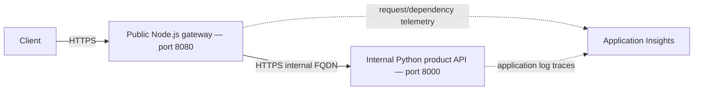

# Микроуслуги с две услуги — Azure Container Apps

**Ниво:** Средно · **Време:** 45–60 минути, включително настройка

Този учебен пример реализира **Node.js API Gateway** и **Python Product Service само за четене**. Включени са изходният код, Dockerfiles, Bicep и конфигурацията на azd.
Това не е система за използване в продукция.


- Използване на вътрешен бекенд FQDN през HTTPS.
- Проверка на отговори при успех, не е намерен, и недостъпна услуга.
- Разбиране на телеметрия и независими граници за скалиране.




Каталогът с продукти съдържа пет фиксирани продукта в паметта. Няма **POST,
PUT или DELETE обработчици**, база данни, Service Bus, услуга за поръчки/потребители/известия,
C# или Go код. Това са идеи за бъдещо развитие, не включени функции.
Входната точка (gateway) не удостоверява потребителите; вътрешният достъп не е заместител
на авторизацията в приложението.

## Предварителни изисквания

Първо завършете [единния Flask API](../../../../../examples/container-app/simple-flask-api).
Инсталирайте текуща стабилна версия на azd (публикуван релийз към момента на преглед: 1.37.2), Azure CLI,
и Docker с активиран демон. Необходим ви е абонамент за Azure, разрешения за създаване на ресурси
и регионален квотен лимит за Container Apps.

```bash
azd version
az version
docker info
azd auth login
az login
```

Използвайте същия абонамент и в двата CLI инструмента. Командите по-долу са за Bash.

## Деплой и проверка

От основната директория на репозитория:

```bash
cd examples/container-app/microservices
azd env new microservices-demo
azd up
GATEWAY_URL=$(azd env get-value API_GATEWAY_URL)
RG_NAME=$(azd env get-value AZURE_RESOURCE_GROUP)
GATEWAY_NAME=$(azd env get-value API_GATEWAY_NAME)
PRODUCT_NAME=$(azd env get-value PRODUCT_SERVICE_NAME)

curl --fail-with-body "${GATEWAY_URL}/health"
curl --fail-with-body "${GATEWAY_URL}/api/products"
curl --fail-with-body "${GATEWAY_URL}/api/products/1"
curl -i "${GATEWAY_URL}/api/products/999"
```

**Успех:** health 200; list 200 с **пет** продукта; продукт 1 е лаптоп
на цена 999.99 с наличност 50; неизвестен продукт връща 404.
Описанията са включени в отговорите; времевите печати варират.

Първоначалното предоставяне използва публични hello-world изображения на порт 80, така че не се опитва
да изтегля несъществуващи изображения от празно хранилище. Специфични за услугата Bicep модули
и параметрични файлове ги заменят с изградени изображения и портове/проби на приложението по време на
`azd deploy`. Основните параметри запазват имената на публикуваните изображения за по-късно предоставяне.

## Услуги и мрежова конфигурация

| Услуга | Изложени крайни точки | По подразбиране ресурси |
|---|---|---|
| Gateway | GET `/`, `/health`, `/api/products`, `/api/products/:id` | 1 vCPU, 2 GiB, 2–20 реплики |
| Product | GET `/`, `/health`, `/products`, `/products/<id>` | 0.5 vCPU, 1 GiB, 1–10 реплики |

Входният достъп за продукта има `external: false` и `allowInsecure: false`. Bicep инжектира
`PRODUCT_SERVICE_URL=https://<actual-internal-fqdn>` в gateway. HTTP щеше
пренасочване; HTTPS съвпада с конфигурирания ingress. Краткото DNS име трябва да съвпада с
**реалното име на Container App**, а не с логическия ключ на услугата `product-service`.
Не се опитвайте да извиквате вътрешния URL директно от вашия лаптоп.

Гейтвеят има таймаут от пет секунди за извиквания на продукта. Липсващи идентификатори на продукт
се предават като 404; транспортни грешки/други грешки във бекенда връщат 503. Гейтвеят
`/health` проверява само гейтвея, а не наличността на бекенда.

## Файлове и конфигурация

```text
azure.yaml
infra/main.bicep
infra/main.parameters.json
infra/abbreviations.json
infra/core/container-apps-environment.bicep
infra/core/monitor.bicep
infra/app/api-gateway.bicep
infra/app/api-gateway.parameters.json
infra/app/product-service.bicep
infra/app/product-service.parameters.json
src/api-gateway/{app.js,package.json,Dockerfile}
src/product-service/{main.py,requirements.txt,Dockerfile}
```

Скалиране, CPU/памет, портове и probe-и се задават в `infra/app/*.bicep`. Променете тези
файлове и изпълнете `azd up`, за да приложите инфраструктурата и да преразположите. В този
пример няма параметър с променлива на средата `GATEWAY_MAX_REPLICAS`.

За промени само в кода:

```bash
azd deploy product-service
azd deploy api-gateway
```

Образът на Node използва Node 22; образът на Python използва Python 3.11. И двата се свързват към
`0.0.0.0`. Ingress/probes използват порт 8080 (гейтвей) и 8000 (продукт) съответно.

## Локално разработване с Docker

Стартирайте от тази примерна директория. Използвайте мрежа, дефинирана от потребителя, **не `localhost`
за връзка от един контейнер към друг**:

```bash
docker network create azd-microservices-demo
docker build -t local-product ./src/product-service
docker build -t local-gateway ./src/api-gateway
docker run -d --name azd-product --network azd-microservices-demo local-product
docker run -d --name azd-gateway --network azd-microservices-demo \
  -p 8080:8080 -e PRODUCT_SERVICE_URL=http://azd-product:8000 local-gateway
curl --fail-with-body http://localhost:8080/api/products
```

Очаквано: пет продукта. HTTP се използва само за тази локална Docker мрежа.

```bash
docker stop azd-product azd-gateway
docker rm azd-product azd-gateway
docker network rm azd-microservices-demo
```

## Мониторинг

```bash
az containerapp logs show --name "$GATEWAY_NAME" --resource-group "$RG_NAME" --follow
# In a separate terminal:
az containerapp logs show --name "$PRODUCT_NAME" --resource-group "$RG_NAME" --tail 100
```

`azd monitor --logs` отваря портал, а не предава поточно логове от терминала.
SDK за Node събира заявки/зависимости на гейтвея. Python `AzureLogHandler`
експортира **лог трасирания**, а не автоматични заявки към Flask, SQL зависимости или пълни
дистрибутирани трасирания. OpenCensus е наследен SDK; препоръчва се Azure Monitor OpenTelemetry
при разширяване на този пример.

В Application Insights Logs генерирайте заявки и инспектирайте:

```kusto
requests
| where timestamp > ago(1h)
| where name contains "products"
| summarize RequestCount=count(), AvgDuration=avg(duration) by bin(timestamp, 5m)
```

За съобщения от Python приложението:

```kusto
traces
| where timestamp > ago(1h)
| where message contains "products"
| project timestamp, message, severityLevel
```

Позволете забавяне при усвояване и вземане на проби; не очаквайте точен брой заявки или
гарантирана латентност. Няма конфигурирани персонализирани аларми или табла.

## Практически упражнения

### Упражнение 1: Модифицирайте каталога

**Изходна точка:** `src/product-service/main.py`.
**Цел:** потвърдете независимо разполагане на услугата.
Променете наличностите на лаптопа от 50 на 49 в фиксирания `products` списък, изпълнете
`azd deploy product-service`, след това заявете `${GATEWAY_URL}/api/products/1`.

**Критерии за успех / решение:** HTTP 200 с `"stock":49`. Възстановете 50 и преразположете.
**Често срещан проблем:** редактиране на гейтвея вместо услугата, която притежава каталога.
Това променя изходните данни, а не постоянна инвентарна база данни.

### Упражнение 2: Потвърдете конфигурацията на репликите

**Изходна точка:** `infra/app/product-service.bicep`.
**Цел:** наблюдавайте инфраструктурна промяна без предположения за автоскалиране.
Променете `minReplicas: 1` на `minReplicas: 2`, изпълнете `azd up`, след което:

```bash
az containerapp show --name "$PRODUCT_NAME" --resource-group "$RG_NAME" \
  --query properties.template.scale -o json
```

**Критерии за успех:** конфигурираният минимум е 2, а максимумът остава 10.
Възстановете минимум 1 и изпълнете `azd up`.
**Често срещан проблем:** самият `azd deploy` не прилага промени в несвързаната споделена
инфраструктура. Не задавайте `maxReplicas` на нула като симулация на грешка.
Това потвърждава конфигурацията, а не е тест за натоварване или гарантиран брой реплики в момента.

### Упражнение 3: Тествайте обработката на недостъпна услуга локално

**Изходна точка:** и двата локални Docker контейнера отгоре работят.
**Цел:** разграничете грешката на бекенда от липсващ продукт.
Спирайте само продукта контейнера:

```bash
docker stop azd-product
curl -i http://localhost:8080/api/products
docker start azd-product
curl --fail-with-body http://localhost:8080/api/products
```

**Критерии за успех:** докато е спрян, гейтвеят връща 503 с
`"error":"Product service unavailable"`; след рестарт списъкът връща 200.
Повторете след кратко забавяне за стартиране ако е необходимо.
**Често срещан проблем:** спирането на гейтвея тества друга грешка (липса на HTTP отговор).

## Разходи и пропуски в продукцията

Минималните реплики по подразбиране държат изчисленията работещи. Регистърът и мониторингът също носят
такси. Няма валидиран фиксиран общ разход от $50/месец: оценете регионален CPU/памет,
часове на реплики, заявки, регистър и съхранение на записи в
[Azure ценови калкулатор](https://azure.microsoft.com/pricing/calculator/).
Изтрийте обучителните ресурси своевременно.

Работата в продукция включва удостоверяване/упълномощаване, ограничени управлявани идентичности,
постоянни данни, валидация на вход/отговор, поддържана инструментализация за наблюдаемост,
тестове за натоварване/грешки, CI/CD, аларми и процедури за възстановяване. Добавянето на поръчкова
услуга, опашка или база данни е отделна задача за изпълнение, не завършено
упражнение или вече налична функция тук.

## Отстраняване на проблеми и почистване

- **Образът не е намерен при първоначално предоставяне:** bootstrap трябва да използва публичния образ;
  проверете настройките по подразбиране на основния параметър на образа и съответствията на модула за разполагане.
- **503 продукти:** проверете логовете на продукта, ревизията на образа и внедрения вътрешен HTTPS URL.
- **404 неочакван път:** продуктният API е само за четене; проверете маршрута, а не липсващ CRUD обработчик.
- **Няма телеметрия:** инспектирайте низовете за връзка по време на изпълнение без да ги излагате
  и позволете забавяне при усвояване. Python таблиците за заявки не се попълват от неговия обработчик на логове.

От тази примерна директория:

```bash
azd down
```

Прегледайте подкани за изтриване и проверете дали специалната ресурсна група е премахната.

[Предишна: Flask API](../../../../../examples/container-app/simple-flask-api) · [Следваща: Приложение за база данни](../../../../../examples/database-app) ·
[AI разработка](../../../docs/chapter-02-ai-development/README.md) ·
[Начало на курса](../../../README.md) · [Съобщете за проблем](https://github.com/microsoft/AZD-for-beginners/issues)

---

<!-- CO-OP TRANSLATOR DISCLAIMER START -->
**Отказ от отговорност**:
Този документ е преведен с помощта на AI преводачески услуга [Co-op Translator](https://github.com/Azure/co-op-translator). Въпреки че се стремим към точност, моля имайте предвид, че автоматизираните преводи могат да съдържат грешки или неточности. Оригиналният документ на неговия роден език трябва да се счита за авторитетен източник. За критична информация се препоръчва професионален човешки превод. Ние не носим отговорност за каквито и да е недоразумения или неправилни тълкувания, произтичащи от използването на този превод.
<!-- CO-OP TRANSLATOR DISCLAIMER END -->