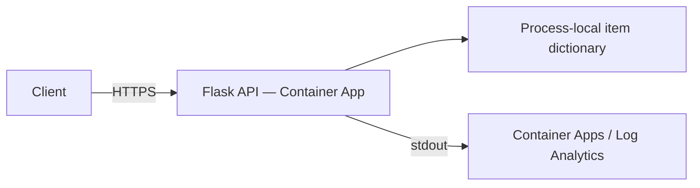

# Прост Flask API — Azure Container Apps

**Ниво:** Начинаещ · **Време:** 30–45 минути включително настройка

Разположете Python Flask CRUD API с Azure Developer CLI (azd). Източник, Dockerfile,
Bicep и параметри за разполагане са включени. Това е **образец за обучение**, а не
API, готов за продукция.

## Какво ще научите

- Създаване и публикуване на контейнер чрез azd.
- Конфигуриране на ingress и проверки за живост/готовност.
- Проверка на CRUD отговори и инспектиране на логове на приложението.
- Разбиране защо данните в паметта не са подходящи за издръжливи приложения.



**Важно:** елементите се държат в един процес. По подразбиране е **един Gunicorn работник,
0–1 реплики**, умишлено избягвайки несъгласувани данни между работници/реплики.
Елементите се губят при рестарт, промяна на версията или скалиране до нула. Увеличаването на репликите
изисква споделено постоянно хранилище. API-то няма удостоверяване или разрешение.

## Предварителни изисквания

- [Текущ стабилен azd](https://learn.microsoft.com/azure/developer/azure-developer-cli/install-azd)
  (публикувано издание по време на прегледа: 1.37.2).
- [Azure CLI](https://learn.microsoft.com/cli/azure/install-azure-cli) за проверка.
- Docker с работещ демон; необходим е за стандартното локално изграждане на образ.
- Абонамент в Azure, разрешения за създаване на ресурси и регионална квота за Container Apps.
- Bash за долните команди (или еквивалентен PowerShell).
- Python 3.11 за опционално локално разработване.

```bash
azd version
az version
docker info
azd auth login
az login
```

CLI инструментите имат отделни сесии за вход. Използвайте същия абонамент и в двата.

## Бърз старт

От корена на хранилището:

```bash
cd examples/container-app/simple-flask-api
azd env new flask-demo
azd up
API_URL=$(azd env get-value API_ENDPOINT)
RG_NAME=$(azd env get-value AZURE_RESOURCE_GROUP)
API_NAME=$(azd env get-value API_NAME)
curl --fail-with-body "${API_URL}/health"
```

Очаквано: HTTP 200 и JSON с `"status":"healthy"`,
`"service":"simple-flask-api"` и текущ времеви печат в UTC.
Проточенето и изграждането на образа обикновено отнемат няколко минути; времето варира.

Първоначалното проточване използва публичен образ hello-world, слушащ на порт 80.
`azure.yaml` избира `infra/app/api.bicep` и съответния му параметричен файл за
разполагане на услугата, който превключва образа, ingress-а и проверките на порт 8000.
Не изтривайте тези параметри за разполагане.

## Проверка на CRUD

Стартирайте следното последователно, докато същата реплика остава активна:

```bash
# Create: HTTP 201; note the returned id (1 for a fresh process).
curl -i -X POST "${API_URL}/api/items" \
  -H "Content-Type: application/json" \
  -d '{"name":"Test Item","description":"My first item"}'

# Read list: HTTP 200, total 1 in a fresh process.
curl --fail-with-body "${API_URL}/api/items"

# Replace 1 if your create response returned another id.
curl --fail-with-body "${API_URL}/api/items/1"
curl -i -X PUT "${API_URL}/api/items/1" \
  -H "Content-Type: application/json" -d '{"name":"Updated Item"}'
curl -i -X DELETE "${API_URL}/api/items/1"
curl -i "${API_URL}/api/items/1"
```

Успех: POST 201, четения/PUT 200, DELETE 204 без тяло, след това липсващ елемент 404.
Неправилно форматиран/не-обект JSON или празно име връщат 400.
Ако елемент изчезне между заявките, проверете за рестарт или скалиране до нула;
това е умишлено ограничение в паметта, не постоянство.

| Крайна точка | Методи |
|---|---|
| `/` | GET — информация за сервиза |
| `/health` | GET — проверки за живост/готовност |
| `/api/items` | GET, POST |
| `/api/items/{id}` | GET, PUT, DELETE |

## Логове и конфигурация

```bash
az containerapp logs show --name "$API_NAME" --resource-group "$RG_NAME" --follow
```

Очаквано: стартиране на Gunicorn, логове за заявки и съобщения на приложението.
`azd monitor --logs` отваря изглед в портал; не изпраща поточно съдържание към терминала.
Application Insights е осигурен, но **не е инструментализиран с този Flask код**;
използвайте Container Apps/Log Analytics за stdout логове.

Редактирайте `infra/app/api.bicep` за CPU/памет, лимити на реплики или правила за мащабиране, след което
стартирайте `azd up`. По подразбиране са 0.5 vCPU, 1 GiB, минимум 0 / максимум 1 реплика и
HTTP праг от 50 едновременни заявки. Скалирането до нула може да добави забавяне при студен старт.

Произволните `azd env set MAX_REPLICAS`, `API_KEY`, `LOG_LEVEL` или
`SCALE_TO_ZERO_TIMEOUT` стойности **не са свързани с този шаблон или приложение**.
Задаването на стойност не го прави автоматично променлива на средата по време на изпълнение.
Образът експлицитно свързва порт 8000; актуализирайте Dockerfile, Bicep ingress и проверките
заедно, ако променяте порта.

## Файлове

```text
azure.yaml
infra/main.bicep
infra/main.parameters.json
infra/app/container-apps.bicep       # Environment, registry, monitoring
infra/app/api.bicep                  # App, ingress, probes, scale settings
infra/app/api.parameters.json        # Image and resource values for azd deploy
src/app.py
src/Dockerfile
src/requirements.txt
```

## Локално разработване

От тази примерна директория:

```bash
python -m venv .venv
source .venv/bin/activate  # PowerShell: .\.venv\Scripts\Activate.ps1
python -m pip install -r src/requirements.txt
python src/app.py
```

В друг терминал тествайте `http://localhost:8000/health` и CRUD крайните точки.
Или изградете и стартирайте действителния образ:

```bash
docker build -t flask-api:local ./src
docker run --rm -p 8000:8000 flask-api:local
```

За промени само в кода след първото разполагане, стартирайте `azd deploy api`.
За Bicep промени, стартирайте `azd up` за повторно проточване и разполагане.

## Практически упражнения

### 1. Валидиране на отхвърляне на входа

**Начална точка:** разположено API, `API_URL` по-горе.
**Цел:** да се провери, че API-то отхвърля невалидни JSON структури и липсващи имена.

```bash
curl -i -X POST "${API_URL}/api/items" \
  -H "Content-Type: application/json" -d '[]'
curl -i -X POST "${API_URL}/api/items" \
  -H "Content-Type: application/json" -d '{"name":""}'
```

**Критерии за успех / решение:** и двете връщат 400 с JSON грешка, а не 500.
**Често срещан проблем:** пропускане на header за JSON съдържание.

### 2. Добавяне на крайна точка само за четене

**Начална точка:** `src/app.py`. **Цел:** разширяване и повторно разполагане на API-то.
Добавете това преди блока `if __name__ == '__main__':`:

```python
@app.route('/version', methods=['GET'])
def version():
    return jsonify({'version': '1.0.0'})
```

Стартирайте `azd deploy api`, след това `curl --fail-with-body "${API_URL}/version"`.
**Критерии за успех:** HTTP 200 и `{"version":"1.0.0"}`.
**Често срещан проблем:** поставяне на маршрута след блокиращото извикване `app.run()` при
тест с `python src/app.py`.

### Проверка на знанията

Защо един работник не е достатъчен за издръжливи данни? Защото дори един процес губи
своя речник при рестарт. Продуктова версия изисква постоянно споделено хранилище,
удостоверяване, разрешение, миграции, тестове и оперативен мониторинг.

## Разходи и отстраняване на проблеми

Това не е гарантирано $0 разполагане: Basic registry и съхранение/приемане на логове
могат да генерират такси дори когато изчислителната мощност на приложението е нула. Използвайте
[калкулатора за цени](https://azure.microsoft.com/pricing/calculator/) за своя регион.

- **Грешка при изграждане на Docker:** потвърдете `docker info`, мрежов достъп и зависимости.
- **Нездравословно приложение:** инспектирайте конзолните/системните логове и проверете порта на образа, ingress-а,
  и проверките за съвпадение. Запълнител не трябва да се проверява на Flask порта.
- **403/разрешения:** потвърдете разрешенията за абонамент и създаване на ресурси.
- **Елементите изчезват:** състоянието в паметта се нулира при рестарт/скалиране до нула; добавете база данни
  за издръжливо поведение.

## Изчистване и следващи стъпки

```bash
azd down
```

Прегледайте подкана за изтриване и потвърдете, че специалната група ресурси е премахната.
Не използвайте разрушително изчистване за група ресурси, съдържаща несвързани данни.

[Следващо: приложение с база данни](../../../../../examples/database-app) · [Микросервизи](../../../../../examples/container-app/microservices) ·
[Преглед на контейнери](../README.md) · [Начална страница на курса](../../../README.md) ·
[Докладвайте проблем](https://github.com/microsoft/AZD-for-beginners/issues)

---

<!-- CO-OP TRANSLATOR DISCLAIMER START -->
**Отказ от отговорност**:
Този документ е преведен с помощта на AI преводачески услуга [Co-op Translator](https://github.com/Azure/co-op-translator). Въпреки че се стремим към точност, моля имайте предвид, че автоматизираните преводи могат да съдържат грешки или неточности. Оригиналният документ на неговия роден език трябва да се счита за авторитетен източник. За критична информация се препоръчва професионален човешки превод. Ние не носим отговорност за каквито и да е недоразумения или неправилни тълкувания, произтичащи от използването на този превод.
<!-- CO-OP TRANSLATOR DISCLAIMER END -->