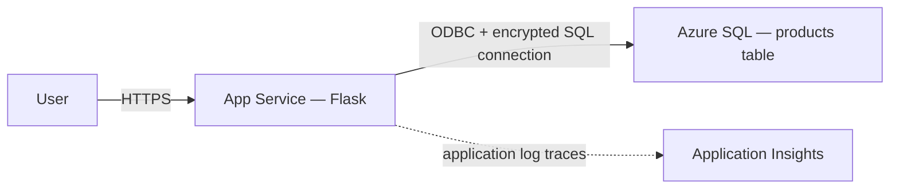

# Flask и Azure SQL на App Service

**Ниво:** Интермедиер · **Време:** 30–60 минути, включително предпоставки

Този пример показва разгръщането на Python Flask API за четене към **Linux App Service** и базова
Azure SQL база данни. Включени са източник, Bicep и конфигурация за azd. Това е
учебно приложение, а не архитектура на база данни готова за продукция.

## Какво ще научите

- Осигуряване на ресурси за App Service, SQL и мониторинг с Bicep.
- Конфигуриране на криптирана SQL връзка без записване на идентификационни данни.
- Инициализиране на схема преди стартирането на Gunicorn работниците.
- Проверка на предварително заредени данни, отговори при ненамерени записи и здравословно състояние на базата.



Ресурси: посветена ресурсна група, B1 Linux App Service план, Python 3.11 Web
App, SQL сървър и базова база данни с 2 ГБ, Application Insights и Log Analytics.
Web приложението използва **source/ZIP разгръщане и инсталация на зависимости чрез Oryx**;
`azd deploy` не компилира или разгъва опционалния Dockerfile.

## Предпоставки

- Текущата стабилна версия на [azd](https://learn.microsoft.com/azure/developer/azure-developer-cli/install-azd)
  (публикуван релийз към момента на преглед: 1.37.2).
- [Azure CLI](https://learn.microsoft.com/cli/azure/install-azure-cli) за проверка.
- Абонамент в Azure, права за създаване на изброените ресурси и регионален лимит.
- Python **3.11** за локална разработка; комитнатият `pyodbc==5.0.1` може да изисква
  native build инструменти на по-нови версии на Python.
- Microsoft ODBC драйвер 18 (или 17) за SQL Server на локални машини. `pip install
  pyodbc` не инсталира системния драйвер. Вижте
  [ODBC инсталация](https://learn.microsoft.com/sql/connect/odbc/download-odbc-driver-for-sql-server).
- Docker само ако тествате опционалния контейнер локално.

```bash
azd version
az version
azd auth login
az login
```

Използвайте същия абонамент и в двата инструмента. Командите по-долу използват Bash.

## Разгръщане

От корена на репозитория:

```bash
cd examples/database-app
azd env new sql-demo
azd provision
azd deploy
WEB_URL=$(azd env get-value WEB_APP_URI)
WEB_NAME=$(azd env get-value WEB_APP_NAME)
RG_NAME=$(azd env get-value AZURE_RESOURCE_GROUP)
```

Изберете поддържан регион. `sqlAdminLogin` по подразбиране е `sqladmin`; необходимият
`sqlAdminPassword` е защитен параметър. Въведете силна парола при подканване.
Не съхранявайте идентификационните данни за разгръщането в Git или в доклади за проблеми. Текущото вмъкване
на низ с връзка очаква парола без делимитери като
`;`; адаптирайте екранните символи, ако използвате такива стойности.

Bicep задава стартова команда, която изпълнява `init_database()` **преди** Gunicorn
работниците да стартират. Това е необходимо, защото импортирането на `app:app` не изпълнява
Python блока `if __name__ == '__main__'`. При нова база данни инициализацията
създава `products` и вмъква пет реда. Това е прост учебен пример, не
конкурентна миграционна система; използвайте правилни миграции преди да разширявате инстанции.

Приложението избира инсталирания Microsoft ODBC драйвер 18, а после 17, ако низът за връзка
не посочва конкретен драйвер. Ако нито един от двата не е наличен, стартирането се проваля с
грешка за необходимостта от инсталиране. Проверете наличието на драйвера в избраната
среда за изпълнение на App Service, вместо да приемате, че е налице.

## Проверка

```bash
curl --fail-with-body "${WEB_URL}/"
curl --fail-with-body "${WEB_URL}/health"
curl --fail-with-body "${WEB_URL}/products"
curl --fail-with-body "${WEB_URL}/products/1"
curl -i "${WEB_URL}/products/999"
```

Очаквано:

- `/` връща информация за крайна точка.
- `/health` връща 200 с `{"status":"healthy","database":"connected"}`.
- `/products` връща пет предварително заредени продукта в нова база данни.
- `/products/1` връща Laptop с цена 1299.99.
- Несъществуващ продукт връща 404 с `{"error":"Product not found"}`.

API-то е само за четене. Няма POST/PUT/DELETE път или потребителски интерфейс в браузъра.
Грешка при връзка към базата връща 503 от `/health`; не е успех.

## Файлове и конфигурация

```text
azure.yaml                         # Python App Service source deployment
infra/main.bicep
infra/main.parameters.json
infra/abbreviations.json
infra/resources/sql-server.bicep
infra/resources/sql-database.bicep
infra/resources/app-service-plan.bicep
infra/resources/web-app.bicep       # Settings + initialization/startup command
infra/resources/app-insights.bicep
src/web/app.py
src/web/requirements.txt
src/web/Dockerfile                 # Optional local container, not the azd target
.env.sample
```

`SQL_CONNECTION_STRING` се предава като защитен параметър в Bicep към модулът на Web App
и се съхранява в настройките на App Service, не в изходни параметри на разгръщането.
`APPLICATIONINSIGHTS_CONNECTION_STRING` конфигурира експорта на логове.
`SCM_DO_BUILD_DURING_DEPLOYMENT=true` активира сървърната инсталация на зависимости.
Задаването на произволни стойности на `azd env` не променя автоматично настройките на приложението.

SQL фаерлуал правилото `0.0.0.0` позволява връзки от **Azure услуги,
включително от абонаменти на други клиенти**, под условие за SQL удостоверяване. То не е
ограничено само до това приложение или абонамент. Публичният мрежов достъп до SQL е включен.
Използвайте ограничени мрежи и идентичност на приложение без администраторски права преди продукция.

## Локална разработка

Използвайте Python 3.11 и инсталиран Microsoft SQL ODBC драйвер:

```bash
python -m venv .venv
source .venv/bin/activate  # PowerShell: .\.venv\Scripts\Activate.ps1
python -m pip install -r src/web/requirements.txt
export SQL_CONNECTION_STRING='Server=tcp:YOUR_SERVER.database.windows.net,1433;Database=YOUR_DATABASE;UID=YOUR_USER;PWD=YOUR_PASSWORD;Encrypt=yes;TrustServerCertificate=no;Connection Timeout=30;'
python src/web/app.py
```

Заменете плейсхолдърите по сигурен начин. Копиран `.env` файл **не се зарежда автоматично**
от това приложение. Вместо това експортирайте променливите във вашата текуща конзола.
За Azure SQL от лаптоп временно разрешете само вашия публичен IP:

```bash
SQL_SERVER=$(azd env get-value SQL_SERVER_NAME)
MY_IP=YOUR_PUBLIC_IP
az sql server firewall-rule create -g "$RG_NAME" -s "$SQL_SERVER" \
  -n AllowMyLearningIP --start-ip-address "$MY_IP" --end-ip-address "$MY_IP"
```

Премахнете правилото след тестване:

```bash
az sql server firewall-rule delete -g "$RG_NAME" -s "$SQL_SERVER" -n AllowMyLearningIP
```

Опционален тест с контейнер от този примерен директория:

```bash
docker build -t sql-flask:local src/web
docker run --rm -p 8000:8000 -e SQL_CONNECTION_STRING sql-flask:local
```

Този образ инсталира драйвер 18 от Debian 12 пакетното хранилище, съответстващо на неговата
Bookworm база, инициализира базата веднъж, след което стартира Gunicorn.

## Мониторинг и отстраняване на проблеми

Активирайте/следете App Service файлови системни логове при диагностика на стартиране:

```bash
az webapp log config --name "$WEB_NAME" --resource-group "$RG_NAME" \
  --application-logging filesystem --level information
az webapp log tail --name "$WEB_NAME" --resource-group "$RG_NAME"
```

Този код експортира приложение на **логи чрез OpenCensus обработчик** от стар тип.
Той не конфигурира автоматично Flask проследяване на заявки/зависимости, Live Metrics,
SQL одит, диагностични настройки или известия. Това се настройва отделно.
За нова инструментализация предпочитайте Azure Monitor OpenTelemetry.

В Application Insights Logs, след изпращане на API заявки:

```kusto
traces
| where timestamp > ago(1h)
| where message contains "products" or message contains "Health check"
| project timestamp, message, severityLevel
```

Позволете забавяне в приема. Активността в таблица със заявки или Live Metrics не
е критерий за завършване при тази само за логове инструментализация.

- **Липсващ драйвер:** проверете `pyodbc.drivers()` във времето за изпълнение и инсталирайте
  поддържан Microsoft ODBC драйвер. Самостоятелен Python пакет не е достатъчен.
- **Грешка при връзка:** проверете SQL настройките, идентификационните данни, фаерлуала и избрания
  абонамент. Не изключвайте криптиране заобикаляйки грешка.
- **Липсваща таблица продукти:** потвърдете, че Bicep стартовата команда е разположена;
  стартирането само на `gunicorn app:app` пропуска инициализацията.
- **Грешка при изграждане на пакет:** използвайте Python 3.11 или налични native prerequisites.
- **Данни с нулева цена:** нулата е валидна децимална цена; трябва да се сериализира като 0.0,
  не като `null`.

## Практически упражнения

### Упражнение 1: Проверете поведението при липсващ продукт

**Начална точка:** разположено API и `WEB_URL` по-горе.
**Цел:** различете липсващ ред от счупена база данни.
Изпратете заявки към `/health` и `/products/999` с посочените по-горе команди.
**Успешен резултат/отговор:** здравословно състояние 200, несъществуващ продукт 404 (не 500 или 503).
**Често срещан проблем:** приемане, че отговорът not-found доказва, че SQL връзката е счупена.

### Упражнение 2: Променете предварително заредена стойност

**Начална точка:** Azure SQL Query Editor, свързан със примерната база.
**Цел:** покажете, че данните от API се съхраняват в SQL, а не в паметта на процеса.

```sql
UPDATE products SET price = 0 WHERE id = 1;
SELECT id, name, price FROM products WHERE id = 1;
```

Изпратете заявка към `${WEB_URL}/products/1`. **Успешен резултат:** цената е `0.0`, не `null`.
Възстановете стойността:

```sql
UPDATE products SET price = 1299.99 WHERE id = 1;
```

**Често срещан проблем:** редактирането на Python seed списъка не обновява вече вмъкнати редове в SQL.
Не изпълнявайте упражнения върху схема/данни върху продукционна база данни.

### Упражнение 3: Добавете само за четене крайна точка за брой

**Начална точка:** `src/web/app.py`.
**Цел:** разширете API-то с агрегатна заявка без параметри.
Добавете това преди блока `if __name__ == '__main__':`:

```python
@app.route('/product-count')
def product_count():
    from contextlib import closing
    with closing(get_db_connection()) as conn, closing(conn.cursor()) as cursor:
        cursor.execute("SELECT COUNT(*) FROM products")
        return jsonify({'count': cursor.fetchone()[0]})
```

Стартирайте `azd deploy web`, след което изпратете заявка към `${WEB_URL}/product-count`.
**Успешен резултат:** 200 с `{"count":5}` върху ненасегнатата seed база.
**Често срещан проблем:** промяна на рут, но забравяне за ново разгръщане.
За продукция добавете обработка на грешки/тестове; това кратко упражнение е фокусирано върху заявката.

## Разходи, пропуски за продукция и почистване

B1 App Service и базата данни Basic се таксуват, докато са осигурени. Спирането на
Web App **не** спира таксуването на App Service плана. Логовете и съхранението могат да добавят разходи.
Използвайте [Azure ценови калкулатор](https://azure.microsoft.com/pricing/calculator/)
за актуалните регионални цени. Превключването към F1 изисква и изключване на `alwaysOn`;
не е просто едноредова замяна. SQL serverless не е автоматично безплатен.

Продукционната работа включва идентичност на приложение с минимални права (не SQL администратор),
удостоверяване/авторизация, частна мрежа, безопасни миграции, преглед на връзки/цикъл на живот,
телеметрия, одит, известия, тестове и процедури за възстановяване.
Redis кеширане и допълнителни таблици са идеи за развитие, не реализирани упражнения.

От тази примерна директория:

```bash
azd down
```

Прегледайте подкана за изтриване и проверете, че посветената ресурсна група е премахната.
Не изтривайте групи съдържащи нерелевантни данни.

[Примери с контейнери](../../../../examples/container-app) ·
[Разработка на AI](../../docs/chapter-02-ai-development/README.md) ·
[Начална страница на курса](../../README.md) · [Докладвайте проблем](https://github.com/microsoft/AZD-for-beginners/issues)

---

<!-- CO-OP TRANSLATOR DISCLAIMER START -->
**Отказ от отговорност**:
Този документ е преведен с помощта на AI преводачески услуга [Co-op Translator](https://github.com/Azure/co-op-translator). Въпреки че се стремим към точност, моля имайте предвид, че автоматизираните преводи могат да съдържат грешки или неточности. Оригиналният документ на неговия роден език трябва да се счита за авторитетен източник. За критична информация се препоръчва професионален човешки превод. Ние не носим отговорност за каквито и да е недоразумения или неправилни тълкувания, произтичащи от използването на този превод.
<!-- CO-OP TRANSLATOR DISCLAIMER END -->