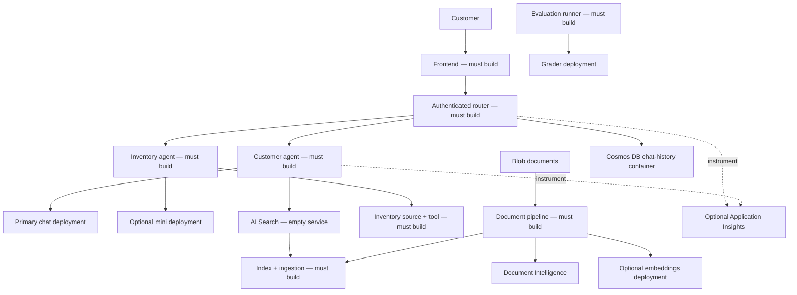

# Многоагентна клиентска поддръжка — Архитектурен план за търговия на дребно

**Глава 5: Многоагентни AI решения**

- [Начална страница на курса](../README.md)
- [Глава 5](../docs/chapter-05-multi-agent/README.md)
- [Изискване: интеграция с AI](../docs/chapter-02-ai-development/microsoft-foundry-integration.md)
- [Следващо: Планиране на капацитета](../docs/chapter-06-pre-deployment/capacity-planning.md)
- [ARM инфраструктурен скелет](retail-multiagent-arm-template/README.md)

> **Архитектурно ръководство, а не работещо приложение.** Единствените файлове за реализация в търговията на дребно
> са `azuredeploy.json`, `azuredeploy.parameters.json` и `deploy.sh` във
> `retail-multiagent-arm-template/`. Контейнерите за рутер/фронтенд са плейсхолдъри на hello-world.
> Няма локално съществуващ търговски агент, UI, поточен процес за въвеждане, оценител, скенер или
> тестов набор за приложение.

## Обзор

**Цел:** да се проектира система за клиентска поддръжка с клиентски агент и агент за инвентар,
да се идентифицира какво предоставя инфраструктурата, и да се планират липсващите
договори и верификация на приложението.

**Аудитория:** разработчици, които са завършили локалния
[чат пример](../../../examples/azure-openai-chat) и [пример с два сервизни контейнера](../../../examples/container-app/microservices).
Отделете 2–3 часа за архитектурно изучаване. Изграждането на приложението е отделен
проект: 80–120 часа разработка е илюстративна оценка за планиране за
опитни разработчици, **не е обещание за доставка**; продукционното укрепване, тестовете,
прегледът на сигурността и експлоатацията изискват допълнителна работа.

### Учебни резултати

- Обяснение на маршрутизация, заземяване, разрешения за инструменти и собственост върху разговора.
- Различаване на идентификатори на модели, имена на разполагания, версии на API и версии на ARM.
- Проектиране на въвеждане и извличане на документи с съвпадащи размерности на векторите.
- Дефиниране на проверими функционални, оценителни и изисквания за възстановяване при грешки.
- Отделяне на опционалните архитектурни цели от ресурсите, които наистина са предоставени.

## Архитектура на решението



Това е **целевата архитектура на приложението**, а не диаграма на работещи агенти
услуги. ARM скелетът създава само подлежащите услуги и два плейсхолдър контейнера.
Front Door, регистър, управлявани идентичности, назначаване на роли,
частни крайни точки, аварийно превключване, инструментариум за приложението и предупреждения не са включени.

### Отговорности и договори

| Компонент | Задължително поведение | Доказателства преди да се счита за завършен |
|---|---|---|
| Фронтенд | Автентикация на потребители, рендиране на чат, безопасно качване на документи | UI и тестове за качване, достъпни грешки |
| Рутер | Оторизация на заявки, избор на агент, ограничени повиквания/таймаути на инструменти | Тестове за маршрутизация, проверки за оторизация, тестове за грешки |
| Клиентски агент | Заземяване на отговори на политики/продукти в одобрени източници | Коректни цитати, въздържание при липса на данни |
| Инвентарен инструмент | Четене на авторитетен запас с обхванати разрешения | Детерминистични тестове за наличност; без измислена наличност |
| Поток за документи | Извличане, разбиване, вграждане, индексиране, актуализиране/изтриване | Индексирани фикстури и поведение при нов опит/мъртво писмо |
| Съхранение на разговори | Изолиране на потребителите, прилагане на запазване | Тестове за оторизация между потребители и TTL |
| Изпълнител на оценки | Сравняване на изходи с истината и рубриката | Покритие, броене на неуспехи, възпроизводими доклади |

Помислете за рутера като рецепция, а инструментите като ограничени вътрешни системи:
изборът на специалист не е разрешение за достъп до всички записи на клиента.
Налагайте идентичност и разрешения в кода на приложението и услугите за данни, не в подсказките.

## Инфраструктура срещу приложение

Прочетете [README на скелета](retail-multiagent-arm-template/README.md) преди
осигуряването. Той изброява точните ресурси, режими, разходи и ограничения.

| Логическо използване | Име на ARM разполагане | Модел / версия | По подразбиране регион |
|---|---|---|---|
| Клиентски чат | `gpt-4.1-chat` | `gpt-4.1` / `2025-04-14` | `eastus2` |
| Инвентаризация | `gpt-4.1-mini-inventory` | `gpt-4.1-mini` / `2025-04-14` | `westus2`, по избор |
| Вграждания | `text-embedding-ada-002` | `text-embedding-ada-002` / `2` | `francecentral`, по избор |
| Оценка | `gpt-4.1-grader` | `gpt-4.1` / `2025-04-14` | По подразбиране първичен регион |

Проверявайте наличността на модел/версия/SKU и квота в **всеки регион**. За чат/мини/оценител
използвайте `GlobalStandard`; за вграждания — `Standard`. Съпоставките единици капацитет към TPM са
специфични за модела. Не добавяйте различни единици капацитет като универсална гаранция за квота.

Аргументът `model` на заявка към Azure OpenAI е **името на разполагането**, не
задължително идентификатор на модела в каталога. Версия на API за данни `2024-10-21`
се различава от версията на модел `2025-04-14` и ARM ресурса `apiVersion`.
Не може да се поправи недостъпен модел само чрез смяна на версията на API за данни.

`--no-multi-region` пропуска вторичните и акаунтите за вграждания. Основният чат и
независимият акаунт за оценител остават. Отделните акаунти за модели не осигуряват автоматично
аварийно превключване; за това са нужни маршрутизация на приложението, съвместими разполагания, проверки на здравето,
лимити на повторни опити и преглед на местоположението на данните.

## Пътна карта за реализация

### 1. Започнете с едно тествано взаимодействие

Преди осигуряването на големия скелет, използвайте локалния чат пример за установяване
на свързаност с инференция. Определете един представителен клиентски въпрос, одобрения
източник на отговор, очакван цитат и поведение при грешка, когато този източник липсва.

### 2. Определяне на маршрутизацията и границите на инструментите

Създайте собствен източник за рутер, манифест на зависимости, Dockerfile и тестове. Илюстративен
договор може да е `POST /chat` с `{"message":"...","conversation_id":"..."}`.
**Тази крайна точка е дизайн предложение; тя не е реализирана от ARM шаблона.**

Валидирайте типове/лимити на тялото, извеждайте идентичността на потребителя от автентикацията, налагайте
собственост върху разговора, прилагайте таймаути на заявките и връщайте смислени кодове за грешка.
Не третирайте HTTP неуспехи или празни отговори като успешни резултати на агента.

### 3. Реализирайте заземяване и въвеждане

ARM шаблонът не създава индекс за търсене. Това е **референтен JSON
фрагмент за адаптиране във вашата собствена дефиниция на индекс**, а не файл, вече в хранилището:

```json
{
  "name": "retail-product-index",
  "fields": [
    {"name": "id", "type": "Edm.String", "key": true},
    {"name": "title", "type": "Edm.String", "searchable": true},
    {"name": "content", "type": "Edm.String", "searchable": true},
    {"name": "category", "type": "Edm.String", "filterable": true},
    {
      "name": "content_vector",
      "type": "Collection(Edm.Single)",
      "searchable": true,
      "dimensions": 1536,
      "vectorSearchProfile": "retail-profile"
    }
  ],
  "vectorSearch": {
    "algorithms": [{"name": "retail-hnsw", "kind": "hnsw"}],
    "profiles": [{"name": "retail-profile", "algorithm": "retail-hnsw"}]
  }
}
```

Профилът свързва векторното поле с неговия алгоритъм. Измеренията трябва да съвпадат с
реалния изход на вграждането (1536 за това `ada-002` разполагане). За Python извличане
използвайте `azure.search.documents.models.VectorizedQuery` вместо непълен
речник, който няма вид на векторно запитване:

```python
# Reference function only: supply an authenticated async SearchClient and an embedding.
from azure.search.documents.models import VectorizedQuery

async def retrieve(search_client, embedding):
    results = await search_client.search(
        search_text=None,
        vector_queries=[VectorizedQuery(
            vector=embedding,
            k_nearest_neighbors=5,
            fields="content_vector"
        )],
        select=["id", "title", "content"]
    )
    return [document async for document in results]
```

Създайте отделна реализация за въвеждане, която:

1. Авторизира достъп за качване и валидира типа и размера на съдържанието.
2. Чете частни блобове чрез автентикирани SDK извиквания. Частен URL на блоб сам по себе си
   **не** е четлив вход към Document Intelligence; изпращайте изтеглените байтове с
   `AnalyzeDocumentRequest(bytes_source=...)` или използвайте подходящо обхванат,
   краткотраен SAS след преглеждане на изискванията за достъп.
3. Извлича текст, разделя го на части, за да отговаря на ограниченията за вграждане, и генерира вграждания.
4. Създава стабилни валидни ключове за документи и качва части с отговарящи вектори.
5. Проверява резултатите от индексирането по документи, обработва повторни опити и актуализира/изтрива остарели данни.

Не вмъквайте произволни потребителски ключове/стойности в OData филтрите. Позволявайте само определени полета,
валидирайте типовете на стойностите и екранирайте кавичките в стринговете. Булевите и числови филтри изискват
типизирани литерали, а не сключени стрингове.

### 4. Уеб заземяване

**Bing Search v7 бе спрян на 11 август 2025 г.** Старият `Microsoft.Bing/accounts`
ресурс и `api.bing.microsoft.com/v7.0/search` примери не са поддържан
път за изпълнение. Оценете текущо поддържана интеграция за заземяване в
Microsoft Foundry и неговото SDK, разрешения, таксуване и изисквания за цитиране;
тук няма имплементация. Той не е директен заместител на спряната крайна точка.

### 5. Добавете телеметрия и оценка

Създаването на Application Insights не инструментализира кода. Използвайте поддържаната Azure Monitor
OpenTelemetry инструментализация при изграждане на ново приложение, предавайте контекст на проследяване
между услугите и избягвайте логване на заявки от потребители, документи или тайни.
Отрязването на заявка **не** я анонимизира.

Измервайте продължителността на заявките, грешки в маршрутизирането/инструментите, релевантност на връщането, коректност на цитиране,
използване на токени и въздържание. Съхранявайте факти за инвентар/политика за истинността
заедно със случаите за оценка: преглеждащият не може надеждно да определи фактическата точност
само от въпрос и отговор.

Разгръщането на преглеждащ не е изпълнител на оценки. Имплементирайте версиониран рубрик,
структурирано изходно/валидиране на схема, проверки на обхвата на оценките, брой повреди при трансфера
и случаи с човешки преглед. Докладвайте непълни/грешни случаи отделно; не ги превръщайте
в успешни оценки или безшумно ги включвайте като отговори с нулево качество.

По същия начин няколко проверки на ключови думи не са сертификат за сигурност. Провалена HTTP
заявка, липсваща тестова стратегия или празен отговор трябва да направят теста **неубедителен или
провален**, а не да дават оценка „100% сигурен“. Провеждайте разрешено тестване с подходящи
инструменти и човешки преглед преди всяко твърдение за готовност за продукция.

### 6. Разгръщайте вашето приложение

Създайте собствени директории за изходен код, манифести, тестове, регистър и разрешения за изтегляне на образи.
Заменете заместителите с изградените образи и актуализирайте ingress/probes,
за да съответстват на порта за слушане на всяко приложение. Конфигурирайте променливи на средата за изпълнение в Bicep
или експлицитна поддържана azd средова карта.

Няма общ речник `config` под услуга azd, който автоматично
създава променливи на средата за изпълнение. `azd env set` променя само ресурси, които
изрично използват тези стойности. Няма реализиран канареечен, списък с региони или персонализиран хук
в тази конструкция.

## Практически упражнения по проектиране

Това са **упражнения по архитектура**, а не претенции за изпълним стартов код за търговски приложения.

### Упражнение 1: Проверка на границата

**Начална точка:** трите файла в `retail-multiagent-arm-template/`.
**Цел:** разграничаване на предоставянето от функционалността на приложението.
Отворете `azuredeploy.json`, намерете и двете контейнерни изображения и `targetPort` стойности,
след което изброете липсващите компоненти на приложението в хранилището.

**Критерии за успех / отговор:** и двете изображения са плейсхолдъри hello-world, слушащи
на порт 80; агенти, чат UI, рутер хендлъри, индекс/въвеждане, оценител и скенер
отсъстват. Успешна заявка към плейсхолдър root не валидира `/chat`.
**Често срещан проблем:** тълкуване на имена на ресурси като `retail-router` като работещ код.

### Упражнение 2: Проследяване на конфигурацията на вектора

**Начална точка:** индекс JSON по-горе.
**Цел:** разбиране на връзката поле → профил → алгоритъм.
Определете кои стойности трябва да се променят при превключване към модел за вграждане с
различна изходна размерност, след което разгледайте функцията `retrieve`.

**Критерии за успех / отговор:** променете поле `dimensions` на действителната дължина на вектора;
поддържайте `vectorSearchProfile` съгласуван с деклариран профил и неговия алгоритъм;
заявката `fields` трябва да посочва името на векторното поле. Прегенерирайте съществуващи
векторни документи при промяна на модела за вграждане.
**Често срещан проблем:** промяна само на името на модела, като се запазват несъвместими вектори.

### Упражнение 3: Дефиниране на тест за неуспех

**Начална точка:** таблица с отговорности.
**Цел:** предотвратяване на фалшив успех.
Опишете очакваното поведение при недостъпен API за инвентар, индекс за търсене без
съвпадащи документи и заявка за оценка, връщаща HTTP 503.

**Критерии за успех / отговор:** без измислени стойности за инвентар; изрично въздържане или
ескалиране при липса на контекст; оценката докладва транспортна грешка, а не преминаване по качество или сигурност.
Добавете изпълними тестове при изграждане на приложението.
**Често срещан проблем:** улавяне на всяко изключение и продължаване с празен отговор.

## Разходи, отстраняване на проблеми и почистване

- Инфраструктурата носи текущи разходи дори при празни индекси за търсене и плейсхолдър
  приложения. Използвайте актуалните цени за регионите; нито „минимален“, нито мултирегионален означава безплатен.
- Разходите за токени зависят от модела, кеширания/некеширания вход, изхода и SKU на разгръщане.
  Рутингът може да спести пари само ако измерената работна натовареност и качествени резултати го оправдават;
  фиксирани спестявания от 60–80% не са гарантирани.
- Проверявайте наличността на модела и квотите преди предоставяне; разграничете грешки в разрешения,
  име на инсталация, регион, версия на модела и версия на API.
- Не изпълнявайте липсващи `setup-data.sh`, evaluator CLI-та или `pytest tests/` команди.
  Техните реализации са част от вашата листа за разработка.
- Конструкцията е само за ARM: следвайте
  [инструкциите за проверка и почистване](retail-multiagent-arm-template/README.md).
  `azd down` не управлява тези ресурси.

## Свързани ресурси

- [Работещ локален чат пример](../../../examples/azure-openai-chat)
- [Работещ двусервисен контейнерен пример](../../../examples/container-app/microservices)
- [Индекси за търсене на AI вектори](https://learn.microsoft.com/azure/search/vector-search-how-to-create-index)
- [Документация за Container Apps](https://learn.microsoft.com/azure/container-apps/)
- [Отстраняване на проблеми](../docs/chapter-07-troubleshooting/common-issues.md)
- [Докладвайте проблем](https://github.com/microsoft/AZD-for-beginners/issues)

---

<!-- CO-OP TRANSLATOR DISCLAIMER START -->
**Отказ от отговорност**:
Този документ е преведен с помощта на AI преводачески услуга [Co-op Translator](https://github.com/Azure/co-op-translator). Въпреки че се стремим към точност, моля имайте предвид, че автоматизираните преводи могат да съдържат грешки или неточности. Оригиналният документ на неговия роден език трябва да се счита за авторитетен източник. За критична информация се препоръчва професионален човешки превод. Ние не носим отговорност за каквито и да е недоразумения или неправилни тълкувания, произтичащи от използването на този превод.
<!-- CO-OP TRANSLATOR DISCLAIMER END -->