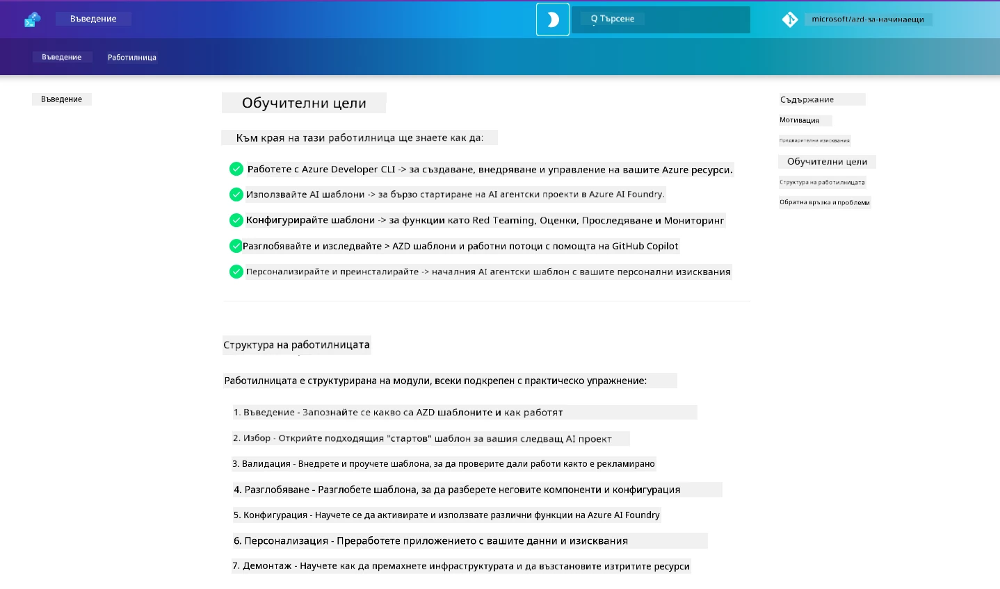

<div align="center">
  <div style="background: linear-gradient(135deg, #0078d4, #106ebe); border-radius: 10px; padding: 20px; margin: 20px 0; box-shadow: 0 4px 15px rgba(0, 120, 212, 0.3); border: 2px solid #005a9e;">
    <h2 style="color: white; margin: 0; font-size: 24px; text-shadow: 1px 1px 2px rgba(0,0,0,0.3);">
      🎯 Работилница AZD за разработчици на ИИ
    </h2>
    <p style="color: white; margin: 10px 0 0 0; font-size: 16px; text-shadow: 1px 1px 2px rgba(0,0,0,0.3);">
      <strong>Практическа работилница за създаване на ИИ приложения с Azure Developer CLI.</strong><br>
      Завършете 7 модула, за да овладеете AZD шаблони и работни процеси за внедряване на ИИ.
    </p>
    <div style="margin-top: 15px;">
      <span style="background: rgba(255,255,255,0.2); padding: 5px 10px; border-radius: 15px; color: white; font-size: 14px;">
        📅 Преглед на източника: ноември 2026
      </span>
    </div>
  </div>
</div>

# Работилница AZD за разработчици на ИИ

Добре дошли в практическата работилница за изучаване на Azure Developer CLI (AZD) с фокус върху внедряването на ИИ приложения. Тази работилница ви помага да придобиете приложни познания за AZD шаблони в 3 стъпки:

1. **Откриване** - намерете шаблона, който е подходящ за вас.
1. **Внедряване** - внедрете и потвърдете, че работи
1. **Персонализиране** - модифицирайте и итерайте, за да го направите свой!

През цялата работилница ще бъдете запознати и с основни инструменти и работни процеси за разработчици, които да помогнат да улесните пълния процес на разработка.

<br/>

## Ръководство в браузъра

Уроците от работилницата са в Markdown. Можете да ги разглеждате директно в GitHub - или да стартирате браузърно предварително визуализиране, както е показано на снимката по-долу.



За да използвате тази опция - форкнете хранилището във вашия профил и стартирайте GitHub Codespaces. След като терминалът на VS Code е активен, напишете тази команда:

Тази браузърна визуализация работи в GitHub Codespaces, в контейнери за разработка или локално копие с инсталирани Python и MkDocs.

```bash title="" linenums="0"
python -m pip install -r requirements-dev.txt
python -m mkdocs serve --config-file workshop/mkdocs.yml
```

Стартирайте тези команди от **корена на хранилището с курса**, не от отделно инициирания AI пример. Поддържайте визуализацията на преден план, за да са видими грешките; прекратете с Ctrl+C. За да проверите сайта без да го сервирайте, изпълнете `python -m mkdocs build --strict --config-file workshop/mkdocs.yml`.

След няколко секунди ще видите изскачащ диалог. Изберете опцията `Open in browser`. Базираната в уеб ръководство сега ще се отвори в нов раздел на браузъра. Някои предимства на тази визуализация:

1. **Вградена търсачка** - бързо намиране на ключови думи или уроци.
1. **Икона за копиране** - задръжте курсора върху кодови блокове, за да видите тази опция
1. **Превключване на тема** - смяна между тъмна и светла тема
1. **Получете помощ** - кликнете върху иконата на Discord във футъра, за да се присъедините!

<br/>

## Преглед на работилницата

**Продължителност:** 3-4 часа  
**Ниво:** Начинаещ до средно ниво  
**Предварителни изисквания:** Запознаване с Azure, концепции за ИИ, VS Code и инструменти за команден ред.

Това е практическа работилница, където се учите чрез практика. След като завършите упражненията, препоръчваме да прегледате учебната програма AZD For Beginners, за да продължите обучението си по най-добри практики в областта на сигурността и производителността.

| Време| Модул  | Цел |
|:---|:---|:---|
| 15 мин | [Увод](docs/instructions/0-Introduction.md) | Определяне на сцената, разбиране на целите |
| 30 мин | [Избор на AI шаблон](docs/instructions/1-Select-AI-Template.md) | Разглеждане на опции и избор на начален шаблон | 
| 30 мин | [Валидиране на AI шаблон](docs/instructions/2-Validate-AI-Template.md) | Внедряване на стандартно решение в Azure |
| 30 мин | [Разглобяване на AI шаблон](docs/instructions/3-Deconstruct-AI-Template.md) | Изследване на структурата и конфигурацията |
| 30 мин | [Конфигуриране на AI шаблон](docs/instructions/4-Configure-AI-Template.md) | Активиране и тестване на налични функции |
| 30 мин | [Персонализиране на AI шаблон](docs/instructions/5-Customize-AI-Template.md) | Адаптиране на шаблона към вашите нужди |
| 30 мин | [Демонтаж на инфраструктура](docs/instructions/6-Teardown-Infrastructure.md) | Почистете и освободете ресурсите |
| 15 мин | [Обобщение и следващи стъпки](docs/instructions/7-Wrap-up.md) | Ресурси за обучение, предизвикателство на работилницата |

<br/>

## Какво ще научите

Помислете за AZD шаблона като учебна площадка за изследване на различни възможности и инструменти за цялостна разработка на Microsoft Foundry. В края на тази работилница би трябвало да имате интуитивно разбиране за различни инструменти и концепции в този контекст.

| Концепция  | Цел |
|:---|:---|
| **Azure Developer CLI** | Разбиране на команди и работни процеси на инструмента|
| **AZD шаблони**| Разбиране на структурата на проекти и конфигурации|
| **Azure AI Agent**| Проектиране и внедряване на проект Microsoft Foundry  |
| **Azure AI Search**| Активиране на контекстно моделиране с агенти |
| **Наблюдаемост**| Изследване на трасировка, мониторинг и оценки |
| **Red Teaming**| Изследване на противник тестване и мерки срещу уязвимости |

<br/>

## Структура на работилницата

Работилницата е структурирана като ви води през път от откриване на шаблон, през внедряване, разглобяване и персонализиране - използвайки официалния началния шаблон [Getting Started with AI Agents](https://github.com/Azure-Samples/get-started-with-ai-agents) като основа.

### [Модул 1: Избор на AI шаблон](docs/instructions/1-Select-AI-Template.md) (30 мин)

- Какво са AI шаблоните?
- Къде мога да намеря AI шаблони?
- Как мога да започна да строя AI агенти?
- **Лаборатория**: Бърз старт в Codespaces или в контейнер за разработка

### [Модул 2: Валидиране на AI шаблон](docs/instructions/2-Validate-AI-Template.md) (30 мин)

- Каква е архитектурата на AI шаблона?
- Какъв е работният процес за разработка с AZD?
- Как мога да получа помощ при разработка с AZD?
- **Лаборатория**: Внедряване и валидиране на шаблон за AI агенти

### [Модул 3: Разглобяване на AI шаблон](docs/instructions/3-Deconstruct-AI-Template.md) (30 мин)

- Изследвайте средата си с `.azure/` 
- Изследвайте вашата ресурсна настройка с `infra/` 
- Изследвайте вашата AZD конфигурация в `azure.yaml`s
- **Лаборатория**: Модифициране на променливи на средата и повторно внедряване

### [Модул 4: Конфигуриране на AI шаблон](docs/instructions/4-Configure-AI-Template.md) (30 мин)
- Изследвайте: Retrieval Augmented Generation
- Изследвайте: Оценка на агенти и Red Teaming
- Изследвайте: Трасировка и мониторинг
- **Лаборатория**: Изследвайте AI агент + наблюдаемост

### [Модул 5: Персонализиране на AI шаблон](docs/instructions/5-Customize-AI-Template.md) (30 мин)
- Определете: PRD с изисквания за сценария
- Конфигурирайте: Променливи на средата за AZD
- Прилагайте: Hook-ове за жизнения цикъл за допълнителни задачи
- **Лаборатория**: Персонализирайте шаблона за моя сценарий

### [Модул 6: Демонтаж на инфраструктура](docs/instructions/6-Teardown-Infrastructure.md) (30 мин)
- Обобщение: Какво са AZD шаблони?
- Обобщение: Защо да използваме Azure Developer CLI?
- Следващи стъпки: Изпробвайте друг шаблон!
- **Лаборатория**: Демонтирайте инфраструктурата и почистете

<br/>

## Предизвикателство в работилницата

Искате ли да се предизвикате да направите повече? Ето някои предложения за проекти - или споделете идеите си с нас!!

| Проект | Описание |
|:---|:---|
|1. **Разглобяване на сложен AI шаблон** | Използвайте работния процес и инструментите, които описахме, и вижте дали можете да внедрите, валидирате и персонализирате различен шаблон за AI решения. _Какво научихте?_|
|2. **Персонализиране според вашия сценарий**  | Опитайте да напишете PRD (Документ за продуктовите изисквания) за друг сценарий. След това използвайте GitHub Copilot в хранилището на шаблона в Agent Model - и го помолете да генерира персонализиран работен процес за вас. _Какво научихте? Как бихте могли да подобрите тези предложения?_|
| | |

## Имате обратна връзка?

1. Публикувайте проблем в това хранилище - маркирайте го с `Workshop` за удобство.
1. Присъединете се към Microsoft Foundry Discord - свържете се с колеги!


| | | 
|:---|:---|
| **📚 Начало на курса**| [AZD For Beginners](../README.md)|
| **📖 Документация** | [Започнете с AI шаблоните](https://learn.microsoft.com/en-us/azure/ai-foundry/how-to/develop/ai-template-get-started)|
| **🛠️ AI шаблони** | [Шаблони Microsoft Foundry](https://ai.azure.com/templates) |
|**🚀 Следващи стъпки** | [Започнете работилницата](#workshop-overview) |
| | |

<br/>

---

**Навигация:** [Основен курс](../README.md) | [Увод](docs/instructions/0-Introduction.md) | [Модул 1: Избор на шаблон](docs/instructions/1-Select-AI-Template.md)

**Готови ли сте да започнете да създавате ИИ приложения с AZD?**

[Започнете работилницата: Увод →](docs/instructions/0-Introduction.md)

---

<!-- CO-OP TRANSLATOR DISCLAIMER START -->
**Отказ от отговорност**:
Този документ е преведен с помощта на AI преводачески услуга [Co-op Translator](https://github.com/Azure/co-op-translator). Въпреки че се стремим към точност, моля имайте предвид, че автоматизираните преводи могат да съдържат грешки или неточности. Оригиналният документ на неговия роден език трябва да се счита за авторитетен източник. За критична информация се препоръчва професионален човешки превод. Ние не носим отговорност за каквито и да е недоразумения или неправилни тълкувания, произтичащи от използването на този превод.
<!-- CO-OP TRANSLATOR DISCLAIMER END -->