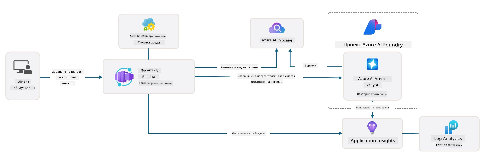

# 3. Деконструиране на шаблон

!!! tip "КЪМ КРАЯ НА ТОЗИ МОДУЛ ЩЕ МОЖЕТЕ ДА"

    - [ ] Use GitHub Copilot and optional MCP tools for Azure documentation and read-only exploration
    - [ ] Identify the template's application, infrastructure, configuration, and test entry points
    - [ ] Verify generated explanations against actual repository files
    - [ ] **Lab 3:** Trace one request and one configuration input through the project

---

## 1. Активиране на GitHub Copilot

Отворете инициализирания AI пример във VS Code и активирайте [GitHub Copilot](https://code.visualstudio.com/docs/copilot/chat/chat-agent-mode). Влезте с акаунт, който има валиден план; лимитите за използване варират. Помолете Copilot да обясни хранилището преди да разрешите промени.

### Незадължителни MCP сървъри

Тези услуги могат да предоставят допълнителни инструменти:

- [Azure MCP Server](https://learn.microsoft.com/azure/developer/azure-mcp-server/overview)
- [Microsoft Learn MCP Server](https://learn.microsoft.com/training/support/mcp)

Във VS Code прегледайте [MCP конфигурационното ръководство](https://code.visualstudio.com/docs/copilot/chat/mcp-servers) и създайте `.vscode/mcp.json`, ако е необходимо:

```json
{
  "servers": {
    "Azure MCP Server": {
      "type": "stdio",
      "command": "npx",
      "args": ["-y", "@azure/mcp@latest", "server", "start"]
    },
    "microsoft.docs.mcp": {
      "type": "http",
      "url": "https://learn.microsoft.com/api/mcp"
    }
  }
}
```

Командата `npx` изисква поддържана инсталация на Node.js/npm и изтегля изпълним код. Прегледайте пакета и фиксирайте одобрена версия за възпроизводима екипна конфигурация. Стартирайте сървърите с контролите за MCP в VS Code и разгледайте наличните им инструменти; имената могат да се променят между версиите.

**Автентикацията е отделна.** Използвайте `azd auth login` за AZD. Следвайте документирания поток на автентикация на Azure MCP за неговите инструменти; само влизане в AZD не установява MCP сесия. Използвайте `az login` отделно, когато упражнение или Hook извиква Azure CLI.

Опитайте заявки само за четене:

1. “Използвай Microsoft Learn MCP, за да намериш документацията за конфигурация на Azure Developer CLI.”
2. “Обясни `azure.yaml` на това хранилище; цитирай файловете, които имплементират всеки Hook.”
3. “Използвай наличните Azure MCP инструменти, за да изброиш разположените ми ресурси без да правиш промени.”

Проверявайте избрания тенант/абонамент и всяко предложено извикване на инструмент. Не одобрявайте създаване, изтриване или промени в достъпа на ресурси само за разглеждане на архитектурата.

## 2. Разберете архитектурата

Примерът хоства Python FastAPI бекенд и React/TypeScript фронтенд в Azure Container Apps. Бекендът комуникира с агент в Microsoft Foundry проект. Извличането и наблюдаемостта зависят от активираните функции на шаблона и успешната настройка; те не са гарантирани само защото приложението е разположено.



Сравнете тази диаграма с [актуалното ръководство за разгръщане](https://github.com/Azure-Samples/get-started-with-ai-agents/blob/main/docs/deployment.md) и реалните си ресурси. Проверете конфигурираното разгръщане на модела, агенти, управлявана идентичност, роли и незадължителни Azure Search/Application Insights ресурси.

**Упражнение:** Помолете Copilot да проследи заявка за чат от фронтенда през API до Foundry с препратки към файлове и функции. Отворете тези препратки и проверете обяснението. Не правете изводи за имплементирана автентикация, маршрутизиране или авторизация само по диаграма.

## 3. Структура на хранилището

Следните избрани пътища бяха проверени спрямо примера на 4 ноември 2026 г. Вашата инициализирана ревизия остава източник на истината:

```text
get-started-with-ai-agents/
  azure.yaml
  docker-compose.yaml
  requirements-dev.txt
  .devcontainer/
  infra/
    main.bicep
    main.parameters.json
    api.bicep
    core/
  src/
    Dockerfile
    pyproject.toml
    requirements.txt
    api/
      main.py
      routes.py
      search_index_manager.py
    frontend/
      package.json
      src/
    files/
  scripts/
    validate_env_vars.sh
    validate_env_vars.ps1
    postdeploy.sh
    postdeploy.ps1
  tests/
    test_evaluation.py
    test_red_teaming.py
  docs/
    deployment.md
    deploy_customization.md
    ai_search.md
    observability.md
    local_development.md
    troubleshooting.md
```

### Инфраструктура и конфигурация

`infra/main.bicep` оркестрира ресурсите; `main.parameters.json` свързва входовете на шаблона с AZD стойностите на средата. `azure.yaml` избира услугата на приложението и жизнения цикъл на Hook-овете. Проследете вход като `USE_AZURE_AI_SEARCH_SERVICE` през тези файлове, за да откриете какво всъщност се променя.

### Приложение и идентичност

Четете `src/api/` и `src/frontend/` заедно. Идентифицирайте къде агентът се създава или извлича, къде се конфигурират инструкции/инструменти и коя идентичност използва всяко Azure повикване. Примерните файлове под `src/files/` са демонстрационни данни, не продуктов каталог или модел на авторизация.

### Тестове и наблюдаемост

Текущите точки за оценка и red-teaming са под `tests/`; по-старите справки `evals/` и `airedteaming/` са остарели за този пример. Четете `docs/observability.md` за предварителни условия и разходи преди да стартирате облачни тестове. Тези Python тестове са отделни от незадължителното `azure.ai.evaluations` AZD разширение.

## 4. Потвърдете своите открития

- Идентифицирайте API маршрута, взаимодействието с агента и кода за извличане за един примерен въпрос.
- Обяснете коя идентичност достъпва Foundry и коя конфигурация избира неговия краен адрес.
- Намерете действителните pre-up и post-deploy скриптове и поведението им при обработка на грешки.
- Изброете всички зависимости или незадължителни функции, които липсват във вашето разгръщане.

Продължете към [Конфигуриране на шаблон](4-Configure-AI-Template.md).

---

<!-- CO-OP TRANSLATOR DISCLAIMER START -->
**Отказ от отговорност**:
Този документ е преведен с помощта на AI преводачески услуга [Co-op Translator](https://github.com/Azure/co-op-translator). Въпреки че се стремим към точност, моля имайте предвид, че автоматизираните преводи могат да съдържат грешки или неточности. Оригиналният документ на неговия роден език трябва да се счита за авторитетен източник. За критична информация се препоръчва професионален човешки превод. Ние не носим отговорност за каквито и да е недоразумения или неправилни тълкувания, произтичащи от използването на този превод.
<!-- CO-OP TRANSLATOR DISCLAIMER END -->