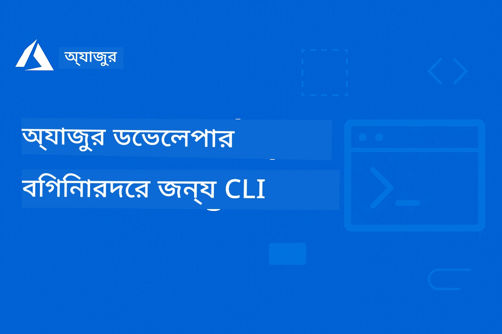

# এজেড ফর বিগিনার্স: একটি সংগঠিত শেখার অভিযান

 

[](https://github.com/microsoft/AZD-for-beginners)
[](https://GitHub.com/microsoft/azd-for-beginners/network/)
[](https://github.com/microsoft/AZD-for-beginners)

[](https://discord.com/invite/nkVh3dp)
[](https://discord.gg/nTYy5BXMWG)

---

### স্বয়ংক্রিয় অনুবাদ (সর্বদা হালনাগাদ)

<!-- CO-OP TRANSLATOR LANGUAGES TABLE START -->
[Arabic](../ar/README.md) | [Bengali](./README.md) | [Bulgarian](../bg/README.md) | [Burmese (Myanmar)](../my/README.md) | [Chinese (Simplified)](../zh-CN/README.md) | [Chinese (Traditional, Hong Kong)](../zh-HK/README.md) | [Chinese (Traditional, Macau)](../zh-MO/README.md) | [Chinese (Traditional, Taiwan)](../zh-TW/README.md) | [Croatian](../hr/README.md) | [Czech](../cs/README.md) | [Danish](../da/README.md) | [Dutch](../nl/README.md) | [Estonian](../et/README.md) | [Finnish](../fi/README.md) | [French](../fr/README.md) | [German](../de/README.md) | [Greek](../el/README.md) | [Hebrew](../he/README.md) | [Hindi](../hi/README.md) | [Hungarian](../hu/README.md) | [Indonesian](../id/README.md) | [Italian](../it/README.md) | [Japanese](../ja/README.md) | [Kannada](../kn/README.md) | [Khmer](../km/README.md) | [Korean](../ko/README.md) | [Lithuanian](../lt/README.md) | [Malay](../ms/README.md) | [Malayalam](../ml/README.md) | [Manipuri (Meitei Mayek)](../mni/README.md) | [Marathi](../mr/README.md) | [Nepali](../ne/README.md) | [Nigerian Pidgin](../pcm/README.md) | [Norwegian](../no/README.md) | [Persian (Farsi)](../fa/README.md) | [Polish](../pl/README.md) | [Portuguese (Brazil)](../pt-BR/README.md) | [Portuguese (Portugal)](../pt-PT/README.md) | [Punjabi (Gurmukhi)](../pa/README.md) | [Romanian](../ro/README.md) | [Russian](../ru/README.md) | [Serbian (Cyrillic)](../sr/README.md) | [Slovak](../sk/README.md) | [Slovenian](../sl/README.md) | [Spanish](../es/README.md) | [Swahili](../sw/README.md) | [Swedish](../sv/README.md) | [Tagalog (Filipino)](../tl/README.md) | [Tamil](../ta/README.md) | [Telugu](../te/README.md) | [Thai](../th/README.md) | [Turkish](../tr/README.md) | [Ukrainian](../uk/README.md) | [Urdu](../ur/README.md) | [Vietnamese](../vi/README.md)

> **স্থানীয়ভাবে ক্লোন করতে চান?**
>
> এই রেপোজিটরিতে ৫০টির বেশি ভাষার অনুবাদ রয়েছে যা ডাউনলোডের আকার উল্লেখযোগ্যভাবে বাড়িয়ে দেয়। অনুবাদ ছাড়া ক্লোন করতে sparse checkout ব্যবহার করুন:
>
> **Bash / macOS / Linux:**
> ```bash
> git clone --filter=blob:none --sparse https://github.com/microsoft/AZD-for-beginners.git
> cd AZD-for-beginners
> git sparse-checkout set --no-cone '/*' '!translations' '!translated_images'
> ```
>
> **CMD (Windows):**
> ```cmd
> git clone --filter=blob:none --sparse https://github.com/microsoft/AZD-for-beginners.git
> cd AZD-for-beginners
> git sparse-checkout set --no-cone "/*" "!translations" "!translated_images"
> ```
>
> এটি আপনাকে কোর্স সম্পন্ন করার জন্য প্রয়োজনীয় সমস্ত কিছু দেয় দ্রুততর ডাউনলোডের সাথে।
<!-- CO-OP TRANSLATOR LANGUAGES TABLE END -->

## 🆕 আজকের azd-তে কী নতুন

> 📌 **AI CLI রিলিজ পর্যালোচনা (2026-11-04):** গাইডেন্স প্রকাশিত **`azd 1.37.2`**, **agents `1.0.0-beta.23`**, এবং **evaluations `1.0.0-beta.2`** ডকুমেন্টেশন/সোর্সের বিরুদ্ধে যাচাই করা হয়েছে। সম্মিলিত ওয়ার্কফ্লোর জন্য `azd >= 1.37.0` ব্যবহার করুন। এক্সটেনশনের আগে `azd version` এবং [কোর CLI আপডেট করুন](https://learn.microsoft.com/azure/developer/azure-developer-cli/install-azd)। দেখুন [রিলিজ পরিবর্তন এবং ফিক্স](docs/chapter-08-production/production-ai-practices.md#recent-release-changes-and-fixes)। এটি সম্পূর্ণ কোর্সের সরাসরি পরীক্ষামূলক ডেপ্লয়মেন্ট নয়।

Azure Developer CLI বিভিন্ন অ্যাপ্লিকেশন টাইপ, যেমন ওয়েব অ্যাপ, APIs, এবং AI এজেন্ট সমর্থন করে, সমর্থিত হোস্ট, টেমপ্লেট, এবং এক্সটেনশনের মাধ্যমে।

এর মানে আপনার জন্য:

- **AI এজেন্ট এখন প্রথম শ্রেণীর azd ওয়ার্কলোড।** আপনি একই `azd init` → `azd up` ওয়ার্কফ্লো ব্যবহার করে AI এজেন্ট প্রজেক্ট ইনিশিয়ালাইজ, ডিপ্লয় এবং ম্যানেজ করতে পারবেন যেটি আপনি ইতিমধ্যেই জানেন।
- **দুটি এক্সটেনশনের মধ্যে একটি এজেন্ট লাইফসাইকেল।** এজেন্ট ইনিশিয়ালাইজ, ইনভোক, অপটিমাইজ এবং রিটায়ার করার জন্য `azure.ai.agents` ব্যবহার করুন।  **`azure.ai.evaluations`** আলাদাভাবে ইনস্টল করুন `azd ai eval init`, `generate`, এবং `run start` এর জন্য। এজেন্ট beta.22 পুরানো ইভ্যালুয়েশন ওয়ার্কফ্লো প্রতিস্থাপন করেছে এবং অপটিমাইজেশন কনফিগারেশন পরিবর্তন করেছে; [মাইগ্রেশন গাইড](docs/chapter-08-production/production-ai-practices.md#evaluation-migration-and-quality-checks) অনুসরণ করুন।
- **আরও AI বিল্ডিং ব্লক।** নতুন প্রিভিউ এক্সটেনশনসমূহ—`azure.ai.skills` এবং `azure.ai.connections`—আপনাকে পুনঃব্যবহারযোগ্য এজেন্ট স্কিল এবং ফাউন্ড্রি সংযোগ সরাসরি azd দিয়ে পরিচালনা করতে দেয়।
- **Microsoft Foundry ইন্টিগ্রেশন** মডেল ডিপ্লয়মেন্ট, এজেন্ট হোস্টিং, এবং AI সার্ভিস কনফিগারেশন সরাসরি azd টেমপ্লেট ইকোসিস্টেমে নিয়ে আসে।
- **দৈনন্দিন কাজ আরও মসৃণ।** সাম্প্রতিক রিলিজগুলো `azd init` কে আইডেম্পোটেন্ট (পুনরায় চালানো নিরাপদ), `azd auth login` স্বয়ংক্রিয়ভাবে পুরানো টোকেন পরিষ্কার করতে সক্ষম করেছে এবং বন্ধুত্বপূর্ণ `azd tool` প্রথমবার চালানোর সেটআপ প্রম্পট যোগ করেছে।
- **কোর ওয়ার্কফ্লো বদলী হয়নি।** আপনি একটি টুডো অ্যাপ, একটি মাইক্রোসার্ভিস, অথবা একটি মাল্টি-এজেন্ট AI সলিউশন ডিপ্লয় করুক, কমান্ডগুলো একই।

> **Aspire ব্যবহারকারীদের জন্য নোট:** Microsoft এখন পণ্যটিকে একেবারে **Aspire** (প্রাক্তন ".NET Aspire") নামে উল্লেখ করে। azd এর Aspire সহযোগিতা অপরিবর্তিত—শুধুমাত্র নাম আপডেট হয়েছে।

আপনি আগেও azd ব্যবহার করে থাকলে, AI সমর্থন একটি স্বাভাবিক এক্সটেনশন—একটি আলাদা টুল বা উন্নত ট্র্যাক নয়। আপনি যদি নতুন করে শুরু করেন, আপনি একটি ওয়ার্কফ্লো শিখবেন যা সবকিছুর জন্য কাজ করে।

---

## 🚀 Azure Developer CLI (azd) কী?

**Azure Developer CLI (azd)** একটি ডেভেলপার-বান্ধব কমান্ড-লাইন টুল যা অ্যাপ্লিকেশনগুলোকে Azure-এ সহজেই ডিপ্লয় করার সুযোগ দেয়। অনেকে Azure রিসোর্স নিজে নিজে তৈরি করে সংযুক্ত করার বদলে, আপনি একক কমান্ড দিয়ে পুরো অ্যাপ্লিকেশন ডিপ্লয় করতে পারেন।

### `azd up` এর জাদু

```bash
# This single command does everything:
# ✅ Creates all Azure resources  
# ✅ Configures networking and security
# ✅ Builds your application code
# ✅ Deploys to Azure
# ✅ Gives you a working URL
azd up
```

টেমপ্লেট অ্যাপ্লিকেশন এবং অবকাঠামো কনফিগারেশন সরবরাহ করে। সফল ডিপ্লয়মেন্টের জন্য যথাযথ সাপোর্টেড সার্ভিস/মডেল, পর্যাপ্ত কোটা ও অনুমতি, সঠিক ইনপুট, এবং ডিপ্লয়কৃত অ্যাপ্লিকেশন যাচাই প্রয়োজন। `azd up` স্বয়ংক্রিয়ভাবে টেমপ্লেটকে নিরাপদ, সম্মতিপূর্ণ, বা প্রোডাকশন-রেডি করে না।

---

## ❓ Azure Developer CLI বনাম Azure CLI: পার্থক্য কী?

এটি শুরু করার সময় সবচেয়ে সাধারণ প্রশ্ন। সহজ উত্তর এখানে:

| বৈশিষ্ট্য | **Azure CLI (`az`)** | **Azure Developer CLI (`azd`)** |
|---------|---------------------|--------------------------------|
| **উদ্দেশ্য** | পৃথক Azure রিসোর্স পরিচালনা | সম্পূর্ণ অ্যাপ্লিকেশন ডিপ্লয় করা |
| **মানসিকতা** | অবকাঠামো-কেন্দ্রিক | অ্যাপ্লিকেশন-কেন্দ্রিক |
| **উদাহরণ** | `az webapp create --name myapp...` | `azd up` |
| **শেখার বক্ররেখা** | Azure সার্ভিস জানাতে হবে | শুধু আপনার অ্যাপ্লিকেশন জানতে হবে |
| **সর্বোত্তম ব্যবহারকারীরা** | DevOps, অবকাঠামো | ডেভেলপার, প্রোটোটাইপিং |

### সহজ উপমা

- **Azure CLI** হলো ঘর তৈরি করার সব সরঞ্জাম থাকার মতো - হাতুড়ি, করাত, পেরেক। আপনি যেকোনো কিছু বানাতে পারবেন, কিন্তু নির্মাণ জানতেই হবে।
- **Azure Developer CLI** হলো একজন ঠিকাদার নিয়োগ করার মতো - আপনি যা চান তা বর্ণনা করবেন এবং তারা নির্মাণ সামলাবে।

### কখন কোনটি ব্যবহার করবেন

| পরিস্থিতি | এটি ব্যবহার করুন |
|----------|----------|
| "আমি দ্রুত আমার ওয়েব অ্যাপ ডিপ্লয় করতে চাই" | `azd up` |
| "আমি শুধু একটি স্টোরেজ অ্যাকাউন্ট তৈরি করতে চাই" | `az storage account create` |
| "আমি একটি সম্পূর্ণ AI অ্যাপ্লিকেশন তৈরি করছি" | `azd init --template azure-search-openai-demo` |
| "আমি একটি নির্দিষ্ট Azure রিসোর্স ডিবাগ করতে চাই" | `az resource show` |
| "আমি আমার কনফিগার করা প্রোডাকশন পরিবেশে ডেপ্লয় করতে চাই" | কনফিগারেশন, এক্সেস, খরচ, এবং অপারেশনাল গেটগুলো পর্যালোচনা করুন এর আগে `azd up --environment production` |

### তারা একসাথে কাজ করে!

AZD এবং Azure CLI এর আলাদা প্রমাণীকরণ এবং কনফিগারেশন রয়েছে। AZD এর জন্য `azd auth login` ব্যবহার করুন, এবং যখন হুক বা ডায়াগনস্টিক কমান্ড স্পষ্টত Azure CLI প্রয়োজন তখন `az login` ব্যবহার করুন। আপনি উভয়ই ব্যবহার করতে পারেন:
```bash
# Deploy your app with AZD
azd up

# Then fine-tune specific resources with Azure CLI
az webapp config set --name myapp --always-on true
```

---

## 🌟 অসাধারণ AZD-তে টেমপ্লেট খুঁজুন

শূন্য থেকে শুরু করবেন না! **অসাধারণ AZD** হলো প্রস্তুত-ডেপ্লয় টেমপ্লেটের কমিউনিটি সংগ্রহ:

| রিসোর্স | বর্ণনা |
|----------|-------------|
| 🔗 [**অসাধারণ AZD গ্যালারি**](https://azure.github.io/awesome-azd/) | এক-ক্লিক ডেপ্লয়ের জন্য ২০০+ টেমপ্লেট ব্রাউজ করুন |
| 🔗 [**একটি টেমপ্লেট জমা দিন**](https://github.com/Azure/awesome-azd/issues) | কমিউনিটিতে আপনার নিজস্ব টেমপ্লেট দিন |
| 🔗 [**গিটহাব রিপোজিটরি**](https://github.com/Azure/awesome-azd) | সোর্স স্টার করুন এবং এক্সপ্লোর করুন |

### অসাধারণ AZD থেকে জনপ্রিয় AI টেমপ্লেট

একটি টেমপ্লেট খালি ডিরেক্টরিতে নির্বাচন করুন; নিচের কমান্ডগুলো বিকল্প। শেষের `.` সেই ডিরেক্টরিটি ইনিশিয়ালাইজ করবে।

```bash
# RAG Chat with Microsoft Foundry Models + AI Search
azd init --template azure-search-openai-demo .

# Quick AI Chat Application
azd init --template openai-chat-app-quickstart .

# AI Agents with Foundry Agents
azd init --template get-started-with-ai-agents .
```

---

## 🎯 ৩ ধাপে শুরু করা

শুরু করার আগে, নিশ্চিত করুন আপনার মেশিন ডেপ্লয়ের জন্য প্রস্তুত:

**উইন্ডোজ:**
```powershell
.\validate-setup.ps1
```

**ম্যাকওএস / লিনাক্স:**
```bash
bash ./validate-setup.sh
```

যদি কোন প্রয়োজনীয় চেক ব্যর্থ হয়, প্রথমে সেটা ঠিক করুন এবং তারপর দ্রুত শুরু করুন।

### ধাপ ১: AZD ইনস্টল করুন (২ মিনিট)

**উইন্ডোজ:**
```powershell
winget install microsoft.azd
```

**ম্যাকওএস:**
```bash
brew tap azure/azd && brew install azd
```

**লিনাক্স:**
```bash
curl -fsSL https://aka.ms/install-azd.sh | bash
```

### ধাপ ২: AZD এর জন্য প্রমাণীকরণ করুন

```bash
# Optional if you plan to use Azure CLI commands directly in this course
az login

# Required for AZD workflows
azd auth login
```

আপনি যদি নিশ্চিত না হন কোনটি প্রয়োজন, তাহলে [ইনস্টলেশন এবং সেটআপ](docs/chapter-01-foundation/installation.md#authentication-setup) এ সম্পূর্ণ সেটআপ ফলো করুন।

### ধাপ ৩: আপনার প্রথম অ্যাপ ডেপ্লয় করুন

```bash
# Initialize from a template
azd init --template todo-nodejs-mongo .

# Deploy to Azure (creates everything!)
azd up
```

**🎉 সেটাই!** আপনার অ্যাপ এখন Azure-এ লাইভ।

### সাফাই করুন (ভুলবেন না!)

```bash
# Remove all resources when done experimenting
azd down --force --purge
```

---

## 📚 এই কোর্সটি কীভাবে ব্যবহার করবেন

এই কোর্সটি **ক্রমবর্ধমান শিখন** এর জন্য ডিজাইন করা হয়েছে - যেখানে স্বাচ্ছন্দ্য সেখানে শুরু করুন এবং ধাপে ধাপে এগিয়ে যান:

| আপনার অভিজ্ঞতা | এখানে শুরু করুন |
|-----------------|------------|
| **Azure-এ নতুন** | [অধ্যায় ১: ভিত্তি](#-chapter-1-foundation--quick-start) |
| **Azure জানেন, AZD নতুন** | [অধ্যায় ১: ভিত্তি](#-chapter-1-foundation--quick-start) |
| **AI অ্যাপ ডেপ্লয় করতে চান** | [অধ্যায় ২: AI-ফার্স্ট ডেভেলপমেন্ট](#-chapter-2-ai-first-development-recommended-for-ai-developers) |
| **হ্যান্ডস-অন অনুশীলন চান** | [🎓 ইন্টারেকটিভ ওয়ার্কশপ](workshop/README.md) - ৩-৪ ঘন্টার গাইডেড ল্যাব |
| **প্রোডাকশন প্যাটার্নের প্রয়োজন** | [Chapter 8: Production & Enterprise](#-chapter-8-production--enterprise-patterns) |

### দ্রুত সেটআপ

1. **এই রিপোজিটরি ফর্ক করুন**: [](https://GitHub.com/microsoft/azd-for-beginners/fork)
2. **ক্লোন করুন**: `git clone https://github.com/YOUR-USERNAME/azd-for-beginners.git`
3. **সাহায্য নিন**: [Azure Discord Community](https://discord.com/invite/ByRwuEEgH4)

> **লোকালি ক্লোন করতে পছন্দ করেন?**

> এই রিপোজিটরিতে ৫০+ ভাষার অনুবাদ অন্তর্ভুক্ত রয়েছে যা ডাউনলোডের মাপে গুরুত্বপূর্ণ বৃদ্ধি ঘটায়। অনুবাদ ছাড়া ক্লোন করতে sparse checkout ব্যবহার করুন:
> ```bash
> git clone --filter=blob:none --sparse https://github.com/microsoft/AZD-for-beginners.git
> cd AZD-for-beginners
> git sparse-checkout set --no-cone '/*' '!translations' '!translated_images'
> ```
> এটি আপনাকে কোর্সটি সম্পূর্ণ করার জন্য প্রয়োজনীয় সকল কিছু প্রদান করে একটি অনেক দ্রুত ডাউনলোডের মাধ্যমে।


## কোর্স ওভারভিউ

স্ট্রাকচার্ড অধ্যায়ের মাধ্যমে Azure Developer CLI (azd)-এর মাস্টার হন যেগুলি পর্যায়ক্রমিক শিক্ষার জন্য ডিজাইন করা হয়েছে। **Microsoft Foundry একত্রীকরণের সাথে AI অ্যাপ্লিকেশন ডিপ্লয়মেন্টে বিশেষ ফোকাস।**

### আধুনিক ডেভেলপারদের জন্য এই কোর্সটি কেন অপরিহার্য

AI ওয়ার্কলোড ডিপ্লয়মেন্ট করা ডেভেলপাররা সাধারণত নিম্নলিখিত বিষয়ে নির্দেশনা প্রয়োজন হয়:
- জটিল মাল্টি-সার্ভিস AI স্থাপত্য
- প্রোডাকশন AI ডিপ্লয়মেন্টের সেরা অনুশীলনসমূহ  
- Azure AI সার্ভিস একত্রীকরণ এবং কনফিগারেশন
- AI ওয়ার্কলোডের জন্য খরচ অপ্টিমাইজেশন
- AI-নির্দিষ্ট ডিপ্লয়মেন্ট সমস্যা সমাধান

### শেখার উদ্দেশ্যসমূহ

এই স্ট্রাকচার্ড কোর্স সম্পন্ন করে, আপনি:
- **AZD মৌলিক বিষয়গুলি আয়ত্ত করবেন**: প্রধান ধারণা, ইনস্টলেশন, এবং কনফিগারেশন
- **AI অ্যাপ্লিকেশন ডিপ্লয় করবেন**: AZD ব্যবহার করে Microsoft Foundry সার্ভিসেস
- **ইনফ্রাস্ট্রাকচার অ্যাজ কোড বাস্তবায়ন করবেন**: Bicep টেমপ্লেটের মাধ্যমে Azure রিসোর্স ম্যানেজ করবেন
- **ডিপ্লয়মেন্টে সমস্যা সমাধান করবেন**: সাধারণ সমস্যাগুলো সমাধান ও ডিবাগ করবেন
- **প্রোডাকশনের জন্য অপ্টিমাইজ করবেন**: নিরাপত্তা, স্কেলিং, মনিটরিং, এবং খরচ ব্যবস্থাপনা
- **মাল্টি-এজেন্ট সলিউশন তৈরি করবেন**: জটিল AI স্থাপত্য ডিপ্লয় করবেন

## শুরু করার আগে: অ্যাকাউন্ট, অ্যাক্সেস, এবং অনুমানসমূহ

অধ্যায় ১ শুরু করার আগে নিশ্চিত করুন আপনার কাছে নিম্নলিখিতগুলি বিদ্যমান। এই গাইডের ইনস্টলেশন ধাপগুলো ধরে নেয় যে এই মৌলিকগুলি ইতিমধ্যে প্রস্তুত।

- **একটি Azure সাবস্ক্রিপশন**: আপনি কাজের একটি বিদ্যমান সাবস্ক্রিপশন বা নিজস্ব অ্যাকাউন্ট ব্যবহার করতে পারেন, অথবা শুরু করতে পারেন একটি [ফ্রি ট্রায়াল](https://aka.ms/azurefreetrial)।
- **Azure রিসোর্স তৈরি করার অনুমতি**: বেশিরভাগ অনুশীলনের জন্য, টার্গেট সাবস্ক্রিপশন বা রিসোর্স গ্রুপে কমপক্ষে **Contributor** অ্যাক্সেস থাকা উচিত। কিছু অধ্যায় অনুমান করে আপনি রিসোর্স গ্রুপ, ম্যানেজড আইডেন্টিটি, এবং RBAC অ্যাসাইনমেন্ট তৈরি করতে পারেন।
- [**একটি GitHub অ্যাকাউন্ট**](https://github.com): রিপোজিটরি ফর্ক করা, নিজের পরিবর্তন ট্র্যাক করা, এবং ওয়ার্কশপের জন্য GitHub Codespaces ব্যবহার করার জন্য এটি উপকারী।
- **টেমপ্লেট রানটাইম প্রয়োজনীয়তাসমূহ**: কিছু টেমপ্লেট স্থানীয় টুলস যেমন Node.js, Python, Java বা Docker এর প্রয়োজন। শুরু করার আগে সেটআপ ভ্যালিডেটর চালিয়ে নিন যাতে অনুপস্থিত টুলস আগে ধরা পড়ে।
- **মৌলিক টার্মিনাল পরিচিতি**: আপনি বিশেষজ্ঞ হতে হবে না, কিন্তু `git clone`, `azd auth login`, এবং `azd up` এর মতো কমান্ড চালাতে আরামদায়ক হওয়া উচিত।

> **এন্টারপ্রাইজ সাবস্ক্রিপশনে কাজ করছেন?**
> যদি আপনার Azure পরিবেশ একটি প্রশাসক দ্বারা পরিচালিত হয়, তাহলে আগে থেকে নিশ্চিত করুন যে আপনি ডিপ্লয় করতে পারবেন সাবস্ক্রিপশন বা রিসোর্স গ্রুপে যা আপনি ব্যবহার করতে যাচ্ছেন। যদি না পারেন, তাহলে শুরু করার আগে স্যান্ডবক্স সাবস্ক্রিপশন অথবা Contributor অ্যাক্সেসের জন্য অনুরোধ করুন।

> **Azure নতুন?**
> নিজের Azure ট্রায়াল বা পে-অ্যাজ-ইউ-গো সাবস্ক্রিপশন থেকে শুরু করুন https://aka.ms/azurefreetrial যাতে অধিকার-মূলক অনুমোদন ছাড়াই অনুশীলন সম্পূর্ণ করতে পারেন।

## 🗺️ কোর্স মানচিত্র: অধ্যায় অনুযায়ী দ্রুত নেভিগেশন

প্রতিটি অধ্যায়ে একটি নিবেদিত README রয়েছে যার মধ্যে শেখার উদ্দেশ্য, দ্রুত শুরু, এবং অনুশীলন রয়েছে:

| অধ্যায় | বিষয় | পাঠ | সময়কাল | জটিলতা |
|---------|-------|---------|----------|------------|
| **[অধ্যায় ১: ভিত্তি](docs/chapter-01-foundation/README.md)** | শুরু করা | [AZD বেসিকস](docs/chapter-01-foundation/azd-basics.md) &#124; [ইনস্টলেশন](docs/chapter-01-foundation/installation.md) &#124; [প্রথম প্রকল্প](docs/chapter-01-foundation/first-project.md) | ৩০-৪৫ মিনিট | ⭐ |
| **[অধ্যায় ২: AI ডেভেলপমেন্ট](docs/chapter-02-ai-development/README.md)** | AI-প্রথম অ্যাপ | [Foundry ইন্টিগ্রেশন](docs/chapter-02-ai-development/microsoft-foundry-integration.md) &#124; [AI এজেন্টস](docs/chapter-02-ai-development/agents.md) &#124; [মডেল ডিপ্লয়মেন্ট](docs/chapter-02-ai-development/ai-model-deployment.md) &#124; [ওয়ার্কশপ](docs/chapter-02-ai-development/ai-workshop-lab.md) | ১-২ ঘণ্টা | ⭐⭐ |
| **[অধ্যায় ৩: কনফিগারেশন](docs/chapter-03-configuration/README.md)** | অথেন্টিকেশন ও নিরাপত্তা | [কনফিগারেশন](docs/chapter-03-configuration/configuration.md) &#124; [অথেন্টিকেশন ও নিরাপত্তা](docs/chapter-03-configuration/authsecurity.md) | ৪৫-৬০ মিনিট | ⭐⭐ |
| **[অধ্যায় ৪: ইনফ্রাস্ট্রাকচার](docs/chapter-04-infrastructure/README.md)** | IaC ও ডিপ্লয়মেন্ট | [ডিপ্লয়মেন্ট গাইড](docs/chapter-04-infrastructure/deployment-guide.md) &#124; [প্রোভিশনিং](docs/chapter-04-infrastructure/provisioning.md) | ১-১.৫ ঘণ্টা | ⭐⭐⭐ |
| **[অধ্যায় ৫: মাল্টি-এজেন্ট](docs/chapter-05-multi-agent/README.md)** | AI এজেন্ট সলিউশন | [রিটেইল পরিস্থিতি](examples/retail-scenario.md) &#124; [কোঅর্ডিনেশন প্যাটার্নস](docs/chapter-06-pre-deployment/coordination-patterns.md) | ২-৩ ঘণ্টা | ⭐⭐⭐⭐ |
| **[অধ্যায় ৬: প্রি-ডিপ্লয়মেন্ট](docs/chapter-06-pre-deployment/README.md)** | পরিকল্পনা ও যাচাই | [প্রিফ্লাইট চেক](docs/chapter-06-pre-deployment/preflight-checks.md) &#124; [ক্যাপাসিটি প্ল্যানিং](docs/chapter-06-pre-deployment/capacity-planning.md) &#124; [SKU নির্বাচন](docs/chapter-06-pre-deployment/sku-selection.md) &#124; [অ্যাপ ইনসাইটস](docs/chapter-06-pre-deployment/application-insights.md) | ১ ঘণ্টা | ⭐⭐ |
| **[অধ্যায় ৭: সমস্যা সমাধান](docs/chapter-07-troubleshooting/README.md)** | ডিবাগ ও ফিক্স | [সাধারণ সমস্যা](docs/chapter-07-troubleshooting/common-issues.md) &#124; [ডিবাগিং](docs/chapter-07-troubleshooting/debugging.md) &#124; [AI সমস্যা](docs/chapter-07-troubleshooting/ai-troubleshooting.md) | ১-১.৫ ঘণ্টা | ⭐⭐ |
| **[অধ্যায় ৮: প্রোডাকশন](docs/chapter-08-production/README.md)** | এন্টারপ্রাইজ প্যাটার্নস | [প্রোডাকশন অনুশীলন](docs/chapter-08-production/production-ai-practices.md) | ২-৩ ঘণ্টা | ⭐⭐⭐⭐ |
| **[🎓 ওয়ার্কশপ](workshop/README.md)** | হ্যান্ডস-অন ল্যাব | [পরিচিতি](workshop/docs/instructions/0-Introduction.md) &#124; [নির্বাচন](workshop/docs/instructions/1-Select-AI-Template.md) &#124; [ভ্যালিডেশন](workshop/docs/instructions/2-Validate-AI-Template.md) &#124; [ডিকন্সট্রাকশন](workshop/docs/instructions/3-Deconstruct-AI-Template.md) &#124; [কনফিগারেশন](workshop/docs/instructions/4-Configure-AI-Template.md) &#124; [কাস্টমাইজেশন](workshop/docs/instructions/5-Customize-AI-Template.md) &#124; [টিয়ারডাউন](workshop/docs/instructions/6-Teardown-Infrastructure.md) &#124; [সমাপ্তি](workshop/docs/instructions/7-Wrap-up.md) | ৩-৪ ঘণ্টা | ⭐⭐ |

**মোট কোর্স সময়কাল:** ~১০-১৪ ঘণ্টা | **দক্ষতা উন্নয়ন:** শুরু থেকে প্রোডাকশন-রেডি পর্যন্ত

---

## 📚 শেখার অধ্যায়সমূহ

*অভিজ্ঞতা স্তর এবং লক্ষ্য অনুযায়ী নিজের শেখার পথ নির্বাচন করুন*

### 🚀 অধ্যায় ১: ভিত্তি ও দ্রুত শুরু
**প্রয়োজনীয়তা**: Azure সাবস্ক্রিপশন, মৌলিক কমান্ড লাইন জ্ঞাণ  
**সময়কাল**: ৩০-৪৫ মিনিট  
**জটিলতা**: ⭐

#### আপনি যা শিখবেন
- Azure Developer CLI এর মৌলিক বিষয়গুলো বোঝা
- আপনার প্ল্যাটফর্মে AZD ইনস্টল করা
- আপনার প্রথম সফল ডিপ্লয়মেন্ট

#### শেখার সংষাধন
- **🎯 এখান থেকে শুরু করুন**: [Azure Developer CLI কি?](#-what-is-azure-developer-cli-azd)
- **📖 তত্ত্ব**: [AZD বেসিকস](docs/chapter-01-foundation/azd-basics.md) - মূল ধারণাসমূহ এবং পরিভাষা
- **⚙️ সেটআপ**: [ইনস্টলেশন ও সেটআপ](docs/chapter-01-foundation/installation.md) - প্ল্যাটফর্ম-নির্দিষ্ট গাইড
- **🛠️ হাতে কলম**: [আপনার প্রথম প্রকল্প](docs/chapter-01-foundation/first-project.md) - ধাপে ধাপে টিউটোরিয়াল
- **📋 দ্রুত রেফারেন্স**: [কমান্ড চিট শীট](resources/cheat-sheet.md)

#### ব্যবহারিক অনুশীলন
```bash
# Quick installation check
azd version

# Deploy your first application
azd init --template todo-nodejs-mongo .
azd up
```

**💡 অধ্যায়ের ফলাফল**: AZD ব্যবহার করে একটি সহজ ওয়েব অ্যাপ্লিকেশন সফলভাবে Azure-এ ডিপ্লয় করুন

**✅ সাফল্যের যাচাইকরণ:**
```bash
# After completing Chapter 1, you should be able to:
azd version              # Shows installed version
azd init --template todo-nodejs-mongo  # Initializes project
azd up                  # Deploys to Azure
azd show                # Displays running app URL
# Application opens in browser and works
azd down --force --purge  # Cleans up resources
```

**📊 সময় ব্যয়:** ৩০-৪৫ মিনিট  
**📈 দক্ষতার স্তর পরবর্তীতে:** গুরুত্বপূর্ণ অ্যাপ্লিকেশন স্বতন্ত্রভাবে ডিপ্লয় করতে সক্ষম

---

### 🤖 অধ্যায় ২: AI-প্রথম উন্নয়ন (AI ডেভেলপারদের জন্য প্রস্তাবিত)
**প্রয়োজনীয়তা**: অধ্যায় ১ সম্পন্ন  
**সময়কাল**: ১-২ ঘণ্টা  
**জটিলতা**: ⭐⭐

#### আপনি যা শিখবেন
- AZD এর সাথে Microsoft Foundry একত্রীকরণ
- AI চালিত অ্যাপ্লিকেশন ডিপ্লয়মেন্ট
- AI সার্ভিস কনফিগারেশন বোঝা

#### শেখার সংষাধন
- **🎯 এখান থেকে শুরু করুন**: [Microsoft Foundry একত্রীকরণ](docs/chapter-02-ai-development/microsoft-foundry-integration.md)
- **🤖 AI এজেন্টস**: [AI এজেন্টস গাইড](docs/chapter-02-ai-development/agents.md) - AZD দিয়ে বুদ্ধিমান এজেন্ট ডিপ্লয় করুন
- **📖 প্যাটার্নস**: [AI মডেল ডিপ্লয়মেন্ট](docs/chapter-02-ai-development/ai-model-deployment.md) - AI মডেল গুলো ডিপ্লয় ও ম্যানেজ করুন
- **🛠️ ওয়ার্কশপ**: [AI ওয়ার্কশপ ল্যাব](docs/chapter-02-ai-development/ai-workshop-lab.md) - আপনার AI সলিউশন AZD-রেডি করুন
- **🎥 ইন্টারেক্টিভ গাইড**: [ওয়ার্কশপ ম্যাটেরিয়ালস](workshop/README.md) - MkDocs * DevContainer পরিবেশসহ ব্রাউজারভিত্তিক শেখা
- **📋 টেমপ্লেটস**: [Microsoft Foundry টেমপ্লেটস](#featured-microsoft-foundry-templates)
- **📝 উদাহরণসমূহ**: [AZD ডিপ্লয়মেন্ট উদাহরণ](examples/README.md)

#### ব্যবহারিক অনুশীলন
```bash
# Deploy your first AI application
azd init --template azure-search-openai-demo .
azd up

# Try additional AI templates
azd init --template openai-chat-app-quickstart .
azd init --template agent-openai-python-prompty .
```

**💡 অধ্যায়ের ফলাফল**: RAG সক্ষমতা সহ একটি AI-চালিত চ্যাট অ্যাপ্লিকেশন ডিপ্লয় ও কনফিগার করুন

**✅ সাফল্যের যাচাইকরণ:**
```bash
# After Chapter 2, you should be able to:
azd init --template azure-search-openai-demo .
azd up
# Test the AI chat interface
# Ask questions and get AI-powered responses with sources
# Verify search integration works
azd monitor  # Check Application Insights shows telemetry
azd down --force --purge
```

**📊 সময় ব্যয়:** ১-২ ঘণ্টা  
**📈 দক্ষতার স্তর পরবর্তীতে:** AI লার্নিং অ্যাপ্লিকেশন ডিপ্লয় করতে ও অতিরিক্ত প্রোডাকশন-রেডিনেস চাহিদা সনাক্ত করতে সক্ষম
**💰 খরচ সচেতনতা:** $80-150/মাস ডেভ খরচ, $300-3500/মাস প্রোডাকশন খরচ বোঝা যাবে

#### 💰 AI ডিপ্লয়মেন্টের জন্য খরচ বিবেচনাসমূহ

**ডেভেলপমেন্ট পরিবেশ (প্রায় $80-150/মাস):**
- Microsoft Foundry মডেলস (পে-অ্যাজ-ইউ-গো): $0-50/মাস (টোকেন ব্যবহার অনুসারে)
- AI সার্চ (বেসিক টিয়ার): $75/মাস
- কন্টেইনার অ্যাপস (কনজাম্পশন): $0-20/মাস
- স্টোরেজ (স্ট্যান্ডার্ড): $1-5/মাস

**প্রোডাকশন পরিবেশ (প্রায় $300-3,500+/মাস):**
- Microsoft Foundry মডেলস (PTU সঙ্গত পারফরম্যান্সের জন্য): $3,000+/মাস অথবা উচ্চ ভলিউম পে-অ্যাজ-ইউ-গো
- AI সার্চ (স্ট্যান্ডার্ড টিয়ার): $250/মাস
- কন্টেইনার অ্যাপস (ডেডিকেটেড): $50-100/মাস
- অ্যাপ্লিকেশন ইনসাইটস: $5-50/মাস
- স্টোরেজ (প্রিমিয়াম): $10-50/মাস

**💡 খরচ অপ্টিমাইজেশন টিপস:**
- মডেল ইনফারেন্স মূল্য এবং অ্যাকাউন্ট-নির্দিষ্ট ক্রেডিট চেক করুন; Azure OpenAI দৈনন্দিন ৫০,০০০ টোকেন ফ্রি এলাউন্স অন্তর্ভুক্ত করে না
- যখন আর কোন দরকার নেই তখন রিসোর্সগুলো মুছে দিতে `azd down` চালান, নির্বাচিত পরিবেশ পর্যালোচনার পরে
- কনজাম্পশন ভিত্তিক বিলিং দিয়ে শুরু করুন, প্রোডাকশনের জন্য PTU-তে আপগ্রেড করুন
- পরিকল্পিত ইনফ্রাস্ট্রাকচার পরিদর্শন করতে `azd provision --preview` ব্যবহার করুন, তারপর Azure প্রাইসিং ক্যালকুলেটর দিয়ে রিসোর্সের মূল্য নির্ধারণ করুন
- অটো-স্কেলিং সক্ষম করুন: প্রকৃত ব্যবহার অনুযায়ী অর্থ প্রদান করুন

**খরচ মনিটরিং:**
```bash
# Inspect planned resources (this does not calculate prices)
azd provision --preview

# Monitor actual costs in Azure Portal
az consumption budget list --resource-group <your-rg>
```

---

### ⚙️ অধ্যায় ৩: কনফিগারেশন ও অথেন্টিকেশন
**প্রয়োজনীয়তা**: অধ্যায় ১ সম্পন্ন  
**সময়কাল**: ৪৫-৬০ মিনিট  
**জটিলতা**: ⭐⭐

#### আপনি যা শিখবেন
- পরিবেশের কনফিগারেশন এবং ব্যবস্থাপনা
- অথেন্টিকেশন ও নিরাপত্তার সেরা অনুশীলনসমূহ
- রিসোর্স নামকরণ ও সংগঠন

#### শেখার সংষাধন
- **📖 কনফিগারেশন**: [কনফিগারেশন গাইড](docs/chapter-03-configuration/configuration.md) - পরিবেশ সেটআপ
- **🔐 নিরাপত্তা**: [অথেন্টিকেশন প্যাটার্ন ও ম্যানেজড আইডেন্টিটি](docs/chapter-03-configuration/authsecurity.md) - অথেন্টিকেশন প্যাটার্নসমূহ
- **📝 উদাহরণ**: [ডাটাবেস অ্যাপ উদাহরণ](examples/database-app/README.md) - AZD ডাটাবেস উদাহরণসমূহ

#### ব্যবহারিক অনুশীলন
- একাধিক পরিবেশ (ডেভ, স্টেজিং, প্রোড) কনফিগার করা
- ম্যানেজড আইডেন্টিটি অথেন্টিকেশন স্থাপন করা
- পরিবেশ-নির্দিষ্ট কনফিগারেশন বাস্তবায়ন করা

**💡 অধ্যায়ের ফলাফল**: সঠিক অথেন্টিকেশন এবং নিরাপত্তার সঙ্গে একাধিক পরিবেশ পরিচালনা করা

---

### 🏗️ অধ্যায় ৪: ইনফ্রাস্ট্রাকচার অ্যাজ কোড ও ডিপ্লয়মেন্ট
**প্রয়োজনীয়তা**: অধ্যায় ১-৩ সম্পন্ন  
**সময়কাল**: ১-১.৫ ঘণ্টা  
**জটিলতা**: ⭐⭐⭐

#### আপনি যা শিখবেন
- উন্নত ডিপ্লয়মেন্ট প্যাটার্নসমূহ
- Bicep ব্যবহার করে ইনফ্রাস্ট্রাকচার অ্যাজ কোড
- রিসোর্স প্রোভিশনিং কৌশলসমূহ

#### শেখার সংষাধন
- **📖 ডিপ্লয়মেন্ট**: [ডিপ্লয়মেন্ট গাইড](docs/chapter-04-infrastructure/deployment-guide.md) - পূর্ণাঙ্গ কার্যপ্রবাহ
- **🏗️ প্রোভিশনিং**: [রিসোর্স প্রোভিশনিং](docs/chapter-04-infrastructure/provisioning.md) - Azure রিসোর্স ব্যবস্থাপনা
- **📝 উদাহরণ**: [কন্টেইনার অ্যাপ উদাহরণ](../../examples/container-app) - কন্টেইনারাইজড ডিপ্লয়মেন্ট

#### ব্যবহারিক অনুশীলন
- কাস্টম Bicep টেমপ্লেট তৈরি করা
- মাল্টি-সার্ভিস অ্যাপ্লিকেশন ডিপ্লয় করা
- ব্লু-গ্রীন ডিপ্লয়মেন্ট কৌশল বাস্তবায়ন

**💡 অধ্যায়ের ফলাফল**: কাস্টম ইনফ্রাস্ট্রাকচার টেমপ্লেট ব্যবহার করে জটিল মাল্টি-সার্ভিস অ্যাপ্লিকেশন ডিপ্লয় করুন

---

### 🎯 অধ্যায় ৫: মাল্টি-এজেন্ট AI সলিউশনস (উন্নত)
**প্রয়োজনীয়তা**: অধ্যায় ১-২ সম্পন্ন  
**সময়কাল**: ২-৩ ঘণ্টা  
**জটিলতা**: ⭐⭐⭐⭐

#### আপনি যা শিখবেন
- মাল্টি-এজেন্ট স্থাপত্য প্যাটার্নস
- এজেন্ট অর্কেস্ট্রেশন ও কোঅর্ডিনেশন
- প্রোডাকশন-রেডি AI ডিপ্লয়মেন্ট

#### শেখার সংষাধন
- **🤖 বৈশিষ্ট্যযুক্ত ডিজাইন**: [রিটেইল মাল্টি-এজেন্ট সলিউশন](examples/retail-scenario.md) - স্থাপত্য ব্লুপ্রিন্ট, পূর্ণাঙ্গ অ্যাপ্লিকেশন নয়
- **🛠️ ARM টেমপ্লেটস**: [ARM Template Package](../../examples/retail-multiagent-arm-template) - ইনফ্রাস্ট্রাকচার স্ক্যাফোল্ড; প্রয়োজনীয়তা এবং অভাবনীয় অ্যাপ্লিকেশন কম্পোনেন্ট পর্যালোচনা করুন
- **📖 আর্কিটেকচার**: [মাল্টি-এজেন্ট সমন্বয় প্যাটার্ন](docs/chapter-06-pre-deployment/coordination-patterns.md) - প্যাটার্নসমূহ

#### ব্যবহারিক অনুশীলন
```bash
# Inspect the retail infrastructure scaffold before choosing to deploy it
cd examples/retail-multiagent-arm-template
cat README.md

# After an intentional deployment, inspect infrastructure state
az deployment group show --resource-group <rg-name> --name <deployment-name>
```

**💡 অধ্যায় ফলাফল**: মাল্টি-এজেন্ট ডিজাইন বুঝুন এবং ইনফ্রাস্ট্রাকচার স্ক্যাফোল্ড ছাড়াও বাস্তবায়ন, যাচাই, এবং অপারেশনাল কাজ সনাক্ত করুন

---

### 🔍 অধ্যায় ৬: প্রি-ডিপ্লয়মেন্ট যাচাই ও পরিকল্পনা
**প্রয়োজনীয়তা**: অধ্যায় ৪ সম্পন্ন  
**সময়কাল**: ১ ঘণ্টা  
**জটিলতা**: ⭐⭐

#### আপনি যা শিখবেন
- ক্ষমতা পরিকল্পনা এবং রিসোর্স যাচাই
- SKU নির্বাচন কৌশল
- প্রি-ফ্লাইট পরীক্ষা ও স্বয়ংক্রিয়তা

#### শেখার উৎস
- **📊 পরিকল্পনা**: [ক্ষমতা পরিকল্পনা](docs/chapter-06-pre-deployment/capacity-planning.md) - রিসোর্স যাচাই
- **💰 নির্বাচন**: [SKU নির্বাচন](docs/chapter-06-pre-deployment/sku-selection.md) - খরচ-সাশ্রয়ী বিকল্প
- **✅ যাচাই**: [প্রি-ফ্লাইট পরীক্ষা](docs/chapter-06-pre-deployment/preflight-checks.md) - স্বয়ংক্রিয় স্ক্রিপ্ট

#### ব্যবহারিক অনুশীলন
- ক্ষমতা যাচাই স্ক্রিপ্ট চালান
- খরচের জন্য SKU নির্বাচন অপ্টিমাইজ করুন
- স্বয়ংক্রিয় প্রি-ডিপ্লয়মেন্ট পরীক্ষা বাস্তবায়ন করুন

**💡 অধ্যায় ফলাফল**: বাস্তবায়নের আগে ডিপ্লয়মেন্ট যাচাই ও অপ্টিমাইজ করুন

---

### 🚨 অধ্যায় ৭: সমস্যা সমাধান ও ডিবাগিং
**প্রয়োজনীয়তা**: যেকোনো ডিপ্লয়মেন্ট অধ্যায় সম্পন্ন  
**সময়কাল**: ১-১.৫ ঘন্টা  
**জটিলতা**: ⭐⭐

#### আপনি যা শিখবেন
- পদ্ধতিগত ডিবাগিং পদ্ধতি
- সাধারণ সমস্যা এবং সমাধান
- AI-নির্দিষ্ট সমস্যা সমাধান

#### শেখার উৎস
- **🔧 সাধারণ সমস্যা**: [সাধারণ সমস্যা](docs/chapter-07-troubleshooting/common-issues.md) - FAQ এবং সমাধান
- **🕵️ ডিবাগিং**: [ডিবাগিং গাইড](docs/chapter-07-troubleshooting/debugging.md) - পর্যায়ক্রমিক কৌশলসমূহ
- **🤖 AI সমস্যা**: [AI-নির্দিষ্ট সমস্যা সমাধান](docs/chapter-07-troubleshooting/ai-troubleshooting.md) - AI সেবা সমস্যা

#### ব্যবহারিক অনুশীলন
- ডিপ্লয়মেন্ট ব্যর্থতা নির্ণয় করুন
- প্রমাণীকরণ সমস্যাগুলো সমাধান করুন
- AI সেবা সংযোগ ডিবাগ করুন

**💡 অধ্যায় ফলাফল**: স্বাধীনভাবে সাধারণ ডিপ্লয়মেন্ট সমস্যা নির্ণয় ও সমাধান করুন

---

### 🏢 অধ্যায় ৮: প্রোডাকশন ও এন্টারপ্রাইজ প্যাটার্ন
**প্রয়োজনীয়তা**: অধ্যায় ১-৪ সম্পন্ন  
**সময়কাল**: ২-৩ ঘন্টা  
**জটিলতা**: ⭐⭐⭐⭐

#### আপনি যা শিখবেন
- প্রোডাকশন ডিপ্লয়মেন্ট কৌশল
- এন্টারপ্রাইজ সিকিউরিটি প্যাটার্ন
- মনিটরিং ও খরচ অপ্টিমাইজেশন

#### শেখার উৎস
- **🏭 প্রোডাকশন**: [প্রোডাকশন AI সেরা অনুশীলন](docs/chapter-08-production/production-ai-practices.md) - এন্টারপ্রাইজ প্যাটার্ন
- **📝 উদাহরণ**: [মাইক্রোসার্ভিস উদাহরণ](../../examples/microservices) - জটিল আর্কিটেকচার
- **📊 মনিটরিং**: [অ্যাপ্লিকেশন ইনসাইটস ইন্টিগ্রেশন](docs/chapter-06-pre-deployment/application-insights.md) - মনিটরিং

#### ব্যবহারিক অনুশীলন
- এন্টারপ্রাইজ সিকিউরিটি প্যাটার্ন বাস্তবায়ন
- পরিপূর্ণ মনিটরিং সেটআপ করুন
- সঠিক শাসনসহ প্রোডাকশনে ডিপ্লয় করুন

**💡 অধ্যায় ফলাফল**: পূর্ণ প্রোডাকশন ক্ষমতাসম্পন্ন এন্টারপ্রাইজ-সামর্থ্যযুক্ত অ্যাপ্লিকেশন ডিপ্লয় করুন

---

## 🎓 কর্মশালা ওভারভিউ: হাতে-কলমে শেখার অভিজ্ঞতা

> **⚠️ কর্মশালা অবস্থা: সক্রিয় উন্নয়ন**  
> কর্মশালা উপকরণ বর্তমানে উন্নয়ন ও পরিমার্জনার অধীনে রয়েছে। মুল মডিউলগুলি কার্যকর, তবে কিছু উন্নত অংশ অসম্পূর্ণ। আমরা সক্রিয়ভাবে সকল বিষয়বস্তু সম্পন্ন করার কাজ করছি। [প্রগতি ট্র্যাক করুন →](workshop/README.md)

### ইন্টারঅ্যাকটিভ কর্মশালা উপকরণ
**ব্রাউজার-ভিত্তিক সরঞ্জাম এবং নির্দেশিত অনুশীলন সহ বিস্তৃত হাতে-কলমে শেখা**

আমাদের কর্মশালা উপকরণ অধ্যায় ভিত্তিক পাঠক্রমের সম্পূরক হিসেবে একটি কাঠামোবদ্ধ, ইন্টারঅ্যাকটিভ শেখার অভিজ্ঞতা প্রদান করে। কর্মশালা স্ব-গতিতে শেখা এবং প্রশিক্ষক-নেতৃত্বাধীন সেশন দুটোর জন্য ডিজাইন করা হয়েছে।

#### 🛠️ কর্মশালা বৈশিষ্ট্য
- **ব্রাউজার-ভিত্তিক ইন্টারফেস**: MkDocs-চালিত সম্পূর্ণ কর্মশালা যা খোঁজা, কপি, এবং থিম বৈশিষ্ট্য সম্বলিত
- **GitHub Codespaces ইন্টিগ্রেশন**: এক-ক্লিক ডেভেলপমেন্ট পরিবেশ সেটআপ
- **কাঠামোবদ্ধ শেখার পথ**: ৮-মডিউল নির্দেশিত অনুশীলন (মোট ৩-৪ ঘন্টা)
- **ক্রমবর্ধমান পদ্ধতি**: পরিচিতি → নির্বাচন → যাচাই → বিভাজন → কনফিগারেশন → অনুকরণ → ক্লিনআপ → সমাপ্তি
- **ইন্টারঅ্যাকটিভ ডেভ::কন্টেইনার পরিবেশ**: পূর্বনির্ধারিত সরঞ্জাম এবং নির্ভরশীলতা

#### 📚 কর্মশালা মডিউল কাঠামো
কর্মশালা অনুসরণ করে একটি **৮-মডিউল প্রগ্রেসিভ পদ্ধতি** যা আপনাকে আবিষ্কার থেকে ডিপ্লয়মেন্ট দক্ষতায় নিয়ে যায়:

| মডিউল | বিষয় | আপনি যা করবেন | সময়কাল |
|--------|-------|----------------|----------|
| **0. পরিচিতি** | কর্মশালা ওভারভিউ | শেখার লক্ষ্য, প্রয়োজনীয়তা, এবং কর্মশালা কাঠামো বুঝুন | ১৫ মিনিট |
| **1. নির্বাচন** | টেমপ্লেট আবিষ্কার | AZD টেমপ্লেট পরীক্ষা করে আপনার পরিস্থিতির জন্য সঠিক AI টেমপ্লেট নির্বাচন করুন | ২০ মিনিট |
| **2. যাচাই** | ডিপ্লয় ও যাচাই | টেমপ্লেট ডিপ্লয় করুন `azd up` দিয়ে এবং ইনফ্রাস্ট্রাকচার কাজ যাচাই করুন | ৩০ মিনিট |
| **3. বিভাজন** | কাঠামো বুঝুন | GitHub Copilot ব্যবহার করে টেমপ্লেট আর্কিটেকচার, Bicep ফাইল এবং কোড সংগঠন অন্বেষণ করুন | ৩০ মিনিট |
| **4. কনফিগারেশন** | azure.yaml গভীর অধ্যয়ন | `azure.yaml` কনফিগারেশন, লাইফসাইকেল হুক এবং পরিবেশ ভেরিয়েবল mastery করুন | ৩০ মিনিট |
| **5. অনুকরণ** | নিজের মতো করুন | AI Search, ট্রেসিং, মূল্যায়ন সক্রিয় করুন এবং আপনার পরিস্থিতির জন্য কাস্টমাইজ করুন | ৪৫ মিনিট |
| **6. ক্লিনআপ** | পরিষ্কার করুন | `azd down --purge` দিয়ে নিরাপদভাবে রিসোর্স ডিপ্রোভিশন করুন | ১৫ মিনিট |
| **7. সমাপ্তি** | পরবর্তী ধাপ | অর্জন পর্যালোচনা, মূল ধারণা, এবং শেখার যাত্রা চালিয়ে যান | ১৫ মিনিট |

**কর্মশালা ধারা:**
```
Introduction → Selection → Validation → Deconstruction → Configuration → Customization → Teardown → Wrap-up
     ↓            ↓           ↓              ↓               ↓              ↓            ↓           ↓
  Overview    Find the     Deploy &      Explore        Master         Customize     Clean up    Review &
             right        verify        code &        azure.yaml      for your      resources   next steps
             template                   structure                     scenario
```

#### 🚀 কর্মশালা শুরু করা
```bash
# Option 1: GitHub Codespaces (Recommended)
# Click "Code" → "Create codespace on main" in the repository

# Option 2: Local Development
git clone https://github.com/microsoft/azd-for-beginners.git
cd azd-for-beginners/workshop
# Follow the setup instructions in workshop/README.md
```

#### 🎯 কর্মশালা শেখার ফলাফল
কর্মশালা সম্পন্ন করার মাধ্যমে, অংশগ্রহণকারীরা:
- **প্রোডাকশন AI অ্যাপ্লিকেশন ডিপ্লয় করবেন**: Microsoft Foundry পরিষেবা সহ AZD ব্যবহার করুন
- **মাল্টি-এজেন্ট আর্কিটেকচার দক্ষ হবেন**: সমন্বিত AI এজেন্ট সমাধান বাস্তবায়ন করুন
- **সিকিউরিটি সেরা অনুশীলন বাস্তবায়ন করুন**: প্রমাণীকরণ এবং অ্যাক্সেস নিয়ন্ত্রণ কনফিগার করুন
- **স্কেলের জন্য অপ্টিমাইজ করুন**: খরচ-সাশ্রয়ী, কার্যকরী ডিপ্লয়মেন্ট ডিজাইন করুন
- **ডিপ্লয়মেন্ট সমস্যা সমাধান করুন**: সাধারণ সমস্যা স্বাধীনভাবে সমাধান করুন

#### 📖 কর্মশালা উৎস
- **🎥 ইন্টারঅ্যাকটিভ গাইড**: [কর্মশালা উপকরণ](workshop/README.md) - ব্রাউজার-ভিত্তিক শেখার পরিবেশ
- **📋 মডিউল-বাই-মডিউল নির্দেশাবলী**:
  - [0. পরিচিতি](workshop/docs/instructions/0-Introduction.md) - কর্মশালা ওভারভিউ এবং লক্ষ্য
  - [1. নির্বাচন](workshop/docs/instructions/1-Select-AI-Template.md) - AI টেমপ্লেট খুঁজুন ও নির্বাচন করুন
  - [2. যাচাই](workshop/docs/instructions/2-Validate-AI-Template.md) - টেমপ্লেট ডিপ্লয় ও যাচাই করুন
  - [3. বিভাজন](workshop/docs/instructions/3-Deconstruct-AI-Template.md) - টেমপ্লেট আর্কিটেকচার অন্বেষণ করুন
  - [4. কনফিগারেশন](workshop/docs/instructions/4-Configure-AI-Template.md) - azure.yaml শিখুন
  - [5. অনুকরণ](workshop/docs/instructions/5-Customize-AI-Template.md) - আপনার পরিস্থিতির জন্য কাস্টমাইজ করুন
  - [6. ক্লিনআপ](workshop/docs/instructions/6-Teardown-Infrastructure.md) - রিসোর্স পরিষ্কার করুন
  - [7. সমাপ্তি](workshop/docs/instructions/7-Wrap-up.md) - পর্যালোচনা ও পরবর্তী ধাপ
- **🛠️ AI কর্মশালা ল্যাব**: [AI কর্মশালা ল্যাব](docs/chapter-02-ai-development/ai-workshop-lab.md) - AI কেন্দ্রীভূত অনুশীলন
- **💡 দ্রুত শুরু**: [কর্মশালা সেটআপ গাইড](workshop/README.md#browser-based-guide) - পরিবেশ কনফিগারেশন

**উপযুক্ত**: কর্পোরেট প্রশিক্ষণ, বিশ্ববিদ্যালয় কোর্স, স্ব-গতির শেখা, এবং ডেভেলপার বুটক্যাম্প।

---

## 📖 গভীর অধ্যয়ন: AZD ক্ষমতা

বেসিকগুলি ছাড়াও, AZD প্রোডাকশন ডিপ্লয়মেন্টগুলির জন্য শক্তিশালী বৈশিষ্ট্য সরবরাহ করে:

- **টেমপ্লেট-ভিত্তিক ডিপ্লয়মেন্ট** - সাধারণ অ্যাপ্লিকেশন প্যাটার্নসমূহের জন্য পূর্ব-নির্মিত টেমপ্লেট ব্যবহার করুন
- **ইনফ্রাস্ট্রাকচার অ্যাজ কোড** - Bicep বা Terraform ব্যবহার করে Azure রিসোর্স পরিচালনা করুন  
- **ইন্টিগ্রেটেড ওয়ার্কফ্লো** - নির্বিঘ্নে প্রোভিশন, ডিপ্লয়, এবং মনিটর করুন
- **ডেভেলপার-সুবিধাজনক** - ডেভেলপার উৎপাদনশীলতা এবং অভিজ্ঞতার জন্য অপ্টিমাইজকৃত

### **AZD + Microsoft Foundry: AI ডিপ্লয়মেন্টের জন্য উপযুক্ত**

**কেন AI সমাধানের জন্য AZD?** AZD AI ডেভেলপারদের মুখোমুখি প্রধান চ্যালেঞ্জগুলো সমাধান করে:

- **AI-রেডি টেমপ্লেট** - Microsoft Foundry মডেল, Azure AI পরিষেবা, এবং এমএল ওয়ার্কলোডের জন্য পূর্ব-কনফিগার টেমপ্লেট
- **নিরাপদ AI ডিপ্লয়মেন্ট** - AI পরিষেবা, API কী, এবং মডেল এন্ডপয়েন্টগুলির জন্য অন্তর্নির্মিত সিকিউরিটি প্যাটার্ন  
- **প্রোডাকশন AI প্যাটার্ন** - স্কেলযোগ্য, খরচ-সাশ্রয়ী AI অ্যাপ্লিকেশন ডিপ্লয়মেন্টের সেরা অনুশীলন
- **এন্ড-টু-এন্ড AI ওয়ার্কফ্লো** - মডেল উন্নয়ন থেকে প্রোডাকশন ডিপ্লয়মেন্ট পর্যন্ত পর্যবেক্ষণসহ
- **খরচ অপ্টিমাইজেশন** - AI ওয়ার্কলোডের জন্য স্মার্ট রিসোর্স বরাদ্দ এবং স্কেলিং কৌশল
- **Microsoft Foundry ইন্টিগ্রেশন** - Microsoft Foundry মডেল ক্যাটালগ এবং এন্ডপয়েন্টের সাথে নির্বিঘ্ন সংযোগ

---

## 🎯 টেমপ্লেট ও উদাহরণ লাইব্রেরি

### বৈশিষ্ট্যগত: Microsoft Foundry টেমপ্লেটস
**আপনি যদি AI অ্যাপ্লিকেশন ডিপ্লয় করেন তাহলে এখান থেকে শুরু করুন!**

> **দ্রষ্টব্য:** এই টেমপ্লেটগুলি বিভিন্ন AI প্যাটার্ন প্রদর্শন করে। কিছু Azure নমুনা বাহ্যিক, অন্যগুলো স্থানীয় বাস্তবায়ন।

| টেমপ্লেট | অধ্যায় | জটিলতা | পরিষেবা | প্রকার |
|----------|---------|------------|----------|------|
| [**AI চ্যাট দিয়ে শুরু করুন**](https://github.com/Azure-Samples/get-started-with-ai-chat) | অধ্যায় ২ | ⭐⭐ | AzureOpenAI + Azure AI মডেল ইনফারেন্স API + Azure AI Search + Azure Container Apps + Application Insights | বাহ্যিক |
| [**AI এজেন্ট দিয়ে শুরু করুন**](https://github.com/Azure-Samples/get-started-with-ai-agents) | অধ্যায় ২ | ⭐⭐ | Foundry Agents + AzureOpenAI + Azure AI Search + Azure Container Apps + Application Insights| বাহ্যিক |
| [**Azure সার্চ + OpenAI ডেমো**](https://github.com/Azure-Samples/azure-search-openai-demo) | অধ্যায় ২ | ⭐⭐ | Azure OpenAI + Azure AI Search + Container Apps (ডিফল্ট) + Storage | বাহ্যিক |
| [**OpenAI চ্যাট অ্যাপ দ্রুত শুরু**](https://github.com/Azure-Samples/openai-chat-app-quickstart) | অধ্যায় ২ | ⭐ | AzureOpenAI + Container Apps + Application Insights | বাহ্যিক |
| [**Agent OpenAI Python Prompty**](https://github.com/Azure-Samples/agent-openai-python-prompty) | অধ্যায় ৫ | ⭐⭐⭐ | AzureOpenAI + Azure Functions + Prompty | বাহ্যিক |
| [**Contoso Chat RAG**](https://github.com/Azure-Samples/contoso-chat) | অধ্যায় ৮ | ⭐⭐⭐⭐ | AzureOpenAI + AI Search + Cosmos DB + Container Apps | বাহ্যিক |
| [**রিটেইল মাল্টি-এজেন্ট সলিউশন**](examples/retail-scenario.md) | অধ্যায় ৫ | ⭐⭐⭐⭐ | প্রস্তাবিত আর্কিটেকচার এবং ইনফ্রাস্ট্রাকচার স্ক্যাফোল্ড; অ্যাপ্লিকেশন বাস্তবায়ন প্রয়োজন | **স্থানীয় ব্লুপ্রিন্ট** |

### বৈশিষ্ট্যগত: সম্পূর্ণ শেখার দৃশ্যকল্প
**শেখার অধ্যায়ের সাথে ম্যাপ করা প্রোডাকশন-প্রস্তুত অ্যাপ্লিকেশন টেমপ্লেটস**

| টেমপ্লেট | শেখার অধ্যায় | জটিলতা | মূল শেখা |
|----------|------------------|------------|--------------|
| [**openai-chat-app-quickstart**](https://github.com/Azure-Samples/openai-chat-app-quickstart) | অধ্যায় ২ | ⭐ | মৌলিক AI ডিপ্লয়মেন্ট প্যাটার্ন |
| [**azure-search-openai-demo**](https://github.com/Azure-Samples/azure-search-openai-demo) | অধ্যায় ২ | ⭐⭐ | Azure AI Search দিয়ে RAG বাস্তবায়ন |
| [**get-started-with-ai-agents**](https://github.com/Azure-Samples/get-started-with-ai-agents) | অধ্যায় ২ | ⭐⭐ | এজেন্ট-সমর্থিত চ্যাট এবং নমুনা-নির্দিষ্ট মূল্যায়ন পরীক্ষা |
| [**agent-openai-python-prompty**](https://github.com/Azure-Samples/agent-openai-python-prompty) | অধ্যায় ৫ | ⭐⭐⭐ | এজেন্ট ফ্রেমওয়ার্ক এবং ফাংশন কলিং |
| [**contoso-chat**](https://github.com/Azure-Samples/contoso-chat) | অধ্যায় ৮ | ⭐⭐⭐ | এন্টারপ্রাইজ AI অর্কেস্ট্রেশন |
| [**retail-multi-agent-solution**](examples/retail-scenario.md) | অধ্যায় ৫ | ⭐⭐⭐⭐ | কাস্টমার এবং ইনভেন্টরি এজেন্ট সম্বলিত মাল্টি-এজেন্ট আর্কিটেকচার |

### উদাহরণ টাইপ অনুযায়ী শেখা

> **📌 স্থানীয় বনাম বাহ্যিক উদাহরণ:**  
> **স্থানীয় উদাহরণসমূহ** (এই রিপোজিটরিতে) = বাস্তবায়ন অবস্থা এবং প্রয়োজনীয়তার জন্য উদাহরণের README দেখুন
> **বাহ্যিক উদাহরণসমূহ** (Azure নমুনা) = লিঙ্ক করা রিপোজিটরি থেকে ক্লোন করুন

#### স্থানীয় উদাহরণ (ব্যবহারের জন্য প্রস্তুত)
- [**রিটেইল মাল্টি-এজেন্ট সলিউশন**](examples/retail-scenario.md) - আর্কিটেকচার ব্লুপ্রিন্ট সহ ARM ইনফ্রাস্ট্রাকচার স্ক্যাফোল্ড
  - প্রস্তাবিত কাস্টমার এবং ইনভেন্টরি এজেন্ট ভূমিকা
  - মনিটরিং, মূল্যায়ন, এবং অ্যাপ্লিকেশন কোড বাস্তবায়ন ও যাচাই করতে হবে
  - শুধুমাত্র রিসোর্স প্রোভিশনিং একটি কাজ করা রিটেইল অ্যাপ্লিকেশন তৈরি করে না

#### স্থানীয় উদাহরণ - কন্টেইনার অ্যাপ্লিকেশন (অধ্যায় ২-৫)
**এই রিপোজিটরিতে ব্যাপক কন্টেইনার ডিপ্লয়মেন্ট উদাহরণসমূহ:**
- [**কন্টেইনার অ্যাপ উদাহরণ**](examples/container-app/README.md) - কন্টেইনারাইজড ডিপ্লয়মেন্ট সম্পূর্ণ গাইড
  - [সহজ Flask API](../../examples/container-app/simple-flask-api) - স্কেল-টু-জিরো সহ মৌলিক REST API
  - [মাইক্রোসার্ভিস আর্কিটেকচার](../../examples/container-app/microservices) - দুই-সেবা শেখার নমুনা; প্রোডাকশন হার্ডেনিং অতিরিক্ত কাজ
  - দ্রুত শুরু, প্রোডাকশন, এবং উন্নত ডিপ্লয়মেন্ট প্যাটার্ন
  - মনিটরিং, সিকিউরিটি, এবং খরচ অপ্টিমাইজেশন নির্দেশনা

#### বাহ্যিক উদাহরণ - সহজ অ্যাপ্লিকেশন (অধ্যায় ১-২)
**শুরু করতে এগুলো Azure নমুনা রিপোজিটরি ক্লোন করুন:**
- [সহজ ওয়েব অ্যাপ - Node.js + MongoDB](https://github.com/Azure-Samples/todo-nodejs-mongo) - মৌলিক ডিপ্লয়মেন্ট প্যাটার্ন
- [স্ট্যাটিক ওয়েবসাইট - React SPA](https://github.com/Azure-Samples/todo-csharp-sql-swa-func) - স্ট্যাটিক কন্টেন্ট ডিপ্লয়মেন্ট
- [কন্টেইনার অ্যাপ - Python Flask](https://github.com/Azure-Samples/container-apps-store-api-microservice) - REST API ডিপ্লয়মেন্ট

#### বাহ্যিক উদাহরণ - ডাটাবেস ইন্টিগ্রেশন (অধ্যায় ৩-৪)  
- [ডাটাবেস অ্যাপ - C# + SQL](https://github.com/Azure-Samples/todo-csharp-sql) - ডাটাবেস সংযোগ প্যাটার্নসমূহ
- [ফাংশন + কসমস ডিবি](https://github.com/Azure-Samples/todo-python-mongo-swa-func) - সার্ভারলেস ডেটা ওয়ার্কফ্লো

#### বহিরাগত উদাহরণ - উন্নত প্যাটার্নসমূহ (অধ্যায় ৪-৮)
- [জাভা মাইক্রোসার্ভিসেস](https://github.com/Azure-Samples/java-microservices-aca-lab) - বহু-সার্ভিস আর্কিটেকচার
- [কন্টেইনার অ্যাপস জবস](https://github.com/Azure-Samples/container-apps-jobs) - ব্যাকগ্রাউন্ড প্রসেসিং  
- [এন্টারপ্রাইজ এমএল পাইপলাইন](https://github.com/Azure/mlops-v2) - MLOps রেফারেন্স প্যাটার্ন; ড্রপ-ইন AZD টেমপ্লেট নয়

### বহিরাগত টেমপ্লেট কালেকশনসমূহ
- [**অফিশিয়াল AZD টেমপ্লেট গ্যালারি**](https://azure.github.io/awesome-azd/) - অফিসিয়াল এবং কমিউনিটি টেমপ্লেটের কিউরেটেড সংগ্রহ
- [**অ্যাজিউর ডেভেলপার CLI টেমপ্লেটসমূহ**](https://learn.microsoft.com/en-us/azure/developer/azure-developer-cli/azd-templates) - মাইক্রোসফট লার্ন টেমপ্লেট ডকুমেন্টেশন
- [**উদাহরণ ডিরেক্টরি**](examples/README.md) - বিস্তারিত ব্যাখ্যা সহ স্থানীয় শেখার উদাহরণ

---

## 📚 শেখার সম্পদ ও রেফারেন্সসমূহ

### দ্রুত রেফারেন্স
- [**কমান্ড চিট শিট**](resources/cheat-sheet.md) - অধ্যায় অনুযায়ী সংগঠিত প্রয়োজনীয় azd কমান্ডসমূহ
- [**গ্লসারি**](resources/glossary.md) - অ্যাজিউর এবং azd পরিভাষা  
- [**প্রশ্ন ও উত্তর**](resources/faq.md) - শেখার অধ্যায় অনুযায়ী সংগঠিত সাধারণ প্রশ্নাবলি
- [**অধ্যয়ন গাইড**](resources/study-guide.md) - ব্যাপক অনুশীলন ব্যায়ামসমূহ

### হাতে-কলমে কর্মশালা
- [**এআই কর্মশালা ল্যাব**](docs/chapter-02-ai-development/ai-workshop-lab.md) - আপনার এআই সমাধান AZD-প্রয়োগযোগ্য করুন (২-৩ ঘণ্টা)
- [**ইন্টারেক্টিভ কর্মশালা**](workshop/README.md) - MkDocs এবং GitHub Codespaces সঙ্গে ৮-মডিউল নির্দেশিত অনুশীলন
  - অনুসরণ করে: পরিচিতি → নির্বাচন → যাচাই → বিচ্ছেদ → কনফিগারেশন → কাস্টমাইজেশন → টিয়ারডাউন → সংক্ষেপ

### বাহ্যিক শেখার সম্পদসমূহ
- [অ্যাজিউর ডেভেলপার CLI ডকুমেন্টেশন](https://learn.microsoft.com/en-us/azure/developer/azure-developer-cli/)
- [অ্যাজিউর আর্কিটেকচার সেন্টার](https://learn.microsoft.com/en-us/azure/architecture/)
- [অ্যাজিউর মূল্য নির্ণায়ক](https://azure.microsoft.com/pricing/calculator/)
- [অ্যাজিউর স্ট্যাটাস](https://status.azure.com/)

### আপনার সম্পাদক জন্য এআই এজেন্ট দক্ষতা
- [**Microsoft Azure Skills on skills.sh**](https://skills.sh/microsoft/github-copilot-for-azure) - Azure AI, Foundry, প্রয়োগ, ডায়াগনস্টিক্স, খরচ অপ্টিমাইজেশন, এবং আরও অনেকের জন্য ৩৭টি উন্মুক্ত এজেন্ট দক্ষতা। GitHub Copilot, Cursor, Claude Code, অথবা যেকোনো সমর্থিত এজেন্টে ইনস্টল করুন:
  ```bash
  npx skills add microsoft/github-copilot-for-azure
  ```

---

## 🔧 দ্রুত সমস্যা সমাধান গাইড

**শুরু করা শিক্ষার্থীরা যে সাধারণ সমস্যাগুলোর মুখোমুখি হয় এবং তাৎক্ষণিক সমাধানসমূহ:**

<details>
<summary><strong>❌ "azd: কমান্ড পাওয়া যায়নি"</strong></summary>

```bash
# Install AZD first
# Windows (PowerShell):
winget install microsoft.azd

# macOS:
brew tap azure/azd && brew install azd

# Linux:
curl -fsSL https://aka.ms/install-azd.sh | bash

# Verify installation
azd version
```
</details>

<details>
<summary><strong>❌ "কোনো সাবস্ক্রিপশন পাওয়া যায়নি" অথবা "সাবস্ক্রিপশন সেট করা হয়নি"</strong></summary>

```bash
# List available subscriptions
az account list --output table

# Set default subscription
az account set --subscription "<subscription-id-or-name>"

# Set for AZD environment
azd env set AZURE_SUBSCRIPTION_ID "<subscription-id>"

# Verify
az account show
```
</details>

<details>
<summary><strong>❌ "InsufficientQuota" অথবা "কোটা ছাড়িয়ে গেছে"</strong></summary>

```bash
# Try different Azure region
azd env set AZURE_LOCATION "westus2"
azd up

# Or use smaller SKUs in development
# Edit infra/main.parameters.json:
{
  "sku": "B1"  // Instead of "P1V2"
}
```
</details>

<details>
<summary><strong>❌ "azd up" মাঝপথে ব্যর্থ হয়েছে</strong></summary>

```bash
# Option 1: Inspect the error and retry after correcting its cause
azd show
azd up --debug

# Option 2: Just fix infrastructure
azd provision

# Option 3: Check detailed status
azd show

# Option 4: Check logs in Azure Monitor
azd monitor --logs
```
</details>

<details>
<summary><strong>❌ "প্রমাণীকরণ ব্যর্থ" অথবা "টোকেন মেয়াদ উত্তীর্ণ"</strong></summary>

```bash
# Re-authenticate for AZD
azd auth logout
azd auth login

# Optional: refresh Azure CLI too if you are running az commands
az logout
az login

# Verify authentication
az account show
```
</details>

<details>
<summary><strong>❌ "রিসোর্স ইতিমধ্যে বিদ্যমান" অথবা নামকরণের সাংঘর্ষিকতা</strong></summary>

```bash
# Inspect the conflicting resource before changing or deleting anything.
# For an isolated new deployment, create a separate environment:
azd env new dev-v2
azd up
```
</details>

<details>
<summary><strong>❌ টেমপ্লেট স্থাপন অনেকক্ষণ সময় নিচ্ছে</strong></summary>

**সাধারণ অপেক্ষার সময়সমূহ:**
- সাধারণ ওয়েব অ্যাপ: ৫-১০ মিনিট
- ডাটাবেস যুক্ত অ্যাপ: ১০-১৫ মিনিট
- এআই অ্যাপ্লিকেশনসমূহ: ১৫-২৫ মিনিট (OpenAI প্রোভিশনিং ধীর)

```bash
# Check progress
azd show

# If stuck >30 minutes, check Azure Portal:
azd monitor --overview
# Look for failed deployments
```
</details>

<details>
<summary><strong>❌ "অনুমতি অস্বীকৃত" অথবা "নিষিদ্ধ"</strong></summary>

```bash
# Check your Azure role
az role assignment list --assignee $(az account show --query user.name -o tsv)

# You need at least "Contributor" role
# Ask your Azure admin to grant:
# - Contributor (for resources)
# - User Access Administrator (for role assignments)
```
</details>

<details>
<summary><strong>❌ স্থাপিত অ্যাপ্লিকেশন URL খুঁজে পাচ্ছি না</strong></summary>

```bash
# Show all service endpoints
azd show

# Or open Azure Portal
azd monitor

# Check specific service
azd env get-values
# Look for *_URL variables
```
</details>

### 📚 সম্পূর্ণ সমস্যা সমাধান সংস্থানসমূহ

- **সাধারণ সমস্যা গাইড:** [বিস্তারিত সমাধানসমূহ](docs/chapter-07-troubleshooting/common-issues.md)
- **এআই-নির্দিষ্ট সমস্যা:** [এআই সমস্যা সমাধান](docs/chapter-07-troubleshooting/ai-troubleshooting.md)
- **ডিবাগিং গাইড:** [ধাপে ধাপে ডিবাগিং](docs/chapter-07-troubleshooting/debugging.md)
- **সাহায্য নিন:** [অ্যাজিউর ডিসকর্ড](https://discord.gg/microsoft-azure) #azure-developer-cli

---

## 🎓 কোর্স সম্পন্নকরণ ও সনদপত্র

### অগ্রগতি অনুসরণ
প্রতিটি অধ্যায়ের মধ্যে আপনার শেখার অগ্রগতি ট্র্যাক করুন:

- [ ] **অধ্যায় ১**: ভিত্তি ও দ্রুত শুরু ✅
- [ ] **অধ্যায় ২**: এআই-প্রথম উন্নয়ন ✅  
- [ ] **অধ্যায় ৩**: কনফিগারেশন ও প্রমাণীকরণ ✅
- [ ] **অধ্যায় ৪**: অবকাঠামো কোড ও স্থাপন ✅
- [ ] **অধ্যায় ৫**: মাল্টি-এজেন্ট এআই সমাধান ✅
- [ ] **অধ্যায় ৬**: প্রাক-প্রয়োগ যাচাই ও পরিকল্পনা ✅
- [ ] **অধ্যায় ৭**: সমস্যা সমাধান ও ডিবাগিং ✅
- [ ] **অধ্যায় ৮**: উত্পাদন ও এন্টারপ্রাইজ প্যাটার্ন ✅

### শেখার যাচাই
প্রতিটি অধ্যায় শেষ করার পর, আপনার জ্ঞান যাচাই করুন:
1. **প্রায়োগিক অনুশীলন**: অধ্যায়ের হাতে-কলমে স্থাপন সম্পন্ন করুন
2. **জ্ঞান পরীক্ষা**: আপনার অধ্যায়ের জন্য FAQ বিভাগ পর্যালোচনা করুন
3. **কমিউনিটি আলোচনায় অংশগ্রহণ**: Azure Discord-এ আপনার অভিজ্ঞতা শেয়ার করুন
4. **পরবর্তী অধ্যায়**: পরবর্তী জটিলতা স্তরে যান

### কোর্স সম্পন্নকরণের সুবিধাসমূহ
সমস্ত অধ্যায় সম্পন্ন করার পর, আপনি পাবেন:
- **উত্পাদন অভিজ্ঞতা**: Azure-এ বাস্তব এআই অ্যাপ্লিকেশন স্থাপন
- **পেশাদার দক্ষতা**: এন্টারপ্রাইজ-তৈরি স্থাপন ক্ষমতা  
- **কমিউনিটি স্বীকৃতি**: Azure ডেভেলপার সম্প্রদায়ের সক্রিয় সদস্য
- **ক্যারিয়ার উন্নয়ন**: প্রচলিত AZD এবং এআই স্থাপন দক্ষতা

---

## 🤝 কমিউনিটি ও সহায়তা

### সাহায্য ও সমর্থন নিন
- **প্রযুক্তিগত সমস্যা**: [বাগ রিপোর্ট করুন ও ফিচার অনুরোধ করুন](https://github.com/microsoft/azd-for-beginners/issues)
- **শিক্ষা সংক্রান্ত প্রশ্ন**: [Microsoft Azure Discord Community](https://discord.gg/microsoft-azure) এবং [](https://discord.gg/nTYy5BXMWG)
- **এআই-নির্দিষ্ট সাহায্য**: যোগ দিন [](https://discord.gg/nTYy5BXMWG)
- **ডকুমেন্টেশন**: [সার্বজনীন Azure Developer CLI ডকুমেন্টেশন](https://learn.microsoft.com/en-us/azure/developer/azure-developer-cli/)

### Microsoft Foundry Discord থেকে কমিউনিটি ইনসাইট

**কমিউনিটির আলোচনা বিষয়সমূহ:**
- বহু-সার্ভিস স্থাপন, ক্রেডেনশিয়াল ম্যানেজমেন্ট, ও উত্পাদন প্রস্তুতি
- এআই-সংশ্লিষ্ট টেমপ্লেট, সমস্যা সমাধান গাইড, ও শ্রেষ্ঠ অনুশীলনসমূহ

**আমাদের কমিউনিটিতে যোগ দিয়ে:**
- আপনার AZD + AI অভিজ্ঞতা শেয়ার করুন এবং সাহায্য নিন
- নতুন AI টেমপ্লেট এর প্রাথমিক ভিউসমূহ পেতে পারেন
- AI স্থাপনের শ্রেষ্ঠ অনুশীলনগুলিতে অবদান রাখুন
- ভবিষ্যৎ AI + AZD ফিচার উন্নয়নে প্রভাব ফেলুন

### কোর্সে অবদান রাখা
আমরা অবদানকে স্বাগত জানাই! বিস্তারিত তথ্যের জন্য আমাদের [অবদান নির্দেশিকা](CONTRIBUTING.md) পড়ুন:
- **বিষয়বস্তু উন্নয়ন**: বিদ্যমান অধ্যায় ও উদাহরণসমূহ উন্নত করুন
- **নতুন উদাহরণ**: বাস্তব জগতের পরিস্থিতি ও টেমপ্লেট যোগ করুন  
- **অনুবাদ**: বহু-ভাষার সমর্থন বজায় রাখতে সাহায্য করুন
- **বাগ রিপোর্ট**: সঠিকতা ও স্পষ্টতা উন্নত করুন
- **কমিউনিটি মান**: আমাদের অন্তর্ভুক্তিমূলক কমিউনিটি নির্দেশিকা অনুসরণ করুন

---

## 📄 কোর্স তথ্য

### লাইসেন্স
এই প্রকল্পটি MIT লাইসেন্সের অধীনে লাইসেন্সপ্রাপ্ত - বিস্তারিত জানতে [LICENSE](../../LICENSE) ফাইল দেখুন।

### সম্পর্কিত Microsoft শেখার সম্পদসমূহ

আমাদের দল অন্যান্য ব্যাপক শেখার কোর্স তৈরি করে:

<!-- CO-OP TRANSLATOR OTHER COURSES START -->
### LangChain
[](https://aka.ms/langchain4j-for-beginners)
[](https://aka.ms/langchainjs-for-beginners?WT.mc_id=m365-94501-dwahlin)
[](https://github.com/microsoft/langchain-for-beginners?WT.mc_id=m365-94501-dwahlin)
---

### Azure / Edge / MCP / Agents
[](https://github.com/microsoft/AZD-for-beginners?WT.mc_id=academic-105485-koreyst)
[](https://github.com/microsoft/edgeai-for-beginners?WT.mc_id=academic-105485-koreyst)
[](https://github.com/microsoft/mcp-for-beginners?WT.mc_id=academic-105485-koreyst)
[](https://github.com/microsoft/ai-agents-for-beginners?WT.mc_id=academic-105485-koreyst)

---
 
### জেনারেটিভ AI সিরিজ
[](https://github.com/microsoft/generative-ai-for-beginners?WT.mc_id=academic-105485-koreyst)
[-9333EA?style=for-the-badge&labelColor=E5E7EB&color=9333EA)](https://github.com/microsoft/Generative-AI-for-beginners-dotnet?WT.mc_id=academic-105485-koreyst)
[-C084FC?style=for-the-badge&labelColor=E5E7EB&color=C084FC)](https://github.com/microsoft/generative-ai-for-beginners-java?WT.mc_id=academic-105485-koreyst)
[-E879F9?style=for-the-badge&labelColor=E5E7EB&color=E879F9)](https://github.com/microsoft/generative-ai-with-javascript?WT.mc_id=academic-105485-koreyst)

---
 
### মূল শেখা
[](https://aka.ms/ml-beginners?WT.mc_id=academic-105485-koreyst)
[](https://aka.ms/datascience-beginners?WT.mc_id=academic-105485-koreyst)
[](https://aka.ms/ai-beginners?WT.mc_id=academic-105485-koreyst)
[](https://github.com/microsoft/Security-101?WT.mc_id=academic-96948-sayoung)
[](https://aka.ms/webdev-beginners?WT.mc_id=academic-105485-koreyst)
[](https://aka.ms/iot-beginners?WT.mc_id=academic-105485-koreyst)
[](https://github.com/microsoft/xr-development-for-beginners?WT.mc_id=academic-105485-koreyst)

---
 
### কপাইলট সিরিজ
[](https://aka.ms/GitHubCopilotAI?WT.mc_id=academic-105485-koreyst)
[](https://github.com/microsoft/mastering-github-copilot-for-dotnet-csharp-developers?WT.mc_id=academic-105485-koreyst)
[](https://github.com/microsoft/CopilotAdventures?WT.mc_id=academic-105485-koreyst)
<!-- CO-OP TRANSLATOR OTHER COURSES END -->

---

## 🗺️ কোর্স নেভিগেশন

**🚀 শেখা শুরু করতে প্রস্তুত?**

**শুরু করা নতুনদের জন্য**: শুরু করুন [অধ্যায় ১: ভিত্তি ও দ্রুত শুরু](#-chapter-1-foundation--quick-start)  
**এআই ডেভেলপাররা**: সরাসরি যান [অধ্যায় ২: এআই-প্রথম উন্নয়ন](#-chapter-2-ai-first-development-recommended-for-ai-developers)  
**অভিজ্ঞ ডেভেলপাররা**: শুরু করুন [অধ্যায় ৩: কনফিগারেশন ও প্রমাণীকরণ](#️-chapter-3-configuration--authentication)

**পরবর্তী পদক্ষেপ**: [অধ্যায় ১ শুরু করুন - AZD মৌলিক বিষয়াবলী](docs/chapter-01-foundation/azd-basics.md) →

---

<!-- CO-OP TRANSLATOR DISCLAIMER START -->
**অস্বীকৃতি**:
এই নথিটি AI অনুবাদ পরিষেবা [Co-op Translator](https://github.com/Azure/co-op-translator) ব্যবহার করে অনূদিত হয়েছে। যদিও আমরা শুদ্ধতার জন্য চেষ্টা করি, অনুগ্রহ করে মনে রাখবেন যে স্বয়ংক্রিয় অনুবাদে ত্রুটি বা অসঙ্গতি থাকতে পারে। মূল নথিটি তার স্বভাষায় কর্তৃত্বপূর্ণ উৎস হিসেবে বিবেচিত হওয়া উচিত। গুরুত্বপূর্ণ তথ্যের জন্য পেশাদার মানব অনুবাদ সুপারিশ করা হয়। এই অনুবাদের ব্যবহারে প্রয়োজনীয় ভুল বোঝাবুঝি বা ভুল ব্যাখ্যার জন্য আমরা দায়বদ্ধ নই।
<!-- CO-OP TRANSLATOR DISCLAIMER END -->