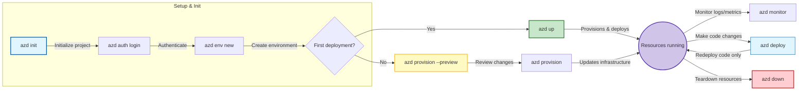
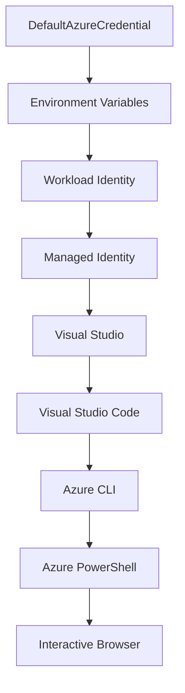

# AZD বেসিকস - মূল ধারণা এবং ভিত্তি

**অধ্যায় নেভিগেশন:**
- **📚 কোর্স হোম**: [শুরুদের জন্য AZD](../../README.md)
- **📖 বর্তমান অধ্যায়**: অধ্যায় ১ - ভিত্তি ও দ্রুত শুরু
- **⬅️ পূর্বের**: [কোর্স ওভারভিউ](../../README.md#-chapter-1-foundation--quick-start)
- **➡️ পরবর্তী**: [ইনস্টলেশন ও সেটআপ](installation.md)
- **🚀 পরবর্তী অধ্যায়**: [অধ্যায় ২: AI-প্রথম ডেভেলপমেন্ট](../chapter-02-ai-development/microsoft-foundry-integration.md)

## পরিচিতি

> `azd 1.37.2` এর বিরুদ্ধে পর্যালোচিত (নভেম্বর ২০২৬)। Bash কমান্ডগুলিতে উদ্ধৃত প্লেসহোল্ডার থাকে যা আপনাকে প্রতিস্থাপন করতে হবে। টেমপ্লেট ওয়ার্কফ্লোগুলিতে বর্তমান ডিরেক্টরি আরম্ভ করতে `.` ব্যবহার করা হয়; ডিরেক্টরি আর্গুমেন্ট ছাড়া, টেমপ্লেট আরম্ভ একটি সাবডিরেক্টরি তৈরি করে এবং আপনার শেল-এর কাজের ডিরেক্টরি পরিবর্তন করে না। উন্নত স্নিপেটগুলি উদাহরণস্বরূপ, সম্পূর্ণ প্রকল্প নয়।

এই পাঠটি আপনাকে Azure Developer CLI (azd) এর সঙ্গে পরিচয় করিয়ে দেয়, একটি শক্তিশালী কমান্ড-লাইন টুল যা স্থানীয় উন্নয়ন থেকে Azure মোতায়েন পর্যন্ত আপনার যাত্রাকে দ্রুততর করে। আপনি মৌলিক ধারণা, মূল বৈশিষ্ট্যগুলি শিখবেন এবং বুঝবেন কীভাবে azd ক্লাউড-নেটিভ অ্যাপ্লিকেশন মোতায়েনকে সহজ করে তোলে।

## শিখন লক্ষ্যসমূহ

এই পাঠের শেষে, আপনি পারবেন:
- বুঝতে পারবেন Azure Developer CLI কী এবং এর প্রধান উদ্দেশ্য কী
- শিখতে পারবেন টেমপ্লেট, পরিবেশ, এবং সার্ভিসের মূল ধারণাগুলো
- অন্বেষণ করবেন প্রধান বৈশিষ্ট্যগুলি যেমন টেমপ্লেট-চালিত উন্নয়ন এবং কাঠামো হিসেবে কোড
- বুঝতে পারবেন azd প্রকল্পের কাঠামো এবং কর্মপ্রবাহ
- আপনার উন্নয়ন পরিবেশের জন্য azd ইনস্টল এবং কনফিগার করতে প্রস্তুত হবেন

## শেখার ফলাফল

এই পাঠ শেষ করার পর, আপনি সক্ষম হবেন:
- আধুনিক ক্লাউড ডেভেলপমেন্ট ওয়ার্কফ্লোতে azd এর ভূমিকা ব্যাখ্যা করতে
- azd প্রকল্প কাঠামোর উপাদানগুলি চিহ্নিত করতে
- কীভাবে টেমপ্লেট, পরিবেশ, এবং সার্ভিসগুলো একত্রে কাজ করে তা বর্ণনা করতে
- azd এর সাথে Infrastructure as Code এর সুবিধাগুলি বুঝতে
- বিভিন্ন azd কমান্ড এবং তাদের উদ্দেশ্যগুলো চিনতে

## Azure Developer CLI (azd) কী?

Azure Developer CLI (azd) একটি কমান্ড-লাইন টুল যা আপনার স্থানীয় ডেভেলপমেন্ট থেকে Azure এ মোতায়েনের যাত্রাকে দ্রুততর করার জন্য ডিজাইন করা হয়েছে। এটি Azure এ ক্লাউড-নেটিভ অ্যাপ্লিকেশন তৈরি, মোতায়েন এবং পরিচালনার প্রক্রিয়াটিকে সহজ করে তোলে।

### azd দিয়ে আপনি কী মোতায়েন করতে পারেন?

azd বিভিন্ন ধরনের কাজের কর্মসমূহকে সমর্থন করে—এবং তালিকাটি ক্রমাগত বৃদ্ধি পাচ্ছে। আজ, আপনি azd ব্যবহার করে নিম্নলিখিতগুলি স্থাপন করতে পারেন:

| কাজের ধরণ | উদাহরণ | একই কর্মপ্রবাহ? |
|---------------|----------|----------------|
| **ঐতিহ্যবাহী অ্যাপ্লিকেশনসমূহ** | ওয়েব অ্যাপ, REST API, স্ট্যাটিক সাইট | ✅ `azd up` |
| **সার্ভিস এবং মাইক্রোসার্ভিস** | কন্টেইনার অ্যাপস, ফাংশন অ্যাপস, মাল্টি-সার্ভিস ব্যাকএন্ড | ✅ `azd up` |
| **এআই-চালিত অ্যাপ্লিকেশনসমূহ** | Microsoft Foundry মডেলসহ চ্যাট অ্যাপস, AI অনুসন্ধানের সাথে RAG সমাধান | ✅ `azd up` |
| **বুদ্ধিমান এজেন্ট** | Foundry-হোস্টকৃত এজেন্ট, মাল্টি-এজেন্ট অর্কেস্ট্রেশন | ✅ `azd up` |

মূল বিষয় হলো **azd জীবনচক্র স্থাপন করা যাই যা কিছুই আপনি ডিপ্লয় করছেন না কেন তা একই থাকে**। আপনি একটি প্রকল্প আরম্ভ করেন, অবকাঠামো প্রদান করেন, আপনার কোড ডিপ্লয় করেন, আপনার অ্যাপ পর্যবেক্ষণ করেন, এবং পরিস্কার করেন—সাধারণ একটি ওয়েবসাইট হোক বা একটি উন্নত AI এজেন্ট।

এই ধারাবাহিকতা ডিজাইনের অংশ। azd AI সক্ষমতাগুলিকে আপনার অ্যাপ্লিকেশন ব্যবহার করতে পারে এমন আরেকটি সার্ভিস হিসাবে বিবেচনা করে, যা কোনো মৌলিকভাবে আলাদা কিছু নয়। Microsoft Foundry মডেল দ্বারা সমর্থিত একটি চ্যাট এন্ডপয়েন্ট azd দৃষ্টিকোণ থেকে কেবল একটি আরেকটি সার্ভিস যা কনফিগার এবং ডিপ্লয় করা হয়।

### 🎯 কেন AZD ব্যবহার করবেন? বাস্তব-দুনিয়ার তুলনা

চলুন একটি সাধারণ ওয়েব অ্যাপ এবং ডেটাবেস ডিপ্লয়ের তুলনা করি:

#### ❌ AZD ছাড়া: ম্যানুয়াল Azure ডিপ্লয়মেন্ট (৩০+ মিনিট)

**উদাহরণস্বরূপ Bash তুলনা, চালানোর জন্য অ্যাপ্লিকেশন স্টার্টার নয়।** এটি ধারণা করে যে বিদ্যমান অ্যাপ্লিকেশন কোড, অনন্য রিসোর্স নাম, Azure CLI প্রমাণীকরণ, এবং প্রয়োজনীয় যেকোনো CLI এক্সটেনশন থাকে। সমর্থিত সম্পূর্ণ পথের জন্য নিচের টেমপ্লেট অনুশীলনটি ব্যবহার করুন।

```bash
# Step 1: Create resource group
az group create --name myapp-rg --location eastus

# Step 2: Create App Service Plan
az appservice plan create --name myapp-plan \
  --resource-group myapp-rg \
  --sku B1 --is-linux

# Step 3: Create Web App
az webapp create --name myapp-web-unique123 \
  --resource-group myapp-rg \
  --plan myapp-plan \
  --runtime "NODE:22-lts"

# Step 4: Create Cosmos DB account (10-15 minutes)
az cosmosdb create --name myapp-cosmos-unique123 \
  --resource-group myapp-rg \
  --kind MongoDB

# Step 5: Create database
az cosmosdb mongodb database create \
  --account-name myapp-cosmos-unique123 \
  --resource-group myapp-rg \
  --name tododb

# Step 6: Create collection
az cosmosdb mongodb collection create \
  --account-name myapp-cosmos-unique123 \
  --resource-group myapp-rg \
  --database-name tododb \
  --name todos

# Step 7: Get connection string
CONN_STR=$(az cosmosdb keys list \
  --name myapp-cosmos-unique123 \
  --resource-group myapp-rg \
  --type connection-strings \
  --query "connectionStrings[0].connectionString" -o tsv)

# Step 8: Configure app settings
az webapp config appsettings set \
  --name myapp-web-unique123 \
  --resource-group myapp-rg \
  --settings MONGODB_URI="$CONN_STR"

# Step 9: Enable logging
az webapp log config --name myapp-web-unique123 \
  --resource-group myapp-rg \
  --application-logging filesystem \
  --detailed-error-messages true

# Step 10: Set up Application Insights
az monitor app-insights component create \
  --app myapp-insights \
  --location eastus \
  --resource-group myapp-rg

# Step 11: Link App Insights to Web App
INSTRUMENTATION_KEY=$(az monitor app-insights component show \
  --app myapp-insights \
  --resource-group myapp-rg \
  --query "instrumentationKey" -o tsv)

az webapp config appsettings set \
  --name myapp-web-unique123 \
  --resource-group myapp-rg \
  --settings APPINSIGHTS_INSTRUMENTATIONKEY="$INSTRUMENTATION_KEY"

# Step 12: Build application locally
npm install
npm run build

# Step 13: Create deployment package
zip -r app.zip . -x "*.git*" "node_modules/*"

# Step 14: Deploy application
az webapp deployment source config-zip \
  --resource-group myapp-rg \
  --name myapp-web-unique123 \
  --src app.zip

# Step 15: Wait and pray it works 🙏
# (No automated validation, manual testing required)
```

**সমস্যাসমূহ:**
- ❌ মনে রাখার জন্য এবং ক্রমানুসারে কার্যকর করার জন্য ১৫+ কমান্ড
- ❌ ৩০-৪৫ মিনিটের ম্যানুয়াল কাজ
- ❌ সহজেই ভুল হওয়ার সম্ভাবনা (টাইপো, ভুল প্যারামিটার)
- ❌ ক্রেডেনশিয়ালস স্পষ্টভাবে পরিচালনা করতে হবে; ডিবাগ লগ এবং শেল ট্রেসিং দিয়ে এগুলো প্রকাশ পেতে পারে
- ❌ কিছু ভুল হলে স্বয়ংক্রিয় রোলব্যাক নেই
- ❌ টিমের সদস্যদের জন্য পুনরায় তৈরি করা কঠিন
- ❌ প্রতিবার আলাদা (পুনরুত্পাদনযোগ্য নয়)

#### ✅ AZD সহ: স্বয়ংক্রিয় ডিপ্লয়মেন্ট (৫টি কমান্ড, ১০-১৫ মিনিট)

```bash
# Step 1: Initialize from template
azd init --template todo-nodejs-mongo .

# Step 2: Authenticate
azd auth login

# Step 3: Select the environment created during init
azd env select dev

# Step 4: Preview changes (optional but recommended)
azd provision --preview

# Step 5: Deploy everything
azd up

# ✨ Done! Everything is deployed, configured, and monitored
```

**উপকারিতা:**
- ✅ **৫টি কমান্ড** বনাম ১৫+ ম্যানুয়াল ধাপ
- ✅ **মোট ১০-১৫ মিনিট** সময় (প্রধানত Azure অপেক্ষা)
- ✅ **কম ম্যানুয়াল ভুল** - সঙ্গতিপূর্ণ, টেমপ্লেট-চালিত ওয়ার্কফ্লো
- ✅ **সুরক্ষিত সিক্রেট হ্যান্ডলিং** - অনেক টেমপ্লেট Azure-পরিচালিত সিক্রেট স্টোরেজ ব্যবহার করে
- ✅ **পুনরাবৃত্ত ডিপ্লয়মেন্ট** - প্রতিবার একই ওয়ার্কফ্লো
- ✅ **পুনরাবৃত্ত অবকাঠামো সংজ্ঞা** - কোটাসমূহ, অঞ্চল উপলব্ধতা এবং টেমপ্লেট সংস্করণের ওপর নির্ভরশীল
- ✅ **টিম-প্রস্তুত** - যে কেউ একই কমান্ড দিয়ে ডিপ্লয় করতে পারে
- ✅ **Infrastructure as Code** - সংস্করণ নিয়ন্ত্রিত Bicep টেমপ্লেট
- ✅ **টেমপ্লেট-সংজ্ঞায়িত মনিটরিং** - টেমপ্লেটে অন্তর্ভুক্ত থাকলে Application Insights

### সময় এবং নির্ভরযোগ্যতা

উপরের সময়সীমাগুলি আনুমানিক, বেঞ্চমার্ক নয়। azd আপনার সমন্বয় করার জন্য কমান্ডগুলি কমিয়ে দেয়, কিন্তু ডিপ্লয়মেন্ট সময়ের নিশ্চয়তা দেয় না, ত্রুটি দূর করে না, বা স্বয়ংক্রিয় অ্যাপ্লিকেশন/ডাটাবেস রোলব্যাক প্রদান করে না। সোর্স কন্ট্রোলে কাজ করা সংস্করণ রাখুন এবং রিকভারি প্রক্রিয়া পরীক্ষা করুন।

## মূল ধারণাসমূহ

### টেমপ্লেটসমূহ
টেমপ্লেটগুলি azd এর ভিত্তি। এগুলো অন্তর্ভুক্ত করে:
- **অ্যাপ্লিকেশন কোড** - আপনার সোর্স কোড এবং নির্ভরশীলতা
- **অবকাঠামোর সংজ্ঞা** - Bicep বা Terraform এ সংজ্ঞায়িত Azure রিসোর্স
- **কনফিগারেশন ফাইল** - সেটিংস এবং পরিবেশ ভেরিয়েবল
- **ডিপ্লয়মেন্ট স্ক্রিপ্ট** - স্বয়ংক্রিয় ডিপ্লয়মেন্ট ওয়ার্কফ্লো

### পরিবেশসমূহ
পরিবেশগুলি বিভিন্ন ডিপ্লয়মেন্ট লক্ষ্যকে প্রতিনিধিত্ব করে:
- **ডেভেলপমেন্ট** - পরীক্ষা ও উন্নয়নের জন্য
- **স্টেজিং** - প্রি-প্রোডাকশন পরিবেশ
- **প্রোডাকশন** - লাইভ প্রোডাকশন পরিবেশ

প্রতিটি পরিবেশ নিজস্ব বজায় রাখে:
- পরিবেশের নাম এবং মান; রিসোর্স আইসোলেশন অবকাঠামো টেমপ্লেটের উপর নির্ভর করে
- কনফিগারেশন সেটিংস
- ডিপ্লয়মেন্ট অবস্থা

### পরিষেবাসমূহ
পরিষেবাগুলি `azure.yaml` এ ডিপ্লয়েবল অ্যাপ্লিকেশন উপাদানগুলি বর্ণনা করে:
- **ফ্রন্টএন্ড** - ওয়েব অ্যাপ্লিকেশন, SPAs
- **ব্যাকএন্ড** - API, মাইক্রোসার্ভিসেস

ডাটাবেস এবং স্টোরেজ সাধারণত অবকাঠামো রিসোর্স হিসাবে প্রোভিশন করা হয়, invented সার্ভিস হোস্ট যেমন `host: postgres` নয়।

## মূল বৈশিষ্ট্যসমূহ

### ১। টেমপ্লেট-চালিত ডেভেলপমেন্ট
```bash
# Browse available templates
azd template list

# Initialize from a template
azd init --template "<template-name>" .
```

### ২। Infrastructure as Code
- **Bicep** - Azure-র ডোমেইন-সুনির্দিষ্ট ভাষা
- **Terraform** - মাল্টি-ক্লাউড অবকাঠামো টুল
- Bicep ARM টেমপ্লেটে কম্পাইল করে; রো ARM JSON আলাদা বিল্ট-ইন `infra.provider` নয়।

### ৩। ইন্টিগ্রেটেড ওয়ার্কফ্লো
```bash
# Complete deployment workflow
azd up            # Provision + Deploy this is hands off for first time setup

# 🧪 NEW: Preview infrastructure changes before deployment (SAFE)
azd provision --preview    # Simulate infrastructure deployment without making changes

azd provision     # Create Azure resources if you update the infrastructure use this
azd deploy        # Deploy application code or redeploy application code once update
azd down          # Clean up resources
```

#### 🛡️ প্রিভিউ সহ নিরাপদ অবকাঠামো পরিকল্পনা
`azd provision --preview` কমান্ডটি নিরাপদ ডিপ্লয়মেন্টের জন্য একটি গেম-চেঞ্জার:
- **ড্রাই-রান বিশ্লেষণ** - কী তৈরি, সংশোধন বা মুছে ফেলা হবে তা দেখায়
- **কোন অবকাঠামো প্রয়োগ নয়** - প্রোভাইডার পরিবর্তনগুলোর পর্যালোচনা; প্রথমে প্রজেক্ট হুকগুলি পরীক্ষা করুন, কারণ হুকগুলি পার্শ্ব প্রতিক্রিয়া সহ কমান্ড চালাতে পারে
- **টিম সহযোগিতা** - ডিপ্লয়মেন্টের আগে প্রিভিউ ফলাফল শেয়ার করুন
- **মূল্য পরিকল্পনার ইনপুট** - প্রস্তাবিত SKU গুলো পরীক্ষা করুন, তারপর Azure মূল্য নির্ধারণ ক্যালকুলেটর দিয়ে মূল্য নির্ধারণ করুন; প্রিভিউ মূল্য গণনা করে না

```bash
# Example preview workflow
azd provision --preview           # See what will change
# Review the output, discuss with team
azd provision                     # Apply changes with confidence
```

### 📊 ভিজ্যুয়াল: AZD ডেভেলপমেন্ট ওয়ার্কফ্লো



**ওয়ার্কফ্লো ব্যাখ্যা:**
1. **Init** - টেমপ্লেট বা নতুন প্রকল্প দিয়ে শুরু করুন
2. **Auth** - Azure সাথে প্রমাণীকরণ করুন
3. **Environment** - বিচ্ছিন্ন ডিপ্লয়মেন্ট পরিবেশ তৈরি করুন
4. **Preview** - 🆕 সর্বদা প্রথমে অবকাঠামো পরিবর্তন দেখুন (নিরাপদ অভ্যাস)
5. **Provision** - Azure রিসোর্স তৈরি/আপডেট করুন
6. **Deploy** - আপনার অ্যাপ্লিকেশন কোড পুশ করুন
7. **Monitor** - অ্যাপ্লিকেশন পারফরম্যান্স পর্যবেক্ষণ করুন
8. **Iterate** - পরিবর্তন করুন এবং কোড পুনরায় ডিপ্লয় করুন
9. **Cleanup** - কাজ শেষ হলে রিসোর্স মুছে ফেলুন

### ৪. পরিবেশ ব্যবস্থাপনা
```bash
# Create and manage environments
azd env new "<environment-name>"
azd env select "<environment-name>"
azd env list
```

### ৫. এক্সটেনশন এবং AI কমান্ডসমূহ

azd একটি এক্সটেনশন সিস্টেম ব্যবহার করে যাতে কোর CLI এর বাইরে সক্ষমতা যোগ করা যায়। এটি বিশেষভাবে AI কাজের জন্য উপযোগী:

```bash
# List available extensions
azd extension list

# Install the Foundry agents extension
azd extension install azure.ai.agents

# Initialize an AI agent project interactively
azd ai agent init

# Test a deployed agent (shows latency and time-to-first-byte)
azd ai agent invoke

# Start the MCP server for AI-assisted development (Alpha)
azd mcp start
```

**এজেন্টের জীবনচক্র, শুরু থেকে শেষ পর্যন্ত।** এজেন্ট জীবনচক্র অপারেশনের জন্য `azure.ai.agents` ব্যবহার করুন এবং মূল্যায়নের জন্য আলাদাভাবে `azure.ai.evaluations` ইনস্টল করুন। সম্মিলিত ওয়ার্কফ্লোর জন্য `azd >= 1.37.0` ব্যবহার করুন। প্রথম দিন এইসবের সবগুলো প্রয়োজন নেই:

| পর্যায় | কমান্ড | কাজ কি করে |
|-------|---------|--------------|
| **স্ক্যাফোল্ড** | `azd ai agent init --template <path-to-azure.yaml>` | একটি চলমান এজেন্ট প্রকল্পের টেমপ্লেট গ্রহণ করুন |
| **পরীক্ষা** | `azd ai agent invoke` | এজেন্ট কল করুন এবং প্রতিক্রিয়ার সময় দেখুন |
| **পরিমাপ** | `azd ai eval init`, `generate`, `run start` | আলাদা এক্সটেনশন ব্যবহার করে কনফিগার, ডিপ্লয় এবং মূল্যায়ন চালান |
| **উন্নতি** | `azd ai agent optimize --eval <evaluation-name> --optimize-model <optimizer-deployment>` | এজেন্ট অপটিমাইজেশনের জন্য উপযুক্ত মূল্যায়ন পুনরায় ব্যবহার করুন |
| **পরিদর্শন** | `azd ai agent endpoint show` | লাইভ এন্ডপয়েন্ট কনফিগারেশন দেখুন |
| **পরিষ্কার** | `azd ai agent delete` | একটি হোস্টেড এজেন্ট এবং এর সকল ভার্সন মুছে ফেলুন |

> এক্সটেনশনসমূহ বিস্তারিতভাবে [অধ্যায় ২: AI-ফার্স্ট ডেভেলপমেন্ট](../chapter-02-ai-development/agents.md) এবং [AZD AI CLI কমান্ডগুলি](../chapter-08-production/production-ai-practices.md#azd-ai-cli-commands-and-extensions) রেফারেন্সে আলোচনা হয়েছে।

## 📁 প্রকল্পের কাঠামো

একটি স্বাভাবিক azd প্রকল্পের কাঠামো:
```
my-app/
├── .azure/                  # Local environments and selected-environment config
│   ├── config.json
│   └── dev/.env
├── .devcontainer/          # Development container config
├── .github/workflows/      # GitHub Actions
├── .vscode/               # VS Code settings
├── infra/                 # Infrastructure code
│   ├── main.bicep        # Main infrastructure template
│   ├── main.parameters.json
│   └── modules/          # Reusable modules
├── src/                  # Application source code
│   ├── api/             # Backend services
│   └── web/             # Frontend application
├── azure.yaml           # azd project configuration
└── README.md
```

## 🔧 কনফিগারেশন ফাইলসমূহ

### azure.yaml
প্রধান প্রকল্প কনফিগারেশন ফাইল:
```yaml
name: my-awesome-app
metadata:
  template: my-template@1.0.0

services:
  web:
    project: ./src/web
    language: js
    host: appservice
  api:
    project: ./src/api
    language: js
    host: appservice

hooks:
  preprovision:
    shell: pwsh
    run: echo "Preparing to provision..."
```

### .azure/config.json
প্রকল্প-স্থানীয় ডিফল্ট পরিবেশের নির্বাচন (বর্ণনামূলক; azd দ্বারা পরিচালিত):
```json
{
  "defaultEnvironment": "dev"
}
```

## 🎪 সাধারণ ওয়ার্কফ্লোগুলো হাতেকলমে অনুশীলনসহ

> **💡 শেখার টিপস:** আপনার AZD দক্ষতা ধাপে ধাপে বাড়াতে এই অনুশীলনগুলো ক্রমানুসারে অনুসরণ করুন।

### 🎯 অনুশীলন ১: আপনার প্রথম প্রকল্প ইনিশিয়ালাইজ করুন

**লক্ষ্য:** একটি AZD প্রকল্প তৈরি করা এবং তার কাঠামো অন্বেষণ করা

**ধাপসমূহ:**
```bash
# Use a proven template
mkdir azd-basics-practice
cd azd-basics-practice
# Choose "dev" for the environment name when prompted
azd init --template todo-nodejs-mongo .

# Explore the generated files
ls -la  # View all files including hidden ones

# Key files created:
# - azure.yaml (main config)
# - infra/ (infrastructure code)
# - src/ (application code)
```

**✅ সফলতা:** আপনার কাছে azure.yaml, infra/, এবং src/ ডিরেক্টরি রয়েছে

---

### 🎯 অনুশীলন ২: Azure এ ডিপ্লয় করুন

**লক্ষ্য:** সম্পূর্ণ এন্ড-টু-এন্ড ডিপ্লয়মেন্ট সম্পন্ন করুন

**ধাপসমূহ:**
```bash
# 1. Authenticate
azd auth login

# 2. Select the dev environment created in Exercise 1
azd env select dev
azd env set AZURE_LOCATION eastus

# 3. Preview changes (RECOMMENDED)
azd provision --preview

# 4. Deploy everything
azd up

# 5. Verify deployment
azd show    # View your app URL
```

**আশাকৃত সময়:** ১০-১৫ মিনিট  
**✅ সফলতা:** অ্যাপ্লিকেশন URL ব্রাউজারে খুলে যায়

---

### 🎯 অনুশীলন ৩: একাধিক পরিবেশ

**লক্ষ্য:** dev এবং staging এ ডিপ্লয় করুন

**ধাপসমূহ:**
```bash
# Already have dev, create staging
azd env new staging
azd env set AZURE_LOCATION westus2
azd up

# Switch between them
azd env list
azd env select dev
```

**✅ সফলতা:** Azure পোর্টালে দুটি পৃথক রিসোর্স গ্রুপ দেখুন

**পরিষ্কার করা:** অনুশীলন ৩ একটি দ্বিতীয় বিলযোগ্য ডিপ্লয়মেন্ট তৈরি করে। শেষ হলে উভয় মুছে ফেলুন:

```bash
azd down --environment dev
azd down --environment staging
```

---

### 🛡️ ধ্বংসাত্মক পরিষ্কার: `azd down --force --purge`

যখন আপনি ইচ্ছাকৃতভাবে নির্বাচিত পরিবেশের Azure সম্পদগুলি মুছে ফেলতে চান:

```bash
azd down --force --purge
```

**এটি যা করে:**
- `--force`: কোন নিশ্চিতকরণ প্রম্পট দেয় না
- `--purge`: পাশাপাশি সমর্থিত সফট-মুছে ফেলা সম্পদও স্থায়ীভাবে মুছে দেয় (যেমন কী ভাল্টস), যেখানে পার্জ সুরক্ষা অনুমতি দেয়। এটি স্থানীয় `.azure/` ডিরেক্টরি মুছে দেয় না।

**কখন ব্যবহার করবেন:** একটি এককালীন পরিবেশ শেষ হলে ব্যবহার করুন। ধ্বংসাত্মক পরিষ্কারকে প্রমাণীকরণ, কোটা অথবা কনফিগারেশন ত্রুটির প্রথম প্রতিক্রিয়া হিসাবে বিবেচনা করবেন না।

---

## 🎪 মূল কাজের প্রবাহ রেফারেন্স

### একটি নতুন প্রকল্প শুরু করা
```bash
# Method 1: Use existing template
azd init --template todo-nodejs-mongo .

# Method 2: Start from scratch
azd init

# Method 3: Use current directory
azd init .
```

### উন্নয়ন চক্র
```bash
# Set up development environment
azd auth login
azd env new dev
azd env select dev

# Deploy everything
azd up

# Make changes and redeploy
azd deploy

# Clean up when done
azd down --force --purge # Deletes this environment's discovered Azure resources; review before forcing deletion.
```

## `azd down --force --purge` বোঝা
`azd down --force --purge` কমান্ড হল আপনার azd পরিবেশ এবং সব সংযুক্ত সম্পদ সম্পূর্ণরূপে ধ্বংস করার জন্য একটি শক্তিশালী উপায়। প্রতিটি ফ্ল্যাগ কী করে তার একটি ব্যাখ্যা এখানে:
```
--force
```
- নিশ্চিতকরণ প্রম্পট এড়িয়ে যায়।
- স্বয়ংক্রিয়করণ বা স্ক্রিপ্টিংয়ের জন্য যেখানে ম্যানুয়াল ইনপুট সম্ভব নয়, সেখানে দরকারী।
- এটি অনুমতি, পার্জ সুরক্ষা, অথবা মুছে ফেলা ব্যর্থতা বাইপাস করে না।

```
--purge
```
সমর্থিত সফট-মুছে ফেলা অ্যাজুর সম্পদ স্থায়ীভাবে অতিরিক্ত নিশ্চিতকরণ ছাড়াই মুছে ফেলে। পরিষ্কার সুরক্ষা এবং অনুমতিগুলি এখনও প্রযোজ্য। এটি **মুছে ফেলে না** স্থানীয় পরিবেশ বা `.azure/` ফোল্ডার।


### কেন উভয় ব্যবহার করবেন?
আপনি শুধুমাত্র তখনই উভয় ব্যবহার করুন যখন আপনি নির্বাচিত পরিবেশের অ্যাজুর সম্পদ মুছে ফেলার এবং পুনরুদ্ধারযোগ্য সম্পদ পরিষ্কার করার ইচ্ছা করেন। এটি ধ্বংসকারী পরিষ্কারকরণ, সাধারণ মেরামত বা স্থানীয়-অবস্থা রিসেট নয়।

এটি বিশেষত ব্যবহৃত হয় অ্যাজুর পোর্টালে ম্যানুয়াল সম্পদ মুছে ফেলার পর বা টেমপ্লেট, পরিবেশ, বা সম্পদ গ্রুপ নামকরণ কনভেনশন পরিবর্তনের সময়।


### একাধিক পরিবেশ পরিচালনা
```bash
# Create staging environment
azd env new staging
azd env select staging
azd up

# Switch back to dev
azd env select dev

# Compare environments
azd env list
```

## 🔐 প্রমাণীকরণ এবং শংসাপত্র

ডিপ্লয়মেন্ট প্রমাণীকরণ (`azd auth login`) এবং অ্যাপ্লিকেশন SDK প্রমাণীকরণ (`DefaultAzureCredential`) আলাদা করুন। তারা পৃথক। azd ডিফল্টরূপে Azure CLI শংসাপত্র ব্যবহার করে না।

### Azure CLI প্রমাণীকরণ (`az login`)

azd এর জন্য `azd auth login` চালান। নিম্নলিখিত Azure CLI কমান্ডগুলি ঐচ্ছিক এবং পৃথকভাবে `az` কমান্ডগুলি প্রমাণীকরণ করে:

```bash
# Interactive login (opens browser)
az login

# Login with specific tenant
az login --tenant "<tenant-id>"

# Login with service principal
az login --service-principal -u "<app-id>" -p "<password>" --tenant "<tenant-id>"

# Check current login status
az account show

# List available subscriptions
az account list --output table

# Set default subscription
az account set --subscription "<subscription-id>"
```

### প্রমাণীকরণ প্রবাহ
১. **ইন্টারেক্টিভ লগইন**: প্রমাণীকরণের জন্য আপনার ডিফল্ট ব্রাউজার খুলবে
২. **ডিভাইস কোড প্রবাহ**: ব্রাউজার অ্যাক্সেস ছাড়া পরিবেশের জন্য
৩. **সার্ভিস প্রিন্সিপাল**: স্বয়ংক্রিয়করণ এবং CI/CD পরিস্থিতির জন্য
৪. **ম্যানেজড আইডেন্টিটি**: অ্যাজুর-হোস্টেড অ্যাপ্লিকেশনের জন্য

### DefaultAzureCredential চেইন

`DefaultAzureCredential` একটি শংসাপত্রের ধরন যা নির্দিষ্ট ক্রমে একাধিক শংসাপত্র উৎস স্বয়ংক্রিয়ভাবে চেষ্টা করে সহজতর প্রমাণীকরণ অভিজ্ঞতা প্রদান করে:

#### অ্যাপ্লিকেশন SDK শংসাপত্র চেইন

নির্দিষ্ট চেইন নির্ভর করে Azure Identity SDK ভাষা, সংস্করণ, ইনস্টল করা প্লাগইন এবং বিকল্পগুলোর উপর। এই চিত্রটি ধারণাগত, একটি স্থির azd প্রমাণীকরণ ক্রম নয়; সাম্প্রতিক SDK-গুলিতে Azure Developer CLI পরিচয়পত্রও থাকতে পারে।


#### ১. পরিবেশ ভেরিয়েবলসমূহ
```bash
# Set environment variables for service principal
export AZURE_CLIENT_ID="<app-id>"
export AZURE_CLIENT_SECRET="<password>"
export AZURE_TENANT_ID="<tenant-id>"
```

#### ২. ওয়ার্কলোড পরিচয় (কুবেরনেটিস/GitHub Actions)
স্বয়ংক্রিয়ভাবে ব্যবহৃত হয়:
- Azure Kubernetes Service (AKS) যেখানে ওয়ার্কলোড পরিচয় আছে
- GitHub Actions যেখানে OIDC ফেডারেশন আছে
- অন্যান্য ফেডারেটেড পরিচয় পরিস্থিতি

#### ৩. ম্যানেজ্ড পরিচয়
Azure রিসোর্স যেমন:
- ভার্চুয়াল মেশিন
- অ্যাপ সার্ভিস
- Azure Functions
- কন্টেইনার ইনস্ট্যান্স

```bash
# Inspect a deployed Container App's configured identity (requires az login)
az containerapp show --name "<app-name>" --resource-group "<rg-name>" --query identity
```

#### ৪. ডেভেলপার টুলস ইন্টিগ্রেশন
- **Visual Studio**: স্বয়ংক্রিয়ভাবে সাইন ইন করা অ্যাকাউন্ট ব্যবহার করে
- **VS Code**: সমর্থন SDK এবং এর সমর্থিত ব্রোকার/প্লাগইন সেটআপের উপর নির্ভর করে
- **Azure CLI**: `az login` পরিচয়পত্র ব্যবহার করে (স্থানীয় উন্নয়নের জন্য সবচেয়ে সাধারণ)

### AZD প্রমাণীকরণ সেটআপ

```bash
# Method 1: Direct azd authentication (recommended)
azd auth login

# Method 2: Direct azd authentication
azd auth login --use-device-code  # For headless environments

# Method 3: Check authentication status
azd auth login --check-status

# Method 4: Logout and re-authenticate
azd auth logout
azd auth login
```

### প্রমাণীকরণ সেরা অনুশীলনসমূহ

#### স্থানীয় উন্নয়নের জন্য
```bash
# 1. Log in to azd
azd auth login

# 2. Select the subscription for this initialized environment
azd env set AZURE_SUBSCRIPTION_ID "<subscription-id>"

# 3. Check azd sign-in details (read the status message)
azd auth login --check-status
```

#### CI/CD পাইপলাইনগুলির জন্য
```yaml
# Partial GitHub Actions steps: assumes checkout, azd installation,
# required AZURE_* environment values, and pipeline secret configuration.
- name: Deploy with azd
  run: |
    azd auth login --client-id ${{ secrets.AZURE_CLIENT_ID }} \
                    --client-secret ${{ secrets.AZURE_CLIENT_SECRET }} \
                    --tenant-id ${{ secrets.AZURE_TENANT_ID }}
    azd up --no-prompt
```

#### উৎপাদন পরিবেশের জন্য
- Azure রিসোর্সে চালানোর সময় **ম্যানেজ্ড পরিচয়** ব্যবহার করুন
- স্বয়ংক্রিয়করণ পরিস্থিতির জন্য **সার্ভিস প্রিন্সিপাল** ব্যবহার করুন
- কোড বা কনফিগারেশন ফাইলে পরিচয়পত্র সংরক্ষণ এড়িয়ে চলুন
- সংবেদনশীল কনফিগারেশনের জন্য **Azure Key Vault** ব্যবহার করুন

### সাধারণ প্রমাণীকরণ সমস্যা এবং সমাধান

#### সমস্যা: "কোন সাবস্ক্রিপশন পাওয়া যায়নি"
```bash
# Solution: Set default subscription
az account list --output table
az account set --subscription "<subscription-id>"
azd env set AZURE_SUBSCRIPTION_ID "<subscription-id>"
```

#### সমস্যা: "অনুমতির অভাব"
```bash
# Solution: Check and assign required roles
az role assignment list --assignee $(az account show --query user.name --output tsv)

# Common required roles:
# - Contributor (for resource management)
# - User Access Administrator (for role assignments)
```

#### সমস্যা: "টোকেন সময়সীমা শেষ"
```bash
# Solution: Re-authenticate
az logout
az login
azd auth logout
azd auth login
```

### বিভিন্ন পরিস্থিতিতে প্রমাণীকরণ

#### স্থানীয় উন্নয়ন
```bash
# Personal development account
az login
azd auth login
```

#### টিম ডেভেলপমেন্ট
```bash
# Use specific tenant for organization
az login --tenant contoso.onmicrosoft.com
azd auth login --tenant-id "<tenant-id>"
```

#### মাল্টি-টেন্যান্ট পরিস্থিতি
```bash
# Switch between tenants
az login --tenant tenant1.onmicrosoft.com
azd auth login --tenant-id "<tenant-1-id>"
# Select an environment configured with tenant 1's subscription
azd env select tenant1-dev
# Deploy to tenant 1
azd up

az login --tenant tenant2.onmicrosoft.com  
azd auth login --tenant-id "<tenant-2-id>"
azd env select tenant2-dev
# Deploy to tenant 2
azd up
```

### নিরাপত্তা বিবেচনা

১. **প্রমাণপত্র সংরক্ষণ**: সোর্স কোডে কখনো প্রমাণপত্র সংরক্ষণ করবেন না
২. **পরিধি সীমিতকরণ**: সার্ভিস প্রিন্সিপালগুলির জন্য সর্বনিম্ন-অধিকার নীতি অনুসরণ করুন
৩. **টোকেন ঘূর্ণন**: নিয়মিত সার্ভিস প্রিন্সিপালের সিক্রেট ঘুরিয়ে নিন
৪. **অডিট ট্রেল**: প্রমাণীকরণ এবং ডেপ্লয়মেন্ট কার্যক্রম পর্যবেক্ষণ করুন
৫. **নেটওয়ার্ক নিরাপত্তা**: সম্ভব হলে প্রাইভেট এন্ডপয়েন্ট ব্যবহার করুন

### প্রমাণীকরণ সমস্যার সমাধান

```bash
# Debug authentication issues
azd auth login --check-status
az account show
az account get-access-token

# Common diagnostic commands
whoami                          # Current user context
az ad signed-in-user show      # Microsoft Entra ID user details
az group list                  # Test resource access
```

## কমান্ড আবিষ্কার

### আবিষ্কার
```bash
azd template list              # Browse templates
azd template list --help       # Template discovery options
azd init --help               # Initialization options
```

### প্রকল্প পরিচালনা
```bash
azd show                     # Project overview
azd env list                # Available environments and selected default
azd config show            # Configuration settings
```

### মনিটরিং
```bash
azd monitor                  # Open Azure portal monitoring
azd monitor --logs           # View application logs
azd monitor --live           # View live metrics
azd pipeline config          # Set up CI/CD
```

## সেরা অনুশীলনসমূহ

### ১. অর্থবহ নাম ব্যবহার করুন
```bash
# Good
azd env new production-east
azd init --template todo-nodejs-mongo .

# Avoid
azd env new env1
azd init --template template1 .
```

### ২. টেমপ্লেট ব্যবহার করুন
- বিদ্যমান টেমপ্লেট দিয়ে শুরু করুন
- আপনার প্রয়োজন অনুযায়ী কাস্টমাইজ করুন
- আপনার সংস্থার জন্য পুনরায় ব্যবহারযোগ্য টেমপ্লেট তৈরি করুন

### ৩. পরিবেশ বিচ্ছিন্নতা
- dev/staging/prod এর জন্য পৃথক পরিবেশ ব্যবহার করুন
- কখনো সরাসরি স্থানীয় মেশিন থেকে উৎপাদনে ডেপ্লয় করবেন না
- উৎপাদন ডেপ্লয়মেন্টের জন্য CI/CD পাইপলাইন ব্যবহার করুন

### ৪. কনফিগারেশন ম্যানেজমেন্ট
- গোপনীয়তার জন্য ম্যানেজ্ড পরিচয় এবং Key Vault ব্যবহার করুন; সাধারণ `azd env set` মান স্থানীয় প্লেইনটেক্সট
- সংস্করণ কন্ট্রোলে কনফিগারেশন রাখুন
- পরিবেশ-নির্দিষ্ট সেটিংস ডকুমেন্ট করুন

## শেখার অগ্রগতি

### শুরু (সপ্তাহ ১-২)
১. azd ইনস্টল এবং প্রমাণীকরণ করুন
২. একটি সাধারণ টেমপ্লেট ডেপ্লয় করুন
৩. প্রকল্পের কাঠামো বুঝুন
৪. মৌলিক কমান্ড শিখুন (up, down, deploy)

### মধ্যম (সপ্তাহ ৩-৪)
১. টেমপ্লেট কাস্টমাইজ করুন
২. একাধিক পরিবেশ পরিচালনা করুন
৩. অবকাঠামো কোড বুঝুন
৪. CI/CD পাইপলাইন সেটআপ করুন

### উন্নত (সপ্তাহ ৫+)
১. কাস্টম টেমপ্লেট তৈরি করুন
২. উন্নত অবকাঠামো প্যাটার্ন
৩. মাল্টি-রিজিওন ডেপ্লয়মেন্ট
৪. এন্টারপ্রাইজ-গ্রেড কনফিগারেশন

## পরবর্তী পদক্ষেপ

**📖 অধ্যায় ১ শিখন চালিয়ে যান:**
- [ইনস্টলেশন এবং সেটআপ](installation.md) - azd ইনস্টল এবং কনফিগার করুন
- [আপনার প্রথম প্রকল্প](first-project.md) - হাতে কলমে টিউটোরিয়াল সম্পন্ন করুন
- [কনফিগারেশন গাইড](../chapter-03-configuration/configuration.md) - উন্নত কনফিগারেশন বিকল্পসমূহ

**🎯 পরবর্তী অধ্যায়ের জন্য প্রস্তুত?**
- [অধ্যায় ২: AI-প্রথম উন্নয়ন](../chapter-02-ai-development/microsoft-foundry-integration.md) - AI অ্যাপ্লিকেশন তৈরি শুরু করুন

## অতিরিক্ত সম্পদ

- [Azure Developer CLI ওভারভিউ](https://learn.microsoft.com/en-us/azure/developer/azure-developer-cli/)
- [টেমপ্লেট গ্যালারি](https://azure.github.io/awesome-azd/)
- [কমিউনিটি নমুনা](https://github.com/Azure-Samples)

---

## 🙋 প্রায়শই জিজ্ঞাসিত প্রশ্নাবলী

### সাধারণ প্রশ্ন

**প্রশ্ন: AZD এবং Azure CLI মধ্যে পার্থক্য কী?**

উত্তর: Azure CLI (`az`) ব্যবহার হয় পৃথক Azure রিসোর্স পরিচালনা করতে। AZD (`azd`) সম্পূর্ণ অ্যাপ্লিকেশন পরিচালনার জন্য:

```bash
# Azure CLI - Low-level resource management
az webapp create --name myapp --resource-group rg
az sql server create --name myserver --resource-group rg
# ...many more commands needed

# AZD - Application-level management
azd up  # Deploys entire app with all resources
```

**এভাবে ভাবুন:**
- `az` = পৃথক Lego ইটের উপর কাজ করা
- `azd` = সম্পূর্ণ Lego সেট নিয়ে কাজ করা

---

**প্রশ্ন: AZD ব্যবহারের জন্য কি আমাকে Bicep বা Terraform জানতে হবে?**

উত্তর: না! টেমপ্লেট দিয়ে শুরু করুন:
```bash
# Use existing template - no IaC knowledge needed
azd init --template todo-nodejs-mongo .
azd up
```

আপনি পরে Bicep শিখে অবকাঠামো কাস্টমাইজ করতে পারেন। টেমপ্লেটগুলি শেখার জন্য কার্যকর উদাহরণ সরবরাহ করে।

---

**প্রশ্ন: AZD টেমপ্লেট চালানোর খরচ কত?**

উত্তর: খরচ অঞ্চল, SKU, আপটাইম, ডাটাবেস মোড এবং মডেল ব্যবহারের উপর নির্ভর করে।idle অবস্থায়ও একটি উন্নয়ন পরিবেশে উল্লেখযোগ্য মাসিক চার্জ আসতে পারে; সর্বজনীন $৫০-১৫০ রেঞ্জ ধরে নেবেন না:

```bash
# Preview resource changes (not prices)
azd provision --preview

# Always cleanup when not using
azd down --force --purge  # Removes all resources
```

**প্রফেশনাল টিপস:** যেখানে সম্ভব ফ্রি টিয়ার ব্যবহার করুন:
- অ্যাপ সার্ভিস: F1 (ফ্রি) টিয়ার
- Azure OpenAI: সাধারণ কোনো মাসিক ফ্রি টোকেন বরাদ্দ নেই; বর্তমান মডেল ও অফারের দাম দেখুন
- Cosmos DB: প্রযোজ্য provisioned-throughput অ্যাকাউন্ট ফ্রি টিয়ারে অপ্ট ইন করতে পারে; সার্ভারলেস টেমপ্লেট স্বয়ংক্রিয়ভাবে যোগ্য নয়

---

**প্রশ্ন: আমি কি বিদ্যমান Azure রিসোর্স নিয়ে AZD ব্যবহার করতে পারি?**

উত্তর: হ্যাঁ, তবে নতুন করে শুরু করাই সহজ। AZD সেরা কাজ করে যখন এটি সম্পূর্ণ জীবনচক্র পরিচালনা করে। বিদ্যমান রিসোর্সের জন্য:

```bash
# Option 1: Import existing resources (advanced)
azd init
# Then modify infra/ to reference existing resources

# Option 2: Start fresh (recommended)
azd init --template "<verified-template-name>" .
azd up  # Creates new environment
```

---

**প্রশ্ন: আমি কীভাবে আমার প্রকল্প সহকর্মীদের সাথে শেয়ার করব?**

উত্তর: AZD প্রকল্প Git এ কমিট করুন (কিন্তু .azure ফোল্ডার নয়):

```bash
# Already in .gitignore by default
.azure/        # Contains secrets and environment data
*.env          # Environment variables

# Team members then:
git clone "<your-repo>"
# Change into the cloned repository before running the remaining commands.
azd auth login
azd env new "<their-name>-dev"
azd up
```

প্রত্যেকের কাছেই একই ইনফ্রাস্ট্রাকচার একই টেমপ্লেট থেকে যাবে।

---

### সমস্যা সমাধানের প্রশ্নসমূহ

**প্রশ্ন: "azd up" মাঝপথে ব্যর্থ হয়েছে। কী করব?**

উত্তর: ত্রুটি চেক করুন, ঠিক করুন, তারপর আবার চেষ্টা করুন:

```bash
# Capture detailed diagnostics (redact sensitive values before sharing)
azd up --debug

# Common fixes:

# 1. If quota exceeded:
azd env set AZURE_LOCATION "westus2"  # Try different region

# 2. If resource name conflict:
azd down --force --purge  # Clean slate
azd up  # Retry

# 3. If auth expired:
az login
azd auth login
azd up
```

**সবচেয়ে সাধারণ সমস্যা:** ভুল Azure সাবস্ক্রিপশন নির্বাচন করা হয়েছে
```bash
az account list --output table
az account set --subscription "<correct-subscription>"
azd env set AZURE_SUBSCRIPTION_ID "<correct-subscription-id>"
```

---

**প্রশ্ন: কিভাবে আমি শুধু কোড পরিবর্তন ডেপ্লয় করব, আবার পুরো অবকাঠামো পুনরায় নির্মাণ ছাড়াই?**

উত্তর: `azd deploy` ব্যবহার করুন, `azd up` নয়:

```bash
azd up          # First time: provision + deploy (slow)

# Make code changes...

azd deploy      # Subsequent times: deploy only (fast)
```

গতি তুলনা:
- `azd up`: ১০-১৫ মিনিট (অবকাঠামো নির্মাণ করে)
- `azd deploy`: ২-৫ মিনিট (শুধুমাত্র কোড)

---

**প্রশ্ন: আমি কি অবকাঠামো টেমপ্লেট কাস্টমাইজ করতে পারি?**

উত্তর: হ্যাঁ! `infra/` এ Bicep ফাইলগুলো এডিট করুন:

```bash
# After azd init
cd infra/
code main.bicep  # Edit in VS Code

# Preview changes
azd provision --preview

# Apply changes
azd provision
```

**টিপস:** ছোট থেকে শুরু করুন - প্রথমে SKUs পরিবর্তন করুন:
```bicep
// infra/main.bicep
sku: {
  name: 'B1'  // Change to 'P1V2' for production
}
```

---

**প্রশ্ন: আমি কীভাবে AZD দ্বারা তৈরি সবকিছু মুছে ফেলব?**

উত্তর: এক কমান্ডে সব রিসোর্স সরিয়ে ফেলুন:

```bash
azd down --force --purge

# This deletes:
# - Azure resources/resource groups discovered for the selected environment
# - Supported soft-deleted resources, if purge protection allows
# Local .azure files remain; shared/external resources may remain too.
```

**সবসময় রান করুন যখন:**
- একটি টেমপ্লেট পরীক্ষা শেষ হয়েছে
- অন্য প্রকল্পে স্যুইচ করছেন
- নতুন করে শুরু করতে চান

**খরচ পরীক্ষা:** Azure-এ ডিলিট নিশ্চিত করুন এবং রাখা/শেয়ার করা রিসোর্স চেক করুন। পূর্বে হওয়া চার্জ এখনও প্রযোজ্য।

---

**প্রশ্ন: আমি ভুলবশত Azure Portal-এ রিসোর্স মুছে ফেলেছি, কি করব?**

উত্তর: AZD অবস্থা সিঙ্ক থেকে দূরে যেতে পারে। ক্লিন স্লেট পদ্ধতি:

```bash
# 1. Delete remaining resources only if that is your intent
azd down --force --purge

# 2. Start fresh
azd up

# Alternative: Let AZD detect and fix
azd provision  # Will create missing resources
```

---

### উন্নত প্রশ্ন

**প্রশ্ন: আমি কি CI/CD পাইপলাইনে AZD ব্যবহার করতে পারি?**

উত্তর: হ্যাঁ! GitHub Actions উদাহরণ:

```yaml
# .github/workflows/deploy.yml
name: Deploy with AZD

on:
  push:
    branches: [main]

jobs:
  deploy:
    runs-on: ubuntu-latest
    steps:
      - uses: actions/checkout@v4
      
      - name: Install azd
        run: curl -fsSL https://aka.ms/install-azd.sh | bash
      
      - name: Azure Login
        run: |
          azd auth login \
            --client-id ${{ secrets.AZURE_CLIENT_ID }} \
            --client-secret ${{ secrets.AZURE_CLIENT_SECRET }} \
            --tenant-id ${{ secrets.AZURE_TENANT_ID }}
      
      - name: Deploy
        env:
          AZURE_ENV_NAME: dev
          AZURE_LOCATION: ${{ vars.AZURE_LOCATION }}
          AZURE_SUBSCRIPTION_ID: ${{ vars.AZURE_SUBSCRIPTION_ID }}
        run: azd up --no-prompt
```

---

**প্রশ্ন: আমি কীভাবে সিক্রেট এবং সংবেদনশীল ডেটা পরিচালনা করব?**

উত্তর: স্পষ্টভাবে Key Vault ব্যবহার করুন। `azd env set` সাধারণ মান স্থানীয় পরিবেশ ফাইলে লিখে; এটি স্বয়ংক্রিয়ভাবে একটি ভল্ট তৈরি করে না, ভূমিকা দেয় না, বা আপনার অ্যাপ্লিকেশনে সিক্রেট ইঞ্জেক্ট করে না।

```bash
# Interactive: create/select a Key Vault secret and save its reference
azd env set-secret DATABASE_PASSWORD
```

উপযুক্ত ভল্ট অনুমতি প্রয়োজন। আপনার অবকাঠামো/অ্যাপ্লিকেশন অবশ্যই সিক্রেটটি তার গ্রহণকারীকে কানেক্ট করে এবং রানটাইম পরিচয়কে অ্যাক্সেস দেয়। লগে সমাধান করা সিক্রেট মান মুদ্রণ করবেন না।

**কখনো কমিট করবেন না:**
- `.azure/` ফোল্ডার (পরিবেশ ডেটা থাকে)
- `.env` ফাইল (স্থানীয় সিক্রেট)
- কানেকশন স্ট্রিং

---

**প্রশ্ন: আমি কি একাধিক অঞ্চলে ডেপ্লয় করতে পারি?**

উত্তর: হ্যাঁ, প্রতি অঞ্চলের জন্য একটি পরিবেশ তৈরি করুন:

```bash
# East US environment
azd env new prod-eastus
azd env set AZURE_LOCATION eastus
azd up

# West Europe environment
azd env new prod-westeurope
azd env set AZURE_LOCATION westeurope
azd up

# Each environment is independent
azd env list
```

আসল মাল্টি-রিজিওন অ্যাপ্লিকেশনের জন্য, একই সাথে একাধিক অঞ্চলে ডেপ্লয় করতে Bicep টেমপ্লেট কাস্টমাইজ করুন।

---

**প্রশ্ন: আমি আটকে গেলে কোথায় সাহায্য পাব?**

১. **AZD ডকুমেন্টেশন:** https://learn.microsoft.com/azure/developer/azure-developer-cli/
২. **GitHub Issues:** https://github.com/Azure/azure-dev/issues
৩. **Discord:** [Azure Discord](https://discord.gg/microsoft-azure) - #azure-developer-cli চ্যানেল
৪. **Stack Overflow:** ট্যাগ `azure-developer-cli`
৫. **এই কোর্স:** [সমাধান গাইড](../chapter-07-troubleshooting/common-issues.md)

**প্রফেশনাল টিপস:** প্রশ্ন করার আগে চালান:
```bash
azd show       # Shows current state
azd version    # Shows your version
```
 আপনার প্রশ্নে এই তথ্য অন্তর্ভুক্ত করুন দ্রুত সাহায্যের জন্য।

---

## 🎓 পরবর্তীতে কী?

এখন আপনি AZD এর মূলনীতি বুঝতে পেরেছেন। আপনার পথ নির্বাচন করুন:

### 🎯 শিক্ষানবিসদের জন্য:
১. **পরবর্তী:** [ইনস্টলেশন এবং সেটআপ](installation.md) - আপনার মেশিনে AZD ইনস্টল করুন
২. **তারপর:** [আপনার প্রথম প্রকল্প](first-project.md) - আপনার প্রথম অ্যাপ ডেপ্লয় করুন
৩. **অনুশীলন:** এই পাঠের সব ৩টি অনুশীলন সম্পন্ন করুন

### 🚀 AI ডেভেলপারদের জন্য:
১. **স্কিপ করুন:** [অধ্যায় ২: AI-প্রথম উন্নয়ন](../chapter-02-ai-development/microsoft-foundry-integration.md)
২. **ডেপ্লয় করুন:** একটি খালি প্রকল্প ডিরেক্টরিতে `azd init --template get-started-with-ai-chat .` দিয়ে শুরু করুন
৩. **শেখা:** ডেপ্লয় করার সাথে সাথে তৈরি করুন

### 🏗️ অভিজ্ঞ ডেভেলপারদের জন্য:
১. **পর্যালোচনা করুন:** [কনফিগারেশন গাইড](../chapter-03-configuration/configuration.md) - উন্নত সেটিংস
২. **অনুসন্ধান করুন:** [Infrastructure as Code](../chapter-04-infrastructure/provisioning.md) - Bicep গভীরভাবে
৩. **তৈরি করুন:** আপনার স্ট্যাকের জন্য কাস্টম টেমপ্লেট তৈরি করুন

---

**অধ্যায় নেভিগেশন:**
- **📚 কোর্স হোম**: [শিক্ষানবিসদের জন্য AZD](../../README.md)
- **📖 বর্তমান অধ্যায়**: অধ্যায় ১ - ভিত্তি ও দ্রুত শুরু  
- **⬅️ পূর্ববর্তী**: [কোর্স ওভারভিউ](../../README.md#-chapter-1-foundation--quick-start)
- **➡️ পরবর্তী**: [ইনস্টলেশন এবং সেটআপ](installation.md)
- **🚀 পরবর্তী অধ্যায়**: [অধ্যায় ২: AI-প্রথম উন্নয়ন](../chapter-02-ai-development/microsoft-foundry-integration.md)

---

<!-- CO-OP TRANSLATOR DISCLAIMER START -->
**অস্বীকৃতি**:
এই নথিটি AI অনুবাদ পরিষেবা [Co-op Translator](https://github.com/Azure/co-op-translator) ব্যবহার করে অনূদিত হয়েছে। যদিও আমরা শুদ্ধতার জন্য চেষ্টা করি, অনুগ্রহ করে মনে রাখবেন যে স্বয়ংক্রিয় অনুবাদে ত্রুটি বা অসঙ্গতি থাকতে পারে। মূল নথিটি তার স্বভাষায় কর্তৃত্বপূর্ণ উৎস হিসেবে বিবেচিত হওয়া উচিত। গুরুত্বপূর্ণ তথ্যের জন্য পেশাদার মানব অনুবাদ সুপারিশ করা হয়। এই অনুবাদের ব্যবহারে প্রয়োজনীয় ভুল বোঝাবুঝি বা ভুল ব্যাখ্যার জন্য আমরা দায়বদ্ধ নই।
<!-- CO-OP TRANSLATOR DISCLAIMER END -->