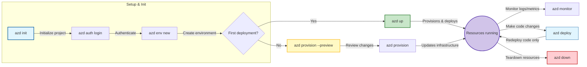
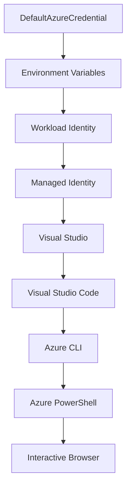

# AZD মৌলিক বিষয় - মূল ধারণা এবং মৌলিক বিষয়াবলী

**অধ্যায় নেভিগেশন:**
- **📚 কোর্স হোম**: [নতুনদের জন্য AZD](../../README.md)
- **📖 বর্তমান অধ্যায়**: অধ্যায় ১ - ভিত্তি ও দ্রুত শুরু
- **⬅️ পূর্ববর্তী**: [কোর্স পর্যালোচনা](../../README.md#-chapter-1-foundation--quick-start)
- **➡️ পরবর্তী**: [ইনস্টলেশন ও সেটআপ](installation.md)
- **🚀 পরবর্তী অধ্যায়**: [অধ্যায় ২: AI-প্রথম উন্নয়ন](../chapter-02-ai-development/microsoft-foundry-integration.md)

## পরিচিতি

> `azd 1.37.2` এর বিরুদ্ধে পর্যালোচনা করা হয়েছে (নভেম্বর ২০২৬)। Bash কমান্ডগুলি উদ্ধৃত প্লেসহোল্ডার ব্যবহার করে যা আপনাকে প্রতিস্থাপন করতে হবে। টেমপ্লেট ওয়ার্কফ্লোগুলি বর্তমান ডিরেক্টরি আরম্ভ করতে `.` ব্যবহার করে; ডিরেক্টরি আর্গুমেন্ট ব্যতীত, টেমপ্লেট আরম্ভ একটি সাবডিরেক্টরি তৈরি করে এবং আপনার শেলের কাজের ডিরেক্টরি পরিবর্তন করে না। উন্নত স্নিপেটগুলি নমুনা স্বরূপ, সম্পূর্ণ প্রকল্প নয়।

এই পাঠে আপনাকে Azure Developer CLI (azd) সঙ্গে পরিচয় করানো হবে, একটি শক্তিশালী কমান্ড-লাইন টুল যা স্থানীয় ডেভেলপমেন্ট থেকে Azure ডিপ্লয়মেন্টে আপনার যাত্রা দ্রুততর করে। আপনি মৌলিক ধারণা, মূল বৈশিষ্ট্যগুলি শিখবেন এবং বুঝবেন কীভাবে azd ক্লাউড-নেটিভ অ্যাপ্লিকেশন ডিপ্লয়মেন্টকে সহজ করে তোলে।

## শেখার লক্ষ্যসমূহ

এই পাঠের শেষে, আপনি সক্ষম হবেন:
- Azure Developer CLI কী এবং এর প্রধান উদ্দেশ্য কী তা বোঝা
- টেমপ্লেট, পরিবেশ এবং পরিষেবাগুলির মূল ধারণাগুলি শেখা
- টেমপ্লেট-চালিত উন্নয়ন এবং কোড হিসাবে অবকাঠামো সহ গুরুত্বপূর্ণ বৈশিষ্ট্যগুলি অনুসন্ধান করা
- azd প্রকল্পের গঠন এবং কর্মপ্রবাহ বোঝা
- আপনার উন্নয়ন পরিবেশের জন্য azd ইনস্টল এবং কনফিগার করার জন্য প্রস্তুত থাকা

## শেখার ফলাফল

এই পাঠ শেষ করার পর, আপনি পারবেন:
- আধুনিক ক্লাউড ডেভেলপমেন্ট ওয়ার্কফ্লোতে azd এর ভূমিকা ব্যাখ্যা করা
- azd প্রকল্পের কাঠামোর উপাদানগুলি চিহ্নিত করা
- কীভাবে টেমপ্লেট, পরিবেশ এবং পরিষেবাগুলি একসাথে কাজ করে তা বর্ণনা করা
- azd এর সাথে Infrastructure as Code এর সুবিধাগুলি বুঝতে পারা
- বিভিন্ন azd কমান্ড এবং তাদের উদ্দেশ্য চিনতে পারা

## Azure Developer CLI (azd) কী?

Azure Developer CLI (azd) একটি কমান্ড-লাইন টুল যা আপনার স্থানীয় ডেভেলপমেন্ট থেকে Azure ডিপ্লয়মেন্টে যাত্রাকে দ্রুততর করার জন্য ডিজাইন করা হয়েছে। এটি Azure-তে ক্লাউড-নেটিভ অ্যাপ্লিকেশন তৈরি, ডিপ্লয় এবং পরিচালনার প্রক্রিয়াকে সহজ করে।

### azd দিয়ে আপনি কী ডিপ্লয় করতে পারেন?

azd অনেক ধরনের ওয়ার্কলোডকে সমর্থন করে—এবং তালিকাটি ক্রমাগত বাড়ছে। আজ আপনি azd ব্যবহার করে ডিপ্লয় করতে পারেন:

| ওয়ার্কলোডের ধরন | উদাহরণ | একই ওয়ার্কফ্লো? |
|---------------|----------|----------------|
| **প্রচলিত অ্যাপ্লিকেশনগুলি** | ওয়েব অ্যাপস, REST APIs, স্ট্যাটিক সাইটস | ✅ `azd up` |
| **সার্ভিস এবং মাইক্রোসার্ভিস** | কন্টেইনার অ্যাপস, ফাংশন অ্যাপস, মাল্টি-সার্ভিস ব্যাকএন্ড | ✅ `azd up` |
| **এআই-চালিত অ্যাপ্লিকেশনসমূহ** | মাইক্রোসফট ফাউন্ড্রি মডেলস দ্বারা চালিত চ্যাট অ্যাপস, AI সার্চ সহ RAG সলিউশন | ✅ `azd up` |
| **বুদ্ধিমান এজেন্টসমূহ** | ফাউন্ড্রি-হোস্টেড এজেন্টস, মাল্টি-এজেন্ট অর্কেস্ট্রেশনস | ✅ `azd up` |

মূল অন্তর্দৃষ্টি হল **azd জীবনচক্র একই থাকে আপনি যা কিছু ডিপ্লয় করুন না কেন**। আপনি একটি প্রকল্প আরম্ভ করেন, অবকাঠামো প্রোভিশন করেন, আপনার কোড ডিপ্লয় করেন, আপনার অ্যাপ মনিটর করেন, এবং পরিস্কার করেন—চাই তা একটি সাধারণ ওয়েবসাইট হোক বা একটি উন্নত AI এজেন্ট।

এই ধারাবাহিকতা ডিজাইনের অংশ। azd AI সক্ষমতাগুলোকে একটি অন্যরকম সার্ভিস হিসাবে বিবেচনা করে যা আপনার অ্যাপ্লিকেশন ব্যবহার করতে পারে, এটাকে মৌলিকভাবে আলাদা কিছু হিসাবে নয়। Microsoft Foundry Models দ্বারা সমর্থিত একটি চ্যাট এন্ডপয়েন্ট, azd-এর দৃষ্টিকোণ থেকে, কেবল একটি অন্য সার্ভিস যা কনফিগার এবং ডিপ্লয় করতে হয়।

### 🎯 কেন AZD ব্যবহার করবেন? একটি বাস্তব বিশ্বের তুলনা

আসুন একটি সাধারণ ওয়েব অ্যাপ এবং ডাটাবেস ডিপ্লয় করার তুলনা করি:

#### ❌ AZD ছাড়া: ম্যানুয়াল আজুর ডিপ্লয়মেন্ট (৩০+ মিনিট)

**চিত্রস্বরূপ Bash তুলনা, রানযোগ্য অ্যাপ্লিকেশন স্টার্টার নয়।** এটি বিদ্যমান অ্যাপ্লিকেশন কোড, অনন্য রিসোর্স নাম, আজুর CLI প্রমাণীকরণ, এবং যে কোন প্রয়োজনীয় CLI এক্সটেনশন ধরে নেয়। সমর্থিত এন্ড-টু-এন্ড পাথের জন্য নিচের টেমপ্লেট ব্যায়ামটি ব্যবহার করুন।

```bash
# Step 1: Create resource group
az group create --name myapp-rg --location eastus

# Step 2: Create App Service Plan
az appservice plan create --name myapp-plan \
  --resource-group myapp-rg \
  --sku B1 --is-linux

# Step 3: Create Web App
az webapp create --name myapp-web-unique123 \
  --resource-group myapp-rg \
  --plan myapp-plan \
  --runtime "NODE:22-lts"

# Step 4: Create Cosmos DB account (10-15 minutes)
az cosmosdb create --name myapp-cosmos-unique123 \
  --resource-group myapp-rg \
  --kind MongoDB

# Step 5: Create database
az cosmosdb mongodb database create \
  --account-name myapp-cosmos-unique123 \
  --resource-group myapp-rg \
  --name tododb

# Step 6: Create collection
az cosmosdb mongodb collection create \
  --account-name myapp-cosmos-unique123 \
  --resource-group myapp-rg \
  --database-name tododb \
  --name todos

# Step 7: Get connection string
CONN_STR=$(az cosmosdb keys list \
  --name myapp-cosmos-unique123 \
  --resource-group myapp-rg \
  --type connection-strings \
  --query "connectionStrings[0].connectionString" -o tsv)

# Step 8: Configure app settings
az webapp config appsettings set \
  --name myapp-web-unique123 \
  --resource-group myapp-rg \
  --settings MONGODB_URI="$CONN_STR"

# Step 9: Enable logging
az webapp log config --name myapp-web-unique123 \
  --resource-group myapp-rg \
  --application-logging filesystem \
  --detailed-error-messages true

# Step 10: Set up Application Insights
az monitor app-insights component create \
  --app myapp-insights \
  --location eastus \
  --resource-group myapp-rg

# Step 11: Link App Insights to Web App
INSTRUMENTATION_KEY=$(az monitor app-insights component show \
  --app myapp-insights \
  --resource-group myapp-rg \
  --query "instrumentationKey" -o tsv)

az webapp config appsettings set \
  --name myapp-web-unique123 \
  --resource-group myapp-rg \
  --settings APPINSIGHTS_INSTRUMENTATIONKEY="$INSTRUMENTATION_KEY"

# Step 12: Build application locally
npm install
npm run build

# Step 13: Create deployment package
zip -r app.zip . -x "*.git*" "node_modules/*"

# Step 14: Deploy application
az webapp deployment source config-zip \
  --resource-group myapp-rg \
  --name myapp-web-unique123 \
  --src app.zip

# Step 15: Wait and pray it works 🙏
# (No automated validation, manual testing required)
```

**সমস্যাসমূহ:**
- ❌ মনে রাখার জন্য ১৫+ কমান্ড এবং সেগুলো সঠিক ক্রমে কার্যকর করা
- ❌ ৩০-৪৫ মিনিটের ম্যানুয়াল কাজ
- ❌ ভুল করা সহজ (টাইপো, ভুল প্যারামিটার)
- ❌ ক্রেডেনশিয়ালস স্পষ্ট নিয়ন্ত্রণ প্রয়োজন; ডিবাগ লগ এবং শেল ট্রেসিং এগুলো প্রকাশ করতে পারে
- ❌ কিছু ভুল হলে স্বয়ংক্রিয় রোলব্যাক নেই
- ❌ টিমের সদস্যদের জন্য পুনরায় তৈরি করা কঠিন
- ❌ প্রতিবার আলাদা (পুনরুক্তিযোগ্য নয়)

#### ✅ AZD সহ: স্বয়ংক্রিয় ডিপ্লয়মেন্ট (৫টি কমান্ড, ১০-১৫ মিনিট)

```bash
# Step 1: Initialize from template
azd init --template todo-nodejs-mongo .

# Step 2: Authenticate
azd auth login

# Step 3: Select the environment created during init
azd env select dev

# Step 4: Preview changes (optional but recommended)
azd provision --preview

# Step 5: Deploy everything
azd up

# ✨ Done! Everything is deployed, configured, and monitored
```

**উপকারিতা:**
- ✅ **৫টি কমান্ড** বনাম ১৫+ ম্যানুয়াল ধাপ
- ✅ **১০-১৫ মিনিট** মোট সময় (অধিকাংশ সময় অপেক্ষা করতে হয় Azure এর জন্য)
- ✅ **স্বল্প ম্যানুয়াল ভুল** - সামঞ্জস্যপূর্ণ, টেমপ্লেট-চালিত ওয়ার্কফ্লো
- ✅ **সিকিউর সিক্রেট হ্যান্ডলিং** - অনেক টেমপ্লেটে Azure-ব্যবস্থাপিত সিক্রেট স্টোরেজ ব্যবহৃত হয়
- ✅ **পুনরাবৃত্ত ডিপ্লয়মেন্ট** - প্রতিবার একই ওয়ার্কফ্লো
- ✅ **পুনরাবৃত্ত অবকাঠামো সংজ্ঞা** - কোটা, অঞ্চল উপলভ্যতা এবং টেমপ্লেট সংস্করণ অনুসারে
- ✅ **টিম-প্রস্তুত** - যেকেউ একই কমান্ড দিয়ে ডিপ্লয় করতে পারে
- ✅ **ইনফ্রাস্ট্রাকচার অ্যাজ কোড** - সংস্করণ নিয়ন্ত্রিত Bicep টেমপ্লেট
- ✅ **টেমপ্লেট-সংজ্ঞায়িত মনিটরিং** - টেমপ্লেটে অন্তর্ভুক্ত করলে অ্যাপ্লিকেশন ইনসাইটস

### সময় এবং নির্ভরযোগ্যতা

উপরের সময়কাল অনুমান, বেঞ্চমার্ক নয়। azd আপনাকে কমান্ড সমন্বয় করতে সাহায্য করে, তবে ডিপ্লয়মেন্ট সময় নির্ধারণ, ত্রুটি নির্মূল বা স্বয়ংক্রিয় অ্যাপ্লিকেশন/ডাটাবেস রোলব্যাক গ্যারান্টি দেয় না। সোর্স কন্ট্রোল-এ কাজ করা সংস্করণ রাখুন এবং রিকভারি পদ্ধতি পরীক্ষা করুন।

## প্রধান ধারণা

### টেমপ্লেটসমূহ
টেমপ্লেটগুলি azd-এর ভিত্তি। এগুলো ধারণ করে:
- **অ্যাপ্লিকেশন কোড** - আপনার সোর্স কোড এবং নির্ভরশীলতা
- **ইনফ্রাস্ট্রাকচার সংজ্ঞা** - Bicep অথবা Terraform-এ সংজ্ঞায়িত Azure রিসোর্স
- **কনফিগারেশন ফাইল** - সেটিংস এবং পরিবেশ ভেরিয়েবল
- **ডিপ্লয়মেন্ট স্ক্রিপ্ট** - স্বয়ংক্রিয় ডিপ্লয়মেন্ট ওয়ার্কফ্লো

### পরিবেশসমূহ
পরিবেশগুলো বিভিন্ন ডিপ্লয়মেন্ট লক্ষ্যমাত্রা উপস্থাপন করে:
- **ডেভেলপমেন্ট** - টেস্টিং এবং ডেভেলপমেন্টের জন্য
- **স্টেজিং** - প্রি-প্রোডাকশন পরিবেশ
- **প্রোডাকশন** - লাইভ প্রোডাকশন পরিবেশ

প্রতিটি পরিবেশ তার নিজস্ব রক্ষণাবেক্ষণ করে:
- পরিবেশের নাম এবং মান; রিসোর্স আইসোলেশন নির্ভর করে অবকাঠামো টেমপ্লেটের উপর
- কনফিগারেশন সেটিংস
- ডিপ্লয়মেন্ট অবস্থা

### সার্ভিসসমূহ
`azure.yaml`-এ সার্ভিসগুলি ডিপ্লয়যোগ্য অ্যাপ্লিকেশন উপাদান বর্ণনা করে:
- **ফ্রন্টএন্ড** - ওয়েব অ্যাপ্লিকেশন, SPA
- **ব্যাকএন্ড** - API, মাইক্রোসার্ভিস

ডাটাবেস এবং স্টোরেজ সাধারণত অবকাঠামো রিসোর্স হিসেবে প্রদান করা হয়, উদ্ভাবিত সার্ভিস হোস্ট যেমন `host: postgres` নয়।

## মূল বৈশিষ্ট্যসমূহ

### ১। টেমপ্লেট-চালিত ডেভেলপমেন্ট
```bash
# Browse available templates
azd template list

# Initialize from a template
azd init --template "<template-name>" .
```

### ২। ইনফ্রাস্ট্রাকচার অ্যাজ কোড
- **Bicep** - Azure-এর ডোমেইন-স্পেসিফিক ভাষা
- **Terraform** - মাল্টি-ক্লাউড ইনফ্রাস্ট্রাকচার টুল
- Bicep কম্পাইল করে ARM টেমপ্লেটে; কাঁচা ARM JSON একটি আলাদা বিল্ট-ইন `infra.provider` নয়।

### ৩। সংযুক্ত ওয়ার্কফ্লো
```bash
# Complete deployment workflow
azd up            # Provision + Deploy this is hands off for first time setup

# 🧪 NEW: Preview infrastructure changes before deployment (SAFE)
azd provision --preview    # Simulate infrastructure deployment without making changes

azd provision     # Create Azure resources if you update the infrastructure use this
azd deploy        # Deploy application code or redeploy application code once update
azd down          # Clean up resources
```

#### 🛡️ প্রিভিউসহ নিরাপদ অবকাঠামো পরিকল্পনা
`azd provision --preview` কমান্ড নিরাপদ ডিপ্লয়মেন্টের জন্য একটি বিপ্লব:
- **ড্রাই-রান বিশ্লেষণ** - কি তৈরি হবে, পরিবর্তিত হবে, অথবা মুছে ফেলা হবে তা দেখায়
- **কোনও অবকাঠামো প্রয়োগ নেই** - প্রোভাইডার পরিবর্তন পর্যালোচনা করে; প্রথমে প্রকল্প হুকগুলি পরীক্ষা করুন, কারণ হুক কমান্ডগুলিতে পার্শ্বপ্রতিক্রিয়া থাকতে পারে
- **টিম সহযোগিতা** - ডিপ্লয়মেন্টের আগে প্রিভিউ ফলাফল শেয়ার করুন
- **খরচ পরিকল্পনার ইনপুট** - প্রস্তাবিত SKU গুলো মূল্যায়ন করুন, তারপর Azure প্রাইসিং ক্যালকুলেটরের সাথে দাম নির্ণয় করুন; প্রিভিউ দাম নির্ণয় করে না

```bash
# Example preview workflow
azd provision --preview           # See what will change
# Review the output, discuss with team
azd provision                     # Apply changes with confidence
```

### 📊 ভিজ্যুয়াল: AZD ডেভেলপমেন্ট ওয়ার্কফ্লো



**ওয়ার্কফ্লো ব্যাখ্যা:**
1. **Init** - টেমপ্লেট বা নতুন প্রজেক্ট দিয়ে শুরু করুন
2. **Auth** - Azure-তে প্রমাণীকরণ করুন
3. **Environment** - পৃথক ডিপ্লয়মেন্ট পরিবেশ তৈরি করুন
4. **Preview** - 🆕 সর্বদা প্রথমে অবকাঠামো পরিবর্তনের পূর্বরূপ দেখুন (নিরাপদ অনুশীলন)
5. **Provision** - Azure সম্পদ তৈরি/আপডেট করুন
6. **Deploy** - আপনার অ্যাপ্লিকেশন কোড পাঠান
7. **Monitor** - অ্যাপ্লিকেশন কর্মক্ষমতা পর্যবেক্ষণ করুন
8. **Iterate** - পরিবর্তন করুন এবং কোড পুনরায় ডিপ্লয় করুন
9. **Cleanup** - কাজ শেষ হলে সম্পদগুলি অপসারণ করুন

### ৪. পরিবেশ ব্যবস্থাপনা
```bash
# Create and manage environments
azd env new "<environment-name>"
azd env select "<environment-name>"
azd env list
```

### ৫. এক্সটেনশন এবং AI কমান্ডসমূহ

azd মূল CLI এর বাইরে ক্ষমতা যুক্ত করতে একটি এক্সটেনশন সিস্টেম ব্যবহার করে। এটি বিশেষত AI ওয়ার্কলোডের জন্য খুবই উপকারী:

```bash
# List available extensions
azd extension list

# Install the GA Foundry bundle (requires azd >= 1.37.0)
azd ext install microsoft.foundry

# Initialize an AI agent project interactively
azd ai agent init

# Test a deployed agent (shows latency and time-to-first-byte)
azd ai agent invoke

# Start the MCP server for AI-assisted development (Alpha)
azd mcp start
```

**এজেন্ট লাইফসাইকেল, শুরু থেকে শেষ পর্যন্ত।** GA `microsoft.foundry` বান্ডিলে `azure.ai.agents` এবং অন্যান্য ছয়টি মূল এক্সটেনশন অন্তর্ভুক্ত। মূল্যায়নের জন্য আলাদাভাবে `azure.ai.evaluations` ইনস্টল করুন। এই ওয়ার্কফ্লোর জন্য `azd >= 1.37.0` ব্যবহার করুন। আপনাকে প্রথম দিন এই সব একসাথে ব্যবহার করার দরকার নেই:

| ধাপ | কমান্ড | কী করে |
|-------|---------|--------------|
| **স্ক্যাফোল্ড** | `azd ai agent init --template <path-to-azure.yaml>` | বর্তমান এজেন্ট প্রজেক্ট টেমপ্লেট গ্রহণ করুন |
| **লোকাল রান** | `azd ai agent run`, তারপর অন্য একটি টার্মিনালে `azd ai agent invoke --local "Test prompt"` | এজেন্ট ইনস্পেক্টরে লোকাল কার্যকলাপ পর্যবেক্ষণ; মডেল কলগুলি এখনও Azure ব্যবহার করে |
| **ডিপ্লয়** | `azd deploy` | কোড-মোড হোস্টেড এজেন্টের জন্য, রিমোট Foundry বিল্ডের জন্য সোর্স আপলোড করুন |
| **পরীক্ষা** | `azd ai agent invoke` | এজেন্টকে কল করুন এবং প্রতিক্রিয়া সময় দেখুন |
| **পরিমাপ** | `azd ai eval init`, `generate`, `run start` | আলাদা এক্সটেনশন ব্যবহার করে কনফিগার, ডিপ্লয় এবং মূল্যায়ন চালান |
| **উন্নতি** | `azd ai agent optimize --eval <evaluation-name> --optimize-model <optimizer-deployment>` | এজেন্ট অপ্টিমাইজেশনের জন্য উপযোগী মূল্যায়ন পুনরায় ব্যবহার করুন |
| **পরিদর্শন** | `azd ai agent endpoint show` | লাইভ এন্ডপয়েন্ট কনফিগারেশন দেখুন |
| **পরিষ্কার** | `azd ai agent delete` | একটি হোস্টেড এজেন্ট এবং তার সব সংস্করণ মুছুন |

> শুরু করুন [GA হোস্টেড-এজেন্ট ওয়াকথ্রু](../chapter-02-ai-development/microsoft-foundry-integration.md#hosted-agent-walkthrough-ga) থেকে, যা পূর্বশর্ত, প্রোভিশনিং, এবং নিরাপদ পরিষ্কারকরণের তথ্য দেয়। এক্সটেনশনগুলি আরও বিস্তারিতভাবে [AZD AI CLI কমান্ডসমূহ](../chapter-08-production/production-ai-practices.md#azd-ai-cli-commands-and-extensions) রেফারেন্সে আলোচনা করা হয়েছে।

## 📁 প্রজেক্ট কাঠামো

একটি সাধারণ azd প্রজেক্ট কাঠামো:
```
my-app/
├── .azure/                  # Local environments and selected-environment config
│   ├── config.json
│   └── dev/.env
├── .devcontainer/          # Development container config
├── .github/workflows/      # GitHub Actions
├── .vscode/               # VS Code settings
├── infra/                 # Infrastructure code
│   ├── main.bicep        # Main infrastructure template
│   ├── main.parameters.json
│   └── modules/          # Reusable modules
├── src/                  # Application source code
│   ├── api/             # Backend services
│   └── web/             # Frontend application
├── azure.yaml           # azd project configuration
└── README.md
```

## 🔧 কনফিগারেশন ফাইলসমূহ

### azure.yaml
প্রধান প্রজেক্ট কনফিগারেশন ফাইল:
```yaml
name: my-awesome-app
metadata:
  template: my-template@1.0.0

services:
  web:
    project: ./src/web
    language: js
    host: appservice
  api:
    project: ./src/api
    language: js
    host: appservice

hooks:
  preprovision:
    shell: pwsh
    run: echo "Preparing to provision..."
```

### .azure/config.json
প্রজেক্ট-লোকাল ডিফল্ট পরিবেশের পছন্দ (চিত্রমূলক; azd দ্বারা পরিচালিত):
```json
{
  "defaultEnvironment": "dev"
}
```

## 🎪 সাধারণ ওয়ার্কফ্লো সহ হাতে কলমে অনুশীলনসমূহ

> **💡 শেখার টিপ:** আপনার AZD দক্ষতা ক্রমাগত বাড়ানোর জন্য এই অনুশীলনগুলি ধারাবাহিকভাবে অনুসরণ করুন।

### 🎯 অনুশীলন ১: আপনার প্রথম প্রজেক্ট শুরু করুন

**লক্ষ্য:** একটি AZD প্রজেক্ট তৈরি করুন এবং তার কাঠামো অন্বেষণ করুন

**ধাপসমূহ:**
```bash
# Use a proven template
mkdir azd-basics-practice
cd azd-basics-practice
# Choose "dev" for the environment name when prompted
azd init --template todo-nodejs-mongo .

# Explore the generated files
ls -la  # View all files including hidden ones

# Key files created:
# - azure.yaml (main config)
# - infra/ (infrastructure code)
# - src/ (application code)
```

**✅ সফলতা:** আপনার কাছে azure.yaml, infra/, এবং src/ ডিরেক্টরি আছে

---

### 🎯 অনুশীলন ২: Azure-এ ডিপ্লয় করুন

**লক্ষ্য:** সম্পূর্ণ ইনড-টু-এন্ড ডিপ্লয়মেন্ট সম্পন্ন করা

**ধাপসমূহ:**
```bash
# 1. Authenticate
azd auth login

# 2. Select the dev environment created in Exercise 1
azd env select dev
azd env set AZURE_LOCATION eastus

# 3. Preview changes (RECOMMENDED)
azd provision --preview

# 4. Deploy everything
azd up

# 5. Verify deployment
azd show    # View your app URL
```

**প্রত্যাশিত সময়:** ১০-১৫ মিনিট  
**✅ সফলতা:** অ্যাপ্লিকেশন URL ব্রাউজারে খোলে

---

### 🎯 ব্যায়াম ৩: একাধিক পরিবেশ

**লক্ষ্য:** dev এবং staging এ ডিপ্লয় করা

**ধাপসমূহ:**
```bash
# Already have dev, create staging
azd env new staging
azd env set AZURE_LOCATION westus2
azd up

# Switch between them
azd env list
azd env select dev
```

**✅ সফলতা:** Azure Portal-এ দুটি পৃথক রিসোর্স গ্রুপ

**পরিষ্কারকরণ:** ব্যায়াম ৩ একটি দ্বিতীয় বিলযোগ্য ডিপ্লয়মেন্ট তৈরি করে। শেষ হলে উভয়ই মুছে ফেলুন:

```bash
azd down --environment dev
azd down --environment staging
```

---

### 🛡️ ধ্বংসাত্মক পরিষ্কারকরণ: `azd down --force --purge`

যখন আপনি ইচ্ছাকৃতভাবে নির্বাচিত পরিবেশের Azure রিসোর্সগুলি মুছে ফেলতে চান:

```bash
azd down --force --purge
```

**এটি যা করে:**
- `--force`: কোন নিশ্চিতকরন প্রম্পট নয়
- `--purge`: এছাড়াও সমর্থিত সফট-ডিলেটেড রিসোর্স (উদাহরণস্বরূপ Key Vaults) কে স্থায়ীভাবে মুছে ফেলে, যেখানে purge protection অনুমতি দেয়। এটি স্থানীয় `.azure/` ডিরেক্টরি মুছে ফেলে না।

**ব্যবহার করুন যখন:** একটি ব্যবহারযোগ্য পরিবেশ শেষ হয়ে গেছে। ধ্বংসাত্মক পরিষ্কারকরণকে প্রাথমিক প্রতিক্রিয়া হিসাবে বিবেচনা করবেন না যখন প্রমাণীকরণ, কোটা, বা কনফিগারেশনের ত্রুটি হয়।

---

## 🎪 মূল কর্মপ্রবাহ রেফারেন্স

### একটি নতুন প্রকল্প শুরু করা
```bash
# Method 1: Use existing template
azd init --template todo-nodejs-mongo .

# Method 2: Start from scratch
azd init

# Method 3: Use current directory
azd init .
```

### উন্নয়ন চক্র
```bash
# Set up development environment
azd auth login
azd env new dev
azd env select dev

# Deploy everything
azd up

# Make changes and redeploy
azd deploy

# Clean up when done
azd down --force --purge # Deletes this environment's discovered Azure resources; review before forcing deletion.
```

## `azd down --force --purge` বোঝা
`azd down --force --purge` কমান্ডটি একটি শক্তিশালী উপায় আপনার azd পরিবেশ এবং সব সংশ্লিষ্ট রিসোর্স সম্পূর্ণরূপে ধ্বংস করার জন্য। প্রতিটি ফ্ল্যাগ কী করে তার বিস্তারিত এখানে:
```
--force
```
- নিশ্চিতকরন প্রম্পট এড়িয়ে যায়।
- অটোমেশন বা স্ক্রিপ্টিং এর জন্য উপযোগী যেখানে ম্যানুয়াল ইনপুট সম্ভব নয়।
- পারমিশন, purge protection, বা মুছে ফেলার ব্যর্থতা বাইপাস করে না।

```
--purge
```
অতিরিক্ত নিশ্চিতকরণের প্রয়োজন ছাড়াই সমর্থিত সফট-মুছে ফেলা Azure সম্পদ স্থায়ীভাবে মুছে দেয়। পরিস্কার সুরক্ষা এবং অনুমতিগুলি এখনও প্রযোজ্য। এটি **কখনই** স্থানীয় পরিবেশ বা `.azure/` ফোল্ডারটি মুছে ফেলে না।


### কেন উভয় ব্যবহার করবেন?
শুধুমাত্র তখনই উভয় ব্যবহার করুন যখন আপনি নির্বাচিত পরিবেশের Azure সম্পদ মুছে ফেলতে এবং পুনরুদ্ধারযোগ্য সম্পদগুলি পুড়্জ করতে চান। এটি ধ্বংসাত্মক পরিস্কার, সাধারণ মেরামত বা স্থানীয়-রাষ্ট্র রিসেট নয়।

এটি বিশেষভাবে সহায়ক যখন Azure পোর্টালে ম্যানুয়ালি সম্পদ মুছে ফেলা হয় বা যখন টেমপ্লেট, পরিবেশ বা সম্পদ গ্রুপ নামকরণ বিধি পরিবর্তন করা হয়।


### একাধিক পরিবেশ পরিচালনা
```bash
# Create staging environment
azd env new staging
azd env select staging
azd up

# Switch back to dev
azd env select dev

# Compare environments
azd env list
```

## 🔐 প্রমাণীকরণ এবং শংসাপত্র

মোতায়েন প্রমাণীকরণ (`azd auth login`) এবং অ্যাপ্লিকেশন SDK প্রমাণীকরণ (`DefaultAzureCredential`) আলাদা করুন। এগুলি পৃথক। azd ডিফল্টরূপে Azure CLI শংসাপত্র ব্যবহার করে না।

### Azure CLI প্রমাণীকরণ (`az login`)

azd এর জন্য `azd auth login` চালান। নিম্নলিখিত Azure CLI কমান্ডগুলি ঐচ্ছিক এবং `az` কমান্ডগুলি আলাদাভাবে প্রমাণীকরণ করে:

```bash
# Interactive login (opens browser)
az login

# Login with specific tenant
az login --tenant "<tenant-id>"

# Login with service principal
az login --service-principal -u "<app-id>" -p "<password>" --tenant "<tenant-id>"

# Check current login status
az account show

# List available subscriptions
az account list --output table

# Set default subscription
az account set --subscription "<subscription-id>"
```

### প্রমাণীকরণ প্রবাহ
1. **ইন্টারেক্টিভ লগইন**: প্রমাণীকরণের জন্য আপনার ডিফল্ট ব্রাউজার খুলে দেয়
2. **ডিভাইস কোড ফ্লো**: ব্রাউজার অ্যাক্সেস ছাড়াই পরিবেশগুলির জন্য
3. **সার্ভিস প্রিন্সিপাল**: অটোমেশন এবং CI/CD সিস্টেমের জন্য
4. **ম্যানেজড আইডেন্টিটি**: Azure-হোস্টেড অ্যাপ্লিকেশনগুলির জন্য

### DefaultAzureCredential চেইন

`DefaultAzureCredential` একটি ক্রেডেনশিয়াল ধরন যা স্বয়ংক্রিয়ভাবে একটি নির্দিষ্ট ক্রমে একাধিক ক্রেডেনশিয়াল সোর্স চেষ্টা করে সহজতর প্রমাণীকরণ অভিজ্ঞতা প্রদান করে:

#### অ্যাপ্লিকেশন SDK ক্রেডেনশিয়াল চেইন

সঠিক চেইন Azure Identity SDK ভাষা, সংস্করণ, ইনস্টল করা প্লাগইন এবং বিকল্পগুলির উপর নির্ভর করে। এই চিত্রটি ধারণাগত, এটি একটি নির্দিষ্ট azd প্রমাণীকরণ ক্রম নয়; সাম্প্রতিক SDK-তেও Azure Developer CLI ক্রেডেনশিয়াল অন্তর্ভুক্ত থাকতে পারে।


#### 1. পরিবেশ ভেরিয়েবল
```bash
# Set environment variables for service principal
export AZURE_CLIENT_ID="<app-id>"
export AZURE_CLIENT_SECRET="<password>"
export AZURE_TENANT_ID="<tenant-id>"
```

#### 2. ওয়ার্কলোড আইডেন্টিটি (Kubernetes/GitHub Actions)
স্বয়ংক্রিয়ভাবে ব্যবহৃত:
- Azure Kubernetes Service (AKS)-এ ওয়ার্কলোড আইডেন্টিটির সাথে
- GitHub Actions-এ OIDC ফেডারেশনের সাথে
- অন্যান্য ফেডারেটেড আইডেন্টিটি পরিস্থিতিতে

#### 3. ম্যানেজড আইডেন্টিটি
Azure রিসোর্সের জন্য যেমন:
- ভার্চুয়াল মেশিন
- অ্যাপ সার্ভিস
- Azure Functions
- কনটেইনার ইনস্ট্যান্স

```bash
# Inspect a deployed Container App's configured identity (requires az login)
az containerapp show --name "<app-name>" --resource-group "<rg-name>" --query identity
```

#### 4. ডেভেলপার টুলস ইন্টিগ্রেশন
- **Visual Studio**: স্বয়ংক্রিয়ভাবে সাইন-ইন করা অ্যাকাউন্ট ব্যবহার করে
- **VS Code**: সমর্থন SDK এবং তার সমর্থিত ব্রোকার/প্লাগইন সেটআপের উপর নির্ভর করে
- **Azure CLI**: `az login` ক্রেডেনশিয়াল ব্যবহার করে (সর্বাধিক সাধারণ স্থানীয় ডেভেলপমেন্টের জন্য)

### AZD প্রমাণীকরণ সেটআপ

```bash
# Method 1: Direct azd authentication (recommended)
azd auth login

# Method 2: Direct azd authentication
azd auth login --use-device-code  # For headless environments

# Method 3: Check authentication status
azd auth login --check-status

# Method 4: Logout and re-authenticate
azd auth logout
azd auth login
```

### প্রমাণীকরণ সেরা অনুশীলন

#### স্থানীয় উন্নয়নের জন্য
```bash
# 1. Log in to azd
azd auth login

# 2. Select the subscription for this initialized environment
azd env set AZURE_SUBSCRIPTION_ID "<subscription-id>"

# 3. Check azd sign-in details (read the status message)
azd auth login --check-status
```

#### CI/CD পাইপলাইনগুলির জন্য
```yaml
# Partial GitHub Actions steps: assumes checkout, azd installation,
# required AZURE_* environment values, and pipeline secret configuration.
- name: Deploy with azd
  run: |
    azd auth login --client-id ${{ secrets.AZURE_CLIENT_ID }} \
                    --client-secret ${{ secrets.AZURE_CLIENT_SECRET }} \
                    --tenant-id ${{ secrets.AZURE_TENANT_ID }}
    azd up --no-prompt
```

#### প্রোডাকশন পরিবেশের জন্য
- Azure রিসোর্সে চলাকালে **ম্যানেজড আইডেন্টিটি** ব্যবহার করুন
- অটোমেশন পরিস্থিতির জন্য **সার্ভিস প্রিন্সিপাল** ব্যবহার করুন
- কোড বা কনফিগারেশন ফাইলে ক্রেডেনশিয়াল সংরক্ষণ এড়ান
- সংবেদনশীল কনফিগারেশনের জন্য **Azure Key Vault** ব্যবহার করুন

### সাধারণ প্রমাণীকরণ সমস্যা এবং সমাধান

#### সমস্যা: "কোন সাবস্ক্রিপশন পাওয়া যায়নি"
```bash
# Solution: Set default subscription
az account list --output table
az account set --subscription "<subscription-id>"
azd env set AZURE_SUBSCRIPTION_ID "<subscription-id>"
```

#### সমস্যা: "অপর্যাপ্ত অনুমতি"
```bash
# Solution: Check and assign required roles
az role assignment list --assignee $(az account show --query user.name --output tsv)

# Common required roles:
# - Contributor (for resource management)
# - User Access Administrator (for role assignments)
```

#### সমস্যা: "টোকেন সময় শেষ"
```bash
# Solution: Re-authenticate
az logout
az login
azd auth logout
azd auth login
```

### বিভিন্ন পরিস্থিতিতে প্রমাণীকরণ

#### স্থানীয় উন্নয়ন
```bash
# Personal development account
az login
azd auth login
```

#### টিম উন্নয়ন
```bash
# Use specific tenant for organization
az login --tenant contoso.onmicrosoft.com
azd auth login --tenant-id "<tenant-id>"
```

#### বহুমালিক পরিস্থিতি
```bash
# Switch between tenants
az login --tenant tenant1.onmicrosoft.com
azd auth login --tenant-id "<tenant-1-id>"
# Select an environment configured with tenant 1's subscription
azd env select tenant1-dev
# Deploy to tenant 1
azd up

az login --tenant tenant2.onmicrosoft.com  
azd auth login --tenant-id "<tenant-2-id>"
azd env select tenant2-dev
# Deploy to tenant 2
azd up
```

### নিরাপত্তা বিবেচনা

1. **ক্রেডেনশিয়াল সংরক্ষণ**: কখনোই সোর্স কোডে ক্রেডেনশিয়াল সংরক্ষণ করবেন না
2. **পরিধি সীমাবদ্ধতা**: সার্ভিস প্রিন্সিপালের জন্য সর্বনিম্ন-অনুমতিতে নীতি ব্যবহার করুন
3. **টোকেন রোটেশন**: নিয়মিত সার্ভিস প্রিন্সিপালের সিক্রেট ঘুরান
4. **অডিট ট্রেইল**: প্রমাণীকরণ এবং ডেপ্লয়মেন্ট কার্যক্রম মনিটর করুন
5. **নেটওয়ার্ক সিকিউরিটি**: সম্ভব হলে প্রাইভেট এন্ডপয়েন্ট ব্যবহার করুন

### প্রমাণীকরণ সমস্যা সমাধান

```bash
# Debug authentication issues
azd auth login --check-status
az account show
az account get-access-token

# Common diagnostic commands
whoami                          # Current user context
az ad signed-in-user show      # Microsoft Entra ID user details
az group list                  # Test resource access
```

## কমান্ড আবিষ্করণ

### আবিষ্করণ
```bash
azd template list              # Browse templates
azd template list --help       # Template discovery options
azd init --help               # Initialization options
```

### প্রকল্প ব্যবস্থাপনা
```bash
azd show                     # Project overview
azd env list                # Available environments and selected default
azd config show            # Configuration settings
```

### মনিটরিং
```bash
azd monitor                  # Open Azure portal monitoring
azd monitor --logs           # View application logs
azd monitor --live           # View live metrics
azd pipeline config          # Set up CI/CD
```

## সেরা অনুশীলন

### 1. অর্থবহ নাম ব্যবহার করুন
```bash
# Good
azd env new production-east
azd init --template todo-nodejs-mongo .

# Avoid
azd env new env1
azd init --template template1 .
```

### 2. টেমপ্লেট ব্যবহার করুন
- বিদ্যমান টেমপ্লেট দিয়ে শুরু করুন
- আপনার প্রয়োজন অনুযায়ী কাস্টমাইজ করুন
- আপনার সংস্থার জন্য পুনঃব্যবহারযোগ্য টেমপ্লেট তৈরি করুন

### 3. পরিবেশ বিচ্ছিন্নতা
- dev/staging/prod এর জন্য পৃথক পরিবেশ ব্যবহার করুন
- কখনো সরাসরি স্থানীয় মেশিন থেকে প্রোডাকশনে ডেপ্লয় করবেন না
- প্রোডাকশন ডেপ্লয়মেন্টের জন্য CI/CD পাইপলাইন ব্যবহার করুন

### 4. কনফিগারেশন ম্যানেজমেন্ট
- সিক্রেটের জন্য ম্যানেজড আইডেন্টিটি এবং Key Vault ব্যবহার করুন; সাধারণ `azd env set` মান স্থানীয় প্লেইনটেক্সট
- কনফিগারেশন ভার্সন কন্ট্রোলে রাখুন
- পরিবেশ-নির্দিষ্ট সেটিংস ডকুমেন্ট করুন

## শেখার অগ্রগতি

### নবীন (সপ্তাহ ১-২)
1. azd ইনস্টল করুন এবং প্রমাণীকরণ করুন
2. একটি সাধারণ টেমপ্লেট ডেপ্লয় করুন
3. প্রকল্প কাঠামো বুঝুন
4. মৌলিক কমান্ড শেখা (up, down, deploy)

### মধ্যবর্তী (সপ্তাহ ৩-৪)
1. টেমপ্লেট কাস্টমাইজ করুন
2. একাধিক পরিবেশ পরিচালনা করুন
3. ইन्फ্রাস্ট্রাকচার কোড বুঝুন
4. CI/CD পাইপলাইন সেটআপ করুন

### উন্নত (সপ্তাহ ৫+)
1. কাস্টম টেমপ্লেট তৈরি করুন
2. উন্নত ইन्फ্রাস্ট্রাকচার প্যাটার্ন
3. বহু-অঞ্চল ডেপ্লয়মেন্ট
4. এন্টারপ্রাইজ গ্রেড কনফিগারেশন

## পরবর্তী ধাপ

**📖 অধ্যায় ১ শেখা চালিয়ে যান:**
- [ইনস্টলেশন ও সেটআপ](installation.md) - azd ইনস্টল এবং কনফিগার করুন
- [আপনার প্রথম প্রকল্প](first-project.md) - হ্যান্ডস-অন টিউটোরিয়াল সমাপন করুন
- [কনফিগারেশন গাইড](../chapter-03-configuration/configuration.md) - উন্নত কনফিগারেশন বিকল্প

**🎯 পরবর্তী অধ্যায়ের জন্য প্রস্তুত?**
- [অধ্যায় ২: AI-প্রথম উন্নয়ন](../chapter-02-ai-development/microsoft-foundry-integration.md) - AI অ্যাপ্লিকেশন তৈরি শুরু করুন

## অতিরিক্ত সম্পদ

- [Azure Developer CLI ওভারভিউ](https://learn.microsoft.com/en-us/azure/developer/azure-developer-cli/)
- [টেমপ্লেট গ্যালারি](https://azure.github.io/awesome-azd/)
- [কমিউনিটি স্যাম্পল](https://github.com/Azure-Samples)

---

## 🙋 সচরাচর জিজ্ঞাসিত প্রশ্ন

### সাধারণ প্রশ্ন

**প্র: AZD এবং Azure CLI-র মধ্যে পার্থক্য কী?**

উ: Azure CLI (`az`) পৃথক Azure রিসোর্স ব্যবস্থাপনার জন্য। AZD (`azd`) পুরো অ্যাপ্লিকেশন পরিচালনার জন্য:

```bash
# Azure CLI - Low-level resource management
az webapp create --name myapp --resource-group rg
az sql server create --name myserver --resource-group rg
# ...many more commands needed

# AZD - Application-level management
azd up  # Deploys entire app with all resources
```

**এইভাবে ভাবুন:**
- `az` = পৃথক লেগো ইট দিয়ে কাজ করা
- `azd` = সম্পূর্ণ লেগো সেট নিয়ে কাজ করা

---

**প্র: AZD ব্যবহারের জন্য Bicep বা Terraform জানতে হবে?**

উ: না! টেমপ্লেট দিয়ে শুরু করুন:
```bash
# Use existing template - no IaC knowledge needed
azd init --template todo-nodejs-mongo .
azd up
```

আপনি পরে Bicep শিখতে পারেন ইन्फ্রাস্ট্রাকচার কাস্টমাইজ করার জন্য। টেমপ্লেটগুলো কাজের উদাহরণ দেয় শেখার জন্য।

---

**প্র: AZD টেমপ্লেট চালানোর খরচ কত?**

উ: খরচ অঞ্চল, SKU, আপটাইম, ডাটাবেজ মোড এবং মডেল ব্যবহারের উপর নির্ভর করে পরিবর্তিত হয়। একটি ডেভেলপমেন্ট পরিবেশ সুসজ্জিত না থাকলেও বড় মাসিক চার্জ দিতে পারে; একটি সর্বজনীন $50-150 সীমা আশা করবেন না:

```bash
# Preview resource changes (not prices)
azd provision --preview

# Always cleanup when not using
azd down --force --purge  # Removes all resources
```

**প্রো টিপ:** যেখানে সম্ভব ফ্রি টিয়ার ব্যবহার করুন:
- অ্যাপ সার্ভিসে: F1 (ফ্রি) টিয়ার
- Azure OpenAI: সাধারণ মাসিক ফ্রি টোকেন বরাদ্দ নেই; বর্তমান মডেল এবং অফার মূল্য যাচাই করুন
- Cosmos DB: যোগ্য পরিমাণী-থ্রুপুট অ্যাকাউণ্ট ফ্রি টিয়ারে যেতে পারে; সার্ভারলেস টেমপ্লেট স্বয়ংক্রিয়ভাবে যোগ্য নয়

---

**প্র: আমি কি বিদ্যমান Azure রিসোর্স দিয়ে AZD ব্যবহার করতে পারি?**

উ: হ্যাঁ, তবে নতুন থেকে শুরু করা সহজ। AZD সবচেয়ে ভালো কাজ করে যখন এটি সম্পূর্ণ লাইফসাইকল পরিচালনা করে। বিদ্যমান রিসোর্সের জন্য:

```bash
# Option 1: Import existing resources (advanced)
azd init
# Then modify infra/ to reference existing resources

# Option 2: Start fresh (recommended)
azd init --template "<verified-template-name>" .
azd up  # Creates new environment
```

---

**প্র: আমি কিভাবে আমার প্রকল্প টিমের সাথে শেয়ার করব?**

উ: AZD প্রকল্প Git-এ কমিট করুন (কিন্তু .azure ফোল্ডার নয়):

```bash
# Already in .gitignore by default
.azure/        # Contains secrets and environment data
*.env          # Environment variables

# Team members then:
git clone "<your-repo>"
# Change into the cloned repository before running the remaining commands.
azd auth login
azd env new "<their-name>-dev"
azd up
```

সবাই একই টেমপ্লেট থেকে অভিন্ন ইन्फ্রাস্ট্রাকচার পায়।

---

### সমস্যা সমাধানের প্রশ্ন

**প্র: "azd up" মাঝপথে ব্যর্থ। আমি কী করব?**

উ: ত্রুটিটি দেখুন, ঠিক করুন, তারপর পুনরায় চেষ্টা করুন:

```bash
# Capture detailed diagnostics (redact sensitive values before sharing)
azd up --debug

# Common fixes:

# 1. If quota exceeded:
azd env set AZURE_LOCATION "westus2"  # Try different region

# 2. If resource name conflict:
azd down --force --purge  # Clean slate
azd up  # Retry

# 3. If auth expired:
az login
azd auth login
azd up
```

**সবচেয়ে সাধারণ সমস্যা:** ভুল Azure সাবস্ক্রিপশন নির্বাচন
```bash
az account list --output table
az account set --subscription "<correct-subscription>"
azd env set AZURE_SUBSCRIPTION_ID "<correct-subscription-id>"
```

---

**প্র: আমি কেবল কোড পরিবর্তন ডেপ্লয় করতে চাই, রিপ্রোভিশন ছাড়া?**

উ: `azd deploy` ব্যবহার করুন `azd up` এর পরিবর্তে:

```bash
azd up          # First time: provision + deploy (slow)

# Make code changes...

azd deploy      # Subsequent times: deploy only (fast)
```

গতি তুলনা:
- `azd up`: ১০-১৫ মিনিট (ইনফ্রাস্ট্রাকচার তৈরি করে)
- `azd deploy`: ২-৫ মিনিট (শুধুমাত্র কোড)

---

**প্র: আমি কি ইन्फ্রাস্ট্রাকচার টেমপ্লেট কাস্টমাইজ করতে পারি?**

উ: হ্যাঁ! `infra/` এ Bicep ফাইল সম্পাদনা করুন:

```bash
# After azd init
cd infra/
code main.bicep  # Edit in VS Code

# Preview changes
azd provision --preview

# Apply changes
azd provision
```

**টিপ:** ছোট থেকে শুরু করুন - প্রথমে SKU পরিবর্তন করুন:
```bicep
// infra/main.bicep
sku: {
  name: 'B1'  // Change to 'P1V2' for production
}
```

---

**প্র: আমি কিভাবে AZD দ্বারা তৈরি সবকিছু মুছে ফেলব?**

উ: একটি কমান্ডে সব রিসোর্স সরানো যায়:

```bash
azd down --force --purge

# This deletes:
# - Azure resources/resource groups discovered for the selected environment
# - Supported soft-deleted resources, if purge protection allows
# Local .azure files remain; shared/external resources may remain too.
```

**যখন এই কাজ করুন:**
- একটি টেমপ্লেট টেস্ট করা শেষ হলে
- অন্য প্রকল্পে স্থানান্তর করার সময়
- নতুন করে শুরু করতে চাইলে

**মূল্য যাচাই:** Azure-এ মুছে ফেলার নিশ্চিত করুন এবং ধরে রাখা/শেয়ারকৃত রিসোর্স চেক করুন। পূর্বে হওয়া চার্জ প্রযোজ্য থাকবে।

---

**প্র: আমি যদি ভুলবশত Azure পোর্টালে রিসোর্স মুছে ফেলি?**

উ: AZD স্টেট সিঙ্ক থেকে বেরিয়ে যেতে পারে। পরিষ্কার শুরু করুন:

```bash
# 1. Delete remaining resources only if that is your intent
azd down --force --purge

# 2. Start fresh
azd up

# Alternative: Let AZD detect and fix
azd provision  # Will create missing resources
```

---

### উন্নত প্রশ্ন

**প্র: আমি CI/CD পাইপলাইনে AZD ব্যবহার করতে পারি?**

উ: হ্যাঁ! GitHub Actions উদাহরণ:

```yaml
# .github/workflows/deploy.yml
name: Deploy with AZD

on:
  push:
    branches: [main]

jobs:
  deploy:
    runs-on: ubuntu-latest
    steps:
      - uses: actions/checkout@v4
      
      - name: Install azd
        run: curl -fsSL https://aka.ms/install-azd.sh | bash
      
      - name: Azure Login
        run: |
          azd auth login \
            --client-id ${{ secrets.AZURE_CLIENT_ID }} \
            --client-secret ${{ secrets.AZURE_CLIENT_SECRET }} \
            --tenant-id ${{ secrets.AZURE_TENANT_ID }}
      
      - name: Deploy
        env:
          AZURE_ENV_NAME: dev
          AZURE_LOCATION: ${{ vars.AZURE_LOCATION }}
          AZURE_SUBSCRIPTION_ID: ${{ vars.AZURE_SUBSCRIPTION_ID }}
        run: azd up --no-prompt
```

---

**প্র: আমি কীভাবে সিক্রেট এবং সংবেদনশীল ডেটা পরিচালনা করব?**

উ: স্পষ্টভাবে Key Vault ব্যবহার করুন। `azd env set` সাধারণ মান স্থানীয় পরিবেশ ফাইলে লেখে; এটি স্বয়ংক্রিয়ভাবে ভল্ট তৈরি করে না, ভূমিকা নির্ধারণ করে না বা অ্যাপ্লিকেশনে সিক্রেট ইনজেক্ট করে না।

```bash
# Interactive: create/select a Key Vault secret and save its reference
azd env set-secret DATABASE_PASSWORD
```

আপনাকে যথাযথ ভল্ট অনুমতি নিতে হবে। আপনার ইনফ্রাস্ট্রাকচার/অ্যাপ্লিকেশন এখনও সিক্রেটটির গ্রাহক পর্যন্ত সংযোগ স্থাপন এবং রানটাইম আইডেন্টিটির অ্যাক্সেস দিতে হবে। লগে সিক্রেট মান প্রকাশ করবেন না।

**কখনো কমিট করবেন না:**
- `.azure/` ফোল্ডার (পরিবেশ ডেটা রয়েছে)
- `.env` ফাইল (স্থানীয় সিক্রেট)
- সংযোগ স্ট্রিংসমূহ

---

**প্র: আমি কি একাধিক অঞ্চলে ডেপ্লয় করতে পারি?**

উ: হ্যাঁ, অঞ্চল অনুযায়ী পরিবেশ তৈরি করুন:

```bash
# East US environment
azd env new prod-eastus
azd env set AZURE_LOCATION eastus
azd up

# West Europe environment
azd env new prod-westeurope
azd env set AZURE_LOCATION westeurope
azd up

# Each environment is independent
azd env list
```

প্রকৃত বহুঅঞ্চল অ্যাপ্লিকেশনগুলির জন্য, Bicep টেমপ্লেট কাস্টমাইজ করুন একাধিক অঞ্চলে একযোগে ডেপ্লয় করার জন্য।

---

**প্র: আমি আটকে গেলে কোথায় সাহায্য পাব?**

1. **AZD ডকুমেন্টেশন:** https://learn.microsoft.com/azure/developer/azure-developer-cli/
2. **GitHub Issues:** https://github.com/Azure/azure-dev/issues
3. **Discord:** [Azure Discord](https://discord.gg/microsoft-azure) - #azure-developer-cli চ্যানেল
4. **Stack Overflow:** ট্যাগ `azure-developer-cli`
5. **এই কোর্স:** [সমস্যা সমাধান গাইড](../chapter-07-troubleshooting/common-issues.md)

**প্রো টিপ:** প্রশ্ন করার আগে চালান:
```bash
azd show       # Shows current state
azd version    # Shows your version
```
এই তথ্য আপনার প্রশ্নের সাথে অন্তর্ভুক্ত করুন দ্রুত সাহায্যের জন্য।

---

## 🎓 পরবর্তী কী?

এখন আপনি AZD-এর মূল বিষয়গুলি বুঝতে পেরেছেন। আপনার পথ বেছে নিন:

### 🎯 নবীনদের জন্য:
1. **পরবর্তী:** [ইনস্টলেশন ও সেটআপ](installation.md) - আপনার মেশিনে AZD ইনস্টল করুন
2. **তারপর:** [আপনার প্রথম প্রকল্প](first-project.md) - আপনার প্রথম অ্যাপ ডেপ্লয় করুন
3. **অভ্যাস করুন:** এই পাঠের সব ৩টি অনুশীলন সমাপন করুন

### 🚀 AI ডেভেলপারদের জন্য:
1. **সোজাসুজি যান:** [অধ্যায় ২: AI-প্রথম উন্নয়ন](../chapter-02-ai-development/microsoft-foundry-integration.md)
2. **ডেপ্লয় করুন:** একটি খালি প্রকল্প ডিরেক্টরিতে, `azd init --template get-started-with-ai-chat .` দিয়ে শুরু করুন
3. **শেখা চালিয়ে যান:** ডেপ্লয় করার সময় নির্মাণ করুন

### 🏗️ অভিজ্ঞ ডেভেলপারদের জন্য:
1. **পুনর্মূল্যায়ন করুন:** [কনফিগারেশন গাইড](../chapter-03-configuration/configuration.md) - উন্নত সেটিংস
2. **অন্বেষণ করুন:** [ইনফ্রাস্ট্রাকচার অ্যাজ কোড](../chapter-04-infrastructure/provisioning.md) - Bicep গভীরতা
3. **নির্মাণ করুন:** আপনার স্ট্যাক এর জন্য কাস্টম টেমপ্লেট তৈরি করুন

---

**অধ্যায় নেভিগেশন:**
- **📚 কোর্স হোম**: [AZD নবীনদের জন্য](../../README.md)
- **📖 বর্তমান অধ্যায়**: অধ্যায় ১ - ভিত্তি ও দ্রুত শুরু  
- **⬅️ পূর্ববর্তী**: [কোর্স ওভারভিউ](../../README.md#-chapter-1-foundation--quick-start)
- **➡️ পরবর্তী**: [ইনস্টলেশন ও সেটআপ](installation.md)
- **🚀 পরবর্তী অধ্যায়**: [অধ্যায় ২: AI-প্রথম উন্নয়ন](../chapter-02-ai-development/microsoft-foundry-integration.md)

---

<!-- CO-OP TRANSLATOR DISCLAIMER START -->
**অস্বীকৃতি**:
এই নথিটি AI অনুবাদ পরিষেবা [Co-op Translator](https://github.com/Azure/co-op-translator) ব্যবহার করে অনূদিত হয়েছে। যদিও আমরা শুদ্ধতার জন্য চেষ্টা করি, অনুগ্রহ করে মনে রাখবেন যে স্বয়ংক্রিয় অনুবাদে ত্রুটি বা অসঙ্গতি থাকতে পারে। মূল নথিটি তার স্বভাষায় কর্তৃত্বপূর্ণ উৎস হিসেবে বিবেচিত হওয়া উচিত। গুরুত্বপূর্ণ তথ্যের জন্য পেশাদার মানব অনুবাদ সুপারিশ করা হয়। এই অনুবাদের ব্যবহারে প্রয়োজনীয় ভুল বোঝাবুঝি বা ভুল ব্যাখ্যার জন্য আমরা দায়বদ্ধ নই।
<!-- CO-OP TRANSLATOR DISCLAIMER END -->