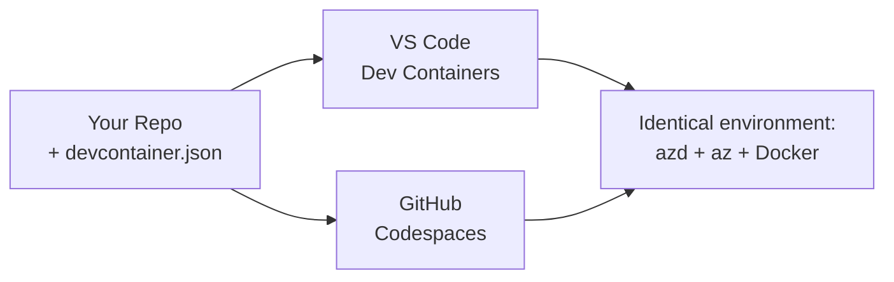

# azd এর জন্য ডেভ কন্টেইনার এবং GitHub Codespaces

**অধ্যায় নেভিগেশন:**
- **📚 কোর্স হোম**: [শুরু করার জন্য AZD](../../README.md)
- **📖 বর্তমান অধ্যায়**: অধ্যায় ১ - ফাউন্ডেশন এবং দ্রুত শুরু
- **⬅️ পূর্ববর্তী**: [নিজের অ্যাপ নিয়ে আসুন](bring-your-own-app.md)
- **🚀 পরবর্তী অধ্যায়**: [অধ্যায় ২: AI-প্রথম ডেভেলপমেন্ট](../chapter-02-ai-development/README.md)

> কমান্ড এবং কনফিগারেশন পর্যালোচনার লক্ষ্য: `azd 1.37.2` (নভেম্বর ২০২৬)। এই পর্যালোচনার অংশ হিসাবে কন্টেইনার বিল্ড এবং Azure ডিপ্লয়মেন্ট চালানো হয়নি।

## পরিচিতি

azd, সঠিক ভাষার রানটাইম, Docker, এবং Azure CLI প্রতিটি মেশিনে ইনস্টল করা একটি ঝামেলা — এবং এটি হল সবচেয়ে বড় কারণ যে একটি টিউটোরিয়াল যা "আমার মেশিনে কাজ করে" অন্য কারো কাছে ব্যর্থ হয়। একটি **ডেভ কন্টেইনার** এই সমস্যা সমাধান করে একটি ফাইলে আপনার পুরো টুলচেইন বর্ণনা করে। যে কেউ VS Code বা GitHub Codespaces এ প্রজেক্ট খুলবে, একই পরিবেশ পাবে, যেখানে azd ইতিমধ্যেই ইনস্টল করা রয়েছে। এই পাঠে আমরা দেখাবো কিভাবে একটি ডেভ কন্টেইনার যোগ করবেন।

## শেখার লক্ষ্য

এই পাঠ শেষে, আপনি:
- বুঝতে পারবেন ডেভ কন্টেইনার কী এবং এটি azd এর সাথে কেন সাহায্য করে
- একটি ন্যূনতম `.devcontainer/devcontainer.json` প্রজেক্টে যোগ করতে পারবেন
- Dev Container *features* এর মাধ্যমে azd, Azure CLI, এবং Docker অন্তর্ভুক্ত করতে পারবেন
- প্রজেক্ট GitHub Codespaces অথবা VS Code এ খুলতে পারবেন

## শেখার ফলাফল

এই পাঠটি সম্পন্ন করার পর, আপনি সক্ষম হবেন:
- একটি `devcontainer.json` একটি azd প্রজেক্টের জন্য রচনা করতে
- azd এবং Azure সরঞ্জাম ইনস্টলেশনের প্রয়োজন ছাড়াই যোগ করতে
- একটি কন্টেইনার কিংবা Codespace এর ভিতর থেকে `azd up` চালাতে

---

## ডেভ কন্টেইনার কী?

একটি ডেভ কন্টেইনার হল একটি Docker-ভিত্তিক ডেভেলপমেন্ট পরিবেশ যা আপনার রিপোজিটরির একটি `.devcontainer/devcontainer.json` ফাইলে সংজ্ঞায়িত। যখন আপনি প্রজেক্টটি খুলবেন:

- **VS Code** (ডেভ কন্টেইনার এক্সটেনশন সহ) কন্টেইনার তৈরি করে এবং এটিতে সংযুক্ত হয়।
- **GitHub Codespaces** একই কন্টেইনার ক্লাউডে তৈরি করে এবং আপনাকে ব্রাউজার-ভিত্তিক এডিটর দেয়।

যেকোনো পথেই হোকনা কেন, প্রতিটি সহকারী একই সরঞ্জাম পায়—"আপনি azd ইনস্টল করেছেন?" সমস্যার সমাধান হয়।



---

## ধাপ ১: devcontainer ফাইল তৈরি করুন

আপনার প্রজেক্টের রুটে `.devcontainer/devcontainer.json` তৈরি করুন:

```json
{
  "name": "azd-project",
  "image": "mcr.microsoft.com/devcontainers/base:bookworm",
  "features": {
    "ghcr.io/devcontainers/features/azure-cli:1": {},
    "ghcr.io/azure/azure-dev/azd:0": { "version": "1.37.2" },
    "ghcr.io/devcontainers/features/docker-in-docker:2": {},
    "ghcr.io/devcontainers/features/node:1": {}
  },
  "customizations": {
    "vscode": {
      "extensions": [
        "ms-azuretools.azure-dev",
        "ms-azuretools.vscode-bicep"
      ]
    }
  },
  "forwardPorts": [3000],
  "postCreateCommand": "azd version"
}
```

প্রতিটি অংশের কাজ:

| কী | উদ্দেশ্য |
|-----|---------|
| `image` | কন্টেইনারের জন্য বেস OS |
| `features` | প্রি-বিল্ট ইনস্টলার—এখানে: Azure CLI, **azd**, Docker, এবং Node.js |
| `customizations.vscode.extensions` | azd এবং Bicep VS Code এক্সটেনশন স্বয়ংক্রিয় ইনস্টল করে |
| `forwardPorts` | আপনার অ্যাপের পোর্ট ব্রাউজারে প্রকাশ করে |
| `postCreateCommand` | কন্টেইনার তৈরি হওয়ার পর একবার রান হয় (এখানে, একটি স্যানিটি চেক) |

> ফিচার ভার্সন (`azd:0`) এবং ইনস্টল করা CLI ভার্সন পৃথক। CLI পিন করার জন্য ফিচারের `version` অপশনকে `"1.37.2"` সেট করুন; ফিচার ট্যাগ হিসাবে CLI ভার্সন ব্যবহার করবেন না।

---

## ধাপ ২: আপনার অ্যাপের ভাষার সাথে ফিচার মেলান

আপনার অ্যাপ যে ভাষা ব্যবহার করে তার জন্য `node` ফিচারটি পরিবর্তন করুন:

```jsonc
// Python project
"ghcr.io/devcontainers/features/python:1": {},

// .NET project
"ghcr.io/devcontainers/features/dotnet:2": {},

// Java project
"ghcr.io/devcontainers/features/java:1": {},

// Go project
"ghcr.io/devcontainers/features/go:1": {}
```

স্থানীয়ভাবে ইমেজ বিল্ড করার সময় `docker-in-docker` রাখুন। একটি কনফিগারড রিমোট ACR বিল্ড (`docker.remoteBuild: true`) বিকল্প; হোস্ট টাইপ শুধু থাকার জন্য সবসময় স্থানীয় Docker প্রয়োজন হয় না।

---

## ধাপ ৩: কন্টেইনারটি খুলুন

**VS Code এ:**
১. **Dev Containers** এক্সটেনশন ইনস্টল করুন।
২. প্রজেক্ট ফোল্ডারটি খুলুন।
৩. প্রম্পট পেলে **Reopen in Container** ক্লিক করুন (অথবা *Dev Containers: Reopen in Container* রান করুন)।

**GitHub Codespaces এ:**
১. রিপোজিটরি GitHub এ পুশ করুন।
২. ক্লিক করুন **Code → Codespaces → Create codespace on main**।
৩. কন্টেইনার বিল্ড হওয়া পর্যন্ত অপেক্ষা করুন—টার্মিনাল-এ azd প্রস্তুত থাকবে।

---

## ধাপ ৪: কন্টেইনারের ভিতর থেকে ডিপ্লয় করুন

কন্টেইনারে azd পূর্বে ইনস্টল করা থাকায়, সাধারণ ওয়ার্কফ্লো কাজ করবে:

```bash
azd auth login --use-device-code   # device code is handy inside Codespaces
azd up
```

> **কেন `--use-device-code`?** রিমোট কন্টেইনার বা Codespace এ কোনো স্থানীয় ব্রাউজার নেই যা পুনঃনির্দেশ করতে পারে, তাই ডিভাইস-কোড লগইন নির্ভরযোগ্য পদ্ধতি। আপনি সাইন-ইন সম্পূর্ণ করতে ব্রাউজার ট্যাবে একটি কোড পেস্ট করবেন।

---

## সাধারণ সমস্যা

| সমস্যা | সমাধান |
|---------|-----|
| `azd up` একটি ইমেজ তৈরি করতে পারে না | `docker-in-docker` ফিচার যোগ করুন |
| Codespaces এ ব্রাউজার লগইন আটকে থাকে | `azd auth login --use-device-code` ব্যবহার করুন |
| টিমের সদস্যদের সরঞ্জাম ভিন্ন | azd ফিচার এর `version` অপশনের মাধ্যমে CLI পিন করুন এবং ভাষার রানটাইম পিন করুন |
| ব্রাউজারে অ্যাপ পৌঁছনো যাচ্ছে না | পোর্টটি `forwardPorts` তে যোগ করুন |

---

## সারসংক্ষেপ

- একটি ডেভ কন্টেইনার azd টুলচেইন সবাইকে পুনরুৎপাদনযোগ্য করে তোলে।
- Dev Container *features* এর মাধ্যমে azd, Azure CLI, এবং Docker যোগ করুন।
- আপনার অ্যাপের ভাষার ফিচার মেলান এবং কন্টেইনার হোস্টের জন্য `docker-in-docker` রাখুন।
- Codespaces এর ভিতরে চালানোর সময় ডিভাইস-কোড লগইন ব্যবহার করুন।

---

## 🔗 নেভিগেশন

| দিক | রিসোর্স |
|-----------|----------|
| **পূর্ববর্তী** | [নিজের অ্যাপ নিয়ে আসুন](bring-your-own-app.md) |
| **অধ্যায় হোম** | [অধ্যায় ১: ফাউন্ডেশন ও দ্রুত শুরু](README.md) |
| **পরবর্তী অধ্যায়** | [অধ্যায় ২: AI-প্রথম ডেভেলপমেন্ট](../chapter-02-ai-development/README.md) |

## 📖 সম্পর্কিত উৎস

- [ইনস্টলেশন ও সেটআপ](installation.md)
- [কমান্ড চিট শীট](../../resources/cheat-sheet.md)
- [অফিশিয়াল ডেভ কন্টেইনার স্পেসিফিকেশন](https://containers.dev/)
- [azd ডেভ কন্টেইনার ফিচার](https://github.com/Azure/azure-dev/tree/main/ext/devcontainer)

---

<!-- CO-OP TRANSLATOR DISCLAIMER START -->
**অস্বীকৃতি**:
এই নথিটি AI অনুবাদ পরিষেবা [Co-op Translator](https://github.com/Azure/co-op-translator) ব্যবহার করে অনূদিত হয়েছে। যদিও আমরা শুদ্ধতার জন্য চেষ্টা করি, অনুগ্রহ করে মনে রাখবেন যে স্বয়ংক্রিয় অনুবাদে ত্রুটি বা অসঙ্গতি থাকতে পারে। মূল নথিটি তার স্বভাষায় কর্তৃত্বপূর্ণ উৎস হিসেবে বিবেচিত হওয়া উচিত। গুরুত্বপূর্ণ তথ্যের জন্য পেশাদার মানব অনুবাদ সুপারিশ করা হয়। এই অনুবাদের ব্যবহারে প্রয়োজনীয় ভুল বোঝাবুঝি বা ভুল ব্যাখ্যার জন্য আমরা দায়বদ্ধ নই।
<!-- CO-OP TRANSLATOR DISCLAIMER END -->