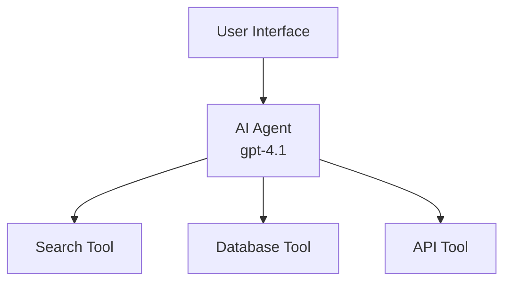
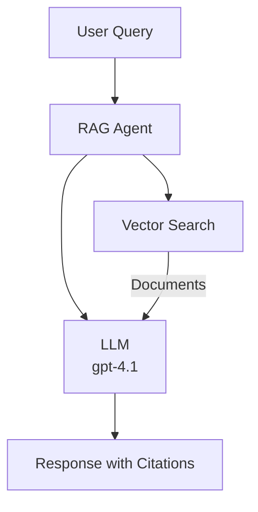
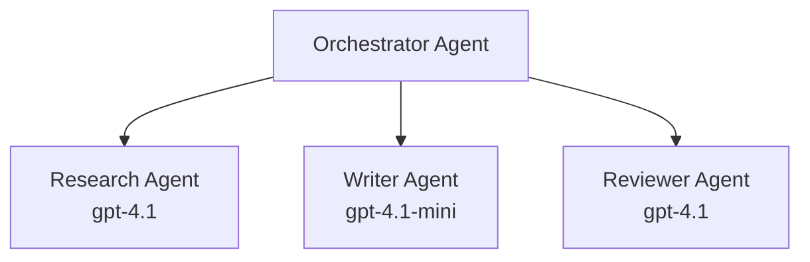

# Azure Developer CLI সহ AI এজেন্টস

**চ্যাপ্টার নেভিগেশন:**
- **📚 কোর্স হোম**: [AZD For Beginners](../../README.md)
- **📖 বর্তমান চ্যাপ্টার**: চ্যাপ্টার ২ - AI-প্রথম উন্নয়ন
- **⬅️ পূর্ববর্তী**: [Microsoft Foundry Integration](microsoft-foundry-integration.md)
- **➡️ পরবর্তী**: [AI Model Deployment](ai-model-deployment.md)
- **🚀 উন্নত**: [Multi-Agent Solutions](../../examples/retail-scenario.md)

---

## ভূমিকা

AI এজেন্টগুলি স্বায়ত্তশাসিত প্রোগ্রাম যা তাদের পরিবেশ উপলব্ধি করতে পারে, সিদ্ধান্ত নিতে পারে, এবং নির্দিষ্ট লক্ষ্য অর্জনের জন্য কর্ম গ্রহণ করতে পারে। সাধারণ চ্যাটবটদের মতো শুধুমাত্র প্রম্পটের প্রতিক্রিয়া না দেওয়ার পরিবর্তে, এজেন্টরা পারে:

- **টুলস ব্যবহার করা** - API কল করা, ডাটাবেস অনুসন্ধান করা, কোড চালানো
- **পরিকল্পনা ও যুক্তি করা** - জটিল কাজগুলোকে ধাপে ভাগ করা
- **প্রসঙ্গ থেকে শেখা** - স্মৃতি রক্ষা এবং আচরণ অভিযোজিত করা
- **সহযোগিতা করা** - অন্যান্য এজেন্টদের সঙ্গে কাজ করা (মাল্টি-এজেন্ট সিস্টেম)

এই গাইডটি আপনাকে দেখায় কীভাবে Azure Developer CLI (azd) ব্যবহার করে Azure-তে AI এজেন্ট নিয়োগ করতে হয়।

কথোপকথনের প্রসঙ্গ ব্যবহার করা মডেল ট্রেনিং নয়: স্থায়ী স্মৃতি, অ্যাক্সেস কন্ট্রোল, এবং রিটেনশন অ্যাপ্লিকেশন দ্বারা বাস্তবায়িত/কনফিগার করা উচিত।

> **Foundry GA আপডেট (2026-11-09):** সাধারণত প্রাপ্য `microsoft.foundry` 1.0 বান্ডেলটি `azd >= 1.37.0` সহ ইনস্টল করুন। মূল্যায়নগুলি আলাদাভাবে ইনস্টল করা হয়; ঐচ্ছিক প্রিভিউ বৈশিষ্ট্য এবং নীচের ক্লাসিক SDK ফ্র্যাগমেন্ট বান্ডেল ঘোষণার মাধ্যমে GA-তে আপগ্রেড হয়নি। এই নির্দেশিকা [GA ঘোষণা](https://devblogs.microsoft.com/azure-sdk/microsoft-foundry-azure-developer-cli-ga/) এবং ডকুমেন্টেশনের উপর ভিত্তি করে, সরাসরি Azure ডিপ্লয়মেন্ট নয়।

## শেখার লক্ষ্যসমূহ

এই গাইডটি সম্পন্ন করার মাধ্যমে আপনি:
- বুঝবেন AI এজেন্ট কী এবং তারা কিভাবে চ্যাটবট থেকে আলাদা
- AZD ব্যবহার করে পূর্বনির্মিত AI এজেন্ট টেমপ্লেট ডিপ্লয় করবেন
- কাস্টম এজেন্টের জন্য Foundry এজেন্ট কনফিগার করবেন
- মৌলিক এজেন্ট প্যাটার্নগুলি বাস্তবায়ন করবেন (টুল ব্যবহার, RAG, মাল্টি-এজেন্ট)
- ডিপ্লয় করা এজেন্ট পর্যবেক্ষণ এবং ডিবাগ করবেন

## শেখার ফলাফলসমূহ

সম্পন্ন করার পর, আপনি পারবেন:
- একটি কমান্ডে এআই এজেন্ট অ্যাপ্লিকেশনগুলো Azure-এ ডিপ্লয় করতে
- এজেন্ট টুল এবং ক্ষমতা কনফিগার করতে
- এজেন্টদের সাথে রিট্রিভাল-অগমেন্টেড জেনারেশন (RAG) বাস্তবায়ন করতে
- জটিল ওয়ার্কফ্লো-এর জন্য মাল্টি-এজেন্ট আর্কিটেকচার ডিজাইন করতে
- সাধারণ এজেন্ট ডিপ্লয়মেন্ট সমস্যা সমাধান করতে

---

## 🤖 একটি এজেন্ট এবং একটি চ্যাটবটের মধ্যে পার্থক্য কী?

| বৈশিষ্ট্য | চ্যাটবট | এআই এজেন্ট |
|---------|---------|----------|
| **আচরণ** | প্রম্পটের উত্তর দেয় | স্বায়ত্তশাসিত কার্য গ্রহণ করে |
| **টুলস** | রিট্রিভাল বা টুল ব্যবহার করতে পারে | সাধারণত লক্ষ্য-নির্দিষ্ট লুপে টুল ব্যবহার করে |
| **মেমোরি** | অ্যাপ্লিকেশন-নির্ভর | কেবল স্পষ্টভাবে বাস্তবায়িত হলে স্থায়ী মেমোরি |
| **পরিকল্পনা** | একক প্রতিক্রিয়া | বহু-ধাপ যুক্তি |
| **সহযোগিতা** | একক সত্তা | অন্যান্য এজেন্টের সাথে কাজ করতে পারে |

### সরল মিল

- **চ্যাটবট** = একটি তথ্য ডেস্কে প্রশ্নের উত্তর দেওয়া সহায়ক ব্যক্তি
- **এআই এজেন্ট** = একজন ব্যক্তিগত সহকারী যিনি কল করতে, অ্যাপয়েন্টমেন্ট বুক করতে এবং কাজ সম্পন্ন করতে পারেন

---

## 🚀 দ্রুত শুরু: আপনার প্রথম এজেন্ট ডিপ্লয় করুন

একটি **নতুন খালি ওয়ার্কিং ডিরেক্টরিতে** একটি অপশন নির্বাচন করুন। সেখানে শেষের `.` আরম্ভ করে; স্পষ্ট গন্তব্য ছাড়াই, বর্তমান AZD একটি টেমপ্লেট-নামক সাবডিরেক্টরি তৈরি করতে পারে এবং আপনার শেল ডিরেক্টরি পরিবর্তন করে না। পৃথক টেমপ্লেট/পরিবেশ পৃথক ডিরেক্টরিতে রাখুন।

নিচের সময়/খরচের সীমা উদাহরণস্বরূপ, যাচাই করা উদ্ধৃতি নয়। প্রতিটি নমুনার বর্তমান প্রয়োজনীয়তা, মূল্য, মডেল ক্বোটা, এবং অপশনাল সার্ভিস আগে পরীক্ষা করুন।

### অপশন ১: Foundry এজেন্ট টেমপ্লেট (সুপারিশকৃত)

```bash
# Initialize the AI agents template
azd init --template get-started-with-ai-agents .

# Deploy to Azure
azd up
```

**কী ডিপ্লয় করা হয়:** নমুনার বর্তমান অবকাঠামো এবং নির্বাচিত অপশনগুলো মডেল, টুলস, হোস্টিং এবং মনিটরিং রিসোর্স নির্ধারণ করে। প্রভিশনিংয়ের আগে এর README এবং `infra/` পর্যালোচনা করুন; ধরে নেবেন না প্রতিটি এজেন্ট টেমপ্লেটে সার্চ বা একটি ওয়েব ইন্টারফেস অন্তর্ভুক্ত থাকে।

**সময়:** প্রায় ১৫-২০ মিনিট
**খরচ:** প্রায় $১০০-১৫০/মাস (বিকাশ)

### অপশন ২: Prompty সহ সৃজনশীল লেখার এজেন্ট

```bash
# Initialize the Prompty-based agent template
azd init --template https://github.com/Azure-Samples/contoso-creative-writer .

# Deploy to Azure
azd up
```

**কী ডিপ্লয় করা হয়:** Azure OpenAI, Bing Grounding, এবং Azure AI Search ব্যবহার করে একটি FastAPI/Prompty মাল্টি-এজেন্ট লেখার নমুনা। পূর্বের `agent-openai-python-prompty` রিপোজিটরি এখানে রিডাইরেক্ট করে; এটি একটি ন্যূনতম Azure Functions weather-agent টেমপ্লেট নয়। হোস্টিং, মডেল ক্বোটা এবং Bing Grounding প্রয়োজনীয়তা জন্য এর বর্তমান README অনুসরণ করুন।

**সময়:** প্রায় ১০-১৫ মিনিট
**খরচ:** প্রায় $৫০-১০০/মাস (বিকাশ)

### অপশন ৩: RAG চ্যাট এজেন্ট

```bash
# Initialize RAG chat template
azd init --template azure-search-openai-demo .

# Deploy to Azure
azd up
```

**কী ডিপ্লয় করা হয়:**
- ✅ Microsoft Foundry মডেলসমূহ
- ✅ নমুনা ডেটাসহ Azure AI Search
- ✅ ডকুমেন্ট প্রসেসিং পাইপলাইন
- ✅ উক্তিসম্পন্ন চ্যাট ইন্টারফেস

**সময়:** প্রায় ১৫-২৫ মিনিট
**খরচ:** প্রায় $৮০-১৫০/মাস (বিকাশ)

### অপশন ৪: GA Foundry বান্ডলের হোস্টেড এজেন্ট

মৌলিক পাইথন এজেন্ট ফ্রেমওয়ার্ক রেসপন্সেস API নমুনার জন্য [সম্পূর্ণ হোস্টেড-এজেন্ট ওয়াকথ্রু](microsoft-foundry-integration.md#hosted-agent-walkthrough-ga) ব্যবহার করুন। এই কোড-ডিপ্লয়মেন্ট পথের জন্য পাইথন ৩.১৩+, বর্তমান uv, Foundry অনুমতি এবং আঞ্চলিক মডেল ক্বোটা প্রয়োজন। Azure CLI ক্রেডেনশিয়াল ব্যবহার করলে স্থানীয় SDK কল পৃথকভাবে অথেনটিকেট করুন।

```bash
azd auth login
azd ext install microsoft.foundry
```

খালি ডিরেক্টরিতে নমুনাটি আরম্ভ করুন:

```text
azd ai agent init --template https://github.com/microsoft-foundry/foundry-samples/blob/main/samples/python/hosted-agents/agent-framework/responses/01-basic/azure.yaml --deploy-mode code --src .
```

একটি নতুন বা বিদ্যমান প্রকল্প নির্বাচন করুন, `azure.yaml` পর্যালোচনা করুন, এবং `azd provision` চালান। Agent Inspector খুলতে `azd ai agent run` ব্যবহার করুন এবং ওই ডিরেক্টরির অন্য একটি টার্মিনাল থেকে `azd ai agent invoke --local "Explain how this agent is hosted."`। স্থানীয় যাচাইকরণের পরে, ডিপ্লয় কৃত রেসপন্সের তুলনা করতে `azd deploy` এবং `azd ai agent invoke "Explain how this agent is hosted."` ব্যবহার করুন। Foundry দূর থেকে আপলোড হওয়া সোর্স তৈরি করে; স্থানীয় কন্টেইনার তৈরি জরুরি নয়।

**কখন `azd ai agent init` বনাম `azd init --template` ব্যবহার করবেন:**

| পন্থা | সর্বোত্তম জন্য | কিভাবে কাজ করে |
|----------|----------|------|
| `azd init --template` | একটি কর্মরত নমুনা অ্যাপ থেকে শুরু | কোড + অবকাঠামো সহ একটি সম্পূর্ণ টেমপ্লেট রিপো ক্লোন করে |
| `azd ai agent init --template` | বর্তমান Foundry এজেন্ট প্রকল্প গ্রহণ | একটি `azure.yaml` প্রকল্প ডকুমেন্ট এবং এর সংজ্ঞা ব্যবহার করে |

> **টিপ:** অপশন ১-৩ সম্পূর্ণ অ্যাপ্লিকেশন টেমপ্লেট থেকে শুরু করে; অপশন ৪ GA হোস্টেড-এজেন্ট ওয়ার্কফ্লো শেখায়। কোনও আরম্ভ কমান্ড পূর্ববর্তী এজেন্ট মেনিফেস্ট স্বয়ংক্রিয়ভাবে স্থানান্তর করে না। বিদ্যমান প্রকল্পে সরাসরি এজেন্ট সংজ্ঞা যুক্ত করার জন্য [শুরু এবং স্থানান্তর নির্দেশিকা](../chapter-08-production/production-ai-practices.md#initializing-agent-projects-with-azd-ai-agent-init) দেখুন।

আলাদাভাবে `azure.ai.evaluations` ইনস্টল করুন টেস্ট ডেটা/রুব্রিক তৈরি ও পর্যালোচনার জন্য, একটি মূল্যায়ন কনফিগার করুন, এবং `azd ai eval` ব্যবহার করে চালান। অপ্টিমাইজেশন একটি উপযুক্ত মূল্যায়ন পুনঃব্যবহার করতে পারে; একটিতে স্পষ্টভাবে ডিপ্লয় করার আগে প্রার্থীদের পর্যালোচনা করুন। পুরাতন উদাহরণ পুনঃব্যবহারের আগে [মূল্যায়ন ওয়ার্কফ্লো](../chapter-08-production/production-ai-practices.md#evaluation-migration-and-quality-checks) এবং [অপ্টিমাইজেশন স্থানান্তর](../chapter-08-production/production-ai-practices.md#optimization-configuration-migration) অনুসরণ করুন। পরিস্কারীকরণের জন্য, পুনঃব্যবহৃত Foundry প্রকল্পের রিসোর্সগুলি `azd down` এর পরে থাকে; নতুন তৈরি প্রকল্পের রিসোর্স গ্রুপ মুছে ফেলা হয়। [ওয়াকথ্রু পরিস্কার পরামর্শ](microsoft-foundry-integration.md#7-clean-up-deliberately) দেখুন।

---

## 🏗️ এজেন্ট স্থাপত্য প্যাটার্নসমূহ

### প্যাটার্ন ১: টুলস সহ একক এজেন্ট

সবচেয়ে সহজ এজেন্ট প্যাটার্ন - একটি এজেন্ট যা একাধিক টুল ব্যবহার করতে পারে।



**সর্বোত্তম জন্য:**
- গ্রাহক সহায়তা বট
- গবেষণা সহকারী
- ডেটা বিশ্লেষণ এজেন্ট

**সম্পর্কিত অ্যাপ্লিকেশন নমুনা:** `azure-search-openai-demo` RAG প্রদর্শন করে, সাধারণ স্বেচ্ছামূলক-টুল এজেন্ট লুপ নয়।

### প্যাটার্ন ২: RAG এজেন্ট (রিট্রিভাল-অগমেন্টেড জেনারেশন)

একটি এজেন্ট যা সাড়া তৈরি করার আগে প্রাসঙ্গিক ডকুমেন্ট রিট্রিভ করে।



**সর্বোত্তম জন্য:**
- এন্টারপ্রাইজ জ্ঞানভিত্তিক বেস
- ডকুমেন্ট প্রশ্নোত্তর সিস্টেম
- সম্মতি এবং আইনগত গবেষণা

**AZD টেমপ্লেট:** `azure-search-openai-demo`

### প্যাটার্ন ৩: মাল্টি-এজেন্ট সিস্টেম

জটিল কাজের জন্য একসঙ্গে কাজ করা একাধিক বিশেষায়িত এজেন্ট।



**সর্বোত্তম জন্য:**
- জটিল বিষয়বস্তু সৃষ্টির জন্য
- বহু-ধাপীয় ওয়ার্কফ্লো
- বিভিন্ন দক্ষতা প্রয়োজন এমন কাজসমূহ

**আরও শিখুন:** [মাল্টি-এজেন্ট সমন্বয় প্যাটার্ন](../chapter-06-pre-deployment/coordination-patterns.md)

---

## ⚙️ এজেন্ট টুলস কনফিগারেশন

যখন এজেন্ট টুলস ব্যবহার করতে পারে তখন তারা শক্তিশালী হয়। সাধারণ টুল কনফিগার করার উপায় এখানে:

### Foundry এজেন্টে টুল কনফিগারেশন

এই **ক্লাসিক এজেন্ট সার্ভিস SDK ফ্র্যাগমেন্ট** `azure-ai-projects==1.0.0` এবং `azure-ai-agents==1.1.0` লক্ষ্য করে `azure-identity` সহ। এটি কিছু বর্তমান Foundry টেমপ্লেটে ব্যবহৃত নতুন ভার্সন্ড-এজেন্ট/রেসপন্সেস API নয়, না `azure.ai.agents` AZD এক্সটেনশন (একটি ভিন্ন প্যাকেজ)। এই API প্রজন্মগুলি মিশ্রিত করবেন না। `PROJECT_ENDPOINT` সেট করুন ক্লাসিক Foundry প্রকল্প এন্ডপয়েন্টে এবং `MODEL_DEPLOYMENT_NAME` বিদ্যমান সমর্থিত মডেল ডিপ্লয়মেন্টে; স্থানীয়ভাবে `az login` দিয়ে অথেন্টিকেট করুন এবং প্রয়োজনীয় প্রকল্প অনুমতি দিন।

```python
# agent_config.py
import os
from azure.ai.projects import AIProjectClient
from azure.ai.agents.models import FunctionTool
from azure.identity import DefaultAzureCredential

def search_knowledge_base(query: str) -> str:
    """Search the demonstration knowledge base.

    :param query: Search text.
    :return: Matching demonstration information.
    """
    # Local fixture only, not a production search implementation.
    return "Demo policy: returns are accepted within 30 days."

project_client = AIProjectClient(
    endpoint=os.environ["PROJECT_ENDPOINT"],
    credential=DefaultAzureCredential(),
)
search_tool = FunctionTool(functions={search_knowledge_base})
project_client.agents.enable_auto_function_calls(search_tool)
agent = project_client.agents.create_agent(
    model=os.environ["MODEL_DEPLOYMENT_NAME"],
    name="Support Agent",
    instructions="Use search_knowledge_base for policy questions. Label results as demo data.",
    tools=search_tool.definitions,
)
```

একটি ফাংশন স্কিমা রেজিস্টার করা সার্ভিসে পাইথন চালায় না। এই SDK তে, `enable_auto_function_calls` এবং `agents.runs.create_and_process(...)` একত্রে আপনার ক্লায়েন্ট প্রসেসে রেজিস্টার করা কলব্যাক চালায়। [রিলিজড SDK উদাহরণ](https://github.com/Azure/azure-sdk-for-python/blob/azure-ai-agents_1.1.0/sdk/ai/azure-ai-agents/samples/agents_tools/sample_agents_auto_function_call.py) দেখুন। শেষ হলে ক্লায়েন্ট বন্ধ করুন এবং প্রদর্শনী এজেন্ট/থ্রেড মুছে ফেলুন।

### পরিবেশ কনফিগারেশন

নিম্নলিখিত নামগুলি **উদাহরণস্বরূপ কাস্টম-টেমপ্লেট ইনপুট**, বিল্ট-ইন AZD সুইচ নয়। প্রথমেই প্রত্যেক মান `infra/main.parameters.json`, অবকাঠামো, এবং অ্যাপ্লিকেশন কোডের মাধ্যমে পাঠান। `azd env set` একা কোনো এজেন্টের টুল বা নির্দেশনা পরিবর্তন করে না।

```bash
# Set up agent-specific environment variables
azd env set AZURE_OPENAI_MODEL "gpt-4.1"
azd env set AGENT_INSTRUCTIONS "You are a helpful assistant..."
azd env set ENABLE_CODE_INTERPRETER "true"
azd env set ENABLE_FILE_SEARCH "true"

# Apply wired infrastructure and application changes
azd up
```

---

## 📊 এজেন্ট মনিটরিং

### অ্যাপ্লিকেশন ইনসাইটস ইন্টিগ্রেশন

আপনার নির্বাচিত টেমপ্লেট অ্যাপ্লিকেশন ইনসাইটস প্রভিশন এবং ইন্সট্রুমেন্টেশন কনফিগার করলে:

```bash
# Open monitoring dashboard
azd monitor --overview

# Open the Application Insights logs view (not a streaming log tail)
azd monitor --logs

# View live metrics
azd monitor --live
```

### ট্র্যাক করার প্রধান মেট্রিক

| মেট্রিক | বর্ণনা | লক্ষ্য |
|--------|-------------|--------|
| রেসপন্স লেটেন্সি | রেসপন্স তৈরি করার সময় | < ৫ সেকেন্ড |
| টোকেন ব্যবহার | অনুরোধ প্রতি টোকেন | খরচ পর্যবেক্ষণ করুন |
| টুল কল সাকসেস রেট | সফল টুল নির্বাহের শতাংশ | > ৯৫% |
| ত্রুটি হার | ব্যর্থ এজেন্ট অনুরোধ | < ১% |
| ব্যবহারকারী সন্তুষ্টি | প্রতিক্রিয়া স্কোর | > ৪.০/৫.০ |

### এজেন্টের জন্য কাস্টম লগিং

```python
import os
from azure.monitor.opentelemetry import configure_azure_monitor
from opentelemetry import trace

# Configure Azure Monitor with OpenTelemetry
configure_azure_monitor(
    connection_string=os.environ["APPLICATIONINSIGHTS_CONNECTION_STRING"]
)

tracer = trace.get_tracer(__name__)

def log_agent_interaction(user_query, agent_response, tools_used, latency_ms):
    with tracer.start_as_current_span("agent_interaction") as span:
        span.set_attributes({
            "query_length": len(user_query),  # Do not log raw prompts or personal data
            "response_length": len(agent_response),
            "tools_used": tools_used,
            "latency_ms": latency_ms
        })
```

> **নোট:** প্রয়োজনীয় প্যাকেজ ইনস্টল করুন: `pip install azure-monitor-opentelemetry`। এটি OpenTelemetry নির্ভরতা নিয়ে আসে; এটি একটি প্যাকেজ নামের ইনস্টলেশন নয় যা `opentelemetry`।

---

## 💰 খরচ বিবেচনা

### প্যাটার্ন অনুযায়ী আনুমানিক মাসিক খরচ

এগুলো উদাহরণস্বরূপ পরিকল্পনামূলক সীমা, উদ্ধৃতি বা ব্যয় সীমা নয়। অঞ্চল, মডেল টোকেন, সার্চ/কম্পিউট SKU, টুল সেশন, স্টোরেজ, এবং ট্রাফিক এগুলোর থেকে বেশি হতে পারে। নমুনার খরচ নির্দেশনা এবং Azure মূল্য নির্ধারণ আগে পরীক্ষা করুন `azd up`।

| প্যাটার্ন | ডেভ পরিবেশ | প্রোডাকশন |
|---------|-----------------|------------|
| একক এজেন্ট | $৫০-১০০ | $২০০-৫০০ |
| RAG এজেন্ট | $৮০-১৫০ | $৩০০-৮০০ |
| মাল্টি-এজেন্ট (২-৩ এজেন্ট) | $১৫০-৩০০ | $৫০০-১,৫০০ |
| এন্টারপ্রাইজ মাল্টি-এজেন্ট | $৩০০-৫০০ | $১,৫০০-৫,০০০+ |

### খরচ অপ্টিমাইজেশনের টিপস

১. **সহজ কাজের জন্য gpt-4.1-mini ব্যবহার করুন** (শুধুমাত্র যদি আপনার টেমপ্লেট এই ইনপুট গ্রহণ করে)
   ```bash
   azd env set AZURE_OPENAI_MODEL "gpt-4.1-mini"
   ```

২. **নিরাপদ, পুনরাবৃত্তি অনুসন্ধানের জন্য সীমাবদ্ধ ক্যাশিং প্রয়োগ করুন।** টেন্যান্ট/ব্যবহারকারী অনুমোদন, মডেল ডিপ্লয়মেন্ট, নির্দেশনা, এবং রিট্রিভাল সংস্করণ ক্যাশ কীতে অন্তর্ভুক্ত করুন; মেয়াদ নির্ধারণ করুন। প্রাইভেট কথোপকথন রেসপন্স প্রসেস-ওয়াইড কুয়েরি-মাত্র ক্যাশের মাধ্যমে শেয়ার করবেন না। SDK এজেন্ট অবজেক্টে কোনও সাধারণ `agent.run()` পদ্ধতি নেই।

৩. **প্রতি রান টোকেন সীমা নির্ধারণ করুন**
   ```python
   # Set max_completion_tokens when running the agent, not during creation
   run = project_client.agents.runs.create_and_process(
       thread_id=thread.id,
       agent_id=agent.id,
       max_completion_tokens=1000  # Budget across the run; may finish as incomplete
   )
   ```

৪. **অব্যবহৃত সময় প্রযোজযোগ্য কন্টেইনার অ্যাপস শূন্যে স্কেল করুন**
   ```bash
   # Custom-template input: must map to template.scale.minReplicas
   azd env set MIN_REPLICAS "0"
   ```
   অবকাঠামোর পরিবর্তন প্রয়োগ করুন `azd provision` বা `azd up` দিয়ে। শূন্যে স্কেল করলে সার্চ, স্টোরেজ, বা মডেল/টুল চার্জ বন্ধ হয় না।

---

## 🔧 এজেন্ট সমস্যা সমাধান

### সাধারণ সমস্যা এবং সমাধান

<details>
<summary><strong>❌ টুল কলের উত্তর দিচ্ছে না এজেন্ট</strong></summary>

```bash
# Inspect the application deployment (not the agent's registered tools)
azd show

# Verify OpenAI deployment
az cognitiveservices account deployment list \
  --name $AZURE_OPENAI_NAME \
  --resource-group $RG_NAME

# Check agent logs
azd monitor --logs
```

**সাধারণ কারণসমূহ:**
- টুল ফাংশন স্বাক্ষর মিলছে না
- প্রয়োজনীয় অনুমতি অনুপলব্ধ
- API এন্ডপয়েন্ট অ্যাক্সেসযোগ্য নয়
</details>

<details>
<summary><strong>❌ এজেন্ট রেসপন্সে উচ্চ লেটেন্সি</strong></summary>

```bash
# Check Application Insights for bottlenecks
azd monitor --live

# Consider using a faster model
azd env set AZURE_OPENAI_MODEL "gpt-4.1-mini"
azd up
```

**অপ্টিমাইজেশন টিপস:**
- স্ট্রিমিং রেসপন্স ব্যবহার করুন
- রেসপন্স ক্যাশিং প্রয়োগ করুন
- কনটেক্সট উইন্ডোর আকার কমান
</details>

<details>
<summary><strong>❌ এজেন্ট ভুল বা হ্যালুসিনেটেড তথ্য ফেরত দিচ্ছে</strong></summary>

```python
# Improve with better system prompts
instructions = """
You are a helpful assistant. IMPORTANT:
- Only answer based on provided context
- If you don't know, say "I don't know"
- Always cite your sources
- Never make up information
"""

# Use these instructions in the agent definition.
# For classic file search, first upload/index documents in a vector store,
# then use FileSearchTool(vector_store_ids=[...]) and pass both its
# .definitions and .resources when creating the agent.
```
 নির্দেশনা এবং রিট্রিভাল ঝুঁকি কমায়; কোনওটি বাস্তব উত্তর নিশ্চিত করে না। পরিচিত উত্তরের বিরুদ্ধে গ্রাউন্ডেড এবং আউট-অফ-স্কোপ প্রশ্ন মূল্যায়ন করুন।
</details>

<details>
<summary><strong>❌ টোকেন সীমা অতিক্রম ত্রুটি</strong></summary>

```python
# Implement context window management
def truncate_context(messages, max_tokens=8000, model="gpt-4.1"):
    """Approximate content-only budget for objects with .content strings."""
    import tiktoken
    encoding = tiktoken.encoding_for_model(model)
    total_tokens = 0
    truncated = []
    
    for msg in reversed(messages):
        msg_tokens = len(encoding.encode(msg.content))
        if total_tokens + msg_tokens > max_tokens:
            break
        truncated.insert(0, msg)
        total_tokens += msg_tokens
    
    return truncated
```
 এই হেল্পার রোল/টুল স্কিমা, সিস্টেম নির্দেশনা, ছবি টোকেন এবং প্রোটোকল ওভারহেড বাদ দেয়। তাদের জন্য এবং সম্পূর্ণতার জন্য স্থান সংরক্ষণ করুন; টুল-কলে/ফলাফলের জোড় ভাগ করবেন না বা প্রয়োজনীয় সিস্টেম নির্দেশনা বাতিল করবেন না। আলাদাভাবে `tiktoken` ইনস্টল করুন। এটি সাধারণ কনটেক্সট-উইন্ডো ভ্যালিডেটর নয়।
</details>

---

## 🎓 হাতে-কলমে অনুশীলন

### অনুশীলন ১: একটি মৌলিক এজেন্ট ডিপ্লয় করুন (২০ মিনিট)

**লক্ষ্য:** AZD ব্যবহার করে আপনার প্রথম AI এজেন্ট ডিপ্লয় করা

```bash
# Step 1: Initialize template
azd init --template get-started-with-ai-agents .

# Step 2: Login to Azure
azd auth login
# If you work across tenants, add --tenant-id <tenant-id>

# Step 3: Deploy
azd up

# Step 4: Test the agent
# Expected output after deployment:
#   Deployment Complete!
#   Endpoint: https://<app-name>.<region>.azurecontainerapps.io
# Open the URL shown in the output and try asking a question

# Step 5: View monitoring
azd monitor --overview

# Step 6: Review the listed resources and confirm cleanup
azd down
```

**সফলতার মানদণ্ড:**
- [ ] এজেন্ট প্রশ্নের উত্তর দেয়
- [ ] `azd monitor` এর মাধ্যমে মনিটরিং ড্যাশবোর্ডে প্রবেশ করতে পারে
- [ ] সম্পদগুলি সফলভাবে পরিষ্কার করা হয়েছে

### অনুশীলন ২: একটি কাস্টম টুল যোগ করুন (৩০ মিনিট)

**লক্ষ্য:** একটি এজেন্টের সাথে কাস্টম টুল যুক্ত করা

**শুরু করার স্থান:** অন্য SDK জেনারেশনসহ এলোমেলো টেম্পলেটের বদলে [টুল কনফিগারেশন](#tool-configuration-in-foundry-agents) থেকে ক্লাসিক SDK ক্লায়েন্ট ব্যবহার করুন।

1. এই ডিটারমিনিস্টিক ফিক্সচারটি `agent_config.py` এ যোগ করুন:
   ```python
   def get_weather(location: str) -> str:
       """Return demonstration weather, not live conditions.

       :param location: City name.
       :return: A clearly labelled fixture.
       """
       print(f"TOOL_CALLED: {location}")
       return f"Demo weather in {location}: Sunny, 72°F (fixture, not live)"
   ```
2. অনুসন্ধান-টুল রেজিস্ট্রেশন এবং তৈরি ব্লকটি নিম্নলিখিত দ্বারা প্রতিস্থাপন করুন:
   ```python
   weather_tool = FunctionTool(functions={get_weather})
   project_client.agents.enable_auto_function_calls(weather_tool)
   agent = project_client.agents.create_agent(
       model=os.environ["MODEL_DEPLOYMENT_NAME"],
       name="Weather Agent",
       instructions="Call get_weather for weather questions; explain that it returns demo data.",
       tools=weather_tool.definitions,
   )
   thread = project_client.agents.threads.create()
   try:
       project_client.agents.messages.create(
           thread_id=thread.id, role="user", content="Use get_weather for Seattle."
       )
       run = project_client.agents.runs.create_and_process(
           thread_id=thread.id, agent_id=agent.id
       )
       if run.status != "completed":
           raise RuntimeError(f"Run status: {run.status}; error: {run.last_error}")
       for message in project_client.agents.messages.list(thread_id=thread.id):
           for text in message.text_messages:
               print(text.text.value)
   finally:
       project_client.agents.threads.delete(thread.id)
       project_client.agents.delete_agent(agent.id)
       project_client.close()
   ```
3. স্থানীয়ভাবে চালান (এটি বিদ্যমান Azure প্রকল্পকে কল করে এবং মডেল চার্জ তৈরি করে):
   ```bash
   python agent_config.py
   # Expected: TOOL_CALLED: Seattle, then a completed answer labelled demo data.
   ```

**সাফল্যের মানদণ্ড:**
- [ ] এজেন্ট আবহাওয়া সম্পর্কিত প্রশ্ন সনাক্ত করে
- [ ] টুলটি সঠিকভাবে কল করা হয়
- [ ] উত্তর আবহাওয়া তথ্য অন্তর্ভুক্ত করে

### ব্যায়াম ৩: একটি RAG এজেন্ট তৈরি করুন (৪৫ মিনিট)

**লক্ষ্য:** এমন একটি এজেন্ট তৈরি করুন যা আপনার ডকুমেন্ট থেকে প্রশ্নের উত্তর দেয়

```bash
# Step 1: Deploy RAG template
azd init --template azure-search-openai-demo .
azd up

# Step 2: Upload your documents
# For the sample's local ingestion path, place supported files in data/.
# Run from the sample root after following its Python environment setup:
./scripts/prepdocs.sh
# Windows PowerShell equivalent: .\\scripts\\prepdocs.ps1

# Step 3: Test with domain-specific questions
# Open the web app URL from the azd up output
# Ask questions about your uploaded documents
# Responses should include citation references like [doc.pdf]
```

**সাফল্যের মানদণ্ড:**
- [ ] এজেন্ট আপলোড করা ডকুমেন্ট থেকে উত্তর দেয়
- [ ] উত্তরগুলিতে উদ্ধৃতি অন্তর্ভুক্ত রয়েছে
- [ ] পরিসরের বাইরে থাকা পরীক্ষার প্রশ্নগুলি অবৈধ দাবির ছাড়াই পরিচালিত হয় (প্রতিটি ভবিষ্যত প্রশ্নের জন্য গ্যারান্টি নয়)

যদি `USE_CLOUD_INGESTION=true`, তবে পরিবর্তে নমুনাটির ক্লাউড ইনজেশন/আপলোড ওয়ার্কফ্লো ব্যবহার করুন; স্থানীয় র‍্যাপার ইচ্ছাকৃতভাবে ইনজেশন বাদ দেয়। পরীক্ষার পরে, RAG পরিবেশে `azd down` চালান এবং মোছার জন্য সম্পদগুলি পর্যালোচনা করুন।

---

## 📚 পরবর্তী ধাপ

এখন যেহেতু আপনি AI এজেন্টগুলিকে বুঝতে পেরেছেন, এই উন্নত বিষয়গুলি অন্বেষণ করুন:

| বিষয় | বিবরণ | লিঙ্ক |
|-------|-------------|------|
| **মাল্টি-এজেন্ট সিস্টেম** | একাধিক সহযোগী এজেন্ট নিয়ে সিস্টেম তৈরি করুন | [রিটেইল মাল্টি-এজেন্ট উদাহরণ](../../examples/retail-scenario.md) |
| **সমন্বয় প্যাটার্ন** | অর্কেস্ট্রেশন এবং যোগাযোগের প্যাটার্ন শিখুন | [সমন্বয় প্যাটার্ন](../chapter-06-pre-deployment/coordination-patterns.md) |
| **প্রোডাকশন ডিপ্লয়মেন্ট** | এন্টারপ্রাইজ-রেডি এজেন্ট ডিপ্লয়মেন্ট | [প্রোডাকশন AI অনুশীলনসমূহ](../chapter-08-production/production-ai-practices.md) |
| **এজেন্ট মূল্যায়ন** | এজেন্টের কর্মক্ষমতা পরীক্ষা এবং মূল্যায়ন | [AI সমস্যা সমাধান](../chapter-07-troubleshooting/ai-troubleshooting.md) |
| **AI ওয়ার্কশপ ল্যাব** | হাতে কলমে: আপনার AI সমাধানকে AZD-রেডি করুন | [AI ওয়ার্কশপ ল্যাব](ai-workshop-lab.md) |

---

## 📖 অতিরিক্ত সম্পদসমূহ

### অফিসিয়াল ডকুমেন্টেশন
- [Microsoft Foundry Agent Service](https://learn.microsoft.com/azure/ai-services/agents/)
- [Microsoft Foundry Agent Service Quickstart](https://learn.microsoft.com/azure/ai-services/agents/quickstart)
- [Semantic Kernel Agent Framework](https://learn.microsoft.com/semantic-kernel/)

### এজেন্টদের জন্য AZD টেমপ্লেটসমূহ
- [AI এজেন্ট দিয়ে শুরু করুন](https://github.com/Azure-Samples/get-started-with-ai-agents)
- [Prompty সহ সৃজনশীল লেখালেখির এজেন্টসমূহ](https://github.com/Azure-Samples/contoso-creative-writer)
- [Azure Search OpenAI ডেমো](https://github.com/Azure-Samples/azure-search-openai-demo)

### কমিউনিটি রিসোর্সসমূহ
- [দারুন AZD - এজেন্ট টেমপ্লেটসমূহ](https://azure.github.io/awesome-azd/?tags=ai-agents)
- [Azure AI Discord](https://discord.gg/microsoft-azure)
- [Microsoft Foundry Discord](https://discord.gg/nTYy5BXMWG)

### আপনার সম্পাদক জন্য এজেন্ট দক্ষতাসমূহ
- [**মাইক্রোসফ্ট অ্যাজুর এজেন্ট স্কিলস**](https://skills.sh/microsoft/github-copilot-for-azure) - গিটহাব কোপাইলট, কার্সর বা যেকোনো সমর্থিত এজেন্টে আজুর ডেভেলপমেন্টের জন্য পুনঃব্যবহারযোগ্য AI এজেন্ট স্কিলস ইনস্টল করুন। এর মধ্যে রয়েছে [Azure AI](https://skills.sh/microsoft/github-copilot-for-azure/azure-ai), [Microsoft Foundry](https://skills.sh/microsoft/github-copilot-for-azure/microsoft-foundry), [deployment](https://skills.sh/microsoft/github-copilot-for-azure/azure-deploy), এবং [diagnostics](https://skills.sh/microsoft/github-copilot-for-azure/azure-diagnostics) জন্য স্কিলস:
  ```bash
  npx skills add microsoft/github-copilot-for-azure
  ```

---

**নেভিগেশন**
- **পূর্বের পাঠ**: [Microsoft Foundry Integration](microsoft-foundry-integration.md)
- **পরবর্তী পাঠ**: [AI Model Deployment](ai-model-deployment.md)

---

<!-- CO-OP TRANSLATOR DISCLAIMER START -->
**অস্বীকৃতি**:
এই নথিটি AI অনুবাদ পরিষেবা [Co-op Translator](https://github.com/Azure/co-op-translator) ব্যবহার করে অনূদিত হয়েছে। যদিও আমরা শুদ্ধতার জন্য চেষ্টা করি, অনুগ্রহ করে মনে রাখবেন যে স্বয়ংক্রিয় অনুবাদে ত্রুটি বা অসঙ্গতি থাকতে পারে। মূল নথিটি তার স্বভাষায় কর্তৃত্বপূর্ণ উৎস হিসেবে বিবেচিত হওয়া উচিত। গুরুত্বপূর্ণ তথ্যের জন্য পেশাদার মানব অনুবাদ সুপারিশ করা হয়। এই অনুবাদের ব্যবহারে প্রয়োজনীয় ভুল বোঝাবুঝি বা ভুল ব্যাখ্যার জন্য আমরা দায়বদ্ধ নই।
<!-- CO-OP TRANSLATOR DISCLAIMER END -->