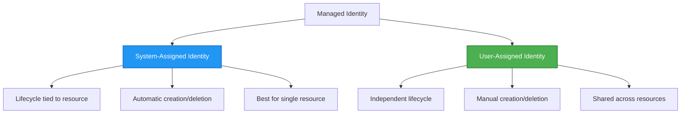

# প্রমাণীকরণ প্যাটার্ন এবং ব্যবস্থাপিত পরিচয়

⏱️ **প্রাক্কলিত সময়**: ৪৫-৬০ মিনিট পাঠ; অনুশীলন সম্পৃক্ত করতে অতিরিক্ত সময় দিন | 💰 **খরচ প্রভাব**: পরিচয়/RBAC বিনামূল্যে; স্থাপিত কম্পিউট, স্টোরেজ, এবং কী ভল্ট বিলযোগ্য | ⭐ **জটিলতা**: মধ্যবর্তী

> `azd 1.37.2` বিরুদ্ধে পর্যালোচনা করা হয়েছে (নভেম্বর ২০২৬)। এই পাঠে **সম্পূর্ণ ডাউনলোডযোগ্য `secure-app` টেম্পলেট নয়, শুধুমাত্র চিত্রণমূলক ইন্টিগ্রেশন ফ্র্যাগমেন্ট রয়েছে**। উল্লেখিত ফাইলগুলি তৈরি করুন, মিল রাখা অবকাঠামো প্রদান করুন, এবং বাস্তবায়নের আগে প্লেসহোল্ডারগুলি প্রতিস্থাপন করুন। পর্যালোচনার সময় কোন Azure সম্পদ প্রদান করা হয়নি।

**📚 শেখার পথ:**
- ← পূর্ববর্তী: [কনফিগারেশন ব্যবস্থাপনা](configuration.md) - পরিবেশ ভেরিয়েবল এবং গোপনীয়তা পরিচালনা
- 🎯 **আপনি এখানে আছেন**: প্রমাণীকরণ ও সুরক্ষা (ম্যানেজড আইডেন্টিটি, কী ভল্ট, নিরাপদ প্যাটার্ন)
- → পরবর্তী: [ইনফ্রাসট্রাকচার অ্যাজ কোড](../chapter-04-infrastructure/README.md) - সম্পদ প্রভিড এবং ডিপ্লয় করুন
- 🏠 [কোর্স হোম](../../README.md)

---

## আপনি কি শিখবেন

এই পাঠটি সম্পন্ন করে, আপনি পাবেন:
- আজুর প্রমাণীকরণ প্যাটার্নগুলি বোঝা (কি, সংযোগ স্ট্রিং, ম্যানেজড আইডেন্টিটি)
- পাসওয়ার্ড ছাড়াই প্রমাণীকরণের জন্য **ম্যানেজড আইডেন্টিটি** বাস্তবায়ন
- **আজুর কি ভল্ট** ইন্টিগ্রেশনের মাধ্যমে সিক্রেট সুরক্ষা
- AZD ডিপ্লয়মেন্টের জন্য **ভূমিকা-ভিত্তিক প্রবেশ নিয়ন্ত্রণ (RBAC)** কনফিগার করা
- কনটেইনার অ্যাপস এবং আজুর সার্ভিসগুলিতে নিরাপত্তার সেরা অনুশীলন প্রয়োগ
- কি-ভিত্তিক থেকে আইডেন্টিটি-ভিত্তিক প্রমাণীকরণে স্থানান্তরিত হওয়া

## কেন Managed Identity গুরুত্বপূর্ণ

### সমস্যা: প্রচলিত প্রমাণিকরণ

**Managed Identity এর আগে:**
```javascript
// ❌ SECURITY RISK: Hardcoded secrets in code
const connectionString = "Server=mydb.database.windows.net;User=admin;Password=P@ssw0rd123";
const storageKey = "xK7mN9pQ2wR5tY8uI0oP3aS6dF1gH4jK...";
const cosmosKey = "C2x7B9n4M1p8Q5w3E6r0T2y5U8i1O4p7...";
```

**সমস্যাসমূহ:**
- 🔴 কোড, কনফিগ ফাইল, পরিবেশ ভেরিয়েবলগুলিতে **প্রকাশিত গোপন তথ্য**
- 🔴 **ক্রেডেনশিয়াল রোটেশন** এর জন্য কোড পরিবর্তন ও পুনরায় স্থাপন প্রয়োজন
- 🔴 **অডিটের দুঃস্বপ্ন** - কে কী, কখন অ্যাক্সেস করেছে?
- 🔴 **বিস্তৃতি** - গোপন তথ্য বিভিন্ন সিস্টেমে ছড়িয়ে ছিটিয়ে আছে
- 🔴 **অনুবর্তিতা ঝুঁকি** - নিরাপত্তা অডিটে ফেল

### সমাধান: Managed Identity

**ম্যানেজড আইডেন্টিটির পরে:**
```javascript
// ✅ SECURE: No secrets in code
const credential = new DefaultAzureCredential();
const client = new BlobServiceClient(
  "https://mystorageaccount.blob.core.windows.net",
  credential  // Azure automatically handles authentication
);
```

**সুবিধাসমূহ:**
- ✅ কোড বা কনফিগারেশনে **জিরো সিক্রেটস**
- ✅ **স্বয়ংক্রিয় রোটেশন** - এটি Azure পরিচালনা করে
- ✅ Microsoft Entra ID লগে **পূর্ণ অডিট ট্রেইল**
- ✅ **কেন্দ্রীভূত নিরাপত্তা** - Azure পোর্টালে পরিচালনা করুন
- ✅ **কমপ্লায়েন্স রেডি** - নিরাপত্তা মানদণ্ড পূরণ করে

**উপমা**: প্রচলিত প্রমাণীকরণ হলো বিভিন্ন দরজার জন্য একাধিক শারীরিক চাবি বহন করার মতো। ম্যানেজড আইডেন্টিটি হলো এমন একটি নিরাপত্তা ব্যাজ যা স্বয়ংক্রিয়ভাবে আপনার পরিচয়ের ভিত্তিতে প্রবেশাধিকার প্রদান করে — কোন চাবি হারানোর, অনুলিপি করার বা রোটেট করার প্রয়োজন নেই।

---

## স্থাপত্যের সারাংশ

### ম্যানেজড আইডেন্টিটি দিয়ে প্রমাণীকরণ প্রবাহ

```mermaid
sequenceDiagram
    participant App as Your Application<br/>(Container App)
    participant MI as Managed Identity<br/>(Microsoft Entra ID)
    participant KV as Key Vault
    participant Storage as Azure Storage
    participant DB as Azure SQL
    
    App->>MI: Request access token<br/>(automatic)
    MI->>MI: Verify identity<br/>(no password needed)
    MI-->>App: Return token for requested audience<br/>(lifetime varies)
    
    App->>KV: Get secret<br/>(using token)
    KV->>KV: Check RBAC permissions
    KV-->>App: Return secret value
    
    App->>Storage: Upload blob<br/>(using token)
    Storage->>Storage: Check RBAC permissions
    Storage-->>App: Success
    
    App->>DB: Query data<br/>(using token)
    DB->>DB: Check SQL permissions
    DB-->>App: Return results
    
    Note over App,DB: Request a separate token for each service audience;<br/>SDK credentials handle caching and renewal
```

### ম্যানেজড আইডেন্টিটির ধরন



| বৈশিষ্ট্য | সিস্টেম-অ্যাসাইনড | ইউজার-অ্যাসাইনড |
|---------|----------------|---------------|
| **লাইফসাইকেল** | রিসোর্সের সঙ্গে আবদ্ধ | স্বতন্ত্র |
| **তৈরি** | রিসোর্সের সঙ্গে স্বয়ংক্রিয় | ম্যানুয়াল তৈরী |
| **মুছে ফেলা** | রিসোর্সের সঙ্গে মিলিয়ে মুছে ফেলা হয় | রিসোর্স মুছে ফেলার পরও অব্যাহত থাকে |
| **শেয়ারিং** | শুধুমাত্র একটি রিসোর্সের জন্য | একাধিক রিসোর্সে ব্যবহারযোগ্য |
| **ব্যবহারের ক্ষেত্রে** | সহজ পরিস্থিতি | জটিল মাল্টি-রিসোর্স পরিস্থিতি |
| **টেমপ্লেট নির্বাচন** | অবকাঠামোতে নির্ধারিত | অবকাঠামোতে নির্ধারিত |

---

## পূর্বশর্তসমূহ

### প্রয়োজনীয় সরঞ্জাম

পূর্বের পাঠ থেকে ইতিমধ্যে এইগুলি আপনার কাছে থাকা উচিত:

```bash
# Verify Azure Developer CLI
azd version
# ✅ Expected: azd version 1.0.0 or higher

# Verify Azure CLI
az --version
# ✅ Expected: azure-cli 2.50.0 or higher
```

### Azure প্রয়োজনীয়তা

- সক্রিয় Azure সাবস্ক্রিপশন
- অনুমতিসমূহ:
  - ম্যানেজড আইডেন্টিটি তৈরি করার
  - RBAC ভূমিকা অ্যাসাইন করার
  - কী ভল্ট রিসোর্স তৈরি করার
  - কন্টেইনার অ্যাপস ডিপ্লয় করার

### জ্ঞানের পূর্বশর্তসমূহ

আপনাকে শেষ করে নেয়া উচিত:
- [ইনস্টলেশন গাইড](../chapter-01-foundation/installation.md) - AZD সেটআপ
- [AZD বেসিকস](../chapter-01-foundation/azd-basics.md) - মূল ধারণা
- [কনফিগারেশন ম্যানেজমেন্ট](configuration.md) - পরিবেশ ভেরিয়েবলস

---

## পাঠ ১: প্রমাণীকরণ প্যাটার্ন বোঝা

### প্যাটার্ন ১: সংযোগ স্ট্রিং (পুরানো - এড়িয়ে চলুন)

**এটি কীভাবে কাজ করে:**
```bash
# Connection string contains credentials
STORAGE_CONNECTION_STRING="DefaultEndpointsProtocol=https;AccountName=myaccount;AccountKey=xK7mN9pQ2wR5..."
COSMOS_CONNECTION_STRING="AccountEndpoint=https://myaccount.documents.azure.com:443/;AccountKey=C2x7..."
SQL_CONNECTION_STRING="Server=myserver.database.windows.net;User=admin;Password=P@ssw0rd..."
```

**সমস্যাসমূহ:**
- ❌ গোপন তথ্য পরিবেশ ভেরিয়েবলসে দৃশ্যমান
- ❌ লগ হয় ডিপ্লয়মেন্ট সিস্টেমে
- ❌ ঘোরানো কঠিন
- ❌ অ্যাক্সেসের কোন অডিট ট্রেইল নেই

**কখন ব্যবহার করবেন:** যখন লক্ষ্য সেবাটি কী-ভিত্তিক প্রমাণীকরণ চায়। সমর্থিত হলে পরিচয় পছন্দ করুন; অন্যথায় কী সুরক্ষিতভাবে সংরক্ষণ করুন এবং ঘোরান, প্রোডাকশনের মধ্যে সহ।

---

### প্যাটার্ন ২: কী ভল্ট রেফারেন্স (ভাল)

**এটি কীভাবে কাজ করে:**
**আংশিক বাইসিপ খণ্ড:** প্রয়োজনীয় ভল্ট ফিল্ড, কন্টেইনার অ্যাপ পরিচয় এবং এর `configuration.secrets` এন্ট্রি বাদ দেওয়া হয়েছে। `secretRef` কন্টেইনার অ্যাপের একটি সিক্রেটকে নামিত করে; এটি **নিজেই** কী ভল্ট ইউআরআই নয়। কী ভল্ট ব্যবহার করতে, ঐ নামকৃত সিক্রেটটি `keyVaultUrl` এবং অনুমোদিত `identity` দিয়ে সংজ্ঞায়িত করুন।

```bicep
// Store secret in Key Vault
resource keyVault 'Microsoft.KeyVault/vaults@2023-02-01' = {
  name: 'mykv'
  properties: {
    enableRbacAuthorization: true
  }
}

// Reference in Container App
env: [
  {
    name: 'STORAGE_KEY'
    secretRef: 'storage-key'  // References Key Vault
  }
]
```

**সুবিধাসমূহ:**
- ✅ কী ভল্টে সিক্রেটগুলি সুরক্ষিতভাবে সংরক্ষিত
- ✅ কেন্দ্রীভূত সিক্রেট ব্যবস্থাপনা
- ✅ কোড পরিবর্তন ছাড়াই ঘোরানো

**সীমাবদ্ধতা:**
- ⚠️ এখনও কী/পাসওয়ার্ড ব্যবহার হচ্ছে
- ⚠️ কী ভল্ট অ্যাক্সেস ম্যানেজ করতে হবে

**কখন ব্যবহার করবেন:** সংযোগ স্ট্রিং থেকে ব্যবস্থাপিত পরিচয়ে রূপান্তরের ধাপ।

---

### প্যাটার্ন ৩: ব্যবস্থাপিত পরিচয় (সেরা অনুশীলন)

**এটি কীভাবে কাজ করে:**
**আংশিক বাইসিপ:** পরিচয় ব্লককে একটি সম্পূর্ণ কন্টেইনার অ্যাপে একত্রিত করুন এবং `storageAccount` এবং রোল ডেফিনিশন সরবরাহ করুন। একটি রোল অ্যাসাইনমেন্টেও একটি নির্ধারিত `name` প্রয়োজন।

```bicep
// Enable managed identity
resource containerApp 'Microsoft.App/containerApps@2023-05-01' = {
  name: 'myapp'
  identity: {
    type: 'SystemAssigned'  // Automatically creates identity
  }
}

// Grant permissions
resource roleAssignment 'Microsoft.Authorization/roleAssignments@2022-04-01' = {
  name: guid(storageAccount.id, containerApp.id, storageBlobDataContributorRole)
  scope: storageAccount
  properties: {
    roleDefinitionId: storageBlobDataContributorRole
    principalId: containerApp.identity.principalId
    principalType: 'ServicePrincipal'
  }
}
```

**অ্যাপ্লিকেশন কোড:**
```javascript
// No secrets needed!
const { DefaultAzureCredential } = require('@azure/identity');
const { BlobServiceClient } = require('@azure/storage-blob');

const credential = new DefaultAzureCredential();
const blobServiceClient = new BlobServiceClient(
  'https://mystorageaccount.blob.core.windows.net',
  credential
);
```

**সুবিধাসমূহ:**
- ✅ কোড/কনফিগে শূন্য সিক্রেট
- ✅ স্বয়ংক্রিয় ক্রেডেনশিয়াল ঘোরানো
- ✅ সম্পূর্ণ অডিট ট্রেইল
- ✅ RBAC-ভিত্তিক অনুমতি
- ✅ কমপ্লায়েন্স প্রস্তুত

**কখন ব্যবহার করবেন:** মাইক্রোসফট এনট্রা প্রমাণীকরণ সমর্থন করে এমন সেবাগুলিতে অ্যাক্সেস করা আজুর হোস্টেড অ্যাপ্লিকেশনের জন্য পছন্দ করুন।

---

### প্যাটার্ন ৪: সার্ভিস প্রিন্সিপালস (CI/CD এবং অটোমেশন)

ব্যবস্থাপিত পরিচয় হলো আজুরের ভিতরে চলা সম্পদের জন্য স্বর্ণমান। কিন্তু আজুরের বাইরের—যেমন একটি বিল্ড এজেন্টে CI/CD পাইপলাইন, বা আপনার ল্যাপটপে একটি স্ক্রিপ্ট যা আপনার ইন্টারেক্টিভ লগইন ব্যবহার করতে পারে না—সেসব ক্ষেত্রে কী হবে? সেক্ষেত্রে একটি **সার্ভিস প্রিন্সিপাল** ব্যবহৃত হয়: একটি অমানবিক পরিচয় যার নিজস্ব প্রমাণপত্র আছে যেটি একটি অটোমেটেড প্রক্রিয়া সাইন ইন হিসেবে ব্যবহার করতে পারে।

**এটি কীভাবে কাজ করে:**

একটি রিসোর্স গ্রুপ স্পেকট্রুমের জন্য সার্ভিস প্রিন্সিপাল তৈরি করুন (সবচেয়ে কম অনুমতি):

```bash
az ad sp create-for-rbac \
  --name "myapp-cicd" \
  --role contributor \
  --scopes "/subscriptions/<sub-id>/resourceGroups/<rg-name>"
```

এটি ক্লায়েন্ট আইডি, ক্লায়েন্ট সিক্রেট, এবং টেন্যান্ট আইডি প্রিন্ট করে। azd এগুলি দিয়ে নন-ইন্টারেক্টিভভাবে সাইন ইন করতে পারে:

```bash
azd auth login \
  --client-id "<appId>" \
  --client-secret "<password>" \
  --tenant-id "<tenant>"
```

**সিক্রেটের উপর federated ক্রেডেনশিয়াল (OIDC) পছন্দ করুন।** দীর্ঘমেয়াদি ক্লায়েন্ট সিক্রেটের পরিবর্তে, একটি federated ক্রেডেনশিয়াল কনফিগার করুন যাতে পাইপলাইন একটি স্বল্পকালীন টোকেন এক্সচেঞ্জ করে—কোনো সিক্রেট ফাঁস হওয়ার বা ঘোরানোর ঝুঁকি নেই:

```bash
azd auth login \
  --client-id "<appId>" \
  --federated-credential-provider "github" \
  --tenant-id "<tenant>"
```

> `azd pipeline config` এটি আপনার জন্য স্বয়ংক্রিয়ভাবে সেট আপ করে। [অধ্যায় ৮](../chapter-08-production/production-ai-practices.md) এ CI/CD হাঁটার পথ দেখুন।

**সুবিধাসমূহ:**
- ✅ Azure-এর বাইরে কাজ করে (বিল্ড এজেন্ট, অন-প্রিম, অন্যান্য ক্লাউড)
- ✅ একটি রোল দিয়ে একটি নির্দিষ্ট রিসোর্স গ্রুপের মধ্যে সীমাবদ্ধ করা যেতে পারে
- ✅ ফেডারেটেড (OIDC) ভ্যারিয়েন্টে কোনো সংরক্ষিত সিক্রেট ব্যবহার হয় না

**টার্ন-অফ:**
- ⚠️ সিক্রেট-ভিত্তিক ভ্যারিয়েন্টের জন্য সতর্ক স্টোরেজ এবং ঘূর্ণন দরকার
- ⚠️ একটি ফাঁস হওয়া সিক্রেট SP যা করতে পারে তা দেয়—স্কোপ সঙ্কুচিত রাখুন

**কখন ব্যবহার করবেন:** CI/CD পাইপলাইন এবং অটোমেশন যা ম্যানেজড আইডেন্টিটি ব্যবহার করতে পারে না। সর্বদা ক্লায়েন্ট সিক্রেটের চেয়ে **ফেডারেটেড/OIDC** ভ্যারিয়েন্ট পছন্দ করুন, এবং যখনও কাজের ওজন Azure-এর ভিতরে চলে তখন ম্যানেজড আইডেন্টিটি পছন্দ করুন।

**ক্রেডেনশিয়াল নিরাপদে সংরক্ষণ:**
- কখনো সিক্রেট কমিট করবেন না—আপনার পাইপলাইনের সিক্রেট স্টোর ব্যবহার করুন (GitHub Actions সিক্রেট, Azure DevOps ভ্যারিয়েবল গ্রুপ / কী ভল্ট)।
- SP কে তার প্রয়োজনীয় সবচেয়ে ছোট রোল এবং রিসোর্স গ্রুপ দিয়ে স্কোপ করুন।
- একটি মেয়াদ নির্ধারণ করুন এবং ঘুরান, অথবা OIDC দিয়ে সম্পূর্ণ সিক্রেট বাদ দিন।

---

## পাঠ ২: AZD দিয়ে ম্যানেজড আইডেন্টিটি বাস্তবায়ন

### ধাপে ধাপে বাস্তবায়ন

নিম্নলিখিত অংশগুলি দেখায় কিভাবে একটি Container App প্রকল্পে ম্যানেজড আইডেন্টিটি ইন্টিগ্রেট করবেন। এগুলো **কপি-এবং-রান স্টার্টার নয়**: স্টোরেজ মডিউল, সম্পূর্ণ ম্যানেজড পরিবেশ/রেজিস্ট্রি ইনফ্রাস্ট্রাকচার, Dockerfile এবং প্যারামিটার ফাইল সব এখানে সরবরাহ করা হয়নি। একটি কাজ করা Container Apps টেমপ্লেট থেকে শুরু করুন এবং এই প্যাটার্নগুলো মিলিয়ে নিন, এর রেজিস্ট্রি কনফিগারেশন এবং সার্ভিস ট্যাগগুলি রেখে দিন।

### প্রকল্প কাঠামো

```
secure-app/
├── azure.yaml                 # AZD configuration
├── infra/
│   ├── main.bicep            # Main infrastructure
│   ├── core/
│   │   ├── identity.bicep    # Managed identity setup
│   │   ├── keyvault.bicep    # Key Vault configuration
│   │   └── storage.bicep     # Storage with RBAC
│   └── app/
│       └── container-app.bicep
└── src/
    ├── app.js                # Application code
    ├── package.json
    └── Dockerfile
```

### ১. AZD কনফিগার করুন (azure.yaml)

```yaml
name: secure-app
metadata:
  template: secure-app@1.0.0

services:
  api:
    project: ./src
    language: js
    host: containerapp

# Managed identity must be enabled in the infrastructure, not by this YAML.
```

### ২. ইনফ্রাস্ট্রাকচার: ম্যানেজড আইডেন্টিটি সক্রিয় করুন

**ফাইল: `infra/main.bicep`**

```bicep
targetScope = 'subscription'

param environmentName string
param location string = 'eastus'
param containerAppsEnvironmentId string
param containerImage string

var tags = { 'azd-env-name': environmentName }

// Resource group
resource rg 'Microsoft.Resources/resourceGroups@2021-04-01' = {
  name: 'rg-${environmentName}'
  location: location
  tags: tags
}

// Storage Account
module storage './core/storage.bicep' = {
  name: 'storage'
  scope: rg
  params: {
    name: 'st${uniqueString(rg.id)}'
    location: location
    tags: tags
  }
}

// Key Vault
module keyVault './core/keyvault.bicep' = {
  name: 'keyvault'
  scope: rg
  params: {
    name: 'kv-${uniqueString(rg.id)}'
    location: location
    tags: tags
  }
}

// Container App with Managed Identity
module containerApp './app/container-app.bicep' = {
  name: 'container-app'
  scope: rg
  params: {
    name: 'ca-${environmentName}'
    location: location
    tags: tags
    storageAccountName: storage.outputs.name
    keyVaultName: keyVault.outputs.name
    containerAppsEnvironmentId: containerAppsEnvironmentId
    containerImage: containerImage
  }
}

// Grant Container App access to Storage
module storageRoleAssignment './core/role-assignment.bicep' = {
  name: 'storage-role'
  scope: rg
  params: {
    principalId: containerApp.outputs.identityPrincipalId
    roleDefinitionId: 'ba92f5b4-2d11-453d-a403-e96b0029c9fe'  // Storage Blob Data Contributor
    targetResourceType: 'storage'
    targetResourceName: storage.outputs.name
  }
}

// Grant Container App access to Key Vault
module kvRoleAssignment './core/role-assignment.bicep' = {
  name: 'kv-role'
  scope: rg
  params: {
    principalId: containerApp.outputs.identityPrincipalId
    roleDefinitionId: '4633458b-17de-408a-b874-0445c86b69e6'  // Key Vault Secrets User
    targetResourceType: 'keyvault'
    targetResourceName: keyVault.outputs.name
  }
}

// Outputs
output AZURE_STORAGE_ACCOUNT_NAME string = storage.outputs.name
output AZURE_KEY_VAULT_NAME string = keyVault.outputs.name
output APP_URL string = containerApp.outputs.url
```

### ৩. সিস্টেম-অ্যাসাইনড আইডেন্টিটি সহ Container App

**ফাইল: `infra/app/container-app.bicep`**

```bicep
param name string
param location string
param tags object = {}
param storageAccountName string
param keyVaultName string
param containerAppsEnvironmentId string
param containerImage string

resource containerApp 'Microsoft.App/containerApps@2023-05-01' = {
  name: name
  location: location
  tags: union(tags, { 'azd-service-name': 'api' })
  identity: {
    type: 'SystemAssigned'  // 🔑 Enable managed identity
  }
  properties: {
    managedEnvironmentId: containerAppsEnvironmentId
    configuration: {
      ingress: {
        external: true
        targetPort: 3000
      }
    }
    template: {
      containers: [
        {
          name: 'api'
          image: containerImage // Must exist; configure registry credentials for private images
          resources: {
            cpu: json('0.5')
            memory: '1Gi'
          }
          env: [
            {
              name: 'AZURE_STORAGE_ACCOUNT_NAME'
              value: storageAccountName
            }
            {
              name: 'AZURE_KEY_VAULT_NAME'
              value: keyVaultName
            }
            // 🔑 No secrets - managed identity handles authentication!
          ]
        }
      ]
    }
  }
}

// Output the identity for RBAC assignments
output identityPrincipalId string = containerApp.identity.principalId
output id string = containerApp.id
output url string = 'https://${containerApp.properties.configuration.ingress.fqdn}'
```

### ৪. RBAC রোল অ্যাসাইনমেন্ট মডিউল

**ফাইল: `infra/core/role-assignment.bicep`**

```bicep
param principalId string
param roleDefinitionId string  // Azure built-in role ID
@allowed(['storage', 'keyvault'])
param targetResourceType string
param targetResourceName string

// Typed existing resources give Bicep a valid resource scope, not a string ID.
resource storageTarget 'Microsoft.Storage/storageAccounts@2023-01-01' existing = {
  name: targetResourceName
}
resource vaultTarget 'Microsoft.KeyVault/vaults@2023-02-01' existing = {
  name: targetResourceName
}

resource storageAssignment 'Microsoft.Authorization/roleAssignments@2022-04-01' = if (targetResourceType == 'storage') {
  name: guid(storageTarget.id, principalId, roleDefinitionId)
  scope: storageTarget
  properties: {
    roleDefinitionId: subscriptionResourceId('Microsoft.Authorization/roleDefinitions', roleDefinitionId)
    principalId: principalId
    principalType: 'ServicePrincipal'
  }
}

resource vaultAssignment 'Microsoft.Authorization/roleAssignments@2022-04-01' = if (targetResourceType == 'keyvault') {
  name: guid(vaultTarget.id, principalId, roleDefinitionId)
  scope: vaultTarget
  properties: {
    roleDefinitionId: subscriptionResourceId('Microsoft.Authorization/roleDefinitions', roleDefinitionId)
    principalId: principalId
    principalType: 'ServicePrincipal'
  }
}

// This module assigns at the target resource scope, not the whole resource group.
```

### ৫. ম্যানেজড আইডেন্টিটি সহ অ্যাপ্লিকেশন কোড

**ফাইল: `src/app.js`**

```javascript
const express = require('express');
const { DefaultAzureCredential } = require('@azure/identity');
const { BlobServiceClient } = require('@azure/storage-blob');
const { SecretClient } = require('@azure/keyvault-secrets');

const app = express();
const PORT = process.env.PORT || 3000;

// 🔑 Initialize credential (works automatically with managed identity)
const credential = new DefaultAzureCredential();

// Azure Storage setup
const storageAccountName = process.env.AZURE_STORAGE_ACCOUNT_NAME;
const blobServiceClient = new BlobServiceClient(
  `https://${storageAccountName}.blob.core.windows.net`,
  credential  // No keys needed!
);

// Key Vault setup
const keyVaultName = process.env.AZURE_KEY_VAULT_NAME;
const secretClient = new SecretClient(
  `https://${keyVaultName}.vault.azure.net`,
  credential  // No keys needed!
);

// Health check
app.get('/health', (req, res) => {
  res.json({ status: 'healthy', authentication: 'managed-identity' });
});

// Upload file to blob storage
app.post('/upload', async (req, res) => {
  try {
    const containerClient = blobServiceClient.getContainerClient('uploads');
    await containerClient.createIfNotExists();
    
    const blobName = `file-${Date.now()}.txt`;
    const blockBlobClient = containerClient.getBlockBlobClient(blobName);
    
    const content = 'Hello from managed identity!';
    await blockBlobClient.upload(content, Buffer.byteLength(content));
    
    res.json({
      success: true,
      blobName: blobName,
      message: 'File uploaded using managed identity!'
    });
  } catch (error) {
    console.error('Upload error:', error);
    res.status(500).json({ error: error.message });
  }
});

// Get secret from Key Vault
app.get('/secret/:name', async (req, res) => {
  try {
    const secretName = req.params.name;
    const secret = await secretClient.getSecret(secretName);
    
    res.json({
      name: secretName,
      retrieved: secret.value !== undefined, // Never return the secret value to callers
      message: 'Secret retrieved using managed identity!'
    });
  } catch (error) {
    console.error('Secret error:', error);
    res.status(500).json({ error: error.message });
  }
});

// List blob containers (demonstrates read access)
app.get('/containers', async (req, res) => {
  try {
    const containers = [];
    for await (const container of blobServiceClient.listContainers()) {
      containers.push(container.name);
    }
    
    res.json({
      containers: containers,
      count: containers.length,
      message: 'Containers listed using managed identity!'
    });
  } catch (error) {
    console.error('List error:', error);
    res.status(500).json({ error: error.message });
  }
});

app.listen(PORT, () => {
  console.log(`Secure API listening on port ${PORT}`);
  console.log('Authentication: Managed Identity (passwordless)');
});
```

**ফাইল: `src/package.json`**

```json
{
  "name": "secure-app",
  "version": "1.0.0",
  "dependencies": {
    "express": "^4.18.2",
    "@azure/identity": "^4.0.0",
    "@azure/storage-blob": "^12.17.0",
    "@azure/keyvault-secrets": "^4.7.0"
  },
  "scripts": {
    "start": "node app.js"
  }
}
```

### ৬. ডিপ্লয় ও পরীক্ষা করুন

এই কমান্ডগুলি চালান শুধুমাত্র **তারা পূরণ করার পরে** অনুপস্থিত ইনফ্রাস্ট্রাকচার, Dockerfile, এবং মেলানো `main.parameters.json` আপনার নিজস্ব প্রকল্পে। azd কে Authenticate করুন `azd auth login` দিয়ে; আলাদাভাবে `az login` দিয়ে সাইন ইন করুন পরে Azure CLI চেকের জন্য। প্রদর্শিত এন্ডপয়েন্টগুলি ডেমো এবং পাবলিক ব্যবহারের আগে যথাযথ অ্যাক্সেস নিয়ন্ত্রণ দরকার।

```bash
# Initialize AZD environment
azd init

# Deploy infrastructure and application
azd up

# Get the app URL
APP_URL=$(azd env get-value APP_URL)

# Test health check
curl $APP_URL/health
```

**✅ প্রত্যাশিত আউটপুট:**
```json
{
  "status": "healthy",
  "authentication": "managed-identity"
}
```

**টেস্ট ব্লব আপলোড:**
```bash
curl -X POST $APP_URL/upload
```

**✅ প্রত্যাশিত আউটপুট:**
```json
{
  "success": true,
  "blobName": "file-1700404800000.txt",
  "message": "File uploaded using managed identity!"
}
```

**টেস্ট কন্টেইনার তালিকা:**
```bash
curl $APP_URL/containers
```

**✅ প্রত্যাশিত আউটপুট:**
```json
{
  "containers": ["uploads"],
  "count": 1,
  "message": "Containers listed using managed identity!"
}
```

---

## সাধারণ Azure RBAC রোল

### ম্যানেজড আইডেন্টিটির জন্য বিল্ট-ইন রোল আইডি

| সার্ভিস | রোল নাম | রোল আইডি | অনুমতি |
|---------|-----------|---------|-------------|
| **Storage** | Storage Blob Data Reader | `2a2b9908-6ea1-4ae2-8e65-a410df84e7d1` | ব্লব এবং কন্টেইনার পড়ুন |
| **Storage** | Storage Blob Data Contributor | `ba92f5b4-2d11-453d-a403-e96b0029c9fe` | ব্লব পড়ুন, লিখুন, মুছে ফেলুন |
| **Storage** | Storage Queue Data Contributor | `974c5e8b-45b9-4653-ba55-5f855dd0fb88` | কিউ/বার্তা পড়ুন, লিখুন, মুছে ফেলুন |
| **কী ভল্ট** | কী ভল্ট সিক্রেটস ব্যবহারকারী | `4633458b-17de-408a-b874-0445c86b69e6` | সিক্রেট পড়ুন |
| **কী ভল্ট** | কী ভল্ট সিক্রেটস অফিসার | `b86a8fe4-44ce-4948-aee5-eccb2c155cd7` | সিক্রেট পড়া, লেখা, মুছুন |
| **কসমস ডিবি** | কসমস ডিবি বিল্ট-ইন ডেটা রিডার | `00000000-0000-0000-0000-000000000001` | কসমস ডিবি ডেটা পড়ুন |
| **কসমস ডিবি** | কসমস ডিবি বিল্ট-ইন ডেটা কন্ট্রিবিউটার | `00000000-0000-0000-0000-000000000002` | কসমস ডিবি ডেটা পড়া, লেখা |
| **এসকিউএল ডাটাবেস** | এসকিউএল ডিবি কন্ট্রিবিউটার | `9b7fa17d-e63e-47b0-bb0a-15c516ac86ec` | ডাটাবেস রিসোর্স ম্যানেজ করুন; এসকিউএল ডেটা অ্যাক্সেস প্রদান করে না |
| **সার্ভিস বাস** | আজুর সার্ভিস বাস ডেটা ওনার | `090c5cfd-751d-490a-894a-3ce6f1109419` | মেসেজ পাঠানো, গ্রহণ, ম্যানেজ করুন |

### কীভাবে রোল আইডি খুঁজবেন

নোসকিউএলের জন্য কসমস ডিবির উপরের দুটি আইডি হলো **নেটিভ কসমস ডেটা-প্লেন রোল সংজ্ঞা**, আজুর আরবিএসি সাবস্ক্রিপশন রোল আইডি নয়। এগুলোকে `az cosmosdb sql role assignment create` (অথবা `Microsoft.DocumentDB/databaseAccounts/sqlRoleAssignments`) দিয়ে অ্যাসাইন করুন, `az role assignment create` দিয়ে নয়। এসকিউএল ডেটা অ্যাক্সেসের জন্য একটি এন্ট্রা ডাটাবেস ব্যবহারকারী এবং এসকিউএল অনুমতি প্রয়োজন।

```bash
# List all built-in roles
az role definition list --query "[].{Name:roleName, ID:name}" --output table

# Search for specific role
az role definition list --query "[?contains(roleName, 'Storage Blob')].{Name:roleName, ID:name}" --output table

# Get role details
az role definition list --name "Storage Blob Data Contributor"
```

---

## ব্যবহারিক অনুশীলন

**তিনটি অনুশীলনের জন্য ইন্টিগ্রেশন পূর্বশর্ত:** আপনার নিজের প্রকল্পে একটি কাজ করা কন্টেইনার অ্যাপ টেমপ্লেট, মিল থাকা বিসেপ রিসোর্স, আজুর সিএলআই/azd সাইন-ইন, এবং প্রয়োজনীয় রোলগুলি অ্যাসাইন করার ক্ষমতা। এগুলো গাইডেড অভিযোজন, স্বাধীন লোকাল স্টার্টার নয়; প্রদর্শনী রিসোর্স নামগুলো আপনার ডিপ্লয়কৃত নাম দিয়ে প্রতিস্থাপন করুন।

### অনুশীলন ১: বিদ্যমান অ্যাপের জন্য ম্যানেজড আইডেনটি সক্ষম করা ⭐⭐ (মাঝারি)

**লক্ষ্য**: বিদ্যমান কন্টেইনার অ্যাপ ডিপ্লয়মেন্টে ম্যানেজড আইডেনটি যোগ করা

**পরিস্থিতি**: আপনার একটি কন্টেইনার অ্যাপ আছে যা কানেকশন স্ট্রিং ব্যবহার করে। এটিকে ম্যানেজড আইডেনটিতে রূপান্তর করুন।

**শুরু বিন্দু**: নিম্নলিখিত কনফিগারেশন সহ কন্টেইনার অ্যাপ:

```bicep
// ❌ Current: Using connection string
env: [
  {
    name: 'STORAGE_CONNECTION_STRING'
    secretRef: 'storage-connection'
  }
]
```

**পদক্ষেপসমূহ**:

১. **বিসেপে ম্যানেজড আইডেনটি সক্ষম করুন:**

```bicep
resource containerApp 'Microsoft.App/containerApps@2023-05-01' = {
  name: 'myapp'
  identity: {
    type: 'SystemAssigned'  // Add this
  }
  // ... rest of configuration
}
```

২. **স্টোরেজ অ্যাক্সেস অনুমতি দিন:**

```bicep
// Get storage account reference
resource storageAccount 'Microsoft.Storage/storageAccounts@2023-01-01' existing = {
  name: storageAccountName
}

// Assign role
resource roleAssignment 'Microsoft.Authorization/roleAssignments@2022-04-01' = {
  name: guid(containerApp.id, 'ba92f5b4-2d11-453d-a403-e96b0029c9fe', storageAccount.id)
  scope: storageAccount
  properties: {
    roleDefinitionId: subscriptionResourceId('Microsoft.Authorization/roleDefinitions', 'ba92f5b4-2d11-453d-a403-e96b0029c9fe')
    principalId: containerApp.identity.principalId
    principalType: 'ServicePrincipal'
  }
}
```

৩. **অ্যাপ্লিকেশন কোড আপডেট করুন:**

**আগে (কানেকশন স্ট্রিং):**
```javascript
const { BlobServiceClient } = require('@azure/storage-blob');

const blobServiceClient = BlobServiceClient.fromConnectionString(
  process.env.STORAGE_CONNECTION_STRING
);
```

**পরে (ম্যানেজড আইডেনটি):**
```javascript
const { DefaultAzureCredential } = require('@azure/identity');
const { BlobServiceClient } = require('@azure/storage-blob');

const credential = new DefaultAzureCredential();
const blobServiceClient = new BlobServiceClient(
  `https://${process.env.STORAGE_ACCOUNT_NAME}.blob.core.windows.net`,
  credential
);
```

৪. **পরিবেশ ভেরিয়েবল আপডেট করুন:**

```bicep
env: [
  {
    name: 'STORAGE_ACCOUNT_NAME'
    value: storageAccountName  // Just the name, no secrets!
  }
  // Remove STORAGE_CONNECTION_STRING
]
```

৫. **ডিপ্লয় এবং পরীক্ষা করুন:**

```bash
# Redeploy
azd up

# Test that it still works
APP_URL=$(azd show --output json | jq -er '.services.api.ingressUrl')
curl --fail -X POST "$APP_URL/upload"
```

**✅ সফলতার মানদণ্ড:**
- ✅ অ্যাপ্লিকেশন ভুল ছাড়া ডিপ্লয় হয়
- ✅ স্টোরেজ অপারেশন কাজ করে (আপলোড, তালিকা, ডাউনলোড)
- ✅ পরিবেশ ভেরিয়েবলে কোন কানেকশন স্ট্রিং নেই
- ✅ আজুর পোর্টালে "আইডেনটিটি" ব্লেডের অধীনে আইডেনটি দৃশ্যমান

**যাচাই:**

```bash
# Check managed identity is enabled
az containerapp show \
  --name myapp \
  --resource-group rg-myapp \
  --query "identity.type"
# ✅ Expected: "SystemAssigned"

# Check role assignment
az role assignment list \
  --assignee $(az containerapp show --name myapp --resource-group rg-myapp --query "identity.principalId" -o tsv) \
  --scope /subscriptions/{sub-id}/resourceGroups/rg-myapp/providers/Microsoft.Storage/storageAccounts/mystorageaccount
# ✅ Expected: Shows "Storage Blob Data Contributor" role
```

**সময়**: ২০-৩০ মিনিট

---

### অনুশীলন ২: মাল্টি-সার্ভিস অ্যাক্সেস ব্যবহারকারী-অ্যাসাইন আইডেনটির মাধ্যমে ⭐⭐⭐ (এডভান্সড)

**লক্ষ্য**: একাধিক কন্টেইনার অ্যাপের জন্য একটি ব্যবহারকারী-অ্যাসাইন আইডেনটি তৈরি করা যা শেয়ার করা হবে

**পরিস্থিতি**: আপনার ৩টি মাইক্রোসার্ভিস আছে যা একই স্টোরেজ অ্যাকাউন্ট এবং কী ভল্ট অ্যাক্সেস করতে হবে।

**পদক্ষেপসমূহ**:

১. **ব্যবহারকারী-অ্যাসাইন আইডেনটি তৈরি করুন:**

**ফাইল: `infra/core/identity.bicep`**

```bicep
param name string
param location string
param tags object = {}

resource userAssignedIdentity 'Microsoft.ManagedIdentity/userAssignedIdentities@2023-01-31' = {
  name: name
  location: location
  tags: tags
}

output id string = userAssignedIdentity.id
output principalId string = userAssignedIdentity.properties.principalId
output clientId string = userAssignedIdentity.properties.clientId
```

২. **ব্যবহারকারী-অ্যাসাইন আইডেনটিতে রোল অ্যাসাইন করুন:**

```bicep
// In main.bicep
module userIdentity './core/identity.bicep' = {
  name: 'user-identity'
  scope: rg
  params: {
    name: 'id-${environmentName}'
    location: location
    tags: tags
  }
}

// Grant Storage access
resource storageRoleAssignment 'Microsoft.Authorization/roleAssignments@2022-04-01' = {
  name: guid(storageAccount.id, environmentName, 'storage-contributor')
  scope: storageAccount
  properties: {
    roleDefinitionId: subscriptionResourceId('Microsoft.Authorization/roleDefinitions', 'ba92f5b4-2d11-453d-a403-e96b0029c9fe')
    principalId: userIdentity.outputs.principalId
    principalType: 'ServicePrincipal'
  }
}

// Grant Key Vault access
resource kvRoleAssignment 'Microsoft.Authorization/roleAssignments@2022-04-01' = {
  name: guid(keyVault.id, environmentName, 'kv-secrets-user')
  scope: keyVault
  properties: {
    roleDefinitionId: subscriptionResourceId('Microsoft.Authorization/roleDefinitions', '4633458b-17de-408a-b874-0445c86b69e6')
    principalId: userIdentity.outputs.principalId
    principalType: 'ServicePrincipal'
  }
}
```

৩. **একাধিক কন্টেইনার অ্যাপের জন্য পরিচয় বরাদ্দ করুন:**

```bicep
resource apiGateway 'Microsoft.App/containerApps@2023-05-01' = {
  name: 'api-gateway'
  identity: {
    type: 'UserAssigned'
    userAssignedIdentities: {
      '${userIdentity.outputs.id}': {}
    }
  }
  // ... rest of config
}

resource productService 'Microsoft.App/containerApps@2023-05-01' = {
  name: 'product-service'
  identity: {
    type: 'UserAssigned'
    userAssignedIdentities: {
      '${userIdentity.outputs.id}': {}
    }
  }
  // ... rest of config
}

resource orderService 'Microsoft.App/containerApps@2023-05-01' = {
  name: 'order-service'
  identity: {
    type: 'UserAssigned'
    userAssignedIdentities: {
      '${userIdentity.outputs.id}': {}
    }
  }
  // ... rest of config
}
```

৪. **অ্যাপ্লিকেশন কোড (সকল পরিষেবা একই প্যাটার্ন ব্যবহার করে):**

```javascript
const { ManagedIdentityCredential } = require('@azure/identity');
const { BlobServiceClient } = require('@azure/storage-blob');

// For user-assigned identity, specify the client ID
const credential = new ManagedIdentityCredential(
  process.env.AZURE_CLIENT_ID  // User-assigned identity client ID
);

// Alternative (choose ONE credential declaration):
// const { DefaultAzureCredential } = require('@azure/identity');
// const credential = new DefaultAzureCredential({
//   managedIdentityClientId: process.env.AZURE_CLIENT_ID
// });

const blobServiceClient = new BlobServiceClient(
  `https://${process.env.STORAGE_ACCOUNT_NAME}.blob.core.windows.net`,
  credential
);
```

প্রতিটি কন্টেইনার অ্যাপের রানটাইম `AZURE_CLIENT_ID`-কে Bicep-এ আপনার স্টোরেজ নামের `userIdentity.outputs.clientId` ও `STORAGE_ACCOUNT_NAME`-তে সেট করুন। পরিচয় বরাদ্দ করা বা `azd env set` চালানো কেবলই এই রানটাইম মানগুলি কনফিগার করে না।

৫. **ডিপ্লয় এবং যাচাই করুন:**

```bash
azd up

# Test all services can access storage
# Replace with the actual ingress URLs reported for your three services
curl --fail -X POST "$API_GATEWAY_URL/upload"
curl --fail -X POST "$PRODUCT_SERVICE_URL/upload"
curl --fail -X POST "$ORDER_SERVICE_URL/upload"
```

**✅ সফলতার মানদণ্ড:**
- ✅ ৩ টি পরিষেবার মধ্যে এক পরিচয় ভাগ করা হয়েছে
- ✅ সব পরিষেবা স্টোরেজ এবং কী ভল্টে প্রবেশাধিকার পায়
- ✅ একটি পরিষেবা মুছে ফেলার পরও পরিচয় থেকে যায়
- ✅ কেন্দ্রীভূত পারমিশন ব্যবস্থাপনা

**ইউজার-অ্যাসাইনড পরিচয়ের সুবিধাসমূহ:**
- একক পরিচয় যা পরিচালনা করা সহজ
- পরিষেবাগুলোর মধ্যে সঙ্গতিপূর্ণ অনুমতি
- পরিষেবা মুছে ফেলার পরও টিকে থাকা
- জটিল স্থাপত্যের জন্য আরও ভালো

**সময়**: ৩০-৪০ মিনিট

---

### অনুশীলন ৩: কী ভল্ট সিক্রেট রোটেশন বাস্তবায়ন করুন ⭐⭐⭐ (উন্নত)

**লক্ষ্য**: তৃতীয় পক্ষের API কী কী ভল্টে সংরক্ষণ করুন এবং ম্যানেজড পরিচয়ের মাধ্যমে সেগুলো অ্যাক্সেস করুন

**দৃশ্যপট**: আপনার অ্যাপ একটি বহির্গত API (OpenAI, Stripe, SendGrid) কল করতে চায় যা API কী প্রয়োজন।

**ধাপসমূহ**:

১. **RBAC সহ কী ভল্ট তৈরি করুন:**

**ফাইল: `infra/core/keyvault.bicep`**

```bicep
param name string
param location string
param tags object = {}

resource keyVault 'Microsoft.KeyVault/vaults@2023-02-01' = {
  name: name
  location: location
  tags: tags
  properties: {
    enableRbacAuthorization: true  // Use RBAC instead of access policies
    sku: {
      family: 'A'
      name: 'standard'
    }
    tenantId: subscription().tenantId
    enableSoftDelete: true
    softDeleteRetentionInDays: 90
  }
}

// Allow Container App to read secrets
output id string = keyVault.id
output name string = keyVault.name
output uri string = keyVault.properties.vaultUri
```

২. **কী ভল্টে সিক্রেট সংরক্ষণ করুন:**

```bash
# Get Key Vault name
KV_NAME=$(azd env get-value AZURE_KEY_VAULT_NAME)

# Store third-party API keys
az keyvault secret set \
  --vault-name $KV_NAME \
  --name "OpenAI-ApiKey" \
  --value "sk-proj-xxxxxxxxxxxxx"

az keyvault secret set \
  --vault-name $KV_NAME \
  --name "Stripe-ApiKey" \
  --value "sk_live_xxxxxxxxxxxxx"

az keyvault secret set \
  --vault-name $KV_NAME \
  --name "SendGrid-ApiKey" \
  --value "SG.xxxxxxxxxxxxx"
```

৩. **সিক্রেট পুনরুদ্ধারের জন্য অ্যাপ্লিকেশন কোড:**

**ফাইল: `src/config.js`**

```javascript
const { DefaultAzureCredential } = require('@azure/identity');
const { SecretClient } = require('@azure/keyvault-secrets');

class Config {
  constructor() {
    this.credential = new DefaultAzureCredential();
    this.secretClient = new SecretClient(
      `https://${process.env.AZURE_KEY_VAULT_NAME}.vault.azure.net`,
      this.credential
    );
    this.cache = {};
  }

  async getSecret(secretName) {
    // Check cache first
    if (this.cache[secretName]) {
      return this.cache[secretName];
    }

    try {
      const secret = await this.secretClient.getSecret(secretName);
      this.cache[secretName] = secret.value;
      console.log(`✅ Retrieved secret: ${secretName}`);
      return secret.value;
    } catch (error) {
      console.error(`❌ Failed to get secret ${secretName}:`, error.message);
      throw error;
    }
  }

  async getOpenAIKey() {
    return this.getSecret('OpenAI-ApiKey');
  }

  async getStripeKey() {
    return this.getSecret('Stripe-ApiKey');
  }

  async getSendGridKey() {
    return this.getSecret('SendGrid-ApiKey');
  }
}

module.exports = new Config();
```

৪. **অ্যাপ্লিকেশনে সিক্রেট ব্যবহার করুন:**

**ফাইল: `src/app.js`**

এই **বিকল্প অ্যাপ্লিকেশন অংশ**-এর জন্য প্রয়োজন `npm install openai`, একটি সত্যিকারের তৃতীয় পক্ষের কী, একটি প্রবেশযোগ্য মডেল, এবং আপনার ওয়ার্কিং প্রকল্পের অবকাঠামো। এটি সরাসরি OpenAI-কে কল করে, Azure OpenAI ডিপ্লয়মেন্ট নয়। নিম্নলিখিত প্লেসহোল্ডার কীগুলো কোনো অনুমোদন দেয় না।

```javascript
const express = require('express');
const config = require('./config');
const { OpenAI } = require('openai');

const app = express();

// Initialize OpenAI with key from Key Vault
let openaiClient;

async function initializeServices() {
  const openaiKey = await config.getOpenAIKey();
  openaiClient = new OpenAI({ apiKey: openaiKey });
  console.log('✅ Services initialized with secrets from Key Vault');
}

app.post('/chat', async (req, res) => {
  try {
    const completion = await openaiClient.chat.completions.create({
      model: 'gpt-4.1',
      messages: [{ role: 'user', content: 'Hello!' }]
    });
    
    res.json({
      response: completion.choices[0].message.content,
      authentication: 'Key from Key Vault via Managed Identity'
    });
  } catch (error) {
    res.status(500).json({ error: error.message });
  }
});

// Start listening only after initialization succeeds.
initializeServices().then(() => {
  app.listen(3000, () => console.log('Key Vault demo running'));
}).catch(error => {
  console.error('Initialization failed:', error.message);
  process.exitCode = 1;
});
```

৫. **ডিপ্লয় এবং পরীক্ষা করুন:**

```bash
azd up

# Test that API keys work
curl -X POST https://myapp.azurecontainerapps.io/chat \
  -H "Content-Type: application/json" \
  -d '{"message":"Hello AI"}'
```

**✅ সফলতার মানদণ্ড:**
- ✅ কোড বা পরিবেশ ভেরিয়েবলে কোনো API কী নেই
- ✅ অ্যাপ্লিকেশন কী ভল্ট থেকে কী সংগ্রহ করে
- ✅ তৃতীয় পক্ষের API সঠিকভাবে কাজ করে
- ✅ কোড পরিবর্তন ছাড়াই কী রোটেট করা যায়

**সিক্রেট রোটেট করুন:**

```bash
# Update secret in Key Vault
az keyvault secret set \
  --vault-name $KV_NAME \
  --name "OpenAI-ApiKey" \
  --value "sk-proj-NEW_KEY_HERE"

# Find the active revision name, then restart it to clear the in-process cache
az containerapp revision list --name myapp --resource-group rg-myapp --output table
az containerapp revision restart \
  --name myapp \
  --resource-group rg-myapp \
  --revision "<active-revision-name>"
```

**সময়**: ২৫-৩৫ মিনিট

---

## জ্ঞান পরীক্ষণ পয়েন্ট

### ১. অথেনটিকেশন প্যাটার্ন ✓

আপনার বোঝাপড়া পরীক্ষা করুন:

- [ ] **Q1**: তিনটি প্রধান অথেনটিকেশন প্যাটার্ন কী কী? 
  - **উত্তর**: সংযোগ স্ট্রিং (পুরাতন), কী ভল্ট রেফারেন্স (রূপান্তর), ম্যানেজড পরিচয় (সেরা)

- [ ] **Q2**: কেন ম্যানেজড পরিচয় সংযোগ স্ট্রিংয়ের চেয়ে ভালো?
  - **উত্তর**: কোডে কোনো সিক্রেট থাকে না, স্বয়ংক্রিয় রোটেশন, পূর্ণ অডিট ট্রেল, RBAC পারমিশন

- [ ] **Q3**: কখন আপনি সিস্টেম-অ্যাসাইনডের বদলে ইউজার-অ্যাসাইনড পরিচয় ব্যবহার করবেন?
  - **উত্তর**: যখন একটি পরিচয় বহুত পক্ষের মধ্যে ভাগ করা হয় বা পরিচয়ের জীবনচক্র সম্পদের জীবনচক্র থেকে আলাদা থাকে

**প্রাকটিক্যাল যাচাই:**
```bash
# Check what type of identity your app uses
az containerapp show \
  --name myapp \
  --resource-group rg-myapp \
  --query "identity.type"

# List all role assignments for the identity
az role assignment list \
  --assignee $(az containerapp show --name myapp --resource-group rg-myapp --query "identity.principalId" -o tsv)
```

---

### ২. RBAC এবং পারমিশন ✓

আপনার বোঝাপড়া পরীক্ষা করুন:

- [ ] **Q1**: "Storage Blob Data Contributor" এর রোল আইডি কী?
  - **উত্তর**: `ba92f5b4-2d11-453d-a403-e96b0029c9fe`

- [ ] **Q2**: "Key Vault Secrets User" কী পারমিশন দেয়?
  - **উত্তর**: সিক্রেট পড়ার অনুমতি (তৈরি, আপডেট বা মুছে ফেলা যায় না)

- [ ] **Q3**: কিভাবে আপনি একটি কন্টেইনার অ্যাপকে Azure SQL-এ অ্যাক্সেস দেবেন?
  - **উত্তর**: Microsoft Entra অথেনটিকেশন কনফিগার করুন, পরিচয়টিকে ডাটাবেস ইউজার হিসেবে তৈরি করুন এবং প্রয়োজনীয় SQL পারমিশন দিন। "SQL DB Contributor" শুধুমাত্র Azure রিসোর্স ম্যানেজ করে; এটি কোয়েরি অনুমোদন করে না।

**প্রাকটিক্যাল যাচাই:**
```bash
# Find specific role
az role definition list --name "Storage Blob Data Contributor"

# Check what roles are assigned to your identity
PRINCIPAL_ID=$(az containerapp show --name myapp --resource-group rg-myapp --query "identity.principalId" -o tsv)
az role assignment list --assignee $PRINCIPAL_ID --output table
```

---

### ৩. কী ভল্ট ইন্টিগ্রেশন ✓

আপনার বোঝাপড়া পরীক্ষা করুন:

- [ ] **Q1**: কী ভল্টে অ্যাক্সেস পলিসির পরিবর্তে RBAC কিভাবে সক্রিয় করবেন?
  - **উত্তর**: Bicep-এ `enableRbacAuthorization: true` সেট করুন

- [ ] **Q2**: কোন Azure SDK লাইব্রেরি ম্যানেজড পরিচয়ের অথেনটিকেশন হ্যান্ডেল করে?
  - **উত্তর**: `@azure/identity` যা `DefaultAzureCredential` ক্লাস ব্যবহার করে

- [ ] **Q3**: কী ভল্ট সিক্রেটগুলি ক্যাশে কতদিন থাকে?
  - **উত্তর**: অ্যাপ্লিকেশন-নির্ভর; আপনার নিজস্ব ক্যাশিং কৌশল প্রয়োগ করুন

**প্রাকটিক্যাল যাচাই:**
```bash
# Test Key Vault access
az keyvault secret show \
  --vault-name $KV_NAME \
  --name "OpenAI-ApiKey" \
  --query "{name:name,enabled:attributes.enabled}"

# Check RBAC is enabled
az keyvault show \
  --name $KV_NAME \
  --query "properties.enableRbacAuthorization"
# ✅ Expected: true
```

---

## নিরাপত্তা সেরা চর্চা

### ✅ করণীয়:

১. **প্রোডাকশন-এ সর্বদা ম্যানেজড পরিচয় ব্যবহার করুন**
   ```bicep
   identity: {
     type: 'SystemAssigned'
   }
   ```

২. **সর্বনিম্ন অধিকারের RBAC রোল ব্যবহার করুন**
   - সম্ভব হলে "রিডার" রোল ব্যবহার করুন
   - প্রয়োজনে "অনার" বা "কন্ট্রিবিউটর" এড়িয়ে চলুন

৩. **তৃতীয় পক্ষের কী কী ভল্টে সংরক্ষণ করুন**
   ```javascript
   const apiKey = await secretClient.getSecret('ThirdPartyApiKey');
   ```

৪. **অডিট লগিং সক্রিয় করুন** (আংশিক রিসোর্স ফ্রাগমেন্ট; আপনার ভল্ট ও ওয়ার্কস্পেস ঘোষণার সাথে একত্রিত করুন)
   ```bicep
   resource vaultDiagnostics 'Microsoft.Insights/diagnosticSettings@2021-05-01-preview' = {
     name: 'vault-audit'
     scope: keyVault
     properties: {
       workspaceId: logAnalytics.id
       logs: [{ category: 'AuditEvent', enabled: true }]
     }
   }
   ```

৫. **ডেভ/স্টেজিং/প্রোডাকশনের জন্য আলাদা পরিচয় ব্যবহার করুন**
   ```bash
   azd env new dev
   azd env new staging
   azd env new prod
   ```

৬. **নিয়মিত সিক্রেট রোটেট করুন**
   - কী ভল্ট সিক্রেটে মেয়াদ শেষের তারিখ সেট করুন
   - Azure Functions দিয়ে স্বয়ংক্রিয় রোটেশন করুন

### ❌ এড়িয়ে চলুন:

১. **কখনো সিক্রেট হার্ডকোড করবেন না**
   ```javascript
   // ❌ BAD
   const apiKey = "sk-proj-xxxxxxxxxxxxx";
   ```

২. **প্রোডাকশন-এ সংযোগ স্ট্রিং ব্যবহার করবেন না**
   ```javascript
   // ❌ BAD
   BlobServiceClient.fromConnectionString(process.env.STORAGE_CONNECTION_STRING)
   ```

৩. **অতিরিক্ত অনুমতি দেবেন না**
   ```bicep
   // ❌ BAD - too much access
   roleDefinitionId: subscriptionResourceId('Microsoft.Authorization/roleDefinitions', '8e3af657-a8ff-443c-a75c-2fe8c4bcb635')
   
   // ✅ GOOD - least privilege
   roleDefinitionId: subscriptionResourceId('Microsoft.Authorization/roleDefinitions', '2a2b9908-6ea1-4ae2-8e65-a410df84e7d1')
   ```

৪. **সিক্রেট লগ করবেন না**
   ```javascript
   // ❌ BAD
   console.log('API Key:', apiKey);
   
   // ✅ GOOD
   console.log('API Key retrieved successfully');
   ```

৫. **পরিবেশের মধ্যে প্রোডাকশন পরিচয় শেয়ার করবেন না**
   ```bicep
   // ❌ BAD - same identity for dev and prod
   // ✅ GOOD - separate identities per environment
   ```

---

## সমস্যার সমাধান নির্দেশিকা

### সমস্যা: Azure স্টোরেজে প্রবেশ করার সময় "Unauthorized" ত্রুটি

**লক্ষণসমূহ:**
```
Error: Unauthorized (403)
AuthorizationPermissionMismatch: This request is not authorized to perform this operation
```

**নির্ণয়:**

```bash
# Check if managed identity is enabled
az containerapp show \
  --name myapp \
  --resource-group rg-myapp \
  --query "identity.type"
# ✅ Expected: "SystemAssigned" or "UserAssigned"

# Check role assignments
PRINCIPAL_ID=$(az containerapp show --name myapp --resource-group rg-myapp --query "identity.principalId" -o tsv)
az role assignment list --assignee $PRINCIPAL_ID

# Expected: Should see "Storage Blob Data Contributor" or similar role
```

**সমাধানসমূহ:**

১. **ঠিক RBAC রোল দিন:**
```bash
STORAGE_ID=$(az storage account show --name mystorageaccount --resource-group rg-myapp --query "id" -o tsv)
az role assignment create \
  --assignee $PRINCIPAL_ID \
  --role "Storage Blob Data Contributor" \
  --scope $STORAGE_ID
```

২. **প্রচারের জন্য অপেক্ষা করুন (৫-১০ মিনিট লাগতে পারে):**
```bash
# Check role assignment status
az role assignment list --assignee $PRINCIPAL_ID --scope $STORAGE_ID
```

৩. **অ্যাপ্লিকেশন কোডে সঠিক প্রমাণপত্র ব্যবহার হচ্ছে কিনা যাচাই করুন:**
```javascript
// Make sure you're using DefaultAzureCredential
const credential = new DefaultAzureCredential();
```

---

### সমস্যা: কী ভল্ট অ্যাক্সেস অস্বীকার

**লক্ষণসমূহ:**
```
Error: Forbidden (403)
The user, group or application does not have secrets get permission
```

**নির্ণয়:**

```bash
# Check Key Vault RBAC is enabled
az keyvault show \
  --name $KV_NAME \
  --query "properties.enableRbacAuthorization"
# ✅ Expected: true

# Check role assignments
az role assignment list \
  --assignee $PRINCIPAL_ID \
  --scope /subscriptions/{sub-id}/resourceGroups/rg-myapp/providers/Microsoft.KeyVault/vaults/$KV_NAME
```

**সমাধানসমূহ:**

১. **কী ভল্টে RBAC সক্রিয় করুন:**
```bash
az keyvault update \
  --name $KV_NAME \
  --enable-rbac-authorization true
```

২. **কী ভল্ট সিক্রেট ইউজার রোল দিন:**
```bash
KV_ID=$(az keyvault show --name $KV_NAME --query "id" -o tsv)
az role assignment create \
  --assignee $PRINCIPAL_ID \
  --role "Key Vault Secrets User" \
  --scope $KV_ID
```

---

### সমস্যা: DefaultAzureCredential স্থানীয়ভাবে ব্যর্থ

**লক্ষণসমূহ:**
```
Error: DefaultAzureCredential failed to retrieve a token
CredentialUnavailableError: No credential available
```

**নির্ণয়:**

```bash
# Check if you're logged in
az account show

# Check Azure CLI authentication
az ad signed-in-user show
```

**সমাধানসমূহ:**

১. **Azure CLI তে লগইন করুন:**
```bash
az login
```

২. **Azure সাবস্ক্রিপশন সেট করুন:**
```bash
az account set --subscription "Your Subscription Name"
```

৩. **স্থানীয় ডেভেলপমেন্টের জন্য পরিবেশ ভেরিয়েবল ব্যবহার করুন:**
```bash
export AZURE_TENANT_ID="your-tenant-id"
export AZURE_CLIENT_ID="your-client-id"
export AZURE_CLIENT_SECRET="your-client-secret"
```

৪. **অথবা স্থানীয়ভাবে ভিন্ন প্রমাণপত্র ব্যবহার করুন:**
```javascript
const { DefaultAzureCredential, AzureCliCredential } = require('@azure/identity');

// Use AzureCliCredential for local dev
const credential = process.env.NODE_ENV === 'production' 
  ? new DefaultAzureCredential()
  : new AzureCliCredential();
```

---

### সমস্যা: রোল অ্যাসাইনমেন্ট প্রচার হতে বেশি সময় নেয়

**লক্ষণসমূহ:**
- রোল সফলভাবে অ্যাসাইন করা হয়েছে
- এখনও ৪০৩ ত্রুটি পাচ্ছেন
- মাঝে মাঝে প্রবেশাধিকার (কখনো কাজ করে, কখনো করে না)

**ব্যাখ্যা:**
Azure RBAC পরিবর্তন বিশ্বব্যাপী প্রচার হতে ৫-১০ মিনিট সময় নিতে পারে।

**সমাধান:**

```bash
# Wait and retry
echo "Waiting for RBAC propagation..."
sleep 300  # Wait 5 minutes

# Test access
curl --fail -X POST "$APP_URL/upload"

# If still failing, restart the app
az containerapp revision restart \
  --name myapp \
  --resource-group rg-myapp \
  --revision "<active-revision-name>"
```

---

## খরচ বিবেচনা

### ম্যানেজড পরিচয়ের খরচ

| রিসোর্স | খরচ |
|----------|------|
| **ম্যানেজড পরিচয়** | 🆓 **ফ্রি** - কোনো চার্জ নেই |
| **RBAC রোল অ্যাসাইনমেন্ট** | 🆓 **ফ্রি** - কোনো চার্জ নেই |
| **Microsoft Entra ID টোকেন অনুরোধ** | 🆓 **ফ্রি** - অন্তর্ভুক্ত |
| **কী ভল্ট অপারেশন** | প্রতি ১০,০০০ অপারেশনে $0.03 |
| **কী ভল্ট সিক্রেট স্টোরেজ** | বর্তমান মূল্য যাচাই করুন; প্রতি সিক্রেট মাসিক ফি ধরবেন না |

**ম্যানেজড পরিচয় অর্থ সাশ্রয় করে:**
- ✅ সার্ভিস-টু-সার্ভিস অথের জন্য কী ভল্ট অপারেশন দূর করে
- ✅ নিরাপত্তা ঘটনাগুলো কমায় (ফাঁস হওয়া ক্রেডেনশিয়াল থাকে না)
- ✅ অপারেশনাল ওভারহেড কমায় (ম্যানুয়াল রোটেশন নেই)

অ্যাপ্লিকেশন অনুরোধ সংখ্যা কী ভল্ট অপারেশন সংখ্যার সমান নয়: ক্যাশিং এবং রোটেশন প্যাটার্ন সিক্রেট-পঠনের খরচ নির্ধারণ করে। পরিচয় কম্পিউট/স্টোরেজ চার্জ সরান না। আপনার অঞ্চলের জন্য [কী ভল্ট মূল্য](https://azure.microsoft.com/pricing/details/key-vault/) এবং অ্যাজুর মূল্য হিসাবকারী চেক করুন, শুধুমাত্র অনুরোধ সংখ্যা থেকে মাসিক সাশ্রয় ধরে নিবেন না।

---

## আরো জানুন

### অফিসিয়াল ডকুমেন্টেশন
- [Azure Managed Identity](https://learn.microsoft.com/entra/identity/managed-identities-azure-resources/overview)
- [Azure RBAC](https://learn.microsoft.com/azure/role-based-access-control/overview)
- [Azure Key Vault](https://learn.microsoft.com/azure/key-vault/general/overview)
- [DefaultAzureCredential](https://learn.microsoft.com/dotnet/api/azure.identity.defaultazurecredential)

### SDK ডকুমেন্টেশন
- [@azure/identity (Node.js)](https://www.npmjs.com/package/@azure/identity)
- [Azure.Identity (C#)](https://www.nuget.org/packages/Azure.Identity/)
- [azure-identity (Python)](https://pypi.org/project/azure-identity/)

### এই কোর্সের পরবর্তী ধাপ
- ← পূর্ববর্তী: [Configuration Management](configuration.md)
- → পরবর্তী: [Infrastructure as Code](../chapter-04-infrastructure/README.md)
- 🏠 [কোর্স হোম](../../README.md)

### সম্পর্কিত উদাহরণসমূহ
- [Microsoft Foundry Models Chat Example](../../../../examples/azure-openai-chat) - ম্যানেজড পরিচয় ব্যবহার করে Microsoft Foundry Models
- [Microservices Example](../../../../examples/microservices) - বহু-সেবা অথেনটিকেশন প্যাটার্ন

---

## সারসংক্ষেপ

**আপনি যা শিখেছেন:**
- ✅ তিনটি অথেনটিকেশন প্যাটার্ন (সংযোগ স্ট্রিং, কী ভল্ট, ম্যানেজড পরিচয়)
- ✅ AZD-তে ম্যানেজড পরিচয় সক্রিয়করণ ও কনফিগারেশন
- ✅ Azure পরিষেবার জন্য RBAC রোল বরাদ্দ
- ✅ তৃতীয় পক্ষের সিক্রেটের জন্য কী ভল্ট ইন্টিগ্রেশন
- ✅ ইউজার-অ্যাসাইনড বনাম সিস্টেম-অ্যাসাইনড পরিচয়
- ✅ নিরাপত্তা সেরা চর্চা এবং সমস্যা সমাধান

**মূল বিষয়সমূহ:**
১. **সবসময় প্রোডাকশনে ম্যানেজড পরিচয় ব্যবহার করুন** - কোনো সিক্রেট নয়, স্বয়ংক্রিয় রোটেশন
২. **সর্বনিম্ন অধিকারের RBAC রোল ব্যবহার করুন** - প্রয়োজনীয় পারমিশনই দিন
৩. **তৃতীয় পক্ষের কী কী ভল্টে সংরক্ষণ করুন** - কেন্দ্রীভূত সিক্রেট ব্যবস্থাপনা
৪. **পরিবেশ অনুসারে আলাদা পরিচয়** - ডেভ, স্টেজিং, প্রোডাকশন বংন
৫. **অডিট লগিং চালু করুন** - কারা কী অ্যাক্সেস করেছে ট্র্যাক করুন

**পরবর্তী ধাপ:**
১. উপরোক্ত ব্যবহারিক অনুশীলনগুলি সম্পন্ন করুন
২. একটি বিদ্যমান অ্যাপ সংযোগ স্ট্রিং থেকে ম্যানেজড পরিচয়ে মাইগ্রেট করুন
৩. প্রাথমিক ডিপ্লয়মেন্ট প্রবাহ পুনরায় দেখুন: [প্রথম প্রকল্প](../chapter-01-foundation/first-project.md)

---

<!-- CO-OP TRANSLATOR DISCLAIMER START -->
**অস্বীকৃতি**:
এই নথিটি AI অনুবাদ পরিষেবা [Co-op Translator](https://github.com/Azure/co-op-translator) ব্যবহার করে অনূদিত হয়েছে। যদিও আমরা শুদ্ধতার জন্য চেষ্টা করি, অনুগ্রহ করে মনে রাখবেন যে স্বয়ংক্রিয় অনুবাদে ত্রুটি বা অসঙ্গতি থাকতে পারে। মূল নথিটি তার স্বভাষায় কর্তৃত্বপূর্ণ উৎস হিসেবে বিবেচিত হওয়া উচিত। গুরুত্বপূর্ণ তথ্যের জন্য পেশাদার মানব অনুবাদ সুপারিশ করা হয়। এই অনুবাদের ব্যবহারে প্রয়োজনীয় ভুল বোঝাবুঝি বা ভুল ব্যাখ্যার জন্য আমরা দায়বদ্ধ নই।
<!-- CO-OP TRANSLATOR DISCLAIMER END -->