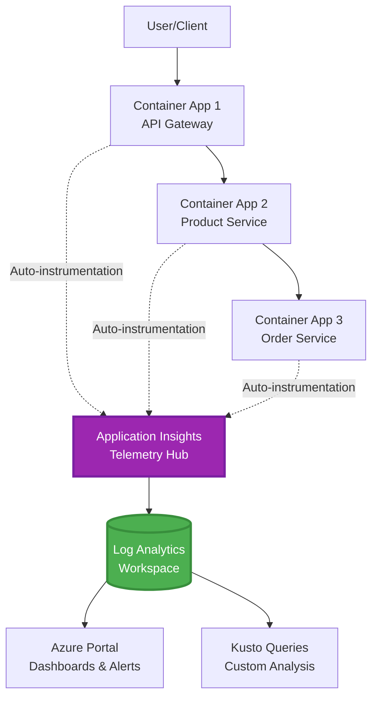
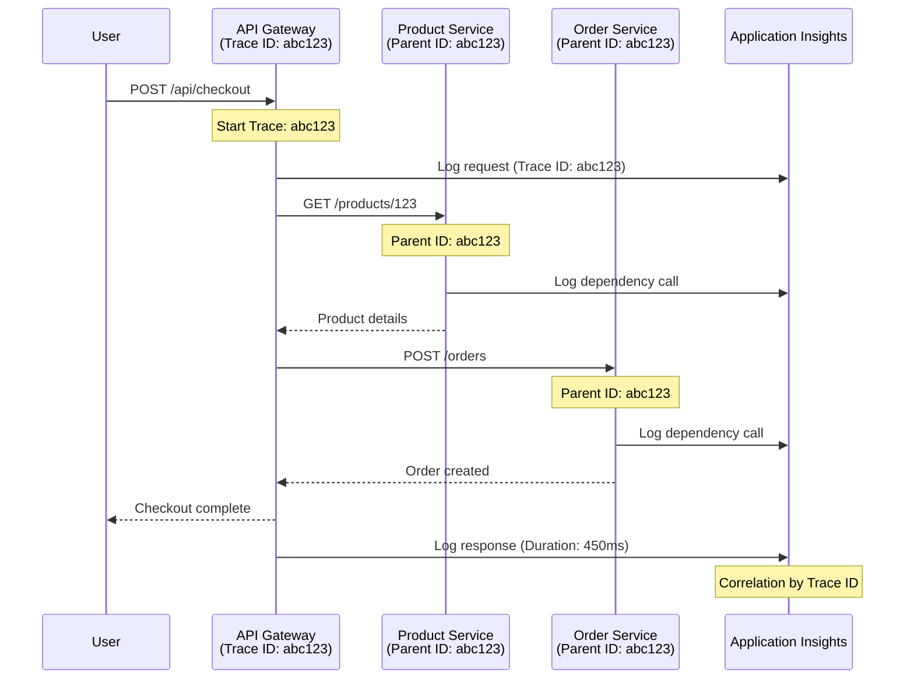

# AZD সহ অ্যাপ্লিকেশন ইনসাইটস একীকরণ

⏱️ **অনুমানিত সময়**: ৪০-৫০ মিনিট | 💰 **ব্যয়ের প্রভাব**: ~৫-১৫$/মাস | ⭐ **জটিলতা**: মধ্যম

**📚 শেখার পথ:**
- ← পূর্ববর্তী: [প্রিফ্লাইট চেক](preflight-checks.md) - প্রি-ডিপ্লয়মেন্ট যাচাই-বাছাই
- 🎯 **আপনি এখানে আছেন**: অ্যাপ্লিকেশন ইনসাইটস ইন্টিগ্রেশন (মনিটরিং, টেলিমেট্রি, ডিবাগিং)
- → পরবর্তী: [ডিপ্লয়মেন্ট গাইড](../chapter-04-infrastructure/deployment-guide.md) - Azure এ ডিপ্লয় করুন
- 🏠 [কোর্স হোম](../../README.md)

---

## আপনি যা শিখবেন

এই পাঠ শেষ করে আপনি সক্ষম হবেন:
- AZD ইনফ্রাস্ট্রাকচারে **অ্যাপ্লিকেশন ইনসাইটস** ঘোষণা এবং SDK ইনস্ট্রুমেন্টেশন কনফিগার করা
- মাইক্রোসার্ভিসের জন্য **বিতরণ করা ট্রেসিং** কনফিগার করা
- **কাস্টম টেলিমেট্রি** (মেট্রিক, ইভেন্ট, ডিপেন্ডেন্সি) প্রয়োগ করা
- রিয়েল-টাইম মনিটরিং এর জন্য **লাইভ মেট্রিক্স** সেট আপ করা
- AZD ডিপ্লয়মেন্ট থেকে **অ্যালার্ট ও ড্যাশবোর্ড** তৈরি করা
- **টেলিমেট্রি কোয়েরিজ** দিয়ে প্রোডাকশন সমস্যা ডিবাগ করা
- **ব্যয় ও স্যাম্পলিং** স্ট্র্যাটেজি অপ্টিমাইজ করা
- **AI/LLM অ্যাপ্লিকেশন** (টোকেন, লেটেন্সি, খরচ) মনিটর করা

## কেন AZD সহ অ্যাপ্লিকেশন ইনসাইটস গুরুত্বপূর্ণ

### চ্যালেঞ্জ: প্রোডাকশন অবজারভেবিলিটি

**অ্যাপ্লিকেশন ইনসাইটস ছাড়া:**
```
❌ No visibility into production behavior
❌ Manual log aggregation across services
❌ Reactive debugging (wait for customer complaints)
❌ No performance metrics
❌ Cannot trace requests across services
❌ Unknown failure rates and bottlenecks
```

**অ্যাপ্লিকেশন ইনসাইটস + AZD এর সাথে:**
```
✅ Automatic telemetry collection
✅ Centralized logs from all services
✅ Proactive issue detection
✅ End-to-end request tracing
✅ Performance metrics and insights
✅ Real-time dashboards
✅ AZD provisions the monitoring declared in your templates
```

**উপমা**: অ্যাপ্লিকেশন ইনসাইটস মানে আপনার অ্যাপ্লিকেশনের জন্য একটি "ব্ল্যাক বক্স" ফ্লাইট রেকর্ডার + ককপিট ড্যাশবোর্ড থাকার মতো। আপনি রিয়েল-টাইমে ঘটছে সবকিছু দেখতে পাবেন এবং কোনো ঘটনা পুনঃপ্রচলন করতে পারবেন।

---

## আর্কিটেকচার ওভারভিউ

### AZD আর্কিটেকচারে অ্যাপ্লিকেশন ইনসাইটস



### স্বয়ংক্রিয়ভাবে কী মনিটর হয়

সমর্থিত অটো-ইনস্ট্রুমেন্টেশন ইনস্ট্রুমেন্টেড লাইব্রেরিগুলোর রিকোয়েস্ট/ডিপেন্ডেন্সি ক্যাপচার করে। কাস্টম ইভেন্ট এবং মেট্রিক অ্যাপ্লিকেশন কোড প্রয়োজন; অ্যাভেলাবিলিটি টেস্ট আলাদাভাবে কনফিগার করতে হবে। শুধুমাত্র রিসোর্স থাকার কারণে নিম্নের প্রতিটি রেকর্ড সংগ্রহ করে না।

| টেলিমেট্রি ধরণ | এটি কী ক্যাপচার করে | ব্যবহারের ক্ষেত্র |
|----------------|------------------|----------|
| **রিকোয়েস্টস** | HTTP রিকোয়েস্ট, স্ট্যাটাস কোড, সময়কাল | API পারফরম্যান্স মনিটরিং |
| **ডিপেন্ডেন্সি** | বাহ্যিক কল (ডাটাবেজ, API, স্টোরেজ) | বটলনেক সনাক্তকরণ |
| **এক্সসেপশনস** | স্ট্যাক ট্রেস সহ আনহ্যান্ডেলড এরর | ফেলিওর ডিবাগিং |
| **কাস্টম ইভেন্টস** | ব্যবসায়িক ইভেন্ট (সাইনআপ, ক্রয়) | অ্যানালিটিক্স ও ফানেল |
| **মেট্রিকস** | পারফরম্যান্স কাউন্টার, কাস্টম মেট্রিক | ক্যাপাসিটি পরিকল্পনা |
| **ট্রেসেস** | গুরত্ব স্তরের লগ বার্তা | ডিবাগিং ও অডিটিং |
| **অ্যাভেলাবিলিটি** | আপটাইম ও রেসপন্স টাইম টেস্ট | SLA মনিটরিং |

---

## পূর্বশর্ত

### প্রয়োজনীয় সরঞ্জাম

```bash
# Verify Azure Developer CLI
azd version
# Command reference baseline: azd 1.37.2

# Verify Azure CLI
az --version
# ✅ Expected: azure-cli 2.50.0 or higher
```

### Azure প্রয়োজনীয়তা

- সক্রিয় Azure সাবস্ক্রিপশন
- তৈরি করার অনুমতি:
  - অ্যাপ্লিকেশন ইনসাইটস রিসোর্স
  - লগ অ্যানালিটিক্স ওয়ার্কস্পেস
  - কন্টেইনার অ্যাপস
  - রিসোর্স গ্রুপ

### জ্ঞান পূর্বশর্ত

আপনাকে সম্পন্ন করতে হবে:
- [AZD বেসিক্স](../chapter-01-foundation/azd-basics.md) - AZD-এর মূল ধারণা
- [কনফিগারেশন](../chapter-03-configuration/configuration.md) - এনভায়রনমেন্ট সেট আপ
- [প্রথম প্রকল্প](../chapter-01-foundation/first-project.md) - বেসিক ডিপ্লয়মেন্ট

---

## পাঠ ১: AZD সহ স্বয়ংক্রিয় অ্যাপ্লিকেশন ইনসাইটস

### AZD কীভাবে অ্যাপ্লিকেশন ইনসাইটস প্রদান করে

AZD অ্যাপ্লিকেশন ইনসাইটস **শুধুমাত্র যখন প্রকল্পের ইনফ্রাস্ট্রাকচার এটি ঘোষণা করে তখনই প্রদান করে**। `azure.yaml` নিজে মনিটরিং তৈরি করে না বা অ্যাপ্লিকেশন কোড ইনস্ট্রুমেন্ট করে না।

> **উদাহরণ স্কোপ:** এই পাঠে ইন্টিগ্রেশন অংশ রয়েছে, একক `monitored-app` প্রকল্প নয়। ডিপ্লয় করার আগে একটি প্রধান টেমপ্লেট ও প্যারামিটার ম্যাপিং, কন্টেইনার অ্যাপস পরিবেশ, রেজিস্ট্রি/ইমেজ ও পরিচয় কনফিগারেশন, ডকারফাইল, এবং সার্ভিস ট্যাগ সরবরাহ করুন। ভবিষ্যত পাঠে বিকল্প/বিস্তৃত অংশ দেখানো হবে, সেগুলো একসাথে অপরিবর্তিতভাবে পেস্ট করা যাবে না। যদি একটি রানযোগ্য বেসলাইন দরকার হয় তবে একটি কর্মরত [মাইক্রোসার্ভিস উদাহরণ](../../../../examples/microservices) ব্যবহার করুন।

### প্রকল্প কাঠামো

```
monitored-app/
├── azure.yaml                     # AZD configuration
├── infra/
│   ├── main.bicep                # Main infrastructure
│   ├── core/
│   │   └── monitoring.bicep      # Application Insights + Log Analytics
│   └── app/
│       └── api.bicep             # Container App with monitoring
└── src/
    ├── app.py                    # Application with telemetry
    ├── requirements.txt
    └── Dockerfile
```

---

### ধাপ ১: AZD কনফিগার করা (azure.yaml)

**ফাইল: `azure.yaml`**

```yaml
name: monitored-app
metadata:
  template: monitored-app@1.0.0

services:
  api:
    project: ./src
    language: python
    host: containerapp

# Monitoring must be declared in infra/ and enabled in application code.
```

এটা ডিপ্লয়েবল সার্ভিস ঘোষণা করে। পরবর্তী Bicep ও SDK কনফিগারেশন মনিটরিং সরবরাহ করে; azd স্বয়ংক্রিয়ভাবে এগুলো যুক্ত করে না।

---

### ধাপ ২: মনিটরিং অবকাঠামো (Bicep)

**ফাইল: `infra/core/monitoring.bicep`**

```bicep
param logAnalyticsName string
param applicationInsightsName string
param location string = resourceGroup().location
param tags object = {}

// Log Analytics Workspace (required for Application Insights)
resource logAnalytics 'Microsoft.OperationalInsights/workspaces@2022-10-01' = {
  name: logAnalyticsName
  location: location
  tags: tags
  properties: {
    sku: {
      name: 'PerGB2018'  // Pay-as-you-go pricing
    }
    retentionInDays: 30  // Keep logs for 30 days
    features: {
      enableLogAccessUsingOnlyResourcePermissions: true
    }
  }
}

// Application Insights
resource applicationInsights 'Microsoft.Insights/components@2020-02-02' = {
  name: applicationInsightsName
  location: location
  tags: tags
  kind: 'web'
  properties: {
    Application_Type: 'web'
    WorkspaceResourceId: logAnalytics.id
    IngestionMode: 'LogAnalytics'
    publicNetworkAccessForIngestion: 'Enabled'
    publicNetworkAccessForQuery: 'Enabled'
  }
}

// Outputs for Container Apps
output logAnalyticsWorkspaceId string = logAnalytics.id
output logAnalyticsWorkspaceName string = logAnalytics.name
output applicationInsightsConnectionString string = applicationInsights.properties.ConnectionString
output applicationInsightsInstrumentationKey string = applicationInsights.properties.InstrumentationKey
output applicationInsightsName string = applicationInsights.name
output applicationInsightsId string = applicationInsights.id
```

---

### ধাপ ৩: কন্টেইনার অ্যাপকে অ্যাপ্লিকেশন ইনসাইটসের সাথে সংযুক্ত করুন

**ফাইল: `infra/app/api.bicep`**

```bicep
param name string
param location string
param tags object = {}
param containerAppsEnvironmentId string
param containerImage string
param applicationInsightsConnectionString string

resource containerApp 'Microsoft.App/containerApps@2023-05-01' = {
  name: name
  location: location
  tags: tags
  properties: {
    managedEnvironmentId: containerAppsEnvironmentId
    configuration: {
      ingress: {
        external: true
        targetPort: 8000
      }
      secrets: [
        {
          name: 'appinsights-connection-string'
          value: applicationInsightsConnectionString
        }
      ]
    }
    template: {
      containers: [
        {
          name: 'api'
          image: containerImage // Supply an accessible image and registry authentication
          resources: {
            cpu: json('0.5')
            memory: '1Gi'
          }
          env: [
            {
              name: 'APPLICATIONINSIGHTS_CONNECTION_STRING'
              secretRef: 'appinsights-connection-string'
            }
            {
              name: 'APPLICATIONINSIGHTS_ENABLED'
              value: 'true'
            }
          ]
        }
      ]
    }
  }
}

output uri string = 'https://${containerApp.properties.configuration.ingress.fqdn}'
```

---

### ধাপ ৪: টেলিমেট্রি সহ অ্যাপ্লিকেশন কোড

**ফাইল: `src/app.py`**

```python
from flask import Flask, request, jsonify
from azure.monitor.opentelemetry import configure_azure_monitor
import logging
import os

app = Flask(__name__)

# Get Application Insights connection string
connection_string = os.environ.get('APPLICATIONINSIGHTS_CONNECTION_STRING')

if connection_string:
    # Azure Monitor OpenTelemetry instruments supported libraries, including Flask.
    configure_azure_monitor(
        connection_string=connection_string,
        logger_name=__name__,
        enable_live_metrics=True
    )
    logger = logging.getLogger(__name__)
    logger.setLevel(logging.INFO)
    
    print("✅ Application Insights enabled")
else:
    logger = logging.getLogger(__name__)
    logger.setLevel(logging.INFO)
    print("⚠️ Application Insights not configured")

@app.route('/health')
def health():
    logger.info('Health check endpoint called')
    return jsonify({'status': 'healthy', 'monitoring': 'enabled' if connection_string else 'disabled'})

@app.route('/api/products')
def get_products():
    logger.info('Fetching products')
    
    # In-memory fixture: this is not a database dependency call.
    products = [
        {'id': 1, 'name': 'Laptop', 'price': 999.99},
        {'id': 2, 'name': 'Mouse', 'price': 29.99},
        {'id': 3, 'name': 'Keyboard', 'price': 79.99}
    ]
    
    logger.info(f'Returned {len(products)} products')
    return jsonify(products)

@app.route('/api/error-test')
def error_test():
    """Test error tracking"""
    logger.error('Testing error tracking')
    try:
        raise ValueError('This is a test exception')
    except Exception as e:
        logger.exception('Exception occurred in error-test endpoint')
        return jsonify({'error': str(e)}), 500

@app.route('/api/slow')
def slow_endpoint():
    """Test performance tracking"""
    import time
    logger.info('Slow endpoint called')
    time.sleep(3)  # Simulate slow operation
    logger.warning('Endpoint took 3 seconds to respond')
    return jsonify({'message': 'Slow operation completed'})

if __name__ == '__main__':
    app.run(host='0.0.0.0', port=8000)
```

**ফাইল: `src/requirements.txt`**

```txt
Flask
azure-monitor-opentelemetry
gunicorn
requests
openai
```

এই ডিপেন্ডেন্সিগুলো আপনার প্রকল্পে যুক্ত করুন, একসাথে পরীক্ষা করুন, এবং ফলপ্রসূ সংস্করণগুলো লক করুন। নতুন প্রকল্পগুলোকে Azure Monitor OpenTelemetry ব্যবহার করা উচিত, পরিত্যক্ত OpenCensus Python এক্সপোর্টার নয়।

---

### ধাপ ৫: ডিপ্লয় এবং যাচাই করুন

```bash
# Deploy only after completing and wiring the infrastructure fragments above
azd up

# Get app URL
APP_URL=$(azd env get-value API_URL) # Requires this output in main.bicep

# Generate telemetry
curl $APP_URL/health
curl $APP_URL/api/products
curl $APP_URL/api/error-test
curl $APP_URL/api/slow
```

**✅ প্রত্যাশিত আউটপুট:**
```json
{
  "status": "healthy",
  "monitoring": "enabled"
}
```

---

### ধাপ ৬: Azure পোর্টালে টেলিমেট্রি দেখুন

```bash
# Get Application Insights details
azd env get-values | grep APPLICATIONINSIGHTS

# Open in Azure Portal
az monitor app-insights component show \
  --app $(azd env get-values | grep APPLICATIONINSIGHTS_NAME | cut -d '=' -f2 | tr -d '"') \
  --resource-group $(azd env get-values | grep AZURE_RESOURCE_GROUP | cut -d '=' -f2 | tr -d '"') \
  --query "appId" -o tsv
```

**Azure পোর্টালে নেভিগেট করুন → Application Insights → Transaction Search**

আপনি দেখতে পাবেন:
- ✅ HTTP রিকোয়েস্ট স্ট্যাটাস কোডসহ
- ✅ রিকোয়েস্ট সময়কাল (৩+ সেকেন্ড জন্য `/api/slow`)
- ✅ এক্সসেপশন ডিটেইলস `/api/error-test` থেকে
- ✅ কাস্টম লগ বার্তা

---

## পাঠ ২: কাস্টম টেলিমেট্রি ও ইভেন্টস

### ব্যবসায়িক ইভেন্ট ট্র্যাক করুন

আসুন ব্যবসায়িক গুরুত্বপূর্ণ ইভেন্টগুলির জন্য কাস্টম টেলিমেট্রি যোগ করি।

**ফাইল: `src/telemetry.py`**

```python
from contextlib import contextmanager
from azure.monitor.opentelemetry import configure_azure_monitor
from opentelemetry import metrics, trace
from opentelemetry.trace import SpanKind
import logging
import os

class TelemetryClient:
    """Custom telemetry client for Application Insights"""
    
    def __init__(self, connection_string=None):
        self.connection_string = connection_string or os.environ.get('APPLICATIONINSIGHTS_CONNECTION_STRING')
        
        # Configure once per process. If app.py already calls this, keep only
        # one configure_azure_monitor call and use logger_name='telemetry'.
        if self.connection_string:
            configure_azure_monitor(
                connection_string=self.connection_string,
                logger_name=__name__,
                enable_live_metrics=True
            )
        self.logger = logging.getLogger(__name__)
        self.logger.setLevel(logging.INFO)
        self.tracer = trace.get_tracer(__name__)
        self.meter = metrics.get_meter(__name__)
        self.instruments = {}
    
    def track_event(self, event_name: str, properties: dict = None):
        """Track custom business event"""
        properties = properties or {}
        self.logger.info(
            f"CustomEvent: {event_name}",
            extra={
                # OTel log attributes become customDimensions in App Insights.
                    'event_name': event_name,
                    **properties
            }
        )
    
    def track_metric(self, metric_name: str, value: float, properties: dict = None):
        """Track custom metric"""
        properties = properties or {}
        if metric_name not in self.instruments:
            self.instruments[metric_name] = self.meter.create_histogram(metric_name)
        self.instruments[metric_name].record(value, attributes=properties)
    
    @contextmanager
    def track_dependency(self, name: str):
        """Time the real operation inside a client span; exceptions mark failure."""
        with self.tracer.start_as_current_span(name, kind=SpanKind.CLIENT) as span:
            yield span

# Global telemetry client
telemetry = TelemetryClient()
```

### কাস্টম ইভেন্ট সহ অ্যাপ্লিকেশন আপডেট করুন

**ফাইল: `src/app.py` (উন্নত)**

এই রুটগুলো বিদ্যমান Flask অ্যাপ্লিকেশনে যোগ করুন; আগের স্বাস্থ্য/টেস্ট রুটগুলো রাখুন। নিচের সংক্ষিপ্ত ব্লকটি একটি পৃথক অ্যাপ দেখায় পরিষ্কারতার জন্য। টেলিমেট্রি ইনিশিয়ালাইজেশন এখন `telemetry.py` তে রয়েছে—একই এক্সপোর্টার দুইবার ইনিশিয়ালাইজ করবেন না।

```python
from flask import Flask, request, jsonify
from telemetry import telemetry
import time
import random
import os

app = Flask(__name__)

@app.route('/api/purchase', methods=['POST'])
def purchase():
    """Track purchase event with custom telemetry"""
    data = request.get_json(silent=True) or {}
    product_id = data.get('product_id')
    quantity = data.get('quantity', 1)
    price = data.get('price', 0)
    if not isinstance(quantity, int) or quantity < 1 or \
       not isinstance(price, (int, float)) or price < 0:
        return jsonify({'error': 'quantity and price must be non-negative numbers; quantity >= 1'}), 400
    
    # Track business event
    telemetry.track_event('Purchase', {
        'product_id': product_id,
        'quantity': quantity,
        'total_amount': price * quantity,
        'user_id': request.headers.get('X-User-Id', 'anonymous')
    })
    
    # Track revenue metric
    telemetry.track_metric('Revenue', price * quantity, {
        'product_id': product_id,
        'currency': 'USD'
    })
    
    return jsonify({
        'order_id': f'ORD-{random.randint(1000, 9999)}',
        'status': 'confirmed',
        'total': price * quantity
    })

@app.route('/api/search')
def search():
    """Track search queries"""
    query = request.args.get('q', '')
    
    start_time = time.time()
    
    # Simulate search (would be real database query)
    results = [{'id': 1, 'name': f'Result for {query}'}]
    
    duration = (time.time() - start_time) * 1000  # Convert to ms
    
    # Track search event
    telemetry.track_event('Search', {
        'query': query,
        'results_count': len(results),
        'duration_ms': duration
    })
    
    # Track search performance metric
    telemetry.track_metric('SearchDuration', duration, {
        'query_length': len(query)
    })
    
    return jsonify({'results': results, 'count': len(results)})

@app.route('/api/external-call')
def external_call():
    """Track external API dependency"""
    import requests
    
    try:
        # Set an actual test endpoint; api.example.com is not a working API.
        with telemetry.track_dependency('ExternalAPI'):
            response = requests.get(os.environ['EXTERNAL_API_URL'], timeout=5)
            response.raise_for_status()
            result = response.json()
    except Exception as e:
        return jsonify({'error': 'External dependency failed'}), 502
    
    return jsonify(result)

if __name__ == '__main__':
    app.run(host='0.0.0.0', port=8000)
```

### কাস্টম টেলিমেট্রি পরীক্ষা করুন

```bash
# Track purchase event
curl -X POST $APP_URL/api/purchase \
  -H "Content-Type: application/json" \
  -H "X-User-Id: user123" \
  -d '{"product_id": 1, "quantity": 2, "price": 29.99}'

# Track search event
curl "$APP_URL/api/search?q=laptop"

# Track external dependency
curl $APP_URL/api/external-call
```

**Azure পোর্টালে দেখুন:**

Application Insights → Logs এ যান, তারপর রান করুন:

```kusto
// View purchase events
traces
| where customDimensions.event_name == "Purchase"
| project 
    timestamp,
    product_id = tostring(customDimensions.product_id),
    total_amount = todouble(customDimensions.total_amount),
    user_id = tostring(customDimensions.user_id)
| order by timestamp desc

// Revenue recorded in Purchase events (not a billing ledger)
traces
| where customDimensions.event_name == "Purchase"
| summarize TotalRevenue = sum(todouble(customDimensions.total_amount)) by bin(timestamp, 1h)
| render timechart

// View search performance
traces
| where customDimensions.event_name == "Search"
| summarize 
    AvgDuration = avg(todouble(customDimensions.duration_ms)),
    SearchCount = count()
  by bin(timestamp, 5m)
| render timechart
```

---

## পাঠ ৩: মাইক্রোসার্ভিসের বিতরণকৃত ট্রেসিং

### ক্রস-সার্ভিস ট্রেসিং সক্ষম করুন

সামঞ্জস্যপূর্ণ ইনস্ট্রুমেন্টেশন এবং W3C ট্রেস-কনটেক্সট প্রচারের মাধ্যমে, অ্যাপ্লিকেশন ইনসাইটস সার্ভিসগুলোর মধ্যে রিকোয়েস্টগুলো সম্পর্কিত করে। শুধু কানেকশন স্ট্রিং শেয়ার করা পেয়ারেন্ট-চাইল্ড স্প্যান প্রতিষ্ঠা করে না। নিম্নের আর্কিটেকচার অংশে আপনাকে ইমপ্লিমেন্ট করতে হবে যেসব মডিউল উল্লেখ আছে।

**ফাইল: `infra/main.bicep`**

```bicep
targetScope = 'subscription'

param environmentName string
param location string = 'eastus'

var tags = { 'azd-env-name': environmentName }

resource rg 'Microsoft.Resources/resourceGroups@2021-04-01' = {
  name: 'rg-${environmentName}'
  location: location
  tags: tags
}

// Monitoring (shared by all services)
module monitoring './core/monitoring.bicep' = {
  name: 'monitoring'
  scope: rg
  params: {
    logAnalyticsName: 'log-${environmentName}'
    applicationInsightsName: 'appi-${environmentName}'
    location: location
    tags: tags
  }
}

// API Gateway
module apiGateway './app/api-gateway.bicep' = {
  name: 'api-gateway'
  scope: rg
  params: {
    name: 'ca-gateway-${environmentName}'
    location: location
    tags: union(tags, { 'azd-service-name': 'gateway' })
    applicationInsightsConnectionString: monitoring.outputs.applicationInsightsConnectionString
  }
}

// Product Service
module productService './app/product-service.bicep' = {
  name: 'product-service'
  scope: rg
  params: {
    name: 'ca-products-${environmentName}'
    location: location
    tags: union(tags, { 'azd-service-name': 'products' })
    applicationInsightsConnectionString: monitoring.outputs.applicationInsightsConnectionString
  }
}

// Order Service
module orderService './app/order-service.bicep' = {
  name: 'order-service'
  scope: rg
  params: {
    name: 'ca-orders-${environmentName}'
    location: location
    tags: union(tags, { 'azd-service-name': 'orders' })
    applicationInsightsConnectionString: monitoring.outputs.applicationInsightsConnectionString
  }
}

output APPLICATIONINSIGHTS_CONNECTION_STRING string = monitoring.outputs.applicationInsightsConnectionString
output GATEWAY_URL string = apiGateway.outputs.uri
```

### এন্ড-টু-এন্ড ট্রানজাকশন দেখুন



**এন্ড-টু-এন্ড ট্রেস কোয়েরি:**

```kusto
// Find complete request flow
let traceId = "abc123...";  // Copy operation_Id from a request in Application Insights
dependencies
| union requests
| where operation_Id == traceId
| project 
    timestamp,
    type = itemType,
    name,
    duration,
    success,
    cloud_RoleName
| order by timestamp asc
```

---

## পাঠ ৪: লাইভ মেট্রিক্স এবং রিয়েল-টাইম মনিটরিং

### লাইভ মেট্রিক্স স্ট্রিম সক্ষম করুন

SDK দ্বারা সমর্থিত এবং সক্রিয় হলে লাইভ মেট্রিক্স প্রায় রিয়েল-টাইম টেলিমেট্রি প্রদান করে। এটি লেটেন্সি SLA নয়। উপরের Python OpenTelemetry সেটআপে `enable_live_metrics=True` দিয়ে অপ্ট-ইন করা হয়েছে।

**লাইভ মেট্রিক্সে প্রবেশ:**

```bash
# Get Application Insights resource
APPI_NAME=$(azd env get-values | grep APPLICATIONINSIGHTS_NAME | cut -d '=' -f2 | tr -d '"')

# Get resource group
RG_NAME=$(azd env get-values | grep AZURE_RESOURCE_GROUP | cut -d '=' -f2 | tr -d '"')

echo "Navigate to: Azure Portal → Resource Groups → $RG_NAME → $APPI_NAME → Live Metrics"
```

**রিয়েল-টাইমে আপনি যা দেখতে পাবেন:**
- ✅ আসা রিকোয়েস্টের হার (রিকোয়েস্ট/সেকেন্ড)
- ✅ যাওয়া ডিপেন্ডেন্সি কল
- ✅ এক্সসেপশন সংখ্যা
- ✅ CPU ও মেমোরি ব্যবহারের পরিমাণ
- ✅ সক্রিয় সার্ভার সংখ্যা
- ✅ নমুনা টেলিমেট্রি

### পরীক্ষার জন্য লোড তৈরি করুন

```bash
# Generate load to see live metrics
for i in {1..100}; do
  curl --silent --max-time 10 "$APP_URL/api/products"
  curl --silent --max-time 10 "$APP_URL/api/search?q=test$i"
done

# Watch live metrics in Azure Portal
# You should see request rate spike
```

---

## বাস্তব অভ্যাস

### অনুশীলন ১: অ্যালার্ট সেট আপ করুন ⭐⭐ (মধ্যম)

**লক্ষ্য**: উচ্চ ত্রুটি হার এবং ধীর প্রতিক্রিয়ার জন্য অ্যালার্ট তৈরি করুন।

**ধাপসমূহ:**

1. **ত্রুটি হারের জন্য অ্যালার্ট তৈরি করুন:**

```bash
# Get Application Insights resource ID
APPI_ID=$(az monitor app-insights component show \
  --app $APPI_NAME \
  --resource-group $RG_NAME \
  --query "id" -o tsv)

# Create metric alert for failed requests
az monitor metrics alert create \
  --name "High-Error-Rate" \
  --resource-group $RG_NAME \
  --scopes $APPI_ID \
  --condition "count requests/failed > 10" \
  --window-size 5m \
  --evaluation-frequency 1m \
  --description "Alert when failed request count exceeds 10 per 5 minutes"
```

2. **ধীর প্রতিক্রিয়ার জন্য অ্যালার্ট তৈরি করুন:**

```bash
az monitor metrics alert create \
  --name "Slow-Responses" \
  --resource-group $RG_NAME \
  --scopes $APPI_ID \
  --condition "avg requests/duration > 3000" \
  --window-size 5m \
  --evaluation-frequency 1m \
  --description "Alert when average response time exceeds 3 seconds"
```

3. **Bicep ব্যবহার করে অ্যালার্ট তৈরি করুন (AZD এর জন্য পছন্দনীয়):**

**ফাইল: `infra/core/alerts.bicep`**

```bicep
param applicationInsightsId string
param actionGroupId string = ''
param location string = resourceGroup().location

// High error rate alert
resource errorRateAlert 'Microsoft.Insights/metricAlerts@2018-03-01' = {
  name: 'high-error-rate'
  location: 'global'
  properties: {
    description: 'Alert when error rate exceeds threshold'
    severity: 2
    enabled: true
    scopes: [
      applicationInsightsId
    ]
    evaluationFrequency: 'PT1M'
    windowSize: 'PT5M'
    criteria: {
      'odata.type': 'Microsoft.Azure.Monitor.SingleResourceMultipleMetricCriteria'
      allOf: [
        {
          name: 'Error rate'
          metricName: 'requests/failed'
          operator: 'GreaterThan'
          threshold: 10
          timeAggregation: 'Count'
        }
      ]
    }
    actions: actionGroupId != '' ? [
      {
        actionGroupId: actionGroupId
      }
    ] : []
  }
}

// Slow response alert
resource slowResponseAlert 'Microsoft.Insights/metricAlerts@2018-03-01' = {
  name: 'slow-responses'
  location: 'global'
  properties: {
    description: 'Alert when response time is too high'
    severity: 3
    enabled: true
    scopes: [
      applicationInsightsId
    ]
    evaluationFrequency: 'PT1M'
    windowSize: 'PT5M'
    criteria: {
      'odata.type': 'Microsoft.Azure.Monitor.SingleResourceMultipleMetricCriteria'
      allOf: [
        {
          name: 'Response duration'
          metricName: 'requests/duration'
          operator: 'GreaterThan'
          threshold: 3000
          timeAggregation: 'Average'
        }
      ]
    }
  }
}

output errorAlertId string = errorRateAlert.id
output slowResponseAlertId string = slowResponseAlert.id
```

4. **অ্যালার্ট পরীক্ষা করুন:**

```bash
# Generate errors
for i in {1..20}; do
  curl $APP_URL/api/error-test
done

# Generate slow responses
for i in {1..10}; do
  curl $APP_URL/api/slow
done

# Check rule configuration (not fired/resolved alert-instance history)
az monitor metrics alert list \
  --resource-group $RG_NAME \
  --query "[].{Name:name, Enabled:enabled}" \
  --output table
```

**✅ সফলতার মানদণ্ড:**
- ✅ সফলভাবে অ্যালার্ট তৈরি হয়েছে
- ✅ থ্রেশহোল্ড অতিক্রম করলে অ্যালার্ট ফায়ার করে
- ✅ Azure পোর্টালে অ্যালার্ট ইতিহাস দেখা যায়
- ✅ AZD ডিপ্লয়মেন্টের সাথে একীকৃত

**সময়**: ২০-২৫ মিনিট

---

### অনুশীলন ২: কাস্টম ড্যাশবোর্ড তৈরি করুন ⭐⭐ (মধ্যম)

**লক্ষ্য**: অ্যাপ্লিকেশনের মূল মেট্রিক্স দেখানো একটি ড্যাশবোর্ড তৈরি করুন।

**ধাপসমূহ:**

১. **Azure পোর্টাল ব্যবহার করে ড্যাশবোর্ড তৈরি করুন:**

যান: Azure Portal → Dashboards → New Dashboard

২. **মূল মেট্রিক্সের জন্য টাইল যোগ করুন:**

- রিকোয়েস্ট সংখ্যা (গত ২৪ ঘণ্টা)
- গড় প্রতিক্রিয়া সময়
- ত্রুটি হার
- শীর্ষ ৫ ধীরতম অপারেশন
- ব্যবহারকারীর ভৌগলিক বিতরণ

৩. **Bicep ব্যবহার করে ড্যাশবোর্ড তৈরি করুন:**

**ফাইল: `infra/core/dashboard.bicep`**

```bicep
param dashboardName string
param applicationInsightsId string
param location string = resourceGroup().location

resource dashboard 'Microsoft.Portal/dashboards@2020-09-01-preview' = {
  name: dashboardName
  location: location
  properties: {
    lenses: [
      {
        order: 0
        parts: [
          // Request count
          {
            position: {
              x: 0
              y: 0
              rowSpan: 4
              colSpan: 6
            }
            metadata: {
              type: 'Extension/Microsoft_OperationsManagementSuite_Workspace/PartType/LogsDashboardPart'
              inputs: [
                {
                  name: 'resourceId'
                  value: applicationInsightsId
                }
                {
                  name: 'query'
                  value: '''
                    requests
                    | summarize RequestCount = count() by bin(timestamp, 1h)
                    | render timechart
                  '''
                }
              ]
            }
          }
          // Error rate
          {
            position: {
              x: 6
              y: 0
              rowSpan: 4
              colSpan: 6
            }
            metadata: {
              type: 'Extension/Microsoft_OperationsManagementSuite_Workspace/PartType/LogsDashboardPart'
              inputs: [
                {
                  name: 'resourceId'
                  value: applicationInsightsId
                }
                {
                  name: 'query'
                  value: '''
                    requests
                    | summarize 
                        Total = count(),
                        Failed = countif(success == false)
                    | extend ErrorRate = (Failed * 100.0) / Total
                    | project ErrorRate
                  '''
                }
              ]
            }
          }
        ]
      }
    ]
  }
}

output dashboardId string = dashboard.id
```

৪. **ড্যাশবোর্ড ডিপ্লয় করুন:**

```bicep
// Add to a subscription-scoped main.bicep with rg and monitoring declared
module dashboard './core/dashboard.bicep' = {
  name: 'dashboard'
  scope: rg
  params: {
    dashboardName: 'dashboard-${environmentName}'
    applicationInsightsId: monitoring.outputs.applicationInsightsId
    location: location
  }
}
```

```bash
# Deploy
azd up
```

**✅ সফলতার মানদণ্ড:**
- ✅ ড্যাশবোর্ডে মূল মেট্রিক্স দেখা যায়
- ✅ Azure পোর্টালের হোমে পিন করা যায়
- ✅ রিয়েল-টাইমে আপডেট হয়
- ✅ AZD এর মাধ্যমে ডিপ্লয়যোগ্য

**সময়**: ২৫-৩০ মিনিট

---

### অনুশীলন ৩: AI/LLM অ্যাপ্লিকেশন মনিটর করুন ⭐⭐⭐ (উন্নত)

**লক্ষ্য**: Microsoft Foundry মডেলের ব্যবহার (টোকেন, ব্যয়, লেটেন্সি) ট্র্যাক করুন।

**ধাপসমূহ:**

১. **AI মনিটরিং র‍্যাপার তৈরি করুন:**

**ফাইল: `src/ai_telemetry.py`**

```python
from telemetry import telemetry
from openai import AzureOpenAI
import time

class MonitoredAzureOpenAI:
    """Microsoft Foundry Models client with automatic telemetry"""
    
    def __init__(self, api_key, endpoint, input_usd_per_million,
                 output_usd_per_million, api_version="2024-10-21"):
        self.client = AzureOpenAI(
            api_key=api_key,
            api_version=api_version,
            azure_endpoint=endpoint
        )
        self.input_rate = input_usd_per_million
        self.output_rate = output_usd_per_million
    
    def chat_completion(self, model: str, messages: list, **kwargs):
        """Track chat completion with telemetry"""
        start_time = time.time()
        
        try:
            # Call Microsoft Foundry Models
            response = self.client.chat.completions.create(
                model=model,
                messages=messages,
                **kwargs
            )
            
            duration = (time.time() - start_time) * 1000  # ms
            
            # Extract usage
            usage = response.usage
            prompt_tokens = usage.prompt_tokens
            completion_tokens = usage.completion_tokens
            total_tokens = usage.total_tokens
            
            # Approximation: supply actual deployment/region/contract rates.
            # Cached input, batch, provisioned and other charges need separate accounting.
            prompt_cost = (prompt_tokens / 1_000_000) * self.input_rate
            completion_cost = (completion_tokens / 1_000_000) * self.output_rate
            total_cost = prompt_cost + completion_cost
            
            # Track custom event
            telemetry.track_event('OpenAI_Request', {
                'model': model,
                'prompt_tokens': prompt_tokens,
                'completion_tokens': completion_tokens,
                'total_tokens': total_tokens,
                'duration_ms': duration,
                'cost_usd': total_cost,
                'success': True
            })
            
            # Track metrics
            telemetry.track_metric('OpenAI_Tokens', total_tokens, {
                'model': model,
                'type': 'total'
            })
            
            telemetry.track_metric('OpenAI_Cost', total_cost, {
                'model': model,
                'currency': 'USD'
            })
            
            telemetry.track_metric('OpenAI_Duration', duration, {
                'model': model
            })
            
            return response
            
        except Exception as e:
            duration = (time.time() - start_time) * 1000
            
            telemetry.track_event('OpenAI_Request', {
                'model': model,
                'duration_ms': duration,
                'success': False,
                'error': str(e)
            })
            
            raise
```

২. **মনিটর ক্লায়েন্ট ব্যবহার করুন:**

```python
from flask import Flask, request, jsonify
from ai_telemetry import MonitoredAzureOpenAI
import os

app = Flask(__name__)

# Initialize monitored OpenAI client
openai_client = MonitoredAzureOpenAI(
    api_key=os.environ['AZURE_OPENAI_API_KEY'],
    endpoint=os.environ['AZURE_OPENAI_ENDPOINT'],
    input_usd_per_million=float(os.environ['INPUT_USD_PER_MILLION']),
    output_usd_per_million=float(os.environ['OUTPUT_USD_PER_MILLION'])
)

@app.route('/api/chat', methods=['POST'])
def chat():
    data = request.json
    user_message = data.get('message')
    
    # Call with automatic monitoring
    response = openai_client.chat_completion(
        model=os.environ['AZURE_OPENAI_DEPLOYMENT'], # Deployment name, not catalog ID
        messages=[
            {'role': 'user', 'content': user_message}
        ]
    )
    
    return jsonify({
        'response': response.choices[0].message.content,
        'tokens': response.usage.total_tokens
    })
```

৩. **AI মেট্রিক্স কোয়েরি করুন:**

```kusto
// Total AI spend over time
traces
| where customDimensions.event_name == "OpenAI_Request"
| where tobool(customDimensions.success) == true
| summarize TotalCost = sum(todouble(customDimensions.cost_usd)) by bin(timestamp, 1h)
| render timechart

// Token usage by model
traces
| where customDimensions.event_name == "OpenAI_Request"
| summarize 
    TotalTokens = sum(toint(customDimensions.total_tokens)),
    RequestCount = count()
  by Model = tostring(customDimensions.model)

// Average latency
traces
| where customDimensions.event_name == "OpenAI_Request"
| summarize AvgDuration = avg(todouble(customDimensions.duration_ms))
| project AvgDurationSeconds = AvgDuration / 1000

// Cost per request
traces
| where customDimensions.event_name == "OpenAI_Request"
| extend Cost = todouble(customDimensions.cost_usd)
| summarize 
    TotalCost = sum(Cost),
    RequestCount = count(),
    AvgCostPerRequest = avg(Cost)
```

**✅ সফলতার মানদণ্ড:**
- ✅ প্রতিটি OpenAI কল স্বয়ংক্রিয়ভাবে ট্র্যাক হয়
- ✅ টোকেন ব্যবহার ও ব্যয় দৃশ্যমান
- ✅ লেটেন্সি মনিটর হয়
- ✅ বাজেট অ্যালার্ট সেট করা যায়

**সময়**: ৩৫-৪৫ মিনিট

---

## খরচ অপটিমাইজেশন

### স্যাম্পলিং পদ্ধতি

টেলিমেট্রি স্যাম্পল করে খরচ নিয়ন্ত্রণ করুন:

```python
import os

# Configure before the one configure_azure_monitor() call in your process.
os.environ["OTEL_TRACES_SAMPLER"] = "microsoft.fixed_percentage"
os.environ["OTEL_TRACES_SAMPLER_ARG"] = "0.1" # 10% trace sampling
```

ট্রেস স্যাম্পলিং প্রত্যেকটি টেলিমেট্রি ক্যাটেগরিকে ৯০% কমায় না। মেট্রিক্স এবং স্বাধীনভাবে ইমিট হওয়া লগগুলো আলাদা ভলিউম নিয়ন্ত্রণ প্রয়োজন। পর্যবেক্ষণ চাহিদা অনুযায়ী হার বাছাই করুন, সামগ্রিক উৎপাদন নিষিদ্ধ নয়।

SDK স্যাম্পলিং স্পষ্টভাবে সেট করুন; কম্পোনেন্টের `SamplingPercentage` প্রপার্টি Python OpenTelemetry স্যাম্পলার কনফিগারেশনের বিকল্প নয়।

### ডেটা রিটেনশন

```bicep
resource logAnalytics 'Microsoft.OperationalInsights/workspaces@2022-10-01' = {
  name: logAnalyticsName
  properties: {
    retentionInDays: 30  // Minimum (cheapest)
    // Options: 30, 31, 60, 90, 120, 180, 270, 365, 550, 730
  }
}
```

### মাসিক খরচের অনুমান

| ডেটা ভলিউম | রিটেনশন | মাসিক খরচ |
|-------------|-----------|--------------|
| ১ জিবি/মাস | ৩০ দিন | ~২-৫ ডলার |
| ৫ জিবি/মাস | ৩০ দিন | ~১০-১৫ ডলার |
| ১০ জিবি/মাস | ৯০ দিন | ~২৫-৪০ ডলার |
| ৫০ জিবি/মাস | ৯০ দিন | ~১০০-১৫০ ডলার |

এই সংখ্যাগুলো উদাহরণস্বরূপ, কোটেশন নয়। আপনার অঞ্চলের এবং চুক্তির ইনজেশন, রিটেনশন, অ্যালার্ট, ও টেস্ট মূল্য যাচাই করুন; ফ্রি এলাউন্স Azure Monitor মূল্যায়নের সাথে ভাগ করা হয়, প্রত্যেক অ্যাপ্লিকেশন ইনসাইটস রিসোর্সের জন্য নিশ্চিহ্ন ফ্রি SKU নয়।

---

## জ্ঞান পরীক্ষণ

### ১. মৌলিক একীকরণ ✓

আপনার বোঝা যাচাই করুন:

- [ ] **প্রশ্ন ১**: AZD কীভাবে অ্যাপ্লিকেশন ইনসাইটস প্রদান করে?
  - **উত্তর**: এটি প্রকল্পের Bicep/Terraform টেমপ্লেট দ্বারা স্পষ্টভাবে ঘোষিত মনিটরিং রিসোর্স ডিপ্লয় করে।

- [ ] **প্রশ্ন ২**: কোন পরিবেশ ভেরিয়েবল অ্যাপ্লিকেশন ইনসাইটস সক্ষম করে?
  - **উত্তর**: `APPLICATIONINSIGHTS_CONNECTION_STRING`

- [ ] **প্রশ্ন ৩**: প্রধান তিনটি টেলিমেট্রি ধরণ কী কী?
  - **উত্তর**: রিকোয়েস্ট (HTTP কল), ডিপেন্ডেন্সি (বাহ্যিক কল), এক্সসেপশন (ত্রুটি)

**হ্যান্ডস-অন যাচাইকরণ:**
```bash
# Check if Application Insights is configured
azd env get-values | grep APPLICATIONINSIGHTS

# Verify telemetry is flowing
az monitor app-insights metrics show \
  --app $APPI_NAME \
  --resource-group $RG_NAME \
  --metric "requests/count"
```

---

### ২. কাস্টম টেলিমেট্রি ✓

আপনার বোঝা যাচাই করুন:

- [ ] **প্রশ্ন ১**: কাস্টম ব্যবসায়িক ইভেন্ট কিভাবে ট্র্যাক করবেন?
  - **উত্তর**: এই পাঠের র‍্যাপার `event_name` অ্যাট্রিবিউট সহ কাঠামোবদ্ধ OTel লগ লেখে, যা `traces` তে কোয়েরি করা যায়; স্বয়ংক্রিয়ভাবে `customEvents` নয়।

- [ ] **প্রশ্ন ২**: ইভেন্ট এবং মেট্রিকের পার্থক্য কী?
  - **উত্তর**: ইভেন্ট হলো পৃথক ঘটনা, মেট্রিক হলো সংখ্যাসূচক পরিমাপ

- [ ] **প্রশ্ন ৩**: টেলিমেট্রি সার্ভিসগুলোর মধ্যে কিভাবে সম্পর্কিত হয়?
  - **উত্তর**: অ্যাপ্লিকেশন ইনসাইটস স্বয়ংক্রিয়ভাবে `operation_Id` ব্যবহার করে সম্পর্ক স্থাপন করে

**হ্যান্ডস-অন যাচাইকরণ:**
```kusto
// Verify custom events
traces
| where customDimensions.event_name != ""
| summarize count() by tostring(customDimensions.event_name)
```

---

### ৩. প্রোডাকশন মনিটরিং ✓

বোঝা যাচাই করুন:

- [ ] **প্রশ্ন ১**: স্যাম্পলিং কী এবং কেন ব্যবহার করবেন?
  - **উত্তর**: স্যাম্পলিং টেলিমেট্রি ভলিউম (ও ব্যয়) কমায় শুধুমাত্র একটি শতাংশ ক্যাপচার করে

- [ ] **প্রশ্ন ২**: কীভাবে অ্যালার্ট সেট আপ করবেন?
  - **উত্তর**: Bicep বা Azure পোর্টালে অ্যাপ্লিকেশন ইনসাইটস মেট্রিক উপর ভিত্তি করে মেট্রিক অ্যালার্ট ব্যবহার করে

- [ ] **প্রশ্ন ৩**: লগ অ্যানালিটিক্স এবং অ্যাপ্লিকেশন ইনসাইটসের পার্থক্য কী?
  - **উত্তর**: অ্যাপ্লিকেশন ইনসাইটস ডেটা লগ অ্যানালিটিক্স ওয়ার্কস্পেসে স্টোর করে; অ্যাপ ইনসাইটস অ্যাপ্লিকেশন-নির্দিষ্ট ভিউ প্রদান করে

**হ্যান্ডস-অন যাচাইকরণ:**
```bash
# Check the sampler configured for the running application, not only the ARM component.
az containerapp show --name "$APP_NAME" --resource-group "$RG_NAME" \
  --query "properties.template.containers[].env[?starts_with(name, 'OTEL_TRACES_SAMPLER')]"
```

---

## সেরা অনুশীলনসমূহ

### ✅ করণীয়:

১. **করেলেশন ID ব্যবহার করুন**
   ```python
   logger.info('Processing order', extra={
           'order_id': order_id,
           'user_id': user_id
   })
   ```

২. **গুরুত্বপূর্ণ মেট্রিকের জন্য অ্যালার্ট সেটআপ করুন**
   ```bicep
   // Error rate, slow responses, availability
   ```

৩. **কাঠামোবদ্ধ লগিং ব্যবহার করুন**
   ```python
   # ✅ GOOD: Structured
   logger.info('User signup', extra={'user_id': 'pseudonymous-id'})
   
   # ❌ BAD: Unstructured
   logger.info(f'User 123 signed up')
   ```

৪. **ডিপেন্ডেন্সি মনিটর করুন**
   ```python
   # Automatically track database calls, HTTP requests, etc.
   ```

৫. **ডিপ্লয়মেন্ট চলাকালে লাইভ মেট্রিক্স ব্যবহার করুন**

### ❌ করা নিষেধ:

1. **সংবেদনশীল ডেটা লগ করবেন না**
   ```python
   # ❌ BAD
   logger.info(f'Login: {username}:{password}')
   
   # ✅ GOOD
   logger.info('Login attempt', extra={'result': 'failed'})
   ```

2. **ভলিউম এবং ডায়াগনস্টিক প্রয়োজন মাপা ছাড়া স্যাম্পলিং নির্বাচন করবেন না**
   ```python
   # ❌ Expensive
   # 100% traces may be appropriate for a small workload or investigation.
   
   # ✅ Cost-effective
   # A lower trace rate reduces visibility; validate coverage before enabling.
   ```

3. **ডেড লেটার কিউগুলি উপেক্ষা করবেন না**

4. **ডেটা রিটেনশন সীমা সেট করতে ভুলবেন না**

---

## সমস্যার সমাধান

### সমস্যা: কোন টেলিমেট্রি প্রদর্শিত হচ্ছে না

**রোগ নির্ণয়:**
```bash
# Check connection string is set
azd env get-values | grep APPLICATIONINSIGHTS

# Check application logs via Azure Monitor
azd monitor --logs

# Or use Azure CLI for Container Apps:
az containerapp logs show --name $APP_NAME --resource-group $RG_NAME --tail 50
```

**সমাধান:**
```bash
# Verify connection string in Container App
az containerapp show \
  --name $APP_NAME \
  --resource-group $RG_NAME \
  --query "properties.template.containers[0].env" \
  | grep -i applicationinsights
```

---

### সমস্যা: উচ্চ খরচ

**রোগ নির্ণয়:**
```bash
# Query ingestion volume in the linked Log Analytics workspace.
# WORKSPACE_ID is the workspace customer ID (GUID), not its ARM resource ID.
az monitor log-analytics query --workspace "$WORKSPACE_ID" \
  --analytics-query "Usage | where TimeGenerated > ago(30d) | where IsBillable == true | summarize IngestedMB=sum(Quantity) by DataType"
```

**সমাধান:**
- স্যাম্পলিং রেট কমান
- রিটেনশন সময়ের পরিমাণ কমান
- অতিরিক্ত লগিং সরান

---

## আরো জানুন

### অফিসিয়াল ডকুমেন্টেশন
- [Application Insights ওভারভিউ](https://learn.microsoft.com/azure/azure-monitor/app/app-insights-overview)
- [Azure Monitor OpenTelemetry সেটআপ](https://learn.microsoft.com/azure/azure-monitor/app/opentelemetry-enable?tabs=python)
- [Kusto Query Language](https://learn.microsoft.com/azure/data-explorer/kusto/query/)
- [AZD মনিটরিং](https://learn.microsoft.com/azure/developer/azure-developer-cli/monitor-your-app)

### এই কোর্সের পরবর্তী ধাপসমূহ
- ← পূর্ববর্তী: [Preflight Checks](preflight-checks.md)
- → পরবর্তী: [Deployment Guide](../chapter-04-infrastructure/deployment-guide.md)
- 🏠 [কোর্স হোম](../../README.md)

### সম্পর্কিত উদাহরণসমূহ
- [Microsoft Foundry Models উদাহরণ](../../../../examples/azure-openai-chat) - AI টেলিমেট্রি
- [Microservices উদাহরণ](../../../../examples/microservices) - বিতরণকৃত ট্রেসিং

---

## সারাংশ

**আপনি শিখেছেন:**
- ✅ AZD এর সঙ্গে স্বয়ংক্রিয় Application Insights প্রোভিশনিং
- ✅ কাস্টম টেলিমেট্রি (ইভেন্ট, মেট্রিক, ডিপেন্ডেন্সি)
- ✅ মাইক্রোসার্ভিসেস জুড়ে বিতরণকৃত ট্রেসিং
- ✅ লাইভ মেট্রিকস এবং রিয়েল-টাইম মনিটরিং
- ✅ অ্যালার্ট এবং ড্যাশবোর্ড
- ✅ AI/LLM অ্যাপ্লিকেশন মনিটরিং
- ✅ খরচ অপ্টিমাইজেশন স্ট্র্যাটেজি

**মুখ্য পয়েন্টসমূহ:**
1. **মনিটরিং স্পষ্টভাবে ঘোষণা করুন** - AZD আপনার টেমপ্লেট ডিপ্লয় করে; SDK ইনস্ট্রুমেন্টেশন টেলিমেট্রি পাঠায়
2. **স্ট্রাকচারড লগিং ব্যবহার করুন** - কোয়ারি করা সহজ হয়
3. **ব্যবসায়িক ইভেন্ট ট্র্যাক করুন** - শুধুমাত্র প্রযুক্তিগত মেট্রিক নয়
4. **AI খরচ মনিটর করুন** - টোকেন এবং খরচ ট্র্যাক করুন
5. **অ্যালার্ট সেটআপ করুন** - প্রতিক্রিয়াশীল নয়, সক্রিয় থাকুন
6. **খরচ অপ্টিমাইজ করুন** - স্যাম্পলিং এবং রিটেনশন সীমা ব্যবহার করুন

**পরবর্তী ধাপসমূহ:**
1. ব্যবহারিক অনুশীলন সম্পন্ন করুন
2. আপনার AZD প্রকল্পে Application Insights যুক্ত করুন
3. আপনার দলের জন্য কাস্টম ড্যাশবোর্ড তৈরি করুন
4. শিখুন [Deployment Guide](../chapter-04-infrastructure/deployment-guide.md)

---

<!-- CO-OP TRANSLATOR DISCLAIMER START -->
**অস্বীকৃতি**:
এই নথিটি AI অনুবাদ পরিষেবা [Co-op Translator](https://github.com/Azure/co-op-translator) ব্যবহার করে অনূদিত হয়েছে। যদিও আমরা শুদ্ধতার জন্য চেষ্টা করি, অনুগ্রহ করে মনে রাখবেন যে স্বয়ংক্রিয় অনুবাদে ত্রুটি বা অসঙ্গতি থাকতে পারে। মূল নথিটি তার স্বভাষায় কর্তৃত্বপূর্ণ উৎস হিসেবে বিবেচিত হওয়া উচিত। গুরুত্বপূর্ণ তথ্যের জন্য পেশাদার মানব অনুবাদ সুপারিশ করা হয়। এই অনুবাদের ব্যবহারে প্রয়োজনীয় ভুল বোঝাবুঝি বা ভুল ব্যাখ্যার জন্য আমরা দায়বদ্ধ নই।
<!-- CO-OP TRANSLATOR DISCLAIMER END -->