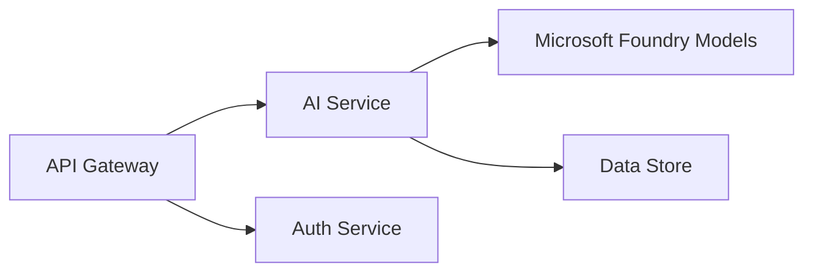
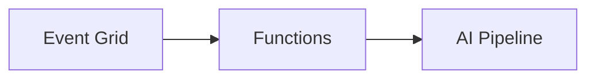

# অধ্যায় ৮: উৎপাদন ও এন্টারপ্রাইজ প্যাটার্নস

**📚 কোর্স**: [AZD ফর বিগিনারস](../../README.md) | **⏱️ সময়কাল**: ২-৩ ঘন্টা | **⭐ জটিলতা**: উন্নত

---

## ওভারভিউ

এই অধ্যায়টি এন্টারপ্রাইজ-প্রস্তুত ডিপ্লয়মেন্ট প্যাটার্ন, সুরক্ষা শক্তিশালীকরণ, মনিটরিং, এবং উৎপাদন AI ওয়ার্কলোডের জন্য খরচ অপ্টিমাইজেশন আলোচনা করে।

এটি একটি স্থাপত্যগত রেফারেন্স, সম্পূর্ণ ডিপ্লয়মেন্ট টেমপ্লেট নয়। উদাহরণগুলো ইন্টিগ্রেশন বিবরণ বাদ দেয় যা আপনাকে আপনার নিজের অ্যাপে প্রদান ও পরীক্ষা করতে হবে; চেকলিস্ট পড়া উৎপাদন প্রস্তুতির নিশ্চয়তা দেয় না।

> **রিলিজ পর্যালোচনা (২০২৬-১১-০৪):** AI CLI গাইডেন্স যাচাই করা হয়েছে `azd 1.37.2`, এজেন্টস `1.0.0-beta.23`, এবং ইভ্যালুয়েশনস `1.0.0-beta.2` ডকুমেন্টেশন/সোর্সের বিরুদ্ধে। সামঞ্জস্যের জন্য [রিলিজ পরিবর্তন এবং ফিক্সগুলো](production-ai-practices.md#recent-release-changes-and-fixes) দেখুন; এটি লাইভ ডিপ্লয়মেন্ট যাচাই নয়।

## শেখার উদ্দেশ্য

এই অধ্যায় শেষ করলে আপনি পারবেন:
- মাল্টি-রিজিওন রেজিলিয়েন্ট অ্যাপ্লিকেশন ডিপ্লয় করা
- এন্টারপ্রাইজ সিকিউরিটি প্যাটার্ন প্রয়োগ করা
- ব্যাপক মনিটরিং কনফিগার করা
- স্কেলে খরচ অপ্টিমাইজ করা
- AZD দিয়ে CI/CD পাইপলাইন সেটআপ করা

---

## 📚 পাঠ

| # | পাঠ | বর্ণনা | সময় |
|---|--------|-------------|------|
| ১ | [উৎপাদন AI অনুশীলন](production-ai-practices.md) | এন্টারপ্রাইজ ডিপ্লয়মেন্ট প্যাটার্নস | ৯০ মিনিট |

---

## 🚀 উৎপাদন চেকলিস্ট

- [ ] রেজিলিয়েন্সের জন্য মাল্টি-রিজিওন ডিপ্লয়মেন্ট
- [ ] অথেনটিকেশনের জন্য ম্যানেজড আইডেন্টিটি (কোন কী নয়)
- [ ] মনিটরিংয়ের জন্য অ্যাপ্লিকেশন ইনসাইটস
- [ ] খরচ বাজেট এবং অ্যালার্ট কনফিগার করা
- [ ] সিকিউরিটি স্ক্যানিং সক্রিয় করা হয়েছে
- [ ] CI/CD পাইপলাইন ইন্টিগ্রেশন
- [ ] ডিজাস্টার রিকভারি প্ল্যান

---

## 🏗️ আর্কিটেকচার প্যাটার্নসমূহ

### প্যাটার্ন ১: মাইক্রোসার্ভিসেস এআই



### প্যাটার্ন ২: ইভেন্ট-চালিত এআই



---

## 🔐 সুরক্ষার সেরা অভ্যাসসমূহ

```bicep
// Illustrative properties from different resources, NOT a standalone Bicep file.
// Attach identity to the application host:
identity: {
  type: 'SystemAssigned'
}

// AI account properties (also require private endpoints, DNS and app connectivity):
properties: {
  publicNetworkAccess: 'Disabled'
  networkAcls: {
    defaultAction: 'Deny'
  }
}
```

---

## 💰 খরচ অপ্টিমাইজেশন

| কৌশল | প্রধান সীমাবদ্ধতা |
|----------|---------|
| শূন্য পর্যন্ত স্কেল করুন (কন্টেইনার অ্যাপস) | উপযুক্ত ট্রিগার প্রয়োজন; অন্যান্য পরিষেবাগুলির জন্য এখনও খরচ হয় |
| ডেভেলপমেন্টের জন্য কনজাম্পশন স্তর ব্যবহার করুন | নির্বাচিত পরিষেবা মূল্য এবং ওয়ার্কলোড তুলনা করুন |
| নির্ধারিত স্কেলিং | সমর্থিত অবকাঠামো/স্বয়ংক্রিয়করণের মাধ্যমে স্কেলিং করুন |
| সংরক্ষণ/প্রদত্ত ক্ষমতা | শুধুমাত্র যখন সমর্থিত হয়; প্রতিশ্রুতিগুলি নিস্ক্রিয় খরচ বাড়াতে পারে |

বৈধ শুরু তারিখ, বিলিং স্কোপ, প্রাপকদের এবং অনুমতিসহ [সম্পূর্ণ বাজেট রিসোর্স প্যাটার্নটি](production-ai-practices.md#2-cost-monitoring-and-budgets) ব্যবহার করুন। একটি বাজেট সতর্কতা পাঠায়; এটি ব্যয় সীমাবদ্ধ করে না। সঞ্চয় পরিমাপিত ব্যবহারের উপর নির্ভর করে এবং গ্যারান্টিযুক্ত শতাংশ নয়।

---

## 📊 মনিটরিং সেটআপ

```bash
# Open the Application Insights logs view (requires configured monitoring)
azd monitor --logs

# Check Application Insights
azd monitor --overview

# View metrics
az monitor metrics list --resource <resource-id>
```

---

## 🔗 নেভিগেশন

| দিকনির্দেশ | অধ্যায় |
|-----------|---------|
| **পূর্ববর্তী** | [অধ্যায় ৭: সমস্যা সমাধান](../chapter-07-troubleshooting/README.md) |
| **কোর্স সম্পন্ন** | [কোর্স হোম](../../README.md) |

---

## 📖 সম্পর্কিত সম্পদসমূহ

- [এআই এজেন্টস গাইড](../chapter-02-ai-development/agents.md)
- [অ্যাপ্লিকেশন ইনসাইটস](../chapter-06-pre-deployment/application-insights.md)
- [মাল্টি-এজেন্ট সমাধানসমূহ](../chapter-05-multi-agent/README.md)
- [মাইক্রোসার্ভিসেস উদাহরণ](../../examples/microservices/README.md)

---

<!-- CO-OP TRANSLATOR DISCLAIMER START -->
**অস্বীকৃতি**:
এই নথিটি AI অনুবাদ পরিষেবা [Co-op Translator](https://github.com/Azure/co-op-translator) ব্যবহার করে অনূদিত হয়েছে। যদিও আমরা শুদ্ধতার জন্য চেষ্টা করি, অনুগ্রহ করে মনে রাখবেন যে স্বয়ংক্রিয় অনুবাদে ত্রুটি বা অসঙ্গতি থাকতে পারে। মূল নথিটি তার স্বভাষায় কর্তৃত্বপূর্ণ উৎস হিসেবে বিবেচিত হওয়া উচিত। গুরুত্বপূর্ণ তথ্যের জন্য পেশাদার মানব অনুবাদ সুপারিশ করা হয়। এই অনুবাদের ব্যবহারে প্রয়োজনীয় ভুল বোঝাবুঝি বা ভুল ব্যাখ্যার জন্য আমরা দায়বদ্ধ নই।
<!-- CO-OP TRANSLATOR DISCLAIMER END -->