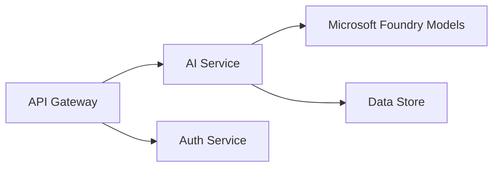
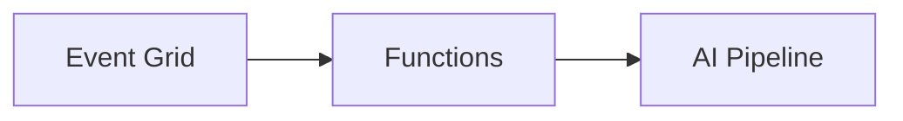

# অধ্যায় ৮: প্রোডাকশন ও এন্টারপ্রাইজ প্যাটার্নস

**📚 কোর্স**: [AZD ফর বিগিনার্স](../../README.md) | **⏱️ সময়কাল**: ২-৩ ঘন্টা | **⭐ জটিলতা**: উন্নত

---

## সারসংক্ষেপ

এই অধ্যায়টি এন্টারপ্রাইজ-প্রস্তুত ডিপ্লয়মেন্ট প্যাটার্নস, সিকিউরিটি হার্ডেনিং, মনিটরিং, এবং প্রোডাকশন AI ওয়ার্কলোডের জন্য খরচ অপ্টিমাইজেশন আলোচনা করে।

এটি একটি আর্কিটেকচারাল রেফারেন্স, পূর্ণ ডিপ্লয়েবল প্রোডাকশন টেমপ্লেট নয়। উদাহরণগুলি ইন্টিগ্রেশন বিবরণ এড়িয়ে যায় যা আপনাকে নিজের অ্যাপ্লিকেশনে যোগ ও পরীক্ষা করতে হবে; চেকলিস্ট পড়ার মাধ্যমে প্রোডাকশন রেডিনেস নিশ্চিত হয় না।

> **Foundry GA আপডেট (২০২৬-১১-০৯):** Foundry ওয়ার্কফ্লোর জন্য `azd >= 1.37.0` এবং সাধারণভাবে উপলব্ধ `microsoft.foundry` 1.0 ব্যান্ডেল ব্যবহার করুন; ইভ্যালুয়েশনগুলি আলাদাভাবে ইনস্টল করা হয়। দেখুন [রিলিজ স্কোপ এবং মাইগ্রেশন](production-ai-practices.md#recent-release-changes-and-fixes) এবং [অথেনটিকেটেড পাইপলাইন উদাহরণ](production-ai-practices.md#cicd-pipeline-configuration)। এটি একটি ডকুমেন্টেশন পর্যালোচনা, জীবন্ত ডিপ্লয়মেন্ট যাচাই বা ঐচ্ছিক প্রিভিউ ফিচারগুলোর জন্য সমগ্র GA স্ট্যাটাস নয়।

## শেখার উদ্দেশ্য

এই অধ্যায়টি সম্পন্ন করার মাধ্যমে আপনি পারবেন:
- মাল্টি-রিজিয়ন রেজিলিয়েন্ট অ্যাপ্লিকেশন ডিপ্লয় করা
- এন্টারপ্রাইজ সিকিউরিটি প্যাটার্ন বাস্তবায়ন করা
- বিস্তৃত মনিটরিং কনফিগার করা
- স্কেলে খরচ অপ্টিমাইজ করা
- AZD দিয়ে CI/CD পাইপলাইন সেট আপ করা

---

## 📚 পাঠসমূহ

| # | পাঠ | বর্ণনা | সময়কাল |
|---|--------|-------------|------|
| ১ | [প্রোডাকশন AI প্রাকটিস](production-ai-practices.md) | এন্টারপ্রাইজ ডিপ্লয়মেন্ট প্যাটার্নস | ৯০ মিনিট |

---

## 🚀 প্রোডাকশন চেকলিস্ট

- [ ] রেজিলিয়েন্সের জন্য মাল্টি-রিজিয়ন ডিপ্লয়মেন্ট
- [ ] অথেন্টিকেশনের জন্য ম্যানেজড আইডেন্টিটি (কী ছাড়া)
- [ ] মনিটরিং এর জন্য অ্যাপ্লিকেশন ইনসাইটস
- [ ] খরচ বাজেট এবং এলার্ট কনফিগার করা
- [ ] সিকিউরিটি স্ক্যানিং সক্ষম করা
- [ ] CI/CD পাইপলাইন ইন্টিগ্রেশন
- [ ] ডিজাস্টার রিকভারি প্ল্যান

---

## 🏗️ আর্কিটেকচারাল প্যাটার্নস

### প্যাটার্ন ১: মাইক্রোসার্ভিসেস AI



### প্যাটার্ন ২: ইভেন্ট-ড্রিভেন AI



---

## 🔐 সিকিউরিটির সেরা অভ্যাসসমূহ

```bicep
// Illustrative properties from different resources, NOT a standalone Bicep file.
// Attach identity to the application host:
identity: {
  type: 'SystemAssigned'
}

// AI account properties (also require private endpoints, DNS and app connectivity):
properties: {
  publicNetworkAccess: 'Disabled'
  networkAcls: {
    defaultAction: 'Deny'
  }
}
```

---

## 💰 খরচ অপ্টিমাইজেশন

| স্ট্র্যাটেজি | প্রধান বাধা |
|----------|---------|
| শূন্যে স্কেলিং (কন্টেইনার অ্যাপস) | উপযুক্ত ট্রিগার প্রয়োজন; অন্যান্য সার্ভিস এখনও খরচ সৃষ্টি করে |
| ডেভেলপমেন্টে কনজাম্পশন লেভেল ব্যবহার | নির্বাচিত সার্ভিসের মূল্য এবং ওয়ার্কলোড তুলনা করুন |
| নির্ধারিত স্কেলিং | সমর্থিত অবকাঠামো/অটোমেশন দ্বারা স্কেলিং |
| রিজার্ভেশন/প্রোভিশন্ড ক্যাপাসিটি | শুধুমাত্র সমর্থিত হলে; কমিটমেন্টস বৃদ্ধি পায় কাজে না আসা খরচ |

বৈধ শুরু তারিখ, বিলিং স্কোপ, প্রাপকদের এবং অনুমতিসহ [সম্পূর্ণ বাজেট রিসোর্স প্যাটার্ন](production-ai-practices.md#2-cost-monitoring-and-budgets) ব্যবহার করুন। একটি বাজেট সতর্কতা পাঠায়; এটি খরচ সীমাবদ্ধ করে না। সঞ্চয় পরিমাপ করা ব্যবহারিকতার উপর নির্ভর করে এবং গ্যারান্টিযুক্ত শতাংশ নয়।

---

## 📊 মনিটরিং সেটআপ

```bash
# Open the Application Insights logs view (requires configured monitoring)
azd monitor --logs

# Check Application Insights
azd monitor --overview

# View metrics
az monitor metrics list --resource <resource-id>
```

---

## 🔗 নেভিগেশন

| দিকনির্দেশ | অধ্যায় |
|-----------|---------|
| **পূর্ববর্তী** | [অধ্যায় ৭: সমস্যার সমাধান](../chapter-07-troubleshooting/README.md) |
| **কোর্স সম্পন্ন** | [কোর্স হোম](../../README.md) |

---

## 📖 সম্পর্কিত রিসোর্সসমূহ

- [AI এজেন্ট গাইড](../chapter-02-ai-development/agents.md)
- [অ্যাপ্লিকেশন ইনসাইটস](../chapter-06-pre-deployment/application-insights.md)
- [মাল্টি-এজেন্ট সলিউশন](../chapter-05-multi-agent/README.md)
- [মাইক্রোসার্ভিস উদাহরণ](../../examples/microservices/README.md)

---

<!-- CO-OP TRANSLATOR DISCLAIMER START -->
**অস্বীকৃতি**:
এই নথিটি AI অনুবাদ পরিষেবা [Co-op Translator](https://github.com/Azure/co-op-translator) ব্যবহার করে অনূদিত হয়েছে। যদিও আমরা শুদ্ধতার জন্য চেষ্টা করি, অনুগ্রহ করে মনে রাখবেন যে স্বয়ংক্রিয় অনুবাদে ত্রুটি বা অসঙ্গতি থাকতে পারে। মূল নথিটি তার স্বভাষায় কর্তৃত্বপূর্ণ উৎস হিসেবে বিবেচিত হওয়া উচিত। গুরুত্বপূর্ণ তথ্যের জন্য পেশাদার মানব অনুবাদ সুপারিশ করা হয়। এই অনুবাদের ব্যবহারে প্রয়োজনীয় ভুল বোঝাবুঝি বা ভুল ব্যাখ্যার জন্য আমরা দায়বদ্ধ নই।
<!-- CO-OP TRANSLATOR DISCLAIMER END -->