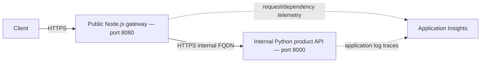

# দুই-সেবা মাইক্রোসার্ভিস — অ্যাজিউর কন্টেইনার অ্যাপস

**স্তর:** মধ্যবর্তী · **সময়:** সেটআপসহ ৪৫–৬০ মিনিট

এই শেখার স্যাম্পলটি একটি **Node.js API গেটওয়ে** এবং একটি **শুধুমাত্র-পঠিত Python
প্রোডাক্ট সার্ভিস** বাস্তবায়ন করে। সোর্স, ডকারফাইলস, বিসেপ, এবং azd কনফিগারেশন অন্তর্ভুক্ত।
এটি একটি প্রোডাকশন-হার্ডেন্ড সিস্টেম নয়।

## আপনি কী শিখবেন

- দুটি সেবা স্বতন্ত্রভাবে মোতায়েন করুন।
- একটি অভ্যন্তরীণ ব্যাকএন্ড FQDN এর মাধ্যমে HTTPS ব্যবহার করুন।
- সফলতা, খুঁজে পাওয়া যায় নি, এবং অনুপলব্ধ-সেবা প্রতিক্রিয়া যাচাই করুন।
- টেলিমেট্রি এবং স্বতন্ত্র স্কেলিং সীমারেখা বুঝুন।



প্রোডাক্ট ক্যাটালগে স্মৃতিতে পাঁচটি স্থায়ী পণ্য রয়েছে। এখানে **POST,
PUT, বা DELETE হ্যান্ডলার নেই**, ডেটাবেস, সার্ভিস বাস, অর্ডার/ব্যবহারকারী/নোটিফিকেশন সার্ভিস,
C#, বা Go কোড নেই। এগুলি ভবিষ্যতের উন্নয়ন ধারণা, অন্তর্ভুক্ত বৈশিষ্ট্য নয়।
গেটওয়ে ব্যবহারকারীদের প্রমাণীকরণ করেনা; অভ্যন্তরীণ ইনগ্রেস অ্যাপ্লিকেশন অনুমোদনের বিকল্প নয়।


## পূর্বশর্তসমূহ

প্রথমে [একক Flask API](../../../../../examples/container-app/simple-flask-api) সম্পন্ন করুন।
একটি বর্তমান স্থিতিশীল azd ইন্সটল করুন (সমীক্ষার সময় প্রকাশিত সংস্করণ: 1.37.2), Azure CLI,
এবং ডকার ডেমন চালু অবস্থায় থাকতে হবে। আপনার একটি Azure সাবস্ক্রিপশন, রিসোর্স
তৈরি করার অনুমতি, এবং কন্টেইনার অ্যাপস এর আঞ্চলিক কোটা প্রয়োজন।

```bash
azd version
az version
docker info
azd auth login
az login
```

উভয় CLI টুলেই একই সাবস্ক্রিপশন ব্যবহার করুন। নিচের কমান্ডগুলি Bash ব্যবহার করে।

## মোতায়েন এবং যাচাই করুন

রিপোজিটরি রুট থেকে:

```bash
cd examples/container-app/microservices
azd env new microservices-demo
azd up
GATEWAY_URL=$(azd env get-value API_GATEWAY_URL)
RG_NAME=$(azd env get-value AZURE_RESOURCE_GROUP)
GATEWAY_NAME=$(azd env get-value API_GATEWAY_NAME)
PRODUCT_NAME=$(azd env get-value PRODUCT_SERVICE_NAME)

curl --fail-with-body "${GATEWAY_URL}/health"
curl --fail-with-body "${GATEWAY_URL}/api/products"
curl --fail-with-body "${GATEWAY_URL}/api/products/1"
curl -i "${GATEWAY_URL}/api/products/999"
```

**সফল:** হেলথ ২০০; তালিকা ২০০ সহ **পাঁচটি** পণ্য; পণ্য ১ একটি ল্যাপটপ
যার দাম ৯৯৯.৯৯ এবং স্টক ৫০; অজানা পণ্য ৪০৪ রিটার্ন করে।
বর্ণনাগুলি প্রতিক্রিয়ায় অন্তর্ভুক্ত; টাইমস্টাম্প পরিবর্তিত হয়।

প্রাথমিক প্রোভিশনিং পোর্ট ৮০ এ পাবলিক হেলো-ওয়ার্ল্ড ইমেজগুলি ব্যবহার করে যাতে এটি
একটি ফাঁকা রেজিস্ট্রি থেকে অস্তিত্বহীন ইমেজ টেনে আনতে না চায়। সার্ভিস-নির্দিষ্ট বিসেপ মডিউল
এবং প্যারামিটার ফাইলগুলি বিল্ট ইমেজ এবং অ্যাপ পোর্ট/প্রোব দ্বারা প্রতিস্থাপিত হয়
`azd deploy` এর সময়। প্রধান প্যারামিটারগুলি পরে প্রোভিশনিংয়ের জন্য প্রকাশিত ইমেজ নাম রক্ষা করে।

## সার্ভিস এবং নেটওয়ার্কিং

| সার্ভিস | প্রকাশিত এন্ডপয়েন্টগুলি | ডিফল্ট রিসোর্সস |
|---|---|---|
| গেটওয়ে | GET `/`, `/health`, `/api/products`, `/api/products/:id` | ১ vCPU, ২ GiB, ২–২০ রেপ্লিকা |
| প্রোডাক্ট | GET `/`, `/health`, `/products`, `/products/<id>` | ০.৫ vCPU, ১ GiB, ১–১০ রেপ্লিকা |

প্রোডাক্ট ইঙ্গ্রেসে `external: false` এবং `allowInsecure: false` রয়েছে। বাইসেপ যুক্ত করে
গেটওয়েতে `PRODUCT_SERVICE_URL=https://<actual-internal-fqdn>`। HTTP হবে
পুনঃনির্দেশনাঃ HTTPS কনফিগার করা ইনগ্রেসের সাথে মেলে। একটি সংক্ষিপ্ত DNS নাম অবশ্যই মেলাতে হবে
**বাস্তব কন্টেইনার অ্যাপ নামের সাথে**, লজিক্যাল সার্ভিস কী `product-service` নয়।
আপনার ল্যাপটপ থেকে সরাসরি অভ্যন্তরীণ URL কল করার চেষ্টা করবেন না।

গেটওয়ে প্রোডাক্ট কলের জন্য পাঁচ সেকেন্ডের টাইমআউট দেয়। অনুপস্থিত প্রোডাক্ট আইডি
404 হিসেবে প্রেরণ করে; পরিবহন ব্যর্থতা/অন্যান্য ব্যাকএন্ড ব্যর্থতা 503 ফেরত দেয়। গেটওয়ে
`/health` শুধুমাত্র গেটওয়েটি পরীক্ষা করে, ব্যাকএন্ড উপলব্ধতা নয়।

## ফাইল এবং কনফিগারেশন

```text
azure.yaml
infra/main.bicep
infra/main.parameters.json
infra/abbreviations.json
infra/core/container-apps-environment.bicep
infra/core/monitor.bicep
infra/app/api-gateway.bicep
infra/app/api-gateway.parameters.json
infra/app/product-service.bicep
infra/app/product-service.parameters.json
src/api-gateway/{app.js,package.json,Dockerfile}
src/product-service/{main.py,requirements.txt,Dockerfile}
```

স্কেলিং, CPU/মেমরি, পোর্ট এবং প্রোবগুলো `infra/app/*.bicep` এ সেট করা হয়। এই
ফাইলগুলো পরিবর্তন করুন এবং ইনফ্রাস্ট্রাকচার প্রয়োগ এবং পুনরায় ডিপ্লয়ের জন্য `azd up` চালান। এখানে
`GATEWAY_MAX_REPLICAS` পরিবেশ-পরিবর্তক প্যারামিটার নেই এই নমুনায়।

শুধু কোড পরিবর্তনের জন্য:

```bash
azd deploy product-service
azd deploy api-gateway
```

নোড ইমেজ Node 22 ব্যবহার করে; পাইথন ইমেজ Python 3.11 ব্যবহার করে। উভয়ই
`0.0.0.0` এ বাইন্ড করে। ইনগ্রেস/প্রোব  যথাক্রমে 8080 (গেটওয়ে) এবং 8000 (প্রোডাক্ট) পোর্ট ব্যবহার করে।

## ডকারের মাধ্যমে লোকাল ডেভেলপমেন্ট

এই উদাহরণ ডিরেক্টরি থেকে চালান। একটি ব্যবহারকারী-সংজ্ঞায়িত নেটওয়ার্ক ব্যবহার করুন, **একটি কন্টেইনার থেকে অন্যটিতে পৌঁছাতে `localhost` নয়
**:

```bash
docker network create azd-microservices-demo
docker build -t local-product ./src/product-service
docker build -t local-gateway ./src/api-gateway
docker run -d --name azd-product --network azd-microservices-demo local-product
docker run -d --name azd-gateway --network azd-microservices-demo \
  -p 8080:8080 -e PRODUCT_SERVICE_URL=http://azd-product:8000 local-gateway
curl --fail-with-body http://localhost:8080/api/products
```

প্রত্যাশিত: পাঁচটি পণ্য। HTTP শুধুমাত্র এই স্থানীয় Docker নেটওয়ার্কের জন্য ব্যবহৃত হয়।

```bash
docker stop azd-product azd-gateway
docker rm azd-product azd-gateway
docker network rm azd-microservices-demo
```

## মনিটরিং

```bash
az containerapp logs show --name "$GATEWAY_NAME" --resource-group "$RG_NAME" --follow
# In a separate terminal:
az containerapp logs show --name "$PRODUCT_NAME" --resource-group "$RG_NAME" --tail 100
```

`azd monitor --logs` একটি পোর্টাল ভিউ খুলে; এটি টার্মিনাল লগ স্ট্রিম করে না।
নোড SDK গেটওয়ে অনুরোধ/নির্ভরতা সংগ্রহ করে। পাইথনের `AzureLogHandler`
**লগ ট্রেস** রপ্তানি করে, স্বয়ংক্রিয় Flask অনুরোধ, SQL নির্ভরতা, বা পূর্ণ
বিতরণকৃত ট্রেস নয়। OpenCensus একটি পুরানো SDK; এই স্যাম্পলটি বর্ধিত করার সময় Azure Monitor OpenTelemetry পছন্দ করুন।


```kusto
requests
| where timestamp > ago(1h)
| where name contains "products"
| summarize RequestCount=count(), AvgDuration=avg(duration) by bin(timestamp, 5m)
```

পাইথন অ্যাপ্লিকেশন বার্তাগুলির জন্য:

```kusto
traces
| where timestamp > ago(1h)
| where message contains "products"
| project timestamp, message, severityLevel
```

ইনজেশন বিলম্ব এবং স্যাম্পলিং অনুমোদন করুন; নির্দিষ্ট অনুরোধের সংখ্যা বা গ্যারান্টিযুক্ত অতিক্রান্ত সময় প্রত্যাশা করবেন না।
কোনো কাস্টম সতর্কতা বা ড্যাশবোর্ড কনফিগার করা হয়নি।

## ব্যবহারিক অনুশীলন

### অনুশীলন ১: ক্যাটালগ পরিবর্তন করুন

**শুরু করার স্থান:** `src/product-service/main.py`.
**লক্ষ্য:** স্বাধীন পরিষেবা মোতায়েন যাচাই করা।
স্থির `products` তালিকায় ল্যাপটপের স্টক ৫০ থেকে ৪৯ এ পরিবর্তন করুন,
`azd deploy product-service` চালান, তারপর `${GATEWAY_URL}/api/products/1` অনুরোধ করুন।

**সাফল্যের মানদণ্ড / সমাধান:** `"stock":49` সহ HTTP 200। ৫০ পুনঃস্থাপন করুন এবং পুনরায় ডিপ্লয় করুন।
**সাধারণ সমস্যা:** ক্যাটালগের মালিক সেবাটির পরিবর্তে গেটওয়ে সম্পাদনা করা।
এটি উৎস ডেটা পরিবর্তন করে, একটি স্থায়ী ইনভেন্টরি ডেটাবেস নয়।

### ব্যায়াম ২: রেপ্লিকা কনফিগারেশন যাচাই করুন

**শুরু করার পয়েন্ট:** `infra/app/product-service.bicep`।
**লক্ষ্য:** অটোস্কেলিং অনুমান না করে অবকাঠামো পরিবর্তন পর্যবেক্ষণ করা।
`minReplicas: 1` থেকে `minReplicas: 2` এ পরিবর্তন করুন, `azd up` চালান, তারপর:

```bash
az containerapp show --name "$PRODUCT_NAME" --resource-group "$RG_NAME" \
  --query properties.template.scale -o json
```

**সফলতার মাপকাঠি:** কনফিগারকৃত সর্বনিম্ন হল ২ এবং সর্বোচ্চ একই থাকে ১০।
সর্বনিম্ন ১ পুনরুদ্ধার করুন এবং `azd up` চালান।
**সাধারণ সমস্যা:** শুধুমাত্র `azd deploy` সম্পর্কহীন শেয়ার করা অবকাঠামোতে পরিবর্তন প্রয়োগ করে না।
ব্যর্থতা সিমুলেশনের জন্য `maxReplicas` শূন্যে সেট করবেন না।
এটি কনফিগারেশন যাচাই করে, লোড-টেস্ট বা নিশ্চিতক্ষণিক প্রতিলিপি গণনা নয়।

### অনুশীলন ৩: লোকালভাবে অনুপলব্ধ-সার্ভিস পরিচালনা পরীক্ষা করুন

**শুরু করার পয়েন্ট:** উভয় লোকাল Docker কন্টেইনার উপরের দিকের চলছে।
**লক্ষ্য:** ব্যাকএন্ড ব্যর্থতা এবং মিসিং প্রোডাক্টের মধ্যে পার্থক্য করা।
শুধুমাত্র প্রোডাক্ট কন্টেইনার বন্ধ করুন:

```bash
docker stop azd-product
curl -i http://localhost:8080/api/products
docker start azd-product
curl --fail-with-body http://localhost:8080/api/products
```

**সফলতার মাপকাঠি:** বন্ধ থাকাকালে, গেটওয়ে 503 সহ ফেরত দেয়
`"error":"Product service unavailable"`; পুনরায় চালু হওয়ার পর, তালিকা ২০০ ফেরত দেয়।
প্রয়োজন হলে সংক্ষিপ্ত স্টার্টআপ বিলম্বের পর পুনরায় চেষ্টা করুন।
**সাধারণ সমস্যা:** গেটওয়ে বন্ধ করা ভিন্ন ব্যর্থতা পরীক্ষা করে (কোনও HTTP প্রতিক্রিয়া নেই)।

## খরচ এবং উৎপাদন ফাঁক

ডিফল্ট সর্বনিম্ন প্রতিলিপি কম্পিউট চালু রাখে। রেজিস্ট্রি এবং মনিটরিং তুলনায় চার্জ হয়।
মোট $৫০/মাস নিশ্চিতকৃত নয়: আঞ্চলিক CPU/মেমরি,
প্রতিলিপি ঘণ্টা, অনুরোধ, রেজিস্ট্রি এবং লগ সংরক্ষণ মূল্যায়ন করুন
[Azure pricing calculator](https://azure.microsoft.com/pricing/calculator/) এ।
শিক্ষামূলক সম্পদ দ্রুত মুছে ফেলুন।

উৎপাদন কাজের মধ্যে অন্তর্ভুক্ত রয়েছে Authentication/Authorization, Scoped Managed Identities,
স্থায়ী ডেটা, ইনপুট/প্রতিক্রিয়া যাচাই, সমর্থিত পর্যবেক্ষণ সরঞ্জামাদি,
লোড/ব্যর্থতা পরীক্ষা, CI/CD, সতর্কতা, এবং পুনরুদ্ধার পদ্ধতি। অর্ডার
সার্ভিস, কিউ, বা ডাটাবেস যোগ করা একটি আলাদা বাস্তবায়ন কাজ; এটি সম্পন্ন
অনুশীলন বা এখানে ইতিমধ্যেই উপলব্ধ ফিচার নয়।

## সমস্যা সমাধান এবং পরিষ্কার

- **প্রথম প্রভিশনিং সময় 이미지 পাওয়া যায়নি:** বুটস্ট্র্যাপ পাবলিক ইমেজ ব্যবহার করা উচিত;
  প্রধান ইমেজ প্যারামিটার ডিফল্ট এবং ডেপ্লয়মেন্ট মডিউল ম্যাপিং যাচাই করুন।
- **503 পণ্য:** পণ্যের লগ, ইমেজ সংস্করণ, এবং ইনজেক্টেড অভ্যন্তরীণ HTTPS URL পরীক্ষা করুন।
- **404 অপ্রত্যাশিত পথ:** পণ্য API শুধুমাত্র-পঠনযোগ্য; রুট যাচাই করুন, অব্যাহত CRUD হ্যান্ডলার নয়।
- **কোনও টেলিমেট্রি নেই:** রানটাইম সংযোগ স্ট্রিংগুলি নিরীক্ষণ করুন তাদের প্রকাশ না করে এবং
  ইনজেস্টশন বিলম্ব অনুমতি দিন। পাইথন রিকোয়েস্ট টেবিলগুলি এর লগ হ্যান্ডলার দ্বারা পূরণ হয় না।

এই নমুনা ডিরেক্টরি থেকে:

```bash
azd down
```

মুছে ফেলার প্রম্পট পর্যালোচনা করুন এবং নির্দিষ্ট রিসোর্স গ্রুপ মুছে ফেলা হয়েছে নিশ্চিত করুন।

[আগের: Flask API](../../../../../examples/container-app/simple-flask-api) · [পরবর্তী: ডাটাবেস অ্যাপ](../../../../../examples/database-app) ·
[AI development](../../../docs/chapter-02-ai-development/README.md) ·
[কোর্স হোম](../../../README.md) · [একটি সমস্যা রিপোর্ট করুন](https://github.com/microsoft/AZD-for-beginners/issues)

---

<!-- CO-OP TRANSLATOR DISCLAIMER START -->
**অস্বীকৃতি**:
এই নথিটি AI অনুবাদ পরিষেবা [Co-op Translator](https://github.com/Azure/co-op-translator) ব্যবহার করে অনূদিত হয়েছে। যদিও আমরা শুদ্ধতার জন্য চেষ্টা করি, অনুগ্রহ করে মনে রাখবেন যে স্বয়ংক্রিয় অনুবাদে ত্রুটি বা অসঙ্গতি থাকতে পারে। মূল নথিটি তার স্বভাষায় কর্তৃত্বপূর্ণ উৎস হিসেবে বিবেচিত হওয়া উচিত। গুরুত্বপূর্ণ তথ্যের জন্য পেশাদার মানব অনুবাদ সুপারিশ করা হয়। এই অনুবাদের ব্যবহারে প্রয়োজনীয় ভুল বোঝাবুঝি বা ভুল ব্যাখ্যার জন্য আমরা দায়বদ্ধ নই।
<!-- CO-OP TRANSLATOR DISCLAIMER END -->