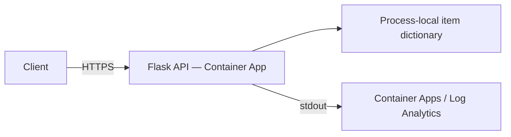

# সহজ Flask API — Azure Container Apps

**স্তর:** নির্মিতব্য · **সময়:** ৩০–৪৫ মিনিট সেটআপ সহ

Azure Developer CLI (azd) দিয়ে একটি Python Flask CRUD API মোতায়েন করুন। সোর্স, Dockerfile,
Bicep, এবং মোতায়েন প্যারামিটারগুলি অন্তর্ভুক্ত রয়েছে। এটি একটি **শিক্ষামূলক নমুনা**, প্রোডাকশন-তৈরির API নয়।


## আপনি যা শিখবেন

- azd এর মাধ্যমে একটি কন্টেইনার বিল্ড এবং প্রকাশ করা।
- ইনগ্রেস এবং লাইভনেস/রেডিনেস প্রোব কনফিগার করা।
- CRUD রেসপন্স যাচাই এবং অ্যাপ্লিকেশন লগ নিরীক্ষণ করা।
- কেন ইন-মেমরি ডেটা টেকসই অ্যাপ্লিকেশনগুলোর জন্য অযোগ্য তা বোঝা।



**গুরুত্বপূর্ণ:** আইটেমগুলি একটি প্রক্রিয়াতে রাখা হয়। ডিফল্ট হল **একটি Gunicorn কর্মী,
০–১ রেপ্লিকা**, ইচ্ছাকৃতভাবে কর্মী/রেপ্লিকা মধ্যে অসঙ্গতিপূর্ণ ডেটা এড়ানো হয়েছে।
রিস্টার্ট, সংস্করণ পরিবর্তন, বা স্কেল-টু-জিরো হলে আইটেম হারিয়ে যায়। রেপ্লিকা বাড়ালে
শেয়ার্ড পারসিস্টেন্ট স্টোরেজ প্রয়োজন। API-তে কোনও প্রমাণীকরণ বা অনুমোদন নেই।

## প্রয়োজনীয়তা

- [বর্তমান স্থিতিশীল azd](https://learn.microsoft.com/azure/developer/azure-developer-cli/install-azd)
  (রিভিউ সময় প্রকাশিত রিলিজ: 1.37.2)।
- যাচাইয়ের জন্য [Azure CLI](https://learn.microsoft.com/cli/azure/install-azure-cli)।
- ডকার এবং এর ডেমন চলমান থাকতে হবে; এটি ডিফল্ট লোকাল ইমেজ বিল্ডের জন্য প্রয়োজন।
- Azure সাবস্ক্রিপশন, রিসোর্স-তৈরির অনুমতি, এবং Container Apps আঞ্চলিক কোটা।
- নিচের কমান্ডগুলোর জন্য Bash (অথবা সমতূল্য PowerShell)।
- ঐচ্ছিক লোকাল ডেভেলপমেন্টের জন্য Python 3.11।

```bash
azd version
az version
docker info
azd auth login
az login
```

CLI টুলগুলির আলাদা লগইন সেশন থাকে। দুটোর মধ্যে একই সাবস্ক্রিপশন ব্যবহার করুন।

## দ্রুত শুরু

রিপোজিটরি রুট থেকে:

```bash
cd examples/container-app/simple-flask-api
azd env new flask-demo
azd up
API_URL=$(azd env get-value API_ENDPOINT)
RG_NAME=$(azd env get-value AZURE_RESOURCE_GROUP)
API_NAME=$(azd env get-value API_NAME)
curl --fail-with-body "${API_URL}/health"
```

প্রত্যাশিত: HTTP 200 এবং JSON সহ `"status":"healthy"`,
`"service":"simple-flask-api"`, এবং বর্তমান UTC টাইমস্ট্যাম্প।
প্রোভিশনিং এবং ইমেজ বিল্ডিং সাধারণত কয়েক মিনিট সময় নেয়; সময় বিভিন্ন হতে পারে।

প্রাথমিক প্রোভিশনিং একটি পাবলিক hello-world ইমেজ ব্যবহার করে যা পোর্ট ৮০-এ শুনে।
`azure.yaml` নির্বাচন করে `infra/app/api.bicep` এবং তার মিলযুক্ত প্যারামিটার ফাইল
সার্ভিস মোতায়েনের জন্য, যা ইমেজ, ইনগ্রেস, এবং প্রোব-গুলো পোর্ট ৮০০০-এ পরিবর্তন করে।
ঐ মোতায়েন প্যারামিটারগুলো মুছে ফেলবেন না।

## CRUD যাচাই করুন

নিম্নলিখিতগুলি ধারাবাহিকভাবে চালান, যতোক্ষণ একই রেপ্লিকা সক্রিয় থাকে:

```bash
# Create: HTTP 201; note the returned id (1 for a fresh process).
curl -i -X POST "${API_URL}/api/items" \
  -H "Content-Type: application/json" \
  -d '{"name":"Test Item","description":"My first item"}'

# Read list: HTTP 200, total 1 in a fresh process.
curl --fail-with-body "${API_URL}/api/items"

# Replace 1 if your create response returned another id.
curl --fail-with-body "${API_URL}/api/items/1"
curl -i -X PUT "${API_URL}/api/items/1" \
  -H "Content-Type: application/json" -d '{"name":"Updated Item"}'
curl -i -X DELETE "${API_URL}/api/items/1"
curl -i "${API_URL}/api/items/1"
```

সফল: POST 201, পাঠ/PUT 200, DELETE 204 বডি ছাড়া, তারপর অনুপস্থিত আইটেমে 404।
ভুল/অবজেক্ট নয় JSON বা খালি নাম ৪০০ রিটার্ন করে।
যদি কোন আইটেম অনুরোধের মাঝে অদৃশ্য হয়, রিস্টার্ট বা স্কেল-টু-জিরো পরীক্ষা করুন;
এটি একটি ইচ্ছাকৃত ইন-মেমরি সীমাবদ্ধতা, পারসিস্টেন্স নয়।

| এন্ডপয়েন্ট | মেথডসমূহ |
|---|---|
| `/` | GET — সার্ভিস তথ্য |
| `/health` | GET — লাইভনেস/রেডিনেস |
| `/api/items` | GET, POST |
| `/api/items/{id}` | GET, PUT, DELETE |

## লগ এবং কনফিগারেশন

```bash
az containerapp logs show --name "$API_NAME" --resource-group "$RG_NAME" --follow
```

প্রত্যাশিত: Gunicorn শুরু, অনুরোধ অ্যাক্সেস লগ, এবং অ্যাপ্লিকেশন মেসেজ।
`azd monitor --logs` একটি পোর্টাল ভিউ খুলে; এটি টার্মিনালে স্ট্রিমিং করে না।
অ্যাপ্লিকেশন ইনসাইটস প্রোভিশন করা হয়েছে কিন্তু **এই Flask কোড দ্বারা ইনস্ট্রুমেন্ট নয়**;
stdout লগের জন্য Container Apps/Log Analytics ব্যবহার করুন।

CPU/মেমরি, রেপ্লিকা সীমা, বা স্কেল রুল পরিবর্তনের জন্য `infra/app/api.bicep` এডিট করুন, তারপর
`azd up` চালান। ডিফল্ট হল 0.5 vCPU, 1 GiB, মিনিমাম 0 / ম্যাক্সিমাম 1 রেপ্লিকা,
এবং ৫০ সমসাময়িক HTTP অনুরোধের থ্রেশহোল্ড। স্কেল-টু-জিরো ঠান্ডা শুরুতে বিলম্ব যোগ করতে পারে।

যেকোনো ইচ্ছাকৃত `azd env set MAX_REPLICAS`, `API_KEY`, `LOG_LEVEL`, বা
`SCALE_TO_ZERO_TIMEOUT` মান **এই টেমপ্লেট বা অ্যাপে সংযুক্ত নয়**।
একটি মান সেট করলে এটি স্বয়ংক্রিয়ভাবে রানটাইম পরিবেশ পরিবর্তনশীল হয় না।
ইমেজ স্পষ্টভাবে পোর্ট ৮০০০-বাইন্ড করে; পোর্ট পরিবর্তন করলে Dockerfile, Bicep ingress, এবং প্রোব একসাথে আপডেট করুন।


## ফাইলসমূহ

```text
azure.yaml
infra/main.bicep
infra/main.parameters.json
infra/app/container-apps.bicep       # Environment, registry, monitoring
infra/app/api.bicep                  # App, ingress, probes, scale settings
infra/app/api.parameters.json        # Image and resource values for azd deploy
src/app.py
src/Dockerfile
src/requirements.txt
```

## লোকাল ডেভেলপমেন্ট

এই উদাহরণ ডিরেক্টরি থেকে:

```bash
python -m venv .venv
source .venv/bin/activate  # PowerShell: .\.venv\Scripts\Activate.ps1
python -m pip install -r src/requirements.txt
python src/app.py
```

অন্য একটি টার্মিনালে `http://localhost:8000/health` এবং CRUD এন্ডপয়েন্ট পরীক্ষা করুন।
অথবা প্রকৃত ইমেজ বিল্ড এবং রান করুন:

```bash
docker build -t flask-api:local ./src
docker run --rm -p 8000:8000 flask-api:local
```

প্রথম মোতায়েনের পর শুধুমাত্র কোড পরিবর্তনের জন্য `azd deploy api` চালান।
Bicep পরিবর্তনগুলোর জন্য, `azd up` চালিয়ে পুনঃপ্রোভিশন এবং মোতায়েন করুন।

## ব্যবহারিক অনুশীলনসমূহ

### ১। ইনপুট প্রত্যাখ্যান যাচাই করুন

**শুরু করার স্থান:** মোতায়েনকৃত API, উপরে `API_URL`।
**লক্ষ্য:** যাচাই করুন API ভুল JSON আকৃতি এবং অনুপস্থিত নাম প্রত্যাখ্যান করে।

```bash
curl -i -X POST "${API_URL}/api/items" \
  -H "Content-Type: application/json" -d '[]'
curl -i -X POST "${API_URL}/api/items" \
  -H "Content-Type: application/json" -d '{"name":""}'
```

**সাফল্যের মানদণ্ড / সমাধান:** উভয়ই JSON ত্রুটিসহ ৪০০ রিটার্ন করে, ৫০০ নয়।
**সাধারণ সমস্যা:** JSON content-type হেডার বাদ দেওয়া।

### ২। একটি শুধু-পাঠযোগ্য সংস্করণ এন্ডপয়েন্ট যোগ করুন

**শুরু করার স্থান:** `src/app.py`। **লক্ষ্য:** API সম্প্রসারিত এবং পুনর্মোতায়েন করা।
এটি `if __name__ == '__main__':` ব্লকের আগে যোগ করুন:

```python
@app.route('/version', methods=['GET'])
def version():
    return jsonify({'version': '1.0.0'})
```

`azd deploy api` চালান, তারপর `curl --fail-with-body "${API_URL}/version"`।
**সাফল্যের মানদণ্ড:** HTTP 200 এবং `{"version":"1.0.0"}`।
**সাধারণ সমস্যা:** ব্লকিং `app.run()` কলের পরে রুট দেওয়া যখন
`python src/app.py` দিয়ে টেস্ট করা হচ্ছে।

### জ্ঞান যাচাই পয়েন্ট

টেকসই ডাটা জন্য কেন এক কর্মী যথেষ্ট নয়? কারণ এক প্রক্রিয়াও রিস্টার্ট করলে
তার ডিকশনারি হারায়। একটি প্রোডাকশন সংস্করণে প্রয়োজন টেকসই শেয়ার্ড স্টোরেজ,
প্রমাণীকরণ, অনুমোদন, মাইগ্রেশন, টেস্ট এবং অপারেশনাল মনিটরিং।

## খরচ এবং সমস্যার সমাধান

এটি একটি নিশ্চয়তা ভাজন $0 ডিপ্লয়মেন্ট নয়: বেসিক রেজিস্ট্রি এবং লগ স্টোরেজ/ইনজেশনে
চার্জ হতে পারে এমনকি যখন অ্যাপ কম্পিউট শূন্য থাকে। আপনার অঞ্চলের জন্য 
[মূল্য হিসাবকারী](https://azure.microsoft.com/pricing/calculator/) ব্যবহার করুন।

- **ডকার বিল্ড ফেইল:** নিশ্চিত করুন `docker info`, নেটওয়ার্ক অ্যাক্সেস এবং ডিপেনডেন্সিগুলি।
- **অস্বাস্থ্যকর অ্যাপ:** কনসোল/ সিস্টেম লগ পরীক্ষা করুন এবং ইমেজ পোর্ট, ইনগ্রেস,
 এবং প্রোব একমত কিনা যাচাই করুন। একটি প্লেসহোল্ডারকে Flask পোর্টে প্রোব করা যাবে না।
- **403/অনুমতি সমস্যা:** সাবস্ক্রিপশন এবং রিসোর্স তৈরি করার অনুমতি নিশ্চিত করুন।
- **আইটেম হারানো:** মেমরির স্টেট রিস্টার্ট/ স্কেল-টু-জিরো তে রিসেট হয়; টেকসই আচরণের জন্য একটি ডেটাবেস যোগ করুন।


## পরিস্কার এবং পরবর্তী পদক্ষেপ

```bash
azd down
```

মোছার প্রম্পট পর্যালোচনা করুন এবং নিশ্চিত করুন নিবেদিত রিসোর্স গ্রুপটি মুছে ফেলা হয়েছে।
সম্পর্কহীন ডেটা ধারণকারী রিসোর্স গ্রুপের বিরুদ্ধে ধ্বংসাত্মক পরিস্কার প্রয়োগ করবেন না।

[পরবর্তী: ডেটাবেস অ্যাপ](../../../../../examples/database-app) · [মাইক্রোসার্ভিস](../../../../../examples/container-app/microservices) ·
[কন্টেইনার ওভারভিউ](../README.md) · [কোর্স হোম](../../../README.md) ·
[একটি সমস্যা রিপোর্ট করুন](https://github.com/microsoft/AZD-for-beginners/issues)

---

<!-- CO-OP TRANSLATOR DISCLAIMER START -->
**অস্বীকৃতি**:
এই নথিটি AI অনুবাদ পরিষেবা [Co-op Translator](https://github.com/Azure/co-op-translator) ব্যবহার করে অনূদিত হয়েছে। যদিও আমরা শুদ্ধতার জন্য চেষ্টা করি, অনুগ্রহ করে মনে রাখবেন যে স্বয়ংক্রিয় অনুবাদে ত্রুটি বা অসঙ্গতি থাকতে পারে। মূল নথিটি তার স্বভাষায় কর্তৃত্বপূর্ণ উৎস হিসেবে বিবেচিত হওয়া উচিত। গুরুত্বপূর্ণ তথ্যের জন্য পেশাদার মানব অনুবাদ সুপারিশ করা হয়। এই অনুবাদের ব্যবহারে প্রয়োজনীয় ভুল বোঝাবুঝি বা ভুল ব্যাখ্যার জন্য আমরা দায়বদ্ধ নই।
<!-- CO-OP TRANSLATOR DISCLAIMER END -->