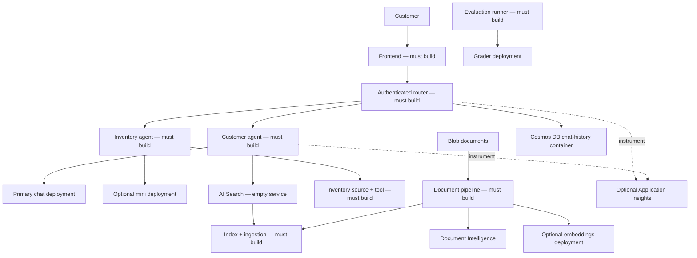

# মাল্টি-এজেন্ট কাস্টমার সাপোর্ট — রিটেইল আর্কিটেকচার ব্লুপ্রিন্ট

**অধ্যায় ৫: মাল্টি-এজেন্ট AI সমাধানসমূহ**

- [কোর্স হোম](../README.md)
- [অধ্যায় ৫](../docs/chapter-05-multi-agent/README.md)
- [প্রয়োজনীয়তা: AI ইন্টিগ্রেশন](../docs/chapter-02-ai-development/microsoft-foundry-integration.md)
- [পরবর্তী: ক্যাপাসিটি প্ল্যানিং](../docs/chapter-06-pre-deployment/capacity-planning.md)
- [ARM অবকাঠামো স্ক্যাফোল্ড](retail-multiagent-arm-template/README.md)

> **আর্কিটেকচার গাইড, একটি কার্যকরী অ্যাপ্লিকেশন নয়।** একমাত্র রিটেইল ইমপ্লিমেন্টেশন
> ফাইলসমূহ হল `azuredeploy.json`, `azuredeploy.parameters.json`, এবং `deploy.sh` যা
> `retail-multiagent-arm-template/` এ অবস্থিত। রাউটার/ফ্রন্টএন্ড কনটেইনারগুলি হলো হ্যালো-ওয়ার্ল্ড
> প্লেসহোল্ডার। কোন রিটেইল এজেন্ট, UI, ইনজেশন পাইপলাইন, ইভ্যালুয়েটর, স্ক্যানার, অথবা
> অ্যাপ্লিকেশন টেস্ট স্যুট স্থানীয়ভাবে বিদ্যমান নেই।

## সারসংক্ষেপ

**লক্ষ্য:** একটি কাস্টমার-সাপোর্ট সিস্টেম ডিজাইন করা যেখানে একটি কাস্টমার এজেন্ট এবং একটি ইনভেন্টরি
এজেন্ট থাকবে, অবকাঠামো যেসব সেবা প্রদান করে তা চিহ্নিত করা, এবং অনুপস্থিত অ্যাপ্লিকেশন
চুক্তি ও যাচাই পরিকল্পনা করা।

**প্রেক্ষিত:** ডেভেলপার যারা স্থানীয়
[চ্যাট স্যাম্পল](../../../examples/azure-openai-chat) এবং [দ্বি-সেবা কনটেইনার স্যাম্পল](../../../examples/container-app/microservices) সম্পন্ন করেছেন।
২–৩ ঘণ্টা সময় দিন আর্কিটেকচার অধ্যয়নের জন্য। অ্যাপ্লিকেশন নির্মাণ একটি পৃথক
প্রকল্প: অভিজ্ঞ ডেভেলপারদের জন্য প্রায় ৮০–১২০ ডেভেলপমেন্ট ঘণ্টার একটি পরিকল্পনামূলক অনুমান,
**কোন ডেলিভারি প্রতিশ্রুতি নয়**; প্রোডাকশন হার্ডেনিং, টেস্ট, সিকিউরিটি পর্যালোচনা,
এবং অপারেশন অতিরিক্ত কাজ প্রয়োজন।

### শেখার ফলাফল

- রাউটিং, গ্রাউন্ডিং, টুল অনুমতি, এবং কথোপকথন মালিকানা ব্যাখ্যা করা।
- মডেল সনাক্তকারী, ডিপ্লয়মেন্ট নাম, API সংস্করণ, এবং ARM সংস্করণ পার্থক্য করা।
- ডকুমেন্ট ইনজেশন এবং পুনরুদ্ধার ডিজাইন করা মিলমান ভেক্টর মাত্রা সহ।
- যাচাইযোগ্য কার্যকরী, মূল্যায়ন, এবং ব্যর্থতা-সংশোধন প্রয়োজনীয়তা সংজ্ঞায়িত করা।
- ঐচ্ছিক আর্কিটেকচার লক্ষ্য পৃথক করা যা বাস্তবে প্রোভিশনকৃত রিসোর্স থেকে আলাদা।

## সমাধান আর্কিটেকচার



এটি একটি **টার্গেট অ্যাপ্লিকেশন আর্কিটেকচার**, চলছে এমন এজেন্ট সেবাসমূহের চিত্র নয়।
ARM স্ক্যাফোল্ড কেবল মুলভিত্তিক সেবা এবং দুটি প্লেসহোল্ডার
কনটেইনার তৈরি করে। ফ্রন্ট ডোর, রেজিস্ট্রি, ম্যানেজড পরিচিতি, রোল অ্যাসাইনমেন্ট,
প্রাইভেট এন্ডপয়েন্ট, ফেলওভার, অ্যাপ্লিকেশন ইনস্ট্রুমেন্টেশন এবং এলার্টগুলি অন্তর্ভুক্ত নয়।

### দায়িত্ব এবং চুক্তিসমূহ

| উপাদান | প্রয়োজনীয় আচরণ | সম্পূর্ণ হওয়ার প্রমাণ |
|---|---|---|
| ফ্রন্টএন্ড | ব্যবহারকারী পরিচয় নিশ্চিত করা, চ্যাট প্রদর্শন করা, নিরাপদে ডকুমেন্ট আপলোড | UI ও আপলোড পরীক্ষা, প্রবেশযোগ্য ত্রুটি |
| রাউটার | অনুরোধ অনুমোদন, এজেন্ট নির্বাচন, সীমাবদ্ধ টুল কল/টাইমআউট | রাউটিং পরীক্ষা, অনুমোদন যাচাই, ব্যর্থতা পরীক্ষা |
| কাস্টমার এজেন্ট | অনুমোদিত উৎসে নীতি/পণ্য উত্তর গ্রাউন্ড করা | সঠিক উদ্ধৃতি, ডেটা অনুপস্থিত হলে বিরতি রাখা |
| ইনভেন্টরি টুল | স্কোপড অনুমতিসহ কর্তৃত্বপূর্ণ স্টক পড়া | নির্দিষ্ট স্টক পরীক্ষা; প্রাপ্তির কল্পনা নয় |
| ডকুমেন্ট পাইপলাইন | উত্তোলন, ভাগ, এমবেড, সূচকরণ, আপডেট/মুছে ফেলা | সূচিকৃত ফিক্সচার এবং পুনরায় চেষ্টা/ডেড-লেটার আচরণ |
| কথোপকথন সংরক্ষণ | ব্যবহারকারী বিচ্ছিন্নকরণ, রিটেনশন প্রয়োগ | ক্রস-ইউজার অনুমোদন এবং TTL পরীক্ষা |
| মূল্যায়ন রানার | আউটপুট তুলনা করা গ্রাউন্ড ট্রুথ এবং রুব্রিকের সঙ্গে | কাভারেজ, ব্যর্থতার সংখ্যা, পুনরুত্পাদনযোগ্য রিপোর্ট |

রাউটারকে একটি রিসেপশন ডেস্ক এবং টুলসমূহকে সীমাবদ্ধ আভ্যন্তরীণ সিস্টেম হিসেবে ভাবুন:
একজন বিশেষজ্ঞ নির্বাচিত করা মানে প্রতিটি গ্রাহকের রেকর্ডে প্রবেশাধিকার নয়।
পরিচয় এবং অনুমতি অ্যাপ্লিকেশন কোড ও ডেটা সেবায় প্রয়োগ করুন, প্রম্পট নয়।

## অবকাঠামো বনাম অ্যাপ্লিকেশন

প্রোভিশন করার আগে [স্ক্যাফোল্ড README](retail-multiagent-arm-template/README.md) পড়ুন।
এটি সঠিক সম্পদ, মোড, ব্যয় এবং সীমাবদ্ধতার তালিকা দেয়।

| যৌক্তিক ব্যবহার | ARM ডেপ্লয়মেন্ট নাম | মডেল / সংস্করণ | ডিফল্ট অঞ্চল |
|---|---|---|---|
| গ্রাহক চ্যাট | `gpt-4.1-chat` | `gpt-4.1` / `2025-04-14` | `eastus2` |
| ইনভেন্টরি | `gpt-4.1-mini-inventory` | `gpt-4.1-mini` / `2025-04-14` | `westus2`, ঐচ্ছিক |
| এমবেডিংস | `text-embedding-ada-002` | `text-embedding-ada-002` / `2` | `francecentral`, ঐচ্ছিক |
| মূল্যায়ন | `gpt-4.1-grader` | `gpt-4.1` / `2025-04-14` | ডিফল্টরূপে প্রাথমিক অঞ্চল |

**প্রতিটি অঞ্চলে** মডেল/সংস্করণ/SKU উপলব্ধতা এবং কোটা পরীক্ষা করুন। চ্যাট/মিনি/গ্রেডার
`GlobalStandard` ব্যবহার করে; এমবেডিংস `Standard` ব্যবহার করে। ক্যাপাসিটি-ইউনিট-টু-TPM ম্যাপিং
মডেল-নির্দিষ্ট। সার্বজনীন কোটা গ্যারান্টি হিসেবে অসম ক্যাপাসিটি ইউনিট যোগ করবেন না।

একটি Azure OpenAI অনুরোধের `model` আর্গুমেন্ট হল **ডিপ্লয়মেন্ট নাম**, অবশ্যই ক্যাটালগ মডেল পরিচায়ক নয়।
ডেটা-প্লেন API সংস্করণ `2024-10-21`
মডেল সংস্করণ `2025-04-14` এবং ARM রিসোর্স `apiVersion` থেকে আলাদা।
কেউ কেবল ডেটা-প্লেন API সংস্করণ পরিবর্তন করে অনুপলভ্য মডেল ঠিক করতে পারেন না।

`--no-multi-region` সেকেন্ডারি এবং এমবেডিংস অ্যাকাউন্টগুলি এড়িয়ে যায়। একটি প্রাথমিক চ্যাট এবং
স্বাধীন গ্রেডার অ্যাকাউন্ট থাকে। পৃথক মডেল অ্যাকাউন্টগুলি স্বয়ংক্রিয়
ফেলওভার প্রদান করে না; এর জন্য প্রয়োজন অ্যাপ্লিকেশন রাউটিং, সামঞ্জস্যপূর্ণ ডিপ্লয়মেন্ট, হেলথ চেক,
রিট্রি সীমা এবং ডেটা-রেসিডেন্সি পর্যালোচনা।

## বাস্তবায়ন রাস্তা মানচিত্র

### 1. একটি পরীক্ষা করা ইন্টারঅ্যাকশনে দিয়ে শুরু করুন

বড় স্ক্যাফোল্ড প্রদান করার আগে, লোকাল চ্যাট স্যাম্পল ব্যবহার করে
ইনফারেন্স সংযোগ স্থাপন করুন। একটি প্রতিনিধিত্বমূলক গ্রাহক প্রশ্ন, অনুমোদিত
উত্তর উৎস, প্রত্যাশিত উদ্ধৃতি, এবং সেই উৎস অনুপস্থিত হলে ব্যর্থতার আচরণ সংজ্ঞায়িত করুন।

### 2. রাউটিং এবং টুল সীমাবদ্ধতা সংজ্ঞায়িত করুন

আপনার নিজস্ব রাউটার উৎস, ডিপেনডেন্সি ম্যানিফেস্ট, ডকরফাইল এবং পরীক্ষা তৈরি করুন। একটি
উদাহরণমূলক চুক্তি হতে পারে `POST /chat` সহ `{"message":"...","conversation_id":"..."}`।
**সেই এন্ডপয়েন্ট একটি নকশা প্রস্তাব; এটি ARM টেমপ্লেট দ্বারা বাস্তবায়িত নয়।**

বডি টাইপ/সীমা যাচাই করুন, প্রমাণীকরণ থেকে ব্যবহারকারী পরিচয় নির্ধারণ করুন, আলাপচারিতার মালিকানা প্রয়োগ করুন,
অনুরোধ টাইমআউট প্রয়োগ করুন এবং অর্থপূর্ণ ত্রুটি কোড ফেরত দিন।
HTTP ব্যর্থতা বা খালি উত্তরে সফল এজেন্ট ফলাফল হিসেবে বিবেচনা করবেন না।

### 3. গ্রাউন্ডিং এবং ইনজেশন বাস্তবায়ন করুন

ARM টেমপ্লেট একটি সার্চ ইনডেক্স তৈরি করে না। এটি একটি **রেফারেন্স JSON
অংশ যা আপনার নিজের ইনডেক্স সংজ্ঞায়নে মানিয়ে নিতে হবে**, রিপোতে ইতিমধ্যেই থাকা ফাইল নয়:

```json
{
  "name": "retail-product-index",
  "fields": [
    {"name": "id", "type": "Edm.String", "key": true},
    {"name": "title", "type": "Edm.String", "searchable": true},
    {"name": "content", "type": "Edm.String", "searchable": true},
    {"name": "category", "type": "Edm.String", "filterable": true},
    {
      "name": "content_vector",
      "type": "Collection(Edm.Single)",
      "searchable": true,
      "dimensions": 1536,
      "vectorSearchProfile": "retail-profile"
    }
  ],
  "vectorSearch": {
    "algorithms": [{"name": "retail-hnsw", "kind": "hnsw"}],
    "profiles": [{"name": "retail-profile", "algorithm": "retail-hnsw"}]
  }
}
```

প্রোফাইল ভেক্টর ক্ষেত্রের সাথে তার অ্যালগরিদম সংযুক্ত করে। মাত্রাগুলি
আসল এমবেডিং আউটপুটের সাথে মেল থাকতে হবে (এই `ada-002` ডিপ্লয়মেন্টের জন্য ১৫৩৬)। পাইথন রিট্রিভালের জন্য,
অসম্পূর্ণ একটি অভিধান যার ভেক্টর অনুসন্ধান ধরনের অভাব রয়েছে, তার পরিবর্তে `azure.search.documents.models.VectorizedQuery` ব্যবহার করুন:


```python
# Reference function only: supply an authenticated async SearchClient and an embedding.
from azure.search.documents.models import VectorizedQuery

async def retrieve(search_client, embedding):
    results = await search_client.search(
        search_text=None,
        vector_queries=[VectorizedQuery(
            vector=embedding,
            k_nearest_neighbors=5,
            fields="content_vector"
        )],
        select=["id", "title", "content"]
    )
    return [document async for document in results]
```

একটি আলাদা ইনজেশন ইমপ্লিমেন্টেশন তৈরি করুন যা:

1. আপলোড অ্যাকসেস অনুমোদন করে এবং কনটেন্ট টাইপ ও আকার যাচাই করে।
2. প্রাইভেট ব্লবগুলি প্রমাণীকৃত SDK কল ব্যবহার করে পড়ে। একটি প্রাইভেট ব্লব URL নিজেই
   কোনো Document Intelligence ইনপুট হিসাবে **পঠনযোগ্য নয়**; ডাউনলোড করা বাইটগুলি পাঠান
   `AnalyzeDocumentRequest(bytes_source=...)` সহ অথবা উপযুক্ত সীমাবদ্ধ,
   স্বল্প-মেয়াদি SAS ব্যবহার করুন প্রবেশাধিকার শর্তাবলী পর্যালোচনার পরে।
3. টেক্সট বের করে, এম্বেডিংস সীমার মধ্যে ফিট করার জন্য চাঙ্ক করে, এবং এম্বেডিং তৈরি করে।
4. স্থিতিশীল বৈধ ডকুমেন্ট কী তৈরি করে এবং মেলানো ভেক্টরসহ চাঙ্ক আপলোড করে।
5. প্রতিটি ডকুমেন্টের ইনডেক্সিং ফলাফল পরীক্ষা করে, পুনঃপ্রচেষ্টা পরিচালনা করে এবং পুরাতন ডেটা হালনাগাদ/মুছে ফেলে।

যে কোনো ব্যবহারকারী কী/মান OData ফিল্টারে ইন্টারপোলেট করবেন না। ক্ষেত্রগুলিকে অনুমোদিত তালিকাভুক্ত করুন,
মানের প্রকার যাচাই করুন, এবং স্ট্রিং উদ্ধৃতি পালাই করুন। বুলিয়ান এবং সংখ্যাগত ফিল্টারের জন্য টাইপযুক্ত লিটারেল দরকার, উদ্ধৃত স্ট্রিং নয়।


### 4. ওয়েব গ্রাউন্ডিং

**বিং সার্চ v7 ১১ আগস্ট, ২০২৫-এ অবসর গ্রহণ করেছে।** পুরানো `Microsoft.Bing/accounts`
রিসোর্স এবং `api.bing.microsoft.com/v7.0/search` উদাহরণগুলি সমর্থিত
ইমপ্লিমেন্টেশন পাথ নয়। Microsoft Foundry এবং এর SDK, পারমিশন, বিলিং, এবং উদ্ধৃতি শর্তাবলী নিয়ে বর্তমানে সমর্থিত গ্রাউন্ডিং ইন্টিগ্রেশন মূল্যায়ন করুন;
এখানে কোনোটি আর ইমপ্লিমেন্ট করা হয়নি। এটি অবসরপ্রাপ্ত এন্ডপয়েন্টের জন্য সরাসরি প্রতিস্থাপন নয়।


### 5. টেলিমেট্রি এবং মূল্যায়ন যোগ করুন

Application Insights তৈরি করা মানে কোডে ইন্সট্রুমেন্টেশন নয়। নতুন অ্যাপ্লিকেশন তৈরি করার সময় সমর্থিত Azure Monitor
OpenTelemetry ইন্সট্রুমেন্টেশন ব্যবহার করুন, সার্ভিসগুলোর মধ্যে ট্রেস কনটেক্সট প্রোপাগেট করুন, এবং গ্রাহকের প্রম্পট, ডকুমেন্ট বা গোপনীয় তথ্য লগ করতে বিরত থাকুন।
একটি অনুসন্ধান সংক্ষিপ্ত করা মানে এটি **ননামিবাইজড** নয়।


অনুরোধের সময়কাল, রাউটিং/টুলের ব্যর্থতা, অনুসন্ধানের সম্পর্কিততা, উদ্ধৃতির সঠিকতা, টোকেন ব্যবহার, এবং বিরতিহীনতা মাপুন। মূল্যায়ন কেসের সাথে প্রামাণিক ইন্টেন্টরি/নীতিগত তথ্য সংরক্ষণ করুন: শুধুমাত্র একটি প্রশ্ন ও উত্তর থেকে একজন গ্রেডার নির্ভরযোগ্যভাবে তথ্যগত সঠিকতা নির্ধারণ করতে পারেন না।


একটি গ্রেডার ডিপ্লয়মেন্ট কোনো মূল্যায়ন রানার নয়। একটি সংস্করণযুক্ত রুব্রিক,
কাঠামোবদ্ধ আউটপুট/স্কিমা যাচাই, স্কোর-পরিধির চেক, ট্রান্সপোর্ট ব্যর্থতার গণনা,
এবং মানব-পর্যালোচনার কেস ইমপ্লিমেন্ট করুন। অসম্পূর্ণ/ত্রুটিপূর্ণ কেস আলাদাভাবে রিপোর্ট করুন; সেগুলিকে সফল গ্রেডে পরিণত করবেন না বা নিঃশব্দে শূন্য-মানের মডেল প্রতিক্রিয়া হিসেবে অন্তর্ভুক্ত করবেন না।


তদ্রুপ, কয়েকটি কীওয়ার্ড চেক সুরক্ষা প্রমাণীকরণ নয়। একটি ব্যর্থ HTTP
অনুরোধ, অনুপস্থিত পরীক্ষার কৌশল, বা শূন্য প্রতিক্রিয়া একটি পরীক্ষা **অস্পষ্ট বা ব্যর্থ** হওয়া উচিত, “১০০% সুরক্ষিত” স্কোর পাওয়া নয়। অনুমোদিত পরীক্ষা প্রয়োজনীয় উপকরণ ও মানবীয় পর্যালোচনার মাধ্যমে চালান কোন প্রোডাকশন-রেডিনেস দাবি করার আগে।


### 6. আপনার অ্যাপ্লিকেশন ডিপ্লয় করুন

আপনার নিজস্ব সোর্স ডিরেক্টরি, ম্যানিফেস্ট, টেস্ট, রেজিস্ট্রি, এবং ইমেজ-পুল অনুমতিসমূহ তৈরি করুন। প্লেসহোল্ডার প্রতিস্থাপন করুন নির্মিত ইমেজ দিয়ে এবং প্রতিটি অ্যাপের শুনার পোর্ট অনুযায়ী ইঙ্গ্রেস/প্রোব আপডেট করুন। ব্যাচ বা স্পষ্ট সমর্থিত azd এনভায়রনমেন্ট ম্যাপিংয়ের মাধ্যমে রানটাইম পরিবেশ ভেরিয়েবল কনফিগার করুন।


azd সার্ভিসের অধীনে কোনও সাধারণ `config` ডিকশনারি নেই যা স্বয়ংক্রিয়ভাবে
রানটাইম পরিবেশের পরিবর্তনশীল তৈরি করে। `azd env set` শুধুমাত্র সেই সংস্থানগুলো পরিবর্তন করে যেগুলো
স্পষ্টভাবে ঐ মানগুলো ব্যবহার করে। এই স্ক্যাফোল্ডে কোনও ক্যানারি, অঞ্চল তালিকা, অথবা সূক্ষ্ম-সর্বশেষ হুক
বাস্তবায়িত হয়নি।

## ব্যবহারিক নকশা অনুশীলনসমূহ

এগুলো **আর্কিটেকচার অনুশীলন**, কার্যকরী খুচরা স্টার্টার কোডের দাবি নয়।

### অনুশীলন ১: সীমানা যাচাই করুন

**শুরু পয়েন্ট:** `retail-multiagent-arm-template/` এর তিনটি ফাইল।
**লক্ষ্য:** প্রোভিশনিং এবং অ্যাপ্লিকেশন কার্যকারিতা পৃথককরণ করা।
`azuredeploy.json` খুলুন, উভয় কন্টেইনার ইমেজ এবং `targetPort` মানগুলি সনাক্ত করুন,
তারপর রিপোজিটরিতে অনুপস্থিত অ্যাপ্লিকেশন উপাদানগুলি তালিকাভুক্ত করুন।

**সফলতার মানদণ্ড / উত্তর:** উভয় ইমেজই হলো-ওয়ার্ল্ড প্লেসহোল্ডার যা পোর্ট ৮০ এ শুনছে;
এজেন্ট, চ্যাট UI, রাউটার হ্যান্ডলার, ইনডেক্স/ইনজেশন, ইভ্যালুয়েটর, এবং স্ক্যানার অনুপস্থিত।
একটি সফল প্লেসহোল্ডার রুট অনুরোধ `/chat` যাচাই করে না।
**সাধারণ সমস্যা:** সংস্থান নামগুলিকে যেমন `retail-router` কার্যকর কোড হিসাবে ব্যাখ্যা করা।

### অনুশীলন ২: ভেক্টর কনফিগারেশন ট্রেস করুন

**শুরু পয়েন্ট:** উপরের ইনডেক্স JSON।
**লক্ষ্য:** ফিল্ড → প্রোফাইল → অ্যালগরিদম সম্পর্ক বোঝা।
কোন মানগুলো পরিবর্তন করতে হবে যখন বিভিন্ন আউটপুট ডাইমেনশনের এম্বেডিং মডেলে সুইচ করবেন তা চিহ্নিত করুন,
তারপর `retrieve` ফাংশনটি পরিদর্শন করুন।

**সফলতার মানদণ্ড / উত্তর:** ফিল্ড `dimensions` প্রকৃত ভেক্টর দৈর্ঘ্যে পরিবর্তন করুন;
`vectorSearchProfile` একটি ঘোষিত প্রোফাইল এবং এর অ্যালগরিদমের সাথে সঙ্গতি রাখুন;
`fields` কোয়েরিটি অবশ্যই ভেক্টর ফিল্ডের নাম হতে হবে। এম্বেডিং মডেল পরিবর্তিত হলে বিদ্যমান ডকুমেন্ট ভেক্টরগুলি পুনর্নির্মাণ করুন।
**সাধারণ সমস্যা:** শুধুমাত্র মডেল নাম পরিবর্তন করা কিন্তু অসমর্থনীয় ভেক্টরগুলি রাখা।


### অনুশীলন ৩: একটি ব্যর্থতা পরীক্ষা সংজ্ঞায়িত করুন

**শুরু পয়েন্ট:** দায়িত্ব টেবিল।
**লক্ষ্য:** মিথ্যা সাফল্য প্রতিরোধ করা।
একটি অনুপলব্ধ ইনভেন্টরি API, কোনও মেলে এমন ডকুমেন্ট ছাড়া একটি সার্চ ইনডেক্স, এবং HTTP 503 ফেরত দেওয়া একটি মূল্যায়ন অনুরোধের জন্য প্রত্যাশিত আচরণ লিখুন।


**সাধারণ সমস্যা:** প্রতিটি ব্যতিক্রম ধরা এবং একটি খালি উত্তরের সাথে চালিয়ে যাওয়া।

## খরচ, সমস্যা সমাধান, এবং পরিস্কার


## খরচ, সমস্যার সমাধান, এবং পরিষ্কার-পরিচ্ছন্নতা

- অবকাঠামোর চলমান খরচ থাকে এমনকি খালি সার্চ ইনডেক্স এবং প্লেসহোল্ডার
  অ্যাপগুলির ক্ষেত্রেও। বর্তমান আঞ্চলিক মূল্য ব্যবহার করুন; “মিনিমাল” বা মাল্টি-রিজিয়ন কোনোটাই নিখরচায় বোঝায় না।
- টোকেনের খরচ নির্ভর করে মডেল, ক্যাশ করা/ক্যাশ না করা ইনপুট, আউটপুট, এবং ডিপ্লয়মেন্ট SKU-এর উপর।
  রাউটিং তখনই অর্থ সাশ্রয় করতে পারে যখন পরিমাপ করা ওয়ার্কলোড এবং গুণগত ফলাফল তা ন্যায্য প্রমাণ করে;
  একটি নির্দিষ্ট ৬০-৮০% সাশ্রয় গ্যারান্টিযুক্ত নয়।
- প্রোভিশনিং করার আগে মডেল উপলব্ধতা এবং কোটা পরীক্ষা করুন; পারমিশন,
  ডিপ্লয়মেন্ট-নাম, অঞ্চল, মডেল-সংস্করণ, এবং API-সংস্করণ ত্রুটিগুলি আলাদা করুন।
- অনুপস্থিত `setup-data.sh`, evaluator CLI অথবা `pytest tests/` কমান্ডগুলি চালাবেন না।
  এগুলির বাস্তবায়ন আপনার ডেভেলপমেন্ট ব্যাকলগের অংশ।
- স্ক্যাফোল্ড শুধুমাত্র ARM-অনুমোদিত: এর
  [যাচাই এবং পরিষ্কারের নির্দেশাবলী](retail-multiagent-arm-template/README.md) অনুসরণ করুন।
  `azd down` ঐ রিসোর্সগুলি পরিচালনা করে না।

## সম্পর্কিত রিসোর্সসমূহ

- [কার্যকরী লোকাল চ্যাট উদাহরণ](../../../examples/azure-openai-chat)
- [কার্যকরী দুটি-সার্ভিস কনটেইনার উদাহরণ](../../../examples/container-app/microservices)
- [AI সার্চ ভেক্টর ইনডেক্সসমূহ](https://learn.microsoft.com/azure/search/vector-search-how-to-create-index)
- [কনটেইনার অ্যাপস ডকুমেন্টেশন](https://learn.microsoft.com/azure/container-apps/)
- [সমস্যা সমাধান](../docs/chapter-07-troubleshooting/common-issues.md)
- [একটি সমস্যা রিপোর্ট করুন](https://github.com/microsoft/AZD-for-beginners/issues)

---

<!-- CO-OP TRANSLATOR DISCLAIMER START -->
**অস্বীকৃতি**:
এই নথিটি AI অনুবাদ পরিষেবা [Co-op Translator](https://github.com/Azure/co-op-translator) ব্যবহার করে অনূদিত হয়েছে। যদিও আমরা শুদ্ধতার জন্য চেষ্টা করি, অনুগ্রহ করে মনে রাখবেন যে স্বয়ংক্রিয় অনুবাদে ত্রুটি বা অসঙ্গতি থাকতে পারে। মূল নথিটি তার স্বভাষায় কর্তৃত্বপূর্ণ উৎস হিসেবে বিবেচিত হওয়া উচিত। গুরুত্বপূর্ণ তথ্যের জন্য পেশাদার মানব অনুবাদ সুপারিশ করা হয়। এই অনুবাদের ব্যবহারে প্রয়োজনীয় ভুল বোঝাবুঝি বা ভুল ব্যাখ্যার জন্য আমরা দায়বদ্ধ নই।
<!-- CO-OP TRANSLATOR DISCLAIMER END -->