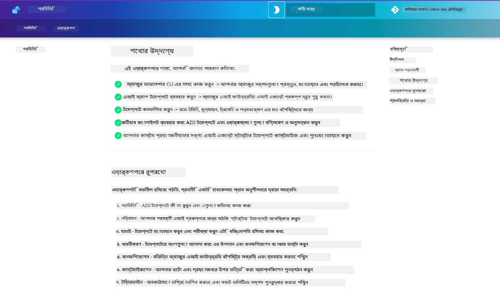

<div align="center">
  <div style="background: linear-gradient(135deg, #0078d4, #106ebe); border-radius: 10px; padding: 20px; margin: 20px 0; box-shadow: 0 4px 15px rgba(0, 120, 212, 0.3); border: 2px solid #005a9e;">
    <h2 style="color: white; margin: 0; font-size: 24px; text-shadow: 1px 1px 2px rgba(0,0,0,0.3);">
      🎯 AI ডেভেলপারদের জন্য AZD কর্মশালা
    </h2>
    <p style="color: white; margin: 10px 0 0 0; font-size: 16px; text-shadow: 1px 1px 2px rgba(0,0,0,0.3);">
      <strong>Azure Developer CLI ব্যবহার করে AI অ্যাপ্লিকেশন তৈরির জন্য একটি হাতে কলমে কর্মশালা।</strong><br>
      AZD টেমপ্লেট এবং AI ডিপ্লয়মেন্ট ওয়ার্কফ্লো সম্পন্ন করতে ৭টি মডিউল।
    </p>
    <div style="margin-top: 15px;">
      <span style="background: rgba(255,255,255,0.2); padding: 5px 10px; border-radius: 15px; color: white; font-size: 14px;">
        📅 উত্স নির্দেশিকা পর্যালোচিত: নভেম্বার ২০২৬
      </span>
    </div>
  </div>
</div>

# AI ডেভেলপারদের জন্য AZD কর্মশালা

Azure Developer CLI (AZD) শেখার জন্য এই হাতে কলমে কর্মশালায় আপনাকে স্বাগতম, যেখানে AI অ্যাপ্লিকেশন ডিপ্লয়মেন্টে ফোকাস করা হয়েছে। এই কর্মশালাটি আপনাকে ৩ ধাপে AZD টেমপ্লেটের ব্যবহারিক ধারণা প্রদান করবে:

1. **আবিষ্কার** - আপনার জন্য সঠিক টেমপ্লেট খুঁজে বের করুন।
1. **ডিপ্লয়মেন্ট** - ডিপ্লয় করে যাচাই করুন যে এটি কাজ করছে
1. **কাস্টমাইজেশন** - পরিমার্জন করুন এবং এটি আপনার মতো তৈরি করুন!

এই কর্মশালার সময়, আপনাকে মূল ডেভেলপার টুলস এবং ওয়ার্কফ্লো পরিচয় করানো হবে, যা আপনাকে সম্পূর্ণ উন্নয়ন যাত্রা সুচারুভাবে পরিচালনা করতে সাহায্য করবে।

<br/>

## ব্রাউজার-ভিত্তিক গাইড

কর্মশালার পাঠগুলি Markdown এ রয়েছে। আপনি সেগুলো সরাসরি GitHub-এ ব্রাউজ করতে পারেন - অথবা নিচের স্ক্রিনশটের মত ব্রাউজার-ভিত্তিক প্রিভিউ চালু করতে পারেন।



এই বিকল্পটি ব্যবহার করতে - রিপোজিটরিটি আপনার প্রোফাইলে ফর্ক করুন এবং GitHub Codespaces চালু করুন। একবার VS Code টার্মিনাল সক্রিয় হলে, এই কমান্ডটি টাইপ করুন:

এই ব্রাউজার প্রিভিউ GitHub Codespaces, dev containers, অথবা স্থানীয় ক্লোনে Python ও MkDocs ইনস্টল দিয়ে কাজ করে।

```bash title="" linenums="0"
python -m pip install -r requirements-dev.txt
python -m mkdocs serve --config-file workshop/mkdocs.yml
```

এই কমান্ডসমূহ চালান **কোর্স রিপোজিটরি রুট থেকে**, পৃথকভাবে ইনিশিয়ালাইজ করা AI স্যাম্পল থেকে নয়। প্রিভিউটি সামনের দিকে রাখুন যাতে ত্রুটি দৃশ্যমান থাকে; বন্ধ করতে Ctrl+C চাপুন। সাইট সার্ভ না করে চেক করতে, `python -m mkdocs build --strict --config-file workshop/mkdocs.yml` চালান।

কয়েক সেকেন্ডের মধ্যে, একটি পপ-আপ ডায়ালগ দেখতে পাবেন। বিকল্প নির্বাচন করুন `Open in browser`। ওয়েব-ভিত্তিক গাইড এখন নতুন ব্রাউজার ট্যাবে খুলবে। এই প্রিভিউর কিছু সুবিধা:

1. **বিল্ট-ইন সার্চ** - দ্রুত কীওয়ার্ড বা পাঠ্য খুঁজুন।
1. **কপি আইকন** - কোডব্লকে হোভার করলে এই অপশন দেখতে পাবেন
1. **থিম টগল** - ডার্ক এবং লাইট থিমের মধ্যে পরিবর্তন করুন
1. **সহায়তা পান** - ফুটারে Discord আইকনে ক্লিক করে যুক্ত হন!

<br/>

## কর্মশালা সংক্ষিপ্ত বিবরণ

**সময়কাল:** ৩-৪ ঘণ্টা  
**স্তর:** শুরু থেকে মধ্যম  
**পূর্বশর্ত:** Azure, AI ধারণা, VS Code ও কমান্ড-লাইন টুল সম্পর্কে পরিচিতি।

এটি একটি হাতে কলমে কর্মশালা যেখানে আপনি করে শিখবেন। একবার আপনি অনুশীলনগুলি সম্পন্ন করলে, আমরা পরামর্শ দিচ্ছি AZD For Beginners কারিকুলাম পর্যালোচনা করতে যাতে সুরক্ষা এবং উৎপাদনশীলতার সর্বোত্তম অনুশীলনে আপনার শেখার যাত্রা চালিয়ে যেতে পারেন।

| সময়| মডিউল  | উদ্দেশ্য |
|:---|:---|:---|
| ১৫ মিনিট | [পরিচিতি](docs/instructions/0-Introduction.md) | সূচনা, লক্ষ্যমাত্রা বোঝা |
| ৩০ মিনিট | [AI টেমপ্লেট নির্বাচন](docs/instructions/1-Select-AI-Template.md) | বিকল্প পরীক্ষা এবং শুরু করা | 
| ৩০ মিনিট | [AI টেমপ্লেট যাচাই](docs/instructions/2-Validate-AI-Template.md) | Azure এ ডিফল্ট সমাধান স্থাপন |
| ৩০ মিনিট | [AI টেমপ্লেট বিশ্লেষণ](docs/instructions/3-Deconstruct-AI-Template.md) | গঠন ও কনফিগারেশন পর্যালোচনা |
| ৩০ মিনিট | [AI টেমপ্লেট কনফিগার](docs/instructions/4-Configure-AI-Template.md) | সক্রিয়করণ এবং উপলব্ধ বৈশিষ্ট্য চেষ্টা |
| ৩০ মিনিট | [AI টেমপ্লেট কাস্টমাইজ](docs/instructions/5-Customize-AI-Template.md) | আপনার চাহিদা অনুযায়ী টেমপ্লেট অভিযোজিত করুন |
| ৩০ মিনিট | [ইনফ্রাস্ট্রাকচার টিয়ারডাউন](docs/instructions/6-Teardown-Infrastructure.md) | পরিষ্কার এবং রিসোর্স মুক্ত করুন |
| ১৫ মিনিট | [সংক্ষিপ্ত উপসংহার ও পরবর্তী ধাপ](docs/instructions/7-Wrap-up.md) | শেখার সম্পদ, কর্মশালা চ্যালেঞ্জ |

<br/>

## আপনি কী শিখবেন

AZD টেমপ্লেটকে একটি শিক্ষণ স্যান্ডবক্স হিসাবে ভাবুন, যা Microsoft Foundry তে সম্পূর্ণ উন্নয়নের জন্য বিভিন্ন দক্ষতা এবং সরঞ্জাম অন্বেষণ করতে দেয়। এই কর্মশালার শেষে, আপনি প্রাসঙ্গিক টুল এবং ধারণাগুলোর প্রতি একটি স্বজ্ঞাত অনুভূতি অর্জন করবেন।

| ধারণা  | উদ্দেশ্য |
|:---|:---|
| **Azure Developer CLI** | টুল কমান্ড এবং ওয়ার্কফ্লো বোঝা|
| **AZD টেমপ্লেট**| প্রকল্প গঠন ও কনফিগারেশন বোঝা|
| **Azure AI এজেন্ট**| Microsoft Foundry প্রকল্প প্রোভিশন ও ডিপ্লয়মেন্ট  |
| **Azure AI সার্চ**| এজেন্টদের সাথে প্রসঙ্গ প্রকৌশল সক্ষম করা |
| **পর্যবেক্ষণযোগ্যতা**| ট্রেসিং, মনিটরিং এবং মূল্যায়ন অন্বেষণ |
| **রেড টিমিং**| বিরোধী পরীক্ষা এবং প্রশমন অন্বেষণ |

<br/>

## কর্মশালার কাঠামো

কর্মশালাটি এমনভাবে গঠিত হয়েছে যাতে আপনাকে টেমপ্লেট আবিষ্কার থেকে শুরু করে ডিপ্লয়মেন্ট, বিশ্লেষণ এবং কাস্টমাইজেশনের মাধ্যমে নিয়ে যাওয়া হয় - অফিসিয়াল [Getting Started with AI Agents](https://github.com/Azure-Samples/get-started-with-ai-agents) স্টার্টার টেমপ্লেট ব্যবহার করে।

### [মডিউল ১: AI টেমপ্লেট নির্বাচন](docs/instructions/1-Select-AI-Template.md) (৩০ মিনিট)

- AI টেমপ্লেট কী?
- AI টেমপ্লেট কোথায় পাবো?
- AI এজেন্ট তৈরি শুরু করব কীভাবে?
- **ল্যাব**: Codespaces বা dev container এ দ্রুত শুরু

### [মডিউল ২: AI টেমপ্লেট যাচাই](docs/instructions/2-Validate-AI-Template.md) (৩০ মিনিট)

- AI টেমপ্লেট আর্কিটেকচার কী?
- AZD উন্নয়ন ওয়ার্কফ্লো কী?
- AZD উন্নয়নে সহায়তা কীভাবে পাবো?
- **ল্যাব**: AI এজেন্ট টেমপ্লেট ডিপ্লয় এবং যাচাই

### [মডিউল ৩: AI টেমপ্লেট বিশ্লেষণ](docs/instructions/3-Deconstruct-AI-Template.md) (৩০ মিনিট)

- আপনার পরিবেশ অন্বেষণ করুন `.azure/` 
- আপনার রিসোর্স সেটআপ অন্বেষণ করুন `infra/` 
- আপনার AZD কনফিগারেশন অন্বেষণ করুন `azure.yaml`
- **ল্যাব**: পরিবেশ ভেরিয়েবল পরিবর্তন করুন ও পুনঃস্থাপন

### [মডিউল ৪: AI টেমপ্লেট কনফিগার](docs/instructions/4-Configure-AI-Template.md) (৩০ মিনিট)
- অন্বেষণ করুন: রিট্রিভাল অগমেন্টেড জেনারেশন
- অন্বেষণ করুন: এজেন্ট মূল্যায়ন ও রেড টিমিং
- অন্বেষণ করুন: ট্রেসিং ও মনিটরিং
- **ল্যাব**: AI এজেন্ট + পর্যবেক্ষণযোগ্যতা অন্বেষণ

### [মডিউল ৫: AI টেমপ্লেট কাস্টমাইজ](docs/instructions/5-Customize-AI-Template.md) (৩০ মিনিট)
- সংজ্ঞায়িত করুন: PRD সহ সিচুয়েশন চাহিদা
- কনফিগার করুন: AZD এর জন্য পরিবেশ ভেরিয়েবল
- বাস্তবায়ন করুন: অতিরিক্ত কাজের জন্য লাইফসাইকেল হুকস
- **ল্যাব**: আমার সিচুয়েশনের জন্য টেমপ্লেট কাস্টমাইজেশন

### [মডিউল ৬: ইনফ্রাস্ট্রাকচার টিয়ারডাউন](docs/instructions/6-Teardown-Infrastructure.md) (৩০ মিনিট)
- পুনঃসূচনা: AZD টেমপ্লেট কী?
- পুনঃসূচনা: কেন Azure Developer CLI ব্যবহার করবেন?
- পরবর্তী ধাপ: অন্য একটি টেমপ্লেট ট্রাই করুন!
- **ল্যাব**: ইনফ্রাস্ট্রাকচার ডিপ্রোভিশন এবং পরিষ্কার

<br/>

## কর্মশালা চ্যালেঞ্জ

আপনি কি নিজের সীমা পরীক্ষা করতে চান? এখানে কিছু প্রকল্পের পরামর্শ - অথবা আপনার আইডিয়া আমাদের সাথে শেয়ার করুন!!

| প্রকল্প | বর্ণনা |
|:---|:---|
|1. **একটি জটিল AI টেমপ্লেট বিশ্লেষণ করুন** | আমরা যে ওয়ার্কফ্লো এবং টুলস উল্লেখ করেছি তা ব্যবহার করে দেখুন আপনি কি অন্য একটি AI সলিউশন টেমপ্লেট ডিপ্লয়, যাচাই, এবং কাস্টমাইজ করতে পারেন। _আপনি কী শিখলেন?_|
|2. **আপনার সিচুয়েশন অনুযায়ী কাস্টমাইজ করুন**  | অন্য একটি সিচুয়েশনের জন্য PRD (প্রোডাক্ট রিকোয়ারমেন্টস ডকুমেন্ট) লিখে দেখুন। তারপরে GitHub Copilot ব্যবহার করে আপনার টেমপ্লেট রিপোতে Agent Model এ কাস্টমাইজেশন ওয়ার্কফ্লো জেনারেট করতে বলেন। _আপনি কী শিখলেন? এই পরামর্শগুলো কীভাবে উন্নত করা যেতে পারে?_|
| | |

## প্রতিক্রিয়া আছে?

1. এই রিপোতে একটি ইস্যু পোস্ট করুন - সুবিধার জন্য এটিকে `Workshop` ট্যাগ করুন।
1. Microsoft Foundry Discord এ যোগ দিন - আপনার সহকর্মীদের সাথে সংযোগ করুন!


| | | 
|:---|:---|
| **📚 কোর্স হোম**| [AZD ফর বিগিনার্স](../README.md)|
| **📖 ডকুমেন্টেশন** | [AI টেমপ্লেট নিয়ে শুরু করুন](https://learn.microsoft.com/en-us/azure/ai-foundry/how-to/develop/ai-template-get-started)|
| **🛠️AI টেমপ্লেট** | [Microsoft Foundry Templates](https://ai.azure.com/templates) |
|**🚀 পরবর্তী ধাপ** | [কর্মশালা শুরু করুন](#workshop-overview) |
| | |

<br/>

---

**নেভিগেশন:** [মূল কোর্স](../README.md) | [পরিচিতি](docs/instructions/0-Introduction.md) | [মডিউল ১: টেমপ্লেট নির্বাচন](docs/instructions/1-Select-AI-Template.md)

**AZD দিয়ে AI অ্যাপ্লিকেশন নির্মাণ শুরু করতে প্রস্তুত?**

[কর্মশালা শুরু করুন: পরিচিতি →](docs/instructions/0-Introduction.md)

---

<!-- CO-OP TRANSLATOR DISCLAIMER START -->
**অস্বীকৃতি**:
এই নথিটি AI অনুবাদ পরিষেবা [Co-op Translator](https://github.com/Azure/co-op-translator) ব্যবহার করে অনূদিত হয়েছে। যদিও আমরা শুদ্ধতার জন্য চেষ্টা করি, অনুগ্রহ করে মনে রাখবেন যে স্বয়ংক্রিয় অনুবাদে ত্রুটি বা অসঙ্গতি থাকতে পারে। মূল নথিটি তার স্বভাষায় কর্তৃত্বপূর্ণ উৎস হিসেবে বিবেচিত হওয়া উচিত। গুরুত্বপূর্ণ তথ্যের জন্য পেশাদার মানব অনুবাদ সুপারিশ করা হয়। এই অনুবাদের ব্যবহারে প্রয়োজনীয় ভুল বোঝাবুঝি বা ভুল ব্যাখ্যার জন্য আমরা দায়বদ্ধ নই।
<!-- CO-OP TRANSLATOR DISCLAIMER END -->