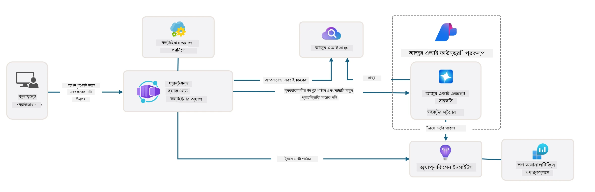

# ৩. একটি টেমপ্লেট ভাঙ্গা

!!! tip "এই মডিউলের শেষে আপনি সক্ষম হবেন"

    - [ ] Use GitHub Copilot and optional MCP tools for Azure documentation and read-only exploration
    - [ ] Identify the template's application, infrastructure, configuration, and test entry points
    - [ ] Verify generated explanations against actual repository files
    - [ ] **Lab 3:** Trace one request and one configuration input through the project

---

## ১. গিথাব কপাইলট সক্রিয় করা

VS Code এ ইনিশিয়ালাইজ করা AI নমুনাটি খুলুন এবং [GitHub Copilot](https://code.visualstudio.com/docs/copilot/chat/chat-agent-mode) সক্রিয় করুন। একটি উপযুক্ত পরিকল্পনার অ্যাকাউন্ট দিয়ে সাইন ইন করুন; ব্যবহারের সীমা পরিবর্তিত হয়। পরিবর্তন অনুমোদনের আগে কপাইলটকে রেপোজিটরি ব্যাখ্যা করতে বলুন।

### ঐচ্ছিক MCP সার্ভারসমূহ

এই সেবাগুলো অতিরিক্ত সরঞ্জাম সরবরাহ করতে পারে:

- [Azure MCP Server](https://learn.microsoft.com/azure/developer/azure-mcp-server/overview)
- [Microsoft Learn MCP Server](https://learn.microsoft.com/training/support/mcp)

VS Code এ, [MCP কনফিগারেশন নির্দেশিকা](https://code.visualstudio.com/docs/copilot/chat/mcp-servers) পর্যালোচনা করুন এবং প্রয়োজনে `.vscode/mcp.json` তৈরি করুন:

```json
{
  "servers": {
    "Azure MCP Server": {
      "type": "stdio",
      "command": "npx",
      "args": ["-y", "@azure/mcp@latest", "server", "start"]
    },
    "microsoft.docs.mcp": {
      "type": "http",
      "url": "https://learn.microsoft.com/api/mcp"
    }
  }
}
```

`npx` কমান্ড একটি সমর্থিত Node.js/npm ইনস্টলেশন প্রয়োজন এবং এক্সিকিউটেবল কোড ডাউনলোড করে। প্যাকেজটি পর্যালোচনা করুন এবং একটি অনুমোদিত সংস্করণ পিন করুন একটি পুনরুত্পাদনযোগ্য টিম সেটআপের জন্য। VS Code এর MCP নিয়ন্ত্রণ ব্যবহার করে সার্ভারগুলি চালু করুন এবং তাদের উপলব্ধ সরঞ্জাম পরিদর্শন করুন; নামগুলি সংস্করণগুলোর মধ্যে পরিবর্তিত হতে পারে।

**প্রমাণীকরণ আলাদা।** AZD এর জন্য `azd auth login` ব্যবহার করুন। Azure MCP এর ডকুমেন্টেড প্রমাণীকরণ প্রবাহ অনুসরণ করুন তাদের সরঞ্জামগুলোর জন্য; AZD লগইন একমাত্র MCP সেশন নিশ্চিত করে না। যখন একটি অনুশীলন বা হুক Azure CLI আহ্বান করে তখন আলাদাভাবে `az login` ব্যবহার করুন।

শুধুমাত্র-পড়ার প্রম্পট চেষ্টা করুন:

১. "Microsoft Learn MCP ব্যবহার করে Azure Developer CLI কনফিগারেশন ডকুমেন্টেশন খুঁজুন।"
২. "এই রেপোজিটরির `azure.yaml` ব্যাখ্যা করুন; প্রতিটি হুক বাস্তবায়ন করার ফাইলগুলো উল্লেখ করুন।"
৩. “উপলব্ধ Azure MCP সরঞ্জাম ব্যবহার করে, আমার মোতায়েন করা রিসোর্সগুলি তালিকাভুক্ত করুন কোনো পরিবর্তন ছাড়াই।"

নির্বাচিত টেনেন্ট/সাবস্ক্রিপশন এবং প্রতিটি প্রস্তাবিত সরঞ্জাম কল পরীক্ষা করুন। কেবলমাত্র স্থাপত্য অনুসন্ধানের জন্য রিসোর্স তৈরি, মুছা বা প্রবেশাধিকার পরিবর্তন অনুমোদন করবেন না।

## ২. আর্কিটেকচার বুঝুন

নমুনা একটি Python FastAPI ব্যাকএন্ড এবং Azure Container Apps এ React/TypeScript ফ্রন্টএন্ড হোস্ট করে। ব্যাকএন্ড একটি Microsoft Foundry প্রকল্পের এজেন্টের সাথে যোগাযোগ করে। পুনরুদ্ধার এবং পর্যবেক্ষণ সক্ষম টেমপ্লেট বৈশিষ্ট্য এবং সফল সেটআপের উপর নির্ভর করে; শুধুমাত্র অ্যাপ্লিকেশন মোতায়েনের কারণে তা গ্যারান্টিযুক্ত নয়।



এই ডায়াগ্রামটি [বর্তমান আপস্ট্রিম মোতায়েন নির্দেশিকা](https://github.com/Azure-Samples/get-started-with-ai-agents/blob/main/docs/deployment.md) এবং আপনার প্রকৃত রিসোর্সের সাথে তুলনা করুন। কনফিগারড মডেল মোতায়েন, এজেন্ট সরঞ্জাম, ব্যবস্থাপিত পরিচয়, ভূমিকা বরাদ্দ এবং ঐচ্ছিক AI Search/Application Insights রিসোর্স পরীক্ষা করুন।

**অনুশীলন:** কপাইলটকে বলুন ফ্রন্টএন্ড থেকে API মাধ্যমে Foundry পর্যন্ত একটি চ্যাট অনুরোধ ট্রেস করতে, ফাইল এবং ফাংশন রেফারেন্স সহ। ঐ রেফারেন্সগুলি খুলুন এবং ব্যাখ্যা যাচাই করুন। শুধুমাত্র একটি ডায়াগ্রাম থেকে বাস্তবায়িত প্রমাণীকরণ, রাউটিং বা অনুমোদন অনুমান করবেন না।

## ৩. রিপোজিটরি কাঠামো

নিম্নলিখিত নির্বাচিত পথগুলো ৪ নভেম্বর, ২০২৬ তারিখে নমুনার বিরুদ্ধে পরীক্ষা করা হয়েছে। আপনার ইনিশিয়ালাইজ করা সংস্করণ হলো সত্যের উৎস:

```text
get-started-with-ai-agents/
  azure.yaml
  docker-compose.yaml
  requirements-dev.txt
  .devcontainer/
  infra/
    main.bicep
    main.parameters.json
    api.bicep
    core/
  src/
    Dockerfile
    pyproject.toml
    requirements.txt
    api/
      main.py
      routes.py
      search_index_manager.py
    frontend/
      package.json
      src/
    files/
  scripts/
    validate_env_vars.sh
    validate_env_vars.ps1
    postdeploy.sh
    postdeploy.ps1
  tests/
    test_evaluation.py
    test_red_teaming.py
  docs/
    deployment.md
    deploy_customization.md
    ai_search.md
    observability.md
    local_development.md
    troubleshooting.md
```

### অবকাঠামো এবং কনফিগারেশন

`infra/main.bicep` রিসোর্স পরিচালনা করে; `main.parameters.json` টেমপ্লেট ইনপুটগুলিকে AZD পরিবেশ মানের সাথে সংযুক্ত করে। `azure.yaml` অ্যাপ্লিকেশন সেবা এবং লাইফসাইকেল হুক নির্বাচন করে। একটি ইনপুট যেমন `USE_AZURE_AI_SEARCH_SERVICE` এই ফাইলগুলোর মাধ্যমে অনুসরণ করুন দেখতে যা বাস্তবে পরিবর্তন করছে।

### অ্যাপ্লিকেশন এবং পরিচয়

`src/api/` এবং `src/frontend/` একসাথে পাঠ করুন। সনাক্ত করুন কোথায় এজেন্ট তৈরি বা পুনরুদ্ধার করা হয়, কোথায় নির্দেশাবলী/সরঞ্জাম কনফিগার করা হয়েছে, এবং প্রতিটি Azure কল কোন পরিচয় ব্যবহার করে। `src/files/`-এর অধীনে নমুনা ফাইলগুলোর ডেটা প্রদর্শনমূলক, পারদর্শিতার ক্যাটালগ বা অনুমোদন মডেল নয়।

### পরীক্ষানিরীক্ষা এবং পর্যবেক্ষণযোগ্যতা

বর্তমান মূল্যায়ন এবং রেড-টিমিং এন্টারিপয়েন্টসমূহ `tests/` এর অধীনে রয়েছে; পুরনো `evals/` এবং `airedteaming/` ডিরেক্টরি রেফারেন্স এই নমুনার জন্য স্থায়ী নয়। ক্লাউড পরীক্ষা চালানোর পূর্বে পূর্বশর্ত এবং খরচ জানতে `docs/observability.md` পড়ুন। এই Python পরীক্ষা ঐচ্ছিক `azure.ai.evaluations` AZD এক্সটেনশন থেকে পৃথক।

## ৪. আপনার তথ্য যাচাই করুন

- একটি নমুনা প্রশ্নের জন্য API রুট, এজেন্ট ইন্টার‌্যাকশন এবং পুনরুদ্ধার কোড সনাক্ত করুন।
- কোন পরিচয় Foundry অ্যাক্সেস করে এবং কোন কনফিগারেশন এর এন্ডপয়েন্ট নির্বাচন করে তা ব্যাখ্যা করুন।
- প্রকৃত প্রি-আপ এবং পোস্ট-ডিপ্লয় স্ক্রিপ্ট এবং তাদের ত্রুটি ব্যবস্থাপনার আচরণ খুঁজে বের করুন।
- আপনার মোতায়েন থেকে অনুপস্থিত নির্ভরতা বা ঐচ্ছিক বৈশিষ্ট্যগুলির তালিকা প্রস্তুত করুন।

চালিয়ে যান [একটি টেমপ্লেট কনফিগার করুন](4-Configure-AI-Template.md)।

---

<!-- CO-OP TRANSLATOR DISCLAIMER START -->
**অস্বীকৃতি**:
এই নথিটি AI অনুবাদ পরিষেবা [Co-op Translator](https://github.com/Azure/co-op-translator) ব্যবহার করে অনূদিত হয়েছে। যদিও আমরা শুদ্ধতার জন্য চেষ্টা করি, অনুগ্রহ করে মনে রাখবেন যে স্বয়ংক্রিয় অনুবাদে ত্রুটি বা অসঙ্গতি থাকতে পারে। মূল নথিটি তার স্বভাষায় কর্তৃত্বপূর্ণ উৎস হিসেবে বিবেচিত হওয়া উচিত। গুরুত্বপূর্ণ তথ্যের জন্য পেশাদার মানব অনুবাদ সুপারিশ করা হয়। এই অনুবাদের ব্যবহারে প্রয়োজনীয় ভুল বোঝাবুঝি বা ভুল ব্যাখ্যার জন্য আমরা দায়বদ্ধ নই।
<!-- CO-OP TRANSLATOR DISCLAIMER END -->