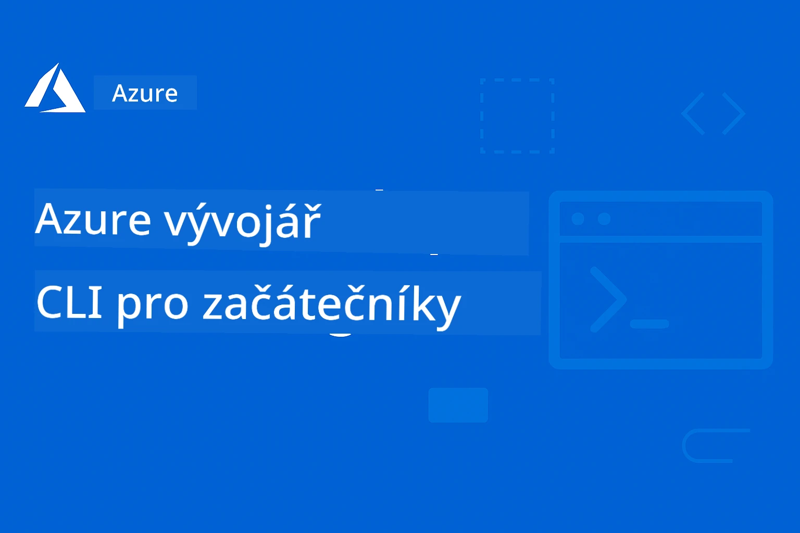

# AZD pro začátečníky: Strukturovaná učební cesta

 

[](https://GitHub.com/microsoft/azd-for-beginners/watchers/)
[](https://GitHub.com/microsoft/azd-for-beginners/network/)
[](https://GitHub.com/microsoft/azd-for-beginners/stargazers/)

[](https://discord.com/invite/nkVh3dp)
[](https://discord.gg/nTYy5BXMWG)

---

### Automatické překlady (vždy aktuální)

<!-- CO-OP TRANSLATOR LANGUAGES TABLE START -->
[Arabština](../ar/README.md) | [Bengálština](../bn/README.md) | [Bulharština](../bg/README.md) | [Barmština (Myanmar)](../my/README.md) | [Čínština (zjednodušená)](../zh-CN/README.md) | [Čínština (tradiční, Hong Kong)](../zh-HK/README.md) | [Čínština (tradiční, Macau)](../zh-MO/README.md) | [Čínština (tradiční, Taiwan)](../zh-TW/README.md) | [Chorvatština](../hr/README.md) | [Čeština](./README.md) | [Dánština](../da/README.md) | [Nizozemština](../nl/README.md) | [Estonština](../et/README.md) | [Finština](../fi/README.md) | [Francouzština](../fr/README.md) | [Němčina](../de/README.md) | [Řečtina](../el/README.md) | [Hebrejština](../he/README.md) | [Hindština](../hi/README.md) | [Maďarština](../hu/README.md) | [Indonéština](../id/README.md) | [Italština](../it/README.md) | [Japonština](../ja/README.md) | [Kannadština](../kn/README.md) | [Khmerština](../km/README.md) | [Korejština](../ko/README.md) | [Litevština](../lt/README.md) | [Malajština](../ms/README.md) | [Malayalam](../ml/README.md) | [Manipursky (Meitei Mayek)](../mni/README.md) | [Maráthština](../mr/README.md) | [Nepálština](../ne/README.md) | [Nigérijská pidžinština](../pcm/README.md) | [Norština](../no/README.md) | [Perština (Fársí)](../fa/README.md) | [Polština](../pl/README.md) | [Portugalština (Brazílie)](../pt-BR/README.md) | [Portugalština (Portugalsko)](../pt-PT/README.md) | [Paňdžábština (Gurmukhí)](../pa/README.md) | [Rumunština](../ro/README.md) | [Ruština](../ru/README.md) | [Srbština (cyrilice)](../sr/README.md) | [Slovenština](../sk/README.md) | [Slovinština](../sl/README.md) | [Španělština](../es/README.md) | [Svahilština](../sw/README.md) | [Švédština](../sv/README.md) | [Tagalog (Filipínština)](../tl/README.md) | [Tamilština](../ta/README.md) | [Telugština](../te/README.md) | [Thajština](../th/README.md) | [Turečtina](../tr/README.md) | [Ukrajinština](../uk/README.md) | [Urdu](../ur/README.md) | [Vietnamština](../vi/README.md)

> **Dáváte přednost lokálnímu klonování?**
>
> Tento repozitář obsahuje překlady do více než 50 jazyků, což výrazně zvyšuje velikost stahování. Pokud chcete klonovat bez překladů, použijte sparse checkout:
>
> **Bash / macOS / Linux:**
> ```bash
> git clone --filter=blob:none --sparse https://github.com/microsoft/AZD-for-beginners.git
> cd AZD-for-beginners
> git sparse-checkout set --no-cone '/*' '!translations' '!translated_images'
> ```
>
> **CMD (Windows):**
> ```cmd
> git clone --filter=blob:none --sparse https://github.com/microsoft/AZD-for-beginners.git
> cd AZD-for-beginners
> git sparse-checkout set --no-cone "/*" "!translations" "!translated_images"
> ```
>
> Tím získáte vše potřebné ke splnění kurzu s mnohem rychlejším stažením.
<!-- CO-OP TRANSLATOR LANGUAGES TABLE END -->

## 🆕 Co je dnes nového v azd

> 📌 Tento kurz je ověřen pro **`azd 1.27.1`** (červenec 2026). Spusťte `azd version` pro kontrolu svého sestavení, a `azd upgrade` pro získání nejnovější verze.

Azure Developer CLI se rozrostl nad tradiční webové aplikace a API. Dnes je azd jediný nástroj pro nasazení **jakékoli** aplikace do Azure — včetně aplikací poháněných AI a inteligentních agentů.

Co to pro vás znamená:

- **AI agenti jsou nyní plnohodnotné azd pracovní úlohy.** Můžete inicializovat, nasazovat a spravovat projekty AI agentů pomocí stejného `azd init` → `azd up` postupu, který už znáte.
- **Kompletní životní cyklus agenta z CLI.** Rozšíření `azure.ai.agents` nyní pokrývá celou cestu — `azd ai agent init` k vytvoření kostry, `azd ai agent invoke` k testování (s výstupem doby reakce), `azd ai agent eval generate` a `azd ai agent optimize` k měření a zlepšování kvality, a `azd ai agent delete` k úklidu.
- **Více stavebních bloků AI.** Nová náhledová rozšíření — `azure.ai.skills` a `azure.ai.connections` — umožňují spravovat znovupoužitelné dovednosti agentů a připojení Foundry přímo v azd.
- **Integrace Microsoft Foundry** přináší nasazení modelů, hosting agentů a konfiguraci AI služeb přímo do ekosystému šablon azd.
- **Plynulejší každodenní základy.** Nedávné verze udělaly `azd init` idempotentní (bezpečné na opakování), automaticky odstranily zastaralé tokeny v `azd auth login` a přidaly přátelský úvodní prompt `azd tool`.
- **Základní postup se nezměnil.** Ať už nasazujete todo aplikaci, mikroslužbu nebo řešení s více AI agenty, příkazy jsou stejné.

> **Poznámka pro uživatele Aspire:** Microsoft nyní označuje produkt jednoduše jako **Aspire** (dříve ".NET Aspire"). Podpora Aspire v azd zůstává stejná — změnilo se jen jméno.

Pokud jste azd používali, podpora AI je přirozené rozšíření — ne samostatný nástroj nebo pokročilá větev. Pokud začínáte, naučíte se jeden postup, který funguje pro vše.

---

## 🚀 Co je Azure Developer CLI (azd)?

**Azure Developer CLI (azd)** je uživatelsky přívětivý příkazový nástroj, který usnadňuje nasazení aplikací do Azure. Místo ručního vytváření a propojení desítek Azure zdrojů můžete nasadit celé aplikace jedním příkazem.

### Kouzlo `azd up`

```bash
# This single command does everything:
# ✅ Creates all Azure resources  
# ✅ Configures networking and security
# ✅ Builds your application code
# ✅ Deploys to Azure
# ✅ Gives you a working URL
azd up
```

**To je vše!** Žádné klikání na Azure Portal, žádné složité ARM šablony k učení, žádná ruční konfigurace - jen funkční aplikace v Azure.

---

## ❓ Azure Developer CLI vs Azure CLI: Jaký je rozdíl?

Toto je nejčastější otázka začátečníků. Zde je jednoduchá odpověď:

| Funkce | **Azure CLI (`az`)** | **Azure Developer CLI (`azd`)** |
|---------|---------------------|--------------------------------|
| **Účel** | Správa jednotlivých Azure zdrojů | Nasazení kompletních aplikací |
| **Přístup** | Zaměření na infrastrukturu | Zaměření na aplikaci |
| **Příklad** | `az webapp create --name myapp...` | `azd up` |
| **Náročnost učení** | Musíte znát Azure služby | Stačí znát vaši aplikaci |
| **Nejlepší pro** | DevOps, infrastruktura | Vývojáře, prototypování |

### Jednoduchá analogie

- **Azure CLI** je jako mít všechny nástroje na stavbu domu - kladiva, pily, hřebíky. Můžete postavit cokoli, ale musíte znát stavbu.
- **Azure Developer CLI** je jako najmout si dodavatele - řeknete co chcete a oni se postarají o stavbu.

### Kdy který použít

| Scénář | Použijte toto |
|----------|----------|
| "Chci rychle nasadit webovou aplikaci" | `azd up` |
| "Potřebuji vytvořit jen úložiště" | `az storage account create` |
| "Stavím kompletní AI aplikaci" | `azd init --template azure-search-openai-demo` |
| "Potřebuji ladit konkrétní Azure zdroj" | `az resource show` |
| "Chci produkční nasazení během minut" | `azd up --environment production` |

### Fungují spolu!

AZD používá pod kapotou Azure CLI. Můžete používat oba:
```bash
# Deploy your app with AZD
azd up

# Then fine-tune specific resources with Azure CLI
az webapp config set --name myapp --always-on true
```

---

## 🌟 Najděte šablony v Awesome AZD

nezačínejte od nuly! **Awesome AZD** je komunitní sbírka šablon připravených k nasazení:

| Zdroj | Popis |
|----------|-------------|
| 🔗 [**Awesome AZD Galerie**](https://azure.github.io/awesome-azd/) | Prohlédněte si 200+ šablon s nasazením jedním kliknutím |
| 🔗 [**Přidejte šablonu**](https://github.com/Azure/awesome-azd/issues) | Přispějte vlastní šablonou komunitě |
| 🔗 [**GitHub Repozitář**](https://github.com/Azure/awesome-azd) | Ocenění a prozkoumejte zdroj |

### Oblíbené AI šablony z Awesome AZD

```bash
# RAG Chat with Microsoft Foundry Models + AI Search
azd init --template azure-search-openai-demo

# Quick AI Chat Application
azd init --template openai-chat-app-quickstart

# AI Agents with Foundry Agents
azd init --template get-started-with-ai-agents
```

---

## 🎯 Začínáme ve 3 krocích

Před začátkem si ověřte, že je váš stroj připraven pro šablonu, kterou chcete nasadit:

**Windows:**
```powershell
.\validate-setup.ps1
```

**macOS / Linux:**
```bash
bash ./validate-setup.sh
```

Pokud některá požadovaná kontrola selže, opravte ji nejdříve a pak pokračujte v rychlém startu.

### Krok 1: Nainstalujte AZD (2 minuty)

**Windows:**
```powershell
winget install microsoft.azd
```

**macOS:**
```bash
brew tap azure/azd && brew install azd
```

**Linux:**
```bash
curl -fsSL https://aka.ms/install-azd.sh | bash
```

### Krok 2: Autentizujte se pro AZD

```bash
# Optional if you plan to use Azure CLI commands directly in this course
az login

# Required for AZD workflows
azd auth login
```

Pokud si nejste jisti, kterou potřebujete, následujte celý instalační postup v [Instalace a nastavení](docs/chapter-01-foundation/installation.md#authentication-setup).

### Krok 3: Nasadíte svou první aplikaci

```bash
# Initialize from a template
azd init --template todo-nodejs-mongo

# Deploy to Azure (creates everything!)
azd up
```

**🎉 Hotovo!** Vaše aplikace je nyní živá na Azure.

### Úklid (nezapomeňte!)

```bash
# Remove all resources when done experimenting
azd down --force --purge
```

---

## 📚 Jak používat tento kurz

Tento kurz je navržen pro **postupné učení** – začněte tam, kde se cítíte pohodlně, a postupujte výše:

| Vaše zkušenost | Začněte zde |
|-----------------|------------|
| **Jste nováček v Azure** | [Kapitola 1: Základy](#-chapter-1-foundation--quick-start) |
| **Znát Azure, ale nováček v AZD** | [Kapitola 1: Základy](#-chapter-1-foundation--quick-start) |
| **Chcete nasadit AI aplikace** | [Kapitola 2: AI-first vývoj](#-chapter-2-ai-first-development-recommended-for-ai-developers) |
| **Chcete praktický nácvik** | [🎓 Interaktivní workshop](workshop/README.md) - 3-4 hodinové řízené cvičení |
| **Potřebujete produkční vzory** | [Kapitola 8: Produkce a podniková řešení](#-chapter-8-production--enterprise-patterns) |

### Rychlé nastavení

1. **Forkněte tento repozitář**: [](https://GitHub.com/microsoft/azd-for-beginners/fork)
2. **Naklonujte si ho**: `git clone https://github.com/YOUR-USERNAME/azd-for-beginners.git`
3. **Získejte pomoc**: [Azure Discord komunita](https://discord.com/invite/ByRwuEEgH4)

> **Dáváte přednost lokálnímu klonování?**

> Tento repozitář obsahuje překlady do více než 50 jazyků, což výrazně zvyšuje velikost stahování. Pokud chcete klonovat bez překladů, použijte sparse checkout:
> ```bash
> git clone --filter=blob:none --sparse https://github.com/microsoft/AZD-for-beginners.git
> cd AZD-for-beginners
> git sparse-checkout set --no-cone '/*' '!translations' '!translated_images'
> ```
> Tím získáte vše potřebné ke splnění kurzu s mnohem rychlejším stažením.


## Přehled kurzu

Ovládněte Azure Developer CLI (azd) prostřednictvím strukturovaných kapitol navržených pro postupné učení. **Zvláštní zaměření na nasazení AI aplikací s integrací Microsoft Foundry.**

### Proč je tento kurz nezbytný pro moderní vývojáře

Na základě poznatků komunity Microsoft Foundry Discord chce **45 % vývojářů používat AZD pro AI pracovní úlohy**, ale narazí na výzvy s:
- Složitými více-službovými AI architekturami
- Nejlepšími postupy produkčního nasazení AI  
- Integrací a konfigurací Azure AI služeb
- Optimalizací nákladů pro AI úlohy
- Řešením nasazovacích problémů specifických pro AI

### Výukové cíle

Dokončením tohoto strukturovaného kurzu:
- **Ovládnete základy AZD**: hlavní koncepty, instalaci a konfiguraci
- **Nasadíte AI aplikace**: využijete AZD se službami Microsoft Foundry
- **Implementujte infrastrukturu jako kód**: Spravujte zdroje Azure pomocí šablon Bicep
- **Odstraňujte problémy s nasazením**: Řešte běžné problémy a ladění
- **Optimalizujte pro produkci**: Bezpečnost, škálování, monitorování a řízení nákladů
- **Budujte řešení s více agenty**: Nasazujte složité AI architektury

## Než začnete: Účty, přístupy a předpoklady

Před zahájením kapitoly 1 si zajistěte následující. Instalační kroky v této příručce předpokládají, že tyto základy jsou již vyřešeny.

- **Předplatné Azure**: Můžete použít existující předplatné z práce nebo svého účtu, nebo si vytvořit [bezplatnou zkušební verzi](https://aka.ms/azurefreetrial) pro začátek.
- **Oprávnění pro vytváření zdrojů Azure**: Pro většinu cvičení byste měli mít alespoň přístup **Contributor** na cílovém předplatném nebo skupině zdrojů. Některé kapitoly také předpokládají, že můžete vytvářet skupiny zdrojů, spravované identity a RBAC přiřazení.
- [**Účet GitHub**](https://github.com): Užitečné pro fork repozitáře, sledování vlastních změn a použití GitHub Codespaces pro workshop.
- **Požadavky na běhové prostředí šablon**: Některé šablony vyžadují místní nástroje jako Node.js, Python, Java nebo Docker. Spusťte ověřovač nastavení před začátkem, abyste včas odhalili chybějící nástroje.
- **Základní znalost terminálu**: Nemusíte být expert, ale měli byste být pohodlní při spouštění příkazů jako `git clone`, `azd auth login` a `azd up`.

> **Pracujete v podnikovém předplatném?**
> Pokud je vaše Azure prostředí spravováno administrátorem, předem si ověřte, že můžete nasazovat zdroje v předplatném nebo skupině zdrojů, kterou plánujete použít. Pokud ne, požádejte o sandboxové předplatné nebo přístup Contributor před zahájením.

> **Jste v Azure noví?**
> Začněte s vlastním zkušebním nebo pay-as-you-go předplatným na https://aka.ms/azurefreetrial, abyste mohli dokončit cvičení kompletně bez čekání na schválení na úrovni tenanta.

## 🗺️ Mapa kurzu: Rychlá navigace podle kapitol

Každá kapitola má vlastní README s cíli učení, rychlými starty a cvičeními:

| Kapitola | Téma | Lekce | Doba trvání | Složitost |
|---------|-------|---------|----------|------------|
| **[Kapitola 1: Základ](docs/chapter-01-foundation/README.md)** | Začínáme | [Základy AZD](docs/chapter-01-foundation/azd-basics.md) &#124; [Instalace](docs/chapter-01-foundation/installation.md) &#124; [První projekt](docs/chapter-01-foundation/first-project.md) | 30-45 min | ⭐ |
| **[Kapitola 2: Vývoj AI](docs/chapter-02-ai-development/README.md)** | Aplikace s AI v popředí | [Integrace s Foundry](docs/chapter-02-ai-development/microsoft-foundry-integration.md) &#124; [AI agenti](docs/chapter-02-ai-development/agents.md) &#124; [Nasazení modelu](docs/chapter-02-ai-development/ai-model-deployment.md) &#124; [Workshop](docs/chapter-02-ai-development/ai-workshop-lab.md) | 1-2 hod | ⭐⭐ |
| **[Kapitola 3: Konfigurace](docs/chapter-03-configuration/README.md)** | Autentizace a bezpečnost | [Konfigurace](docs/chapter-03-configuration/configuration.md) &#124; [Autentizace & bezpečnost](docs/chapter-03-configuration/authsecurity.md) | 45-60 min | ⭐⭐ |
| **[Kapitola 4: Infrastruktura](docs/chapter-04-infrastructure/README.md)** | IaC a nasazení | [Průvodce nasazením](docs/chapter-04-infrastructure/deployment-guide.md) &#124; [Provisioning](docs/chapter-04-infrastructure/provisioning.md) | 1-1,5 hod | ⭐⭐⭐ |
| **[Kapitola 5: Multi-Agent](docs/chapter-05-multi-agent/README.md)** | AI agent řešení | [Scénář pro retail](examples/retail-scenario.md) &#124; [Koordinační vzory](docs/chapter-06-pre-deployment/coordination-patterns.md) | 2-3 hod | ⭐⭐⭐⭐ |
| **[Kapitola 6: Před nasazením](docs/chapter-06-pre-deployment/README.md)** | Plánování a ověření | [Kontroly před nasazením](docs/chapter-06-pre-deployment/preflight-checks.md) &#124; [Plánování kapacity](docs/chapter-06-pre-deployment/capacity-planning.md) &#124; [Výběr SKU](docs/chapter-06-pre-deployment/sku-selection.md) &#124; [App Insights](docs/chapter-06-pre-deployment/application-insights.md) | 1 hod | ⭐⭐ |
| **[Kapitola 7: Řešení problémů](docs/chapter-07-troubleshooting/README.md)** | Ladění a opravy | [Běžné problémy](docs/chapter-07-troubleshooting/common-issues.md) &#124; [Ladění](docs/chapter-07-troubleshooting/debugging.md) &#124; [Problémy s AI](docs/chapter-07-troubleshooting/ai-troubleshooting.md) | 1-1,5 hod | ⭐⭐ |
| **[Kapitola 8: Produkce](docs/chapter-08-production/README.md)** | Podnikové vzory | [Praxe v produkci](docs/chapter-08-production/production-ai-practices.md) | 2-3 hod | ⭐⭐⭐⭐ |
| **[🎓 Workshop](workshop/README.md)** | Praktická laboratoř | [Úvod](workshop/docs/instructions/0-Introduction.md) &#124; [Výběr](workshop/docs/instructions/1-Select-AI-Template.md) &#124; [Ověření](workshop/docs/instructions/2-Validate-AI-Template.md) &#124; [Rozbor](workshop/docs/instructions/3-Deconstruct-AI-Template.md) &#124; [Konfigurace](workshop/docs/instructions/4-Configure-AI-Template.md) &#124; [Přizpůsobení](workshop/docs/instructions/5-Customize-AI-Template.md) &#124; [Ukončení](workshop/docs/instructions/6-Teardown-Infrastructure.md) &#124; [Závěr](workshop/docs/instructions/7-Wrap-up.md) | 3-4 hod | ⭐⭐ |

**Celková doba kurzu:** ~10-14 hodin | **Pokrok ve dovednostech:** Začátečník → Produktově připravený

---

## 📚 Kapitoly ke studiu

*Vyberte si cestu učení podle úrovně zkušeností a cílů*

### 🚀 Kapitola 1: Základ & rychlý start
**Předpoklady**: Předplatné Azure, základní znalost příkazové řádky  
**Doba trvání**: 30-45 minut  
**Složitost**: ⭐

#### Co se naučíte
- Porozumění základům Azure Developer CLI
- Instalace AZD na vaší platformě
- Vaše první úspěšné nasazení

#### Výukové zdroje
- **🎯 Začněte zde**: [Co je Azure Developer CLI?](#what-is-azure-developer-cli)
- **📖 Teorie**: [Základy AZD](docs/chapter-01-foundation/azd-basics.md) - Klíčové pojmy a terminologie
- **⚙️ Nastavení**: [Instalace a nastavení](docs/chapter-01-foundation/installation.md) - Průvodce pro specifické platformy
- **🛠️ Praktické**: [Váš první projekt](docs/chapter-01-foundation/first-project.md) - Návod krok za krokem
- **📋 Rychlý přehled**: [Přehled příkazů](resources/cheat-sheet.md)

#### Praktická cvičení
```bash
# Quick installation check
azd version

# Deploy your first application
azd init --template todo-nodejs-mongo
azd up
```

**💡 Výsledky kapitoly**: Úspěšné nasazení jednoduché webové aplikace na Azure pomocí AZD

**✅ Ověření úspěchu:**
```bash
# After completing Chapter 1, you should be able to:
azd version              # Shows installed version
azd init --template todo-nodejs-mongo  # Initializes project
azd up                  # Deploys to Azure
azd show                # Displays running app URL
# Application opens in browser and works
azd down --force --purge  # Cleans up resources
```

**📊 Časová investice:** 30-45 minut  
**📈 Úroveň dovedností po:** Dokáže samostatně nasadit základní aplikace
**📈 Úroveň dovedností po:** Dokáže samostatně nasadit základní aplikace

---

### 🤖 Kapitola 2: Vývoj AI v popředí (Doporučeno pro AI vývojáře)
**Předpoklady**: Dokončená Kapitola 1  
**Doba trvání**: 1-2 hodiny  
**Složitost**: ⭐⭐

#### Co se naučíte
- Integraci Microsoft Foundry s AZD
- Nasazování aplikací s AI
- Porozumění konfiguracím AI služeb

#### Výukové zdroje
- **🎯 Začněte zde**: [Integrace Microsoft Foundry](docs/chapter-02-ai-development/microsoft-foundry-integration.md)
- **🤖 AI agenti**: [Příručka AI agentů](docs/chapter-02-ai-development/agents.md) - Nasazení inteligentních agentů s AZD
- **📖 Vzory**: [Nasazení AI modelu](docs/chapter-02-ai-development/ai-model-deployment.md) - Nasazení a správa AI modelů
- **🛠️ Workshop**: [AI workshop laboratoř](docs/chapter-02-ai-development/ai-workshop-lab.md) - Připravte svá AI řešení pro AZD
- **🎥 Interaktivní průvodce**: [Materiály Workshopu](workshop/README.md) - Výuka v prohlížeči s MkDocs * DevContainer prostředí
- **📋 Šablony**: [Microsoft Foundry šablony](#featured-microsoft-foundry-templates)
- **📝 Příklady**: [Příklady nasazení AZD](examples/README.md)

#### Praktická cvičení
```bash
# Deploy your first AI application
azd init --template azure-search-openai-demo
azd up

# Try additional AI templates
azd init --template openai-chat-app-quickstart
azd init --template agent-openai-python-prompty
```

**💡 Výsledky kapitoly**: Nasadit a nakonfigurovat AI chat aplikaci s RAG funkcemi

**✅ Ověření úspěchu:**
```bash
# After Chapter 2, you should be able to:
azd init --template azure-search-openai-demo
azd up
# Test the AI chat interface
# Ask questions and get AI-powered responses with sources
# Verify search integration works
azd monitor  # Check Application Insights shows telemetry
azd down --force --purge
```

**📊 Časová investice:** 1-2 hodiny  
**📈 Úroveň dovedností po:** Dokáže nasadit a konfigurovat produkčně připravené AI aplikace  
**💰 Povědomí o nákladech:** Pochopení výdajů na vývoj $80-150/měsíc, produkci $300-3500/měsíc

#### 💰 Úvahy o nákladech pro AI nasazení

**Vývojové prostředí (odhadem $80-150/měsíc):**
- Microsoft Foundry modely (Pay-as-you-go): $0-50/měsíc (dle použití tokenů)
- AI Search (základní vrstva): $75/měsíc
- Container Apps (na spotřebu): $0-20/měsíc
- Úložiště (standardní): $1-5/měsíc

**Produkční prostředí (odhadem $300-3 500+/měsíc):**
- Microsoft Foundry modely (PTU pro konzistentní výkon): $3 000+/měsíc NEBO Pay-as-you-go s vysokým objemem
- AI Search (standardní vrstva): $250/měsíc
- Container Apps (vyhrazené): $50-100/měsíc
- Application Insights: $5-50/měsíc
- Úložiště (prémiové): $10-50/měsíc

**💡 Tipy pro optimalizaci nákladů:**
- Používejte **Free Tier** Microsoft Foundry modelů pro učení (včetně Azure OpenAI 50 000 tokenů/měsíc)
- Spouštějte `azd down` k uvolnění zdrojů, když aktivně nevyvíjíte
- Začněte s účtováním podle spotřeby, na PTU přejděte pouze pro produkci
- Používejte `azd provision --preview` pro odhad nákladů před nasazením
- Zapněte automatické škálování: plaťte jen za skutečné využití

**Sledování nákladů:**
```bash
# Check estimated monthly costs
azd provision --preview

# Monitor actual costs in Azure Portal
az consumption budget list --resource-group <your-rg>
```

---

### ⚙️ Kapitola 3: Konfigurace a autentizace
**Předpoklady**: Dokončená Kapitola 1  
**Doba trvání**: 45-60 minut  
**Složitost**: ⭐⭐

#### Co se naučíte
- Konfigurace a správa prostředí
- Nejlepší postupy autentizace a bezpečnosti
- Pojmenovávání a organizace zdrojů

#### Výukové zdroje
- **📖 Konfigurace**: [Průvodce konfigurací](docs/chapter-03-configuration/configuration.md) - Nastavení prostředí
- **🔐 Bezpečnost**: [Vzory autentizace a spravované identity](docs/chapter-03-configuration/authsecurity.md) - Vzory autentizace
- **📝 Příklady**: [Příklad databázové aplikace](examples/database-app/README.md) - Příklady databáze AZD

#### Praktická cvičení
- Konfigurace více prostředí (vývoj, staging, produkce)
- Nastavení autentizace pomocí spravované identity
- Implementace konfigurací specifických pro prostředí

**💡 Výsledky kapitoly**: Spravujte více prostředí s řádnou autentizací a bezpečností

---

### 🏗️ Kapitola 4: Infrastruktura jako kód a nasazení
**Předpoklady**: Dokončené kapitoly 1-3  
**Doba trvání**: 1-1,5 hodiny  
**Složitost**: ⭐⭐⭐

#### Co se naučíte
- Pokročilé vzory nasazení
- Infrastruktura jako kód pomocí Bicep
- Strategie provisioningu zdrojů

#### Výukové zdroje
- **📖 Nasazení**: [Průvodce nasazením](docs/chapter-04-infrastructure/deployment-guide.md) - Kompletní pracovní postupy
- **🏗️ Provisioning**: [Provisioning zdrojů](docs/chapter-04-infrastructure/provisioning.md) - Správa zdrojů Azure
- **📝 Příklady**: [Příklad container aplikace](../../examples/container-app) - Kontejnerová nasazení

#### Praktická cvičení
- Vytvoření vlastních šablon Bicep
- Nasazení multi-servisních aplikací
- Implementace blue-green strategií nasazení

**💡 Výsledky kapitoly**: Nasadit složité multi-servisní aplikace pomocí vlastních šablon infrastruktury

---

### 🎯 Kapitola 5: Řešení AI s více agenty (Pokročilé)
**Předpoklady**: Dokončené kapitoly 1-2  
**Doba trvání**: 2-3 hodiny  
**Složitost**: ⭐⭐⭐⭐

#### Co se naučíte
- Vzory architektury s více agenty
- Orchestrace a koordinace agentů
- Produkčně připravená AI nasazení

#### Výukové zdroje
- **🤖 Hlavní projekt**: [Retail Multi-Agent řešení](examples/retail-scenario.md) - Kompletní implementace
- **🛠️ ARM šablony**: [Balíček ARM šablon](../../examples/retail-multiagent-arm-template) - Nasazení jedním kliknutím
- **📖 Architektura**: [Koordinační vzory multi-agentů](docs/chapter-06-pre-deployment/coordination-patterns.md) - Vzory

#### Praktická cvičení
```bash
# Deploy the complete retail multi-agent solution
cd examples/retail-multiagent-arm-template
./deploy.sh

# Explore agent configurations
az deployment group show --resource-group <rg-name> --name <deployment-name>
```

**💡 Výsledky kapitoly**: Nasadit a spravovat produkčně připravené AI řešení s agenty pro zákazníka a inventář

---

### 🔍 Kapitola 6: Ověření a plánování před nasazením
**Předpoklady**: Dokončená Kapitola 4  
**Doba trvání**: 1 hodina  
**Složitost**: ⭐⭐

#### Co se naučíte
- Plánování kapacity a ověřování zdrojů
- Strategie výběru SKU
- Kontroly před letem a automatizace

#### Výukové zdroje
- **📊 Plánování**: [Plánování kapacity](docs/chapter-06-pre-deployment/capacity-planning.md) - Ověření zdrojů
- **💰 Výběr**: [Výběr SKU](docs/chapter-06-pre-deployment/sku-selection.md) - Nákladově efektivní volby
- **✅ Validace**: [Předběžné kontroly](docs/chapter-06-pre-deployment/preflight-checks.md) - Automatizované skripty

#### Praktická cvičení
- Spusťte skripty pro ověření kapacity
- Optimalizujte výběr SKU z hlediska nákladů
- Implementujte automatizované kontroly před nasazením

**💡 Výsledek kapitoly**: Ověřit a optimalizovat nasazení před spuštěním

---

### 🚨 Kapitola 7: Řešení problémů a ladění
**Předpoklady**: Jakákoli dokončená kapitola o nasazení  
**Délka**: 1–1,5 hodiny  
**Náročnost**: ⭐⭐

#### Co se naučíte
- Systematické přístupy k ladění
- Běžné problémy a řešení
- Specifické řešení problémů v AI

#### Výukové zdroje
- **🔧 Běžné problémy**: [Běžné problémy](docs/chapter-07-troubleshooting/common-issues.md) - Nejčastější dotazy a řešení
- **🕵️ Ladění**: [Průvodce laděním](docs/chapter-07-troubleshooting/debugging.md) - Krok za krokem
- **🤖 AI problémy**: [Řešení problémů se zaměřením na AI](docs/chapter-07-troubleshooting/ai-troubleshooting.md) - Problémy AI služeb

#### Praktická cvičení
- Diagnostikujte neúspěchy nasazení
- Vyřešte problémy s autentizací
- Ladění konektivity AI služeb

**💡 Výsledek kapitoly**: Samostatně diagnostikovat a řešit běžné problémy při nasazení

---

### 🏢 Kapitola 8: Produkční a podnikové vzory
**Předpoklady**: Dokončené kapitoly 1–4  
**Délka**: 2–3 hodiny  
**Náročnost**: ⭐⭐⭐⭐

#### Co se naučíte
- Produkční strategie nasazení
- Podnikové bezpečnostní vzory
- Monitorování a optimalizace nákladů

#### Výukové zdroje
- **🏭 Produkce**: [Nejlepší postupy pro AI v produkci](docs/chapter-08-production/production-ai-practices.md) - Podnikové vzory
- **📝 Příklady**: [Příklad mikroservis](../../examples/microservices) - Komplexní architektury
- **📊 Monitorování**: [Integrace Application Insights](docs/chapter-06-pre-deployment/application-insights.md) - Monitorování

#### Praktická cvičení
- Implementujte podnikové bezpečnostní vzory
- Nastavte komplexní monitorování
- Nasazení do produkce s odpovídajícím řízením

**💡 Výsledek kapitoly**: Nasadit aplikace připravené pro podnik s plnými produkčními schopnostmi

---

## 🎓 Přehled workshopu: Praktická zkušenost

> **⚠️ STAV WORKSHOPU: Aktivní vývoj**  
> Materiály workshopu jsou v současnosti vyvíjeny a zdokonalovány. Hlavní moduly fungují, některé pokročilé části jsou nedokončené. Aktivně pracujeme na dokončení veškerého obsahu. [Sledujte pokrok →](workshop/README.md)

### Interaktivní materiály workshopu
**Komplexní praktické učení s prohlížečem a vedenými cvičeními**

Naše materiály workshopu poskytují strukturovaný, interaktivní vzdělávací zážitek, který doplňuje výše uvedený kapitoly založený výukový plán. Workshop je navržen jak pro samostatné učení, tak pro vedené kurzy instruktorem.

#### 🛠️ Funkce workshopu
- **Rozhraní v prohlížeči**: Kompletní workshop poháněný MkDocs s funkcemi vyhledávání, kopírování a témat
- **Integrace GitHub Codespaces**: Nastavení vývojového prostředí jedním kliknutím
- **Strukturovaná cesta učení**: 8 modulů s řízenými cvičeními (celkem 3-4 hodiny)
- **Postupná metodika**: Úvod → Výběr → Validace → Dekonstrukce → Konfigurace → Přizpůsobení → Ukončení → Shrnutí
- **Interaktivní prostředí DevContainer**: Předkonfigurované nástroje a závislosti

#### 📚 Struktura modulu workshopu
Workshop sleduje **8-modulovou postupnou metodiku**, která vás provede od objevování až po mistrovství v nasazení:

| Modul | Téma | Co budete dělat | Délka |
|--------|-------|----------------|----------|
| **0. Úvod** | Přehled workshopu | Pochopit cíle učení, předpoklady a strukturu workshopu | 15 min |
| **1. Výběr** | Objevování šablon | Prozkoumat šablony AZD a vybrat správnou AI šablonu pro váš scénář | 20 min |
| **2. Validace** | Nasadit a ověřit | Nasadit šablonu pomocí `azd up` a ověřit funkčnost infrastruktury | 30 min |
| **3. Dekonstrukce** | Pochopit strukturu | Použít GitHub Copilot pro průzkum architektury šablony, Bicep souborů a organizace kódu | 30 min |
| **4. Konfigurace** | Hluboký ponor do azure.yaml | Ovládnout konfiguraci `azure.yaml`, životní cykly a proměnné prostředí | 30 min |
| **5. Přizpůsobení** | Udělej to svým | Zapnout AI Search, sledování, hodnocení a přizpůsobit pro svůj scénář | 45 min |
| **6. Ukončení** | Úklid | Bezpečně ukončit zdroje pomocí `azd down --purge` | 15 min |
| **7. Shrnutí** | Další kroky | Přehled dosaženého, klíčových konceptů a pokračování ve vzdělávání | 15 min |

**Průběh workshopu:**
```
Introduction → Selection → Validation → Deconstruction → Configuration → Customization → Teardown → Wrap-up
     ↓            ↓           ↓              ↓               ↓              ↓            ↓           ↓
  Overview    Find the     Deploy &      Explore        Master         Customize     Clean up    Review &
             right        verify        code &        azure.yaml      for your      resources   next steps
             template                   structure                     scenario
```

#### 🚀 Začínáme s workshopem
```bash
# Option 1: GitHub Codespaces (Recommended)
# Click "Code" → "Create codespace on main" in the repository

# Option 2: Local Development
git clone https://github.com/microsoft/azd-for-beginners.git
cd azd-for-beginners/workshop
# Follow the setup instructions in workshop/README.md
```

#### 🎯 Výsledky učení workshopu
Po dokončení workshopu budou účastníci:
- **Nasazovat produkční AI aplikace**: Používat AZD s Microsoft Foundry službami
- **Ovládnout multi-agentní architektury**: Implementovat koordinovaná řešení AI agentů
- **Implementovat bezpečnostní nejlepší postupy**: Konfigurovat autentizaci a řízení přístupu
- **Optimalizovat pro škálovatelnost**: Navrhovat nákladově efektivní a výkonná nasazení
- **Řešit problémy při nasazení**: Samostatně odstraňovat běžné problémy

#### 📖 Zdroje workshopu
- **🎥 Interaktivní průvodce**: [Materiály workshopu](workshop/README.md) - Učební prostředí v prohlížeči
- **📋 Instrukce modul po modulu**:
  - [0. Úvod](workshop/docs/instructions/0-Introduction.md) - Přehled workshopu a cíle
  - [1. Výběr](workshop/docs/instructions/1-Select-AI-Template.md) - Najít a vybrat AI šablony
  - [2. Validace](workshop/docs/instructions/2-Validate-AI-Template.md) - Nasadit a ověřit šablony
  - [3. Dekonstrukce](workshop/docs/instructions/3-Deconstruct-AI-Template.md) - Prozkoumat architekturu šablony
  - [4. Konfigurace](workshop/docs/instructions/4-Configure-AI-Template.md) - Ovládnout azure.yaml
  - [5. Přizpůsobení](workshop/docs/instructions/5-Customize-AI-Template.md) - Přizpůsobit pro svůj scénář
  - [6. Ukončení](workshop/docs/instructions/6-Teardown-Infrastructure.md) - Úklid zdrojů
  - [7. Shrnutí](workshop/docs/instructions/7-Wrap-up.md) - Přehled a další kroky
- **🛠️ AI workshop laboratoř**: [AI workshop laboratoř](docs/chapter-02-ai-development/ai-workshop-lab.md) - AI zaměřená cvičení
- **💡 Rychlý start**: [Průvodce nastavením workshopu](workshop/README.md#quick-start) - Konfigurace prostředí

**Ideální pro**: Firemní školení, univerzitní kurzy, samostatné učení a bootcampy pro vývojáře.

---

## 📖 Hloubkový pohled: Možnosti AZD

Kromě základů nabízí AZD silné funkce pro produkční nasazení:

- **Nasazení založené na šablonách** - Používejte předpřipravené šablony pro běžné vzory aplikací
- **Infrastruktura jako kód** - Spravujte zdroje Azure pomocí Bicep či Terraformu  
- **Integrované workflow** - Plynulé provisionování, nasazení a monitorování aplikací
- **Přátelské k vývojářům** - Optimalizované pro produktivitu a zážitek vývojáře

### **AZD + Microsoft Foundry: Ideální pro AI nasazení**

**Proč AZD pro AI řešení?** AZD řeší hlavní výzvy, kterým čelí AI vývojáři:

- **AI připravené šablony** - Předkonfigurované šablony pro Microsoft Foundry modely, Azure AI služby a ML pracovní zátěže
- **Bezpečné AI nasazení** - Vestavěné bezpečnostní vzory pro AI služby, API klíče a koncové body modelů  
- **Produkční AI vzory** - Nejlepší postupy pro škálovatelné a nákladově efektivní nasazení AI aplikací
- **End-to-end AI workflow** - Od vývoje modelu po produkční nasazení s odpovídajícím monitorováním
- **Optimalizace nákladů** - Chytré alokace zdrojů a škálovací strategie pro AI pracovní zátěže
- **Integrace Microsoft Foundry** - Plynulé připojení ke katalogu Microsoft Foundry modelů a koncových bodů

---

## 🎯 Knihovna šablon a příkladů

### Doporučené: Microsoft Foundry šablony
**Začněte zde, pokud nasazujete AI aplikace!**

> **Poznámka:** Tyto šablony demonstrují různé AI vzory. Některé jsou externí ukázky Azure, jiné lokální implementace.

| Šablona | Kapitola | Náročnost | Služby | Typ |
|----------|---------|------------|----------|------|
| [**Začínáme s AI chatem**](https://github.com/Azure-Samples/get-started-with-ai-chat) | Kapitola 2 | ⭐⭐ | AzureOpenAI + Azure AI Model Inference API + Azure AI Search + Azure Container Apps + Application Insights | Externí |
| [**Začínáme s AI agenty**](https://github.com/Azure-Samples/get-started-with-ai-agents) | Kapitola 2 | ⭐⭐ | Foundry Agents + AzureOpenAI + Azure AI Search + Azure Container Apps + Application Insights| Externí |
| [**Azure Search + OpenAI demo**](https://github.com/Azure-Samples/azure-search-openai-demo) | Kapitola 2 | ⭐⭐ | AzureOpenAI + Azure AI Search + App Service + Storage | Externí |
| [**OpenAI Chat App Rychlý start**](https://github.com/Azure-Samples/openai-chat-app-quickstart) | Kapitola 2 | ⭐ | AzureOpenAI + Container Apps + Application Insights | Externí |
| [**Agent OpenAI Python Prompty**](https://github.com/Azure-Samples/agent-openai-python-prompty) | Kapitola 5 | ⭐⭐⭐ | AzureOpenAI + Azure Functions + Prompty | Externí |
| [**Contoso Chat RAG**](https://github.com/Azure-Samples/contoso-chat) | Kapitola 8 | ⭐⭐⭐⭐ | AzureOpenAI + AI Search + Cosmos DB + Container Apps | Externí |
| [**Retail Multi-Agent Solution**](examples/retail-scenario.md) | Kapitola 5 | ⭐⭐⭐⭐ | AzureOpenAI + AI Search + Storage + Container Apps + Cosmos DB | **Lokální** |

### Doporučené: Kompletní školicí scénáře
**Produkčně připravené šablony aplikací mapované na školicí kapitoly**

| Šablona | Učební kapitola | Náročnost | Klíčové učení |
|----------|------------------|------------|--------------|
| [**openai-chat-app-quickstart**](https://github.com/Azure-Samples/openai-chat-app-quickstart) | Kapitola 2 | ⭐ | Základní vzory nasazení AI |
| [**azure-search-openai-demo**](https://github.com/Azure-Samples/azure-search-openai-demo) | Kapitola 2 | ⭐⭐ | Implementace RAG s Azure AI Search |
| [**ai-document-processing**](https://github.com/Azure-Samples/ai-document-processing) | Kapitola 4 | ⭐⭐ | Integrace Document Intelligence |
| [**agent-openai-python-prompty**](https://github.com/Azure-Samples/agent-openai-python-prompty) | Kapitola 5 | ⭐⭐⭐ | Agentní rámec a volání funkcí |
| [**contoso-chat**](https://github.com/Azure-Samples/contoso-chat) | Kapitola 8 | ⭐⭐⭐ | Podniková AI orchestrací |
| [**retail-multi-agent-solution**](examples/retail-scenario.md) | Kapitola 5 | ⭐⭐⭐⭐ | Multi-agentní architektura s agenty zákazníků a zásobování |

### Typ učení dle příkladů

> **📌 Lokální vs. externí příklady:**  
> **Lokální příklady** (v tomto repozitáři) = Ihned připravené k použití  
> **Externí příklady** (Azure ukázky) = Klonovat z propojených repozitářů

#### Lokální příklady (připravené k použití)
- [**Retail Multi-Agent Solution**](examples/retail-scenario.md) - Kompletní produkčně připravená implementace s ARM šablonami
  - Multi-agentní architektura (zákaznický a zásobovací agent)
  - Komplexní monitorování a vyhodnocování
  - Nasazení jedním kliknutím přes ARM šablonu

#### Lokální příklady - kontejnerové aplikace (kapitoly 2-5)
**Komplexní příklady nasazení kontejnerů v tomto repozitáři:**
- [**Příklady Container App**](examples/container-app/README.md) - Kompletní průvodce nasazením kontejnerů
  - [Jednoduché Flask API](../../examples/container-app/simple-flask-api) - Základní REST API s scale-to-zero
  - [Mikroservisní architektura](../../examples/container-app/microservices) - Produkčně připravené multi-service nasazení
  - Rychlý start, produkční a pokročilé vzory nasazení
  - Doporučení pro monitorování, bezpečnost a optimalizaci nákladů

#### Externí příklady - jednoduché aplikace (kapitoly 1-2)
**Klonujte tyto repozitáře Azure Samples pro začátek:**
- [Jednoduchá webová aplikace - Node.js + MongoDB](https://github.com/Azure-Samples/todo-nodejs-mongo) - Základní vzory nasazení
- [Statická webová stránka - React SPA](https://github.com/Azure-Samples/todo-csharp-sql-swa-func) - Nasazení statického obsahu
- [Container App - Python Flask](https://github.com/Azure-Samples/container-apps-store-api-microservice) - Nasazení REST API

#### Externí příklady - integrace databáze (kapitoly 3-4)  
- [Databázová aplikace - C# + SQL](https://github.com/Azure-Samples/todo-csharp-sql) - Vzory připojení k databázi
- [Functions + Cosmos DB](https://github.com/Azure-Samples/todo-python-mongo-swa-func) - Serverless workflow dat

#### Externí příklady - pokročilé vzory (kapitoly 4-8)
- [Java mikroservisy](https://github.com/Azure-Samples/java-microservices-aca-lab) - Multi-service architektury
- [Container Apps Jobs](https://github.com/Azure-Samples/container-apps-jobs) - Zpracování na pozadí  
- [Enterprise ML Pipeline](https://github.com/Azure-Samples/mlops-v2) - Produkčně připravené ML vzory

### Externí sbírky šablon
- [**Oficiální AZD galerie šablon**](https://azure.github.io/awesome-azd/) - Kurátorská kolekce oficiálních a komunitních šablon
- [**Šablony Azure Developer CLI**](https://learn.microsoft.com/en-us/azure/developer/azure-developer-cli/azd-templates) - Dokumentace šablon Microsoft Learn
- [**Adresář příkladů**](examples/README.md) - Lokální výukové příklady s podrobnými vysvětleními

---

## 📚 Výukové zdroje a odkazy

### Rychlé odkazy
- [**Přehled příkazů**](resources/cheat-sheet.md) - Základní příkazy azd uspořádané podle kapitol
- [**Slovníček**](resources/glossary.md) - Terminologie Azure a azd  
- [**Často kladené otázky**](resources/faq.md) - Běžné otázky uspořádané podle výukových kapitol
- [**Studijní průvodce**](resources/study-guide.md) - Komplexní cvičení k procvičování

### Praktické workshopy
- [**AI Workshop Lab**](docs/chapter-02-ai-development/ai-workshop-lab.md) - Udělejte své AI řešení nasaditelné pomocí AZD (2-3 hodiny)
- [**Interaktivní workshop**](workshop/README.md) - 8 modulů řízených cvičení s MkDocs a GitHub Codespaces
  - Sleduje: Úvod → Výběr → Validace → Dekonstrukce → Konfigurace → Přizpůsobení → Ukončení → Shrnutí

### Externí zdroje pro učení
- [Dokumentace Azure Developer CLI](https://learn.microsoft.com/en-us/azure/developer/azure-developer-cli/)
- [Centrum architektury Azure](https://learn.microsoft.com/en-us/azure/architecture/)
- [Kalkulačka cen Azure](https://azure.microsoft.com/pricing/calculator/)
- [Stav Azure](https://status.azure.com/)

### Dovednosti AI agenta pro váš editor
- [**Microsoft Azure dovednosti na skills.sh**](https://skills.sh/microsoft/github-copilot-for-azure) - 37 otevřených dovedností agentů pro Azure AI, Foundry, nasazení, diagnostiku, optimalizaci nákladů a další. Nainstalujte je do GitHub Copilot, Cursor, Claude Code nebo jakéhokoli podporovaného agenta:
  ```bash
  npx skills add microsoft/github-copilot-for-azure
  ```

---

## 🔧 Rychlý průvodce řešením problémů

**Běžné problémy, se kterými se začátečníci setkávají, a okamžitá řešení:**

<details>
<summary><strong>❌ "azd: příkaz nenalezen"</strong></summary>

```bash
# Install AZD first
# Windows (PowerShell):
winget install microsoft.azd

# macOS:
brew tap azure/azd && brew install azd

# Linux:
curl -fsSL https://aka.ms/install-azd.sh | bash

# Verify installation
azd version
```
</details>

<details>
<summary><strong>❌ "Nenalezena žádná předplatná" nebo "Předplatné není nastaveno"</strong></summary>

```bash
# List available subscriptions
az account list --output table

# Set default subscription
az account set --subscription "<subscription-id-or-name>"

# Set for AZD environment
azd env set AZURE_SUBSCRIPTION_ID "<subscription-id>"

# Verify
az account show
```
</details>

<details>
<summary><strong>❌ "Nedostatečná kvóta" nebo "Kvóta překročena"</strong></summary>

```bash
# Try different Azure region
azd env set AZURE_LOCATION "westus2"
azd up

# Or use smaller SKUs in development
# Edit infra/main.parameters.json:
{
  "sku": "B1"  // Instead of "P1V2"
}
```
</details>

<details>
<summary><strong>❌ "azd up" selhalo v polovině procesu</strong></summary>

```bash
# Option 1: Clean and retry
azd down --force --purge
azd up

# Option 2: Just fix infrastructure
azd provision

# Option 3: Check detailed status
azd show

# Option 4: Check logs in Azure Monitor
azd monitor --logs
```
</details>

<details>
<summary><strong>❌ "Autentizace selhala" nebo "Platnost tokenu vypršela"</strong></summary>

```bash
# Re-authenticate for AZD
azd auth logout
azd auth login

# Optional: refresh Azure CLI too if you are running az commands
az logout
az login

# Verify authentication
az account show
```
</details>

<details>
<summary><strong>❌ "Zdroj již existuje" nebo konflikty pojmenování</strong></summary>

```bash
# AZD generates unique names, but if conflict:
azd down --force --purge

# Then retry with fresh environment
azd env new dev-v2
azd up
```
</details>

<details>
<summary><strong>❌ Nasazení šablony trvá příliš dlouho</strong></summary>

**Normální čekací doby:**
- Jednoduchá webová aplikace: 5-10 minut
- Aplikace s databází: 10-15 minut
- AI aplikace: 15-25 minut (Provisioning OpenAI je pomalý)

```bash
# Check progress
azd show

# If stuck >30 minutes, check Azure Portal:
azd monitor --overview
# Look for failed deployments
```
</details>

<details>
<summary><strong>❌ "Přístup odepřen" nebo "Zakázáno"</strong></summary>

```bash
# Check your Azure role
az role assignment list --assignee $(az account show --query user.name -o tsv)

# You need at least "Contributor" role
# Ask your Azure admin to grant:
# - Contributor (for resources)
# - User Access Administrator (for role assignments)
```
</details>

<details>
<summary><strong>❌ Nelze najít URL nasazené aplikace</strong></summary>

```bash
# Show all service endpoints
azd show

# Or open Azure Portal
azd monitor

# Check specific service
azd env get-values
# Look for *_URL variables
```
</details>

### 📚 Kompletní zdroje k řešení problémů

- **Průvodce běžnými problémy:** [Podrobné řešení](docs/chapter-07-troubleshooting/common-issues.md)
- **Problémy specifické pro AI:** [Řešení problémů AI](docs/chapter-07-troubleshooting/ai-troubleshooting.md)
- **Průvodce laděním:** [Krok za krokem ladění](docs/chapter-07-troubleshooting/debugging.md)
- **Získejte pomoc:** [Azure Discord](https://discord.gg/microsoft-azure) #azure-developer-cli

---

## 🎓 Dokončení kurzu a certifikace

### Sledování pokroku
Sledujte svůj pokrok v učení skrze jednotlivé kapitoly:

- [ ] **Kapitola 1**: Základy a rychlý start ✅
- [ ] **Kapitola 2**: Vývoj zaměřený na AI ✅  
- [ ] **Kapitola 3**: Konfigurace a autentizace ✅
- [ ] **Kapitola 4**: Infrastruktura jako kód a nasazení ✅
- [ ] **Kapitola 5**: Víceagentní AI řešení ✅
- [ ] **Kapitola 6**: Validace a plánování před nasazením ✅
- [ ] **Kapitola 7**: Řešení problémů a ladění ✅
- [ ] **Kapitola 8**: Produkční a podnikové vzory ✅

### Ověření učení
Po dokončení každé kapitoly ověřte své znalosti:
1. **Praktické cvičení**: Dokončete nasazení v kapitole
2. **Kontrola znalostí**: Projděte sekci FAQ pro vaši kapitolu
3. **Diskuze v komunitě**: Sdílejte své zkušenosti na Azure Discord
4. **Další kapitola**: Pokračujte na další úroveň složitosti

### Výhody dokončení kurzu
Po dokončení všech kapitol získáte:
- **Produkční zkušenost**: Nasazení skutečných AI aplikací do Azure
- **Profesionální dovednosti**: Schopnosti nasazení na podnikové úrovni  
- **Uznání v komunitě**: Aktivní člen Azure vývojářské komunity
- **Kariérní postup**: Žádané znalosti AZD a nasazení AI

---

## 🤝 Komunita a podpora

### Získejte pomoc a podporu
- **Technické problémy**: [Nahlášení chyb a žádosti o funkce](https://github.com/microsoft/azd-for-beginners/issues)
- **Otázky k učení**: [Komunita Microsoft Azure Discord](https://discord.gg/microsoft-azure) a [](https://discord.gg/nTYy5BXMWG)
- **Pomoc specifická pro AI**: Přidejte se k [](https://discord.gg/nTYy5BXMWG)
- **Dokumentace**: [Oficiální dokumentace Azure Developer CLI](https://learn.microsoft.com/en-us/azure/developer/azure-developer-cli/)

### Postřehy komunity z Microsoft Foundry Discord

**Nedávné výsledky ankety z kanálu #Azure:**
- **45%** vývojářů chce používat AZD pro AI pracovní zátěže
- **Hlavní výzvy**: Nasazení více služeb, správa pověření, připravenost na produkci  
- **Nejčastější požadavky**: Šablony specifické pro AI, průvodce řešením problémů, osvědčené postupy

**Připojte se k naší komunitě, abyste:**
- Sdíleli své zkušenosti s AZD + AI a získali pomoc
- Měli přístup k předběžným verzím nových AI šablon
- Přispívali k osvědčeným postupům nasazení AI
- Ovlivňovali budoucí vývoj funkcí AI + AZD

### Přispívání do kurzu
Vítáme příspěvky! Přečtěte si náš [Průvodce přispíváním](CONTRIBUTING.md) pro podrobnosti o:
- **Vylepšení obsahu**: Vylepšete stávající kapitoly a příklady
- **Nové příklady**: Přidejte scénáře a šablony z reálného světa  
- **Překlad**: Pomozte udržovat podporu vícejazyčnosti
- **Hlásení chyb**: Zlepšete přesnost a srozumitelnost
- **Standardy komunity**: Dodržujte naše inkluzivní komunitní zásady

---

## 📄 Informace o kurzu

### Licence
Tento projekt je licencován pod licencí MIT - viz soubor [LICENSE](../../LICENSE) pro podrobnosti.

### Související výukové zdroje Microsoft

Náš tým vytváří další komplexní výukové kurzy:

<!-- CO-OP TRANSLATOR OTHER COURSES START -->
### LangChain
[](https://aka.ms/langchain4j-for-beginners)
[](https://aka.ms/langchainjs-for-beginners?WT.mc_id=m365-94501-dwahlin)
[](https://github.com/microsoft/langchain-for-beginners?WT.mc_id=m365-94501-dwahlin)
---

### Azure / Edge / MCP / Agenti
[](https://github.com/microsoft/AZD-for-beginners?WT.mc_id=academic-105485-koreyst)
[](https://github.com/microsoft/edgeai-for-beginners?WT.mc_id=academic-105485-koreyst)
[](https://github.com/microsoft/mcp-for-beginners?WT.mc_id=academic-105485-koreyst)
[](https://github.com/microsoft/ai-agents-for-beginners?WT.mc_id=academic-105485-koreyst)

---
 
### Série Generativní AI
[](https://github.com/microsoft/generative-ai-for-beginners?WT.mc_id=academic-105485-koreyst)
[-9333EA?style=for-the-badge&labelColor=E5E7EB&color=9333EA)](https://github.com/microsoft/Generative-AI-for-beginners-dotnet?WT.mc_id=academic-105485-koreyst)
[-C084FC?style=for-the-badge&labelColor=E5E7EB&color=C084FC)](https://github.com/microsoft/generative-ai-for-beginners-java?WT.mc_id=academic-105485-koreyst)
[-E879F9?style=for-the-badge&labelColor=E5E7EB&color=E879F9)](https://github.com/microsoft/generative-ai-with-javascript?WT.mc_id=academic-105485-koreyst)

---
 
### Základní vzdělávání
[](https://aka.ms/ml-beginners?WT.mc_id=academic-105485-koreyst)
[](https://aka.ms/datascience-beginners?WT.mc_id=academic-105485-koreyst)
[](https://aka.ms/ai-beginners?WT.mc_id=academic-105485-koreyst)
[](https://github.com/microsoft/Security-101?WT.mc_id=academic-96948-sayoung)
[](https://aka.ms/webdev-beginners?WT.mc_id=academic-105485-koreyst)
[](https://aka.ms/iot-beginners?WT.mc_id=academic-105485-koreyst)
[](https://github.com/microsoft/xr-development-for-beginners?WT.mc_id=academic-105485-koreyst)

---
 
### Série Copilot
[](https://aka.ms/GitHubCopilotAI?WT.mc_id=academic-105485-koreyst)
[](https://github.com/microsoft/mastering-github-copilot-for-dotnet-csharp-developers?WT.mc_id=academic-105485-koreyst)
[](https://github.com/microsoft/CopilotAdventures?WT.mc_id=academic-105485-koreyst)
<!-- CO-OP TRANSLATOR OTHER COURSES END -->

---

## 🗺️ Navigace kurzem

**🚀 Připraven začít se učit?**

**Začátečníci**: Začněte s [Kapitola 1: Základy a rychlý start](#-chapter-1-foundation--quick-start)  
**Vývojáři AI**: Přeskočte na [Kapitola 2: Vývoj zaměřený na AI](#-chapter-2-ai-first-development-recommended-for-ai-developers)  
**Zkušení vývojáři**: Začněte s [Kapitola 3: Konfigurace a autentizace](#️-chapter-3-configuration--authentication)

**Další kroky**: [Začněte Kapitolu 1 - Základy AZD](docs/chapter-01-foundation/azd-basics.md) →

---

<!-- CO-OP TRANSLATOR DISCLAIMER START -->
**Prohlášení o omezení odpovědnosti**:
Tento dokument byl přeložen pomocí AI překladatelské služby [Co-op Translator](https://github.com/Azure/co-op-translator). Přestože usilujeme o co největší přesnost, mějte prosím na paměti, že automatizované překlady mohou obsahovat chyby nebo nepřesnosti. Originální dokument v jeho mateřském jazyce by měl být považován za autoritativní zdroj. Pro kritické informace se doporučuje profesionální lidský překlad. Nejsme odpovědní za jakékoli nedorozumění nebo nesprávné interpretace vzniklé použitím tohoto překladu.
<!-- CO-OP TRANSLATOR DISCLAIMER END -->