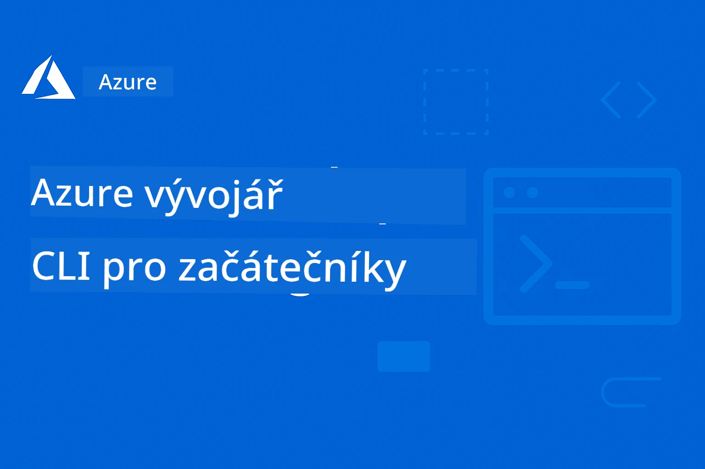

# AZD pro začátečníky: Strukturovaná cesta ke vzdělání

 

[](https://github.com/microsoft/AZD-for-beginners)
[](https://GitHub.com/microsoft/azd-for-beginners/network/)
[](https://github.com/microsoft/AZD-for-beginners)

[](https://discord.com/invite/nkVh3dp)
[](https://discord.gg/nTYy5BXMWG)

---

### Automatické překlady (vždy aktuální)

<!-- CO-OP TRANSLATOR LANGUAGES TABLE START -->
[Arabština](../ar/README.md) | [Bengálština](../bn/README.md) | [Bulharština](../bg/README.md) | [Barmsky (Myanmar)](../my/README.md) | [Čínština (zjednodušená)](../zh-CN/README.md) | [Čínština (tradiční, Hong Kong)](../zh-HK/README.md) | [Čínština (tradiční, Macau)](../zh-MO/README.md) | [Čínština (tradiční, Taiwan)](../zh-TW/README.md) | [Chorvatština](../hr/README.md) | [Čeština](./README.md) | [Dánština](../da/README.md) | [Nizozemština](../nl/README.md) | [Estonština](../et/README.md) | [Finština](../fi/README.md) | [Francouzština](../fr/README.md) | [Němčina](../de/README.md) | [Řečtina](../el/README.md) | [Hebrejština](../he/README.md) | [Hindština](../hi/README.md) | [Maďarština](../hu/README.md) | [Indonéština](../id/README.md) | [Italština](../it/README.md) | [Japonština](../ja/README.md) | [Kannada](../kn/README.md) | [Khmer](../km/README.md) | [Korejština](../ko/README.md) | [Litevština](../lt/README.md) | [Malajština](../ms/README.md) | [Malajálam](../ml/README.md) | [Maráthština](../mr/README.md) | [Nepálština](../ne/README.md) | [Nigerijská pidžinština](../pcm/README.md) | [Norština](../no/README.md) | [Perština (Fársí)](../fa/README.md) | [Polština](../pl/README.md) | [Portugalština (Brazílie)](../pt-BR/README.md) | [Portugalština (Portugalsko)](../pt-PT/README.md) | [Pandžábština (Gurmukhi)](../pa/README.md) | [Rumunština](../ro/README.md) | [Ruština](../ru/README.md) | [Srbština (cyrilice)](../sr/README.md) | [Slovenština](../sk/README.md) | [Slovinština](../sl/README.md) | [Španělština](../es/README.md) | [Svahilština](../sw/README.md) | [Švédština](../sv/README.md) | [Tagalog (Filipínština)](../tl/README.md) | [Tamilština](../ta/README.md) | [Telugu](../te/README.md) | [Thajština](../th/README.md) | [Turečtina](../tr/README.md) | [Ukrajinština](../uk/README.md) | [Urdu](../ur/README.md) | [Vietnamština](../vi/README.md)

> **Dáváte přednost lokálnímu klonování?**
>
> Tento repozitář obsahuje přes 50 jazykových překladů, což výrazně zvyšuje velikost stahování. Pro klonování bez překladů použijte sparse checkout:
>
> **Bash / macOS / Linux:**
> ```bash
> git clone --filter=blob:none --sparse https://github.com/microsoft/AZD-for-beginners.git
> cd AZD-for-beginners
> git sparse-checkout set --no-cone '/*' '!translations' '!translated_images'
> ```
>
> **CMD (Windows):**
> ```cmd
> git clone --filter=blob:none --sparse https://github.com/microsoft/AZD-for-beginners.git
> cd AZD-for-beginners
> git sparse-checkout set --no-cone "/*" "!translations" "!translated_images"
> ```
>
> Tím získáte vše potřebné ke zvládnutí kurzu s mnohem rychlejším stažením.
<!-- CO-OP TRANSLATOR LANGUAGES TABLE END -->

## 🆕 Co je dnes nového v azd

> 📌 **Aktualizace Foundry GA (09. 11. 2026):** Balíček **`microsoft.foundry` 1.0 je obecně dostupný**, oznámený dne [5. listopadu 2026](https://devblogs.microsoft.com/azure-sdk/microsoft-foundry-azure-developer-cli-ga/). Použijte **`azd >= 1.37.0`** a nainstalujte jej pomocí `azd ext install microsoft.foundry`. Postupujte podle [hostovaného průvodce agentem](docs/chapter-02-ai-development/microsoft-foundry-integration.md#hosted-agent-walkthrough-ga) pro nastavení, lokální testování a nasazení. Tato aktualizace vychází z publikovaných pokynů, ne z live nasazení Azure; obecná dostupnost balíčku nezajišťuje, že každá volitelná funkce, rozšíření nebo SDK je obecně dostupná.

Azure Developer CLI podporuje mnoho typů aplikací, včetně webových aplikací, API a AI agentů, přes podporované hostitele, šablony a rozšíření.

Co to pro vás znamená:

- **GA balíček pro vývoj Foundry.** `microsoft.foundry` instaluje sedm hlavních rozšíření, včetně agentů, projektů a Agent Inspectoru. Kód agenta a nastavení nasazení zůstávají společně v `azure.yaml`.
- **Testujte lokálně, pak nasazujte svůj kód.** Použijte `azd ai agent init --deploy-mode code`, `azd provision` a `azd ai agent run` pro inspekci místních požadavků a odpovědí. Pak použijte `azd deploy` pro vzdálenou sestavu v Foundry, bez lokální sestavy kontejneru.
- **Samostatně měřte kvalitu.** Nainstalujte **`azure.ai.evaluations`** pro `azd ai eval generate`, `init` a `run start`; není zahrnuto v balíčku. Uchovávejte recenzované datové soubory a rubriky se svým kódem. Starší projekty by měly následovat [průvodce migrací hodnocení a optimalizace](docs/chapter-08-production/production-ai-practices.md#evaluation-migration-and-quality-checks).
- **Znovupoužijte konfiguraci v CI/CD.** Po úspěšném `azd up` nastavte pipeline s `azd pipeline config`. Nainstalujte balíček na runner a uchovejte vygenerovaná autentizační a prostředí nastavení.
- **Plynulejší každodenní základy.** Nedávné vydání učinilo `azd init` idempotentní (bezpečné opakované spuštění), `azd auth login` automaticky čistící neplatné tokeny a přidalo přátelský `azd tool` první-použití nastavení výzvy.
- **Jádro pracovního postupu se nezměnilo.** Ať už nasazujete todo aplikaci, mikroslužbu nebo multi-agentní AI řešení, příkazy jsou stejné.

> **Poznámka pro uživatele Aspire:** Microsoft nyní produkt jednoduše označuje jako **Aspire** (dříve „.NET Aspire“). Podpora azd pro Aspire zůstává nezměněna — změnil se pouze název.

Pokud jste již azd používali, podpora AI je přirozeným rozšířením — nikoli samostatným nástrojem nebo pokročilou disciplínou. Pokud začínáte, naučíte se jeden pracovní postup, který funguje pro vše.

---

## 🚀 Co je Azure Developer CLI (azd)?

**Azure Developer CLI (azd)** je přátelský příkazový nástroj pro vývojáře, který usnadňuje nasazení aplikací do Azure. Místo manuálního vytváření a spojování desítek Azure zdrojů můžete nasadit celé aplikace jediným příkazem.

### Kouzlo `azd up`

```bash
# This single command does everything:
# ✅ Creates all Azure resources  
# ✅ Configures networking and security
# ✅ Builds your application code
# ✅ Deploys to Azure
# ✅ Gives you a working URL
azd up
```

Šablona poskytuje konfiguraci aplikace a infrastruktury. Úspěšné nasazení stále vyžaduje podporované služby/modely, dostatečnou kvótu a oprávnění, správné vstupy a ověření nasazené aplikace. `azd up` automaticky nezajišťuje, že šablona je bezpečná, v souladu nebo připravená do produkce.

---

## ❓ Azure Developer CLI vs Azure CLI: Jaký je rozdíl?

To je nejčastější otázka začátečníků. Zde je jednoduchá odpověď:

| Funkce | **Azure CLI (`az`)** | **Azure Developer CLI (`azd`)** |
|---------|---------------------|--------------------------------|
| **Účel** | Spravovat jednotlivé Azure zdroje | Nasadit kompletní aplikace |
| **Přístup** | Zaměření na infrastrukturu | Zaměření na aplikaci |
| **Příklad** | `az webapp create --name myapp...` | `azd up` |
| **Křivka učení** | Musíte znát Azure služby | Stačí znát svou aplikaci |
| **Nejlepší pro** | DevOps, infrastruktura | Vývojáře, prototypování |

### Jednoduchá analogie

- **Azure CLI** je jako mít všechny nástroje na stavbu domu – kladiva, pily, hřebíky. Můžete postavit cokoli, ale musíte znát stavbu.
- **Azure Developer CLI** je jako najmout si dodavatele – popíšete, co chcete, a on se o stavbu postará.

### Kdy co použít

| Scénář | Použijte toto |
|----------|----------|
| „Chci rychle nasadit webovou aplikaci“ | `azd up` |
| „Potřebuji jen vytvořit úložiště“ | `az storage account create` |
| „Stavím plnohodnotnou AI aplikaci“ | `azd init --template azure-search-openai-demo` |
| „Potřebuji ladit konkrétní Azure zdroj“ | `az resource show` |
| „Chci nasadit do svého konfigurovaného produkčního prostředí“ | Prohlédněte si konfiguraci, přístup, náklady a provozní brány před `azd up --environment production` |

### Fungují spolu!

AZD a Azure CLI mají samostatnou autentizaci a konfiguraci. Pro AZD použijte `azd auth login`, a když hák nebo diagnostický příkaz explicitně potřebuje Azure CLI, pak `az login`. Můžete používat oba:
```bash
# Deploy your app with AZD
azd up

# Then fine-tune specific resources with Azure CLI
az webapp config set --name myapp --always-on true
```

---

## 🌟 Najděte šablony v Awesome AZD

Nezačínejte od nuly! **Awesome AZD** je komunitní sbírka předpřipravených šablon k nasazení:

| Zdroj | Popis |
|----------|-------------|
| 🔗 [**Awesome AZD Galerie**](https://azure.github.io/awesome-azd/) | Prohlížejte přes 200 šablon s nasazením na jedno kliknutí |
| 🔗 [**Přispět šablonou**](https://github.com/Azure/awesome-azd/issues) | Přidejte svou vlastní šablonu komunitě |
| 🔗 [**GitHub Repozitář**](https://github.com/Azure/awesome-azd) | Označte hvězdičkou a prozkoumejte zdrojový kód |

### Oblíbené AI šablony z Awesome AZD

Vyberte jednu šablonu v jejím vlastním prázdném adresáři; níže uvedené příkazy jsou alternativy. Koncový `.` inicializuje tento adresář.

```bash
# RAG Chat with Microsoft Foundry Models + AI Search
azd init --template azure-search-openai-demo .

# Quick AI Chat Application
azd init --template openai-chat-app-quickstart .

# AI Agents with Foundry Agents
azd init --template get-started-with-ai-agents .
```

---

## 🎯 Začněte ve 3 krocích

Než začnete, ujistěte se, že váš stroj je připraven pro šablonu, kterou chcete nasadit:

**Windows:**
```powershell
.\validate-setup.ps1
```

**macOS / Linux:**
```bash
bash ./validate-setup.sh
```

Pokud některá ze zkoušek nevyhoví, nejprve ji opravte a pak pokračujte s rychlým startem.

### Krok 1: Instalace AZD (2 minuty)

**Windows:**
```powershell
winget install microsoft.azd
```

**macOS:**
```bash
brew tap azure/azd && brew install azd
```

**Linux:**
```bash
curl -fsSL https://aka.ms/install-azd.sh | bash
```

### Krok 2: Autentizace pro AZD

```bash
# Optional if you plan to use Azure CLI commands directly in this course
az login

# Required for AZD workflows
azd auth login
```

Pokud si nejste jistí, který potřebujete, postupujte podle kompletního průvodce v [Instalace & Nastavení](docs/chapter-01-foundation/installation.md#authentication-setup).

### Krok 3: Nasazení první aplikace

```bash
# Initialize from a template
azd init --template todo-nodejs-mongo .

# Deploy to Azure (creates everything!)
azd up
```

**🎉 Hotovo!** Vaše aplikace je teď živá na Azure.

### Úklid (nezapomeňte!)

```bash
# Remove all resources when done experimenting
azd down --force --purge
```

---

## 📚 Jak používat tento kurz

Tento kurz je navržen pro **postupné učení** – začněte tam, kde se cítíte pohodlně, a postupujte dál:

| Vaše zkušenost | Začít zde |
|-----------------|------------|
| **Nováček v Azure** | [Kapitola 1: Základy](#-chapter-1-foundation--quick-start) |
| **Znám Azure, nováček v AZD** | [Kapitola 1: Základy](#-chapter-1-foundation--quick-start) |
| **Chci nasazovat AI aplikace** | [Kapitola 2: Vývoj s AI v popředí](#-chapter-2-ai-first-development-recommended-for-ai-developers) |
| **Chci prakticky cvičit** | [🎓 Interaktivní workshop](workshop/README.md) - 3-4 hodinový navigovaný lab |
| **Potřebuji produkční vzory** | [Kapitola 8: Produkce a podniková řešení](#-chapter-8-production--enterprise-patterns) |

### Rychlé nastavení

1. **Vytvořte Fork tohoto repozitáře**: [](https://GitHub.com/microsoft/azd-for-beginners/fork)
2. **Naklonujte si jej**: `git clone https://github.com/YOUR-USERNAME/azd-for-beginners.git`
3. **Získejte pomoc**: [Azure Discord Komunita](https://discord.com/invite/ByRwuEEgH4)

> **Raději klonovat lokálně?**

> Tento repozitář obsahuje více než 50 překladů do různých jazyků, což významně zvětšuje velikost stahování. Pro klonování bez překladů použijte sparse checkout:
> ```bash
> git clone --filter=blob:none --sparse https://github.com/microsoft/AZD-for-beginners.git
> cd AZD-for-beginners
> git sparse-checkout set --no-cone '/*' '!translations' '!translated_images'
> ```
> To vám poskytne vše potřebné k dokončení kurzu s mnohem rychlejším stažením.


## Přehled kurzu

Ovládněte Azure Developer CLI (azd) prostřednictvím strukturovaných kapitol určených pro postupné učení. **Zvláštní důraz na nasazení AI aplikací s integrací Microsoft Foundry.**

### Proč je tento kurz nezbytný pro moderní vývojáře

Vývojáři nasazující AI pracovní zátěže často potřebují vedení v oblasti:
- Složitých víceslužbových AI architektur
- Nejlepších postupů nasazení AI do produkce  
- Integrace a konfigurace Azure AI služeb
- Optimalizace nákladů na AI pracovní zátěže
- Řešení problémů specifických pro nasazení AI

### Výukové cíle

Dokončením tohoto strukturovaného kurzu budete schopni:
- **Ovládnout základy AZD**: Klíčové koncepty, instalace a konfigurace
- **Nasadit AI aplikace**: Použít AZD s Microsoft Foundry službami
- **Implementovat infrastrukturu jako kód**: Spravovat zdroje Azure pomocí Bicep šablon
- **Řešit problémy s nasazením**: Odstranit běžné potíže a ladit chyby
- **Optimalizovat pro produkci**: Bezpečnost, škálování, monitorování a řízení nákladů
- **Vytvářet multi-agentní řešení**: Nasazovat složité AI architektury

## Před zahájením: Účty, přístup a předpoklady

Než začnete s Kapitolou 1, ujistěte se, že máte následující. Kroky instalace v tomto návodu počítají s tím, že tyto základy již máte za sebou.

- **Azure předplatné**: Můžete použít existující předplatné z práce nebo svého účtu, případně vytvořit [bezplatnou zkušební verzi](https://aka.ms/azurefreetrial) pro začátek.
- **Oprávnění k vytváření Azure zdrojů**: Pro většinu cvičení byste měli mít minimálně přístup **Contributor** na cílové předplatné nebo skupinu prostředků. Některé kapitoly také předpokládají, že můžete vytvářet skupiny prostředků, spravované identity a RBAC přiřazení.
- [**GitHub účet**](https://github.com): Užitečný pro fork repozitáře, sledování vlastních změn a použití GitHub Codespaces pro workshop.
- **Požadavky na běhové prostředí šablon**: Některé šablony vyžadují místní nástroje jako Node.js, Python, Java nebo Docker. Spusťte validátor nastavení před startem, abyste včas odhalili chybějící nástroje.
- **Základní znalost terminálu**: Nemusíte být expert, ale měli byste být pohodlní s příkazy jako `git clone`, `azd auth login` a `azd up`.

> **Pracujete v podnikové předplatném?**
> Pokud je vaše Azure prostředí spravováno administrátorem, předem ověřte, zda můžete nasazovat zdroje v předplatném nebo skupině prostředků, kterou plánujete použít. Pokud ne, požádejte o sandbox předplatné nebo přístup Contributor ještě před začátkem.

> **Nový v Azure?**
> Začněte se svým vlastním Azure zkušebním nebo pay-as-you-go předplatným na https://aka.ms/azurefreetrial, abyste mohli cvičení dokončit kompletně bez čekání na schválení na úrovni instance.

## 🗺️ Mapa kurzu: Rychlá navigace podle kapitol

Každá kapitola má vlastní README se vzdělávacími cíli, rychlými starty a cvičeními:

| Kapitola | Téma | Lekce | Doba | Náročnost |
|---------|-------|---------|----------|------------|
| **[Kap 1: Základy](docs/chapter-01-foundation/README.md)** | Začínáme | [Základy AZD](docs/chapter-01-foundation/azd-basics.md) &#124; [Instalace](docs/chapter-01-foundation/installation.md) &#124; [První projekt](docs/chapter-01-foundation/first-project.md) | 30-45 min | ⭐ |
| **[Kap 2: Vývoj AI](docs/chapter-02-ai-development/README.md)** | AI-First aplikace | [Integrace Foundry](docs/chapter-02-ai-development/microsoft-foundry-integration.md) &#124; [AI Agent](docs/chapter-02-ai-development/agents.md) &#124; [Nasazení modelu](docs/chapter-02-ai-development/ai-model-deployment.md) &#124; [Workshop](docs/chapter-02-ai-development/ai-workshop-lab.md) | 1-2 hod | ⭐⭐ |
| **[Kap 3: Konfigurace](docs/chapter-03-configuration/README.md)** | Autentizace & bezpečnost | [Konfigurace](docs/chapter-03-configuration/configuration.md) &#124; [Autentizace & bezpečnost](docs/chapter-03-configuration/authsecurity.md) | 45-60 min | ⭐⭐ |
| **[Kap 4: Infrastruktura](docs/chapter-04-infrastructure/README.md)** | IaC & nasazení | [Průvodce nasazením](docs/chapter-04-infrastructure/deployment-guide.md) &#124; [Provisioning](docs/chapter-04-infrastructure/provisioning.md) | 1-1,5 hod | ⭐⭐⭐ |
| **[Kap 5: Multi-agent](docs/chapter-05-multi-agent/README.md)** | AI agentní řešení | [Scénář obchod](examples/retail-scenario.md) &#124; [Koordinační vzory](docs/chapter-06-pre-deployment/coordination-patterns.md) | 2-3 hod | ⭐⭐⭐⭐ |
| **[Kap 6: Před nasazením](docs/chapter-06-pre-deployment/README.md)** | Plánování & validace | [Kontroly před startem](docs/chapter-06-pre-deployment/preflight-checks.md) &#124; [Plánování kapacity](docs/chapter-06-pre-deployment/capacity-planning.md) &#124; [Volba SKU](docs/chapter-06-pre-deployment/sku-selection.md) &#124; [App Insights](docs/chapter-06-pre-deployment/application-insights.md) | 1 hod | ⭐⭐ |
| **[Kap 7: Řešení problémů](docs/chapter-07-troubleshooting/README.md)** | Ladění & opravy | [Běžné problémy](docs/chapter-07-troubleshooting/common-issues.md) &#124; [Ladění](docs/chapter-07-troubleshooting/debugging.md) &#124; [AI problémy](docs/chapter-07-troubleshooting/ai-troubleshooting.md) | 1-1,5 hod | ⭐⭐ |
| **[Kap 8: Produkce](docs/chapter-08-production/README.md)** | Podnikové vzory | [Produkční postupy](docs/chapter-08-production/production-ai-practices.md) | 2-3 hod | ⭐⭐⭐⭐ |
| **[🎓 Workshop](workshop/README.md)** | Praktická laboratoř | [Úvod](workshop/docs/instructions/0-Introduction.md) &#124; [Výběr](workshop/docs/instructions/1-Select-AI-Template.md) &#124; [Validace](workshop/docs/instructions/2-Validate-AI-Template.md) &#124; [Rozklad](workshop/docs/instructions/3-Deconstruct-AI-Template.md) &#124; [Konfigurace](workshop/docs/instructions/4-Configure-AI-Template.md) &#124; [Přizpůsobení](workshop/docs/instructions/5-Customize-AI-Template.md) &#124; [Ukončení](workshop/docs/instructions/6-Teardown-Infrastructure.md) &#124; [Závěr](workshop/docs/instructions/7-Wrap-up.md) | 3-4 hod | ⭐⭐ |

**Celková doba kurzu:** ~10-14 hodin | **Pokrok dovedností:** Začátečník → Produkčně připravený

---

## 📚 Výukové kapitoly

*Vyberte si výukovou cestu podle úrovně zkušeností a cílů*

### 🚀 Kapitola 1: Základy & Rychlý start
**Předpoklady**: Azure předplatné, základní znalosti příkazové řádky  
**Doba trvání**: 30-45 minut  
**Náročnost**: ⭐

#### Co se naučíte
- Pochopení základů Azure Developer CLI
- Instalace AZD na vaší platformě
- První úspěšné nasazení

#### Výukové zdroje
- **🎯 Začněte zde**: [Co je Azure Developer CLI?](#-what-is-azure-developer-cli-azd)
- **📖 Teorie**: [Základy AZD](docs/chapter-01-foundation/azd-basics.md) - Klíčové koncepty a terminologie
- **⚙️ Nastavení**: [Instalace & nastavení](docs/chapter-01-foundation/installation.md) - Platformově specifické návody
- **🛠️ Prakticky**: [Váš první projekt](docs/chapter-01-foundation/first-project.md) - Krok za krokem
- **📋 Rychlá reference**: [Přehled příkazů](resources/cheat-sheet.md)

#### Praktická cvičení
```bash
# Quick installation check
azd version

# Deploy your first application
azd init --template todo-nodejs-mongo .
azd up
```

**💡 Výsledek kapitoly**: Úspěšné nasazení jednoduché webové aplikace do Azure pomocí AZD

**✅ Ověření úspěchu:**
```bash
# After completing Chapter 1, you should be able to:
azd version              # Shows installed version
azd init --template todo-nodejs-mongo  # Initializes project
azd up                  # Deploys to Azure
azd show                # Displays running app URL
# Application opens in browser and works
azd down --force --purge  # Cleans up resources
```

**📊 Časová náročnost:** 30-45 minut  
**📈 Úroveň dovednosti po dokončení:** Schopnost samostatného nasazení základních aplikací

---

### 🤖 Kapitola 2: Vývoj zaměřený na AI (Doporučeno pro AI vývojáře)
**Předpoklady**: Dokončená kapitola 1  
**Doba trvání**: 1-2 hodiny  
**Náročnost**: ⭐⭐

#### Co se naučíte
- Integrace Microsoft Foundry s AZD
- Nasazování AI aplikací
- Pochopení konfigurace AI služeb

#### Výukové zdroje
- **🎯 Začněte zde**: [Integrace Microsoft Foundry](docs/chapter-02-ai-development/microsoft-foundry-integration.md)
- **🤖 AI agenti**: [Průvodce AI agenty](docs/chapter-02-ai-development/agents.md) - Nasazení inteligentních agentů pomocí AZD
- **📖 Vzory**: [Nasazení AI modelů](docs/chapter-02-ai-development/ai-model-deployment.md) - Nasazení a správa AI modelů
- **🛠️ Workshop**: [AI Workshop Laboratoř](docs/chapter-02-ai-development/ai-workshop-lab.md) - Připravte svá AI řešení k použití s AZD
- **🎥 Interaktivní průvodce**: [Materiály workshopu](workshop/README.md) - Učení v prohlížeči s MkDocs * DevContainer prostředí
- **📋 Šablony**: [Microsoft Foundry šablony](#featured-microsoft-foundry-templates)
- **📝 Příklady**: [Příklady nasazení AZD](examples/README.md)

#### Praktická cvičení
```bash
# Deploy your first AI application
azd init --template azure-search-openai-demo .
azd up

# Try additional AI templates
azd init --template openai-chat-app-quickstart .
azd init --template agent-openai-python-prompty .
```

**💡 Výsledek kapitoly**: Nasazení a konfigurace AI chatovací aplikace s RAG schopnostmi

**✅ Ověření úspěchu:**
```bash
# After Chapter 2, you should be able to:
azd init --template azure-search-openai-demo .
azd up
# Test the AI chat interface
# Ask questions and get AI-powered responses with sources
# Verify search integration works
azd monitor  # Check Application Insights shows telemetry
azd down --force --purge
```

**📊 Časová náročnost:** 1-2 hodiny  
**📈 Úroveň dovednosti po dokončení:** Schopnost nasadit AI učící aplikace a identifikovat další požadavky pro produkční nasazení
**💰 Povědomí o nákladech:** Pochopení výdajů $80-150/měsíc pro vývoj, $300-3500/měsíc pro produkci

#### 💰 Úvahy o nákladech pro AI nasazení

**Vývojové prostředí (Odhadem $80-150/měsíc):**
- Microsoft Foundry modely (Pay-as-you-go): $0-50/měsíc (dle použití tokenů)
- AI Search (základní úroveň): $75/měsíc
- Container Apps (spotřeba): $0-20/měsíc
- Úložiště (standard): $1-5/měsíc

**Produkční prostředí (Odhadem $300-3,500+/měsíc):**
- Microsoft Foundry modely (PTU pro konstantní výkon): $3,000+/měsíc NEBO Pay-as-you-go s vysokým objemem
- AI Search (standardní úroveň): $250/měsíc
- Container Apps (vyhrazené): $50-100/měsíc
- Application Insights: $5-50/měsíc
- Úložiště (prémiové): $10-50/měsíc

**💡 Tipy na optimalizaci nákladů:**
- Zkontrolujte ceny za inferenci modelu a účty s kredity; Azure OpenAI neobsahuje univerzální měsíční bezplatný limit 50 000 tokenů
- Spusťte `azd down` pro smazání zdrojů, když je již nepotřebujete, po kontrole vybraného prostředí
- Začněte s fakturací podle spotřeby, upgradujte na PTU jen pro produkci
- Použijte `azd provision --preview` ke kontrole plánované infrastruktury a poté oceňte zdroje pomocí Azure Pricing Calculator
- Aktivujte automatické škálování: plaťte pouze za skutečné využití

**Sledování nákladů:**
```bash
# Inspect planned resources (this does not calculate prices)
azd provision --preview

# Monitor actual costs in Azure Portal
az consumption budget list --resource-group <your-rg>
```

---

### ⚙️ Kapitola 3: Konfigurace & autentizace
**Předpoklady**: Dokončená kapitola 1  
**Doba trvání**: 45-60 minut  
**Náročnost**: ⭐⭐

#### Co se naučíte
- Konfigurace a správa prostředí
- Osvedčené postupy autentizace a bezpečnosti
- Pojmenování a organizace zdrojů

#### Výukové zdroje
- **📖 Konfigurace**: [Průvodce konfigurací](docs/chapter-03-configuration/configuration.md) - Nastavení prostředí
- **🔐 Bezpečnost**: [Vzory autentizace a spravované identity](docs/chapter-03-configuration/authsecurity.md) - Vzory autentizace
- **📝 Příklady**: [Příklad databázové aplikace](examples/database-app/README.md) - AZD databázové příklady

#### Praktická cvičení
- Konfigurovat více prostředí (dev, staging, prod)
- Nastavit autentizaci spravované identity
- Implementovat konfigurace specifické pro prostředí

**💡 Výsledek kapitoly**: Správa více prostředí s odpovídající autentizací a bezpečností

---

### 🏗️ Kapitola 4: Infrastruktura jako kód & nasazení
**Předpoklady**: Dokončené kapitoly 1-3  
**Doba trvání**: 1-1,5 hodiny  
**Náročnost**: ⭐⭐⭐

#### Co se naučíte
- Pokročilé vzory nasazení
- Infrastruktura jako kód s Bicep
- Strategie provisioning zdrojů

#### Výukové zdroje
- **📖 Nasazení**: [Průvodce nasazením](docs/chapter-04-infrastructure/deployment-guide.md) - Kompletní pracovní postupy
- **🏗️ Provisioning**: [Provisioning zdrojů](docs/chapter-04-infrastructure/provisioning.md) - Správa Azure zdrojů
- **📝 Příklady**: [Příklad Container App](../../examples/container-app) - Kontejnerová nasazení

#### Praktická cvičení
- Vytvořit vlastní Bicep šablony
- Nasadit víceslužbové aplikace
- Implementovat strategie blue-green nasazení

**💡 Výsledek kapitoly**: Nasadit složité víceslužbové aplikace pomocí vlastních infrastrukturních šablon

---

### 🎯 Kapitola 5: Multi-agentní AI řešení (Pokročilé)
**Předpoklady**: Dokončené kapitoly 1-2  
**Doba trvání**: 2-3 hodiny  
**Náročnost**: ⭐⭐⭐⭐

#### Co se naučíte
- Vzory multi-agentní architektury
- Orchestrace a koordinace agentů
- Produkčně připravené AI nasazení

#### Výukové zdroje
- **🤖 Vybrané řešení**: [Retail Multi-Agent Solution](examples/retail-scenario.md) - Architektonický plán, nikoli kompletní aplikace
- **🛠️ Šablony ARM**: [ARM Template Package](../../examples/retail-multiagent-arm-template) - Infrastrukturní kostra; zkontrolujte předpoklady a chybějící komponenty aplikace
- **📖 Architektura**: [Multi-agent coordination patterns](docs/chapter-06-pre-deployment/coordination-patterns.md) - Vzory

#### Praktické cvičení
```bash
# Inspect the retail infrastructure scaffold before choosing to deploy it
cd examples/retail-multiagent-arm-template
cat README.md

# After an intentional deployment, inspect infrastructure state
az deployment group show --resource-group <rg-name> --name <deployment-name>
```

**💡 Výsledek kapitoly**: Pochopit návrh multi-agentů a identifikovat implementační, validační a provozní práci potřebnou nad rámec infrastrukturní kostry

---

### 🔍 Kapitola 6: Validace a plánování před nasazením
**Předpoklady**: Dokončení kapitoly 4  
**Délka**: 1 hodina  
**Náročnost**: ⭐⭐

#### Co se naučíte
- Plánování kapacity a ověření zdrojů
- Strategie výběru SKU
- Kontroly před nasazením a automatizace

#### Výukové zdroje
- **📊 Plánování**: [Plánování kapacity](docs/chapter-06-pre-deployment/capacity-planning.md) - Ověření zdrojů
- **💰 Výběr**: [Výběr SKU](docs/chapter-06-pre-deployment/sku-selection.md) - Nákladově efektivní volby
- **✅ Validace**: [Kontroly před nasazením](docs/chapter-06-pre-deployment/preflight-checks.md) - Automatizované skripty

#### Praktické cvičení
- Spustit skripty pro ověření kapacity
- Optimalizovat výběr SKU ze šetření nákladů
- Implementovat automatizované kontroly před nasazením

**💡 Výsledek kapitoly**: Ověřit a optimalizovat nasazení před provedením

---

### 🚨 Kapitola 7: Řešení problémů a ladění
**Předpoklady**: Dokončení jakékoli kapitoly o nasazení  
**Délka**: 1-1,5 hodiny  
**Náročnost**: ⭐⭐

#### Co se naučíte
- Systematické přístupy k ladění
- Běžné problémy a řešení
- Řešení problémů specifických pro AI

#### Výukové zdroje
- **🔧 Běžné problémy**: [Běžné problémy](docs/chapter-07-troubleshooting/common-issues.md) - FAQ a řešení
- **🕵️ Ladění**: [Průvodce laděním](docs/chapter-07-troubleshooting/debugging.md) - Strategie krok za krokem
- **🤖 AI problémy**: [Řešení problémů specifických pro AI](docs/chapter-07-troubleshooting/ai-troubleshooting.md) - Problémy služeb AI

#### Praktické cvičení
- Diagnostikovat chyby nasazení
- Vyřešit problémy s autentizací
- Ladit konektivitu služeb AI

**💡 Výsledek kapitoly**: Samostatně diagnostikovat a řešit běžné problémy s nasazením

---

### 🏢 Kapitola 8: Produkční a podnikové vzory
**Předpoklady**: Dokončení kapitol 1-4  
**Délka**: 2-3 hodiny  
**Náročnost**: ⭐⭐⭐⭐

#### Co se naučíte
- Strategie produkčního nasazení
- Podnikové bezpečnostní vzory
- Monitorování a optimalizace nákladů

#### Výukové zdroje
- **🏭 Produkce**: [Best Practices pro AI produkci](docs/chapter-08-production/production-ai-practices.md) - Podnikové vzory
- **📝 Příklady**: [Příklad mikroservis](../../examples/microservices) - Komplexní architektury
- **📊 Monitorování**: [Integrace Application Insights](docs/chapter-06-pre-deployment/application-insights.md) - Monitorování

#### Praktické cvičení
- Implementovat podnikové bezpečnostní vzory
- Nastavit komplexní monitorování
- Nasadit do produkce s odpovídajícím řízením

**💡 Výsledek kapitoly**: Nasadit aplikace připravené pro produkční provoz s plnými produkčními schopnostmi

---

## 🎓 Přehled workshopu: Praktická výuka

> **⚠️ STAV WORKSHOPU: Aktivní vývoj**  
> Materiály workshopu jsou momentálně vyvíjeny a zdokonalovány. Jádrové moduly fungují, ale některé pokročilé části nejsou dokončeny. Aktivně pracujeme na dokončení veškerého obsahu. [Sledovat pokrok →](workshop/README.md)

### Interaktivní materiály workshopu
**Komplexní praktická výuka s nástroji v prohlížeči a řízenými cvičeními**

Naše materiály workshopu poskytují strukturovaný, interaktivní zážitek z učení, který doplňuje výše uvedený tematický obsah. Workshop je navržen jak pro samostudium, tak pro výuku s lektorem.

#### 🛠️ Vlastnosti workshopu
- **Rozhraní v prohlížeči**: Kompletní workshop poháněný MkDocs s vyhledáváním, kopírováním a tématy
- **Integrace GitHub Codespaces**: Jedno kliknutí pro nastavení vývojového prostředí
- **Strukturovaná učební cesta**: 8 modulů řízených cvičení (celkem 3-4 hodiny)
- **Postupná metodologie**: Úvod → Výběr → Validace → Rozebrání → Konfigurace → Přizpůsobení → Ukončení → Závěr
- **Interaktivní devcontainer prostředí**: Předkonfigurované nástroje a závislosti

#### 📚 Struktura modulů workshopu
Workshop následuje **8 modulovou postupnou metodologii**, která vás provede od objevení po mistrovství v nasazení:

| Modul | Téma | Co budete dělat | Délka |
|--------|-------|----------------|----------|
| **0. Úvod** | Přehled workshopu | Porozumět cílovým znalostem, předpokladům a struktuře workshopu | 15 min |
| **1. Výběr** | Objevování šablon | Prozkoumat šablony AZD a vybrat správnou AI šablonu pro váš scénář | 20 min |
| **2. Validace** | Nasazení a ověření | Nasadit šablonu s `azd up` a ověřit funkčnost infrastruktury | 30 min |
| **3. Rozebrání** | Pochopení struktury | Použít GitHub Copilot k prozkoumání architektury šablon, souborů Bicep a organizace kódu | 30 min |
| **4. Konfigurace** | Hluboké ponoření do azure.yaml | Ovládnout konfiguraci `azure.yaml`, životní cyklus a proměnné prostředí | 30 min |
| **5. Přizpůsobení** | Upravte si to | Aktivovat AI Search, tracing, vyhodnocování a přizpůsobit pro váš scénář | 45 min |
| **6. Ukončení** | Úklid | Bezpečně ukončit služby s `azd down --purge` | 15 min |
| **7. Závěr** | Další kroky | Rekapitulovat výsledky, klíčové pojmy a pokračovat v učení | 15 min |

**Průběh workshopu:**
```
Introduction → Selection → Validation → Deconstruction → Configuration → Customization → Teardown → Wrap-up
     ↓            ↓           ↓              ↓               ↓              ↓            ↓           ↓
  Overview    Find the     Deploy &      Explore        Master         Customize     Clean up    Review &
             right        verify        code &        azure.yaml      for your      resources   next steps
             template                   structure                     scenario
```

#### 🚀 Začínáme s workshopem
```bash
# Option 1: GitHub Codespaces (Recommended)
# Click "Code" → "Create codespace on main" in the repository

# Option 2: Local Development
git clone https://github.com/microsoft/azd-for-beginners.git
cd azd-for-beginners/workshop
# Follow the setup instructions in workshop/README.md
```

#### 🎯 Výsledky učení ve workshopu
Po absolvování workshopu budou účastníci schopni:
- **Nasazovat produkční AI aplikace**: použít AZD s Microsoft Foundry službami
- **Ovládnout víceagentové architektury**: Implementovat koordinovaná řešení AI agentů
- **Implementovat bezpečnostní osvědčené postupy**: Konfigurovat autentizaci a řízení přístupu
- **Optimalizovat pro škálování**: Navrhnout nákladově efektivní a výkonná nasazení
- **Řešit problémy nasazení**: Samostatně řešit běžné problémy

#### 📖 Zdroje workshopu
- **🎥 Interaktivní průvodce**: [Materiály workshopu](workshop/README.md) - Výukové prostředí v prohlížeči
- **📋 Pokyny po modulech**:
  - [0. Úvod](workshop/docs/instructions/0-Introduction.md) - Přehled workshopu a cíle
  - [1. Výběr](workshop/docs/instructions/1-Select-AI-Template.md) - Najít a vybrat AI šablony
  - [2. Validace](workshop/docs/instructions/2-Validate-AI-Template.md) - Nasadit a ověřit šablony
  - [3. Rozebrání](workshop/docs/instructions/3-Deconstruct-AI-Template.md) - Prozkoumat architekturu šablon
  - [4. Konfigurace](workshop/docs/instructions/4-Configure-AI-Template.md) - Ovládnout azure.yaml
  - [5. Přizpůsobení](workshop/docs/instructions/5-Customize-AI-Template.md) - Přizpůsobit pro váš scénář
  - [6. Ukončení](workshop/docs/instructions/6-Teardown-Infrastructure.md) - Vyčistit prostředky
  - [7. Závěr](workshop/docs/instructions/7-Wrap-up.md) - Rekapitulace a další kroky
- **🛠️ AI Workshop Lab**: [AI Workshop Lab](docs/chapter-02-ai-development/ai-workshop-lab.md) - Cvičení zaměřená na AI
- **💡 Rychlý start**: [Průvodce nastavením workshopu](workshop/README.md#browser-based-guide) - Konfigurace prostředí

**Perfektní pro**: Firemní školení, univerzitní kurzy, samostudium a bootcampy pro vývojáře.

---

## 📖 Hluboký vhled: Možnosti AZD

Kromě základů poskytuje AZD silné funkce pro produkční nasazení:

- **Nasazení založené na šablonách** - Použití předpřipravených šablon pro běžné vzory aplikací
- **Infrastruktura jako kód** - Správa Azure zdrojů pomocí Bicep nebo Terraformu  
- **Integrované pracovní toky** - Bezproblémové poskytování, nasazení a monitorování aplikací
- **Přívětivé pro vývojáře** - Optimalizováno pro produktivitu a zkušenost vývojářů

### **AZD + Microsoft Foundry: Perfektní pro AI nasazení**

**Proč AZD pro AI řešení?** AZD řeší hlavní výzvy vývojářů AI:

- **Šablony připravené pro AI** - Předkonfigurované šablony pro Microsoft Foundry modely, Azure AI služby a ML pracovní zatížení
- **Bezpečné AI nasazení** - Vestavěné bezpečnostní vzory pro AI služby, API klíče a koncové body modelů  
- **Produkční AI vzory** - Nejlepší postupy pro škálovatelné a nákladově efektivní nasazení AI aplikací
- **End-to-End AI pracovní toky** - Od vývoje modelu po produkční nasazení s odpovídajícím monitorováním
- **Optimalizace nákladů** - Chytré přidělování zdrojů a škálovací strategie pro AI pracovní zatížení
- **Integrace Microsoft Foundry** - Bezproblémové propojení s katalogem modelů Microsoft Foundry a koncovými body

---

## 🎯 Knihovna šablon a příkladů

### Vybráno: Microsoft Foundry šablony
**Začněte zde, pokud nasazujete AI aplikace!**

> **Poznámka:** Tyto šablony demonstrují různé AI vzory. Některé jsou externí Azure Samples, jiné jsou lokální implementace.

| Šablona | Kapitola | Náročnost | Služby | Typ |
|----------|---------|------------|----------|------|
| [**Začínáme s AI chatem**](https://github.com/Azure-Samples/get-started-with-ai-chat) | Kapitola 2 | ⭐⭐ | AzureOpenAI + Azure AI Model Inference API + Azure AI Search + Azure Container Apps + Application Insights | Externí |
| [**Začínáme s AI agenty**](https://github.com/Azure-Samples/get-started-with-ai-agents) | Kapitola 2 | ⭐⭐ | Foundry Agents + AzureOpenAI + Azure AI Search + Azure Container Apps + Application Insights| Externí |
| [**Ukázka Azure Search + OpenAI**](https://github.com/Azure-Samples/azure-search-openai-demo) | Kapitola 2 | ⭐⭐ | Azure OpenAI + Azure AI Search + Container Apps (výchozí) + Storage | Externí |
| [**OpenAI Chat App Rychlý start**](https://github.com/Azure-Samples/openai-chat-app-quickstart) | Kapitola 2 | ⭐ | AzureOpenAI + Container Apps + Application Insights | Externí |
| [**Agent OpenAI Python Prompty**](https://github.com/Azure-Samples/agent-openai-python-prompty) | Kapitola 5 | ⭐⭐⭐ | AzureOpenAI + Azure Functions + Prompty | Externí |
| [**Contoso Chat RAG**](https://github.com/Azure-Samples/contoso-chat) | Kapitola 8 | ⭐⭐⭐⭐ | AzureOpenAI + AI Search + Cosmos DB + Container Apps | Externí |
| [**Retail Multi-Agent Solution**](examples/retail-scenario.md) | Kapitola 5 | ⭐⭐⭐⭐ | Navrhovaná architektura a infrastrukturní kostra; nutná implementace aplikace | **Lokální plán** |

### Vybráno: Kompletní učební scénáře
**Šablony aplikací připravených pro produkci mapované na učební kapitoly**

| Šablona | Učební kapitola | Náročnost | Klíčové učení |
|----------|------------------|------------|--------------|
| [**openai-chat-app-quickstart**](https://github.com/Azure-Samples/openai-chat-app-quickstart) | Kapitola 2 | ⭐ | Základní vzory nasazení AI |
| [**azure-search-openai-demo**](https://github.com/Azure-Samples/azure-search-openai-demo) | Kapitola 2 | ⭐⭐ | Implementace RAG s Azure AI Search |
| [**get-started-with-ai-agents**](https://github.com/Azure-Samples/get-started-with-ai-agents) | Kapitola 2 | ⭐⭐ | Chat podporovaný agenty a testy vyhodnocení specifické pro ukázku |
| [**agent-openai-python-prompty**](https://github.com/Azure-Samples/agent-openai-python-prompty) | Kapitola 5 | ⭐⭐⭐ | Rámec agenta a volání funkcí |
| [**contoso-chat**](https://github.com/Azure-Samples/contoso-chat) | Kapitola 8 | ⭐⭐⭐ | Podniková orchestrácia AI |
| [**retail-multi-agent-solution**](examples/retail-scenario.md) | Kapitola 5 | ⭐⭐⭐⭐ | Architektura multi-agentů s Customer a Inventory agenty |

### Učení podle typu příkladu

> **📌 Lokální vs. Externí příklady:**  
> **Lokální příklady** (v tomto repozitáři) = Prohlédněte si README příkladu pro stav implementace a předpoklady
> **Externí příklady** (Azure Samples) = Klonujte z propojených repozitářů

#### Lokální příklady (připravené k použití)
- [**Retail Multi-Agent Solution**](examples/retail-scenario.md) - Architektonický plán s infrastrukturní ARM kostrou
  - Navrhované role agentů Customer a Inventory
  - Musí být implementováno a ověřeno monitorování, vyhodnocení a aplikační kód
  - Pouhé poskytování zdrojů nevytvoří funkční maloobchodní aplikaci

#### Lokální příklady - Container Applications (kapitoly 2-5)
**Komplexní příklady nasazení kontejnerů v tomto repozitáři:**
- [**Příklady kontejnerových aplikací**](examples/container-app/README.md) - Kompletní průvodce nasazením kontejnerů
  - [Jednoduché Flask API](../../examples/container-app/simple-flask-api) - Základní REST API s měřením na nulu
  - [Architektura mikroservis](../../examples/container-app/microservices) - Ukázka dvouslužbových systémů; příprava pro produkci je další práce
  - Rychlý start, produkční a pokročilé vzory nasazení
  - Monitorování, zabezpečení a doporučení pro optimalizaci nákladů

#### Externí příklady - Jednoduché aplikace (kapitoly 1-2)
**Klonujte tyto Azure Samples repozitáře pro začátek:**
- [Jednoduchá webová aplikace - Node.js + MongoDB](https://github.com/Azure-Samples/todo-nodejs-mongo) - Základní vzory nasazení
- [Statická webová stránka - React SPA](https://github.com/Azure-Samples/todo-csharp-sql-swa-func) - Nasazení statického obsahu
- [Container App - Python Flask](https://github.com/Azure-Samples/container-apps-store-api-microservice) - Nasazení REST API

#### Externí příklady - Integrace databáze (kapitoly 3-4)  
- [Database App - C# + SQL](https://github.com/Azure-Samples/todo-csharp-sql) - Vzory připojení k databázi
- [Functions + Cosmos DB](https://github.com/Azure-Samples/todo-python-mongo-swa-func) - Serverless datové workflow

#### Externí příklady - Pokročilé vzory (kapitoly 4-8)
- [Java Microservices](https://github.com/Azure-Samples/java-microservices-aca-lab) - Víceslužbové architektury
- [Container Apps Jobs](https://github.com/Azure-Samples/container-apps-jobs) - Zpracování na pozadí  
- [Enterprise ML Pipeline](https://github.com/Azure/mlops-v2) - Referenční vzory MLOps; není to šablona k přímému použití v AZD

### Externí kolekce šablon
- [**Oficiální galerie šablon AZD**](https://azure.github.io/awesome-azd/) - Kurátorská kolekce oficiálních a komunitních šablon
- [**Šablony Azure Developer CLI**](https://learn.microsoft.com/en-us/azure/developer/azure-developer-cli/azd-templates) - Dokumentace šablon Microsoft Learn
- [**Adresář příkladů**](examples/README.md) - Lokální vzdělávací příklady s podrobnými vysvětleními

---

## 📚 Vzdělávací zdroje a odkazy

### Rychlé odkazy
- [**Přehled příkazů**](resources/cheat-sheet.md) - Základní příkazy azd uspořádané podle kapitol
- [**Glosář**](resources/glossary.md) - Terminologie Azure a azd  
- [**FAQ**](resources/faq.md) - Často kladené otázky uspořádané podle kapitol pro učení
- [**Studijní průvodce**](resources/study-guide.md) - Komplexní cvičení k procvičování

### Praktické workshopy
- [**AI Workshop Lab**](docs/chapter-02-ai-development/ai-workshop-lab.md) - Umožněte nasazení svých AI řešení pomocí AZD (2-3 hodiny)
- [**Interaktivní workshop**](workshop/README.md) - 8 modulů s řízenými cvičeními pomocí MkDocs a GitHub Codespaces
  - Následuje: Úvod → Výběr → Validace → Dekonstrukce → Konfigurace → Přizpůsobení → Ukončení → Shrnutí

### Externí zdroje pro učení
- [Dokumentace Azure Developer CLI](https://learn.microsoft.com/en-us/azure/developer/azure-developer-cli/)
- [Azure Architecture Center](https://learn.microsoft.com/en-us/azure/architecture/)
- [Azure kalkulačka cen](https://azure.microsoft.com/pricing/calculator/)
- [Azure Status](https://status.azure.com/)

### Dovednosti AI agenta pro váš editor
- [**Microsoft Azure Skills na skills.sh**](https://skills.sh/microsoft/github-copilot-for-azure) - 37 otevřených dovedností agenta pro Azure AI, Foundry, nasazení, diagnostiku, optimalizaci nákladů a další. Nainstalujte si je v GitHub Copilot, Cursor, Claude Code nebo v jakémkoli podporovaném agentovi:
  ```bash
  npx skills add microsoft/github-copilot-for-azure
  ```

---

## 🔧 Rychlý průvodce řešením problémů

**Běžné problémy, kterým čelí začátečníci a okamžitá řešení:**

<details>
<summary><strong>❌ "azd: příkaz nenalezen"</strong></summary>

```bash
# Install AZD first
# Windows (PowerShell):
winget install microsoft.azd

# macOS:
brew tap azure/azd && brew install azd

# Linux:
curl -fsSL https://aka.ms/install-azd.sh | bash

# Verify installation
azd version
```
</details>

<details>
<summary><strong>❌ "Nenalezena žádná objednávka" nebo "Objednávka není nastavena"</strong></summary>

```bash
# List available subscriptions
az account list --output table

# Set default subscription
az account set --subscription "<subscription-id-or-name>"

# Set for AZD environment
azd env set AZURE_SUBSCRIPTION_ID "<subscription-id>"

# Verify
az account show
```
</details>

<details>
<summary><strong>❌ "Nedostatečný kvóta" nebo "Kvóta překročena"</strong></summary>

```bash
# Try different Azure region
azd env set AZURE_LOCATION "westus2"
azd up

# Or use smaller SKUs in development
# Edit infra/main.parameters.json:
{
  "sku": "B1"  // Instead of "P1V2"
}
```
</details>

<details>
<summary><strong>❌ "azd up" selhal v průběhu</strong></summary>

```bash
# Option 1: Inspect the error and retry after correcting its cause
azd show
azd up --debug

# Option 2: Just fix infrastructure
azd provision

# Option 3: Check detailed status
azd show

# Option 4: Check logs in Azure Monitor
azd monitor --logs
```
</details>

<details>
<summary><strong>❌ "Ověření selhalo" nebo "Platnost tokenu vypršela"</strong></summary>

```bash
# Re-authenticate for AZD
azd auth logout
azd auth login

# Optional: refresh Azure CLI too if you are running az commands
az logout
az login

# Verify authentication
az account show
```
</details>

<details>
<summary><strong>❌ "Zdroj již existuje" nebo konflikty v názvech</strong></summary>

```bash
# Inspect the conflicting resource before changing or deleting anything.
# For an isolated new deployment, create a separate environment:
azd env new dev-v2
azd up
```
</details>

<details>
<summary><strong>❌ Nasazení šablony trvá příliš dlouho</strong></summary>

**Normální doby čekání:**
- Jednoduchá webová aplikace: 5-10 minut
- Aplikace s databází: 10-15 minut
- AI aplikace: 15-25 minut (provisioning OpenAI je pomalý)

```bash
# Check progress
azd show

# If stuck >30 minutes, check Azure Portal:
azd monitor --overview
# Look for failed deployments
```
</details>

<details>
<summary><strong>❌ "Přístup odepřen" nebo "Zakázáno"</strong></summary>

```bash
# Check your Azure role
az role assignment list --assignee $(az account show --query user.name -o tsv)

# You need at least "Contributor" role
# Ask your Azure admin to grant:
# - Contributor (for resources)
# - User Access Administrator (for role assignments)
```
</details>

<details>
<summary><strong>❌ Nelze najít URL nasazené aplikace</strong></summary>

```bash
# Show all service endpoints
azd show

# Or open Azure Portal
azd monitor

# Check specific service
azd env get-values
# Look for *_URL variables
```
</details>

### 📚 Kompletní zdroje pro řešení problémů

- **Průvodce běžnými problémy:** [Podrobné řešení](docs/chapter-07-troubleshooting/common-issues.md)
- **Problémy specifické pro AI:** [Řešení problémů s AI](docs/chapter-07-troubleshooting/ai-troubleshooting.md)
- **Průvodce laděním:** [Krok za krokem ladění](docs/chapter-07-troubleshooting/debugging.md)
- **Získejte pomoc:** [Azure Discord](https://discord.gg/microsoft-azure) #azure-developer-cli

---

## 🎓 Dokončení kurzu a certifikace

### Sledování pokroku
Sledujte svůj pokrok v učení každou kapitolou:

- [ ] **Kapitola 1**: Základy a rychlý start ✅
- [ ] **Kapitola 2**: Vývoj zaměřený na AI ✅  
- [ ] **Kapitola 3**: Konfigurace a ověřování ✅
- [ ] **Kapitola 4**: Infrastruktura jako kód a nasazení ✅
- [ ] **Kapitola 5**: Více agentní AI řešení ✅
- [ ] **Kapitola 6**: Validace a plánování před nasazením ✅
- [ ] **Kapitola 7**: Řešení problémů a ladění ✅
- [ ] **Kapitola 8**: Produkční a podnikové vzory ✅

### Ověření znalostí
Po dokončení každé kapitoly ověřte své znalosti:
1. **Praktické cvičení**: Dokončete nasazení v kapitole
2. **Kontrola znalostí**: Projděte FAQ sekci pro svou kapitolu
3. **Diskuse v komunitě**: Sdílejte své zkušenosti na Azure Discord
4. **Další kapitola**: Pokračujte na další úroveň složitosti

### Výhody dokončení kurzu
Po dokončení všech kapitol získáte:
- **Produkční zkušenosti**: Nasazené reálné AI aplikace na Azure
- **Profesionální dovednosti**: Schopnosti nasazení připravené pro podnikové prostředí  
- **Uznání v komunitě**: Aktivní člen Azure developerské komunity
- **Kariérní růst**: Vyhledávané znalosti AZD a AI nasazení

---

## 🤝 Komunita & Podpora

### Získejte pomoc a podporu
- **Technické problémy**: [Nahlásit chyby a požádat o funkce](https://github.com/microsoft/azd-for-beginners/issues)
- **Otázky k učení**: [Microsoft Azure Discord komunita](https://discord.gg/microsoft-azure) a [](https://discord.gg/nTYy5BXMWG)
- **Specifická pomoc pro AI**: Připojte se k [](https://discord.gg/nTYy5BXMWG)
- **Dokumentace**: [Oficiální dokumentace Azure Developer CLI](https://learn.microsoft.com/en-us/azure/developer/azure-developer-cli/)

### Přehledy komunity z Microsoft Foundry Discord

**Témata diskutovaná komunitou:**
- Nasazení víceslužebních řešení, správa přihlašovacích údajů a připravenost pro produkci
- Šablony specifické pro AI, průvodci řešením problémů a nejlepší praxe

**Přidejte se k naší komunitě, abyste:**
- Sdíleli své zkušenosti s AZD + AI a získali pomoc
- Získali přístup k časným náhledům nových AI šablon
- Přispívali k nejlepším postupům nasazení AI
- Ovlivňovali budoucí vývoj funkcí AI + AZD

### Přispívání do kurzu
Vítáme příspěvky! Přečtěte si náš [Průvodce přispíváním](CONTRIBUTING.md) pro podrobnosti o:
- **Vylepšení obsahu**: Zlepšení existujících kapitol a příkladů
- **Nové příklady**: Přidání reálných scénářů a šablon  
- **Překlady**: Pomoc s udržením podpory více jazyků
- **Hlášení chyb**: Zlepšení přesnosti a srozumitelnosti
- **Komunitní standardy**: Dodržování našich inkluzivních komunitních pravidel

---

## 📄 Informace o kurzu

### Licence
Tento projekt je licencován pod licencí MIT - podrobnosti naleznete v souboru [LICENSE](../../LICENSE).

### Související vzdělávací zdroje Microsoftu

Náš tým vytváří i další komplexní vzdělávací kurzy:

<!-- CO-OP TRANSLATOR OTHER COURSES START -->
### LangChain
[](https://aka.ms/langchain4j-for-beginners)
[](https://aka.ms/langchainjs-for-beginners?WT.mc_id=m365-94501-dwahlin)
[](https://github.com/microsoft/langchain-for-beginners?WT.mc_id=m365-94501-dwahlin)
---

### Azure / Edge / MCP / Agenti
[](https://github.com/microsoft/AZD-for-beginners?WT.mc_id=academic-105485-koreyst)
[](https://github.com/microsoft/edgeai-for-beginners?WT.mc_id=academic-105485-koreyst)
[](https://github.com/microsoft/mcp-for-beginners?WT.mc_id=academic-105485-koreyst)
[](https://github.com/microsoft/ai-agents-for-beginners?WT.mc_id=academic-105485-koreyst)

---
 
### Série generativní AI
[](https://github.com/microsoft/generative-ai-for-beginners?WT.mc_id=academic-105485-koreyst)
[-9333EA?style=for-the-badge&labelColor=E5E7EB&color=9333EA)](https://github.com/microsoft/Generative-AI-for-beginners-dotnet?WT.mc_id=academic-105485-koreyst)
[-C084FC?style=for-the-badge&labelColor=E5E7EB&color=C084FC)](https://github.com/microsoft/generative-ai-for-beginners-java?WT.mc_id=academic-105485-koreyst)
[-E879F9?style=for-the-badge&labelColor=E5E7EB&color=E879F9)](https://github.com/microsoft/generative-ai-with-javascript?WT.mc_id=academic-105485-koreyst)

---
 
### Základní učení
[](https://aka.ms/ml-beginners?WT.mc_id=academic-105485-koreyst)
[](https://aka.ms/datascience-beginners?WT.mc_id=academic-105485-koreyst)
[](https://aka.ms/ai-beginners?WT.mc_id=academic-105485-koreyst)
[](https://github.com/microsoft/Security-101?WT.mc_id=academic-96948-sayoung)
[](https://aka.ms/webdev-beginners?WT.mc_id=academic-105485-koreyst)
[](https://aka.ms/iot-beginners?WT.mc_id=academic-105485-koreyst)
[](https://github.com/microsoft/xr-development-for-beginners?WT.mc_id=academic-105485-koreyst)

---
 
### Série Copilot
[](https://aka.ms/GitHubCopilotAI?WT.mc_id=academic-105485-koreyst)
[](https://github.com/microsoft/mastering-github-copilot-for-dotnet-csharp-developers?WT.mc_id=academic-105485-koreyst)
[](https://github.com/microsoft/CopilotAdventures?WT.mc_id=academic-105485-koreyst)
<!-- CO-OP TRANSLATOR OTHER COURSES END -->

---

## 🗺️ Navigace kurzem

**🚀 Připraveni začít se učit?**

**Začátečníci**: Začněte s [Kapitola 1: Základy a rychlý start](#-chapter-1-foundation--quick-start)  
**Vývojáři AI**: Přejděte na [Kapitola 2: Vývoj zaměřený na AI](#-chapter-2-ai-first-development-recommended-for-ai-developers)  
**Zkušení vývojáři**: Začněte s [Kapitola 3: Konfigurace a ověřování](#️-chapter-3-configuration--authentication)

**Další kroky**: [Začněte Kapitolu 1 - Základy AZD](docs/chapter-01-foundation/azd-basics.md) →

---

<!-- CO-OP TRANSLATOR DISCLAIMER START -->
**Prohlášení o omezení odpovědnosti**:
Tento dokument byl přeložen pomocí AI překladatelské služby [Co-op Translator](https://github.com/Azure/co-op-translator). Přestože usilujeme o co největší přesnost, mějte prosím na paměti, že automatizované překlady mohou obsahovat chyby nebo nepřesnosti. Originální dokument v jeho mateřském jazyce by měl být považován za autoritativní zdroj. Pro kritické informace se doporučuje profesionální lidský překlad. Nejsme odpovědní za jakékoli nedorozumění nebo nesprávné interpretace vzniklé použitím tohoto překladu.
<!-- CO-OP TRANSLATOR DISCLAIMER END -->