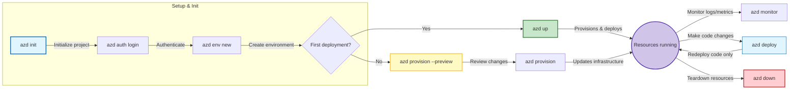
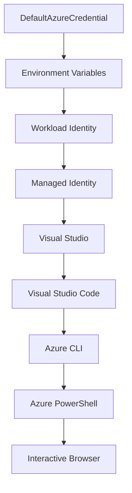

# AZD základy - Jádrové koncepty a základy

**Navigace kapitolou:**
- **📚 Domů kurzu**: [AZD pro začátečníky](../../README.md)
- **📖 Aktuální kapitola**: Kapitola 1 - Základ & Rychlý start
- **⬅️ Předchozí**: [Přehled kurzu](../../README.md#-chapter-1-foundation--quick-start)
- **➡️ Další**: [Instalace a nastavení](installation.md)
- **🚀 Další kapitola**: [Kapitola 2: Vývoj orientovaný na AI](../chapter-02-ai-development/microsoft-foundry-integration.md)

## Úvod

> Přezkoumáno vůči `azd 1.37.2` (listopad 2026). Příkazy Bash používají uvedené zástupné znaky, které musíte nahradit. Šablony pracovních postupů používají `.` k inicializaci aktuálního adresáře; bez argumentu adresáře vytvoří inicializace šablony podsložku a nezmění pracovní adresář shellu. Pokročilé úryvky jsou ilustrační, nejsou kompletními projekty.

Tato lekce vás seznámí s Azure Developer CLI (azd), mocným nástrojem příkazové řádky, který urychluje vaši cestu od místního vývoje k nasazení na Azure. Naučíte se základní koncepty, hlavní funkce a pochopíte, jak azd zjednodušuje nasazování cloud-nativních aplikací.

## Výukové cíle

Na konci této lekce budete:
- Rozumět, co je Azure Developer CLI a jaký je jeho hlavní účel
- Naučit se základní koncepty šablon, prostředí a služeb
- Prozkoumat klíčové funkce včetně vývoje poháněného šablonami a infrastruktury jako kódu
- Pochopit strukturu projektu azd a pracovní postup
- Být připraveni nainstalovat a konfigurovat azd pro vaše vývojové prostředí

## Výsledky učení

Po dokončení této lekce budete moci:
- Vysvětlit roli azd v moderních pracovních postupech cloudového vývoje
- Identifikovat součásti struktury projektu azd
- Popsat, jak šablony, prostředí a služby spolupracují
- Porozumět výhodám infrastruktury jako kódu s azd
- Rozpoznat různé azd příkazy a jejich účely

## Co je Azure Developer CLI (azd)?

Azure Developer CLI (azd) je nástroj příkazové řádky navržený k urychlení vaší cesty od místního vývoje k nasazení na Azure. Zjednodušuje proces budování, nasazování a správy cloud-nativních aplikací na Azure.

### Co můžete nasadit pomocí azd?

azd podporuje širokou škálu pracovních zátěží — a seznam neustále roste. Dnes můžete pomocí azd nasadit:

| Typ pracovní zátěže | Příklady | Stejný pracovní postup? |
|---------------|----------|----------------|
| **Tradiční aplikace** | Webové aplikace, REST API, statické weby | ✅ `azd up` |
| **Služby a mikroslužby** | Container Apps, Function Apps, back-endy s více službami | ✅ `azd up` |
| **Aplikace poháněné AI** | Chatovací aplikace s Microsoft Foundry Models, RAG řešení s AI vyhledáváním | ✅ `azd up` |
| **Inteligentní agenti** | Agenti hostovaní ve Foundry, orchestrace více agentů | ✅ `azd up` |

Klíčovou poznámkou je, že **životní cyklus azd zůstává stejný bez ohledu na to, co nasazujete**. Inicializujete projekt, zřizujete infrastrukturu, nasazujete svůj kód, sledujete aplikaci a uklízíte — ať už jde o jednoduchý web nebo sofistikovaného AI agenta.

Tato kontinuita je záměrná. azd považuje AI schopnosti jako další druh služby, kterou vaše aplikace může používat, nikoli jako něco zásadně odlišného. Chatovací koncový bod podporovaný Microsoft Foundry Models je z pohledu azd jen další službou ke konfiguraci a nasazení.

### 🎯 Proč používat AZD? Srovnání z praxe

Porovnejme nasazení jednoduché webové aplikace s databází:

#### ❌ BEZ AZD: Manuální nasazení na Azure (30+ minut)

**Ilustrační srovnání Bash, ne spustitelný startér aplikace.** Předpokládá existující aplikační kód, unikátní názvy zdrojů, autentizaci Azure CLI a požadované rozšíření CLI. Použijte níže uvedený šablonový úkol pro podporovanou kompletní cestu.

```bash
# Step 1: Create resource group
az group create --name myapp-rg --location eastus

# Step 2: Create App Service Plan
az appservice plan create --name myapp-plan \
  --resource-group myapp-rg \
  --sku B1 --is-linux

# Step 3: Create Web App
az webapp create --name myapp-web-unique123 \
  --resource-group myapp-rg \
  --plan myapp-plan \
  --runtime "NODE:22-lts"

# Step 4: Create Cosmos DB account (10-15 minutes)
az cosmosdb create --name myapp-cosmos-unique123 \
  --resource-group myapp-rg \
  --kind MongoDB

# Step 5: Create database
az cosmosdb mongodb database create \
  --account-name myapp-cosmos-unique123 \
  --resource-group myapp-rg \
  --name tododb

# Step 6: Create collection
az cosmosdb mongodb collection create \
  --account-name myapp-cosmos-unique123 \
  --resource-group myapp-rg \
  --database-name tododb \
  --name todos

# Step 7: Get connection string
CONN_STR=$(az cosmosdb keys list \
  --name myapp-cosmos-unique123 \
  --resource-group myapp-rg \
  --type connection-strings \
  --query "connectionStrings[0].connectionString" -o tsv)

# Step 8: Configure app settings
az webapp config appsettings set \
  --name myapp-web-unique123 \
  --resource-group myapp-rg \
  --settings MONGODB_URI="$CONN_STR"

# Step 9: Enable logging
az webapp log config --name myapp-web-unique123 \
  --resource-group myapp-rg \
  --application-logging filesystem \
  --detailed-error-messages true

# Step 10: Set up Application Insights
az monitor app-insights component create \
  --app myapp-insights \
  --location eastus \
  --resource-group myapp-rg

# Step 11: Link App Insights to Web App
INSTRUMENTATION_KEY=$(az monitor app-insights component show \
  --app myapp-insights \
  --resource-group myapp-rg \
  --query "instrumentationKey" -o tsv)

az webapp config appsettings set \
  --name myapp-web-unique123 \
  --resource-group myapp-rg \
  --settings APPINSIGHTS_INSTRUMENTATIONKEY="$INSTRUMENTATION_KEY"

# Step 12: Build application locally
npm install
npm run build

# Step 13: Create deployment package
zip -r app.zip . -x "*.git*" "node_modules/*"

# Step 14: Deploy application
az webapp deployment source config-zip \
  --resource-group myapp-rg \
  --name myapp-web-unique123 \
  --src app.zip

# Step 15: Wait and pray it works 🙏
# (No automated validation, manual testing required)
```

**Problémy:**
- ❌ 15+ příkazů k zapamatování a vykonání ve správném pořadí
- ❌ 30-45 minut manuální práce
- ❌ Snadno dělat chyby (překlepy, špatné parametry)
- ❌ Požadavky na explicitní zacházení s přihlašovacími údaji; ladicí logy a sledování shellu je mohou odhalit
- ❌ Žádné automatické vrácení zpět při selhání
- ❌ Složité reprodukování pro členy týmu
- ❌ Každé nasazení je jiné (nereprodukovatelné)

#### ✅ S AZD: Automatizované nasazení (5 příkazů, 10-15 minut)

```bash
# Step 1: Initialize from template
azd init --template todo-nodejs-mongo .

# Step 2: Authenticate
azd auth login

# Step 3: Select the environment created during init
azd env select dev

# Step 4: Preview changes (optional but recommended)
azd provision --preview

# Step 5: Deploy everything
azd up

# ✨ Done! Everything is deployed, configured, and monitored
```

**Výhody:**
- ✅ **5 příkazů** vs. 15+ manuálních kroků
- ✅ **10-15 minut** celkový čas (většinou čekání na Azure)
- ✅ **Méně manuálních chyb** - konzistentní, šablonami řízený pracovní postup
- ✅ **Bezpečné zacházení s tajemstvími** - mnoho šablon používá Azure řízené úložiště tajemství
- ✅ **Opakovatelné nasazení** - stejný pracovní postup pokaždé
- ✅ **Opakovatelné definice infrastruktury** - podléhá kvótám, dostupnosti regionů a verzím šablon
- ✅ **Připraveno pro tým** - kdokoli může nasadit stejnými příkazy
- ✅ **Infrastruktura jako kód** - šablony Bicep ve verzovacím systému
- ✅ **Monitorování definované v šabloně** - Application Insights pokud je součástí šablony

### Čas a spolehlivost

Časy výše jsou odhady, nikoli benchmarky. azd snižuje počet příkazů, které musíte koordinovat, ale nezaručuje dobu nasazení, neeliminuje chyby ani neposkytuje automatické vrácení aplikace/databáze. Uchovávejte funkční verze v řízení zdrojů a testujte recovery postupy.

## Jádrové koncepty

### Šablony
Šablony jsou základem azd. Obsahují:
- **Kód aplikace** - váš zdrojový kód a závislosti
- **Definice infrastruktury** - zdroje Azure definované v Bicep nebo Terraform
- **Konfigurační soubory** - nastavení a proměnné prostředí
- **Skripty nasazení** - automatizované pracovní postupy nasazení

### Prostředí
Prostředí představují různé cíle nasazení:
- **Vývoj** - pro testování a vývoj
- **Staging** - předprodukční prostředí
- **Produkce** - živé produkční prostředí

Každé prostředí udržuje své vlastní:
- Název a hodnoty prostředí; izolace zdrojů závisí na infrastrukturní šabloně
- Konfigurační nastavení
- Stav nasazení

### Služby
Služby v `azure.yaml` popisují nasaditelné komponenty aplikace:
- **Frontend** - webové aplikace, SPA
- **Backend** - API, mikroslužby

Databáze a úložiště jsou normálně zřizovány jako infrastrukturní zdroje, ne jako imaginární hostitelé služeb jako `host: postgres`.

## Klíčové vlastnosti

### 1. Vývoj řízený šablonami
```bash
# Browse available templates
azd template list

# Initialize from a template
azd init --template "<template-name>" .
```

### 2. Infrastruktura jako kód
- **Bicep** - jazyk specifický pro Azure
- **Terraform** - nástroj pro více-cloudovou infrastrukturu
- Bicep se překládá do ARM šablon; surový ARM JSON není samostatným vestavěným `infra.provider`.

### 3. Integrované pracovní postupy
```bash
# Complete deployment workflow
azd up            # Provision + Deploy this is hands off for first time setup

# 🧪 NEW: Preview infrastructure changes before deployment (SAFE)
azd provision --preview    # Simulate infrastructure deployment without making changes

azd provision     # Create Azure resources if you update the infrastructure use this
azd deploy        # Deploy application code or redeploy application code once update
azd down          # Clean up resources
```

#### 🛡️ Bezpečné plánování infrastruktury s náhledem
Příkaz `azd provision --preview` je průlomový pro bezpečná nasazení:
- **Analýza bez aplikování** - ukáže, co bude vytvořeno, upraveno nebo odstraněno
- **Neaplikuje infrastrukturu** - kontroluje změny poskytovatelů; nejdříve si prohlédněte projektové háky, protože háky mohou spouštět příkazy s vedlejšími účinky
- **Týmová spolupráce** - sdílení výsledků náhledu před nasazením
- **Vstup pro plánování nákladů** - prohlédněte navrhované SKU, pak je oceněte pomocí Azure Pricing Calculator; náhled nepočítá ceny

```bash
# Example preview workflow
azd provision --preview           # See what will change
# Review the output, discuss with team
azd provision                     # Apply changes with confidence
```

### 📊 Vizualizace: Vývojový pracovní postup AZD



**Vysvětlení pracovního postupu:**
1. **Init** - Začněte se šablonou nebo novým projektem
2. **Auth** - Autentizace s Azure
3. **Environment** - Vytvoření izolovaného nasazovacího prostředí
4. **Preview** - 🆕 Vždy nejprve zobrazit náhled změn infrastruktury (bezpečná praxe)
5. **Provision** - Vytvoření/aktualizace zdrojů Azure
6. **Deploy** - Načtení kódu aplikace
7. **Monitor** - Sledování výkonu aplikace
8. **Iterate** - Provádění změn a opětovné nasazení kódu
9. **Cleanup** - Odstranění zdrojů po dokončení

### 4. Správa prostředí
```bash
# Create and manage environments
azd env new "<environment-name>"
azd env select "<environment-name>"
azd env list
```

### 5. Rozšíření a AI příkazy

azd používá systém rozšíření pro přidání schopností nad rámec základního CLI. To je zvláště užitečné pro AI pracovní zatížení:

```bash
# List available extensions
azd extension list

# Install the Foundry agents extension
azd extension install azure.ai.agents

# Initialize an AI agent project interactively
azd ai agent init

# Test a deployed agent (shows latency and time-to-first-byte)
azd ai agent invoke

# Start the MCP server for AI-assisted development (Alpha)
azd mcp start
```

**Životní cyklus agenta od začátku do konce.** Použijte `azure.ai.agents` pro operace životního cyklu agenta a nainstalujte `azure.ai.evaluations` samostatně pro hodnocení. Použijte `azd >= 1.37.0` pro kombinovaný pracovní postup. Nepotřebujete všechny hned první den:

| Fáze | Příkaz | Co dělá |
|-------|---------|--------------|
| **Scaffold** | `azd ai agent init --template <path-to-azure.yaml>` | Převzetí aktuální šablony projektu agenta |
| **Test** | `azd ai agent invoke` | Zavolání agenta a zobrazení doby odezvy |
| **Measure** | `azd ai eval init`, `generate`, `run start` | Konfigurace, nasazení a spuštění hodnocení pomocí samostatného rozšíření |
| **Improve** | `azd ai agent optimize --eval <evaluation-name> --optimize-model <optimizer-deployment>` | Znovupoužití kompatibilního hodnocení pro optimalizaci agenta |
| **Inspect** | `azd ai agent endpoint show` | Zobrazení konfigurace live endpointu |
| **Clean up** | `azd ai agent delete` | Smazání hostovaného agenta a všech jeho verzí |

> Rozšíření jsou podrobně popsána v [Kapitole 2: Vývoj zaměřený na AI](../chapter-02-ai-development/agents.md) a v referenci [AZD AI CLI příkazy](../chapter-08-production/production-ai-practices.md#azd-ai-cli-commands-and-extensions).

## 📁 Struktura projektu

Typická struktura projektu azd:
```
my-app/
├── .azure/                  # Local environments and selected-environment config
│   ├── config.json
│   └── dev/.env
├── .devcontainer/          # Development container config
├── .github/workflows/      # GitHub Actions
├── .vscode/               # VS Code settings
├── infra/                 # Infrastructure code
│   ├── main.bicep        # Main infrastructure template
│   ├── main.parameters.json
│   └── modules/          # Reusable modules
├── src/                  # Application source code
│   ├── api/             # Backend services
│   └── web/             # Frontend application
├── azure.yaml           # azd project configuration
└── README.md
```

## 🔧 Konfigurační soubory

### azure.yaml
Hlavní konfigurační soubor projektu:
```yaml
name: my-awesome-app
metadata:
  template: my-template@1.0.0

services:
  web:
    project: ./src/web
    language: js
    host: appservice
  api:
    project: ./src/api
    language: js
    host: appservice

hooks:
  preprovision:
    shell: pwsh
    run: echo "Preparing to provision..."
```

### .azure/config.json
Lokální výběr výchozího prostředí projektu (ilustrační; spravováno azd):
```json
{
  "defaultEnvironment": "dev"
}
```

## 🎪 Běžné pracovní postupy s praktickými cvičeními

> **💡 Tip pro učení:** Následujte tyto cvičení postupně, abyste si postupně vybudovali dovednosti AZD.

### 🎯 Cvičení 1: Inicializace prvního projektu

**Cíl:** Vytvořit projekt AZD a prozkoumat jeho strukturu

**Kroky:**
```bash
# Use a proven template
mkdir azd-basics-practice
cd azd-basics-practice
# Choose "dev" for the environment name when prompted
azd init --template todo-nodejs-mongo .

# Explore the generated files
ls -la  # View all files including hidden ones

# Key files created:
# - azure.yaml (main config)
# - infra/ (infrastructure code)
# - src/ (application code)
```

**✅ Úspěch:** Máte adresáře azure.yaml, infra/ a src/

---

### 🎯 Cvičení 2: Nasazení na Azure

**Cíl:** Dokončit kompletní nasazení

**Kroky:**
```bash
# 1. Authenticate
azd auth login

# 2. Select the dev environment created in Exercise 1
azd env select dev
azd env set AZURE_LOCATION eastus

# 3. Preview changes (RECOMMENDED)
azd provision --preview

# 4. Deploy everything
azd up

# 5. Verify deployment
azd show    # View your app URL
```

**Odhadovaný čas:** 10-15 minut  
**✅ Úspěch:** URL aplikace se otevře v prohlížeči

---

### 🎯 Cvičení 3: Více prostředí

**Cíl:** Nasazení do dev a staging

**Kroky:**
```bash
# Already have dev, create staging
azd env new staging
azd env set AZURE_LOCATION westus2
azd up

# Switch between them
azd env list
azd env select dev
```

**✅ Úspěch:** Dvě samostatné skupiny zdrojů v Azure Portálu

**Úklid:** Cvičení 3 vytvoří druhé zpoplatněné nasazení. Po dokončení smažte obě:

```bash
azd down --environment dev
azd down --environment staging
```

---

### 🛡️ Destruktivní úklid: `azd down --force --purge`

Pokud chcete úmyslně smazat Azure zdroje vybraného prostředí:

```bash
azd down --force --purge
```

**Co dělá:**
- `--force`: Žádné potvrzovací výzvy
- `--purge`: Také trvale smaže podporované mákčeně smazané zdroje (například Key Vaults), kde to ochrana před vyčištěním umožňuje. Lokální adresář `.azure/` nesmaže.

**Použijte, když:** je prostředí jednorázové a dokončili jste s ním práci. Nepovažujte destruktivní úklid za první krok při chybě autentizace, kvóty nebo konfigurace.

---

## 🎪 Originální referenční pracovní postup

### Zahájení nového projektu
```bash
# Method 1: Use existing template
azd init --template todo-nodejs-mongo .

# Method 2: Start from scratch
azd init

# Method 3: Use current directory
azd init .
```

### Vývojový cyklus
```bash
# Set up development environment
azd auth login
azd env new dev
azd env select dev

# Deploy everything
azd up

# Make changes and redeploy
azd deploy

# Clean up when done
azd down --force --purge # Deletes this environment's discovered Azure resources; review before forcing deletion.
```

## Pochopení `azd down --force --purge`
Příkaz `azd down --force --purge` je mocný způsob, jak úplně rozebrat prostředí azd a všechny k němu přidružené zdroje. Zde je rozpis, co jednotlivé přepínače dělají:
```
--force
```
- Přeskočí výzvy k potvrzení.
- Užitečné pro automatizaci nebo skriptování, kde manuální vstup není možný.
- Neobchází oprávnění, ochranu vyčištění ani chyby při mazání.

```
--purge
```
Trvale odstraní podporované Azure zdroje, které byly měkce smazány, bez dalšího potvrzení. Ochrana před vymazáním a oprávnění stále platí. **Neodstraní** místní prostředí ani složku `.azure/`.


### Proč používat obojí?
Používejte obojí pouze pokud hodláte odstranit Azure zdroje vybraného prostředí a vymazat obnovitelné zdroje. Toto je destruktivní úklid, nikoli obecná oprava nebo reset místního stavu.

Je to obzvlášť užitečné po ručním mazání zdrojů v portálu Azure nebo při přepínání šablon, prostředí či konvencí pojmenování skupin zdrojů.


### Správa více prostředí
```bash
# Create staging environment
azd env new staging
azd env select staging
azd up

# Switch back to dev
azd env select dev

# Compare environments
azd env list
```

## 🔐 Autentizace a přihlašovací údaje

Rozlišujte autentizaci nasazení (`azd auth login`) od autentizace v SDK aplikace (`DefaultAzureCredential`). Jsou oddělené. azd ve výchozím nastavení nepoužívá přihlašovací údaje Azure CLI.

### Autentizace Azure CLI (`az login`)

Spusťte `azd auth login` pro azd. Následující příkazy Azure CLI jsou volitelné a autentizují příkazy `az` samostatně:

```bash
# Interactive login (opens browser)
az login

# Login with specific tenant
az login --tenant "<tenant-id>"

# Login with service principal
az login --service-principal -u "<app-id>" -p "<password>" --tenant "<tenant-id>"

# Check current login status
az account show

# List available subscriptions
az account list --output table

# Set default subscription
az account set --subscription "<subscription-id>"
```

### Průběh autentizace
1. **Interaktivní přihlášení**: Otevře váš výchozí prohlížeč pro autentizaci
2. **Device code flow**: Pro prostředí bez přístupu k prohlížeči
3. **Servisní principal**: Pro automatizaci a scénáře CI/CD
4. **Managed Identity**: Pro aplikace hostované v Azure

### Řetězec DefaultAzureCredential

`DefaultAzureCredential` je typ přihlašovacích údajů, který poskytuje zjednodušenou autentizaci tím, že automaticky zkouší několik zdrojů přihlašovacích údajů v konkrétním pořadí:

#### Řetězec přihlašovacích údajů SDK aplikace

Přesný řetězec závisí na jazyce Azure Identity SDK, verzi, nainstalovaných pluginech a možnostech. Tento diagram je konceptuální, nikoli pevná sekvence ověřování azd; novější SDK mohou také zahrnovat přihlašovací údaje Azure Developer CLI.


#### 1. Proměnné prostředí
```bash
# Set environment variables for service principal
export AZURE_CLIENT_ID="<app-id>"
export AZURE_CLIENT_SECRET="<password>"
export AZURE_TENANT_ID="<tenant-id>"
```

#### 2. Pracovní identita (Kubernetes/GitHub Actions)
Používá se automaticky v:
- Azure Kubernetes Service (AKS) s Pracovní identitou
- GitHub Actions s OIDC federací
- Jiné scénáře federované identity

#### 3. Spravovaná identita
Pro Azure zdroje jako:
- Virtuální stroje
- App Service
- Azure Functions
- Kontejnerové instance

```bash
# Inspect a deployed Container App's configured identity (requires az login)
az containerapp show --name "<app-name>" --resource-group "<rg-name>" --query identity
```

#### 4. Integrace vývojářských nástrojů
- **Visual Studio**: Automaticky používá přihlášený účet
- **VS Code**: Podpora závisí na SDK a jeho podpoře brokera/pluginů
- **Azure CLI**: Používá `az login` přihlašovací údaje (nejčastější pro lokální vývoj)

### Nastavení ověřování AZD

```bash
# Method 1: Direct azd authentication (recommended)
azd auth login

# Method 2: Direct azd authentication
azd auth login --use-device-code  # For headless environments

# Method 3: Check authentication status
azd auth login --check-status

# Method 4: Logout and re-authenticate
azd auth logout
azd auth login
```

### Nejlepší postupy ověřování

#### Pro lokální vývoj
```bash
# 1. Log in to azd
azd auth login

# 2. Select the subscription for this initialized environment
azd env set AZURE_SUBSCRIPTION_ID "<subscription-id>"

# 3. Check azd sign-in details (read the status message)
azd auth login --check-status
```

#### Pro CI/CD pipeline
```yaml
# Partial GitHub Actions steps: assumes checkout, azd installation,
# required AZURE_* environment values, and pipeline secret configuration.
- name: Deploy with azd
  run: |
    azd auth login --client-id ${{ secrets.AZURE_CLIENT_ID }} \
                    --client-secret ${{ secrets.AZURE_CLIENT_SECRET }} \
                    --tenant-id ${{ secrets.AZURE_TENANT_ID }}
    azd up --no-prompt
```

#### Pro produkční prostředí
- Používejte **Spravovanou identitu** při běhu na Azure zdrojích
- Používejte **Service Principal** pro scénáře automatizace
- Vyhněte se ukládání přihlašovacích údajů do kódu nebo konfiguračních souborů
- Používejte **Azure Key Vault** pro citlivou konfiguraci

### Běžné problémy s ověřováním a řešení

#### Problém: "Nenalezena žádná subscription"
```bash
# Solution: Set default subscription
az account list --output table
az account set --subscription "<subscription-id>"
azd env set AZURE_SUBSCRIPTION_ID "<subscription-id>"
```

#### Problém: "Nedostatečná oprávnění"
```bash
# Solution: Check and assign required roles
az role assignment list --assignee $(az account show --query user.name --output tsv)

# Common required roles:
# - Contributor (for resource management)
# - User Access Administrator (for role assignments)
```

#### Problém: "Token vypršel"
```bash
# Solution: Re-authenticate
az logout
az login
azd auth logout
azd auth login
```

### Ověřování v různých scénářích

#### Lokální vývoj
```bash
# Personal development account
az login
azd auth login
```

#### Týmový vývoj
```bash
# Use specific tenant for organization
az login --tenant contoso.onmicrosoft.com
azd auth login --tenant-id "<tenant-id>"
```

#### Multi-tenant scénáře
```bash
# Switch between tenants
az login --tenant tenant1.onmicrosoft.com
azd auth login --tenant-id "<tenant-1-id>"
# Select an environment configured with tenant 1's subscription
azd env select tenant1-dev
# Deploy to tenant 1
azd up

az login --tenant tenant2.onmicrosoft.com  
azd auth login --tenant-id "<tenant-2-id>"
azd env select tenant2-dev
# Deploy to tenant 2
azd up
```

### Bezpečnostní úvahy

1. **Ukládání pověření**: Nikdy neukládejte pověření do zdrojového kódu
2. **Omezení rozsahu**: Používejte princip nejmenších oprávnění u service principals
3. **Rotace tokenů**: Pravidelně rotujte tajemství service principalů
4. **Auditní stopa**: Sledujte aktivity ověřování a nasazení
5. **Síťová bezpečnost**: Používejte soukromé koncové body, pokud je to možné

### Řešení problémů s ověřováním

```bash
# Debug authentication issues
azd auth login --check-status
az account show
az account get-access-token

# Common diagnostic commands
whoami                          # Current user context
az ad signed-in-user show      # Microsoft Entra ID user details
az group list                  # Test resource access
```

## Objevování příkazů

### Objevování
```bash
azd template list              # Browse templates
azd template list --help       # Template discovery options
azd init --help               # Initialization options
```

### Správa projektů
```bash
azd show                     # Project overview
azd env list                # Available environments and selected default
azd config show            # Configuration settings
```

### Monitoring
```bash
azd monitor                  # Open Azure portal monitoring
azd monitor --logs           # View application logs
azd monitor --live           # View live metrics
azd pipeline config          # Set up CI/CD
```

## Nejlepší postupy

### 1. Používejte smysluplná jména
```bash
# Good
azd env new production-east
azd init --template todo-nodejs-mongo .

# Avoid
azd env new env1
azd init --template template1 .
```

### 2. Využívejte šablony
- Začněte s existujícími šablonami
- Přizpůsobte podle svých potřeb
- Vytvářejte znovupoužitelné šablony pro vaši organizaci

### 3. Izolace prostředí
- Používejte oddělená prostředí pro dev/staging/prod
- Nikdy nenasazujte přímo do produkce z lokálního počítače
- Používejte CI/CD pipeline pro produkční nasazení

### 4. Správa konfigurace
- Používejte spravovanou identitu a Key Vault pro tajné údaje; běžné `azd env set` hodnoty jsou lokální plaintext
- Udržujte konfiguraci ve verzovacím systému
- Dokumentujte nastavení specifická pro prostředí

## Postup učení

### Začátečník (1.-2. týden)
1. Nainstalujte azd a přihlašte se
2. Nasazení jednoduché šablony
3. Pochopení struktury projektu
4. Naučte se základní příkazy (up, down, deploy)

### Středně pokročilý (3.-4. týden)
1. Přizpůsobení šablon
2. Správa více prostředí
3. Pochopení infrastruktury jako kódu
4. Nastavení CI/CD pipeline

### Pokročilý (5. týden a dál)
1. Vytváření vlastních šablon
2. Pokročilé vzory infrastruktury
3. Nasazení do více regionů
4. Konfigurace na podnikové úrovni

## Další kroky

**📖 Pokračujte v učení kapitoly 1:**
- [Instalace a nastavení](installation.md) - Nainstalujte a nakonfigurujte azd
- [Váš první projekt](first-project.md) - Dokončete praktický tutoriál
- [Průvodce konfigurací](../chapter-03-configuration/configuration.md) - Pokročilé možnosti konfigurace

**🎯 Připraveni na další kapitolu?**
- [Kapitola 2: Vývoj s prioritou AI](../chapter-02-ai-development/microsoft-foundry-integration.md) - Začněte tvořit AI aplikace

## Další zdroje

- [Přehled Azure Developer CLI](https://learn.microsoft.com/en-us/azure/developer/azure-developer-cli/)
- [Galerie šablon](https://azure.github.io/awesome-azd/)
- [Ukázky od komunity](https://github.com/Azure-Samples)

---

## 🙋 Často kladené otázky

### Obecné otázky

**Otázka: Jaký je rozdíl mezi AZD a Azure CLI?**

Odpověď: Azure CLI (`az`) slouží k správě jednotlivých Azure zdrojů. AZD (`azd`) slouží ke správě celých aplikací:

```bash
# Azure CLI - Low-level resource management
az webapp create --name myapp --resource-group rg
az sql server create --name myserver --resource-group rg
# ...many more commands needed

# AZD - Application-level management
azd up  # Deploys entire app with all resources
```

**Přemýšlejte o tom takto:**
- `az` = Práce s jednotlivými Lego kostkami
- `azd` = Práce s kompletními Lego sadami

---

**Otázka: Musím znát Bicep nebo Terraform pro použití AZD?**

Odpověď: Ne! Začněte se šablonami:
```bash
# Use existing template - no IaC knowledge needed
azd init --template todo-nodejs-mongo .
azd up
```

Bicep se můžete naučit později pro přizpůsobení infrastruktury. Šablony poskytují funkční příklady k učení.

---

**Otázka: Kolik stojí provoz AZD šablon?**

Odpověď: Náklady se liší podle regionu, SKU, doby provozu, režimu databáze a používání modelu. Vývojové prostředí může způsobit značné měsíční poplatky i v době nečinnosti; nepředpokládejte univerzální rozmezí 50-150 USD:

```bash
# Preview resource changes (not prices)
azd provision --preview

# Always cleanup when not using
azd down --force --purge  # Removes all resources
```

**Profesionální tip:** Používejte dostupné bezplatné úrovně:
- App Service: F1 (zdarma)
- Azure OpenAI: není obecná garantovaná měsíční bezplatná kvóta tokenů; zkontrolujte aktuální model a ceny
- Cosmos DB: způsobilé účty s provisioned-throughput mohou být zařazeny do bezplatné úrovně; serverless šablony automaticky nesplňují podmínky

---

**Otázka: Mohu používat AZD se stávajícími Azure zdroji?**

Odpověď: Ano, ale je jednodušší začít od začátku. AZD nejlépe funguje, když spravuje celý životní cyklus. Pro stávající zdroje:

```bash
# Option 1: Import existing resources (advanced)
azd init
# Then modify infra/ to reference existing resources

# Option 2: Start fresh (recommended)
azd init --template "<verified-template-name>" .
azd up  # Creates new environment
```

---

**Otázka: Jak sdílet svůj projekt s kolegy?**

Odpověď: Zazálohujte AZD projekt do Gitu (ale NE složku .azure):

```bash
# Already in .gitignore by default
.azure/        # Contains secrets and environment data
*.env          # Environment variables

# Team members then:
git clone "<your-repo>"
# Change into the cloned repository before running the remaining commands.
azd auth login
azd env new "<their-name>-dev"
azd up
```

Všichni získají identickou infrastrukturu ze stejných šablon.

---

### Otázky k řešení problémů

**Otázka: „azd up“ selhalo v polovině. Co mám dělat?**

Odpověď: Zkontrolujte chybu, opravte ji a zkuste to znovu:

```bash
# Capture detailed diagnostics (redact sensitive values before sharing)
azd up --debug

# Common fixes:

# 1. If quota exceeded:
azd env set AZURE_LOCATION "westus2"  # Try different region

# 2. If resource name conflict:
azd down --force --purge  # Clean slate
azd up  # Retry

# 3. If auth expired:
az login
azd auth login
azd up
```

**Nejčastější problém:** Vybrána špatná Azure subscription
```bash
az account list --output table
az account set --subscription "<correct-subscription>"
azd env set AZURE_SUBSCRIPTION_ID "<correct-subscription-id>"
```

---

**Otázka: Jak nasadit pouze změny kódu bez reprovisioningu?**

Odpověď: Použijte `azd deploy` místo `azd up`:

```bash
azd up          # First time: provision + deploy (slow)

# Make code changes...

azd deploy      # Subsequent times: deploy only (fast)
```

Porovnání rychlosti:
- `azd up`: 10-15 minut (provisionuje infrastrukturu)
- `azd deploy`: 2-5 minut (pouze kód)

---

**Otázka: Mohu přizpůsobit infrastrukturu šablon?**

Odpověď: Ano! Upravte Bicep soubory v `infra/`:

```bash
# After azd init
cd infra/
code main.bicep  # Edit in VS Code

# Preview changes
azd provision --preview

# Apply changes
azd provision
```

**Tip:** Začněte s malým - nejdříve změňte SKU:
```bicep
// infra/main.bicep
sku: {
  name: 'B1'  // Change to 'P1V2' for production
}
```

---

**Otázka: Jak odstranit vše, co AZD vytvořil?**

Odpověď: Jeden příkaz odstraní všechny zdroje:

```bash
azd down --force --purge

# This deletes:
# - Azure resources/resource groups discovered for the selected environment
# - Supported soft-deleted resources, if purge protection allows
# Local .azure files remain; shared/external resources may remain too.
```

**Vždy spusťte, když:**
- Dokončíte testování šablony
- Přecházíte na jiný projekt
- Chcete začít na čistém štítě

**Kontrola nákladů:** Potvrďte smazání v Azure a zkontrolujte případné držené/společné zdroje. Dříve vzniklé náklady nadále platí.

---

**Otázka: Co když omylem smažu zdroje v Azure Portalu?**

Odpověď: Stav AZD se může rozladit. Přístup na čistý štít:

```bash
# 1. Delete remaining resources only if that is your intent
azd down --force --purge

# 2. Start fresh
azd up

# Alternative: Let AZD detect and fix
azd provision  # Will create missing resources
```

---

### Pokročilé otázky

**Otázka: Mohu používat AZD v CI/CD pipeline?**

Odpověď: Ano! Příklad GitHub Actions:

```yaml
# .github/workflows/deploy.yml
name: Deploy with AZD

on:
  push:
    branches: [main]

jobs:
  deploy:
    runs-on: ubuntu-latest
    steps:
      - uses: actions/checkout@v4
      
      - name: Install azd
        run: curl -fsSL https://aka.ms/install-azd.sh | bash
      
      - name: Azure Login
        run: |
          azd auth login \
            --client-id ${{ secrets.AZURE_CLIENT_ID }} \
            --client-secret ${{ secrets.AZURE_CLIENT_SECRET }} \
            --tenant-id ${{ secrets.AZURE_TENANT_ID }}
      
      - name: Deploy
        env:
          AZURE_ENV_NAME: dev
          AZURE_LOCATION: ${{ vars.AZURE_LOCATION }}
          AZURE_SUBSCRIPTION_ID: ${{ vars.AZURE_SUBSCRIPTION_ID }}
        run: azd up --no-prompt
```

---

**Otázka: Jak spravovat tajné údaje a citlivá data?**

Odpověď: Výslovně používejte Key Vault. `azd env set` zapisuje běžné hodnoty do lokálního env souboru; automaticky nevytváří vault, nepřiřazuje role ani nevkládá tajné údaje do aplikace.

```bash
# Interactive: create/select a Key Vault secret and save its reference
azd env set-secret DATABASE_PASSWORD
```

Potřebujete příslušná oprávnění k vaultu. Infrastruktura/aplikace musí stále propojit tajemství se svým konzumentem a udělit runtime identitě přístup. Nevypisujte rozluštěné tajné hodnoty v logách.

**Nikdy nezazálohujte:**
- Složku `.azure/` (obsahuje data prostředí)
- Soubor `.env` (lokální tajemství)
- Připojovací řetězce

---

**Otázka: Mohu nasadit do více regionů?**

Odpověď: Ano, vytvořte prostředí pro každý region:

```bash
# East US environment
azd env new prod-eastus
azd env set AZURE_LOCATION eastus
azd up

# West Europe environment
azd env new prod-westeurope
azd env set AZURE_LOCATION westeurope
azd up

# Each environment is independent
azd env list
```

Pro skutečné multi-region aplikace přizpůsobte Bicep šablony k současnému nasazení do více regionů.

---

**Otázka: Kde mohu získat pomoc, když uvíznu?**

1. **Dokumentace AZD:** https://learn.microsoft.com/azure/developer/azure-developer-cli/
2. **GitHub Issues:** https://github.com/Azure/azure-dev/issues
3. **Discord:** [Azure Discord](https://discord.gg/microsoft-azure) - kanál #azure-developer-cli
4. **Stack Overflow:** Tag `azure-developer-cli`
5. **Tento kurz:** [Průvodce řešením problémů](../chapter-07-troubleshooting/common-issues.md)

**Profesionální tip:** Před dotazem spusťte:
```bash
azd show       # Shows current state
azd version    # Shows your version
```
Zahrňte tyto informace do svého dotazu pro rychlejší pomoc.

---

## 🎓 Co dál?

Teď rozumíte základům AZD. Vyberte svou cestu:

### 🎯 Pro začátečníky:
1. **Dále:** [Instalace a nastavení](installation.md) - Nainstalujte AZD na svůj počítač
2. **Potom:** [Váš první projekt](first-project.md) - Nasazení první aplikace
3. **Procvičujte:** Dokončete všech 3 cvičení v této lekci

### 🚀 Pro vývojáře AI:
1. **Přejděte na:** [Kapitola 2: Vývoj s prioritou AI](../chapter-02-ai-development/microsoft-foundry-integration.md)
2. **Nasazujte:** V prázdném adresáři projektu začněte s `azd init --template get-started-with-ai-chat .`
3. **Naučte se:** Stavte aplikaci při nasazení

### 🏗️ Pro zkušené vývojáře:
1. **Prohlédněte:** [Průvodce konfigurací](../chapter-03-configuration/configuration.md) - Pokročilá nastavení
2. **Prozkoumejte:** [Infrastruktura jako kód](../chapter-04-infrastructure/provisioning.md) - Hluboký pohled na Bicep
3. **Vytvářejte:** Vytvořte vlastní šablony pro svůj stack

---

**Navigace kapitol:**
- **📚 Domovská stránka kurzu**: [AZD pro začátečníky](../../README.md)
- **📖 Aktuální kapitola**: Kapitola 1 - Základy a rychlý start  
- **⬅️ Předchozí**: [Přehled kurzu](../../README.md#-chapter-1-foundation--quick-start)
- **➡️ Další**: [Instalace a nastavení](installation.md)
- **🚀 Další kapitola**: [Kapitola 2: Vývoj s prioritou AI](../chapter-02-ai-development/microsoft-foundry-integration.md)

---

<!-- CO-OP TRANSLATOR DISCLAIMER START -->
**Prohlášení o omezení odpovědnosti**:
Tento dokument byl přeložen pomocí AI překladatelské služby [Co-op Translator](https://github.com/Azure/co-op-translator). Přestože usilujeme o co největší přesnost, mějte prosím na paměti, že automatizované překlady mohou obsahovat chyby nebo nepřesnosti. Originální dokument v jeho mateřském jazyce by měl být považován za autoritativní zdroj. Pro kritické informace se doporučuje profesionální lidský překlad. Nejsme odpovědní za jakékoli nedorozumění nebo nesprávné interpretace vzniklé použitím tohoto překladu.
<!-- CO-OP TRANSLATOR DISCLAIMER END -->