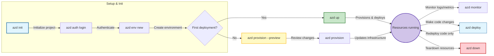
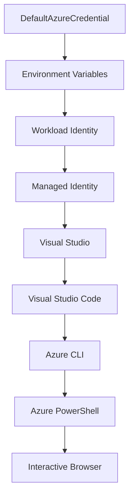

# AZD Základy - Jádrové Koncepty a Základy

**Navigace Kapitolou:**
- **📚 Domů Kurz**: [AZD Pro Začátečníky](../../README.md)
- **📖 Aktuální Kapitola**: Kapitola 1 - Základy & Rychlý Start
- **⬅️ Předchozí**: [Přehled Kurzu](../../README.md#-chapter-1-foundation--quick-start)
- **➡️ Další**: [Instalace & Nastavení](installation.md)
- **🚀 Další Kapitola**: [Kapitola 2: AI-první Vývoj](../chapter-02-ai-development/microsoft-foundry-integration.md)

## Úvod

> Přezkoumáno podle `azd 1.37.2` (listopad 2026). Bash příkazy používají citované zástupné symboly, které musíte nahradit. Šablonové workflow používají `.` k inicializaci aktuálního adresáře; bez argumentu adresáře inicializace šablony vytvoří podadresář a nezmění pracovní adresář vašeho shellu. Pokročilé úryvky jsou ilustrativní, ne kompletní projekty.

Tato lekce vás seznámí s Azure Developer CLI (azd), výkonným nástrojem příkazového řádku, který urychluje váš přechod od lokálního vývoje k nasazení na Azure. Naučíte se základní koncepty, hlavní funkce a pochopíte, jak azd zjednodušuje nasazení cloudově nativních aplikací.

## Cíle Učení

Na konci této lekce budete:
- Rozumět tomu, co Azure Developer CLI je a jaký je jeho hlavní účel
- Naučit se základní koncepty šablon, prostředí a služeb
- Prozkoumat klíčové funkce včetně vývoje řízeného šablonami a infrastruktury jako kódu
- Pochopit strukturu projektu azd a pracovní postup
- Být připraveni na instalaci a konfiguraci azd pro vaše vývojové prostředí

## Výstupy Učení

Po dokončení této lekce budete schopni:
- Vysvětlit roli azd v moderních cloudových vývojových pracovních postupech
- Rozpoznat komponenty struktury projektu azd
- Popsat, jak spolupracují šablony, prostředí a služby
- Pochopit výhody infrastruktury jako kódu s azd
- Rozpoznat různé příkazy azd a jejich účely

## Co je Azure Developer CLI (azd)?

Azure Developer CLI (azd) je nástroj příkazového řádku navržený k urychlení vašeho přechodu od lokálního vývoje k nasazení na Azure. Zjednodušuje proces budování, nasazení a správy cloudově nativních aplikací na Azure.

### Co můžete nasadit pomocí azd?

azd podporuje širokou škálu zátěží — a seznam se neustále rozrůstá. Dnes můžete použít azd k nasazení:

| Typ zátěže | Příklady | Stejný pracovní postup? |
|---------------|----------|----------------|
| **Tradiční aplikace** | Webové aplikace, REST API, statické stránky | ✅ `azd up` |
| **Služby a mikroservisy** | Container Apps, Function Apps, více-službové backendy | ✅ `azd up` |
| **Aplikace s využitím AI** | Chat aplikace s Microsoft Foundry Modely, RAG řešení s AI Vyhledáváním | ✅ `azd up` |
| **Inteligentní agenti** | Agenti hostovaní ve Foundry, orchestrace více agentů | ✅ `azd up` |

Klíčovým poznatkem je, že **životní cyklus azd zůstává stejný bez ohledu na to, co nasazujete**. Inicializujete projekt, zajistíte infrastrukturu, nasadíte kód, sledujete aplikaci a uklízíte — ať už je to jednoduchá webová stránka nebo sofistikovaný AI agent.

Tato kontinuita je záměrná. azd považuje AI schopnosti za další druh služby, kterou vaše aplikace může používat, nikoli za něco zásadně odlišného. Chatovací konec podporovaný Microsoft Foundry Modely je z pohledu azd jen další službou k nastavení a nasazení.

### 🎯 Proč používat AZD? Srovnání z praxe

Porovnejme nasazení jednoduché webové aplikace s databází:

#### ❌ BEZ AZD: Manuální nasazení na Azure (30+ minut)

**Ilustrativní porovnání Bash, ne spustitelný startér aplikace.** Předpokládá existující aplikační kód, unikátní názvy zdrojů, Azure CLI autentizaci a požadované rozšíření CLI. Použijte níže uvedený šablonový cvičební příklad pro podporovanou cestu end-to-end.

```bash
# Step 1: Create resource group
az group create --name myapp-rg --location eastus

# Step 2: Create App Service Plan
az appservice plan create --name myapp-plan \
  --resource-group myapp-rg \
  --sku B1 --is-linux

# Step 3: Create Web App
az webapp create --name myapp-web-unique123 \
  --resource-group myapp-rg \
  --plan myapp-plan \
  --runtime "NODE:22-lts"

# Step 4: Create Cosmos DB account (10-15 minutes)
az cosmosdb create --name myapp-cosmos-unique123 \
  --resource-group myapp-rg \
  --kind MongoDB

# Step 5: Create database
az cosmosdb mongodb database create \
  --account-name myapp-cosmos-unique123 \
  --resource-group myapp-rg \
  --name tododb

# Step 6: Create collection
az cosmosdb mongodb collection create \
  --account-name myapp-cosmos-unique123 \
  --resource-group myapp-rg \
  --database-name tododb \
  --name todos

# Step 7: Get connection string
CONN_STR=$(az cosmosdb keys list \
  --name myapp-cosmos-unique123 \
  --resource-group myapp-rg \
  --type connection-strings \
  --query "connectionStrings[0].connectionString" -o tsv)

# Step 8: Configure app settings
az webapp config appsettings set \
  --name myapp-web-unique123 \
  --resource-group myapp-rg \
  --settings MONGODB_URI="$CONN_STR"

# Step 9: Enable logging
az webapp log config --name myapp-web-unique123 \
  --resource-group myapp-rg \
  --application-logging filesystem \
  --detailed-error-messages true

# Step 10: Set up Application Insights
az monitor app-insights component create \
  --app myapp-insights \
  --location eastus \
  --resource-group myapp-rg

# Step 11: Link App Insights to Web App
INSTRUMENTATION_KEY=$(az monitor app-insights component show \
  --app myapp-insights \
  --resource-group myapp-rg \
  --query "instrumentationKey" -o tsv)

az webapp config appsettings set \
  --name myapp-web-unique123 \
  --resource-group myapp-rg \
  --settings APPINSIGHTS_INSTRUMENTATIONKEY="$INSTRUMENTATION_KEY"

# Step 12: Build application locally
npm install
npm run build

# Step 13: Create deployment package
zip -r app.zip . -x "*.git*" "node_modules/*"

# Step 14: Deploy application
az webapp deployment source config-zip \
  --resource-group myapp-rg \
  --name myapp-web-unique123 \
  --src app.zip

# Step 15: Wait and pray it works 🙏
# (No automated validation, manual testing required)
```

**Problémy:**
- ❌ Více než 15 příkazů si zapamatovat a vykonat ve správném pořadí
- ❌ 30-45 minut manuální práce
- ❌ Snadné chyby (překlepy, špatné parametry)
- ❌ Povinné explicitní nakládání s přihlašovacími údaji; ladicí logy a sledování shellu je mohou odhalit
- ❌ Chybí automatický rollback při selhání
- ❌ Obtížné opakovat pro týmové členy
- ❌ Každé nasazení je jiné (nereprodukovatelné)

#### ✅ S AZD: Automatizované nasazení (5 příkazů, 10-15 minut)

```bash
# Step 1: Initialize from template
azd init --template todo-nodejs-mongo .

# Step 2: Authenticate
azd auth login

# Step 3: Select the environment created during init
azd env select dev

# Step 4: Preview changes (optional but recommended)
azd provision --preview

# Step 5: Deploy everything
azd up

# ✨ Done! Everything is deployed, configured, and monitored
```

**Výhody:**
- ✅ **5 příkazů** vs. více než 15 manuálních kroků
- ✅ Celkem **10-15 minut** (většinou čekání na Azure)
- ✅ **Méně manuálních chyb** - konzistentní, šablonou řízený pracovní postup
- ✅ **Bezpečné nakládání s tajnými údaji** - mnoho šablon používá Azure-managed ukládání tajemství
- ✅ **Opakovatelné nasazení** - stejný pracovní postup pokaždé
- ✅ **Opakovatelné definice infrastruktury** - podléhá kvótám, dostupnosti regionu a verzím šablon
- ✅ **Připravené pro tým** - kdokoli může nasadit stejnými příkazy
- ✅ **Infrastruktura jako kód** - verzované Bicep šablony
- ✅ **Monitorování definované šablonou** - Application Insights pokud je zahrnuto ve šabloně

### Čas a Spolehlivost

Časy uvedené výše jsou odhady, nikoli benchmarky. azd snižuje počet příkazů, které musíte koordinovat, ale nezaručuje dobu nasazení, neeliminuje chyby ani neposkytuje automatický rollback aplikace/databáze. Udržujte funkční verze v řízení zdrojů a testujte postupy obnovy.

## Základní Koncepty

### Šablony
Šablony jsou základem azd. Obsahují:
- **Kód aplikace** - Váš zdrojový kód a závislosti
- **Definice infrastruktury** - Azure zdroje definované v Bicep nebo Terraform
- **Konfigurační soubory** - Nastavení a proměnné prostředí
- **Nasazovací skripty** - Automatizované workflow nasazení

### Prostředí
Prostředí představují různé cíle nasazení:
- **Vývojové** - Pro testování a vývoj
- **Předprodukční (Staging)** - Předprodukční prostředí
- **Produkční** - Živé produkční prostředí

Každé prostředí si udržuje vlastní:
- Název prostředí a hodnoty; izolace zdrojů závisí na infrastrukturní šabloně
- Konfigurační nastavení
- Stav nasazení

### Služby
Služby v `azure.yaml` popisují nasaditelné komponenty aplikace:
- **Frontend** - Webové aplikace, SPA
- **Backend** - API, mikroservisy

Databáze a úložiště jsou normálně zajišťovány jako infrastrukturní zdroje, ne jako vymýšlení hostitelů služeb jako `host: postgres`.

## Klíčové Funkce

### 1. Vývoj řízený šablonami
```bash
# Browse available templates
azd template list

# Initialize from a template
azd init --template "<template-name>" .
```

### 2. Infrastruktura jako kód
- **Bicep** - Doménově specifický jazyk Azure
- **Terraform** - Nástroj infrastruktury pro více cloudů
- Bicep se překládá do ARM šablon; surový ARM JSON není samostatný vestavěný `infra.provider`.

### 3. Integrované Workflow
```bash
# Complete deployment workflow
azd up            # Provision + Deploy this is hands off for first time setup

# 🧪 NEW: Preview infrastructure changes before deployment (SAFE)
azd provision --preview    # Simulate infrastructure deployment without making changes

azd provision     # Create Azure resources if you update the infrastructure use this
azd deploy        # Deploy application code or redeploy application code once update
azd down          # Clean up resources
```

#### 🛡️ Bezpečné plánování infrastruktury s náhledem
Příkaz `azd provision --preview` je průlomový pro bezpečné nasazení:
- **Analýza bez změn** - Ukazuje, co bude vytvořeno, upraveno, nebo smazáno
- **Žádná aplikace infrastruktury** - Kontroluje změny poskytovatele; nejprve prohlédněte projektové háčky, protože háčky mohou spouštět příkazy s vedlejšími účinky
- **Týmová spolupráce** - Sdílejte výsledky náhledu před nasazením
- **Vstup pro plánování nákladů** - Zkontrolujte navrhované SKU, pak je oceněte pomocí Azure Pricing Calculator; náhled nepočítá ceny

```bash
# Example preview workflow
azd provision --preview           # See what will change
# Review the output, discuss with team
azd provision                     # Apply changes with confidence
```

### 📊 Vizualizace: Vývojový workflow AZD



**Vysvětlení workflow:**
1. **Init** - Začněte se šablonou nebo novým projektem
2. **Auth** - Autentizace do Azure
3. **Prostředí** - Vytvoření izolovaného nasazovacího prostředí
4. **Preview** - 🆕 Vždy nejprve náhled změn infrastruktury (bezpečná praxe)
5. **Provision** - Vytvoření/aktualizace zdrojů Azure
6. **Deploy** - Nasazení aplikačního kódu
7. **Monitor** - Sledování výkonu aplikace
8. **Iterate** - Provádějte změny a znovu nasazujte kód
9. **Cleanup** - Odstranění zdrojů po dokončení

### 4. Správa Prostředí
```bash
# Create and manage environments
azd env new "<environment-name>"
azd env select "<environment-name>"
azd env list
```

### 5. Rozšíření a AI příkazy

azd používá systém rozšíření k přidání schopností nad jádrovou CLI. To je zvláště užitečné pro AI zátěže:

```bash
# List available extensions
azd extension list

# Install the GA Foundry bundle (requires azd >= 1.37.0)
azd ext install microsoft.foundry

# Initialize an AI agent project interactively
azd ai agent init

# Test a deployed agent (shows latency and time-to-first-byte)
azd ai agent invoke

# Start the MCP server for AI-assisted development (Alpha)
azd mcp start
```

**Životní cyklus agenta od začátku do konce.** Balíček GA `microsoft.foundry` zahrnuje `azure.ai.agents` a šest dalších jádrových rozšíření. Nainstalujte `azure.ai.evaluations` samostatně pro hodnocení. Pro tento workflow použijte `azd >= 1.37.0`. Nemusíte mít vše hned od prvního dne:

| Fáze | Příkaz | Co dělá |
|-------|---------|--------------|
| **Skelet** | `azd ai agent init --template <path-to-azure.yaml>` | Přijměte šablonu aktuálního agentního projektu |
| **Lokální spuštění** | `azd ai agent run`, potom `azd ai agent invoke --local "Test prompt"` v jiném terminálu | Kontrola lokální aktivity v Agent Inspector; volání modelu stále používají Azure |
| **Nasazení** | `azd deploy` | Pro agentní kód-hosting, nahrajte zdroj pro vzdálenou Foundry build |
| **Testování** | `azd ai agent invoke` | Zavolejte agenta a sledujte čas odezvy |
| **Měření** | `azd ai eval init`, `generate`, `run start` | Konfigurujte, nasazujte a provádějte hodnocení pomocí samostatného rozšíření |
| **Zlepšování** | `azd ai agent optimize --eval <evaluation-name> --optimize-model <optimizer-deployment>` | Znovu použijte kompatibilní hodnocení k optimalizaci agenta |
| **Inspekce** | `azd ai agent endpoint show` | Zobrazte konfiguraci běžícího endpointu |
| **Úklid** | `azd ai agent delete` | Odstraňte hostingového agenta a všechny jeho verze |

> Začněte s [návodem na hostovaného agenta GA](../chapter-02-ai-development/microsoft-foundry-integration.md#hosted-agent-walkthrough-ga), který pokrývá požadavky, zajištění a bezpečný úklid. Rozšíření jsou podrobněji popsána v referenci [AZD AI CLI Příkazy](../chapter-08-production/production-ai-practices.md#azd-ai-cli-commands-and-extensions).

## 📁 Struktura Projektu

Typická struktura projektu azd:
```
my-app/
├── .azure/                  # Local environments and selected-environment config
│   ├── config.json
│   └── dev/.env
├── .devcontainer/          # Development container config
├── .github/workflows/      # GitHub Actions
├── .vscode/               # VS Code settings
├── infra/                 # Infrastructure code
│   ├── main.bicep        # Main infrastructure template
│   ├── main.parameters.json
│   └── modules/          # Reusable modules
├── src/                  # Application source code
│   ├── api/             # Backend services
│   └── web/             # Frontend application
├── azure.yaml           # azd project configuration
└── README.md
```

## 🔧 Konfigurační Soubory

### azure.yaml
Hlavní konfigurační soubor projektu:
```yaml
name: my-awesome-app
metadata:
  template: my-template@1.0.0

services:
  web:
    project: ./src/web
    language: js
    host: appservice
  api:
    project: ./src/api
    language: js
    host: appservice

hooks:
  preprovision:
    shell: pwsh
    run: echo "Preparing to provision..."
```

### .azure/config.json
Lokální výběr výchozího prostředí projektu (ilustrativní; spravuje azd):
```json
{
  "defaultEnvironment": "dev"
}
```

## 🎪 Běžné Workflow s Praktickými Cvičeními

> **💡 Tip pro učení:** Sledujte tato cvičení v pořadí, abyste si postupně budovali AZD dovednosti.

### 🎯 Cvičení 1: Inicializujte svůj první projekt

**Cíl:** Vytvořit AZD projekt a prozkoumat jeho strukturu

**Kroky:**
```bash
# Use a proven template
mkdir azd-basics-practice
cd azd-basics-practice
# Choose "dev" for the environment name when prompted
azd init --template todo-nodejs-mongo .

# Explore the generated files
ls -la  # View all files including hidden ones

# Key files created:
# - azure.yaml (main config)
# - infra/ (infrastructure code)
# - src/ (application code)
```

**✅ Úspěch:** Máte adresáře azure.yaml, infra/ a src/

---

### 🎯 Cvičení 2: Nasazení do Azure

**Cíl:** Dokončit end-to-end nasazení

**Kroky:**
```bash
# 1. Authenticate
azd auth login

# 2. Select the dev environment created in Exercise 1
azd env select dev
azd env set AZURE_LOCATION eastus

# 3. Preview changes (RECOMMENDED)
azd provision --preview

# 4. Deploy everything
azd up

# 5. Verify deployment
azd show    # View your app URL
```

**Očekávaný čas:** 10-15 minut  
**✅ Úspěch:** URL aplikace se otevře v prohlížeči

---

### 🎯 Cvičení 3: Více prostředí

**Cíl:** Nasazení do vývojového a předprodukčního prostředí

**Kroky:**
```bash
# Already have dev, create staging
azd env new staging
azd env set AZURE_LOCATION westus2
azd up

# Switch between them
azd env list
azd env select dev
```

**✅ Úspěch:** Dvě samostatné skupiny zdrojů v Azure Portálu

**Úklid:** Cvičení 3 vytváří druhé účtovatelné nasazení. Po dokončení odstraňte obě:

```bash
azd down --environment dev
azd down --environment staging
```

---

### 🛡️ Destruktivní úklid: `azd down --force --purge`

Když chcete úmyslně odstranit Azure zdroje vybraného prostředí:

```bash
azd down --force --purge
```

**Co dělá:**
- `--force`: Žádné potvrzovací výzvy
- `--purge`: Také trvale odstraní podporované soft-delete zdroje (například Key Vaulty), pokud to ochrana před očistou dovoluje. Neodstraňuje místní adresář `.azure/`.

**Použijte, když:** skončíte s jednorázovým prostředím. Neraďte destruktivní úklid jako první kroky při problémech s autentizací, kvótami nebo konfigurací.

---

## 🎪 Původní Referenční Workflow

### Zahájení nového projektu
```bash
# Method 1: Use existing template
azd init --template todo-nodejs-mongo .

# Method 2: Start from scratch
azd init

# Method 3: Use current directory
azd init .
```

### Vývojový cyklus
```bash
# Set up development environment
azd auth login
azd env new dev
azd env select dev

# Deploy everything
azd up

# Make changes and redeploy
azd deploy

# Clean up when done
azd down --force --purge # Deletes this environment's discovered Azure resources; review before forcing deletion.
```

## Pochopení `azd down --force --purge`
Příkaz `azd down --force --purge` je mocný způsob, jak kompletně rozebrat vaše azd prostředí a všechny související zdroje. Zde je přehled funkcí jednotlivých přepínačů:
```
--force
```
- Přeskakuje potvrzovací výzvy.
- Užitočné pro automatizaci nebo skriptování, kde není možné manuální zadání.
- Neobchází oprávnění, ochranu před očistou ani neúspěchy mazání.

```
--purge
```
Trvale odstraní podporované Azure zdroje, které jsou měkce smazané, bez dalšího potvrzení. Ochrana proti vyčištění a oprávnění stále platí. **Ne**odstraní místní prostředí ani složku `.azure/`.


### Proč používat obojí?
Používejte obojí pouze tehdy, pokud zamýšlíte odstranit Azure zdroje vybraného prostředí a vyčistit obnovitelné zdroje. Toto je destruktivní vyčištění, nikoli obecná oprava nebo reset místního stavu.

Je to obzvláště užitečné po ručním odstranění zdrojů v portálu Azure nebo při přepínání šablon, prostředí či konvencí pojmenování skupin zdrojů.


### Správa vícero prostředí
```bash
# Create staging environment
azd env new staging
azd env select staging
azd up

# Switch back to dev
azd env select dev

# Compare environments
azd env list
```

## 🔐 Autentizace a přihlašovací údaje

Rozlišujte mezi autentizací nasazení (`azd auth login`) a autentizací aplikace SDK (`DefaultAzureCredential`). Jsou to oddělené věci. azd ve výchozím nastavení nepoužívá přihlašovací údaje Azure CLI.

### Autentizace Azure CLI (`az login`)

Pro azd spusťte `azd auth login`. Následující příkazy Azure CLI jsou volitelné a autentizují příkazy `az` samostatně:

```bash
# Interactive login (opens browser)
az login

# Login with specific tenant
az login --tenant "<tenant-id>"

# Login with service principal
az login --service-principal -u "<app-id>" -p "<password>" --tenant "<tenant-id>"

# Check current login status
az account show

# List available subscriptions
az account list --output table

# Set default subscription
az account set --subscription "<subscription-id>"
```

### Průběh autentizace
1. **Interaktivní přihlášení**: Otevře váš výchozí prohlížeč pro autentizaci
2. **Device Code Flow**: Pro prostředí bez přístupu k prohlížeči
3. **Service Principal**: Pro scénáře automatizace a CI/CD
4. **Managed Identity**: Pro aplikace hostované v Azure

### DefaultAzureCredential Chain

`DefaultAzureCredential` je typ pověření, který poskytuje zjednodušený autentizační zážitek tím, že automaticky zkouší několik zdrojů pověření v konkrétním pořadí:

#### Application SDK Credential Chain

Přesný řetězec závisí na jazyce Azure Identity SDK, verzi, nainstalovaných pluginech a nastaveních. Tento diagram je koncepční, není pevně danou autentizační sekvencí azd; novější SDK mohou také obsahovat pověření Azure Developer CLI.


#### 1. Environment Variables
```bash
# Set environment variables for service principal
export AZURE_CLIENT_ID="<app-id>"
export AZURE_CLIENT_SECRET="<password>"
export AZURE_TENANT_ID="<tenant-id>"
```

#### 2. Workload Identity (Kubernetes/GitHub Actions)
Používá se automaticky v:
- Azure Kubernetes Service (AKS) s Workload Identity
- GitHub Actions s OIDC federací
- Ostatních scénářích s federovanou identitou

#### 3. Managed Identity
Pro Azure zdroje jako:
- Virtuální stroje
- App Service
- Azure Functions
- Container Instances

```bash
# Inspect a deployed Container App's configured identity (requires az login)
az containerapp show --name "<app-name>" --resource-group "<rg-name>" --query identity
```

#### 4. Integrace nástrojů pro vývojáře
- **Visual Studio**: Automaticky používá přihlášený účet
- **VS Code**: Podpora závisí na SDK a nastavení podporovaného brokera/pluginu
- **Azure CLI**: Používá `az login` pověření (nejběžnější pro lokální vývoj)

### Nastavení autentizace AZD

```bash
# Method 1: Direct azd authentication (recommended)
azd auth login

# Method 2: Direct azd authentication
azd auth login --use-device-code  # For headless environments

# Method 3: Check authentication status
azd auth login --check-status

# Method 4: Logout and re-authenticate
azd auth logout
azd auth login
```

### Nejlepší praktiky autentizace

#### Pro lokální vývoj
```bash
# 1. Log in to azd
azd auth login

# 2. Select the subscription for this initialized environment
azd env set AZURE_SUBSCRIPTION_ID "<subscription-id>"

# 3. Check azd sign-in details (read the status message)
azd auth login --check-status
```

#### Pro CI/CD pipeliny
```yaml
# Partial GitHub Actions steps: assumes checkout, azd installation,
# required AZURE_* environment values, and pipeline secret configuration.
- name: Deploy with azd
  run: |
    azd auth login --client-id ${{ secrets.AZURE_CLIENT_ID }} \
                    --client-secret ${{ secrets.AZURE_CLIENT_SECRET }} \
                    --tenant-id ${{ secrets.AZURE_TENANT_ID }}
    azd up --no-prompt
```

#### Pro produkční prostředí
- Používejte **Managed Identity**, pokud běžíte na Azure zdrojích
- Používejte **Service Principal** pro scénáře automatizace
- Vyhýbejte se ukládání pověření do kódu nebo konfiguračních souborů
- Používejte **Azure Key Vault** pro citlivou konfiguraci

### Běžné problémy s autentizací a řešení

#### Problém: "No subscription found"
```bash
# Solution: Set default subscription
az account list --output table
az account set --subscription "<subscription-id>"
azd env set AZURE_SUBSCRIPTION_ID "<subscription-id>"
```

#### Problém: "Insufficient permissions"
```bash
# Solution: Check and assign required roles
az role assignment list --assignee $(az account show --query user.name --output tsv)

# Common required roles:
# - Contributor (for resource management)
# - User Access Administrator (for role assignments)
```

#### Problém: "Token expired"
```bash
# Solution: Re-authenticate
az logout
az login
azd auth logout
azd auth login
```

### Autentizace v různých scénářích

#### Lokální vývoj
```bash
# Personal development account
az login
azd auth login
```

#### Týmový vývoj
```bash
# Use specific tenant for organization
az login --tenant contoso.onmicrosoft.com
azd auth login --tenant-id "<tenant-id>"
```

#### Multi-tenant scénáře
```bash
# Switch between tenants
az login --tenant tenant1.onmicrosoft.com
azd auth login --tenant-id "<tenant-1-id>"
# Select an environment configured with tenant 1's subscription
azd env select tenant1-dev
# Deploy to tenant 1
azd up

az login --tenant tenant2.onmicrosoft.com  
azd auth login --tenant-id "<tenant-2-id>"
azd env select tenant2-dev
# Deploy to tenant 2
azd up
```

### Bezpečnostní úvahy

1. **Ukládání pověření**: Nikdy neukládejte pověření v zdrojovém kódu
2. **Omezení rozsahu**: Používejte princip nejmenších oprávnění pro service principaly
3. **Rotace tokenů**: Pravidelně měňte tajemství service principalů
4. **Auditní stopa**: Monitorujte autentizační a nasazovací aktivity
5. **Síťová bezpečnost**: Používejte privátní endpointy, pokud je to možné

### Řešení problémů s autentizací

```bash
# Debug authentication issues
azd auth login --check-status
az account show
az account get-access-token

# Common diagnostic commands
whoami                          # Current user context
az ad signed-in-user show      # Microsoft Entra ID user details
az group list                  # Test resource access
```

## Objevování příkazů

### Objevování
```bash
azd template list              # Browse templates
azd template list --help       # Template discovery options
azd init --help               # Initialization options
```

### Správa projektů
```bash
azd show                     # Project overview
azd env list                # Available environments and selected default
azd config show            # Configuration settings
```

### Monitorování
```bash
azd monitor                  # Open Azure portal monitoring
azd monitor --logs           # View application logs
azd monitor --live           # View live metrics
azd pipeline config          # Set up CI/CD
```

## Nejlepší praktiky

### 1. Používejte smysluplné názvy
```bash
# Good
azd env new production-east
azd init --template todo-nodejs-mongo .

# Avoid
azd env new env1
azd init --template template1 .
```

### 2. Využívejte šablony
- Začněte s existujícími šablonami
- Přizpůsobte si je podle potřeb
- Vytvořte znovupoužitelné šablony pro svou organizaci

### 3. Izolace prostředí
- Používejte oddělená prostředí pro vývoj/testování/produkci
- Nikdy nedeployujte přímo do produkce z lokálního počítače
- Používejte CI/CD pipeliny pro nasazení do produkce

### 4. Správa konfigurace
- Používejte managed identity a Key Vault pro tajemství; běžné hodnoty `azd env set` jsou lokálně v prostém textu
- Uchovávejte konfiguraci ve verzovacím systému
- Dokumentujte nastavení specifická pro prostředí

## Postup učení

### Začátečník (1.-2. týden)
1. Nainstalujte azd a autentizujte se
2. Nasadťe jednoduchou šablonu
3. Pochopte strukturu projektu
4. Naučte se základní příkazy (up, down, deploy)

### Středně pokročilý (3.-4. týden)
1. Přizpůsobte šablony
2. Spravujte více prostředí
3. Pochopte infrastrukturu jako kód
4. Nastavte CI/CD pipeliny

### Pokročilý (5. týden a dál)
1. Vytvářejte vlastní šablony
2. Pokročilé vzory infrastruktury
3. Nasazení do více regionů
4. Konfigurace úrovně podniku

## Další kroky

**📖 Pokračujte v kapitole 1:**
- [Instalace a nastavení](installation.md) - Nainstalujte a nakonfigurujte azd
- [Váš první projekt](first-project.md) - Dokončete praktický tutoriál
- [Průvodce konfigurací](../chapter-03-configuration/configuration.md) - Pokročilé možnosti konfigurace

**🎯 Připraveno na další kapitolu?**
- [Kapitola 2: Vývoj zaměřený na AI](../chapter-02-ai-development/microsoft-foundry-integration.md) - Začněte tvořit AI aplikace

## Další zdroje

- [Přehled Azure Developer CLI](https://learn.microsoft.com/en-us/azure/developer/azure-developer-cli/)
- [Galerie šablon](https://azure.github.io/awesome-azd/)
- [Ukázky z komunity](https://github.com/Azure-Samples)

---

## 🙋 Často kladené otázky

### Obecné otázky

**Q: Jaký je rozdíl mezi AZD a Azure CLI?**

A: Azure CLI (`az`) je pro správu jednotlivých Azure zdrojů. AZD (`azd`) spravuje celé aplikace:

```bash
# Azure CLI - Low-level resource management
az webapp create --name myapp --resource-group rg
az sql server create --name myserver --resource-group rg
# ...many more commands needed

# AZD - Application-level management
azd up  # Deploys entire app with all resources
```

**Myslete na to takto:**
- `az` = Práce s jednotlivými Lego kostkami
- `azd` = Práce s kompletními Lego sety

---

**Q: Potřebuji znát Bicep nebo Terraform pro použití AZD?**

A: Ne! Začněte se šablonami:
```bash
# Use existing template - no IaC knowledge needed
azd init --template todo-nodejs-mongo .
azd up
```

Můžete se později naučit Bicep k přizpůsobení infrastruktury. Šablony poskytují fungující příklady k učení.

---

**Q: Kolik stojí provozování AZD šablon?**

A: Náklady se liší podle regionu, SKU, doby provozu, režimu databáze a použití modelů. Vývojové prostředí může způsobit výrazné měsíční náklady i v klidu; nepočítejte s univerzálním rozsahem 50-150 $:

```bash
# Preview resource changes (not prices)
azd provision --preview

# Always cleanup when not using
azd down --force --purge  # Removes all resources
```

**Profesionální tip:** Používejte dostupné bezplatné tarify:
- App Service: F1 (zdarma)
- Azure OpenAI: bez obecného garantovaného měsíčního bezplatného tokenu; ověřte ceny aktuálního modelu a nabídky
- Cosmos DB: kvalifikované účty s alokovaným propustností mohou využít bezplatný tarif; serverless šablony automaticky nevyužívají

---

**Q: Můžu používat AZD se stávajícími Azure zdroji?**

A: Ano, ale je jednodušší začít znovu. AZD je nejlepší, když spravuje celý životní cyklus. Pro stávající zdroje:

```bash
# Option 1: Import existing resources (advanced)
azd init
# Then modify infra/ to reference existing resources

# Option 2: Start fresh (recommended)
azd init --template "<verified-template-name>" .
azd up  # Creates new environment
```

---

**Q: Jak sdílet projekt s kolegy?**

A: Commitněte AZD projekt do Gitu (ale NE složku .azure):

```bash
# Already in .gitignore by default
.azure/        # Contains secrets and environment data
*.env          # Environment variables

# Team members then:
git clone "<your-repo>"
# Change into the cloned repository before running the remaining commands.
azd auth login
azd env new "<their-name>-dev"
azd up
```

Všichni dostanou stejnou infrastrukturu z těch samých šablon.

---

### Otázky k řešení problémů

**Q: "azd up" selhalo v polovině. Co mám dělat?**

A: Zkontrolujte chybu, opravte ji a zkuste znovu:

```bash
# Capture detailed diagnostics (redact sensitive values before sharing)
azd up --debug

# Common fixes:

# 1. If quota exceeded:
azd env set AZURE_LOCATION "westus2"  # Try different region

# 2. If resource name conflict:
azd down --force --purge  # Clean slate
azd up  # Retry

# 3. If auth expired:
az login
azd auth login
azd up
```

**Nejčastější problém:** Vybrána nesprávná Azure subscription
```bash
az account list --output table
az account set --subscription "<correct-subscription>"
azd env set AZURE_SUBSCRIPTION_ID "<correct-subscription-id>"
```

---

**Q: Jak nasadit jen změny v kódu bez reprovisioningu?**

A: Použijte `azd deploy` místo `azd up`:

```bash
azd up          # First time: provision + deploy (slow)

# Make code changes...

azd deploy      # Subsequent times: deploy only (fast)
```

Porovnání rychlosti:
- `azd up`: 10–15 minut (provisionuje infrastrukturu)
- `azd deploy`: 2–5 minut (jen kód)

---

**Q: Můžu přizpůsobit šablony infrastruktury?**

A: Ano! Upravte Bicep soubory v `infra/`:

```bash
# After azd init
cd infra/
code main.bicep  # Edit in VS Code

# Preview changes
azd provision --preview

# Apply changes
azd provision
```

**Tip:** Začněte malými změnami – nejprve změňte SKU:
```bicep
// infra/main.bicep
sku: {
  name: 'B1'  // Change to 'P1V2' for production
}
```

---

**Q: Jak smažu vše, co AZD vytvořil?**

A: Jeden příkaz odstraní všechny zdroje:

```bash
azd down --force --purge

# This deletes:
# - Azure resources/resource groups discovered for the selected environment
# - Supported soft-deleted resources, if purge protection allows
# Local .azure files remain; shared/external resources may remain too.
```

**Vždy spusťte, když:**
- Dokončíte testování šablony
- Přecházíte na jiný projekt
- Chcete začít znovu

**Kontrola nákladů:** Potvrďte odstranění v Azure a zkontrolujte zachované/společné zdroje. Dříve vzniklé náklady stále platí.

---

**Q: Co když omylem smažu zdroje v Azure Portálu?**

A: Stav AZD může být nesouladný. Přístup „čistý list“:

```bash
# 1. Delete remaining resources only if that is your intent
azd down --force --purge

# 2. Start fresh
azd up

# Alternative: Let AZD detect and fix
azd provision  # Will create missing resources
```

---

### Pokročilé otázky

**Q: Můžu používat AZD v CI/CD pipelinech?**

A: Ano! Příklad GitHub Actions:

```yaml
# .github/workflows/deploy.yml
name: Deploy with AZD

on:
  push:
    branches: [main]

jobs:
  deploy:
    runs-on: ubuntu-latest
    steps:
      - uses: actions/checkout@v4
      
      - name: Install azd
        run: curl -fsSL https://aka.ms/install-azd.sh | bash
      
      - name: Azure Login
        run: |
          azd auth login \
            --client-id ${{ secrets.AZURE_CLIENT_ID }} \
            --client-secret ${{ secrets.AZURE_CLIENT_SECRET }} \
            --tenant-id ${{ secrets.AZURE_TENANT_ID }}
      
      - name: Deploy
        env:
          AZURE_ENV_NAME: dev
          AZURE_LOCATION: ${{ vars.AZURE_LOCATION }}
          AZURE_SUBSCRIPTION_ID: ${{ vars.AZURE_SUBSCRIPTION_ID }}
        run: azd up --no-prompt
```

---

**Q: Jak zacházím s tajemstvími a citlivými daty?**

A: Používejte explicitně Key Vault. `azd env set` zapisuje běžné hodnoty do lokálního environment file; automaticky nevytváří vault, nepřiřazuje role ani nevstřikuje tajemství do aplikace.

```bash
# Interactive: create/select a Key Vault secret and save its reference
azd env set-secret DATABASE_PASSWORD
```

Potřebujete vhodná oprávnění k vaultu. Vaše infrastruktura/aplikace ještě musí tajemství svázat s jeho konzumentem a povolit runtime identitě přístup. Nezobrazujte vyřešené hodnoty tajemství v logech.

**Nikdy necommitujte:**
- Složku `.azure/` (obsahuje data prostředí)
- Soubory `.env` (lokální tajemství)
- Connection stringy

---

**Q: Můžu nasadit do více regionů?**

A: Ano, vytvořte prostředí pro každý region:

```bash
# East US environment
azd env new prod-eastus
azd env set AZURE_LOCATION eastus
azd up

# West Europe environment
azd env new prod-westeurope
azd env set AZURE_LOCATION westeurope
azd up

# Each environment is independent
azd env list
```

Pro skutečné multi-regionální aplikace přizpůsobte Bicep šablony pro souběžné nasazení do více regionů.

---

**Q: Kde najdu pomoc, když uvíznu?**

1. **Dokumentace AZD:** https://learn.microsoft.com/azure/developer/azure-developer-cli/
2. **GitHub Issues:** https://github.com/Azure/azure-dev/issues
3. **Discord:** [Azure Discord](https://discord.gg/microsoft-azure) - kanál #azure-developer-cli
4. **Stack Overflow:** Tag `azure-developer-cli`
5. **Tento kurz:** [Průvodce řešením problémů](../chapter-07-troubleshooting/common-issues.md)

**Profesionální tip:** Před dotazem spusťte:
```bash
azd show       # Shows current state
azd version    # Shows your version
```
Vložte tyto informace do dotazu pro rychlejší pomoc.

---

## 🎓 Co dál?

Teď již rozumíte základům AZD. Vyberte si cestu:

### 🎯 Pro začátečníky:
1. **Další:** [Instalace a nastavení](installation.md) - Nainstalujte AZD na svůj stroj
2. **Potom:** [Váš první projekt](first-project.md) - Nasadťe svou první aplikaci
3. **Procvičujte:** Dokončete všech 3 cvičení v této lekci

### 🚀 Pro AI vývojáře:
1. **Přeskočte na:** [Kapitola 2: Vývoj zaměřený na AI](../chapter-02-ai-development/microsoft-foundry-integration.md)
2. **Nasadťe:** V prázdném adresáři projektu začněte s `azd init --template get-started-with-ai-chat .`
3. **Učte se:** Budujte při nasazování

### 🏗️ Pro zkušené vývojáře:
1. **Prohlédněte:** [Průvodce konfigurací](../chapter-03-configuration/configuration.md) - Pokročilá nastavení
2. **Prozkoumejte:** [Infrastruktura jako kód](../chapter-04-infrastructure/provisioning.md) - Hloubkový pohled na Bicep
3. **Vytvářejte:** Vlastní šablony pro svůj stack

---

**Navigace kapitol:**
- **📚 Domů kurzu**: [AZD pro začátečníky](../../README.md)
- **📖 Aktuální kapitola**: Kapitola 1 - Základy a rychlý start  
- **⬅️ Předchozí**: [Přehled kurzu](../../README.md#-chapter-1-foundation--quick-start)
- **➡️ Další**: [Instalace a nastavení](installation.md)
- **🚀 Další kapitola**: [Kapitola 2: Vývoj zaměřený na AI](../chapter-02-ai-development/microsoft-foundry-integration.md)

---

<!-- CO-OP TRANSLATOR DISCLAIMER START -->
**Prohlášení o omezení odpovědnosti**:
Tento dokument byl přeložen pomocí AI překladatelské služby [Co-op Translator](https://github.com/Azure/co-op-translator). Přestože usilujeme o co největší přesnost, mějte prosím na paměti, že automatizované překlady mohou obsahovat chyby nebo nepřesnosti. Originální dokument v jeho mateřském jazyce by měl být považován za autoritativní zdroj. Pro kritické informace se doporučuje profesionální lidský překlad. Nejsme odpovědní za jakékoli nedorozumění nebo nesprávné interpretace vzniklé použitím tohoto překladu.
<!-- CO-OP TRANSLATOR DISCLAIMER END -->