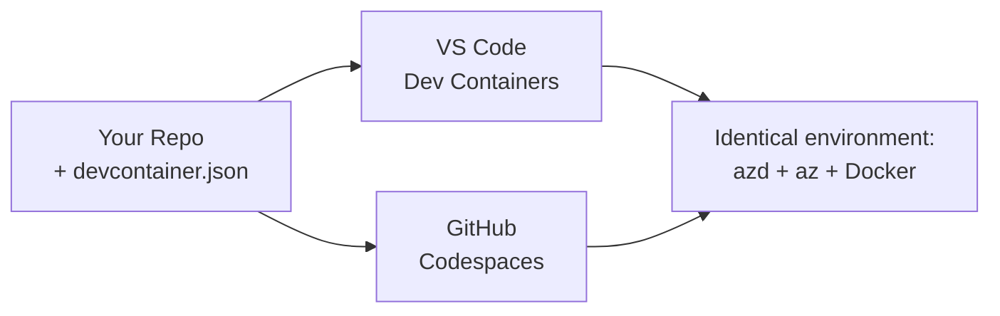

# Vývojové kontejnery & GitHub Codespaces pro azd

**Navigace kapitolou:**
- **📚 Domů do kurzu**: [AZD pro začátečníky](../../README.md)
- **📖 Aktuální kapitola**: Kapitola 1 - Základy a rychlý start
- **⬅️ Předchozí**: [Přineste si vlastní aplikaci](bring-your-own-app.md)
- **🚀 Další kapitola**: [Kapitola 2: Vývoj s důrazem na umělou inteligenci](../chapter-02-ai-development/README.md)

> Cíl přezkoumání příkazů a konfigurace: `azd 1.37.2` (listopad 2026). Sestavení kontejnerů a nasazení do Azure nebylo součástí tohoto přezkoumání.

## Úvod

Instalace azd, správného běhového prostředí jazyka, Dockeru a Azure CLI na každý počítač je úkol – a je to hlavní důvod, proč tutoriál, který „funguje na mém počítači“, selže u někoho jiného. **Vývojový kontejner** to řeší tak, že celý svůj nástrojový řetězec popíšeš v jednom souboru. Kdokoli, kdo otevře projekt ve VS Code nebo GitHub Codespaces, dostane přesně stejné prostředí s již nainstalovaným azd. Tato lekce ti ukáže, jak jeden vytvořit.

## Cíle učení

Na konci této lekce:
- Pochopíš, co je vývojový kontejner a proč pomáhá s azd
- Přidáš minimální `.devcontainer/devcontainer.json` do projektu
- Zahrneš azd, Azure CLI a Docker přes funkce vývojového kontejneru (*features*)
- Otevřeš projekt v GitHub Codespaces nebo ve VS Code

## Výsledky učení

Po dokončení lekce budeš umět:
- Vytvořit `devcontainer.json` pro azd projekt
- Přidat azd a Azure nástroje bez ručních instalací
- Spustit `azd up` uvnitř kontejneru nebo Codespace

---

## Co je vývojový kontejner?

Vývojový kontejner je vývojové prostředí založené na Dockeru, definované v souboru `.devcontainer/devcontainer.json` ve tvém repozitáři. Když otevřeš projekt:

- **VS Code** (s rozšířením Dev Containers) sestaví kontejner a připojí se k němu.
- **GitHub Codespaces** sestaví stejný kontejner v cloudu a poskytne ti editor v prohlížeči.

Každopádně každý přispěvatel má stejné nástroje – žádné „nainstaloval jsi azd?“ řešení problémů.



---

## Krok 1: Vytvoření souboru devcontainer

Vytvoř `.devcontainer/devcontainer.json` v kořenové složce projektu:

```json
{
  "name": "azd-project",
  "image": "mcr.microsoft.com/devcontainers/base:bookworm",
  "features": {
    "ghcr.io/devcontainers/features/azure-cli:1": {},
    "ghcr.io/azure/azure-dev/azd:0": { "version": "1.37.2" },
    "ghcr.io/devcontainers/features/docker-in-docker:2": {},
    "ghcr.io/devcontainers/features/node:1": {}
  },
  "customizations": {
    "vscode": {
      "extensions": [
        "ms-azuretools.azure-dev",
        "ms-azuretools.vscode-bicep"
      ]
    }
  },
  "forwardPorts": [3000],
  "postCreateCommand": "azd version"
}
```

Co jednotlivé části dělají:

| Klíč | Účel |
|-----|---------|
| `image` | Základní OS pro kontejner |
| `features` | Předpřipravené instalátory – zde: Azure CLI, **azd**, Docker a Node.js |
| `customizations.vscode.extensions` | Automaticky instaluje rozšíření azd a Bicep ve VS Code |
| `forwardPorts` | Otevře port tvé aplikace do prohlížeče |
| `postCreateCommand` | Spustí se jednou po sestavení kontejneru (zde kontrola správnosti) |

> Verze funkce (`azd:0`) a nainstalovaná verze CLI jsou různé. Nastav volbu `version` funkce na `"1.37.2"` pro pevné ukotvení CLI; nepoužívej verzi CLI jako značku funkce.

---

## Krok 2: Přizpůsob funkci podle jazyka tvé aplikace

Vyměň funkci `node` za tu, kterou tvoje aplikace používá:

```jsonc
// Python project
"ghcr.io/devcontainers/features/python:1": {},

// .NET project
"ghcr.io/devcontainers/features/dotnet:2": {},

// Java project
"ghcr.io/devcontainers/features/java:1": {},

// Go project
"ghcr.io/devcontainers/features/go:1": {}
```

Zachovej `docker-in-docker` při lokálním sestavování obrazů. Alternativou je konfigurovaná vzdálená sestava ACR (`docker.remoteBuild: true`); samotný typ hostitele nemusí vždy vyžadovat lokální Docker.

---

## Krok 3: Otevři projekt

**Ve VS Code:**
1. Nainstaluj rozšíření **Dev Containers**.
2. Otevři složku projektu.
3. Když se zobrazí výzva, klikni na **Znovuotevřít v kontejneru** (nebo spusť *Dev Containers: Reopen in Container*).

**V GitHub Codespaces:**
1. Nahraj repozitář na GitHub.
2. Klikni na **Code → Codespaces → Vytvořit codespace na main**.
3. Počkej, až se kontejner sestaví – azd bude připravený v terminálu.

---

## Krok 4: Nasazení z kontejneru

Kontejner má azd předinstalovaný, takže normální pracovní postup funguje:

```bash
azd auth login --use-device-code   # device code is handy inside Codespaces
azd up
```

> **Proč používat `--use-device-code`?** Ve vzdáleném kontejneru nebo Codespace není místní prohlížeč pro přesměrování, takže přihlášení pomocí kódu zařízení je spolehlivá cesta. Zadáš kód do záložky prohlížeče, čímž dokončíš přihlášení.

---

## Časté chyby

| Problém | Řešení |
|---------|-----|
| `azd up` nedokáže sestavit obraz | Přidej funkci `docker-in-docker` |
| Přihlášení přes prohlížeč v Codespaces visí | Použij `azd auth login --use-device-code` |
| Nástroje se liší mezi členy týmu | Ukotvi CLI přes volbu `version` ve funkci azd a ukotvi běhová prostředí jazyka |
| Aplikace není dostupná v prohlížeči | Přidej port do `forwardPorts` |

---

## Shrnutí

- Vývojový kontejner dělá tvůj nástrojový řetězec azd reprodukovatelným pro všechny.
- Přidej azd, Azure CLI a Docker přes funkce Dev Container.
- Přizpůsob jazykovou funkci své aplikaci a ponech `docker-in-docker` pro hostitele kontejnerů.
- Použij přihlášení pomocí kódu zařízení při běhu v Codespaces.

---

## 🔗 Navigace

| Směr | Zdroj |
|-----------|----------|
| **Předchozí** | [Přineste si vlastní aplikaci](bring-your-own-app.md) |
| **Domů do kapitoly** | [Kapitola 1: Základy a rychlý start](README.md) |
| **Další kapitola** | [Kapitola 2: Vývoj s důrazem na umělou inteligenci](../chapter-02-ai-development/README.md) |

## 📖 Související zdroje

- [Instalace a nastavení](installation.md)
- [Přehled příkazů](../../resources/cheat-sheet.md)
- [Oficiální specifikace Dev Containers](https://containers.dev/)
- [Funkce Dev Container pro azd](https://github.com/Azure/azure-dev/tree/main/ext/devcontainer)

---

<!-- CO-OP TRANSLATOR DISCLAIMER START -->
**Prohlášení o omezení odpovědnosti**:
Tento dokument byl přeložen pomocí AI překladatelské služby [Co-op Translator](https://github.com/Azure/co-op-translator). Přestože usilujeme o co největší přesnost, mějte prosím na paměti, že automatizované překlady mohou obsahovat chyby nebo nepřesnosti. Originální dokument v jeho mateřském jazyce by měl být považován za autoritativní zdroj. Pro kritické informace se doporučuje profesionální lidský překlad. Nejsme odpovědní za jakékoli nedorozumění nebo nesprávné interpretace vzniklé použitím tohoto překladu.
<!-- CO-OP TRANSLATOR DISCLAIMER END -->