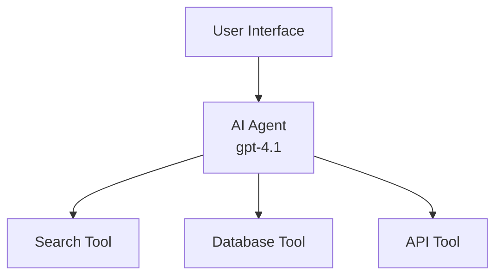
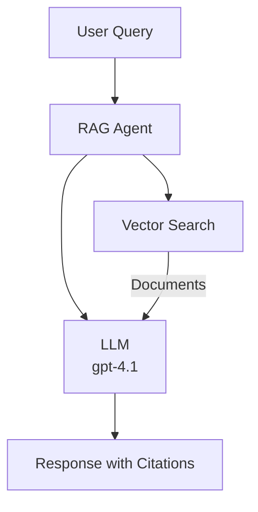
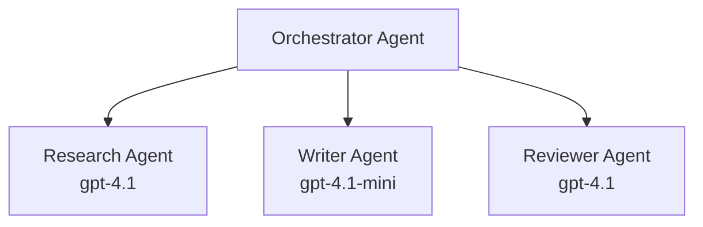

# AI agenti s Azure Developer CLI

**Navigace kapitolou:**
- **📚 Domov kurzu**: [AZD pro začátečníky](../../README.md)
- **📖 Aktuální kapitola**: Kapitola 2 - Vývoj orientovaný na AI
- **⬅️ Předchozí**: [Integrace Microsoft Foundry](microsoft-foundry-integration.md)
- **➡️ Další**: [Nasazení AI modelu](ai-model-deployment.md)
- **🚀 Pokročilé**: [Řešení s více agenty](../../examples/retail-scenario.md)

---

## Úvod

AI agenti jsou autonomní programy, které mohou vnímat své prostředí, činit rozhodnutí a podnikat kroky k dosažení konkrétních cílů. Na rozdíl od jednoduchých chatbotů, kteří odpovídají na podněty, agenti mohou:

- **Používat nástroje** - Volat API, vyhledávat v databázích, spouštět kód
- **Plánovat a uvažovat** - Rozčlenit složité úkoly na kroky
- **Učit se z kontextu** - Udržovat paměť a přizpůsobit chování
- **Spolupracovat** - Pracovat s ostatními agenty (systémy s více agenty)

Tento průvodce vám ukáže, jak nasadit AI agenty do Azure pomocí Azure Developer CLI (azd).

Používání konverzačního kontextu není trénink modelu: trvalá paměť, řízení přístupu a uchovávání musí být implementovány/konfigurovány aplikací.

> **Aktualizace Foundry GA (2026-11-09):** Nainstalujte obecně dostupný `microsoft.foundry` 1.0 balíček s `azd >= 1.37.0`. Hodnocení se instalují samostatně; volitelné náhledové funkce a níže uvedený klasický SDK fragment nejsou v rámci oznámení balíčku propagovány jako GA. Toto doporučení je založeno na [oznámení GA](https://devblogs.microsoft.com/azure-sdk/microsoft-foundry-azure-developer-cli-ga/) a dokumentaci, nikoli na živém nasazení Azure.

## Cíle učení

Dokončením tohoto průvodce budete:
- Chápat, co jsou AI agenti a čím se liší od chatbotů
- Nasazovat předpřipravené šablony AI agentů pomocí AZD
- Konfigurovat Foundry Agenty pro vlastní agenty
- Implementovat základní vzory agentů (použití nástrojů, RAG, více agentů)
- Monitorovat a ladit nasazené agenty

## Výstupy učení

Po dokončení budete schopni:
- Nasadit AI agentní aplikace do Azure jediným příkazem
- Konfigurovat nástroje a schopnosti agentů
- Implementovat retrieval-augmented generation (RAG) u agentů
- Navrhnout víceagentní architektury pro složité pracovní postupy
- Řešit běžné problémy s nasazením agentů

---

## 🤖 Čím se agent liší od chatbota?

| Vlastnost | Chatbot | AI Agent |
|---------|---------|----------|
| **Chování** | Reaguje na výzvy | Podniká autonomní akce |
| **Nástroje** | Může používat vyhledávání nebo nástroje | Obvykle používá nástroje v cílené smyčce |
| **Paměť** | Závisí na aplikaci | Trvalá paměť pouze pokud je explicitně implementována |
| **Plánování** | Jedna odpověď | Vícekrokové uvažování |
| **Spolupráce** | Jednotlivý entita | Může pracovat s dalšími agenty |

### Jednoduchá analýza

- **Chatbot** = Pomocná osoba odpovídající na otázky na informačním stole
- **AI Agent** = Osobní asistent, který může volat, rezervovat schůzky a plnit úkoly za vás

---

## 🚀 Rychlý start: Nasazení vašeho prvního agenta

Zvolte jednu možnost v **novém prázdném pracovním adresáři**. Zakládací `.` inicializuje tam; bez explicitního cíle může aktuální AZD vytvořit podsložku pojmenovanou podle šablony a nemění adresář vašeho shellu. Mějte oddělené šablony/prostředí v oddělených složkách.

Časové/nákladové rozsahy níže jsou ilustrativní, nikoli ověřené nabídky. Před nasazením si ověřte aktuální požadavky, ceny, kvótu modelu a volitelné služby každého vzoru.

### Možnost 1: Šablona Foundry Agentů (Doporučeno)

```bash
# Initialize the AI agents template
azd init --template get-started-with-ai-agents .

# Deploy to Azure
azd up
```

**Co se nasazuje:** Aktuální infrastruktura vzoru a vybrané možnosti určují model, nástroje, hostování a monitorovací zdroje. Prohlédněte si jeho README a `infra/` před zavedením; nepředpokládejte, že každý šablonový agent obsahuje Vyhledávání nebo webové rozhraní.

**Čas:** ~15-20 minut
**Cena:** ~$100-150/měsíc (vývoj)

### Možnost 2: Kreativní psaní agentů s Prompty

```bash
# Initialize the Prompty-based agent template
azd init --template https://github.com/Azure-Samples/contoso-creative-writer .

# Deploy to Azure
azd up
```

**Co se nasazuje:** Multientský vzor psaní FastAPI/Prompty používající Azure OpenAI, Bing Grounding a Azure AI Search. Původní `agent-openai-python-prompty` repozitář přesměrovává sem; není to minimální šablona Azure Functions pro agenta počasí. Řiďte se aktuálním README pro požadavky na hostování, kvótu modelu a Bing Grounding.

**Čas:** ~10-15 minut
**Cena:** ~$50-100/měsíc (vývoj)

### Možnost 3: RAG Chat Agent

```bash
# Initialize RAG chat template
azd init --template azure-search-openai-demo .

# Deploy to Azure
azd up
```

**Co se nasazuje:**
- ✅ Microsoft Foundry Modely
- ✅ Azure AI Search s ukázkovými daty
- ✅ Pipeline pro zpracování dokumentů
- ✅ Chat rozhraní s citacemi

**Čas:** ~15-25 minut
**Cena:** ~$80-150/měsíc (vývoj)

### Možnost 4: Hostovaný agent s GA Foundry balíčkem

Použijte [kompletní průvodce hostovaným agentem](microsoft-foundry-integration.md#hosted-agent-walkthrough-ga) pro základní Python Agent Framework Responses API vzor. Tato cesta nasazení kódu vyžaduje Python 3.13+, aktuální uv, oprávnění Foundry a regionální kvótu modelu. Autentizujte místní SDK volání samostatně při použití Azure CLI přihlašovacích údajů.

```bash
azd auth login
azd ext install microsoft.foundry
```

V prázdném adresáři inicializujte vzor:

```text
azd ai agent init --template https://github.com/microsoft-foundry/foundry-samples/blob/main/samples/python/hosted-agents/agent-framework/responses/01-basic/azure.yaml --deploy-mode code --src .
```

Zvolte nový nebo existující projekt, prohlédněte si `azure.yaml` a spusťte `azd provision`. Použijte `azd ai agent run` pro otevření Agent Inspector a z jiného terminálu v tomto adresáři `azd ai agent invoke --local "Explain how this agent is hosted."`. Po místní verifikaci použijte `azd deploy` a `azd ai agent invoke "Explain how this agent is hosted."` pro porovnání nasazené odpovědi. Foundry sestavuje nahraný zdroj vzdáleně; místní sestavení kontejneru není nutné.

**Kdy používat `azd ai agent init` vs `azd init --template`:**

| Přístup | Nejlepší pro | Jak funguje |
|----------|----------|------|
| `azd init --template` | Začínající s funkční ukázkovou aplikací | Klonuje celý repozitář šablony s kódem + infrastrukturou |
| `azd ai agent init --template` | Přijímající aktuální Foundry agentní projekt | Používá `azure.yaml` projektový dokument a jeho definice |

> **Tip:** Možnosti 1-3 začínají plnými šablonami aplikací; Možnost 4 ukazuje workflow hostovaného agenta GA. Žádný inicializační příkaz automaticky nepřenáší starší manifesty agentů. Pro přidání přímé agentní definice do existujícího projektu viz [návod na inicializaci a migraci](../chapter-08-production/production-ai-practices.md#initializing-agent-projects-with-azd-ai-agent-init).

Nainstalujte `azure.ai.evaluations` zvlášť pro generaci a prohlížení testovacích dat/kritérií, konfigurování hodnocení a jeho spuštění pomocí `azd ai eval`. Optimalizace může znovu použít kompatibilní hodnocení; před explicitním nasazením si prohlédněte kandidáty. Řiďte se [workflow hodnocení](../chapter-08-production/production-ai-practices.md#evaluation-migration-and-quality-checks) a [migrací optimalizace](../chapter-08-production/production-ai-practices.md#optimization-configuration-migration) před opětovným použitím starších příkladů. Pro úklid zůstávají zdroje znovu použitých Foundry projektů po `azd down`; nově vytvořený projekt má smazanou skupinu zdrojů. Viz [návod na úklid](microsoft-foundry-integration.md#7-clean-up-deliberately).

---

## 🏗️ Vzory architektury agentů

### Vzor 1: Jeden agent s nástroji

Nejjednodušší vzor agenta - jeden agent, který může používat více nástrojů.



**Nejlepší pro:**
- Boty zákaznické podpory
- Výzkumné asistenty
- Agenty pro analýzu dat

**Související ukázka aplikace:** `azure-search-openai-demo` demonstruje RAG, nikoli obecně nástrojový agentní cyklus.

### Vzor 2: RAG agent (retrieval-augmented generation)

Agent, který vyhledá relevantní dokumenty před generováním odpovědí.



**Nejlepší pro:**
- Podnikové znalostní báze
- Dokumentové systémy otázek a odpovědí
- Dodržování předpisů a právní výzkum

**AZD šablona:** `azure-search-openai-demo`

### Vzor 3: Systém s více agenty

Více specializovaných agentů pracujících společně na složitých úkolech.



**Nejlepší pro:**
- Složitou tvorbu obsahu
- Vícekrokové pracovní postupy
- Úkoly vyžadující různou odbornost

**Další informace:** [Vzor koordinace více agentů](../chapter-06-pre-deployment/coordination-patterns.md)

---

## ⚙️ Konfigurace nástrojů agentů

Agent se stane silným, když může používat nástroje. Zde je návod na konfiguraci běžných nástrojů:

### Konfigurace nástrojů ve Foundry agenty

Tento **klasický SDK fragment Agent Service** cílí na `azure-ai-projects==1.0.0` a `azure-ai-agents==1.1.0` s `azure-identity`. Není to novější verze agent/Responses API používaná některými současnými Foundry šablonami, ani `azure.ai.agents` AZD rozšíření (jiný balíček). Nemíchejte tyto generace API. Nastavte `PROJECT_ENDPOINT` na klasický Foundry projektový koncový bod a `MODEL_DEPLOYMENT_NAME` na existující podporované nasazení modelu; autentizujte s `az login` lokálně a udělte potřebná oprávnění projektu.

```python
# agent_config.py
import os
from azure.ai.projects import AIProjectClient
from azure.ai.agents.models import FunctionTool
from azure.identity import DefaultAzureCredential

def search_knowledge_base(query: str) -> str:
    """Search the demonstration knowledge base.

    :param query: Search text.
    :return: Matching demonstration information.
    """
    # Local fixture only, not a production search implementation.
    return "Demo policy: returns are accepted within 30 days."

project_client = AIProjectClient(
    endpoint=os.environ["PROJECT_ENDPOINT"],
    credential=DefaultAzureCredential(),
)
search_tool = FunctionTool(functions={search_knowledge_base})
project_client.agents.enable_auto_function_calls(search_tool)
agent = project_client.agents.create_agent(
    model=os.environ["MODEL_DEPLOYMENT_NAME"],
    name="Support Agent",
    instructions="Use search_knowledge_base for policy questions. Label results as demo data.",
    tools=search_tool.definitions,
)
```

Registrování schématu funkce nevykonává Python na službě. V tomto SDK `enable_auto_function_calls` plus `agents.runs.create_and_process(...)` spouští registrované callbacky ve vašem klientském procesu. Viz [uvolněný SDK příklad](https://github.com/Azure/azure-sdk-for-python/blob/azure-ai-agents_1.1.0/sdk/ai/azure-ai-agents/samples/agents_tools/sample_agents_auto_function_call.py). Po dokončení zavřete klienta a smažte demonstrační agenty/vlákna.

### Konfigurace prostředí

Následující názvy jsou **ilustrativní vstupy vlastních šablon**, nikoli zabudované AZD přepínače. Nejprve každou hodnotu propleťte přes `infra/main.parameters.json`, infrastrukturu a aplikační kód. Pouhé `azd env set` nezmění nástroje nebo instrukce agenta.

```bash
# Set up agent-specific environment variables
azd env set AZURE_OPENAI_MODEL "gpt-4.1"
azd env set AGENT_INSTRUCTIONS "You are a helpful assistant..."
azd env set ENABLE_CODE_INTERPRETER "true"
azd env set ENABLE_FILE_SEARCH "true"

# Apply wired infrastructure and application changes
azd up
```

---

## 📊 Monitorování agentů

### Integrace Application Insights

Pokud vybraná šablona zprovozní Application Insights a nakonfiguruje instrumentaci:

```bash
# Open monitoring dashboard
azd monitor --overview

# Open the Application Insights logs view (not a streaming log tail)
azd monitor --logs

# View live metrics
azd monitor --live
```

### Klíčové metriky k sledování

| Metrika | Popis | Cíl |
|--------|-------------|--------|
| Latence odpovědi | Čas k vygenerování odpovědi | < 5 sekund |
| Spotřeba tokenů | Tokeny na požadavek | Sledujte kvůli nákladům |
| Úspěšnost volání nástrojů | % úspěšných provedení nástrojů | > 95% |
| Míra chyb | Neúspěšné požadavky agentů | < 1% |
| Spokojenost uživatelů | Hodnotící skóre | > 4.0/5.0 |

### Vlastní logování pro agenty

```python
import os
from azure.monitor.opentelemetry import configure_azure_monitor
from opentelemetry import trace

# Configure Azure Monitor with OpenTelemetry
configure_azure_monitor(
    connection_string=os.environ["APPLICATIONINSIGHTS_CONNECTION_STRING"]
)

tracer = trace.get_tracer(__name__)

def log_agent_interaction(user_query, agent_response, tools_used, latency_ms):
    with tracer.start_as_current_span("agent_interaction") as span:
        span.set_attributes({
            "query_length": len(user_query),  # Do not log raw prompts or personal data
            "response_length": len(agent_response),
            "tools_used": tools_used,
            "latency_ms": latency_ms
        })
```

> **Poznámka:** Nainstalujte požadovaný balíček: `pip install azure-monitor-opentelemetry`. Zahrnuje závislosti OpenTelemetry; importovaný namespace není požadavek pro instalaci balíčku nazvaného `opentelemetry`.

---

## 💰 Úvahy o nákladech

### Odhadované měsíční náklady podle vzoru

Toto jsou ilustrační plánovací rozsahy, nikoli nabídky nebo výdajové limity. Region, tokeny modelu, Search/compute SKU, relace nástrojů, úložiště a provoz je mohou překročit. Před `azd up` si zkontrolujte pokyny k cenám a Azure ceny vzoru.

| Vzor | Vývojové prostředí | Produkce |
|---------|-----------------|------------|
| Jeden agent | $50-100 | $200-500 |
| RAG agent | $80-150 | $300-800 |
| Více agentů (2-3 agenti) | $150-300 | $500-1,500 |
| Podnikový více agentů | $300-500 | $1,500-5,000+ |

### Tipy pro optimalizaci nákladů

1. **Použijte gpt-4.1-mini pro jednoduché úkoly** (pouze pokud váš vzor tento vstup spotřebovává)
   ```bash
   azd env set AZURE_OPENAI_MODEL "gpt-4.1-mini"
   ```

2. **Implementujte omezené cachování pro bezpečné, opakované dotazy.** Zahrňte autorizaci nájemce/uživatele, nasazení modelu, instrukce a verzi retrieval v klíči cache; nastavte expiraci. Nesdílejte soukromé odpovědi v rámci dotazovací cache pro celý proces. SDK agentní objekt nemá generickou metodu `agent.run()`.

3. **Nastavte limity tokenů na běh**
   ```python
   # Set max_completion_tokens when running the agent, not during creation
   run = project_client.agents.runs.create_and_process(
       thread_id=thread.id,
       agent_id=agent.id,
       max_completion_tokens=1000  # Budget across the run; may finish as incomplete
   )
   ```

4. **Škálujte vhodné Container Apps na nulu, když nejsou používány**
   ```bash
   # Custom-template input: must map to template.scale.minReplicas
   azd env set MIN_REPLICAS "0"
   ```
   Změnu infrastruktury aplikujte pomocí `azd provision` nebo `azd up`. Škálování na nulu vyžaduje vhodný spouštěč a nezastavuje poplatky za Search, úložiště ani model/nástroj.

---

## 🔧 Řešení problémů s agenty

### Běžné problémy a řešení

<details>
<summary><strong>❌ Agent nereaguje na volání nástrojů</strong></summary>

```bash
# Inspect the application deployment (not the agent's registered tools)
azd show

# Verify OpenAI deployment
az cognitiveservices account deployment list \
  --name $AZURE_OPENAI_NAME \
  --resource-group $RG_NAME

# Check agent logs
azd monitor --logs
```

**Běžné příčiny:**
- Nesoulad podpisu funkce nástroje
- Chybějící požadovaná oprávnění
- Nedostupný koncový bod API
</details>

<details>
<summary><strong>❌ Vysoká latence odpovědí agenta</strong></summary>

```bash
# Check Application Insights for bottlenecks
azd monitor --live

# Consider using a faster model
azd env set AZURE_OPENAI_MODEL "gpt-4.1-mini"
azd up
```

**Tipy pro optimalizaci:**
- Používejte přenosové odpovědi
- Implementujte cachování odpovědí
- Zmenšete velikost kontextového okna
</details>

<details>
<summary><strong>❌ Agent vrací nesprávné nebo halucinované informace</strong></summary>

```python
# Improve with better system prompts
instructions = """
You are a helpful assistant. IMPORTANT:
- Only answer based on provided context
- If you don't know, say "I don't know"
- Always cite your sources
- Never make up information
"""

# Use these instructions in the agent definition.
# For classic file search, first upload/index documents in a vector store,
# then use FileSearchTool(vector_store_ids=[...]) and pass both its
# .definitions and .resources when creating the agent.
```
Instrukce a retrieval snižují riziko; žádný nezaručuje faktické odpovědi. Hodnoťte způsobilé a mimo rozsah dotazy vůči známým odpovědím.
</details>

<details>
<summary><strong>❌ Překročení limitu tokenů</strong></summary>

```python
# Implement context window management
def truncate_context(messages, max_tokens=8000, model="gpt-4.1"):
    """Approximate content-only budget for objects with .content strings."""
    import tiktoken
    encoding = tiktoken.encoding_for_model(model)
    total_tokens = 0
    truncated = []
    
    for msg in reversed(messages):
        msg_tokens = len(encoding.encode(msg.content))
        if total_tokens + msg_tokens > max_tokens:
            break
        truncated.insert(0, msg)
        total_tokens += msg_tokens
    
    return truncated
```
Tento pomocník vylučuje role/schéma nástrojů, systémové instrukce, tokeny obrázků a protokolové režie. Rezervujte místo pro ně a dokončení; nerozdělujte páry volání nástroje/výsledku ani nesundávejte požadované systémové instrukce. Nainstalujte `tiktoken` zvlášť. Není to obecný validátor kontextových oken.
</details>

---

## 🎓 Praktické cvičení

### Cvičení 1: Nasazení základního agenta (20 minut)

**Cíl:** Nasadit vašeho prvního AI agenta pomocí AZD

```bash
# Step 1: Initialize template
azd init --template get-started-with-ai-agents .

# Step 2: Login to Azure
azd auth login
# If you work across tenants, add --tenant-id <tenant-id>

# Step 3: Deploy
azd up

# Step 4: Test the agent
# Expected output after deployment:
#   Deployment Complete!
#   Endpoint: https://<app-name>.<region>.azurecontainerapps.io
# Open the URL shown in the output and try asking a question

# Step 5: View monitoring
azd monitor --overview

# Step 6: Review the listed resources and confirm cleanup
azd down
```

**Kritéria úspěchu:**
- [ ] Agent odpovídá na otázky
- [ ] Má přístup k monitorovacímu panelu přes `azd monitor`
- [ ] Prostředky jsou úspěšně vyčištěny

### Cvičení 2: Přidání vlastního nástroje (30 minut)

**Cíl:** Rozšířit agenta o vlastní nástroj

**Výchozí bod:** Použijte klasického klienta SDK z [Konfigurace nástroje](#tool-configuration-in-foundry-agents), ne libovolnou šablonu s jinou generací SDK.

1. Přidejte tento deterministický fixture do `agent_config.py`:
   ```python
   def get_weather(location: str) -> str:
       """Return demonstration weather, not live conditions.

       :param location: City name.
       :return: A clearly labelled fixture.
       """
       print(f"TOOL_CALLED: {location}")
       return f"Demo weather in {location}: Sunny, 72°F (fixture, not live)"
   ```
2. Nahraďte blok registrace a tvorby nástroje search-tool tímto:
   ```python
   weather_tool = FunctionTool(functions={get_weather})
   project_client.agents.enable_auto_function_calls(weather_tool)
   agent = project_client.agents.create_agent(
       model=os.environ["MODEL_DEPLOYMENT_NAME"],
       name="Weather Agent",
       instructions="Call get_weather for weather questions; explain that it returns demo data.",
       tools=weather_tool.definitions,
   )
   thread = project_client.agents.threads.create()
   try:
       project_client.agents.messages.create(
           thread_id=thread.id, role="user", content="Use get_weather for Seattle."
       )
       run = project_client.agents.runs.create_and_process(
           thread_id=thread.id, agent_id=agent.id
       )
       if run.status != "completed":
           raise RuntimeError(f"Run status: {run.status}; error: {run.last_error}")
       for message in project_client.agents.messages.list(thread_id=thread.id):
           for text in message.text_messages:
               print(text.text.value)
   finally:
       project_client.agents.threads.delete(thread.id)
       project_client.agents.delete_agent(agent.id)
       project_client.close()
   ```
3. Spusťte lokálně (toto volá existující projekt Azure a generuje náklady na model):
   ```bash
   python agent_config.py
   # Expected: TOOL_CALLED: Seattle, then a completed answer labelled demo data.
   ```

**Kritéria úspěchu:**
- [ ] Agent rozpozná dotazy týkající se počasí
- [ ] Nástroj je správně volán
- [ ] Odpověď obsahuje informace o počasí

### Cvičení 3: Vytvoření agenta RAG (45 minut)

**Cíl:** Vytvořit agenta, který odpovídá na otázky z vašich dokumentů

```bash
# Step 1: Deploy RAG template
azd init --template azure-search-openai-demo .
azd up

# Step 2: Upload your documents
# For the sample's local ingestion path, place supported files in data/.
# Run from the sample root after following its Python environment setup:
./scripts/prepdocs.sh
# Windows PowerShell equivalent: .\\scripts\\prepdocs.ps1

# Step 3: Test with domain-specific questions
# Open the web app URL from the azd up output
# Ask questions about your uploaded documents
# Responses should include citation references like [doc.pdf]
```

**Kritéria úspěchu:**
- [ ] Agent odpovídá z nahraných dokumentů
- [ ] Odpovědi obsahují citace
- [ ] Testovací otázky mimo rozsah jsou řešeny bez nepodložených tvrzení (není to záruka pro každou budoucí otázku)

Pokud `USE_CLOUD_INGESTION=true`, použijte místo toho vzorový cloudový workflow pro ingest/upload; lokální wrapper záměrně skipuje ingest. Po testování spusťte `azd down` v RAG prostředí a zkontrolujte prostředky určené k odstranění.

---

## 📚 Další kroky

Nyní, když rozumíte AI agentům, prozkoumejte tyto pokročilé témata:

| Téma | Popis | Odkaz |
|-------|-------------|------|
| **Systémy více agentů** | Vytvářejte systémy s více spolupracujícími agenty | [Příklad maloobchodního systému více agentů](../../examples/retail-scenario.md) |
| **Koordinační vzory** | Naučte se orchestraci a komunikační vzory | [Koordinační vzory](../chapter-06-pre-deployment/coordination-patterns.md) |
| **Produkční nasazení** | Nasazení agentů připravené pro podnikové prostředí | [Produkční praktiky AI](../chapter-08-production/production-ai-practices.md) |
| **Hodnocení agentů** | Testujte a hodnotte výkon agentů | [Řešení problémů s AI](../chapter-07-troubleshooting/ai-troubleshooting.md) |
| **AI Workshop Lab** | Praktické cvičení: Připravte své AI řešení na AZD | [AI Workshop Lab](ai-workshop-lab.md) |

---

## 📖 Další zdroje

### Oficiální dokumentace
- [Microsoft Foundry Agent Service](https://learn.microsoft.com/azure/ai-services/agents/)
- [Microsoft Foundry Agent Service Quickstart](https://learn.microsoft.com/azure/ai-services/agents/quickstart)
- [Semantic Kernel Agent Framework](https://learn.microsoft.com/semantic-kernel/)

### Šablony AZD pro agenty
- [Začněte s AI agenty](https://github.com/Azure-Samples/get-started-with-ai-agents)
- [Agent kreativního psaní s Prompty](https://github.com/Azure-Samples/contoso-creative-writer)
- [Azure Search OpenAI Demo](https://github.com/Azure-Samples/azure-search-openai-demo)

### Komunitní zdroje
- [Skvělé AZD - Šablony agentů](https://azure.github.io/awesome-azd/?tags=ai-agents)
- [Azure AI Discord](https://discord.gg/microsoft-azure)
- [Microsoft Foundry Discord](https://discord.gg/nTYy5BXMWG)

### Agent dovednosti pro váš editor
- [**Dovednosti agentů Microsoft Azure**](https://skills.sh/microsoft/github-copilot-for-azure) - Nainstalujte znovupoužitelné dovednosti AI agentů pro vývoj v Azure v GitHub Copilot, Cursor nebo jakémkoli podporovaném agentu. Obsahuje dovednosti pro [Azure AI](https://skills.sh/microsoft/github-copilot-for-azure/azure-ai), [Microsoft Foundry](https://skills.sh/microsoft/github-copilot-for-azure/microsoft-foundry), [nasazení](https://skills.sh/microsoft/github-copilot-for-azure/azure-deploy) a [diagnostiku](https://skills.sh/microsoft/github-copilot-for-azure/azure-diagnostics):
  ```bash
  npx skills add microsoft/github-copilot-for-azure
  ```

---

**Navigace**
- **Předchozí lekce**: [Integrace Microsoft Foundry](microsoft-foundry-integration.md)
- **Následující lekce**: [Nasazení modelu AI](ai-model-deployment.md)

---

<!-- CO-OP TRANSLATOR DISCLAIMER START -->
**Prohlášení o omezení odpovědnosti**:
Tento dokument byl přeložen pomocí AI překladatelské služby [Co-op Translator](https://github.com/Azure/co-op-translator). Přestože usilujeme o co největší přesnost, mějte prosím na paměti, že automatizované překlady mohou obsahovat chyby nebo nepřesnosti. Originální dokument v jeho mateřském jazyce by měl být považován za autoritativní zdroj. Pro kritické informace se doporučuje profesionální lidský překlad. Nejsme odpovědní za jakékoli nedorozumění nebo nesprávné interpretace vzniklé použitím tohoto překladu.
<!-- CO-OP TRANSLATOR DISCLAIMER END -->