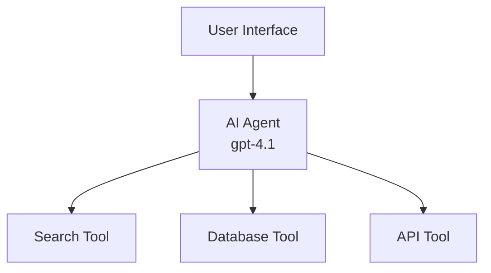
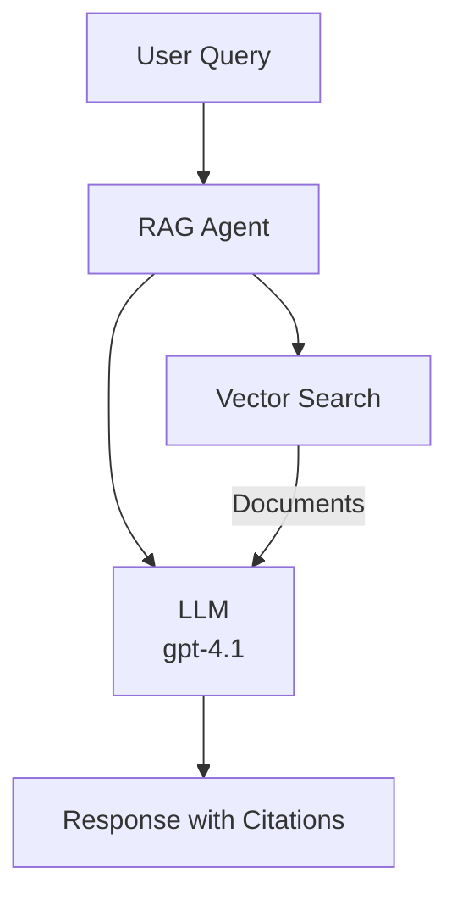
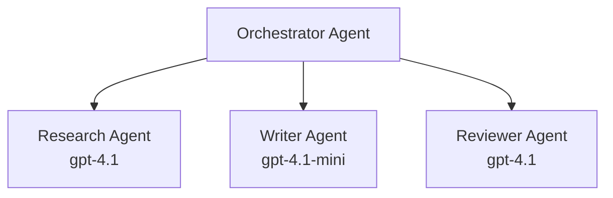

# AI Agenti s Azure Developer CLI

**Navigace kapitolou:**
- **📚 Domovská stránka kurzu**: [AZD Pro začátečníky](../../README.md)
- **📖 Aktuální kapitola**: Kapitola 2 - Vývoj s AI na prvním místě
- **⬅️ Předchozí**: [Integrace Microsoft Foundry](microsoft-foundry-integration.md)
- **➡️ Další**: [Nasazení AI modelu](ai-model-deployment.md)
- **🚀 Pokročilé**: [Řešení s více agenty](../../examples/retail-scenario.md)

---

## Úvod

AI agenti jsou autonomní programy, které mohou vnímat své prostředí, učinit rozhodnutí a podniknout kroky k dosažení určitých cílů. Na rozdíl od jednoduchých chatbotů, které reagují na podněty, agenti mohou:

- **Používat nástroje** - Volat API, vyhledávat v databázích, vykonávat kód
- **Plánovat a uvažovat** - Rozdělit složité úkoly na kroky
- **Učit se z kontextu** - Udržovat paměť a přizpůsobovat chování
- **Spolupracovat** - Pracovat s jinými agenty (systémy s více agenty)

Tento průvodce vám ukáže, jak nasadit AI agenty do Azure pomocí Azure Developer CLI (azd).

Použití kontextu konverzace není trénink modelu: perzistentní paměť, kontrola přístupu a uchovávání musí být implementovány/konfigurovány aplikací.

> **Revize vydání (2026-11-04):** Příklady CLI byly ověřeny vůči dokumentaci/zdrojům `azd` `1.37.2`, `azure.ai.agents` `1.0.0-beta.23`, a `azure.ai.evaluations` `1.0.0-beta.2`, nikoliv vůči živému nasazení v Azure. Pro kombinovaný pracovní postup použijte `azd >= 1.37.0`. Před aktualizací starších projektů si přečtěte [nedávné změny a opravy](../chapter-08-production/production-ai-practices.md#recent-release-changes-and-fixes).

## Cíle učení

Po dokončení tohoto průvodce budete:
- Rozumět, co jsou AI agenti a jak se liší od chatbotů
- Nasadit předpřipravené šablony AI agentů pomocí AZD
- Konfigurovat Foundry Agenty pro vlastní agenty
- Implementovat základní vzory agentů (použití nástrojů, RAG, multi-agent)
- Monitorovat a ladit nasazené agenty

## Výsledky učení

Po dokončení budete schopni:
- Nasadit aplikace AI agentů do Azure jedním příkazem
- Konfigurovat nástroje a schopnosti agentů
- Implementovat retrieval-augmented generation (RAG) u agentů
- Navrhnout architektury s více agenty pro složité pracovní postupy
- Řešit běžné problémy s nasazením agentů

---

## 🤖 Čím se agent liší od chatbota?

| Funkce | Chatbot | AI Agent |
|---------|---------|----------|
| **Chování** | Reaguje na podněty | Provádí autonomní akce |
| **Nástroje** | Může používat vyhledávání nebo nástroje | Typicky používá nástroje v cílené smyčce |
| **Paměť** | Závisí na aplikaci | Perzistentní paměť jen pokud je explicitně implementována |
| **Plánování** | Jedna odpověď | Vícekrokové uvažování |
| **Spolupráce** | Jednotlivý subjekt | Může pracovat s jinými agenty |

### Jednoduchá analogie

- **Chatbot** = Užitečná osoba odpovídající na otázky na informačním stole
- **AI Agent** = Osobní asistent, který může volat, objednávat schůzky a plnit úkoly za vás

---

## 🚀 Rychlý start: Nasazení prvního agenta

Zvolte jednu možnost v **novém prázdném pracovním adresáři**. Koncové `.` se tam inicializuje; bez explicitního cíle může aktuální AZD vytvořit podsložku pojmenovanou podle šablony a nemění adresář vašeho shellu. Uchovávejte oddělené šablony/prostředí v samostatných adresářích.

Časové/nákladové rozsahy níže jsou pouze ilustrativní, nejsou ověřené cenové nabídky. Před nasazením si ověřte aktuální požadavky, ceny, kvótu modelu a volitelné služby u každého vzoru.

### Možnost 1: Šablona Foundry Agentů (doporučeno)

```bash
# Initialize the AI agents template
azd init --template get-started-with-ai-agents .

# Deploy to Azure
azd up
```

**Co se nasadí:** Aktuální infrastruktura a vybrané možnosti vzoru určují model, nástroje, hosting a monitorovací zdroje. Před provisioningem prostudujte jeho README a `infra/`; nepředpokládejte, že každá šablona agenta obsahuje Search nebo webové rozhraní.

**Čas:** ~15-20 minut
**Cena:** ~$100-150/měsíc (vývoj)

### Možnost 2: Kreativní psaní agentů s Prompty

```bash
# Initialize the Prompty-based agent template
azd init --template https://github.com/Azure-Samples/contoso-creative-writer .

# Deploy to Azure
azd up
```

**Co se nasadí:** Vzorek multi-agentního psaní FastAPI/Prompty využívající Azure OpenAI, Bing Grounding a Azure AI Search. Původní úložiště `agent-openai-python-prompty` odkazuje sem; není to minimální šablona počasového agenta Azure Functions. Řiďte se jeho aktuálním README ohledně hostingu, kvóty modelu a předpokladů Bing Grounding.

**Čas:** ~10-15 minut
**Cena:** ~$50-100/měsíc (vývoj)

### Možnost 3: RAG Chat Agent

```bash
# Initialize RAG chat template
azd init --template azure-search-openai-demo .

# Deploy to Azure
azd up
```

**Co se nasadí:**
- ✅ Microsoft Foundry Modely
- ✅ Azure AI Search s ukázkovými daty
- ✅ Pipeline pro zpracování dokumentů
- ✅ Chatovací rozhraní s citacemi

**Čas:** ~15-25 minut
**Cena:** ~$80-150/měsíc (vývoj)

### Možnost 4: AZD AI Agent Init (Náhled šablony projektu)

Použijte `azd ai agent init` interaktivně, nebo adaptujte aktuální `azure.yaml` agentní projekt pomocí `--template`/`-t`. Starší možnost `--manifest`/`-m` je zastaralý alias, není konvertor pro starší manifesty.

```bash
# Install the AI agents extension
azd extension install azure.ai.agents

# Optional: verify the installed preview version
azd extension show azure.ai.agents

# Initialize from a current agent project template (supply your template path)
azd ai agent init --template ./templates/support-agent/azure.yaml

# Deploy to Azure
azd up

# Test the deployed agent (shows latency + time-to-first-byte)
azd ai agent invoke
```

**Kdy použít `azd ai agent init` vs `azd init --template`:**

| Přístup | Nejlepší pro | Jak funguje |
|----------|----------|------|
| `azd init --template` | Start s funkčním vzorkem aplikace | Klonuje kompletní šablonu repozitáře s kódem + infrastrukturou |
| `azd ai agent init --template` | Adaptace aktuálního Foundry agentního projektu | Používá dokument projektu `azure.yaml` a jeho definice |

> **Tip:** Použijte `azd init --template` při učení (možnosti 1-3 výše). Použijte `azd ai agent init` pro pracovní postup Foundry agenta. Pro přidání přímé definice agenta do existujícího projektu viz [návod pro inicializaci a migraci](../chapter-08-production/production-ai-practices.md#initializing-agent-projects-with-azd-ai-agent-init).

Po `azd up` použijte `azd ai agent invoke` k testování, samostatné `azure.ai.evaluations` rozšíření (`azd ai eval init`, `generate` a `run start`) k měření kvality a `azd ai agent optimize` k jejímu zlepšení pomocí nové konfigurační evaluace. Beta verze agentů beta.22 nahradila starší evaluanční pracovní postup a změnila formát `--config` optimalizace. Před opětovným použitím starších příkladů si přečtěte [evaluanční migraci](../chapter-08-production/production-ai-practices.md#evaluation-migration-and-quality-checks) a [migraci optimalizace](../chapter-08-production/production-ai-practices.md#optimization-configuration-migration).

---

## 🏗️ Vzory architektury agentů

### Vzor 1: Jediný agent s nástroji

Nejjednodušší vzor agenta – jeden agent, který může používat více nástrojů.



**Nejvhodnější pro:**
- Boty zákaznické podpory
- Výzkumné asistenty
- Agenty pro analýzu dat

**Ukázková související aplikace:** `azure-search-openai-demo` demonstruje RAG, ne generický cyklus agenta s libovolnými nástroji.

### Vzor 2: RAG agent (Retrieval-Augmented Generation)

Agent, který vyhledává relevantní dokumenty před generováním odpovědí.



**Nejvhodnější pro:**
- Podnikové znalostní báze
- Systémy otázky a odpovědi na dokumenty
- Výzkum v oblasti souladu a právních záležitostí

**AZD šablona:** `azure-search-openai-demo`

### Vzor 3: Systém více agentů

Více specializovaných agentů spolupracuje na složitých úkolech.



**Nejvhodnější pro:**
- Složité generování obsahu
- Vícekrokové pracovní postupy
- Úkoly vyžadující různé odborné znalosti

**Další informace:** [Vzory koordinace více agentů](../chapter-06-pre-deployment/coordination-patterns.md)

---

## ⚙️ Konfigurace nástrojů agentů

Agenti jsou silnější, když mohou používat nástroje. Zde je návod, jak konfigurovat běžné nástroje:

### Konfigurace nástrojů v Foundry agentech

Tento **klasický fragment Agent Service SDK** cílí na `azure-ai-projects==1.0.0` a `azure-ai-agents==1.1.0` s `azure-identity`. Není to novější verze API verzovaných agentů/Responses používaná některými aktuálními Foundry šablonami, ani `azure.ai.agents` rozšíření AZD (jiný balík). Nemíchejte tyto generace API. Nastavte `PROJECT_ENDPOINT` na klasický koncový bod projektu Foundry a `MODEL_DEPLOYMENT_NAME` na existující podporované nasazení modelu; autentizujte s `az login` lokálně a povolte potřebná oprávnění projektu.

```python
# agent_config.py
import os
from azure.ai.projects import AIProjectClient
from azure.ai.agents.models import FunctionTool
from azure.identity import DefaultAzureCredential

def search_knowledge_base(query: str) -> str:
    """Search the demonstration knowledge base.

    :param query: Search text.
    :return: Matching demonstration information.
    """
    # Local fixture only, not a production search implementation.
    return "Demo policy: returns are accepted within 30 days."

project_client = AIProjectClient(
    endpoint=os.environ["PROJECT_ENDPOINT"],
    credential=DefaultAzureCredential(),
)
search_tool = FunctionTool(functions={search_knowledge_base})
project_client.agents.enable_auto_function_calls(search_tool)
agent = project_client.agents.create_agent(
    model=os.environ["MODEL_DEPLOYMENT_NAME"],
    name="Support Agent",
    instructions="Use search_knowledge_base for policy questions. Label results as demo data.",
    tools=search_tool.definitions,
)
```

Registrace schématu funkce nespouští Python na službě. V tomto SDK spouští `enable_auto_function_calls` spolu s `agents.runs.create_and_process(...)` registrované zpětné volání ve vašem klientském procesu. Viz [uvolněný příklad SDK](https://github.com/Azure/azure-sdk-for-python/blob/azure-ai-agents_1.1.0/sdk/ai/azure-ai-agents/samples/agents_tools/sample_agents_auto_function_call.py). Po skončení zavřete klienta a smažte demonstrační agenty/vlákna.

### Konfigurace prostředí

Následující názvy jsou **ilustrační vstupy vlastních šablon**, ne vestavěné přepínače AZD. Nejprve každý hodnotu prolomte přes `infra/main.parameters.json`, infrastrukturu a aplikační kód. Pouze `azd env set` nezmění nástroje nebo instrukce agenta.

```bash
# Set up agent-specific environment variables
azd env set AZURE_OPENAI_MODEL "gpt-4.1"
azd env set AGENT_INSTRUCTIONS "You are a helpful assistant..."
azd env set ENABLE_CODE_INTERPRETER "true"
azd env set ENABLE_FILE_SEARCH "true"

# Apply wired infrastructure and application changes
azd up
```

---

## 📊 Monitorování agentů

### Integrace Application Insights

Pokud vaše vybraná šablona nastaví Application Insights a nakonfiguruje instrumentaci:

```bash
# Open monitoring dashboard
azd monitor --overview

# Open the Application Insights logs view (not a streaming log tail)
azd monitor --logs

# View live metrics
azd monitor --live
```

### Klíčové metriky ke sledování

| Metrika | Popis | Cíl |
|--------|-------------|--------|
| Latence odpovědi | Čas generování odpovědi | < 5 sekund |
| Využití tokenů | Tokeny na požadavek | Sledujte kvůli nákladům |
| Míra úspěšnosti volání nástrojů | % úspěšných vykonání nástrojů | > 95% |
| Míra chyb | Neúspěšné požadavky agenta | < 1% |
| Spokojenost uživatelů | Hodnocení zpětné vazby | > 4,0/5,0 |

### Vlastní protokolování pro agenty

```python
import os
from azure.monitor.opentelemetry import configure_azure_monitor
from opentelemetry import trace

# Configure Azure Monitor with OpenTelemetry
configure_azure_monitor(
    connection_string=os.environ["APPLICATIONINSIGHTS_CONNECTION_STRING"]
)

tracer = trace.get_tracer(__name__)

def log_agent_interaction(user_query, agent_response, tools_used, latency_ms):
    with tracer.start_as_current_span("agent_interaction") as span:
        span.set_attributes({
            "query_length": len(user_query),  # Do not log raw prompts or personal data
            "response_length": len(agent_response),
            "tools_used": tools_used,
            "latency_ms": latency_ms
        })
```

> **Poznámka:** Nainstalujte požadovaný balíček: `pip install azure-monitor-opentelemetry`. Přináší závislosti OpenTelemetry; jmenný prostor importu není požadavkem pro instalaci balíčku pojmenovaného `opentelemetry`.

---

## 💰 Nákladové úvahy

### Odhadované měsíční náklady podle vzoru

Toto jsou ilustrativní plánovací rozsahy, nikoli nabídky nebo stropy výdajů. Region, tokeny modelu, SKU pro vyhledávání/výpočet, relace nástrojů, úložiště a provoz je mohou překročit. Před `azd up` zkontrolujte návod k nákladům vzorku a ceny Azure.

| Vzor | Vývojové prostředí | Provoz |
|---------|-----------------|------------|
| Jednotlivý agent | $50-100 | $200-500 |
| RAG agent | $80-150 | $300-800 |
| Multi-agent (2-3 agenti) | $150-300 | $500-1 500 |
| Podnikový multi-agent | $300-500 | $1 500-5 000+ |

### Tipy pro optimalizaci nákladů

1. **Používejte gpt-4.1-mini pro jednoduché úkoly** (pouze pokud váš šablona zpracovává tento vstup)
   ```bash
   azd env set AZURE_OPENAI_MODEL "gpt-4.1-mini"
   ```

2. **Implementujte scoped caching pro bezpečné opakované dotazy.** Zahrňte autorizaci nájemce/uživatele, nasazení modelu, instrukce a verzi vyhledávání v klíči cache; nastavte expiraci. Nesdílejte odpovědi soukromých konverzací pomocí cache pouze pro dotazy v rámci celého procesu. Objekt agenta SDK nemá obecným způsobem `agent.run()` metodu.

3. **Nastavte limity tokenů na běh**
   ```python
   # Set max_completion_tokens when running the agent, not during creation
   run = project_client.agents.runs.create_and_process(
       thread_id=thread.id,
       agent_id=agent.id,
       max_completion_tokens=1000  # Budget across the run; may finish as incomplete
   )
   ```

4. **Škálujte způsobilé Container Apps na nulu, pokud nejsou používány**
   ```bash
   # Custom-template input: must map to template.scale.minReplicas
   azd env set MIN_REPLICAS "0"
   ```
   Změnu infrastruktury aplikujte pomocí `azd provision` nebo `azd up`. Škálování na nulu vyžaduje vhodný spouštěč a nezastavuje poplatky za Vyhledávání, úložiště ani model/nástroj.

---

## 🔧 Řešení problémů s agenty

### Běžné problémy a řešení

<details>
<summary><strong>❌ Agent nereaguje na volání nástrojů</strong></summary>

```bash
# Inspect the application deployment (not the agent's registered tools)
azd show

# Verify OpenAI deployment
az cognitiveservices account deployment list \
  --name $AZURE_OPENAI_NAME \
  --resource-group $RG_NAME

# Check agent logs
azd monitor --logs
```

**Běžné příčiny:**
- Neshoda podpisu funkce nástroje
- Chybějící požadovaná oprávnění
- API endpoint není dostupný
</details>

<details>
<summary><strong>❌ Vysoká latence v odpovědích agenta</strong></summary>

```bash
# Check Application Insights for bottlenecks
azd monitor --live

# Consider using a faster model
azd env set AZURE_OPENAI_MODEL "gpt-4.1-mini"
azd up
```

**Tipy pro optimalizaci:**
- Používejte streamované odpovědi
- Zavádějte cacheování odpovědí
- Snižte velikost kontextového okna
</details>

<details>
<summary><strong>❌ Agent vrací nesprávné nebo halucinované informace</strong></summary>

```python
# Improve with better system prompts
instructions = """
You are a helpful assistant. IMPORTANT:
- Only answer based on provided context
- If you don't know, say "I don't know"
- Always cite your sources
- Never make up information
"""

# Use these instructions in the agent definition.
# For classic file search, first upload/index documents in a vector store,
# then use FileSearchTool(vector_store_ids=[...]) and pass both its
# .definitions and .resources when creating the agent.
```
Instrukce a retrieval snižují riziko; ani jedno nezaručuje faktické odpovědi. Vyhodnocujte otázky s oporou v realitě i mimo rozsah vůči známým odpovědím.
</details>

<details>
<summary><strong>❌ Chyby překročení limitu tokenů</strong></summary>

```python
# Implement context window management
def truncate_context(messages, max_tokens=8000, model="gpt-4.1"):
    """Approximate content-only budget for objects with .content strings."""
    import tiktoken
    encoding = tiktoken.encoding_for_model(model)
    total_tokens = 0
    truncated = []
    
    for msg in reversed(messages):
        msg_tokens = len(encoding.encode(msg.content))
        if total_tokens + msg_tokens > max_tokens:
            break
        truncated.insert(0, msg)
        total_tokens += msg_tokens
    
    return truncated
```
Tento pomocník vylučuje role/tool schémata, systémové instrukce, obrazové tokeny a režii protokolu. Vyhraďte prostor pro tyto položky a dokončení; nerozdělujte páry volání nástroje/výsledek ani nezahazujte požadované systémové instrukce. Instalujte `tiktoken` samostatně. Není to obecný validátor kontextového okna.
</details>

---

## 🎓 Praktická cvičení

### Cvičení 1: Nasazení základního agenta (20 minut)

**Cíl:** Nasadit svého prvního AI agenta pomocí AZD

```bash
# Step 1: Initialize template
azd init --template get-started-with-ai-agents .

# Step 2: Login to Azure
azd auth login
# If you work across tenants, add --tenant-id <tenant-id>

# Step 3: Deploy
azd up

# Step 4: Test the agent
# Expected output after deployment:
#   Deployment Complete!
#   Endpoint: https://<app-name>.<region>.azurecontainerapps.io
# Open the URL shown in the output and try asking a question

# Step 5: View monitoring
azd monitor --overview

# Step 6: Clean up
azd down --force --purge
```

**Kritéria úspěchu:**
- [ ] Agent odpovídá na otázky
- [ ] Má přístup k monitorovacímu panelu přes `azd monitor`
- [ ] Zdroje byly úspěšně vyčištěny

### Cvičení 2: Přidání vlastního nástroje (30 minut)

**Cíl:** Rozšířit agenta vlastním nástrojem

**Výchozí bod:** Použijte klasického SDK klienta z [Tool Configuration](#tool-configuration-in-foundry-agents), nikoli libovolnou šablonu s jinou generací SDK.

1. Přidejte tento deterministický fixture do `agent_config.py`:
   ```python
   def get_weather(location: str) -> str:
       """Return demonstration weather, not live conditions.

       :param location: City name.
       :return: A clearly labelled fixture.
       """
       print(f"TOOL_CALLED: {location}")
       return f"Demo weather in {location}: Sunny, 72°F (fixture, not live)"
   ```
2. Nahraďte blok registrace a vytvoření search-tool následujícím:
   ```python
   weather_tool = FunctionTool(functions={get_weather})
   project_client.agents.enable_auto_function_calls(weather_tool)
   agent = project_client.agents.create_agent(
       model=os.environ["MODEL_DEPLOYMENT_NAME"],
       name="Weather Agent",
       instructions="Call get_weather for weather questions; explain that it returns demo data.",
       tools=weather_tool.definitions,
   )
   thread = project_client.agents.threads.create()
   try:
       project_client.agents.messages.create(
           thread_id=thread.id, role="user", content="Use get_weather for Seattle."
       )
       run = project_client.agents.runs.create_and_process(
           thread_id=thread.id, agent_id=agent.id
       )
       if run.status != "completed":
           raise RuntimeError(f"Run status: {run.status}; error: {run.last_error}")
       for message in project_client.agents.messages.list(thread_id=thread.id):
           for text in message.text_messages:
               print(text.text.value)
   finally:
       project_client.agents.threads.delete(thread.id)
       project_client.agents.delete_agent(agent.id)
       project_client.close()
   ```
3. Spusťte lokálně (toto volá existující Azure projekt a vyvolává poplatky za model):
   ```bash
   python agent_config.py
   # Expected: TOOL_CALLED: Seattle, then a completed answer labelled demo data.
   ```

**Kritéria úspěchu:**
- [ ] Agent rozpozná dotazy související s počasím
- [ ] Nástroj je volán správně
- [ ] Odpověď obsahuje informace o počasí

### Cvičení 3: Vytvoření RAG Agenta (45 minut)

**Cíl:** Vytvořit agenta, který odpovídá na otázky z vašich dokumentů

```bash
# Step 1: Deploy RAG template
azd init --template azure-search-openai-demo .
azd up

# Step 2: Upload your documents
# For the sample's local ingestion path, place supported files in data/.
# Run from the sample root after following its Python environment setup:
./scripts/prepdocs.sh
# Windows PowerShell equivalent: .\\scripts\\prepdocs.ps1

# Step 3: Test with domain-specific questions
# Open the web app URL from the azd up output
# Ask questions about your uploaded documents
# Responses should include citation references like [doc.pdf]
```

**Kritéria úspěchu:**
- [ ] Agent odpovídá na základě nahraných dokumentů
- [ ] Odpovědi obsahují citace
- [ ] Testovací otázky mimo rozsah jsou řešeny bez nepodložených tvrzení (není záruka pro každou budoucí otázku)

Pokud `USE_CLOUD_INGESTION=true`, použijte raději ukázkový cloud ingestion/upload workflow; lokální wrapper záměrně ingestion přeskočí. Po testování spusťte `azd down` v prostředí RAG a zkontrolujte zdroje, které mají být smazány.

---

## 📚 Další kroky

Nyní, když rozumíte AI agentům, prozkoumejte tyto pokročilé témata:

| Téma | Popis | Odkaz |
|-------|-------------|------|
| **Multiodvětvové systémy agentů** | Vytvářejte systémy s více spolupracujícími agenty | [Příklad multiodvětvového agenta v maloobchodu](../../examples/retail-scenario.md) |
| **Koordinační vzory** | Naučte se orchestraci a komunikační vzory | [Koordinační vzory](../chapter-06-pre-deployment/coordination-patterns.md) |
| **Nasazení do produkce** | Nasazení agenta připravené pro podnikové prostředí | [Produkční AI praktiky](../chapter-08-production/production-ai-practices.md) |
| **Hodnocení agentů** | Testujte a vyhodnocujte výkon agenta | [Řešení problémů AI](../chapter-07-troubleshooting/ai-troubleshooting.md) |
| **AI Workshop Lab** | Prakticky: Připravte své AI řešení pro AZD | [AI Workshop Lab](ai-workshop-lab.md) |

---

## 📖 Další zdroje

### Oficiální dokumentace
- [Microsoft Foundry Agent Service](https://learn.microsoft.com/azure/ai-services/agents/)
- [Microsoft Foundry Agent Service Quickstart](https://learn.microsoft.com/azure/ai-services/agents/quickstart)
- [Semantic Kernel Agent Framework](https://learn.microsoft.com/semantic-kernel/)

### AZD šablony pro agenty
- [Začínáme s AI agenti](https://github.com/Azure-Samples/get-started-with-ai-agents)
- [Agenti pro kreativní psaní s Prompty](https://github.com/Azure-Samples/contoso-creative-writer)
- [Azure Search OpenAI demo](https://github.com/Azure-Samples/azure-search-openai-demo)

### Komunitní zdroje
- [Awesome AZD - šablony agentů](https://azure.github.io/awesome-azd/?tags=ai-agents)
- [Azure AI Discord](https://discord.gg/microsoft-azure)
- [Microsoft Foundry Discord](https://discord.gg/nTYy5BXMWG)

### Dovednosti agentů pro váš editor
- [**Microsoft Azure Agent Skills**](https://skills.sh/microsoft/github-copilot-for-azure) - Instalujte znovupoužitelné AI dovednosti agentů pro vývoj na Azure v GitHub Copilot, Cursor nebo jakémkoli podporovaném agentovi. Obsahuje dovednosti pro [Azure AI](https://skills.sh/microsoft/github-copilot-for-azure/azure-ai), [Microsoft Foundry](https://skills.sh/microsoft/github-copilot-for-azure/microsoft-foundry), [nasazení](https://skills.sh/microsoft/github-copilot-for-azure/azure-deploy) a [diagnostiku](https://skills.sh/microsoft/github-copilot-for-azure/azure-diagnostics):
  ```bash
  npx skills add microsoft/github-copilot-for-azure
  ```

---

**Navigace**
- **Předchozí lekce**: [Microsoft Foundry Integrace](microsoft-foundry-integration.md)
- **Následující lekce**: [Nasazení AI modelu](ai-model-deployment.md)

---

<!-- CO-OP TRANSLATOR DISCLAIMER START -->
**Prohlášení o omezení odpovědnosti**:
Tento dokument byl přeložen pomocí AI překladatelské služby [Co-op Translator](https://github.com/Azure/co-op-translator). Přestože usilujeme o co největší přesnost, mějte prosím na paměti, že automatizované překlady mohou obsahovat chyby nebo nepřesnosti. Originální dokument v jeho mateřském jazyce by měl být považován za autoritativní zdroj. Pro kritické informace se doporučuje profesionální lidský překlad. Nejsme odpovědní za jakékoli nedorozumění nebo nesprávné interpretace vzniklé použitím tohoto překladu.
<!-- CO-OP TRANSLATOR DISCLAIMER END -->