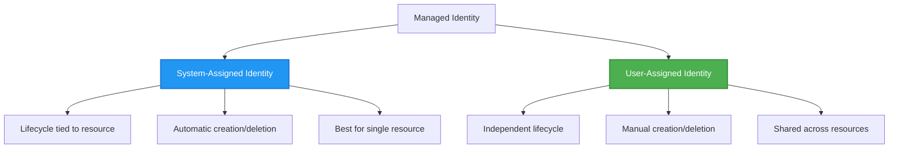

# Vzory ověřování a spravovaná identita

⏱️ **Odhadovaný čas**: 45-60 minut čtení; počítejte s dalším časem na zapracování cvičení | 💰 **Dopad na náklady**: Identita/RBAC jsou zdarma; nasazené výpočetní prostředky, úložiště a Key Vault jsou zpoplatněny | ⭐ **Složitost**: Středně pokročilé

> Přezkoumáno k datu `azd 1.37.2` (listopad 2026). Tato lekce obsahuje **ilustrační integrační fragmenty, nikoli kompletní stahovatelnou šablonu `secure-app`**. Vytvořte referencované soubory, zajišťte odpovídající infrastrukturu a před nasazením nahraďte zástupné symboly. Během přezkoumání nebyly vytvořeny žádné Azure zdroje.

**📚 Výuková cesta:**
- ← Předchozí: [Správa konfigurace](configuration.md) - Správa proměnných prostředí a tajemství
- 🎯 **Jste zde**: Ověřování a zabezpečení (spravovaná identita, Key Vault, bezpečné vzory)
- → Další: [Infrastruktura jako kód](../chapter-04-infrastructure/README.md) - Nasazení a správa zdrojů
- 🏠 [Domovská stránka kurzu](../../README.md)

---

## Co se naučíte

Po dokončení této lekce budete:
- Rozumět vzorům ověřování Azure (klíče, připojovací řetězce, spravovaná identita)
- Implementovat **spravovanou identitu** pro bezheslové ověřování
- Zabezpečit tajemství pomocí integrace s **Azure Key Vault**
- Nastavit **řízení přístupu na základě rolí (RBAC)** pro nasazení AZD
- Aplikovat bezpečnostní osvědčené postupy v Container Apps a Azure službách
- Přejít z ověřování na základě klíčů na ověřování na základě identity

## Proč je spravovaná identita důležitá

### Problém: Tradiční ověřování

**Před spravovanou identitou:**
```javascript
// ❌ SECURITY RISK: Hardcoded secrets in code
const connectionString = "Server=mydb.database.windows.net;User=admin;Password=P@ssw0rd123";
const storageKey = "xK7mN9pQ2wR5tY8uI0oP3aS6dF1gH4jK...";
const cosmosKey = "C2x7B9n4M1p8Q5w3E6r0T2y5U8i1O4p7...";
```

**Problémy:**
- 🔴 **Otevřená tajemství** v kódu, konfiguračních souborech, proměnných prostředí
- 🔴 **Rotace přihlašovacích údajů** vyžadovala změny v kódu a nové nasazení
- 🔴 **Noční můry z auditů** - kdo co, kdy přistoupil?
- 🔴 **Rozptyl** - tajemství jsou rozházená po několika systémech
- 🔴 **Rizika souladu** - nevyhovuje bezpečnostním auditům

### Řešení: Spravovaná identita

**Po zavedení spravované identity:**
```javascript
// ✅ SECURE: No secrets in code
const credential = new DefaultAzureCredential();
const client = new BlobServiceClient(
  "https://mystorageaccount.blob.core.windows.net",
  credential  // Azure automatically handles authentication
);
```

**Výhody:**
- ✅ **Žádná tajemství** v kódu či konfiguraci
- ✅ **Automatická rotace** - spravuje Azure
- ✅ **Úplná auditní stopa** v protokolech Microsoft Entra ID
- ✅ **Centralizovaná bezpečnost** - správa v Azure portálu
- ✅ **Připravenost pro soulad** - splňuje bezpečnostní standardy

**Analogie**: Tradiční ověřování je jako nosit fyzické klíče od mnoha dveří. Spravovaná identita je jako bezpečnostní průkaz, který automaticky umožňuje přístup podle vaší identity — žádné klíče na ztracení, kopírování nebo rotaci.

---

## Přehled architektury

### Tok ověřování se spravovanou identitou

```mermaid
sequenceDiagram
    participant App as Your Application<br/>(Container App)
    participant MI as Managed Identity<br/>(Microsoft Entra ID)
    participant KV as Key Vault
    participant Storage as Azure Storage
    participant DB as Azure SQL
    
    App->>MI: Request access token<br/>(automatic)
    MI->>MI: Verify identity<br/>(no password needed)
    MI-->>App: Return token for requested audience<br/>(lifetime varies)
    
    App->>KV: Get secret<br/>(using token)
    KV->>KV: Check RBAC permissions
    KV-->>App: Return secret value
    
    App->>Storage: Upload blob<br/>(using token)
    Storage->>Storage: Check RBAC permissions
    Storage-->>App: Success
    
    App->>DB: Query data<br/>(using token)
    DB->>DB: Check SQL permissions
    DB-->>App: Return results
    
    Note over App,DB: Request a separate token for each service audience;<br/>SDK credentials handle caching and renewal
```

### Typy spravovaných identit



| Vlastnost | Systémem přidělená | Uživatelem přiřazená |
|---------|--------------------|------------------|
| **Životní cyklus** | Vazba na zdroj | Nezávislá |
| **Vytvoření** | Automaticky se zdrojem | Ručně vytvořená |
| **Smazání** | Smazána se zdrojem | Přetrvává i po smazání zdroje |
| **Sdílení** | Pouze jeden zdroj | Více zdrojů |
| **Použití** | Jednoduché scénáře | Komplexní vícezdrojové scénáře |
| **Volba šablony** | Definováno v infrastruktuře | Definováno v infrastruktuře |

---

## Požadavky

### Požadované nástroje

Měli byste mít tyto již nainstalované z předchozích lekcí:

```bash
# Verify Azure Developer CLI
azd version
# ✅ Expected: azd version 1.0.0 or higher

# Verify Azure CLI
az --version
# ✅ Expected: azure-cli 2.50.0 or higher
```

### Požadavky na Azure

- Aktivní Azure předplatné
- Oprávnění k:
  - Vytváření spravovaných identit
  - Přiřazování RBAC rolí
  - Vytváření zdrojů Key Vault
  - Nasazování Container Apps

### Požadavky na znalosti

Měli byste mít dokončeno:
- [Instalační průvodce](../chapter-01-foundation/installation.md) - Nastavení AZD
- [AZD základy](../chapter-01-foundation/azd-basics.md) - Základní koncepty
- [Správa konfigurace](configuration.md) - Proměnné prostředí

---

## Lekce 1: Porozumění vzorům ověřování

### Vzor 1: Připojovací řetězce (starší - vyhnout se)

**Jak to funguje:**
```bash
# Connection string contains credentials
STORAGE_CONNECTION_STRING="DefaultEndpointsProtocol=https;AccountName=myaccount;AccountKey=xK7mN9pQ2wR5..."
COSMOS_CONNECTION_STRING="AccountEndpoint=https://myaccount.documents.azure.com:443/;AccountKey=C2x7..."
SQL_CONNECTION_STRING="Server=myserver.database.windows.net;User=admin;Password=P@ssw0rd..."
```

**Problémy:**
- ❌ Tajemství viditelná v proměnných prostředí
- ❌ Logováno v nasazovacích systémech
- ❌ Obtížná rotace
- ❌ Žádná auditní stopa přístupu

**Kdy použít:** Když cílová služba vyžaduje ověřování na základě klíče. Preferujte identitu, pokud je podporována; jinak klíče bezpečně uložte a rotujte, včetně produkčního prostředí.

---

### Vzor 2: Odkazy na Key Vault (lepší)

**Jak to funguje:**
**Částečné fragmenty Bicep:** požadovaná pole Key Vault, identita Container App a její `configuration.secrets` vstup jsou vynechány. `secretRef` jmenuje tajemství Container App; **není to samo o sobě** URI Key Vault. Pro použití Key Vault definujte toto pojmenované tajemství pomocí `keyVaultUrl` a autorizovaného `identity`.

```bicep
// Store secret in Key Vault
resource keyVault 'Microsoft.KeyVault/vaults@2023-02-01' = {
  name: 'mykv'
  properties: {
    enableRbacAuthorization: true
  }
}

// Reference in Container App
env: [
  {
    name: 'STORAGE_KEY'
    secretRef: 'storage-key'  // References Key Vault
  }
]
```

**Výhody:**
- ✅ Tajemství bezpečně uložená v Key Vault
- ✅ Centralizovaná správa tajemství
- ✅ Rotace bez změn kódu

**Omezení:**
- ⚠️ Stále používáte klíče/hesla
- ⚠️ Nutná správa přístupu ke Key Vault

**Kdy použít:** Přechodový krok od connection stringů k spravované identitě.

---

### Vzor 3: Spravovaná identita (Nejlepší praxe)

**Jak to funguje:**
**Částečný Bicep:** sloučí blok identity do kompletního Container App a poskytne `storageAccount` a definici role. Přidělení role také vyžaduje deterministické `name`.

```bicep
// Enable managed identity
resource containerApp 'Microsoft.App/containerApps@2023-05-01' = {
  name: 'myapp'
  identity: {
    type: 'SystemAssigned'  // Automatically creates identity
  }
}

// Grant permissions
resource roleAssignment 'Microsoft.Authorization/roleAssignments@2022-04-01' = {
  name: guid(storageAccount.id, containerApp.id, storageBlobDataContributorRole)
  scope: storageAccount
  properties: {
    roleDefinitionId: storageBlobDataContributorRole
    principalId: containerApp.identity.principalId
    principalType: 'ServicePrincipal'
  }
}
```

**Kód aplikace:**
```javascript
// No secrets needed!
const { DefaultAzureCredential } = require('@azure/identity');
const { BlobServiceClient } = require('@azure/storage-blob');

const credential = new DefaultAzureCredential();
const blobServiceClient = new BlobServiceClient(
  'https://mystorageaccount.blob.core.windows.net',
  credential
);
```

**Výhody:**
- ✅ Žádná tajemství v kódu/configu
- ✅ Automatická rotace přihlašovacích údajů
- ✅ Kompletní auditní stopa
- ✅ Oprávnění založená na RBAC
- ✅ Připravené na shodu

**Kdy použít:** Preferujte pro aplikace hostované v Azure přistupující k službám, které podporují autentizaci Microsoft Entra.

---

### Vzor 4: Service Principals (CI/CD a Automatizace)

Spravovaná identita je zlatý standard *pro zdroje běžící uvnitř Azure*. Ale co věci běžící **mimo** Azure — jako CI/CD pipeline na build agentovi, nebo skript na vašem notebooku, který nemůže použít interaktivní přihlášení? Zde přichází na řadu **service principal**: ne-lidská identita s vlastními přihlašovacími údaji, pod kterou se může automatizovaný proces přihlásit.

**Jak to funguje:**

Vytvořte service principal v rozsahu resource group (s nejmenším oprávněním):

```bash
az ad sp create-for-rbac \
  --name "myapp-cicd" \
  --role contributor \
  --scopes "/subscriptions/<sub-id>/resourceGroups/<rg-name>"
```

Toto zobrazí client ID, client secret a tenant ID. azd se může přihlásit non-interactivně:

```bash
azd auth login \
  --client-id "<appId>" \
  --client-secret "<password>" \
  --tenant-id "<tenant>"
```

**Preferujte federované přihlašovací údaje (OIDC) před tajemstvími.** Místo dlouhodobého client secret konfigurujte federované přihlašovací údaje, aby pipeline vyměnila krátkodobý token — žádné tajemství, které by mohlo uniknout nebo být rotováno:

```bash
azd auth login \
  --client-id "<appId>" \
  --federated-credential-provider "github" \
  --tenant-id "<tenant>"
```

> `azd pipeline config` to zařídí automaticky za vás. Podívejte se na průvodce CI/CD v [Kapitole 8](../chapter-08-production/production-ai-practices.md).

**Výhody:**
- ✅ Funguje mimo Azure (build agenti, on-prem, jiné cloudech)
- ✅ Může být omezeno na jedinou resource group s jednou rolí
- ✅ Federovaná (OIDC) varianta nepoužívá uložené tajemství

**Obchodní kompromisy:**
- ⚠️ Varianta založená na tajemství vyžaduje pečlivé uložení a rotaci
- ⚠️ Uniklé tajemství uděluje vše, co SP může dělat — udržujte rozsahy přísné

**Kdy použít:** CI/CD pipeline a automatizace, která nemůže použít spravovanou identitu. Vždy preferujte **federovanou/OIDC** variantu před client secret a pokud běží workload uvnitř Azure, preferujte spravovanou identitu.

**Bezpečné ukládání přihlašovacích údajů:**
- Nikdy nezakompilovávejte tajemství — používejte úložiště tajemství pipeline (GitHub Actions secrets, Azure DevOps variable groups / Key Vault).
- Omezení SP na nejmenší potřebnou roli a resource group.
- Nastavte expiraci a rotujte, nebo úplně eliminujte tajemství s OIDC.

---

## Lekce 2: Implementace Spravované Identity s AZD

### Krok za krokem implementace

Následující fragmenty ukazují, jak integrovat spravovanou identitu do Container App projektu. Nejsou to **přímé startovací kódy**: modul Storage, kompletní infrastruktura spravovaného prostředí/registry, Dockerfile a parametrický soubor zde nejsou všechny dodány. Začněte z funkčního Container Apps šablony a sloučte tyto vzory, přičemž ponechte konfiguraci registry a servisní štítky.

### Struktura projektu

```
secure-app/
├── azure.yaml                 # AZD configuration
├── infra/
│   ├── main.bicep            # Main infrastructure
│   ├── core/
│   │   ├── identity.bicep    # Managed identity setup
│   │   ├── keyvault.bicep    # Key Vault configuration
│   │   └── storage.bicep     # Storage with RBAC
│   └── app/
│       └── container-app.bicep
└── src/
    ├── app.js                # Application code
    ├── package.json
    └── Dockerfile
```

### 1. Konfigurace AZD (azure.yaml)

```yaml
name: secure-app
metadata:
  template: secure-app@1.0.0

services:
  api:
    project: ./src
    language: js
    host: containerapp

# Managed identity must be enabled in the infrastructure, not by this YAML.
```

### 2. Infrastruktura: Povolení spravované identity

**Soubor: `infra/main.bicep`**

```bicep
targetScope = 'subscription'

param environmentName string
param location string = 'eastus'
param containerAppsEnvironmentId string
param containerImage string

var tags = { 'azd-env-name': environmentName }

// Resource group
resource rg 'Microsoft.Resources/resourceGroups@2021-04-01' = {
  name: 'rg-${environmentName}'
  location: location
  tags: tags
}

// Storage Account
module storage './core/storage.bicep' = {
  name: 'storage'
  scope: rg
  params: {
    name: 'st${uniqueString(rg.id)}'
    location: location
    tags: tags
  }
}

// Key Vault
module keyVault './core/keyvault.bicep' = {
  name: 'keyvault'
  scope: rg
  params: {
    name: 'kv-${uniqueString(rg.id)}'
    location: location
    tags: tags
  }
}

// Container App with Managed Identity
module containerApp './app/container-app.bicep' = {
  name: 'container-app'
  scope: rg
  params: {
    name: 'ca-${environmentName}'
    location: location
    tags: tags
    storageAccountName: storage.outputs.name
    keyVaultName: keyVault.outputs.name
    containerAppsEnvironmentId: containerAppsEnvironmentId
    containerImage: containerImage
  }
}

// Grant Container App access to Storage
module storageRoleAssignment './core/role-assignment.bicep' = {
  name: 'storage-role'
  scope: rg
  params: {
    principalId: containerApp.outputs.identityPrincipalId
    roleDefinitionId: 'ba92f5b4-2d11-453d-a403-e96b0029c9fe'  // Storage Blob Data Contributor
    targetResourceType: 'storage'
    targetResourceName: storage.outputs.name
  }
}

// Grant Container App access to Key Vault
module kvRoleAssignment './core/role-assignment.bicep' = {
  name: 'kv-role'
  scope: rg
  params: {
    principalId: containerApp.outputs.identityPrincipalId
    roleDefinitionId: '4633458b-17de-408a-b874-0445c86b69e6'  // Key Vault Secrets User
    targetResourceType: 'keyvault'
    targetResourceName: keyVault.outputs.name
  }
}

// Outputs
output AZURE_STORAGE_ACCOUNT_NAME string = storage.outputs.name
output AZURE_KEY_VAULT_NAME string = keyVault.outputs.name
output APP_URL string = containerApp.outputs.url
```

### 3. Container App se systémově přidělenou identitou

**Soubor: `infra/app/container-app.bicep`**

```bicep
param name string
param location string
param tags object = {}
param storageAccountName string
param keyVaultName string
param containerAppsEnvironmentId string
param containerImage string

resource containerApp 'Microsoft.App/containerApps@2023-05-01' = {
  name: name
  location: location
  tags: union(tags, { 'azd-service-name': 'api' })
  identity: {
    type: 'SystemAssigned'  // 🔑 Enable managed identity
  }
  properties: {
    managedEnvironmentId: containerAppsEnvironmentId
    configuration: {
      ingress: {
        external: true
        targetPort: 3000
      }
    }
    template: {
      containers: [
        {
          name: 'api'
          image: containerImage // Must exist; configure registry credentials for private images
          resources: {
            cpu: json('0.5')
            memory: '1Gi'
          }
          env: [
            {
              name: 'AZURE_STORAGE_ACCOUNT_NAME'
              value: storageAccountName
            }
            {
              name: 'AZURE_KEY_VAULT_NAME'
              value: keyVaultName
            }
            // 🔑 No secrets - managed identity handles authentication!
          ]
        }
      ]
    }
  }
}

// Output the identity for RBAC assignments
output identityPrincipalId string = containerApp.identity.principalId
output id string = containerApp.id
output url string = 'https://${containerApp.properties.configuration.ingress.fqdn}'
```

### 4. Modul přiřazení role RBAC

**Soubor: `infra/core/role-assignment.bicep`**

```bicep
param principalId string
param roleDefinitionId string  // Azure built-in role ID
@allowed(['storage', 'keyvault'])
param targetResourceType string
param targetResourceName string

// Typed existing resources give Bicep a valid resource scope, not a string ID.
resource storageTarget 'Microsoft.Storage/storageAccounts@2023-01-01' existing = {
  name: targetResourceName
}
resource vaultTarget 'Microsoft.KeyVault/vaults@2023-02-01' existing = {
  name: targetResourceName
}

resource storageAssignment 'Microsoft.Authorization/roleAssignments@2022-04-01' = if (targetResourceType == 'storage') {
  name: guid(storageTarget.id, principalId, roleDefinitionId)
  scope: storageTarget
  properties: {
    roleDefinitionId: subscriptionResourceId('Microsoft.Authorization/roleDefinitions', roleDefinitionId)
    principalId: principalId
    principalType: 'ServicePrincipal'
  }
}

resource vaultAssignment 'Microsoft.Authorization/roleAssignments@2022-04-01' = if (targetResourceType == 'keyvault') {
  name: guid(vaultTarget.id, principalId, roleDefinitionId)
  scope: vaultTarget
  properties: {
    roleDefinitionId: subscriptionResourceId('Microsoft.Authorization/roleDefinitions', roleDefinitionId)
    principalId: principalId
    principalType: 'ServicePrincipal'
  }
}

// This module assigns at the target resource scope, not the whole resource group.
```

### 5. Kód aplikace se spravovanou identitou

**Soubor: `src/app.js`**

```javascript
const express = require('express');
const { DefaultAzureCredential } = require('@azure/identity');
const { BlobServiceClient } = require('@azure/storage-blob');
const { SecretClient } = require('@azure/keyvault-secrets');

const app = express();
const PORT = process.env.PORT || 3000;

// 🔑 Initialize credential (works automatically with managed identity)
const credential = new DefaultAzureCredential();

// Azure Storage setup
const storageAccountName = process.env.AZURE_STORAGE_ACCOUNT_NAME;
const blobServiceClient = new BlobServiceClient(
  `https://${storageAccountName}.blob.core.windows.net`,
  credential  // No keys needed!
);

// Key Vault setup
const keyVaultName = process.env.AZURE_KEY_VAULT_NAME;
const secretClient = new SecretClient(
  `https://${keyVaultName}.vault.azure.net`,
  credential  // No keys needed!
);

// Health check
app.get('/health', (req, res) => {
  res.json({ status: 'healthy', authentication: 'managed-identity' });
});

// Upload file to blob storage
app.post('/upload', async (req, res) => {
  try {
    const containerClient = blobServiceClient.getContainerClient('uploads');
    await containerClient.createIfNotExists();
    
    const blobName = `file-${Date.now()}.txt`;
    const blockBlobClient = containerClient.getBlockBlobClient(blobName);
    
    const content = 'Hello from managed identity!';
    await blockBlobClient.upload(content, Buffer.byteLength(content));
    
    res.json({
      success: true,
      blobName: blobName,
      message: 'File uploaded using managed identity!'
    });
  } catch (error) {
    console.error('Upload error:', error);
    res.status(500).json({ error: error.message });
  }
});

// Get secret from Key Vault
app.get('/secret/:name', async (req, res) => {
  try {
    const secretName = req.params.name;
    const secret = await secretClient.getSecret(secretName);
    
    res.json({
      name: secretName,
      retrieved: secret.value !== undefined, // Never return the secret value to callers
      message: 'Secret retrieved using managed identity!'
    });
  } catch (error) {
    console.error('Secret error:', error);
    res.status(500).json({ error: error.message });
  }
});

// List blob containers (demonstrates read access)
app.get('/containers', async (req, res) => {
  try {
    const containers = [];
    for await (const container of blobServiceClient.listContainers()) {
      containers.push(container.name);
    }
    
    res.json({
      containers: containers,
      count: containers.length,
      message: 'Containers listed using managed identity!'
    });
  } catch (error) {
    console.error('List error:', error);
    res.status(500).json({ error: error.message });
  }
});

app.listen(PORT, () => {
  console.log(`Secure API listening on port ${PORT}`);
  console.log('Authentication: Managed Identity (passwordless)');
});
```

**Soubor: `src/package.json`**

```json
{
  "name": "secure-app",
  "version": "1.0.0",
  "dependencies": {
    "express": "^4.18.2",
    "@azure/identity": "^4.0.0",
    "@azure/storage-blob": "^12.17.0",
    "@azure/keyvault-secrets": "^4.7.0"
  },
  "scripts": {
    "start": "node app.js"
  }
}
```

### 6. Nasazení a testování

Spusťte tyto příkazy **až po** dokončení chybějící infrastruktury, Dockerfile a odpovídajícího `main.parameters.json` ve vašem vlastním projektu. Autentizujte azd pomocí `azd auth login`; přihlaste se samostatně s `az login` pro pozdější kontroly Azure CLI. Zobrazené koncové body jsou demonstrace a vyžadují odpovídající kontrolu přístupu před veřejným použitím.

```bash
# Initialize AZD environment
azd init

# Deploy infrastructure and application
azd up

# Get the app URL
APP_URL=$(azd env get-value APP_URL)

# Test health check
curl $APP_URL/health
```

**✅ Očekávaný výstup:**
```json
{
  "status": "healthy",
  "authentication": "managed-identity"
}
```

**Test nahrání blobu:**
```bash
curl -X POST $APP_URL/upload
```

**✅ Očekávaný výstup:**
```json
{
  "success": true,
  "blobName": "file-1700404800000.txt",
  "message": "File uploaded using managed identity!"
}
```

**Test výpisu kontejnerů:**
```bash
curl $APP_URL/containers
```

**✅ Očekávaný výstup:**
```json
{
  "containers": ["uploads"],
  "count": 1,
  "message": "Containers listed using managed identity!"
}
```

---

## Běžné role Azure RBAC

### Vestavěná ID rolí pro spravovanou identitu

| Služba | Název role | ID role | Oprávnění |
|---------|-----------|---------|-------------|
| **Storage** | Storage Blob Data Reader | `2a2b9908-6ea1-4ae2-8e65-a410df84e7d1` | Čtení blobů a kontejnerů |
| **Storage** | Storage Blob Data Contributor | `ba92f5b4-2d11-453d-a403-e96b0029c9fe` | Čtení, zápis, mazání blobů |
| **Storage** | Storage Queue Data Contributor | `974c5e8b-45b9-4653-ba55-5f855dd0fb88` | Čtení, zápis, mazání front/zpráv |
| **Key Vault** | Key Vault Secrets User | `4633458b-17de-408a-b874-0445c86b69e6` | Čtení tajemství |
| **Key Vault** | Key Vault Secrets Officer | `b86a8fe4-44ce-4948-aee5-eccb2c155cd7` | Čtení, zápis, mazání tajemství |
| **Cosmos DB** | Cosmos DB Built-in Data Reader | `00000000-0000-0000-0000-000000000001` | Čtení dat Cosmos DB |
| **Cosmos DB** | Cosmos DB Built-in Data Contributor | `00000000-0000-0000-0000-000000000002` | Čtení, zápis dat Cosmos DB |
| **SQL Database** | SQL DB Contributor | `9b7fa17d-e63e-47b0-bb0a-15c516ac86ec` | Správa databázových zdrojů; neuděluje přístup k datům SQL |
| **Service Bus** | Azure Service Bus Data Owner | `090c5cfd-751d-490a-894a-3ce6f1109419` | Odesílání, přijímání, správa zpráv |

### Jak najít ID rolí

Dvě výše uvedená ID pro Cosmos DB for NoSQL jsou **nativní definice rolí v datové rovině Cosmos**, ne odběrová ID rolí Azure RBAC. Přiřaďte je pomocí `az cosmosdb sql role assignment create` (nebo `Microsoft.DocumentDB/databaseAccounts/sqlRoleAssignments`), ne `az role assignment create`. Přístup k datům SQL vyžaduje uživatele databáze Entra a SQL oprávnění.

```bash
# List all built-in roles
az role definition list --query "[].{Name:roleName, ID:name}" --output table

# Search for specific role
az role definition list --query "[?contains(roleName, 'Storage Blob')].{Name:roleName, ID:name}" --output table

# Get role details
az role definition list --name "Storage Blob Data Contributor"
```

---

## Praktická cvičení

**Integracní předpoklady pro všechna tři cvičení:** funkční Container App šablona ve vašem vlastním projektu, odpovídající Bicep zdroje, přihlášení do Azure CLI/azd a oprávnění přiřadit požadované role. Jsou to vedené adaptace, nikoli samostatné místní startovací kódy; nahraďte názvy ukázkových zdrojů vlastními nasazenými názvy.

### Cvičení 1: Povolit spravovanou identitu pro stávající aplikaci ⭐⭐ (Střední)

**Cíl**: Přidat spravovanou identitu ke stávajícímu Container App nasazení

**Scénář**: Máte Container App používající connection stringy. Převést ji na spravovanou identitu.

**Výchozí bod**: Container App s touto konfigurací:

```bicep
// ❌ Current: Using connection string
env: [
  {
    name: 'STORAGE_CONNECTION_STRING'
    secretRef: 'storage-connection'
  }
]
```

**Kroky**:

1. **Povolit spravovanou identitu v Bicep:**

```bicep
resource containerApp 'Microsoft.App/containerApps@2023-05-01' = {
  name: 'myapp'
  identity: {
    type: 'SystemAssigned'  // Add this
  }
  // ... rest of configuration
}
```

2. **Udělte přístup ke Storage:**

```bicep
// Get storage account reference
resource storageAccount 'Microsoft.Storage/storageAccounts@2023-01-01' existing = {
  name: storageAccountName
}

// Assign role
resource roleAssignment 'Microsoft.Authorization/roleAssignments@2022-04-01' = {
  name: guid(containerApp.id, 'ba92f5b4-2d11-453d-a403-e96b0029c9fe', storageAccount.id)
  scope: storageAccount
  properties: {
    roleDefinitionId: subscriptionResourceId('Microsoft.Authorization/roleDefinitions', 'ba92f5b4-2d11-453d-a403-e96b0029c9fe')
    principalId: containerApp.identity.principalId
    principalType: 'ServicePrincipal'
  }
}
```

3. **Aktualizujte aplikační kód:**

**Před (connection string):**
```javascript
const { BlobServiceClient } = require('@azure/storage-blob');

const blobServiceClient = BlobServiceClient.fromConnectionString(
  process.env.STORAGE_CONNECTION_STRING
);
```

**Po (spravovaná identita):**
```javascript
const { DefaultAzureCredential } = require('@azure/identity');
const { BlobServiceClient } = require('@azure/storage-blob');

const credential = new DefaultAzureCredential();
const blobServiceClient = new BlobServiceClient(
  `https://${process.env.STORAGE_ACCOUNT_NAME}.blob.core.windows.net`,
  credential
);
```

4. **Aktualizujte proměnné prostředí:**

```bicep
env: [
  {
    name: 'STORAGE_ACCOUNT_NAME'
    value: storageAccountName  // Just the name, no secrets!
  }
  // Remove STORAGE_CONNECTION_STRING
]
```

5. **Nasadit a otestovat:**

```bash
# Redeploy
azd up

# Test that it still works
APP_URL=$(azd show --output json | jq -er '.services.api.ingressUrl')
curl --fail -X POST "$APP_URL/upload"
```

**✅ Kritéria úspěchu:**
- ✅ Aplikace nasazena bez chyb
- ✅ Operace Storage fungují (upload, list, download)
- ✅ Žádné connection stringy v proměnných prostředí
- ✅ Identita viditelná v Azure Portálu v sekci "Identity"

**Ověření:**

```bash
# Check managed identity is enabled
az containerapp show \
  --name myapp \
  --resource-group rg-myapp \
  --query "identity.type"
# ✅ Expected: "SystemAssigned"

# Check role assignment
az role assignment list \
  --assignee $(az containerapp show --name myapp --resource-group rg-myapp --query "identity.principalId" -o tsv) \
  --scope /subscriptions/{sub-id}/resourceGroups/rg-myapp/providers/Microsoft.Storage/storageAccounts/mystorageaccount
# ✅ Expected: Shows "Storage Blob Data Contributor" role
```

**Čas**: 20-30 minut

---

### Cvičení 2: Přístup ke službám s uživatelem přiřazenou identitou ⭐⭐⭐ (Pokročilé)

**Cíl**: Vytvořit uživatelem přiřazenou identitu sdílenou mezi více Container Apps

**Scénář**: Máte 3 mikroservisy, které všechny potřebují přístup ke stejnému Storage účtu a Key Vault.

**Kroky**:

1. **Vytvořit uživatelem přiřazenou identitu:**

**Soubor: `infra/core/identity.bicep`**

```bicep
param name string
param location string
param tags object = {}

resource userAssignedIdentity 'Microsoft.ManagedIdentity/userAssignedIdentities@2023-01-31' = {
  name: name
  location: location
  tags: tags
}

output id string = userAssignedIdentity.id
output principalId string = userAssignedIdentity.properties.principalId
output clientId string = userAssignedIdentity.properties.clientId
```

2. **Přiřaďte role uživatelem přiřazené identitě:**

```bicep
// In main.bicep
module userIdentity './core/identity.bicep' = {
  name: 'user-identity'
  scope: rg
  params: {
    name: 'id-${environmentName}'
    location: location
    tags: tags
  }
}

// Grant Storage access
resource storageRoleAssignment 'Microsoft.Authorization/roleAssignments@2022-04-01' = {
  name: guid(storageAccount.id, environmentName, 'storage-contributor')
  scope: storageAccount
  properties: {
    roleDefinitionId: subscriptionResourceId('Microsoft.Authorization/roleDefinitions', 'ba92f5b4-2d11-453d-a403-e96b0029c9fe')
    principalId: userIdentity.outputs.principalId
    principalType: 'ServicePrincipal'
  }
}

// Grant Key Vault access
resource kvRoleAssignment 'Microsoft.Authorization/roleAssignments@2022-04-01' = {
  name: guid(keyVault.id, environmentName, 'kv-secrets-user')
  scope: keyVault
  properties: {
    roleDefinitionId: subscriptionResourceId('Microsoft.Authorization/roleDefinitions', '4633458b-17de-408a-b874-0445c86b69e6')
    principalId: userIdentity.outputs.principalId
    principalType: 'ServicePrincipal'
  }
}
```

3. **Přiřaďte identitu více aplikacím Container Apps:**

```bicep
resource apiGateway 'Microsoft.App/containerApps@2023-05-01' = {
  name: 'api-gateway'
  identity: {
    type: 'UserAssigned'
    userAssignedIdentities: {
      '${userIdentity.outputs.id}': {}
    }
  }
  // ... rest of config
}

resource productService 'Microsoft.App/containerApps@2023-05-01' = {
  name: 'product-service'
  identity: {
    type: 'UserAssigned'
    userAssignedIdentities: {
      '${userIdentity.outputs.id}': {}
    }
  }
  // ... rest of config
}

resource orderService 'Microsoft.App/containerApps@2023-05-01' = {
  name: 'order-service'
  identity: {
    type: 'UserAssigned'
    userAssignedIdentities: {
      '${userIdentity.outputs.id}': {}
    }
  }
  // ... rest of config
}
```

4. **Kód aplikace (všechny služby používají stejný vzor):**

```javascript
const { ManagedIdentityCredential } = require('@azure/identity');
const { BlobServiceClient } = require('@azure/storage-blob');

// For user-assigned identity, specify the client ID
const credential = new ManagedIdentityCredential(
  process.env.AZURE_CLIENT_ID  // User-assigned identity client ID
);

// Alternative (choose ONE credential declaration):
// const { DefaultAzureCredential } = require('@azure/identity');
// const credential = new DefaultAzureCredential({
//   managedIdentityClientId: process.env.AZURE_CLIENT_ID
// });

const blobServiceClient = new BlobServiceClient(
  `https://${process.env.STORAGE_ACCOUNT_NAME}.blob.core.windows.net`,
  credential
);
```

Nastavte každému Container App runtime `AZURE_CLIENT_ID` na `userIdentity.outputs.clientId` a `STORAGE_ACCOUNT_NAME` na název vašeho úložiště v Bicepu. Pouhé přiřazení identity nebo spuštění `azd env set` tyto runtime hodnoty nenakonfiguruje.

5. **Nasazení a ověření:**

```bash
azd up

# Test all services can access storage
# Replace with the actual ingress URLs reported for your three services
curl --fail -X POST "$API_GATEWAY_URL/upload"
curl --fail -X POST "$PRODUCT_SERVICE_URL/upload"
curl --fail -X POST "$ORDER_SERVICE_URL/upload"
```

**✅ Kritéria úspěchu:**
- ✅ Jedna identita sdílená mezi 3 službami
- ✅ Všechny služby mají přístup k úložišti a Key Vault
- ✅ Identita přetrvává i po smazání jedné služby
- ✅ Centralizovaná správa oprávnění

**Výhody uživatelsky přiřazené identity:**
- Jedna spravovaná identita
- Konzistentní oprávnění napříč službami
- Přetrvává po odstranění služby
- Vhodnější pro složité architektury

**Čas**: 30–40 minut

---

### Cvičení 3: Implementace rotace tajemství v Key Vault ⭐⭐⭐ (Pokročilé)

**Cíl**: Uložit API klíče třetích stran v Key Vault a přistupovat k nim pomocí spravované identity

**Scénář**: Vaše aplikace musí volat externí API (OpenAI, Stripe, SendGrid), které vyžaduje API klíče.

**Kroky**:

1. **Vytvořte Key Vault s RBAC:**

**Soubor: `infra/core/keyvault.bicep`**

```bicep
param name string
param location string
param tags object = {}

resource keyVault 'Microsoft.KeyVault/vaults@2023-02-01' = {
  name: name
  location: location
  tags: tags
  properties: {
    enableRbacAuthorization: true  // Use RBAC instead of access policies
    sku: {
      family: 'A'
      name: 'standard'
    }
    tenantId: subscription().tenantId
    enableSoftDelete: true
    softDeleteRetentionInDays: 90
  }
}

// Allow Container App to read secrets
output id string = keyVault.id
output name string = keyVault.name
output uri string = keyVault.properties.vaultUri
```

2. **Uložte tajemství do Key Vault:**

```bash
# Get Key Vault name
KV_NAME=$(azd env get-value AZURE_KEY_VAULT_NAME)

# Store third-party API keys
az keyvault secret set \
  --vault-name $KV_NAME \
  --name "OpenAI-ApiKey" \
  --value "sk-proj-xxxxxxxxxxxxx"

az keyvault secret set \
  --vault-name $KV_NAME \
  --name "Stripe-ApiKey" \
  --value "sk_live_xxxxxxxxxxxxx"

az keyvault secret set \
  --vault-name $KV_NAME \
  --name "SendGrid-ApiKey" \
  --value "SG.xxxxxxxxxxxxx"
```

3. **Kód aplikace pro získání tajemství:**

**Soubor: `src/config.js`**

```javascript
const { DefaultAzureCredential } = require('@azure/identity');
const { SecretClient } = require('@azure/keyvault-secrets');

class Config {
  constructor() {
    this.credential = new DefaultAzureCredential();
    this.secretClient = new SecretClient(
      `https://${process.env.AZURE_KEY_VAULT_NAME}.vault.azure.net`,
      this.credential
    );
    this.cache = {};
  }

  async getSecret(secretName) {
    // Check cache first
    if (this.cache[secretName]) {
      return this.cache[secretName];
    }

    try {
      const secret = await this.secretClient.getSecret(secretName);
      this.cache[secretName] = secret.value;
      console.log(`✅ Retrieved secret: ${secretName}`);
      return secret.value;
    } catch (error) {
      console.error(`❌ Failed to get secret ${secretName}:`, error.message);
      throw error;
    }
  }

  async getOpenAIKey() {
    return this.getSecret('OpenAI-ApiKey');
  }

  async getStripeKey() {
    return this.getSecret('Stripe-ApiKey');
  }

  async getSendGridKey() {
    return this.getSecret('SendGrid-ApiKey');
  }
}

module.exports = new Config();
```

4. **Použijte tajemství v aplikaci:**

**Soubor: `src/app.js`**

Tento **náhradní útržek aplikace** vyžaduje `npm install openai`, skutečný klíč třetí strany, přístupný model a infrastrukturu z vašeho pracovního projektu. Volá přímo OpenAI, nikoli nasazení Azure OpenAI. Níže uvedené zástupné klíče neautorizují žádost.

```javascript
const express = require('express');
const config = require('./config');
const { OpenAI } = require('openai');

const app = express();

// Initialize OpenAI with key from Key Vault
let openaiClient;

async function initializeServices() {
  const openaiKey = await config.getOpenAIKey();
  openaiClient = new OpenAI({ apiKey: openaiKey });
  console.log('✅ Services initialized with secrets from Key Vault');
}

app.post('/chat', async (req, res) => {
  try {
    const completion = await openaiClient.chat.completions.create({
      model: 'gpt-4.1',
      messages: [{ role: 'user', content: 'Hello!' }]
    });
    
    res.json({
      response: completion.choices[0].message.content,
      authentication: 'Key from Key Vault via Managed Identity'
    });
  } catch (error) {
    res.status(500).json({ error: error.message });
  }
});

// Start listening only after initialization succeeds.
initializeServices().then(() => {
  app.listen(3000, () => console.log('Key Vault demo running'));
}).catch(error => {
  console.error('Initialization failed:', error.message);
  process.exitCode = 1;
});
```

5. **Nasazení a testování:**

```bash
azd up

# Test that API keys work
curl -X POST https://myapp.azurecontainerapps.io/chat \
  -H "Content-Type: application/json" \
  -d '{"message":"Hello AI"}'
```

**✅ Kritéria úspěchu:**
- ✅ Žádné API klíče v kódu nebo proměnných prostředí
- ✅ Aplikace získává klíče z Key Vault
- ✅ Třetí strany API fungují správně
- ✅ Možnost otáčet klíče bez změn kódu

**Otáčení tajemství:**

```bash
# Update secret in Key Vault
az keyvault secret set \
  --vault-name $KV_NAME \
  --name "OpenAI-ApiKey" \
  --value "sk-proj-NEW_KEY_HERE"

# Find the active revision name, then restart it to clear the in-process cache
az containerapp revision list --name myapp --resource-group rg-myapp --output table
az containerapp revision restart \
  --name myapp \
  --resource-group rg-myapp \
  --revision "<active-revision-name>"
```

**Čas**: 25–35 minut

---

## Kontrolní bod znalostí

### 1. Vzory autentizace ✓

Otestujte své znalosti:

- [ ] **Q1**: Jaké jsou tři hlavní vzory autentizace?
  - **O**: Připojovací řetězce (legacy), odkazy na Key Vault (přechod), spravovaná identita (nejlepší)

- [ ] **Q2**: Proč je spravovaná identita lepší než připojovací řetězce?
  - **O**: Žádná tajemství v kódu, automatická rotace, úplná auditní stopa, oprávnění RBAC

- [ ] **Q3**: Kdy použijete uživatelsky přiřazenou identitu místo systémově přiřazené?
  - **O**: Při sdílení identity mezi více zdroji nebo když je životní cyklus identity nezávislý na životním cyklu zdroje

**Ověření v praxi:**
```bash
# Check what type of identity your app uses
az containerapp show \
  --name myapp \
  --resource-group rg-myapp \
  --query "identity.type"

# List all role assignments for the identity
az role assignment list \
  --assignee $(az containerapp show --name myapp --resource-group rg-myapp --query "identity.principalId" -o tsv)
```

---

### 2. RBAC a oprávnění ✓

Otestujte své znalosti:

- [ ] **Q1**: Jaké je ID role pro „Storage Blob Data Contributor“?
  - **O**: `ba92f5b4-2d11-453d-a403-e96b0029c9fe`

- [ ] **Q2**: Jaká oprávnění poskytuje „Key Vault Secrets User“?
  - **O**: Pouze čtení tajemství (nelze vytvářet, aktualizovat ani mazat)

- [ ] **Q3**: Jak udělíte aplikaci Container App přístup k Azure SQL?
  - **O**: Nakonfigurujte Microsoft Entra autentizaci, vytvořte identitu jako uživatele databáze a udělte potřebná oprávnění v SQL. „SQL DB Contributor“ spravuje pouze Azure zdroje; neautorizuje dotazy.

**Ověření v praxi:**
```bash
# Find specific role
az role definition list --name "Storage Blob Data Contributor"

# Check what roles are assigned to your identity
PRINCIPAL_ID=$(az containerapp show --name myapp --resource-group rg-myapp --query "identity.principalId" -o tsv)
az role assignment list --assignee $PRINCIPAL_ID --output table
```

---

### 3. Integrace s Key Vault ✓

Otestujte své znalosti:

- [ ] **Q1**: Jak povolit RBAC pro Key Vault místo přístupových politik?
  - **O**: Nastavte `enableRbacAuthorization: true` v Bicepu

- [ ] **Q2**: Která knihovna Azure SDK řeší autentizaci spravované identity?
  - **O**: `@azure/identity` s třídou `DefaultAzureCredential`

- [ ] **Q3**: Jak dlouho zůstávají tajemství Key Vault v cache?
  - **O**: Závisí na aplikaci; implementujte vlastní caching strategii

**Ověření v praxi:**
```bash
# Test Key Vault access
az keyvault secret show \
  --vault-name $KV_NAME \
  --name "OpenAI-ApiKey" \
  --query "{name:name,enabled:attributes.enabled}"

# Check RBAC is enabled
az keyvault show \
  --name $KV_NAME \
  --query "properties.enableRbacAuthorization"
# ✅ Expected: true
```

---

## Bezpečnostní nejlepší postupy

### ✅ DĚLEJTE:

1. **V produkci vždy používejte spravovanou identitu**
   ```bicep
   identity: {
     type: 'SystemAssigned'
   }
   ```

2. **Používejte RBAC role s nejmenšími potřebnými oprávněními**
   - Používejte role „Reader“, kdykoli je to možné
   - Vyhněte se rolím „Owner“ nebo „Contributor“, pokud to není nutné

3. **Ukládejte klíče třetích stran do Key Vault**
   ```javascript
   const apiKey = await secretClient.getSecret('ThirdPartyApiKey');
   ```

4. **Povolit auditní protokolování** (částečný zdrojový kód; spojte s vašimi deklaracemi vaultu a workspace)
   ```bicep
   resource vaultDiagnostics 'Microsoft.Insights/diagnosticSettings@2021-05-01-preview' = {
     name: 'vault-audit'
     scope: keyVault
     properties: {
       workspaceId: logAnalytics.id
       logs: [{ category: 'AuditEvent', enabled: true }]
     }
   }
   ```

5. **Používejte různé identity pro vývoj/test/prod**
   ```bash
   azd env new dev
   azd env new staging
   azd env new prod
   ```

6. **Pravidelně otáčejte tajemství**
   - Nastavte datum vypršení platnosti u tajemství v Key Vault
   - Automatizujte rotaci pomocí Azure Functions

### ❌ NEDĚLEJTE:

1. **Nikdy nezapouštějte tajemství přímo do kódu**
   ```javascript
   // ❌ BAD
   const apiKey = "sk-proj-xxxxxxxxxxxxx";
   ```

2. **Nepoužívejte připojovací řetězce v produkci**
   ```javascript
   // ❌ BAD
   BlobServiceClient.fromConnectionString(process.env.STORAGE_CONNECTION_STRING)
   ```

3. **Nedávejte přílišná oprávnění**
   ```bicep
   // ❌ BAD - too much access
   roleDefinitionId: subscriptionResourceId('Microsoft.Authorization/roleDefinitions', '8e3af657-a8ff-443c-a75c-2fe8c4bcb635')
   
   // ✅ GOOD - least privilege
   roleDefinitionId: subscriptionResourceId('Microsoft.Authorization/roleDefinitions', '2a2b9908-6ea1-4ae2-8e65-a410df84e7d1')
   ```

4. **Neukládejte tajemství do protokolů**
   ```javascript
   // ❌ BAD
   console.log('API Key:', apiKey);
   
   // ✅ GOOD
   console.log('API Key retrieved successfully');
   ```

5. **Nesdílejte produkční identity napříč prostředími**
   ```bicep
   // ❌ BAD - same identity for dev and prod
   // ✅ GOOD - separate identities per environment
   ```

---

## Průvodce řešením problémů

### Problém: „Unauthorized“ při přístupu k Azure Storage

**Příznaky:**
```
Error: Unauthorized (403)
AuthorizationPermissionMismatch: This request is not authorized to perform this operation
```

**Diagnóza:**

```bash
# Check if managed identity is enabled
az containerapp show \
  --name myapp \
  --resource-group rg-myapp \
  --query "identity.type"
# ✅ Expected: "SystemAssigned" or "UserAssigned"

# Check role assignments
PRINCIPAL_ID=$(az containerapp show --name myapp --resource-group rg-myapp --query "identity.principalId" -o tsv)
az role assignment list --assignee $PRINCIPAL_ID

# Expected: Should see "Storage Blob Data Contributor" or similar role
```

**Řešení:**

1. **Přiřaďte správnou RBAC roli:**
```bash
STORAGE_ID=$(az storage account show --name mystorageaccount --resource-group rg-myapp --query "id" -o tsv)
az role assignment create \
  --assignee $PRINCIPAL_ID \
  --role "Storage Blob Data Contributor" \
  --scope $STORAGE_ID
```

2. **Počkejte na propagaci (může trvat 5–10 minut):**
```bash
# Check role assignment status
az role assignment list --assignee $PRINCIPAL_ID --scope $STORAGE_ID
```

3. **Ověřte, že kód aplikace používá správné přihlašovací údaje:**
```javascript
// Make sure you're using DefaultAzureCredential
const credential = new DefaultAzureCredential();
```

---

### Problém: Odmítnutí přístupu k Key Vault

**Příznaky:**
```
Error: Forbidden (403)
The user, group or application does not have secrets get permission
```

**Diagnóza:**

```bash
# Check Key Vault RBAC is enabled
az keyvault show \
  --name $KV_NAME \
  --query "properties.enableRbacAuthorization"
# ✅ Expected: true

# Check role assignments
az role assignment list \
  --assignee $PRINCIPAL_ID \
  --scope /subscriptions/{sub-id}/resourceGroups/rg-myapp/providers/Microsoft.KeyVault/vaults/$KV_NAME
```

**Řešení:**

1. **Povolte RBAC na Key Vault:**
```bash
az keyvault update \
  --name $KV_NAME \
  --enable-rbac-authorization true
```

2. **Přiřaďte roli Key Vault Secrets User:**
```bash
KV_ID=$(az keyvault show --name $KV_NAME --query "id" -o tsv)
az role assignment create \
  --assignee $PRINCIPAL_ID \
  --role "Key Vault Secrets User" \
  --scope $KV_ID
```

---

### Problém: DefaultAzureCredential selhává lokálně

**Příznaky:**
```
Error: DefaultAzureCredential failed to retrieve a token
CredentialUnavailableError: No credential available
```

**Diagnóza:**

```bash
# Check if you're logged in
az account show

# Check Azure CLI authentication
az ad signed-in-user show
```

**Řešení:**

1. **Přihlaste se do Azure CLI:**
```bash
az login
```

2. **Nastavte Azure subscription:**
```bash
az account set --subscription "Your Subscription Name"
```

3. **Pro lokální vývoj použijte proměnné prostředí:**
```bash
export AZURE_TENANT_ID="your-tenant-id"
export AZURE_CLIENT_ID="your-client-id"
export AZURE_CLIENT_SECRET="your-client-secret"
```

4. **Nebo použijte jiný credential lokálně:**
```javascript
const { DefaultAzureCredential, AzureCliCredential } = require('@azure/identity');

// Use AzureCliCredential for local dev
const credential = process.env.NODE_ENV === 'production' 
  ? new DefaultAzureCredential()
  : new AzureCliCredential();
```

---

### Problém: Propagace přiřazení role trvá příliš dlouho

**Příznaky:**
- Role byla úspěšně přiřazena
- Stále jsou chyby 403
- Přerušovaný přístup (někdy funguje, někdy ne)

**Vysvětlení:**
Změny RBAC v Azure mohou globálně trvat 5–10 minut, než se propagují.

**Řešení:**

```bash
# Wait and retry
echo "Waiting for RBAC propagation..."
sleep 300  # Wait 5 minutes

# Test access
curl --fail -X POST "$APP_URL/upload"

# If still failing, restart the app
az containerapp revision restart \
  --name myapp \
  --resource-group rg-myapp \
  --revision "<active-revision-name>"
```

---

## Náklady

### Náklady na spravovanou identitu

| Zdroj | Náklad |
|----------|------|
| **Spravovaná identita** | 🆓 **ZDARMA** - Bez poplatku |
| **Přiřazení RBAC rolí** | 🆓 **ZDARMA** - Bez poplatku |
| **Požadavky tokenů Microsoft Entra ID** | 🆓 **ZDARMA** - Zahrnuto |
| **Operace Key Vault** | $0,03 za 10 000 operací |
| **Ukládání tajemství v Key Vault** | Zkontrolujte aktuální ceny; nepředpokládejte měsíční poplatek za tajemství |

**Spravovaná identita šetří peníze tím, že:**
- ✅ Eliminuje operace Key Vault pro autentizaci služba ke službě
- ✅ Snižuje bezpečnostní incidenty (žádné uniklé přihlašovací údaje)
- ✅ Snižuje operační režii (žádné ruční otáčení)

Počet požadavků aplikace není roven počtu operací Key Vault: náklady na čtení tajemství určují caching a otáčecí vzory. Identita neodstraňuje náklady na výpočet či úložiště. Pro vaši oblast zkontrolujte [ceník Key Vault](https://azure.microsoft.com/pricing/details/key-vault/) a Azure Pricing Calculator místo odvodzování měsíčních úspor pouze z počtu požadavků.

---

## Naučte se více

### Oficiální dokumentace
- [Azure Managed Identity](https://learn.microsoft.com/entra/identity/managed-identities-azure-resources/overview)
- [Azure RBAC](https://learn.microsoft.com/azure/role-based-access-control/overview)
- [Azure Key Vault](https://learn.microsoft.com/azure/key-vault/general/overview)
- [DefaultAzureCredential](https://learn.microsoft.com/dotnet/api/azure.identity.defaultazurecredential)

### Dokumentace SDK
- [@azure/identity (Node.js)](https://www.npmjs.com/package/@azure/identity)
- [Azure.Identity (C#)](https://www.nuget.org/packages/Azure.Identity/)
- [azure-identity (Python)](https://pypi.org/project/azure-identity/)

### Další kroky v tomto kurzu
- ← Předchozí: [Správa konfigurace](configuration.md)
- → Další: [Infrastruktura jako kód](../chapter-04-infrastructure/README.md)
- 🏠 [Domovská stránka kurzu](../../README.md)

### Související příklady
- [Příklad chatování s Microsoft Foundry Models](../../../../examples/azure-openai-chat) – Používá spravovanou identitu pro Microsoft Foundry Models
- [Příklad mikroservis](../../../../examples/microservices) – Vzory autentizace více služeb

---

## Shrnutí

**Naučili jste se:**
- ✅ Tři vzory autentizace (připojovací řetězce, Key Vault, spravovaná identita)
- ✅ Jak povolit a konfigurovat spravovanou identitu v AZD
- ✅ Přiřazení RBAC rolí pro Azure služby
- ✅ Integraci Key Vault pro tajemství třetích stran
- ✅ Uživatelsky přiřazené vs systémově přiřazené identity
- ✅ Bezpečnostní nejlepší praxe a řešení problémů

**Hlavní poznatky:**
1. **V produkci vždy používejte spravovanou identitu** – žádná tajemství, automatická rotace
2. **Používejte RBAC role s nejmenšími potřebnými oprávněními** – udělujte pouze nezbytná oprávnění
3. **Ukládejte klíče třetích stran do Key Vault** – centralizovaná správa tajemství
4. **Oddělujte identity podle prostředí** – izolace vývoj, test, produkce
5. **Povolit auditní protokolování** – sledujte, kdo co přistupoval

**Další kroky:**
1. Dokončete praktická cvičení výše
2. Migrujte existující aplikaci z připojovacích řetězců na spravovanou identitu
3. Znovu si projděte průvodce nasazením pro začátečníky: [První projekt](../chapter-01-foundation/first-project.md)

---

<!-- CO-OP TRANSLATOR DISCLAIMER START -->
**Prohlášení o omezení odpovědnosti**:
Tento dokument byl přeložen pomocí AI překladatelské služby [Co-op Translator](https://github.com/Azure/co-op-translator). Přestože usilujeme o co největší přesnost, mějte prosím na paměti, že automatizované překlady mohou obsahovat chyby nebo nepřesnosti. Originální dokument v jeho mateřském jazyce by měl být považován za autoritativní zdroj. Pro kritické informace se doporučuje profesionální lidský překlad. Nejsme odpovědní za jakékoli nedorozumění nebo nesprávné interpretace vzniklé použitím tohoto překladu.
<!-- CO-OP TRANSLATOR DISCLAIMER END -->