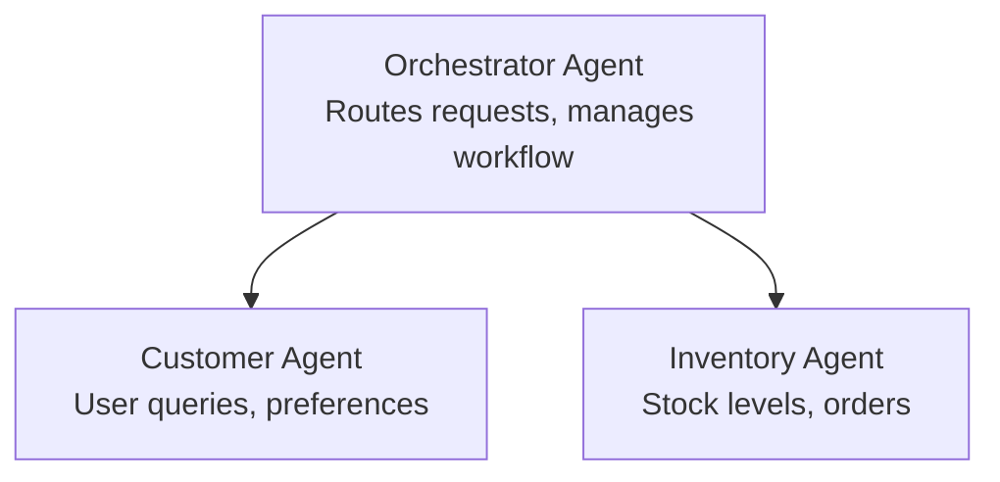

# Kapitola 5: Víceagentní AI řešení

**📚 Kurz**: [AZD pro začátečníky](../../README.md) | **⏱️ Délka**: 2-3 hodiny | **⭐ Složitost**: Pokročilá

---

## Přehled

Tato kapitola pokrývá pokročilé vzory víceagentní architektury, orchestraci agentů a nasazení AI připravených pro produkci v komplexních scénářích.

> Pokyny k příkazům byly ověřeny podle zveřejněné referenční příručky `azd 1.37.2`. Nasazení v cloudu nebylo provedeno.

## Cíle učení

Po dokončení této kapitoly budete:
- Rozumět víceagentním architektonickým vzorům
- Nasazovat koordinované systémy AI agentů
- Implementovat komunikaci agent-agent
- Vytvářet řešení více agentů připravená pro produkci

---

## 📚 Lekce

| # | Lekce | Popis | Čas |
|---|--------|-------------|------|
| 1 | [Základy více agentů](multi-agent-basics.md) | Prakticky: nasadit funkční víceagentní aplikaci s `azd up` | 45 min |
| 2 | [Vzory koordinace](../chapter-06-pre-deployment/coordination-patterns.md) | Strategie orchestraci agentů (pokračuje v kapitole 6) | 30 min |
| 3 | [Nasazení ARM šablony](../../examples/retail-multiagent-arm-template/README.md) | Příklad nasazení na jeden klik | 30 min |

> **Začněte lekcí 1.** Je to jediná plně praktická a nasaditelná lekce v této kapitole. Lekce 2 je v kapitole 6 (sdílena s plánováním před nasazením) a [Retail Multi-Agent Solution](../../examples/retail-scenario.md) je architektonický plán – designová reference, ne šablona na jeden příkaz.

---

## 🚀 Rychlý start

```bash
# Option 1: Deploy the multi-agent template used in Lesson 1
azd init --template Azure-Samples/contoso-creative-writer .
azd up

# Option 2: Initialize a Foundry agent interactively with the GA bundle
azd ext install microsoft.foundry
azd ai agent init
azd up
```

> **Jaký přístup?** Použijte `azd init --template` pro start z funkčního vzoru. Použijte `azd ai agent init` interaktivně, nebo `azd ai agent init --template <path-to-azure.yaml>` k převzetí existujícího agentního projektu. Viz [referenci AZD AI CLI](../chapter-08-production/production-ai-practices.md#azd-ai-cli-commands-and-extensions) pro požadavky na verzi a migraci hodnocení.

Spusťte tyto alternativy v samostatných prázdných složkách. Workflow GA Foundry vyžaduje `azd >= 1.37.0`; jeho interaktivní režim nevytváří vlastní pipeline Service Bus v lekci koordinace. Pro lokální testování, nasazení kódu a úklid nových oproti znovu použitým projektům následujte [průvodce host-agentem](../chapter-02-ai-development/microsoft-foundry-integration.md#hosted-agent-walkthrough-ga).

---

## 🤖 Víceagentní architektura



---

## 🎯 Doporučené řešení: Retail Multi-Agent

Řešení [Retail Multi-Agent](../../examples/retail-scenario.md) demonstruje:

- **Zákaznický agent**: Zpracovává uživatelské interakce a preference
- **Inventární agent**: Spravuje zásoby a zpracování objednávek
- **Orchestrátor**: Koordinuje mezi agenty
- **Sdílená paměť**: Správa kontextu napříč agenty

### Použité služby

| Služba | Účel |
|---------|---------|
| Microsoft Foundry Models | Porozumění jazyku |
| Azure AI Search | Produktový katalog |
| Cosmos DB | Stav a paměť agenta |
| Container Apps | Hostování agentů |
| Application Insights | Monitorování |

---

## 🔗 Navigace

| Směr | Kapitola |
|-----------|---------|
| **Předchozí** | [Kapitola 4: Infrastruktura](../chapter-04-infrastructure/README.md) |
| **Další** | [Kapitola 6: Přednasazení](../chapter-06-pre-deployment/README.md) |

---

## 📖 Související zdroje

- [Průvodce AI agenty](../chapter-02-ai-development/agents.md)
- [Průmyslové AI praktiky](../chapter-08-production/production-ai-practices.md)
- [Řešení problémů s AI](../chapter-07-troubleshooting/ai-troubleshooting.md)

---

<!-- CO-OP TRANSLATOR DISCLAIMER START -->
**Prohlášení o omezení odpovědnosti**:
Tento dokument byl přeložen pomocí AI překladatelské služby [Co-op Translator](https://github.com/Azure/co-op-translator). Přestože usilujeme o co největší přesnost, mějte prosím na paměti, že automatizované překlady mohou obsahovat chyby nebo nepřesnosti. Originální dokument v jeho mateřském jazyce by měl být považován za autoritativní zdroj. Pro kritické informace se doporučuje profesionální lidský překlad. Nejsme odpovědní za jakékoli nedorozumění nebo nesprávné interpretace vzniklé použitím tohoto překladu.
<!-- CO-OP TRANSLATOR DISCLAIMER END -->