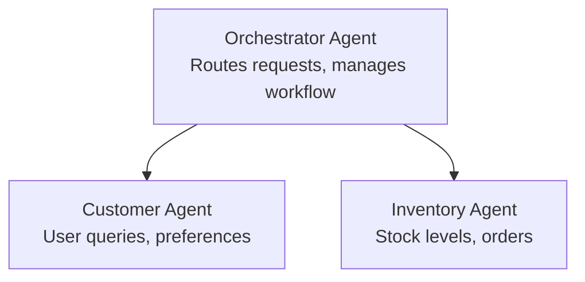

# Kapitola 5: Multi-agentní AI řešení

**📚 Kurz**: [AZD Pro začátečníky](../../README.md) | **⏱️ Délka**: 2-3 hodiny | **⭐ Náročnost**: Pokročilá

---

## Přehled

Tato kapitola pokrývá pokročilé vzory multi-agentní architektury, orchestraci agentů a produkčně připravené AI nasazení pro složité scénáře.

> Příkazy byly ověřeny podle vydaného `azd 1.37.2` referenčního materiálu. Nasazení do cloudu nebylo provedeno.

## Cíle učení

Dokončením této kapitoly budete:
- Rozumět vzorům multi-agentní architektury
- Nasazovat koordinované systémy AI agentů
- Implementovat komunikaci agent-agent
- Vytvářet produkčně připravená multi-agentní řešení

---

## 📚 Lekce

| # | Lekce | Popis | Doba |
|---|--------|-------------|------|
| 1 | [Základy multi-agentů](multi-agent-basics.md) | Praktická lekce: nasazení funkční multi-agentní aplikace s `azd up` | 45 min |
| 2 | [Vzory koordinace](../chapter-06-pre-deployment/coordination-patterns.md) | Strategie orchestrací agentů (pokračuje v kapitole 6) | 30 min |
| 3 | [Nasazení ARM šablony](../../examples/retail-multiagent-arm-template/README.md) | Příklad nasazení jedním kliknutím | 30 min |

> **Začněte Lekcí 1.** Je to jediná plně praktická a deployovatelná lekce v této kapitole. Lekce 2 je v kapitole 6 (sdílí se s plánováním před nasazením) a [Retail Multi-Agent Solution](../../examples/retail-scenario.md) je architektonický návrh – designová reference, ne šablona jednoho příkazu.

---

## 🚀 Rychlý začátek

```bash
# Option 1: Deploy the multi-agent template used in Lesson 1
azd init --template Azure-Samples/contoso-creative-writer .
azd up

# Option 2: Initialize a Foundry agent interactively (requires azure.ai.agents)
azd extension install azure.ai.agents
azd ai agent init
azd up
```

> **Který přístup?** Použijte `azd init --template` pro start z fungující ukázky. Použijte interaktivně `azd ai agent init`, nebo `azd ai agent init --template <path-to-azure.yaml>` pro převzetí stávajícího agentního projektu. Viz [AZD AI CLI reference](../chapter-08-production/production-ai-practices.md#azd-ai-cli-commands-and-extensions) pro požadavky na verzi a migraci k evaluaci.

Spusťte tyto alternativy v samostatných prázdných složkách. Rozšíření agentů `1.0.0-beta.23` vyžaduje `azd >= 1.37.0`; jeho interaktivní tok nevytváří vlastní pipeline pro Service Bus v lekci koordinace.

---

## 🤖 Multi-agentní architektura



---

## 🎯 Vybrané řešení: Retail Multi-Agent

Řešení [Retail Multi-Agent Solution](../../examples/retail-scenario.md) demonstruje:

- **Zákaznický agent**: Zpracovává uživatelské interakce a preference
- **Inventární agent**: Spravuje zásoby a zpracování objednávek
- **Orchestrace**: Koordinuje mezi agenty
- **Sdílená paměť**: Správa kontextu mezi agenty

### Použité služby

| Služba | Účel |
|---------|---------|
| Microsoft Foundry Models | Porozumění jazyku |
| Azure AI Search | Produktový katalog |
| Cosmos DB | Stav a paměť agenta |
| Container Apps | Hostování agenta |
| Application Insights | Monitorování |

---

## 🔗 Navigace

| Směr | Kapitola |
|-----------|---------|
| **Předchozí** | [Kapitola 4: Infrastruktura](../chapter-04-infrastructure/README.md) |
| **Další** | [Kapitola 6: Před nasazením](../chapter-06-pre-deployment/README.md) |

---

## 📖 Související zdroje

- [Průvodce AI agenty](../chapter-02-ai-development/agents.md)
- [Praxe produkční AI](../chapter-08-production/production-ai-practices.md)
- [Řešení problémů AI](../chapter-07-troubleshooting/ai-troubleshooting.md)

---

<!-- CO-OP TRANSLATOR DISCLAIMER START -->
**Prohlášení o omezení odpovědnosti**:
Tento dokument byl přeložen pomocí AI překladatelské služby [Co-op Translator](https://github.com/Azure/co-op-translator). Přestože usilujeme o co největší přesnost, mějte prosím na paměti, že automatizované překlady mohou obsahovat chyby nebo nepřesnosti. Originální dokument v jeho mateřském jazyce by měl být považován za autoritativní zdroj. Pro kritické informace se doporučuje profesionální lidský překlad. Nejsme odpovědní za jakékoli nedorozumění nebo nesprávné interpretace vzniklé použitím tohoto překladu.
<!-- CO-OP TRANSLATOR DISCLAIMER END -->