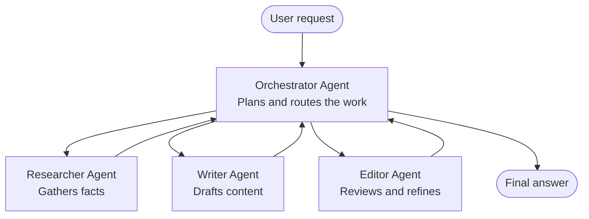

# Základy multi-agentních systémů – Nasazení prvního koordinovaného AI systému

**Navigace kapitolou:**
- **📚 Domovská stránka kurzu**: [AZD pro začátečníky](../../README.md)
- **📖 Aktuální kapitola**: Kapitola 5 - Multi-agentní AI řešení
- **⬅️ Předchozí**: [Kapitola 4: Infrastruktura](../chapter-04-infrastructure/README.md)
- **➡️ Další**: [Koordinační vzory](../chapter-06-pre-deployment/coordination-patterns.md)

> Příkazy zkontrolované vůči vydané referenci `azd 1.37.2`. Nasazení do cloudu nebylo provedeno.

## Úvod

V dřívějších kapitolách jste nasadili jednu aplikaci—a v kapitole 2 jste nasadili jednoho AI agenta. Tento lekce udělá další krok: nasadí **multi-agentní systém**, kde několik specializovaných agentů spolupracuje, aby vyřešilo problém, který by jeden agent sám dobře nezvládl.

Dobrá zpráva pro začátečníky: **nepotřebujete nové příkazy.** Multi-agentní řešení je stále projekt azd. Budete `azd init`, `azd up`, testovat a `azd down`—přesně pracovní postup, který už znáte. Co se mění je *podoba* aplikace uvnitř.

## Cíle učení

Na konci této lekce budete:
- Rozumět, co znamená "multi-agentní" a kdy stojí za to přijmout větší složitost
- Rozpoznat běžné role v multi-agentním systému (orchestrátor + specialisté)
- Nasadit skutečnou, fungující multi-agentní šablonu s `azd up`
- Rozumět zdrojům Azure, které podporují multi-agentní aplikaci
- Vědět, jak bezpečně ověřit, upravit a ukončit řešení

## Výsledky učení

Po dokončení lekce budete schopni:
- Vysvětlit rozdíl mezi jedním agentem a multi-agentním systémem
- Vybrat mezi jedním agentem s nástroji a skutečným multi-agentním návrhem
- Nasadit a otestovat multi-agentní šablonu od začátku do konce pomocí azd
- Identifikovat, kde každý agent běží a jak spolu komunikují
- Smazat všechny zdroje, aby nenastaly další poplatky

---

## Co je multi-agentní systém?

Jeden AI agent je jeden model s sadou instrukcí a (volitelně) nějakými nástroji. To funguje dobře pro zaměřené úkoly. Ale jak úkol roste — výzkum, pak psaní, pak úpravy, pak kontrola faktů — nacpání všeho do jednoho promptu činí agenta pomalejším, méně spolehlivým a těžším k ladění.

**Multi-agentní systém** rozděluje práci na specialisty, kteří každý dobře plní jednu činnost, koordinovanou orchestrátorem:



### Dvě role, které vždy uvidíte

| Role | Úkol | Příklad |
|------|-----|---------|
| **Orchestrátor** | Rozhoduje *co se stane dál* a směruje práci mezi agenty | "Nejprve výzkum, pak psaní, pak úpravy" |
| **Specialista** | Plní jednu zaměřenou činnost a vrací výsledek | Výzkumník, který jen sbírá fakta |

### Opravdu potřebujete více agentů?

Začněte jednoduše. Sáhněte po multi-agentním řešení **jen** když platí některé z těchto:

- ✅ Úkol má **odlišné fáze**, které těží z různých instrukcí (výzkum vs. psaní vs. kontrola)
- ✅ Chcete, aby specialisté běželi **paralelně** a ušetřili čas
- ✅ Různé kroky potřebují **různé nástroje nebo zdroje dat**
- ✅ Potřebujete, aby každý krok šel **samostatně testovat a ladit**

Pokud je váš úkol jednou otázkou a odpovědí nebo jednoduchým voláním nástroje, **jeden agent s nástroji** (Kapitola 2) je jednodušší, levnější a snadněji ovladatelný.

> **Tip pro začátečníky:** "Více agentů" není "lepší." Každý agent přidává zpoždění, náklady a novou věc k monitorování. Přidávejte agenty jen když se problém jasně rozdělí na části.

---

## Dva způsoby, jak postavit multi-agentní systém na Azure

| Přístup | Co to je | Nejlepší pro |
|----------|-----------|----------|
| **Jeden agent + nástroje** | Jeden Foundry agent, který volá funkce/nástroje | Jednoduché pracovní postupy, začátečníci |
| **Více koordinovaných agentů** | Několik agentů s orchestrátorem | Odlišné fáze, paralelní práce, specializace |

Tato lekce se zaměřuje na druhý přístup pomocí **připravené šablony**, abyste viděli skutečný multi-agentní systém v provozu, než si postavíte vlastní.

---

## Prakticky: Nasazení fungující multi-agentní aplikace

Nasadíme **Contoso Creative Writer**, oficiální ukázkový projekt Azure, který koordinuje výzkumné, produktové, píšící a editační agenty pro vytvoření článku. Před pokračováním zkontrolujte [předpoklady a náklady ukázky](https://github.com/Azure-Samples/contoso-creative-writer#azure-account-requirements): vyžaduje kvótu modelu, Azure AI Search, přístup k Bing Grounding, Python, Docker a Bash kompatibilní háčky. Dostupnost modelu a regionu závisí na vašem předplatném; výběr regionu nezaručuje nasazení.

### Krok 1: Inicializace šablony

```bash
# Create a working folder
mkdir creative-writer && cd creative-writer

# Initialize from the official multi-agent template
azd init --template Azure-Samples/contoso-creative-writer .
```

> Můžete kdykoliv procházet další multi-agentní šablony v [Awesome AZD AI galerii](https://azure.github.io/awesome-azd/?tags=ai). Další možnosti vhodné pro začátečníky zahrnují `get-started-with-ai-agents` a `azure-ai-travel-agents`.

### Krok 2: Autentizace

```bash
# Required for azd workflows
azd auth login

# Also required by this sample's Azure CLI hooks
az login
```

### Krok 3: Kontrola prostředí

```bash
# init normally creates/selects an environment; confirm it before proceeding
azd env list
# Only if you need an additional environment:
# azd env new dev
```

### Krok 4: Náhled a pak nasazení

```bash
# See what will be created before spending anything (recommended)
azd provision --preview

# Provision infrastructure and deploy all agents in one step
azd up
```

`azd up` vyzve k doplnění chybějících nastavení předplatného a regionu, poté vytvoří zdroje a nasadí aplikaci. Náhled nezabírá kvótu ani nezaručuje úspěch; šablonové háčky mohou běžet i během náhledu tvorby, proto je nejprve zkontrolujte. Pro prodloužení čekání azd na každé **nasazení služby** (nikoli modelu):

```bash
azd deploy --timeout 1800
```

Časový limit zastaví čekání azd; nezruší nasazení v Azure. Před opakováním akce zkontrolujte stav zdroje.

> **Upozornění na náklady a kapacitu:** Multi-agentní aplikace nasazují AI modely, které spotřebovávají kvótu a generují náklady. Pokud `azd up` selže kvůli kvótě modelu, podívejte se do [AI řešení problémů](../chapter-07-troubleshooting/ai-troubleshooting.md) pro opravy regionu a kvóty, a do kapitoly 6 [Plánování kapacity](../chapter-06-pre-deployment/capacity-planning.md).

---

## Porozumění nasazení

Typická multi-agentní aplikace jako tato vytvoří sadu Azure zdrojů, které přímo odpovídají rolím z výše uvedeného diagramu:

| Zdroj | Proč je zde |
|----------|----------------|
| **Microsoft Foundry / Modely** | Hostuje jazykové modely používané každým agentem |
| **Azure AI Search** | Dává výzkumnému agentovi spolehlivá data k vyhledávání |
| **Container Apps** (nebo App Service) | Hostuje orchestrátora a kód agentů |
| **Cosmos DB** (v některých ukázkách) | Uchovává sdílený stav/paměť předávanou mezi agenty |
| **Application Insights** | Sleduje požadavky *mezi* agenty, abyste mohli ladit průběh |

### Jak spolu agenti komunikují

Ve většině azd multi-agentních ukázek **orchestrátor běží ve vašem aplikačním kódu** (například s frameworkem jako Semantic Kernel nebo Microsoft Agent Framework). Orchestrátor volá jednotlivé specialisty postupně, předává výsledky a sestavuje finální odpověď. Agenti sdílejí kontext pomocí:

- **Volání funkcí/nástrojů** — orchestrátor vyvolá specialistu a obdrží zpět výsledek
- **Sdílené paměti** — databáze (často Cosmos DB) uchovává stav, který oba agenti čtou
- **Zpráv/událostí** — pro volnější propojení komunikují agenti přes frontu nebo Service Bus

> **Proč je to důležité pro ladění:** protože každý krok je oddělený, Application Insights vám ukáže, *který* agent byl pomalý nebo selhal. To je hlavní důvod rozdělení práce na víc agentů.

---

## Ověření nasazení

Potvrďte, že systém skutečně funguje, než budete pokračovat:

```bash
# Show the deployed endpoints
azd show

# Open the app's monitoring dashboard
azd monitor

# Open Application Insights Logs (not a terminal log stream)
azd monitor --logs
```

Pak otevřete URL aplikace z `azd show` a vyžádejte si krátký článek. Použijte ladicí režim ukázky pro kontrolu workflow agentů. Hledání transakcí v Application Insights může zobrazit jednotlivé kroky pouze pokud ukázka instrumentuje a koreluje tyto kroky; azd nepřidává automaticky rozsahy agentů.

**Kritéria úspěchu:**
- ✅ `azd show` vypisuje dostupný endpoint
- ✅ Požadavek vygeneruje výsledek, který jasně prošel několika fázemi
- ✅ Ladicí režim zobrazuje kroky více agentů; pokud je tracing povolený, ověřte odpovídající telemetrii po ingestaci

---

## Přizpůsobení: Přidání nebo úprava agenta

Protože každý agent je jen sada instrukcí a nástrojů, přizpůsobení je zvládnutelné:

1. **Najděte definice agentů** v šabloně (často sada souborů `prompts/`, `agents/` nebo `*.prompty`).
2. **Upravte instrukce agenta** — například řekněte editačnímu agentovi, aby dodržoval konkrétní tón nebo počet slov.
3. **Znovu nasadíte jen kód** (infrastruktura zůstává stejná):

   ```bash
   azd deploy
   ```

Pro další práci se *svým* Foundry agent projektem použijte GA balíček s AZD 1.37.0+ v samostatném prázdném adresáři:

```bash
azd ext install microsoft.foundry
azd ai agent init
azd up
azd ai agent invoke      # test, with response timing
```

Podívejte se na [GA hosted-agent průvodce](../chapter-02-ai-development/microsoft-foundry-integration.md#hosted-agent-walkthrough-ga) pro lokální testování Agent Inspector, vzdálené nasazení kódu a správu úklidu. [AZD AI CLI reference](../chapter-08-production/production-ai-practices.md#azd-ai-cli-commands-and-extensions) pokrývá také rozšíření o samostatná vyhodnocení, optimalizaci a mazání agentů.

---

## Úklid

Multi-agentní aplikace provozují více účtovaných služeb. Vše smažte, když skončíte:

```bash
# Review the resources and confirm deletion interactively
azd down
```

Mazání je destruktivní. Pro krátkou laboratoř `azd down --force --purge` přeskočí mazání a podporované potvrzení měkkého vyčištění; vyčištění je nevratné tam, kde je podporováno, a může být blokováno ochranou proti vyčištění. Měkké mazání je otázka obnovy/opětovného použití jména, nikoli samo o sobě důkaz o pokračujících poplatcích. Po úklidu zkontrolujte zachované zdroje a účtování.

Pokud jste také inicializovali hosted agenta vůči existujícímu Foundry projektu, `azd down` nechá agent projektu a další zdroje na místě. Odstraňte pouze vlastní nepotřebné zdroje samostatně. Pro nový Foundry projekt vytvořený jeho AZD prostředím, `azd down` smaže skupinu zdrojů a vše v ní.

---

## Poznámka k produkčním multi-agentním systémům

Řešení [Retail Multi-Agent Solution](../../examples/retail-scenario.md) v tomto repozitáři je **architektonický plán**, nikoliv šablona spustitelná jedním příkazem—dokumentuje, jak by se výrobní maloobchodní systém *měl* postavit (a jasně uvádí, že kompletní stavba je značný úkol). Použijte ho jako referenční návrh *poté*, co zde nasadíte funkční vzorek. Pro výrobní záležitosti (odolnost, náklady, monitorování, řízení) pokračujte na [Kapitolu 8: Produkční AI postupy](../chapter-08-production/production-ai-practices.md).

---

## Shrnutí

- Multiagentní systém rozděluje práci mezi specialisty koordinované orchestratorem.
- Používejte ho pouze tehdy, když má úkol jasné fáze, paralelismus nebo různé nástroje pro každý krok—jinak upřednostněte jednoho agenta.
- Pracovní postup azd zůstává nezměněn: `azd init` → `azd up` → test → `azd down`.
- Skutečná šablona jako `contoso-creative-writer` vám dnes umožní vidět a přizpůsobit fungující multiagentní aplikaci.
- Sledování Application Insights napříč agenty je jednou z největších praktických výhod návrhu s více agenty.

---

## 🔗 Navigace

| Směr | Lekce |
|-----------|--------|
| **Předchozí** | [Kapitola 4: Infrastruktura](../chapter-04-infrastructure/README.md) |
| **Další** | [Koordinační vzory](../chapter-06-pre-deployment/coordination-patterns.md) |

## 📖 Související zdroje

- [Průvodce AI agenty](../chapter-02-ai-development/agents.md)
- [Koordinační vzory](../chapter-06-pre-deployment/coordination-patterns.md)
- [Praxie produkční AI](../chapter-08-production/production-ai-practices.md)
- [Řešení problémů s AI](../chapter-07-troubleshooting/ai-troubleshooting.md)

---

<!-- CO-OP TRANSLATOR DISCLAIMER START -->
**Prohlášení o omezení odpovědnosti**:
Tento dokument byl přeložen pomocí AI překladatelské služby [Co-op Translator](https://github.com/Azure/co-op-translator). Přestože usilujeme o co největší přesnost, mějte prosím na paměti, že automatizované překlady mohou obsahovat chyby nebo nepřesnosti. Originální dokument v jeho mateřském jazyce by měl být považován za autoritativní zdroj. Pro kritické informace se doporučuje profesionální lidský překlad. Nejsme odpovědní za jakékoli nedorozumění nebo nesprávné interpretace vzniklé použitím tohoto překladu.
<!-- CO-OP TRANSLATOR DISCLAIMER END -->