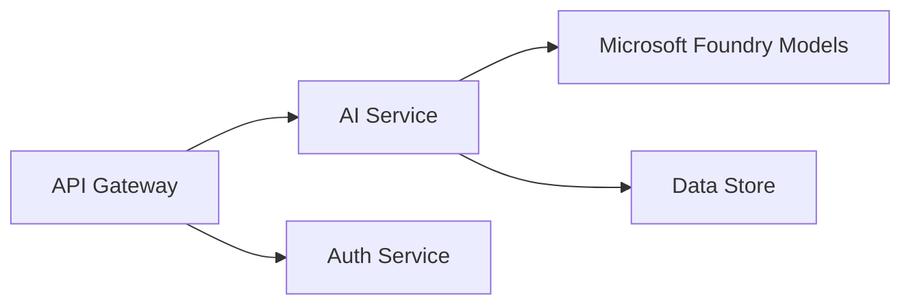
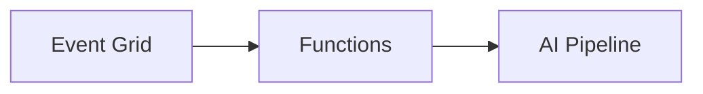

# Kapitola 8: Produkční a podnikové vzory

**📚 Kurz**: [AZD pro začátečníky](../../README.md) | **⏱️ Doba trvání**: 2-3 hodiny | **⭐ Složitost**: Pokročilá

---

## Přehled

Tato kapitola pokrývá vzory nasazení připravené pro podnikové prostředí, zabezpečení, monitorování a optimalizaci nákladů pro produkční AI pracovní zátěže.

Jedná se o architektonickou referenci, nikoli o kompletní nasaditelnou produkční šablonu. Příklady vynechávají detaily integrace, které musíte dodat a otestovat ve vlastní aplikaci; přečtení kontrolního seznamu nezaručuje produkční připravenost.

> **Aktualizace Foundry GA (2026-11-09):** Použijte `azd >= 1.37.0` a obecně dostupný balíček `microsoft.foundry` 1.0 pro Foundry workflow; vyhodnocování se instaluje samostatně. Viz [rozsah vydání a migrace](production-ai-practices.md#recent-release-changes-and-fixes) a [příklad autentizovaného pipeline](production-ai-practices.md#cicd-pipeline-configuration). Toto je revize dokumentace, nikoli validace nasazení v reálu nebo všeobecný GA stav pro volitelné náhledové funkce.

## Výukové cíle

Po dokončení této kapitoly budete umět:
- Nasadit odolné aplikace v několika regionech
- Implementovat podnikové bezpečnostní vzory
- Nakonfigurovat komplexní monitorování
- Optimalizovat náklady ve velkém měřítku
- Nastavit CI/CD pipeline s AZD

---

## 📚 Lekce

| # | Lekce | Popis | Čas |
|---|--------|-------------|------|
| 1 | [Produkční AI praktiky](production-ai-practices.md) | Podnikové vzory nasazení | 90 min |

---

## 🚀 Produkční kontrolní seznam

- [ ] Nasazení do více regionů pro odolnost
- [ ] Spravovaná identita pro autentizaci (bez klíčů)
- [ ] Application Insights pro monitorování
- [ ] Nastaveny rozpočty a upozornění na náklady
- [ ] Povolené bezpečnostní skenování
- [ ] Integrace CI/CD pipeline
- [ ] Plán obnovy po havárii

---

## 🏗️ Architektonické vzory

### Vzor 1: Microservices AI



### Vzor 2: Event-Driven AI



---

## 🔐 Nejlepší bezpečnostní postupy

```bicep
// Illustrative properties from different resources, NOT a standalone Bicep file.
// Attach identity to the application host:
identity: {
  type: 'SystemAssigned'
}

// AI account properties (also require private endpoints, DNS and app connectivity):
properties: {
  publicNetworkAccess: 'Disabled'
  networkAcls: {
    defaultAction: 'Deny'
  }
}
```

---

## 💰 Optimalizace nákladů

| Strategie | Hlavní omezení |
|----------|---------|
| Měřítko na nulu (Container Apps) | Vyžaduje vhodný spouštěč; ostatní služby stále generují náklady |
| Použití spotřebních úrovní pro vývoj | Porovnat cenové tarify služby a zátěž |
| Naplánované škálování | Škálování přes podporovanou infrastrukturu/automatizaci |
| Rezervace/provízované kapacity | Pouze pokud je podporováno; závazky mohou zvyšovat nečinné náklady |

Použijte [kompletní vzor rozpočtového zdroje](production-ai-practices.md#2-cost-monitoring-and-budgets) s platným počátečním datem, fakturačním rozsahem, příjemci a oprávněními. Rozpočet posílá upozornění; neomezuje výdaje. Úspory závisí na měřené využitelnosti a nejsou zaručeným procentem.

---

## 📊 Nastavení monitorování

```bash
# Open the Application Insights logs view (requires configured monitoring)
azd monitor --logs

# Check Application Insights
azd monitor --overview

# View metrics
az monitor metrics list --resource <resource-id>
```

---

## 🔗 Navigace

| Směr | Kapitola |
|-----------|---------|
| **Předchozí** | [Kapitola 7: Řešení problémů](../chapter-07-troubleshooting/README.md) |
| **Konec kurzu** | [Domovská stránka kurzu](../../README.md) |

---

## 📖 Související zdroje

- [Průvodce AI agenty](../chapter-02-ai-development/agents.md)
- [Application Insights](../chapter-06-pre-deployment/application-insights.md)
- [Řešení s více agenty](../chapter-05-multi-agent/README.md)
- [Příklad microservices](../../examples/microservices/README.md)

---

<!-- CO-OP TRANSLATOR DISCLAIMER START -->
**Prohlášení o omezení odpovědnosti**:
Tento dokument byl přeložen pomocí AI překladatelské služby [Co-op Translator](https://github.com/Azure/co-op-translator). Přestože usilujeme o co největší přesnost, mějte prosím na paměti, že automatizované překlady mohou obsahovat chyby nebo nepřesnosti. Originální dokument v jeho mateřském jazyce by měl být považován za autoritativní zdroj. Pro kritické informace se doporučuje profesionální lidský překlad. Nejsme odpovědní za jakékoli nedorozumění nebo nesprávné interpretace vzniklé použitím tohoto překladu.
<!-- CO-OP TRANSLATOR DISCLAIMER END -->