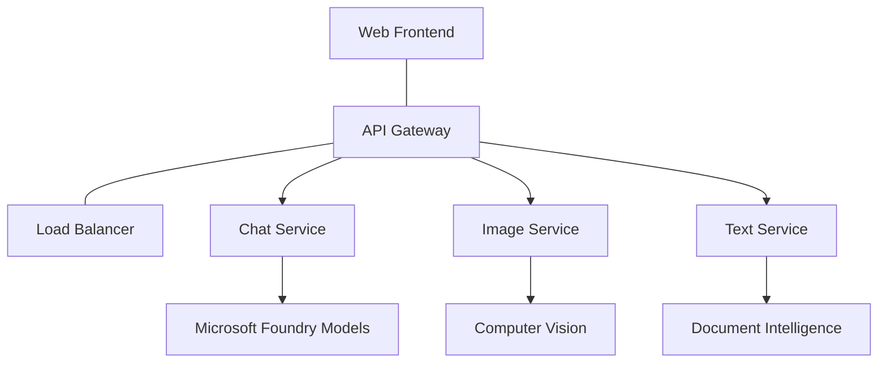

# Nejlepší postupy pro produkční AI pracovní zatížení s AZD

**Navigace kapitolou:**
- **📚 Domov kurzu**: [AZD pro začátečníky](../../README.md)
- **📖 Aktuální kapitola**: Kapitola 8 - Produkční a podnikové vzory
- **⬅️ Předchozí kapitola**: [Kapitola 7: Odstraňování problémů](../chapter-07-troubleshooting/debugging.md)
- **⬅️ Také související**: [AI Workshop Lab](../chapter-02-ai-development/ai-workshop-lab.md)
- **🎯 Dokončení kurzu**: [AZD pro začátečníky](../../README.md)

## Přehled

Tento průvodce vysvětluje produkční AI návrhové vzory pomocí Azure Developer CLI (AZD). Jedná se o návrhový referenční materiál, nikoli o nasaditelnou aplikaci nebo produkční certifikaci.

**Příkladové hranice:** Pokud není výslovně označeno jako kompletní, části Bicep předpokládají parametry a odkazované zdroje z obsahující šablony. Vynechávají hostitelské obrazy/plány, identity, přiřazení rolí, DNS, výstupy a další požadovanou integraci. YAML cesty služby a hook/testovací skripty jsou ilustrační soubory k vytvoření ve **vlastní aplikaci**; nejsou dodávány tímto kurzem. Použijte funkční vzor AZD jako základ, zkompilujte kompletní infrastrukturu a otestujte ji v izolovaném prostředí před produkcí.

## Hlavní řešené výzvy

Běžné produkční obavy zahrnují nasazení více služeb, správu identity a tajemství, škálování, kontrolu nákladů a monitorování. Zde není žádné tvrzení o měřeném výskytu.

## Architektonické vzory pro produkční AI

### Vzor 1: Microservices AI architektura

**Kdy použít**: Složité AI aplikace s více schopnostmi



**Implementace v AZD**:

```yaml
# azure.yaml
name: enterprise-ai-platform
services:
  web:
    project: ./web
    host: staticwebapp
  api-gateway:
    project: ./api-gateway
    host: containerapp
  chat-service:
    project: ./services/chat
    host: containerapp
  vision-service:
    project: ./services/vision
    host: containerapp
  text-service:
    project: ./services/text
    host: containerapp
```

### Vzor 2: Událostmi řízené AI zpracování

**Kdy použít**: Hromadné zpracování, analýza dokumentů, asynchronní pracovní postupy

```bicep
// Event Hub for AI processing pipeline
resource eventHub 'Microsoft.EventHub/namespaces@2024-01-01' = {
  name: eventHubNamespaceName
  location: location
  sku: {
    name: 'Standard'
    tier: 'Standard'
    capacity: 1
  }
}

// Service Bus for reliable message processing
resource serviceBus 'Microsoft.ServiceBus/namespaces@2024-01-01' = {
  name: serviceBusNamespaceName
  location: location
  sku: {
    name: 'Premium'
    tier: 'Premium'
    capacity: 1
  }
}

// Function App for processing
resource functionApp 'Microsoft.Web/sites@2023-01-01' = {
  name: functionAppName
  location: location
  kind: 'functionapp,linux'
  properties: {
    siteConfig: {
      appSettings: [
        {
          name: 'FUNCTIONS_EXTENSION_VERSION'
          value: '~4'
        }
        {
          name: 'AZURE_OPENAI_ENDPOINT'
          value: '@Microsoft.KeyVault(VaultName=${keyVault.name};SecretName=openai-endpoint)'
        }
      ]
    }
  }
}
```

Toto vytváří fragmenty jmenných prostorů, nikoli centrály, fronty, odběry nebo funkční spouštěče. Spustitelná funkce také potřebuje hostitelský plán, konfiguraci runtime/úložiště, připojenou identitu, RBAC a síťový přístup. Odkaz na Key Vault vyžaduje oprávnění pro čtení tajemství; URL koncového bodu samo o sobě není přihlašovací údaj.

## Přemýšlení o zdraví AI agenta

Když se tradiční webová aplikace pokazí, příznaky jsou známé: stránka se nenačte, API vrátí chybu nebo nasazení selže. AI-poháněné aplikace se mohou porouchat všemi těmito způsoby – ale mohou se také chovat méně zjevnými způsoby, které nevytvářejí zřetelné chybové zprávy.

Tato sekce vám pomůže vybudovat mentální model pro monitorování AI pracovních zátěží, abyste věděli, kam se podívat, když něco není v pořádku.

### Jak se zdraví agenta liší od zdraví tradiční aplikace

I tradiční aplikace mohou mít skryté chyby správnosti. AI agent přidává nedeterministickou kvalitu odpovědi k obvyklým obavám o dostupnost a správnost. Považujte zdraví agenta za dvě vrstvy:

| Vrstva | Co sledovat | Kde hledat |
|-------|--------------|---------------|
| **Zdraví infrastruktury** | Běží služba? Jsou zdroje nakonfigurovány? Jsou koncové body dostupné? | `azd monitor`, stav zdroje v Azure portálu, logy kontejneru/aplikace |
| **Zdraví chování** | Reaguje agent přesně? Jsou odpovědi včasné? Je model volán správně? | Trace Application Insights, metriky latence volání modelu, logy kvality odpovědí |

Zdraví infrastruktury je známé — je stejné pro jakoukoli azd aplikaci. Zdraví chování je nová vrstva, kterou zavádějí AI pracovní zatížení.

### Kam se podívat, když se AI aplikace nechovají podle očekávání

Pokud vaše AI aplikace nevytváří očekávané výsledky, zde je konceptuální kontrolní seznam:

1. **Začněte od základů.** Aplikace běží? Může dosáhnout svých závislostí? Zkontrolujte `azd monitor` a zdraví zdrojů stejně jako u jakékoli aplikace.
2. **Zkontrolujte připojení k modelu.** Volá vaše aplikace úspěšně AI model? Selhání nebo timeouty volání modelu jsou nejčastější příčinou problémů a objeví se v logu vaší aplikace.
3. **Bezpečně zkontrolujte vstupy a zakotvení.** Špatné odpovědi mohou být způsobeny vyhledáváním, instrukcemi, omezeními modelu nebo vykonáváním nástrojů. Používejte diagnostická data s řízeným přístupem a redakcí; v produkci nezapínejte bezvýběrové logování promptů/odpovědí.
4. **Prohlédněte si latenci odpovědí.** Volání AI modelů jsou pomalejší než běžná API volání. Pokud se vaše aplikace zdá pomalá, zkontrolujte, zda se nezvýšila doba odezvy modelu – to může znamenat throttling, kapacitní limity nebo zácpy na úrovni regionu.
5. **Sledujte signály nákladů.** Neočekávané skoky v používání tokenů nebo volání API mohou signalizovat smyčku, chybný prompt nebo nadměrné opakování.

Nemusíte hned ovládat nástroje pro observabilitu. Klíčové je, že AI aplikace mají další vrstvu chování ke sledování, a zabudované monitorování azd (`azd monitor`) vám dává výchozí bod pro zkoumání obou vrstev.

---

## Nejlepší bezpečnostní postupy

### 1. Model bezpečnosti zero-trust

**Strategie implementace**:
- Žádná komunikace služba ke službě bez autentizace
- Všechny API volání používají spravované identity
- Síťová izolace soukromými koncovými body
- Přístupy s nejnižšími oprávněními

```bicep
// Managed Identity for each service
resource chatServiceIdentity 'Microsoft.ManagedIdentity/userAssignedIdentities@2023-01-31' = {
  name: 'chat-service-identity'
  location: location
}

// Role assignments with minimal permissions
resource openAIUserRole 'Microsoft.Authorization/roleAssignments@2022-04-01' = {
  scope: openAIAccount
  name: guid(openAIAccount.id, chatServiceIdentity.id, '5e0bd9bd-7b93-4f28-af87-19fc36ad61bd')
  properties: {
    roleDefinitionId: subscriptionResourceId('Microsoft.Authorization/roleDefinitions', '5e0bd9bd-7b93-4f28-af87-19fc36ad61bd')
    principalId: chatServiceIdentity.properties.principalId
    principalType: 'ServicePrincipal'
  }
}
```

### 2. Bezpečná správa tajemství

**Vzor integrace Key Vault**:

```bicep
// Key Vault with proper access policies
resource keyVault 'Microsoft.KeyVault/vaults@2023-02-01' = {
  name: keyVaultName
  location: location
  properties: {
    tenantId: tenant().tenantId
    sku: {
      family: 'A'
      name: 'standard' // Premium is needed for HSM-backed keys, not ordinary secrets
    }
    enableRbacAuthorization: true  // Use RBAC instead of access policies
    enablePurgeProtection: true    // Prevent accidental deletion
    enableSoftDelete: true
    softDeleteRetentionInDays: 90
  }
}

// Optional legacy key-auth alternative; omit when using Entra ID.
resource openAIKeySecret 'Microsoft.KeyVault/vaults/secrets@2023-02-01' = {
  parent: keyVault
  name: 'openai-api-key'
  properties: {
    value: openAIAccount.listKeys().key1
    attributes: {
      enabled: true
    }
  }
}
```

Přiřaďte runtime identitu `Key Vault Secrets User` na vhodné úrovni rozsahu a připojte ji k hostiteli; samotné `enableRbacAuthorization` nedává přístup. Preferujte autentizaci spravovanou identitou OpenAI pomocí `disableLocalAuth: true`. Volitelný klíč tajemství dává smysl pouze pro účet s explicitně povoleným klíčem, a principál provedení rovněž potřebuje oprávnění k zápisu tajemství.

### 3. Síťová bezpečnost

**Konfigurace soukromého koncového bodu**:

```bicep
// Virtual Network for AI services
resource virtualNetwork 'Microsoft.Network/virtualNetworks@2023-04-01' = {
  name: vnetName
  location: location
  properties: {
    addressSpace: {
      addressPrefixes: ['10.0.0.0/16']
    }
    subnets: [
      {
        name: 'ai-services-subnet'
        properties: {
          addressPrefix: '10.0.1.0/24'
          privateEndpointNetworkPolicies: 'Disabled'
        }
      }
      {
        name: 'app-services-subnet'
        properties: {
          addressPrefix: '10.0.2.0/24'
          delegations: [
            {
              name: 'Microsoft.Web/serverFarms'
              properties: {
                serviceName: 'Microsoft.Web/serverFarms'
              }
            }
          ]
        }
      }
    ]
  }
}

// Private endpoints for all AI services
resource openAIPrivateEndpoint 'Microsoft.Network/privateEndpoints@2023-04-01' = {
  name: '${openAIAccountName}-pe'
  location: location
  properties: {
    subnet: {
      id: virtualNetwork.properties.subnets[0].id
    }
    privateLinkServiceConnections: [
      {
        name: 'openai-connection'
        properties: {
          privateLinkServiceId: openAIAccount.id
          groupIds: ['account']
        }
      }
    ]
  }
}
```

Soukromé koncové body také vyžadují skupiny soukromých DNS zón/VNet odkazy a integraci aplikace s VNet. Nezablokují automaticky veřejný přístup: po ověření soukromého připojení a přístupu k nasazení explicitně zakažte veřejný síťový přístup účtu AI.

## Výkon a škálování

### 1. Strategie automatického škálování

**Automatické škálování kontejnerových aplikací**:

```bicep
resource containerApp 'Microsoft.App/containerApps@2023-05-01' = {
  name: containerAppName
  location: location
  properties: {
    configuration: {
      ingress: {
        external: true
        targetPort: 8000
        transport: 'http'
      }
    }
    template: {
      scale: {
        minReplicas: 2  // Always have 2 instances minimum
        maxReplicas: 50 // Scale up to 50 for high load
        rules: [
          {
            name: 'http-scaling'
            http: {
              metadata: {
                concurrentRequests: '20'  // Scale when >20 concurrent requests
              }
            }
          }
          {
            name: 'cpu-scaling'
            custom: {
              type: 'cpu'
              metadata: {
                type: 'Utilization'
                value: '70'  // Scale when CPU >70%
              }
            }
          }
        ]
      }
    }
  }
}
```

### 2. Strategie cachování

**Redis cache pro AI odpovědi**:

```bicep
// Legacy Azure Cache for Redis example (not recommended for new deployments)
resource redisCache 'Microsoft.Cache/redis@2023-04-01' = {
  name: redisCacheName
  location: location
  properties: {
    sku: {
      name: 'Premium'
      family: 'P'
      capacity: 1
    }
    enableNonSslPort: false
    minimumTlsVersion: '1.2'
    redisConfiguration: {
      'maxmemory-policy': 'allkeys-lru'
    }
    // Sharding distributes data; replication/failover provides availability.
    shardCount: 2
  }
}

// Cache configuration in application
var cacheConnectionString = '${redisCache.properties.hostName}:6380,password=${redisCache.listKeys().primaryKey},ssl=True,abortConnect=False'
```

Azure Cache pro Redis Basic/Standard/Premium je na [cestě k ukončení](https://learn.microsoft.com/azure/azure-cache-for-redis/retirement-faq). Pro nové návrhy používejte Azure Managed Redis a jeho dokumentovanou konfiguraci SKU, identity a TLS místo kopírování tohoto staršího zdroje do nového produkčního systému. Řádek connection-string je nefunkční zástupce, nikoli přihlašovací údaj. Rozdělte klíče cache podle autorizace, modelu/instrukcí a verze vyhledávání, s expirací; sdílená cache pouze pro dotazy může zpřístupnit data jiného uživatele.

### 3. Vyvažování zátěže a řízení provozu

**Application Gateway s WAF**:

```bicep
// Application Gateway with Web Application Firewall
resource applicationGateway 'Microsoft.Network/applicationGateways@2023-04-01' = {
  name: appGatewayName
  location: location
  properties: {
    sku: {
      name: 'WAF_v2'
      tier: 'WAF_v2'
      capacity: 2
    }
    webApplicationFirewallConfiguration: {
      enabled: true
      firewallMode: 'Prevention'
      ruleSetType: 'OWASP'
      ruleSetVersion: '3.2'
    }
    // Backend pools for AI services
    backendAddressPools: [
      {
        name: 'ai-services-pool'
        properties: {
          backendAddresses: [
            {
              fqdn: '${containerApp.properties.configuration.ingress.fqdn}'
            }
          ]
        }
      }
    ]
  }
}
```

Toto je část zdroje gateway: skutečné nasazení také vyžaduje konfiguraci podsítě/IP gateway, front-end IP a porty, TLS posluchače/certifikáty, backend HTTP nastavení/probéry, směrovací pravidla a priority a přezkoumanou WAF politiku. TLS hostname/SNI a autentizace musí odpovídat backendu kontejnerové aplikace.

## 💰 Optimalizace nákladů

### 1. Správná velikost zdrojů

**Konfigurace podle prostředí**:

Tyto názvy jsou **ilustrační vstupy vlastních šablon**, nikoli automatická nastavení AZD. Nejprve je namapujte do `infra/main.parameters.json`/Bicep a konfigurace hostitele. Například ve vzoru RAG se používají `AZURE_SEARCH_SERVICE_SKU` a `AZURE_OPENAI_CHATGPT_DEPLOYMENT_CAPACITY`, nikoli generické názvy níže. Nastavte paměť Container Apps na podporovanou jednotku, například `1Gi` ve skutečném zdroji. Aplikujte změny infrastruktury pomocí `azd up` nebo `azd provision`; samotné `azd deploy` nezměny Bicep neaplikuje.

```bash
# Development environment
azd env new development
azd env set AZURE_OPENAI_SKU "S0"
azd env set AZURE_OPENAI_CAPACITY 10
azd env set AZURE_SEARCH_SKU "basic"
azd env set CONTAINER_CPU 0.5
azd env set CONTAINER_MEMORY 1.0

# Production environment  
azd env new production
azd env set AZURE_OPENAI_SKU "S0"
azd env set AZURE_OPENAI_CAPACITY 100
azd env set AZURE_SEARCH_SKU "standard"
azd env set CONTAINER_CPU 2.0
azd env set CONTAINER_MEMORY 4.0
```

### 2. Monitorování nákladů a rozpočty

```bicep
// Supply the first day of the current UTC month, e.g. 2026-11-01T00:00:00Z.
param budgetStartDate string

// Cost management and budgets
resource budget 'Microsoft.Consumption/budgets@2024-08-01' = {
  name: 'ai-workload-budget'
  properties: {
    timePeriod: {
      startDate: budgetStartDate
    }
    timeGrain: 'Monthly'
    amount: 2000  // In the billing currency, not necessarily USD
    category: 'Cost'
    notifications: {
      warning: {
        enabled: true
        operator: 'GreaterThan'
        threshold: 80
        contactEmails: [
          'finance@company.com'
          'engineering@company.com'
        ]
        contactRoles: [
          'Owner'
          'Contributor'
        ]
      }
      critical: {
        enabled: true
        operator: 'GreaterThan'
        threshold: 95
        contactEmails: [
          'cto@company.com'
        ]
      }
    }
  }
}
```

Nahraďte příkladové příjemce a zkontrolujte rozsah/oprávnění. Upozornění rozpočtu používají opožděná fakturační data a nevnucují limit výdajů.

### 3. Optimalizace využití tokenů

**Správa nákladů OpenAI**:

Toto je pouze heuristika založená na znacích pro náhled uživatelského rozhraní, **nikoli** validátor limitu tokenů modelu. Produkční kód musí použít tokenizér odpovídající nasazenému modelu a zohlednit systémové instrukce, schémata nástrojů, historii a rozpočet výstupu. Odmítejte příliš velké uživatelské zprávy místo tichého ořezu.

```typescript
// Application-level token optimization
class TokenOptimizer {
  private readonly maxTokens = 4000;
  private readonly reserveTokens = 500;
  
  optimizePrompt(userInput: string, context: string): string {
    const availableTokens = this.maxTokens - this.reserveTokens;
    if (this.estimateTokens(userInput) + 8 >= availableTokens) {
      throw new Error("User input exceeds the illustrative prompt budget");
    }
    const estimatedTokens = this.estimateTokens(userInput + context) + 8;
    
    if (estimatedTokens > availableTokens) {
      // Truncate context, not user input
      context = this.truncateContext(context, Math.max(0, availableTokens - this.estimateTokens(userInput) - 8));
    }
    
    return `${context}\n\nUser: ${userInput}`;
  }
  
  private estimateTokens(text: string): number {
    // Rough estimation: 1 token ≈ 4 characters
    return Math.ceil(text.length / 4);
  }

  private truncateContext(text: string, estimatedBudget: number): string {
    return text.slice(0, Math.max(0, estimatedBudget) * 4);
  }
}
```

## Monitorování a observabilita

### 1. Komplexní Application Insights

```bicep
// Application Insights with advanced features
resource applicationInsights 'Microsoft.Insights/components@2020-02-02' = {
  name: applicationInsightsName
  location: location
  kind: 'web'
  properties: {
    Application_Type: 'web'
    WorkspaceResourceId: logAnalyticsWorkspace.id
    SamplingPercentage: 100  // Ingestion setting; review cost and SDK sampling separately
    DisableIpMasking: false  // Retain IP masking
  }
}

// Custom metrics for AI operations
resource aiMetricAlerts 'Microsoft.Insights/metricAlerts@2018-03-01' = {
  name: 'ai-high-error-rate'
  location: 'global'
  properties: {
    description: 'Alert when failed request count exceeds 10 in five minutes'
    severity: 2
    enabled: true
    scopes: [
      applicationInsights.id
    ]
    evaluationFrequency: 'PT1M'
    windowSize: 'PT5M'
    criteria: {
      'odata.type': 'Microsoft.Azure.Monitor.SingleResourceMultipleMetricCriteria'
      allOf: [
        {
          name: 'high-error-rate'
          metricName: 'requests/failed'
          operator: 'GreaterThan'
          threshold: 10
          timeAggregation: 'Count'
        }
      ]
    }
  }
}
```

### 2. Specifické monitorování AI

**Vlastní dashboardy pro AI metriky**:

```json
{
  "dashboard": {
    "name": "AI Application Monitoring",
    "tiles": [
      {
        "name": "OpenAI Request Volume",
        "query": "dependencies | where target contains 'openai' | summarize count() by bin(timestamp, 5m)"
      },
      {
        "name": "AI Response Latency",
        "query": "dependencies | where target contains 'openai' | summarize avg(duration) by bin(timestamp, 5m)"
      },
      {
        "name": "Token Usage",
        "query": "customMetrics | where name == 'openai_tokens_used' | summarize sum(value) by bin(timestamp, 1h)"
      },
      {
        "name": "Cost per Hour",
        "query": "customMetrics | where name == 'openai_cost' | summarize sum(value) by bin(timestamp, 1h)"
      }
    ]
  }
}
```

Tento JSON je náčrt definovaný aplikací, nikoli importovatelná schéma dashboardu Azure portálu. Dotazy na tokeny/náklady vyžadují, aby vaše aplikace emitovala tyto přesné vlastní metriky; nevytváří je AZD. Přizpůsobte filtry závislostí skutečným jménům koncových bodů/span modelu.

### 3. Kontroly zdraví a monitorování dostupnosti

```bicep
// Application Insights availability tests
resource availabilityTest 'Microsoft.Insights/webtests@2022-06-15' = {
  name: 'ai-app-availability-test'
  location: location
  tags: {
    'hidden-link:${applicationInsights.id}': 'Resource'
  }
  properties: {
    SyntheticMonitorId: 'ai-app-availability-test'
    Name: 'AI Application Availability Test'
    Description: 'Tests AI application endpoints'
    Enabled: true
    Frequency: 300  // 5 minutes
    Timeout: 120    // 2 minutes
    Kind: 'standard'
    Locations: [
      {
        Id: 'us-east-2-azr'
      }
      {
        Id: 'us-west-2-azr'
      }
    ]
    Request: {
      RequestUrl: 'https://${webApp.properties.defaultHostName}/health'
      HttpVerb: 'GET'
      FollowRedirects: true
      ParseDependentRequests: false
    }
    ValidationRules: {
      ExpectedHttpStatusCode: 200
      SSLCheck: true
      SSLCertRemainingLifetimeCheck: 7
    }
  }
}
```

## Obnova po havárii a vysoká dostupnost

Předchozí test předpokládá existující App Service `webApp` a Application Insights zdroj. Standardní testy dostupnosti jsou zpoplatněné a vyžadují dosažitelný koncový bod; aplikace pouze soukromé potřebuji vhodný soukromý monitorovací návrh. URL ping testy jsou zastaralé; používejte [standardní testy dostupnosti](https://learn.microsoft.com/azure/azure-monitor/app/availability).

### 1. Nasazení ve více regionech

```yaml
# azure.yaml - Multi-region configuration
name: ai-app-multiregion
services:
  api-primary:
    project: ./api
    host: containerapp
    env:
      AZURE_REGION: eastus
  api-secondary:
    project: ./api
    host: containerapp
    env:
      AZURE_REGION: westus2
```

```bicep
// Separate App Service topology, not the Container Apps declarations above
resource trafficManager 'Microsoft.Network/trafficManagerProfiles@2022-04-01' = {
  name: trafficManagerProfileName
  location: 'global'
  properties: {
    profileStatus: 'Enabled'
    trafficRoutingMethod: 'Priority'
    dnsConfig: {
      relativeName: trafficManagerProfileName
      ttl: 30
    }
    monitorConfig: {
      protocol: 'HTTPS'
      port: 443
      path: '/health'
      intervalInSeconds: 30
      toleratedNumberOfFailures: 3
      timeoutInSeconds: 10
    }
    endpoints: [
      {
        name: 'primary-endpoint'
        type: 'Microsoft.Network/trafficManagerProfiles/azureEndpoints'
        properties: {
          targetResourceId: primaryAppService.id
          endpointStatus: 'Enabled'
          priority: 1
        }
      }
      {
        name: 'secondary-endpoint'
        type: 'Microsoft.Network/trafficManagerProfiles/azureEndpoints'
        properties: {
          targetResourceId: secondaryAppService.id
          endpointStatus: 'Enabled'
          priority: 2
        }
      }
    ]
  }
}
```

Proměnné prostředí nevolí umístění zdrojů. IaC musí vytvořit samostatné regionální hostitele a spojit každou službu pomocí `resourceName` nebo `azd-service-name` štítků. Příklad Traffic Manager je **samostatná topologie App Service** (`primaryAppService`/`secondaryAppService`), nikoli směrování pro deklarace Container Apps. Container Apps vyžadují vhodně nakonfigurovaný externí koncový bod/front door, směrování TLS/vlastní domény a kontroly zdraví.

### 2. Zálohování dat a obnova

```bicep
// Backup configuration for critical data
resource backupVault 'Microsoft.DataProtection/backupVaults@2023-05-01' = {
  name: backupVaultName
  location: location
  identity: {
    type: 'SystemAssigned'
  }
  properties: {
    storageSettings: [
      {
        datastoreType: 'VaultStore'
        type: 'LocallyRedundant'
      }
    ]
  }
}

```

Samotný vault nic nezálohuje. Nakonfigurujte **politiku podporovanou specifickou pro zátěž a zálohovací instanci**, zdrojová oprávnění, uchovávání a testy obnovy pomocí [matice podpory Azure Backup](https://learn.microsoft.com/azure/backup/backup-support-matrix). Neexistuje obecná backup politika Azure pro hostovaná nasazení Azure OpenAI modelů. Uchovávejte definice infrastruktury/nasazení modelu ve verzovacím systému; chraňte nahrané dokumenty, data aplikace a artefakty ladění pomocí zálohovacích/exportních funkcí každé podpůrné služby. Explicitně definujte a testujte RPO/RTO.

## Integrace DevOps a CI/CD

### 1. GitHub Actions workflow

```yaml
# .github/workflows/deploy-ai-app.yml
name: Deploy AI Application

on:
  push:
    branches: [main]
  pull_request:
    branches: [main]

jobs:
  test:
    runs-on: ubuntu-latest
    steps:
      - uses: actions/checkout@v4
      
      - name: Setup Python
        uses: actions/setup-python@v4
        with:
          python-version: '3.11'
          
      - name: Install dependencies
        run: |
          pip install -r requirements.txt
          pip install pytest
          
      - name: Run tests
        run: pytest tests/
        
      - name: AI Safety Tests
        run: |
          python scripts/test_ai_safety.py
          python scripts/validate_prompts.py

```

Toto je **pouze testovací část** workflow a předpokládá, že jste vytvořili `requirements.txt`, `tests/` a dva bezpečnostní skripty. Přidejte autentizované OIDC provisioning/nasazovací joby z [Konfigurace CI/CD pipeline](#cicd-pipeline-configuration), s `needs: test`, důvěryhodným push/manual trigger a chráněnými GitHub prostředími. Nenasazujte nedůvěryhodný kód pull requestu s cloudovými přihlašovacími údaji. Čerstvý runner nemá vybrané lokální prostředí AZD; zadejte vstupy prostředí/předplatného/umístění a používejte `azd auth login`, ne pouze `azure/login`.

### 2. Validace infrastruktury

```bash
# scripts/validate_infrastructure.sh
#!/bin/bash
set -euo pipefail

echo "Validating AI infrastructure deployment..."

# Requires Azure CLI login and the resource group selected explicitly.
: "${AZURE_RESOURCE_GROUP:?Set AZURE_RESOURCE_GROUP}"
: "${AZURE_OPENAI_NAME:?Set AZURE_OPENAI_NAME}"
: "${AZURE_OPENAI_CHAT_DEPLOYMENT:?Set the actual deployment name}"

# A successful empty list is not proof that resources exist.
types=("Microsoft.CognitiveServices/accounts" "Microsoft.Search/searchServices"
       "Microsoft.Storage/storageAccounts" "Microsoft.KeyVault/vaults")
for resource_type in "${types[@]}"; do
    count=$(az resource list --resource-group "$AZURE_RESOURCE_GROUP" \
        --resource-type "$resource_type" --query "length(@)" -o tsv)
    if [[ "$count" -lt 1 ]]; then
        echo "ERROR: No $resource_type found in $AZURE_RESOURCE_GROUP"
        exit 1
    fi
done

# Validate OpenAI model deployments
echo "Validating OpenAI model deployments..."
state=$(az cognitiveservices account deployment show \
  --name "$AZURE_OPENAI_NAME" --resource-group "$AZURE_RESOURCE_GROUP" \
  --deployment-name "$AZURE_OPENAI_CHAT_DEPLOYMENT" \
  --query "properties.provisioningState" -o tsv)
if [[ "$state" != "Succeeded" ]]; then
    echo "ERROR: Required model deployment is not provisioned successfully"
    exit 1
fi

echo "Infrastructure validation completed successfully!"
```

Očekává se: nula chybový kód a dokončovací zpráva pouze pokud existují všechny očekávané typy a pojmenované nasazení modelu je vytvořeno. Toto kontroluje inventář/stav provisioning, **nikoli** zdraví zdrojů, přesnou topologii, RBAC, síťovou dosažitelnost nebo chování modelu. Přizpůsobte očekávané typy vaší architektuře, pak proveďte samostatný autentizovaný test připravenosti aplikace.

## Kontrolní seznam připravenosti na produkci

### Bezpečnost ✅
- [ ] Všechny služby používají spravované identity
- [ ] Tajemství uložená v Key Vault
- [ ] Konfigurované soukromé koncové body
- [ ] Implementované síťové bezpečnostní skupiny
- [ ] RBAC s nejnižšími oprávněními
- [ ] WAF povolený na veřejných bodech

### Výkon ✅
- [ ] Nakonfigurované automatické škálování
- [ ] Implementované cachování
- [ ] Nastavené vyvažování zátěže
- [ ] CDN pro statický obsah
- [ ] Pooling připojení k databázi
- [ ] Optimalizace využití tokenů

### Monitorování ✅
- [ ] Nakonfigurovaný Application Insights
- [ ] Definované vlastní metriky
- [ ] Nastavená pravidla upozornění
- [ ] Vytvořený dashboard
- [ ] Implementované kontroly zdraví
- [ ] Politiky uchování logů

### Spolehlivost ✅
- [ ] Nasazení ve více regionech
- [ ] Plán zálohování a obnovy
- [ ] Implementované jističe přetížení
- [ ] Nakonfigurované politiky opakování
- [ ] Graceful degradace
- [ ] Koncové body kontrol zdraví

### Řízení nákladů ✅
- [ ] Nakonfigurované upozornění rozpočtu
- [ ] Správná velikost zdrojů
- [ ] Aplikované slevy pro vývoj/testování
- [ ] Zakoupené rezervované instance
- [ ] Dashboard pro sledování nákladů
- [ ] Pravidelné revize nákladů

### Soulad ✅
- [ ] Splněny požadavky na umístění dat
- [ ] Povolené auditní logování
- [ ] Aplikované politiky souladu
- [ ] Implementované bezpečnostní základy
- [ ] Pravidelná bezpečnostní hodnocení
- [ ] Plán reakce na incidenty

## Výkonové benchmarky

### Ilustrační produkční cíle

Toto jsou příkladové SLO pro vyjednávání a zatěžovací testy, nikoli měřené benchmarky nebo záruky. Latence odpovědi závisí na délce modelu/výstupu; měsíční výdaje za tokeny závisí na provozu a cenách, nikoli pouze na počtu tokenů.

| Metrika | Cíl | Monitorování |
|--------|--------|------------|
| **Doba odezvy** | < 2 sekundy | Application Insights |
| **Dostupnost** | 99.9 % | Monitorování dostupnosti |
| **Míra chyb** | < 0,1 % | Logy aplikace |
| **Výdaje na model** | < 500 $/měsíc (příklad rozpočtu) | Řízení nákladů |
| **Současní uživatelé** | 1000+ | Zátěžové testování |
| **Doba zotavení** | < 1 hodina | Testy obnovy po havárii |

### Testování zátěže

Níže je náčrt rozhraní pro skript testování zátěže, který **musíte implementovat**; toto repozitář neposkytuje `scripts/load_test.py`. Definujte požadavky payload, autentifikaci, reprezentativní zátěže, percentilové časové odezvy/chybové aserce a limit výdajů ve vámi zvoleném nástroji testování zátěže před spuštěním:

```bash
# Load testing script for AI applications
python scripts/load_test.py \
  --endpoint https://your-ai-app.azurewebsites.net \
  --concurrent-users 100 \
  --duration 300 \
  --ramp-up 60
```

## 🤝 Nejlepší praktiky komunity

Na základě zpětné vazby komunity Microsoft Foundry Discord:

### Hlavní doporučení od komunity:

1. **Začněte malými kroky, škálujte postupně**: Začněte s jednoduchými SKU a škálujte na základě skutečného využití
2. **Sledujte vše**: Nastavte komplexní monitoring od prvního dne
3. **Automatizujte bezpečnost**: Používejte infrastrukturu jako kód pro konzistentní zabezpečení
4. **Testujte důkladně**: Zahrňte do svého pipeline testování specifické pro AI
5. **Plánujte náklady**: Sledujte využití tokenů a nastavte si brzy upozornění na rozpočet

### Běžné chyby, kterým se vyhnout:

- ❌ Pevné zakódování API klíčů v kódu
- ❌ Nesprávné nastavení monitoringu
- ❌ Ignorování optimalizace nákladů
- ❌ Netestování scénářů selhání
- ❌ Nasazení bez kontrol zdraví

## AZD AI CLI příkazy a rozšíření

AZD obsahuje rostoucí sadu AI-specifických příkazů a rozšíření, která zjednodušují produkční AI workflow. Tyto nástroje překonávají propast mezi lokálním vývojem a produkčním nasazením AI zátěží.

> **Foundry GA aktualizace (2026-11-09):** Balíček `microsoft.foundry` dosáhl **verze 1.0 / obecné dostupnosti** dne [5. listopadu 2026](https://devblogs.microsoft.com/azure-sdk/microsoft-foundry-azure-developer-cli-ga/). Použijte **`azd >= 1.37.0`** pro tento workflow. Starší recenze `azd 1.37.2`, agents beta.23 a evaluations beta.2 je níže jako historie migrace, nikoliv aktuální verze balíčku. Toto je dokumentační / zdrojová revize, nikoliv validace běžného nasazení nebo tvrzení, že každé volitelné rozšíření, API nebo preview funkce je GA.

### AZD rozšíření pro AI

AZD využívá systém rozšíření pro přidání AI-specifických schopností. Nainstalujte a spravujte rozšíření pomocí:

```bash
# List all available extensions (including AI)
azd extension list

# Inspect installed versions
azd version
azd ext list --installed

# Install the GA Foundry bundle
azd ext install microsoft.foundry

# Install the separate Foundry evaluations extension
azd extension install azure.ai.evaluations

# Install the fine-tuning extension
azd extension install azure.ai.finetune

# Install the custom models extension
azd extension install azure.ai.models

# Upgrade the Foundry bundle
azd ext upgrade microsoft.foundry
```

**Dostupná AI rozšíření:**

| Rozšíření | Účel | Stav |
|-----------|---------|--------|
| `microsoft.foundry` | Meta-balíček instalující sedm základních rozšíření uvedených níže; nemá vlastní skupinu příkazů | GA balíček 1.0 |
| `azure.ai.agents` | `azd ai agent`: nastavení agentů, lokální spuštění a operace | Zahrnuto; samostatně verzované |
| `azure.ai.connections` | `azd ai connection`: připojení projektu | Zahrnuto; samostatně verzované |
| `azure.ai.inspector` | `azd ai inspector`: lokální UI Agent Inspector | Zahrnuto; samostatně verzované |
| `azure.ai.projects` | `azd ai project`: zdroje projektu a nasazení modelů | Zahrnuto; samostatně verzované |
| `azure.ai.routines` | `azd ai routine`: plány a spouštěče | Zahrnuto; samostatně verzované |
| `azure.ai.skills` | `azd ai skill`: znovupoužitelné behaviorální směrnice | Zahrnuto; samostatně verzované |
| `azure.ai.toolboxes` | `azd ai toolbox`: verzované kolekce nástrojů | Zahrnuto; samostatně verzované |
| `azure.ai.evaluations` | Datové sady hodnocení, hodnotitelé, eval skupiny a běhy | Samostatná instalace/emise |
| `azure.ai.dataset` | Registrace a verzování datových sad | Samostatná instalace/emise |
| `azure.ai.finetune` | Doladění modelů Foundry | Samostatná instalace/emise |
| `azure.ai.models` | Vlastní modely Foundry | Samostatná instalace/emise |

Instalace `azure.ai.agents` jednotlivě je stále podporována a nainstaluje své závislosti; balíček je výchozí pro tento kurz a workflow GA. Balíček GA není záruka státního rozšíření pro volitelné funkce komponent. Viz [balení a ověřování rozšíření](https://learn.microsoft.com/azure/foundry/agents/how-to/install-cli-foundry-extensions) a před použitím si prohlédněte nápovědu instalovaných příkazů.

> Nejprve aktualizujte základní CLI pomocí `azd update` nebo příslušným [způsobem instalace/aktualizace](https://learn.microsoft.com/azure/developer/azure-developer-cli/install-azd), poté spusťte `azd ext upgrade microsoft.foundry`. Samostatně nainstalovaná hodnocení aktualizujte podle potřeby pomocí `azd ext upgrade azure.ai.evaluations`. Neexistuje základní příkaz `azd upgrade`. V produkční automatizaci zaznamenávejte a kontrolujte samostatně verzovaná rozšíření; aktualizace automaticky nepřemapuje starou konfiguraci.

### Nedávné změny a opravy vydání

| Vydání | Změny pro tento kurz |
|---------|------------------------------|
| `microsoft.foundry` 1.0 GA (2026-11-05) | Výchozí sedmirozdílný balíček, udržujte nastavení agentů/nasazení v `azure.yaml`, testujte lokálně pomocí Agent Inspector a nahrajte kód pro vzdálenou Foundry stavbu. Hodnocení instalujte zvlášť a opět instalujte povinná rozšíření na CI běžících. |
| `azd 1.37.0` | Přidává stabilní preview API pro nasazení a opravuje přepisování nastavení `azure.yaml` při úpravách rozšíření. |
| `azd 1.37.1` | Opravuje propagaci Ctrl+C přes rozšíření a rozeznává zrušení/time-outy od obecných chyb. |
| `azd 1.37.2` | Zlepšuje validaci provisioning: kritická varování defaultně na **Ne**, selhává bez potvrzení v bezobslužných bězích, zrušení přeskočí post-provision háky. Také opravuje nevyřešené hodnoty prostředí v deny listech Deployment Stacks při zapnuté alfě. |
| Agenti `beta.22` | Migruje hodnocení na `azd ai eval`, mění optimalizaci na GA v1 API, vyžaduje plurál `toolboxes`, odděluje spravovaný harness, hlasové a dlouhodobé preview opt-in. Opravuje výběr modelu specifický pro prostředí a autentifikaci toolboxu. |
| Agenti `beta.23` | Zpřístupňuje `init --harness`; opravuje výstup odpovědi A2A 0.3, neplatné cesty/moduly prompt-agent přes infrastrukturu, aktivace-timeout diagnostiku a zachované RBAC varování vývojářů. |
| Hodnocení `beta.2` | Vyžaduje camelCase konfiguraci hodnocení, přidává statické/simulované psaní rozmovy a explicitní lokální zdroje souborů, opravuje správu identity/verze datových sad, počty kvalitativních bran a diagnostiku neúspěšných běhů. |

Timeout aktivace agenta **ne** dokazuje selhání nasazení: prohlédněte pokus o verzi a její stav před opakovaným pokusem. RBAC varování vývojářů mohou přetrvávat i při úspěšném provisioningu; vyřešte chybějící přístup před spuštěním jako tento vývojář.

Beta řádky výše popisují starší opravy a migrační hranice, nikoliv požadavek připnout nové projekty na tyto verze.

Zdroje: [Foundry GA oznámení](https://devblogs.microsoft.com/azure-sdk/microsoft-foundry-azure-developer-cli-ga/), [vydání AZD](https://github.com/Azure/azure-dev/releases), [agents beta.23 vydání](https://github.com/Azure/azure-dev/releases/tag/azd-ext-azure-ai-agents_1.0.0-beta.23), [migrace agents beta.22](https://github.com/Azure/azure-dev/releases/tag/azd-ext-azure-ai-agents_1.0.0-beta.22) a [evaluations beta.2 vydání](https://github.com/Azure/azure-dev/releases/tag/azd-ext-azure-ai-evaluations_1.0.0-beta.2).

**Co jsou zabalená rozšíření `skills` a `connections`?**

Ta jsou nainstalována s jádrovým balíčkem, ale slouží různým účelům:

- **`azure.ai.skills`** — **dovednost** balíčkuje znovupoužitelné behaviorální směrnice pro agenty. Sdílejte revidované instrukce mezi agenty, místo aby jste je kopírovali. Dovednost sama neimplementuje nástroj ani neuděluje přístup k datům; použijte toolboxy a aplikační kód pro spuštění nástrojů.
- **`azure.ai.connections`** — **připojení** je spravovaný odkaz z vašeho Foundry projektu na externí zdroj, který vaši agenti potřebují — datový zdroj (např. Azure AI Search), endpoint nástroje nebo jinou službu. Připojení centralizují *kde* a *jak* agenti přistupují k datům, takže přístupové údaje a endpointy jsou na jednom řízeném místě místo roztroušených v kódu.

Nemusíte konfigurovat každou zabalenou schopnost, abyste nasadili svého prvního agenta. Sáhněte po dovednostech, když agenti sdílejí behaviorální směrnice, a pro připojení, když sdílejí externí zdroje.

### Inicializace agentních projektů pomocí `azd ai agent init`

Příkaz `azd ai agent init` scaffolduje Microsoft Foundry agentní projekt. Pro příklad kódu s Python 3.13+ a aktuálním uv, postupujte podle [GA hosted-agent průvodce](../chapter-02-ai-development/microsoft-foundry-integration.md#hosted-agent-walkthrough-ga). Níže příkazy ilustrují přijetí **vašeho vlastního** aktuálního `azure.yaml` projektového šablonu; pojmenovaná lokální šablona není tímto kurzem dodávaná:

```bash
# Initialize a new agent project from a local project template
azd ai agent init --template ./templates/support-agent/azure.yaml

# Initialize and target a specific Foundry project
azd ai agent init --template ./templates/support-agent/azure.yaml --project-id <foundry-project-id>

# Adopt the template into a different directory
azd ai agent init --template ./templates/support-agent/azure.yaml --src ./agents/my-agent
```

**Klíčové přepínače:**

| Přepínač | Popis |
|------|-------------|
| `-t, --template` | Cesta nebo podporované GitHub URI k projektu `azure.yaml` |
| `-p, --project-id` | Existující ID Microsoft Foundry projektu pro vaše prostředí azd |
| `-s, --src` | Zdrojový adresář pro generované agenty, nebo cílový adresář při adopci projektu |
| `--deploy-mode code` | Nahrajte zdroj pro vzdálené sestavení Foundry místo místního kontejneru |
| `--model-deployment` | Znovupoužijte pojmenované existující nasazení modelu během inicializace |
| `--kind` | Inicializujte `hosted`, `prompt` nebo preview `prompt-voice` agenta |
| `--harness` | Volitelný běhový rámec pro `--kind prompt`; vyžaduje preview opt-in |
| `-e, --environment` | Prostředí azd, které se má použít |

`--manifest`/`-m` je zastaralý alias pro `--template`/`-t`; přejmenování přepínače nepřevádí starý manifest na aktuální projektový dokument. `--host containerapp` není aktuální přepínač agent-init. Pro běžnou aplikaci Container Apps použijte `azd init --template` s šablonou deklarující `host: containerapp`.

U existujícího projektu s přesně jednou službou `azure.ai.project` přidává nebo aktualizuje `azd ai agent add support-agent --file ./agents/support-agent.yaml` přímou definici agenta bez provisioningu nebo nasazení. Běhové příkazy odmítají starší implicitní `agent.yaml`/AgentManifest a vnořené definice služby `config:`; migrujte je na aktuální službu `azure.ai.agent`. Když init vytiskne další krok `cd`, proveďte jej před `azd up`: init nemění váš adresář shellu.

**Tip pro produkci**: Použijte `--project-id` k přímému připojení k existujícímu Foundry projektu a od začátku udržujte propojený kód agenta a cloudové zdroje.

#### Volitelné preview funkce

Spravovaný harness, hlasová podpora a dlouhotrvající vyvolání jsou ve výchozím nastavení samostatně zakázány. Nastavte pouze přepínač pro funkci, kterou potřebujete v **prostředí shellu/CI procesu**, nikoliv pomocí `azd env set`:

| Funkce | Proměnná prostředí procesu |
|---------|------------------------------|
| Spravovaný harness (`init --kind prompt --harness ...`) | `AZD_ALPHA_ENABLE_AGENTS_MANAGED_HARNESS=true` |
| Hlas (`init --kind prompt-voice`) | `AZD_ALPHA_ENABLE_AGENTS_VOICE=true` |
| Dlouhotrvající vyvolání | `AZD_ALPHA_ENABLE_AGENTS_LONG_RUNNING=true` |

Například použijte `export AZD_ALPHA_ENABLE_AGENTS_MANAGED_HARNESS=true` v Bash nebo `$env:AZD_ALPHA_ENABLE_AGENTS_MANAGED_HARNESS = "true"` v PowerShell před spuštěním příslušného příkazu. Jeden přepínač nezapne ostatní. Viz [README vydaných agentů](https://github.com/Azure/azure-dev/blob/azd-ext-azure-ai-agents_1.0.0-beta.23/cli/azd/extensions/azure.ai.agents/README.md) pro všechny preview přepínače a omezení.

### Řízení životního cyklu agenta

Rozšíření balíčku `azure.ai.agents` podporuje lokální testování a operace nasazených agentů. Zvlášť instalujte `azure.ai.evaluations` pro měření kvality:

```bash
# Start the local agent and Agent Inspector (leave running)
azd ai agent run

# From a second terminal in the project directory
azd ai agent invoke --local "Explain how this agent is deployed."

# Invoke a deployed agent and view server response timing
# (total latency and time to first byte)
azd ai agent invoke

# Show the live endpoint configuration before changing it
azd ai agent endpoint show

# Download the deployed source of a code-based hosted agent
# (with SHA-256 verification)
azd ai agent code download

# Delete a hosted agent and all of its versions
# (--force terminates active sessions)
azd ai agent delete --force
```

**Životní cyklus přehledně:**

| Fáze | Příkaz | Produkční využití |
|-------|---------|----------------|
| Lokální test | `azd ai agent run`, pak `azd ai agent invoke --local "Test prompt"` | Prohlédněte si požadavky a odpovědi před nasazením; volání Azure modelů stále účtuje poplatky |
| Nasazení | `azd deploy` | V režimu kódu vytvořte nahraný zdroj vzdáleně v Foundry |
| Test | `azd ai agent invoke` | Validujte odpovědi a měřte latenci před vydáním |
| Diagnostika | `azd ai agent doctor`, `azd ai agent monitor --follow` | Zkontrolujte nastavení/oprávnění a streamujte logy agenta |
| Inspekce | `azd ai agent endpoint show` | Přezkoumejte autentifikaci/config endpointu; včas odhalte zásadní změny |
| Měření | `azd ai eval init`, `generate`, `run start` | Definujte, nasazujte a provádějte opakovatelné hodnocení |
| Zlepšení | `azd ai agent optimize --eval <evaluation-name> --optimize-model <optimizer-deployment>` | Znovupoužijte kompatibilní hodnocení pro optimalizaci agenta |
| Obnova | `azd ai agent code download` | Získejte přesný nasazený zdroj pro audit/rollback |
| Vyřazení | `azd ai agent delete --force` | Čistě odstraňte agenta a jeho verze |

> Spusťte `azd ai agent --help` pro kontrolu příkazů ve vaší nainstalované verzi. Balíček je GA; samostatně řízené preview funkce stále vyžadují opt-in. Před úklidem rozlišujte vymazání agenta a projektu: `azd down` maže resource group nově vytvořeného projektu, ale ponechává zdroje znovupoužitých projektů. Řiďte se [návodem na úklid](../chapter-02-ai-development/microsoft-foundry-integration.md#7-clean-up-deliberately).

`endpoint show` podporuje hosted, prompt a voice agenty, ale aktualizace endpointů jsou pouze hosted; workflow agenti nejsou podporováni. Stahování kódu a příklad vyřazení hosted-agenta výše nejsou obecné operace pro všechny druhy agentů.

#### Migrace hodnocení a kontroly kvality

Od agentů **1.0.0-beta.22 (2026-10-23)** poskytují starší příkazy `azd ai agent eval` místo předchozího workflow hodnocení migrační instrukce. Nekopírujte staré příklady `eval generate --dataset ...`: hodnocení nyní žije pod **`azd ai eval`**.

V inicializovaném projektu agenta se autentizujte pomocí `azd auth login`, potvrďte vybrané prostředí/projekt Foundry a nainstalujte `azure.ai.evaluations`. Pro nasazení modelu rozhodčího je potřeba model založený na hodnocení; generování a simulace konverzací mohou vyžadovat vlastní výběr modelů a mohou být účtovány další poplatky.

```bash
# Generate a draft rubric and dataset from the deployed agent
azd ai eval generate

# After reviewing the assets, configure a named evaluation
azd ai eval init --name quality

# Review generated files, then register datasets, evaluators, and eval groups
azd up

# Start an evaluation and wait for its results
azd ai eval run start --eval quality --wait

# Inspect runs and available test-case output
azd ai eval run list
azd ai eval run show <run-id>
azd ai eval run output list <run-id>
```

Pro příklad oznámení GA vyberte během generování **Dataset a evaluátor** a **Turn**, poté vyberte během inicializace zkontrolované prvky a model rozhodčího. Řiďte se vytištěnými dalšími kroky namísto předpokladu, že vygenerované prvky jsou již zaregistrované. Můžete také inicializovat proti existujícímu zkontrolovanému datasetu/rubrice, aniž byste generovali nová data. Konfigurace hodnocení obvykle žije v `evals/azure.eval.yaml`, na kterou odkazuje služba `azure.ai.eval` v `azure.yaml`. Klíče jsou ve **camelCase** (`evaluationLevel`, `maxSamples`, `initializationParameters`, `dataMapping`); staré klíče konfigurace snake_case jsou odmítnuty. Cesty uvnitř odkazované konfigurace se řeší relativně k tomuto souboru, ne ke kořeni repozitáře.

Pro hodnocení konverzací vyberte **statické** pro vyhodnocení dokončených přepisů bez spouštění agenta, nebo **simulaci** pro generování konverzací ze scénářových semínek. Simulace potřebuje cíl agenta, model simulátoru a samostatný výběr modelu rozhodčího. Pro bezobslužné příkazy poskytněte vstupy uvedené `azd ai eval init --help` a `azd ai eval generate --help`; nepočítejte s tím, že model generování je zároveň rozhodčím nebo simulátorem.

Pro CI nakonfigurujte explicitní politiku kvality pomocí `azd ai eval run start --help` (`--fail-on`) a považujte nenulový exit hostitele za selhání. Dokončený běh není automaticky průchodem kvalitou. Prohlédněte neúspěšné/chybové řádky a diagnostiku; chybějící nebo nekonzistentní počty výsledků nejsou důkazem úspěchu. Registrované datasety si uchovávají svoji identitu/službu/verzi; `--max-samples` nemůže subsetovat registrovaný dataset. Publikujte menší dataset cíleně nebo používejte podporovaný zdroj lokálního souboru.

```bash
# Example CI policy: at least 90% of all test cases must pass
azd ai eval run start --eval quality --wait --no-prompt --fail-on "pass-rate=0.9"
```

Brána úspěšnosti používá poměr úspěšných testovacích případů ku celkovému počtu; selhané, chybové, přeskočené a jinak neprošlé řádky se počítají proti ní. Kombinujte bránu s `--no-wait`, která vrací před dostupností verdiktu, nedoporučuje se.

#### Migrace konfigurace optimalizace

Optimalizace nyní používá GA API verze 1. Pro opětovné použití kompatibilního **hodnocení na úrovni tahu s podporou datasetu** z nového workflow:

```bash
# Replace placeholders with the evaluation name and optimizer model deployment
azd ai agent optimize --eval-config ./evals/azure.eval.yaml --eval <evaluation-name> --optimize-model <optimizer-deployment>
```

`--eval` vybírá hodnocení; `--eval-config` vybírá jeho konfigurační soubor (včetně definic v souborech). `--config` naopak bere **samostatný požadavek API optimalizace** ve formátu YAML nebo JSON. Nepředávejte starý agent `eval.yaml` ani nový `azure.eval.yaml` do `--config` a nekombinujte `--config` s `--eval`/`--eval-config`. Hodnocení konverzací, založené na trace nebo simulaci nejsou zaměnitelná s optimalizačním zkratkovým módem s datasetem; pro tyto scénáře použijte podporovaný formát požadavku pro optimalizaci. Před aplikací či nasazením kandidáty pečlivě zkontrolujte.

Viz [referenční dokumentaci hodnocení pro revidované vydání](https://github.com/Azure/azure-dev/blob/azd-ext-azure-ai-evaluations_1.0.0-beta.2/cli/azd/extensions/azure.ai.evaluations/README.md) a [zdroj příkazů pro optimalizaci pro revidované vydání](https://github.com/Azure/azure-dev/blob/azd-ext-azure-ai-agents_1.0.0-beta.23/cli/azd/extensions/azure.ai.agents/internal/cmd/optimize.go) pro přesné volby.

#### Náhled nasazení pouze pro čtení Hosted-Agenta

Pro existující prostředí navázané na Foundry s jednotnou službou `azure.ai.agent` typu `kind: hosted` porovnejte podporovanou konfiguraci před nasazením:

```bash
azd deploy <service-name> --preview --no-prompt
```

Tento náhled agenta nenasazuje. Nejde o kompletní infrastrukturní/bezpečnostní rozdíl: prompt/voice/workflow agenti, staré konfigurace a některá hostovaná nastavení nejsou v jeho rozsahu. Výsledek `unknown` nepředstavuje schválení k nasazení. Neexistuje samostatný příkaz `azd ai agent deploy` nebo příkaz agenta `--dry-run`, použijte klasické deployment workflow.

### Protokol kontextu modelu (MCP) s `azd mcp`

AZD obsahuje vestavěnou podporu MCP serveru (Alfa), umožňující AI agentům a nástrojům interagovat s vašimi zdroji Azure skrze standardizovaný protokol:

```bash
# Start the MCP server for your project
azd mcp start

# Review current Copilot consent rules for tool execution
azd copilot consent list
```

MCP server zpřístupňuje kontext vašeho projektu azd — prostředí, služby a zdroje Azure — pro nástroje vyvíjené s umělou inteligencí. To umožňuje:

- **Nasazení asistované AI**: Nechte programovací agenty dotazovat stav projektu a spouštět nasazení
- **Objevování zdrojů**: AI nástroje mohou zjistit, jaké Azure zdroje váš projekt používá
- **Správa prostředí**: Agenti se mohou přepínat mezi vývojovým/testovacím/produkčním prostředím

### Generování infrastruktury s `azd infra generate`

Pro produkční AI pracovní zátěže můžete generovat a přizpůsobovat infrastrukturu jako kód místo spoléhání se na automatické provádění:

```bash
# Generate supported infrastructure for this project type
azd infra generate
```

Podpora závisí na projektu/hostiteli a nainstalovaných poskytovatelích; nejedná se o obecný příkaz pro reverzní inženýrství libovolných zdrojů Azure nebo slib generovat zároveň Bicep i Terraform. Spusťte `azd infra generate --help` a zkontrolujte vygenerovaný formát. Kde je podpora, zápis IaC na disk umožňuje:
- Prohlédnout a auditovat infrastrukturu před nasazením
- Přidat vlastní bezpečnostní politiky (síťová pravidla, privátní koncové body)
- Integrovat s existujícími procesy kontroly IaC
- Verzovat změny infrastruktury odděleně od aplikačního kódu

### Produkční životní cyklus Hooks

AZD hooks vám umožňují vložit vlastní logiku do každé fáze životního cyklu nasazení — kritické pro produkční AI pracovní zátěže:

```yaml
# azure.yaml - Production hooks example
name: ai-production-app
hooks:
  preprovision:
    shell: sh
    run: scripts/validate-quotas.sh    # Check AI model quota before provisioning
  postprovision:
    shell: sh
    run: scripts/verify-networking.sh  # Verify IaC-provisioned private connectivity
  predeploy:
    shell: sh
    run: scripts/run-ai-safety-tests.sh  # Run prompt safety checks
  postdeploy:
    shell: sh
    run: scripts/smoke-test.sh           # Verify agent responses post-deploy
services:
  agent-api:
    project: ./src/agent
    host: containerapp
    hooks:
      predeploy:
        shell: sh
        run: scripts/validate-model-access.sh  # Per-service hook
```

```bash
# Run a specific hook manually during development
azd hooks run predeploy
```

**Doporučené hooks pro produkční AI pracovní zátěže:**

| Hook | Použití |
|------|----------|
| `preprovision` | Validace kvót předplatného pro kapacitu AI modelu |
| `postprovision` | Ověření privátní konektivity a požadovaných výstupů zdrojů |
| `predeploy` | Spuštění AI bezpečnostních testů, validace šablon promptů |
| `postdeploy` | Smoke test odpovědí agenta, ověření konektivity modelu |

### Konfigurace CI/CD pipeline

Nejprve projekt lokálně validujte a dokončete úspěšný `azd up`. Poté použijte `azd pipeline config` pro připojení k GitHub Actions nebo Azure Pipelines s bezpečnou autentizací Azure:

```bash
# Configure CI/CD pipeline (interactive)
azd pipeline config

# Configure with a specific provider
azd pipeline config --provider github
```

Tento příkaz:
- Vytvoří nebo nakonfiguruje identitu pipeline; pečlivě zkontrolujte její vytvořený rozsah rolí/oprávnění, místo předpokladu minimálních práv
- Nakonfiguruje federované přihlašovací údaje (žádné uložené tajné klíče)
- Vygeneruje nebo aktualizuje definici pipeline souboru
- Nastaví požadované proměnné prostředí ve vašem CI/CD systému

#### Krok za krokem: vaše první GitHub Actions pipeline

Zde je kompletní průvodce od funkčního projektu azd k automatickému nasazování při každém pushi.

**1. Ujistěte se, že váš projekt je na GitHubu**

```bash
git init
git add .
git commit -m "Initial azd project"
gh repo create my-ai-app --private --source=. --push
```

**2. Spusťte konfiguraci pipeline**

```bash
azd pipeline config --provider github
```

azd interaktivně:
- Zeptá se, které předplatné Azure a jaké prostředí cílit
- Vytvoří Entra **app registraci + servisního principála** pro pipeline
- Nastaví **federované přihlašovací údaje (OIDC)** — aby GitHub autentizoval Azure krátkodobými tokeny a **žádné tajné klíče se neukládají**
- Nahraje požadované **proměnné** do vašeho GitHub repozitáře (`AZURE_CLIENT_ID`, `AZURE_TENANT_ID`, `AZURE_SUBSCRIPTION_ID`, `AZURE_ENV_NAME`, `AZURE_LOCATION`)

**3. Pochopte vygenerovaný workflow**

Pro podporovanou šablonu nakonfigurujte/prohlédněte `.github/workflows/azure-dev.yml`. Následující příklad Foundry zachovává checkout, OIDC přihlášení a nastavení cílového prostředí a instaluje GA balíček plus hodnocení na runneru. Přidejte nástroje a požadavky na poskytovatele infrastruktury vaší aplikace; u Terraform ponechte jeho vygenerované nastavení, vzdálený stav a autentizační kroky. Zvolte a přišpendlete schválenou verzi AZD ve verzi 1.37.0 nebo vyšší; tento úryvek používá minimum z oznámení.

```yaml
# .github/workflows/azure-dev.yml
on:
  push:
    branches: [ main ]
  workflow_dispatch:        # lets you run it manually too

permissions:
  id-token: write           # required for OIDC federated login
  contents: read

concurrency:
  group: foundry-production-deployment
  cancel-in-progress: false

jobs:
  build:
    runs-on: ubuntu-latest
    env:
      AZURE_CLIENT_ID: ${{ vars.AZURE_CLIENT_ID }}
      AZURE_TENANT_ID: ${{ vars.AZURE_TENANT_ID }}
      AZURE_SUBSCRIPTION_ID: ${{ vars.AZURE_SUBSCRIPTION_ID }}
      AZURE_ENV_NAME: ${{ vars.AZURE_ENV_NAME }}
      AZURE_LOCATION: ${{ vars.AZURE_LOCATION }}
    steps:
      - uses: actions/checkout@v4
      - name: Install azd
        uses: Azure/setup-azd@v2
        with:
          version: 1.37.0
      - name: Install Foundry extensions
        run: azd ext install microsoft.foundry azure.ai.evaluations
      - name: Log in with OIDC
        run: azd auth login --client-id "$AZURE_CLIENT_ID" --federated-credential-provider "github" --tenant-id "$AZURE_TENANT_ID"
      - name: Provision infrastructure
        run: azd provision --no-prompt
      - name: Deploy application
        run: azd deploy --no-prompt
      - name: Evaluate deployed agent
        run: azd ai eval run start --eval quality --wait --no-prompt --fail-on "pass-rate=0.9"
```

Krok hodnocení vyžaduje commited `evals/azure.eval.yaml`, služební odkaz v `azure.yaml`, recenzované netajné testovací prvky a pipeline přístup k odkazovaným datasetům, hodnotitelům a nasazeným modelům. Před aktivací tohoto kroku nakonfigurujte hodnocení `quality`; pokud váš projekt toto nepoužívá, vynechejte jak krok, tak instalaci hodnocení. Dokončený běh není sám o sobě branou kvality: tento příklad vyžaduje alespoň 90 % úspěšnost u všech případů.

Použijte samostatné AZD prostředí a přiměřená schválení pro každou fázi. Concurrency skupina serializuje pouze tento workflow, ne jiné nástroje nebo repozitáře, aktualizující stejného agenta. Udělte požadovaná oprávnění zdrojových a Foundry oprávnění identitě pipeline a uložte potřebná runtime přihlašovací data do zabezpečených úložišť, ne do commited konfigurace. Viz [kompletní Foundry CI/CD příručku](https://learn.microsoft.com/azure/foundry/agents/how-to/set-up-ci-cd-cli) pro požadavky konkrétních poskytovatelů.

**4. Ověřte, že funguje**

```bash
# Push a change to trigger the pipeline
git commit -am "Trigger pipeline" --allow-empty
git push
```

Otevřete záložku **Actions** v GitHub repozitáři a sledujte automatický běh workflow `azd provision` a `azd deploy`.

> **Proč jsou federované přihlašovací údaje důležité:** starší pipeline ukládaly klientský tajný klíč do GitHubu. OIDC federované přihlašovací údaje tento tajný klíč zcela odstraňují — GitHub v runtime požaduje krátkodobý token, což je bezpečnější a není třeba nic otáčet nebo hlídat únik. Toto je výchozí konfigurace `azd pipeline config`.

> **Tajné klíče vs. proměnné:** ne citlivé identifikátory (`AZURE_CLIENT_ID` apod.) jdou do repo **proměnných**. Pokud vaše aplikace opravdu potřebuje tajný údaj při sestavování, přidejte ho jako GitHub **secret** a odkažte přes `${{ secrets.NAME }}` — ale preferujte Key Vault + spravovanou identitu v runtime (viz [kapitola 3](../chapter-03-configuration/authsecurity.md)).

**Produkční workflow s konfigurací pipeline:**

```bash
# 1. Set up production environment
azd env new production
azd env set AZURE_OPENAI_CAPACITY 100

# 2. Configure the pipeline
azd pipeline config --provider github

# 3. Review the generated trigger, provisioning/deployment steps, and approvals
```

#### Krok za krokem: Azure DevOps Pipelines

Preferujete Azure DevOps před GitHub Actions? azd jej nativně podporuje s poskytovatelem `azdo`. Postup je téměř stejný – azd generuje pipeline soubor, vytvoří servisní spojení a nastaví autentizaci.

**1. Ujistěte se, že máte projekt Azure DevOps**

Potřebujete organizaci a projekt na `https://dev.azure.com/<your-org>`. Vygenerujte Personal Access Token (PAT) s oprávněními **Build (čtení a spouštění)**, **Code (čtení a zápis)** a **Service Connections (čtení, dotazování a správa)** – azd si ho od vás vyžádá.

**2. Nakonfigurujte pipeline**

```bash
azd pipeline config --provider azdo
```

azd:
- Zeptá se na organizaci Azure DevOps a projekt
- Vytvoří (nebo znovu použije) **service connection** k Azure s pomocí servisního principála
- Nakonfiguruje **federaci identit workload (OIDC)**, takže se neukládá klientský tajný klíč
- Nakonfiguruje definici pipeline (obvykle `.azdo/pipelines/azure-dev.yml`) podle šablony projektu

**3. Prohlédněte si vygenerovanou pipeline**

Použijte vygenerovanou pipeline projektu, včetně kroků pro **Azure service connection a autentizaci AZD**. Oficiální [návod na nastavení Azure Pipelines](https://learn.microsoft.com/azure/developer/azure-developer-cli/pipeline-azure-pipelines) ukazuje instalační fragment níže; jedná se o **instalaci pouze**, nikoliv spustitelný autentizovaný workflow nasazení:

```yaml
# .azdo/pipelines/azure-dev.yml (installer fragment only)
trigger:
  - main

pool:
  vmImage: ubuntu-latest

steps:
  - task: setup-azd@0
    displayName: Install azd
```

Nainstalujte rozšíření AZD pro Azure DevOps pokud tato úloha není ve vaší organizaci dostupná. Pro Foundry úlohy ověřte verzi AZD 1.37.0+ a nainstalujte `microsoft.foundry` na runner, plus `azure.ai.evaluations` pokud jsou hodnocení nutná. Nekopírujte syrové shellové kroky `azd provision`/`azd deploy` bez autentizace: samotné nakonfigurování service connection automaticky nepřipojí všechny procesy k AZD. Řiďte se přihlašováním OIDC a autorizovaným kontextem úlohy generované šablony a zadejte vybrané prostředí/předplatné/umístění.

**4. Odkud se berou proměnné**

azd ukládá hodnoty prostředí (`AZURE_ENV_NAME`, `AZURE_LOCATION`, `AZURE_SUBSCRIPTION_ID`) jako **skupinu proměnných** v Azure DevOps, aby je pipeline mohla číst. Můžete je vidět a upravit pod **Pipelines → Library**.

> **Stejná výhoda OIDC jako u GitHubu:** poskytovatel `azdo` také implicitně nastavuje federaci identit workload, takže se žádný tajný klíč neukládá v service connection – Azure DevOps v runtime vymění krátkodobý token. Použijte `--auth-type client-credentials` pouze pokud vaší organizaci OIDC zatím nefunguje.

**5. Spusťte ji**

```bash
git commit -am "Add Azure DevOps pipeline" --allow-empty
git push
```

Otevřete **Pipelines** v Azure DevOps a sledujte spuštění `azd provision` a `azd deploy`.

### Přidávání komponent s `azd add`

Postupně přidávejte Azure služby do existujícího projektu:

```bash
# Add a new service component interactively
azd add
```

To je obzvlášť užitečné pro rozšiřování produkčních AI aplikací – například přidání služby vektorového vyhledávání, nového koncového bodu agenta nebo monitorovací komponenty do stávajícího nasazení.

## Další zdroje

- **Azure Well-Architected Framework**: [Pokyny pro AI zátěže](https://learn.microsoft.com/azure/well-architected/ai/)
- **Dokumentace Microsoft Foundry**: [Oficiální dokumenty](https://learn.microsoft.com/azure/ai-studio/)
- **Šablony komunity**: [Azure ukázky](https://github.com/Azure-Samples)
- **Discord komunita**: [#Azure kanál](https://discord.gg/microsoft-azure)
- **Agent Skills for Azure**: [microsoft/github-copilot-for-azure na skills.sh](https://skills.sh/microsoft/github-copilot-for-azure) – znovupoužitelné dovednosti agenta pro Azure AI, Foundry, nasazení, optimalizaci nákladů a diagnostiku. Instalujte ve svém editoru:
  ```bash
  npx skills add microsoft/github-copilot-for-azure
  ```

---

**Navigace kapitol:**
- **📚 Domů kursu**: [AZD pro začátečníky](../../README.md)
- **📖 Aktuální kapitola**: Kapitola 8 – Produkční a podnikové vzory
- **⬅️ Předchozí kapitola**: [Kapitola 7: Odstraňování problémů](../chapter-07-troubleshooting/debugging.md)
- **⬅️ Také související**: [AI Workshop Lab](../chapter-02-ai-development/ai-workshop-lab.md)
- **🎯 Kurz dokončen**: [AZD pro začátečníky](../../README.md)

**Pamatujte**: Produkční AI úlohy vyžadují pečlivé plánování, sledování a nepřetržitou optimalizaci. Začněte s těmito vzory a přizpůsobte je svým specifickým požadavkům.

---

<!-- CO-OP TRANSLATOR DISCLAIMER START -->
**Prohlášení o omezení odpovědnosti**:
Tento dokument byl přeložen pomocí AI překladatelské služby [Co-op Translator](https://github.com/Azure/co-op-translator). Přestože usilujeme o co největší přesnost, mějte prosím na paměti, že automatizované překlady mohou obsahovat chyby nebo nepřesnosti. Originální dokument v jeho mateřském jazyce by měl být považován za autoritativní zdroj. Pro kritické informace se doporučuje profesionální lidský překlad. Nejsme odpovědní za jakékoli nedorozumění nebo nesprávné interpretace vzniklé použitím tohoto překladu.
<!-- CO-OP TRANSLATOR DISCLAIMER END -->