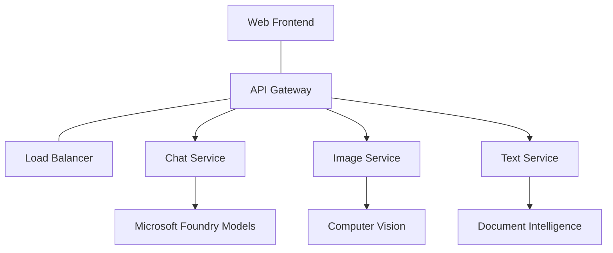

# Nejlepší postupy pro produkční AI pracovní zátěže s AZD

**Navigace kapitolou:**
- **📚 Domů kurzu**: [AZD pro začátečníky](../../README.md)
- **📖 Aktuální kapitola**: Kapitola 8 - Produkční & podnikové vzory
- **⬅️ Předchozí kapitola**: [Kapitola 7: Řešení problémů](../chapter-07-troubleshooting/debugging.md)
- **⬅️ Také související**: [AI Workshop Lab](../chapter-02-ai-development/ai-workshop-lab.md)
- **🎯 Dokončení kurzu**: [AZD pro začátečníky](../../README.md)

## Přehled

Tento průvodce vysvětluje produkční návrhové vzory AI pomocí Azure Developer CLI (AZD). Jedná se o návrhový referenční materiál, nikoli o nasaditelnou aplikaci nebo produkční certifikaci.

**Příklady hranic:** Pokud není výslovně uvedeno jako kompletní, fragmenty Bicep předpokládají parametry a referencované zdroje z obsahující šablony. Vynechávají hostitelské image/plány, identity, přiřazení rolí, DNS, výstupy a další požadovanou integraci. YAML cesty služeb a hook/testovací skripty jsou ilustrativní soubory k vytvoření ve **vaší vlastní aplikaci**; nejsou tímto kurzem dodávány. Použijte funkční vzorek AZD jako základ, sestavte kompletní infrastrukturu a otestujte ji v izolovaném prostředí před produkcí.

## Klíčové řešené výzvy

Běžné produkční starosti zahrnují nasazení více služeb, správu identit a tajemství, škálování, kontrolu nákladů a monitorování. Zde není tvrzen žádný měřený výskyt.

## Architektonické vzory pro produkční AI

### Vzor 1: Mikroservisní AI architektura

**Kdy použít**: Složitá AI aplikace s několika schopnostmi



**Implementace v AZD**:

```yaml
# azure.yaml
name: enterprise-ai-platform
services:
  web:
    project: ./web
    host: staticwebapp
  api-gateway:
    project: ./api-gateway
    host: containerapp
  chat-service:
    project: ./services/chat
    host: containerapp
  vision-service:
    project: ./services/vision
    host: containerapp
  text-service:
    project: ./services/text
    host: containerapp
```

### Vzor 2: Událostmi řízené AI zpracování

**Kdy použít**: Hromadné zpracování, analýza dokumentů, asynchronní pracovní postupy

```bicep
// Event Hub for AI processing pipeline
resource eventHub 'Microsoft.EventHub/namespaces@2024-01-01' = {
  name: eventHubNamespaceName
  location: location
  sku: {
    name: 'Standard'
    tier: 'Standard'
    capacity: 1
  }
}

// Service Bus for reliable message processing
resource serviceBus 'Microsoft.ServiceBus/namespaces@2024-01-01' = {
  name: serviceBusNamespaceName
  location: location
  sku: {
    name: 'Premium'
    tier: 'Premium'
    capacity: 1
  }
}

// Function App for processing
resource functionApp 'Microsoft.Web/sites@2023-01-01' = {
  name: functionAppName
  location: location
  kind: 'functionapp,linux'
  properties: {
    siteConfig: {
      appSettings: [
        {
          name: 'FUNCTIONS_EXTENSION_VERSION'
          value: '~4'
        }
        {
          name: 'AZURE_OPENAI_ENDPOINT'
          value: '@Microsoft.KeyVault(VaultName=${keyVault.name};SecretName=openai-endpoint)'
        }
      ]
    }
  }
}
```

To vytváří fragmenty namespace, nikoli huby, fronty, odběry nebo spuštění Function. Spustitelná funkce také potřebuje hostingový plán, konfiguraci runtime/úložiště, připojenou identitu, RBAC a přístup k síti. Odkaz na Key Vault vyžaduje oprávnění ke čtení tajemství; samotná URL koncového bodu není přihlašovací údaj.

## Přemýšlení o zdraví AI agenta

Když tradiční webová aplikace selže, příznaky jsou známé: stránka se nenačte, API vrátí chybu nebo selže nasazení. Aplikace s AI mohou selhat ve stejných způsoby—but mohou se také chovat jemněji, bez zřejmých chybových hlášení.

Tato sekce vám pomůže vybudovat mentální model pro monitorování AI zátěží, abyste věděli, kde hledat, když něco není v pořádku.

### Jak se zdraví agenta liší od tradičního zdraví aplikace

Tradiční aplikace mohou mít také jemné chyby správnosti. AI agent přidává nedeterministickou kvalitu odpovědi k běžným starostem o dostupnost a správnost. Zdraví agenta lze chápat ve dvou vrstvách:

| Vrstva | Na co dávat pozor | Kde hledat |
|-------|------------------|-------------|
| **Zdraví infrastruktury** | Běží služba? Jsou zdroje přiděleny? Jsou koncové body dostupné? | `azd monitor`, stav zdroje v Azure Portálu, logy kontejnerů/aplikací |
| **Zdraví chování** | Reaguje agent přesně? Jsou odpovědi včasné? Je model volán správně? | Trace v Application Insights, metriky latence volání modelu, logy kvality odpovědí |

Zdraví infrastruktury je známé—je stejné pro jakoukoliv aplikaci azd. Zdraví chování je nová vrstva, kterou AI zátěže zavádějí.

### Kam se podívat, když AI aplikace nefungují podle očekávání

Pokud vaše AI aplikace nevytváří očekávané výsledky, zde je koncepční kontrolní seznam:

1. **Začněte základy.** Běží aplikace? Může dosáhnout na závislosti? Zkontrolujte `azd monitor` a stav zdroje stejně jako u jakékoli jiné aplikace.
2. **Zkontrolujte připojení k modelu.** Volá vaše aplikace úspěšně AI model? Selhávající nebo překročené volání modelu jsou nejčastější příčinou problémů a objeví se v logách aplikace.
3. **Bezpečně zkontrolujte vstup a základy.** Špatné odpovědi mohou být způsobeny vyhledáváním, instrukcemi, omezeními modelu nebo vykonáváním nástrojů. Používejte přístupově řízená, anonymizovaná diagnostická data; v produkci nepovolujte nezřízené logování promptů/odpovědí.
4. **Zkontrolujte latenci odpovědi.** Volání AI modelů jsou pomalejší než typická API volání. Když aplikace působí pomalu, zkontrolujte, zda se nezvýšila doba odezvy modelu—může to znamenat omezení, kapacitní limity nebo přetížení regionu.
5. **Sledujte signály nákladů.** Nečekané špičky ve využití tokenů nebo API volání mohou znamenat smyčku, špatně nastavený prompt nebo nadměrné opakování.

Nemusíte hned ovládat nástroje observability. Klíčové je, že AI aplikace mají další vrstvu chování k monitorování, a vestavěný monitoring azd (`azd monitor`) vám dává výchozí bod pro prozkoumání obou vrstev.

---

## Nejlepší bezpečnostní postupy

### 1. Bezpečnostní model Zero-Trust

**Implementační strategie**:
- Žádná komunikace služba ke službě bez ověření
- Všechny API volání používají spravované identity
- Izolace sítě pomocí privátních koncových bodů
- Přístupy s nejmenšími právy

```bicep
// Managed Identity for each service
resource chatServiceIdentity 'Microsoft.ManagedIdentity/userAssignedIdentities@2023-01-31' = {
  name: 'chat-service-identity'
  location: location
}

// Role assignments with minimal permissions
resource openAIUserRole 'Microsoft.Authorization/roleAssignments@2022-04-01' = {
  scope: openAIAccount
  name: guid(openAIAccount.id, chatServiceIdentity.id, '5e0bd9bd-7b93-4f28-af87-19fc36ad61bd')
  properties: {
    roleDefinitionId: subscriptionResourceId('Microsoft.Authorization/roleDefinitions', '5e0bd9bd-7b93-4f28-af87-19fc36ad61bd')
    principalId: chatServiceIdentity.properties.principalId
    principalType: 'ServicePrincipal'
  }
}
```

### 2. Bezpečná správa tajemství

**Vzor integrace Key Vault**:

```bicep
// Key Vault with proper access policies
resource keyVault 'Microsoft.KeyVault/vaults@2023-02-01' = {
  name: keyVaultName
  location: location
  properties: {
    tenantId: tenant().tenantId
    sku: {
      family: 'A'
      name: 'standard' // Premium is needed for HSM-backed keys, not ordinary secrets
    }
    enableRbacAuthorization: true  // Use RBAC instead of access policies
    enablePurgeProtection: true    // Prevent accidental deletion
    enableSoftDelete: true
    softDeleteRetentionInDays: 90
  }
}

// Optional legacy key-auth alternative; omit when using Entra ID.
resource openAIKeySecret 'Microsoft.KeyVault/vaults/secrets@2023-02-01' = {
  parent: keyVault
  name: 'openai-api-key'
  properties: {
    value: openAIAccount.listKeys().key1
    attributes: {
      enabled: true
    }
  }
}
```

Přiřaďte runtime identitu `Key Vault Secrets User` na příslušné úrovni a připojte ji k hostiteli; `enableRbacAuthorization` samotné nepřiděluje přístup. Preferujte autentizaci spravovanou identitou OpenAI s `disableLocalAuth: true`. Volitelné tajemství klíče dává smysl jen pro účet s explicitně povoleným klíčem, a oprávnění k zápisu tajemství musí mít i provisioningový principál.

### 3. Síťová bezpečnost

**Konfigurace privátního koncového bodu**:

```bicep
// Virtual Network for AI services
resource virtualNetwork 'Microsoft.Network/virtualNetworks@2023-04-01' = {
  name: vnetName
  location: location
  properties: {
    addressSpace: {
      addressPrefixes: ['10.0.0.0/16']
    }
    subnets: [
      {
        name: 'ai-services-subnet'
        properties: {
          addressPrefix: '10.0.1.0/24'
          privateEndpointNetworkPolicies: 'Disabled'
        }
      }
      {
        name: 'app-services-subnet'
        properties: {
          addressPrefix: '10.0.2.0/24'
          delegations: [
            {
              name: 'Microsoft.Web/serverFarms'
              properties: {
                serviceName: 'Microsoft.Web/serverFarms'
              }
            }
          ]
        }
      }
    ]
  }
}

// Private endpoints for all AI services
resource openAIPrivateEndpoint 'Microsoft.Network/privateEndpoints@2023-04-01' = {
  name: '${openAIAccountName}-pe'
  location: location
  properties: {
    subnet: {
      id: virtualNetwork.properties.subnets[0].id
    }
    privateLinkServiceConnections: [
      {
        name: 'openai-connection'
        properties: {
          privateLinkServiceId: openAIAccount.id
          groupIds: ['account']
        }
      }
    ]
  }
}
```

Privátní koncové body vyžadují také skupiny privátních DNS zón/VNet odkazy a integraci aplikace do VNet. Nezablokují automaticky veřejný přístup: po ověření privátní konektivity a přístupu k nasazení explicitně vypněte veřejný síťový přístup AI účtu.

## Výkon a škálování

### 1. Strategie auto-škálování

**Auto-škálování Container Apps**:

```bicep
resource containerApp 'Microsoft.App/containerApps@2023-05-01' = {
  name: containerAppName
  location: location
  properties: {
    configuration: {
      ingress: {
        external: true
        targetPort: 8000
        transport: 'http'
      }
    }
    template: {
      scale: {
        minReplicas: 2  // Always have 2 instances minimum
        maxReplicas: 50 // Scale up to 50 for high load
        rules: [
          {
            name: 'http-scaling'
            http: {
              metadata: {
                concurrentRequests: '20'  // Scale when >20 concurrent requests
              }
            }
          }
          {
            name: 'cpu-scaling'
            custom: {
              type: 'cpu'
              metadata: {
                type: 'Utilization'
                value: '70'  // Scale when CPU >70%
              }
            }
          }
        ]
      }
    }
  }
}
```

### 2. Strategie cachování

**Redis cache pro AI odpovědi**:

```bicep
// Legacy Azure Cache for Redis example (not recommended for new deployments)
resource redisCache 'Microsoft.Cache/redis@2023-04-01' = {
  name: redisCacheName
  location: location
  properties: {
    sku: {
      name: 'Premium'
      family: 'P'
      capacity: 1
    }
    enableNonSslPort: false
    minimumTlsVersion: '1.2'
    redisConfiguration: {
      'maxmemory-policy': 'allkeys-lru'
    }
    // Sharding distributes data; replication/failover provides availability.
    shardCount: 2
  }
}

// Cache configuration in application
var cacheConnectionString = '${redisCache.properties.hostName}:6380,password=${redisCache.listKeys().primaryKey},ssl=True,abortConnect=False'
```

Azure Cache pro Redis Basic/Standard/Premium je na [cestě k vypnutí](https://learn.microsoft.com/azure/azure-cache-for-redis/retirement-faq). Pro nové návrhy používejte Azure Managed Redis s dokumentovanou konfigurací SKU, identity a TLS, místo kopírování tohoto legacy zdroje do nové produkční služby. Řádek connection-string je nefunkční zástupce, nikoli přihlašovací údaj. Oddělujte cache klíče podle autorizace, modelu/instrukcí a verze vyhledávání, s expirací; sdílená cache jen pro dotazy může zveřejnit data jiného uživatele.

### 3. Vyvažování zátěže a správa provozu

**Application Gateway s WAF**:

```bicep
// Application Gateway with Web Application Firewall
resource applicationGateway 'Microsoft.Network/applicationGateways@2023-04-01' = {
  name: appGatewayName
  location: location
  properties: {
    sku: {
      name: 'WAF_v2'
      tier: 'WAF_v2'
      capacity: 2
    }
    webApplicationFirewallConfiguration: {
      enabled: true
      firewallMode: 'Prevention'
      ruleSetType: 'OWASP'
      ruleSetVersion: '3.2'
    }
    // Backend pools for AI services
    backendAddressPools: [
      {
        name: 'ai-services-pool'
        properties: {
          backendAddresses: [
            {
              fqdn: '${containerApp.properties.configuration.ingress.fqdn}'
            }
          ]
        }
      }
    ]
  }
}
```

Toto je částečný gateway zdroj: reálné nasazení vyžaduje také konfiguraci podsítě brány/IP, frontend IP a porty, TLS posluchače/certifikáty, backend HTTP nastavení/probe, routovací pravidla a priority, a přezkoumanou WAF politiku. TLS hostname/SNI a autentizace musí odpovídat backendu Container App.

## 💰 Optimalizace nákladů

### 1. Správná velikost zdrojů

**Konfigurace specifické pro prostředí**:

Tyto názvy jsou **ilustrativní vstupy do šablony na míru**, nikoli automatické nastavení AZD. Nejprve je namapujte do `infra/main.parameters.json`/Bicep a konfigurace hostitele. Například RAG vzorek používá `AZURE_SEARCH_SERVICE_SKU` a `AZURE_OPENAI_CHATGPT_DEPLOYMENT_CAPACITY`, nikoli obecné názvy níže. Paměť Container Apps nastavte na podporovanou jednotku, např. `1Gi` ve zdroji. Infrastrukturní změny aplikujte přes `azd up` nebo `azd provision`; `azd deploy` samotné Bicep změny neaplikuje.

```bash
# Development environment
azd env new development
azd env set AZURE_OPENAI_SKU "S0"
azd env set AZURE_OPENAI_CAPACITY 10
azd env set AZURE_SEARCH_SKU "basic"
azd env set CONTAINER_CPU 0.5
azd env set CONTAINER_MEMORY 1.0

# Production environment  
azd env new production
azd env set AZURE_OPENAI_SKU "S0"
azd env set AZURE_OPENAI_CAPACITY 100
azd env set AZURE_SEARCH_SKU "standard"
azd env set CONTAINER_CPU 2.0
azd env set CONTAINER_MEMORY 4.0
```

### 2. Monitorování nákladů a rozpočty

```bicep
// Supply the first day of the current UTC month, e.g. 2026-11-01T00:00:00Z.
param budgetStartDate string

// Cost management and budgets
resource budget 'Microsoft.Consumption/budgets@2024-08-01' = {
  name: 'ai-workload-budget'
  properties: {
    timePeriod: {
      startDate: budgetStartDate
    }
    timeGrain: 'Monthly'
    amount: 2000  // In the billing currency, not necessarily USD
    category: 'Cost'
    notifications: {
      warning: {
        enabled: true
        operator: 'GreaterThan'
        threshold: 80
        contactEmails: [
          'finance@company.com'
          'engineering@company.com'
        ]
        contactRoles: [
          'Owner'
          'Contributor'
        ]
      }
      critical: {
        enabled: true
        operator: 'GreaterThan'
        threshold: 95
        contactEmails: [
          'cto@company.com'
        ]
      }
    }
  }
}
```

Nahraďte příklady příjemců a zkontrolujte rozsah/oprávnění. Upozornění rozpočtu používají zpožděná fakturační data a nezavádějí limit výdajů.

### 3. Optimalizace využití tokenů

**Správa nákladů OpenAI**:

Toto je pouze znakově založená heuristika pro UI náhled, **nikoli** ověřovač limitu tokenů modelu. Produkční kód musí používat tokenizér vhodný pro nasazený model a zohlednit systémové instrukce, schémata nástrojů, historii a rozpočet výstupu. Odmítejte příliš velkou uživatelskou zprávu, místo aby byla tiše zkracována.

```typescript
// Application-level token optimization
class TokenOptimizer {
  private readonly maxTokens = 4000;
  private readonly reserveTokens = 500;
  
  optimizePrompt(userInput: string, context: string): string {
    const availableTokens = this.maxTokens - this.reserveTokens;
    if (this.estimateTokens(userInput) + 8 >= availableTokens) {
      throw new Error("User input exceeds the illustrative prompt budget");
    }
    const estimatedTokens = this.estimateTokens(userInput + context) + 8;
    
    if (estimatedTokens > availableTokens) {
      // Truncate context, not user input
      context = this.truncateContext(context, Math.max(0, availableTokens - this.estimateTokens(userInput) - 8));
    }
    
    return `${context}\n\nUser: ${userInput}`;
  }
  
  private estimateTokens(text: string): number {
    // Rough estimation: 1 token ≈ 4 characters
    return Math.ceil(text.length / 4);
  }

  private truncateContext(text: string, estimatedBudget: number): string {
    return text.slice(0, Math.max(0, estimatedBudget) * 4);
  }
}
```

## Monitorování a observabilita

### 1. Kompletní Application Insights

```bicep
// Application Insights with advanced features
resource applicationInsights 'Microsoft.Insights/components@2020-02-02' = {
  name: applicationInsightsName
  location: location
  kind: 'web'
  properties: {
    Application_Type: 'web'
    WorkspaceResourceId: logAnalyticsWorkspace.id
    SamplingPercentage: 100  // Ingestion setting; review cost and SDK sampling separately
    DisableIpMasking: false  // Retain IP masking
  }
}

// Custom metrics for AI operations
resource aiMetricAlerts 'Microsoft.Insights/metricAlerts@2018-03-01' = {
  name: 'ai-high-error-rate'
  location: 'global'
  properties: {
    description: 'Alert when failed request count exceeds 10 in five minutes'
    severity: 2
    enabled: true
    scopes: [
      applicationInsights.id
    ]
    evaluationFrequency: 'PT1M'
    windowSize: 'PT5M'
    criteria: {
      'odata.type': 'Microsoft.Azure.Monitor.SingleResourceMultipleMetricCriteria'
      allOf: [
        {
          name: 'high-error-rate'
          metricName: 'requests/failed'
          operator: 'GreaterThan'
          threshold: 10
          timeAggregation: 'Count'
        }
      ]
    }
  }
}
```

### 2. AI-specifické monitorování

**Vlastní dashboardy pro AI metriky**:

```json
{
  "dashboard": {
    "name": "AI Application Monitoring",
    "tiles": [
      {
        "name": "OpenAI Request Volume",
        "query": "dependencies | where target contains 'openai' | summarize count() by bin(timestamp, 5m)"
      },
      {
        "name": "AI Response Latency",
        "query": "dependencies | where target contains 'openai' | summarize avg(duration) by bin(timestamp, 5m)"
      },
      {
        "name": "Token Usage",
        "query": "customMetrics | where name == 'openai_tokens_used' | summarize sum(value) by bin(timestamp, 1h)"
      },
      {
        "name": "Cost per Hour",
        "query": "customMetrics | where name == 'openai_cost' | summarize sum(value) by bin(timestamp, 1h)"
      }
    ]
  }
}
```

Tento JSON je náčrt definovaný aplikací, nikoli importovatelný schema dashboardu z Azure portálu. Tokenové/nákladové dotazy vyžadují, aby vaše aplikace emitovala tyto přesné vlastní metriky; nejsou vytvářeny AZD. Přizpůsobte filtry závislostí pro skutečné názvy vašich model endpoint/span.

### 3. Kontroly stavu a monitorování dostupnosti

```bicep
// Application Insights availability tests
resource availabilityTest 'Microsoft.Insights/webtests@2022-06-15' = {
  name: 'ai-app-availability-test'
  location: location
  tags: {
    'hidden-link:${applicationInsights.id}': 'Resource'
  }
  properties: {
    SyntheticMonitorId: 'ai-app-availability-test'
    Name: 'AI Application Availability Test'
    Description: 'Tests AI application endpoints'
    Enabled: true
    Frequency: 300  // 5 minutes
    Timeout: 120    // 2 minutes
    Kind: 'standard'
    Locations: [
      {
        Id: 'us-east-2-azr'
      }
      {
        Id: 'us-west-2-azr'
      }
    ]
    Request: {
      RequestUrl: 'https://${webApp.properties.defaultHostName}/health'
      HttpVerb: 'GET'
      FollowRedirects: true
      ParseDependentRequests: false
    }
    ValidationRules: {
      ExpectedHttpStatusCode: 200
      SSLCheck: true
      SSLCertRemainingLifetimeCheck: 7
    }
  }
}
```

## Obnova po havárii a vysoká dostupnost

Výše uvedený test předpokládá existující App Service `webApp` a Application Insights zdroj. Standardní testy dostupnosti jsou zpoplatněné a vyžadují dostupný endpoint; aplikace jen s privátním přístupem potřebují vhodný soukromý monitorovací design. URL ping testy jsou zastaralé; použijte [standardní testy dostupnosti](https://learn.microsoft.com/azure/azure-monitor/app/availability).

### 1. Nasazení napříč regiony

```yaml
# azure.yaml - Multi-region configuration
name: ai-app-multiregion
services:
  api-primary:
    project: ./api
    host: containerapp
    env:
      AZURE_REGION: eastus
  api-secondary:
    project: ./api
    host: containerapp
    env:
      AZURE_REGION: westus2
```

```bicep
// Separate App Service topology, not the Container Apps declarations above
resource trafficManager 'Microsoft.Network/trafficManagerProfiles@2022-04-01' = {
  name: trafficManagerProfileName
  location: 'global'
  properties: {
    profileStatus: 'Enabled'
    trafficRoutingMethod: 'Priority'
    dnsConfig: {
      relativeName: trafficManagerProfileName
      ttl: 30
    }
    monitorConfig: {
      protocol: 'HTTPS'
      port: 443
      path: '/health'
      intervalInSeconds: 30
      toleratedNumberOfFailures: 3
      timeoutInSeconds: 10
    }
    endpoints: [
      {
        name: 'primary-endpoint'
        type: 'Microsoft.Network/trafficManagerProfiles/azureEndpoints'
        properties: {
          targetResourceId: primaryAppService.id
          endpointStatus: 'Enabled'
          priority: 1
        }
      }
      {
        name: 'secondary-endpoint'
        type: 'Microsoft.Network/trafficManagerProfiles/azureEndpoints'
        properties: {
          targetResourceId: secondaryAppService.id
          endpointStatus: 'Enabled'
          priority: 2
        }
      }
    ]
  }
}
```

Proměnné prostředí nevybírají lokaci zdrojů. IaC musí provisionovat oddělené regionální hostitele a navázat každou službu pomocí `resourceName` nebo `azd-service-name` tagů. Příklad Traffic Manageru je **samostatná topologie App Service** (`primaryAppService`/`secondaryAppService`), nikoli směrování pro deklarace Container Apps. Container Apps vyžaduje vhodně nakonfigurovaný externí endpoint/front door, TLS/vlastní doménu a kontrolní sondy stavu.

### 2. Zálohování a obnova dat

```bicep
// Backup configuration for critical data
resource backupVault 'Microsoft.DataProtection/backupVaults@2023-05-01' = {
  name: backupVaultName
  location: location
  identity: {
    type: 'SystemAssigned'
  }
  properties: {
    storageSettings: [
      {
        datastoreType: 'VaultStore'
        type: 'LocallyRedundant'
      }
    ]
  }
}

```

Samotný vault nic nezálohuje. Nakonfigurujte **politiku a instanci zálohy podporovanou pro konkrétní pracovní zátěž**, oprávnění zdroje, retenční pravidla a testy obnovy dle [podpory Azure Backup](https://learn.microsoft.com/azure/backup/backup-support-matrix). Neexistuje univerzální politika pro zálohování Azure OpenAI modelů v cloudu. Uchovávejte definice infrastruktury/nasazení modelu ve zdrojové kontrole; chraňte nahrané dokumenty, data aplikace a artefakty doladění pomocí zálohování/exportních možností každé podpůrné služby. Explicitně definujte a testujte RPO/RTO.

## Integrace DevOps a CI/CD

### 1. GitHub Actions workflow

```yaml
# .github/workflows/deploy-ai-app.yml
name: Deploy AI Application

on:
  push:
    branches: [main]
  pull_request:
    branches: [main]

jobs:
  test:
    runs-on: ubuntu-latest
    steps:
      - uses: actions/checkout@v4
      
      - name: Setup Python
        uses: actions/setup-python@v4
        with:
          python-version: '3.11'
          
      - name: Install dependencies
        run: |
          pip install -r requirements.txt
          pip install pytest
          
      - name: Run tests
        run: pytest tests/
        
      - name: AI Safety Tests
        run: |
          python scripts/test_ai_safety.py
          python scripts/validate_prompts.py

```

Toto je **pouze testovací část** workflow a předpokládá, že jste vytvořili `requirements.txt`, `tests/` a dva bezpečnostní skripty. Přidejte autentizované OIDC provisioning/nasazovací úlohy z [Konfigurace CI/CD pipeline](#cicd-pipeline-configuration), s `needs: test`, důvěryhodným spuštěním push/manual, a chráněnými GitHub prostředími. Nenasazujte nedůvěryhodný pull-request kód s cloudovými přihlašovacími údaji. Čerstvý runner nemá zvolené lokální prostředí AZD; zadejte vstupy prostředí/předplatného/lokace a použijte `azd auth login`, ne jen `azure/login`.

### 2. Validace infrastruktury

```bash
# scripts/validate_infrastructure.sh
#!/bin/bash
set -euo pipefail

echo "Validating AI infrastructure deployment..."

# Requires Azure CLI login and the resource group selected explicitly.
: "${AZURE_RESOURCE_GROUP:?Set AZURE_RESOURCE_GROUP}"
: "${AZURE_OPENAI_NAME:?Set AZURE_OPENAI_NAME}"
: "${AZURE_OPENAI_CHAT_DEPLOYMENT:?Set the actual deployment name}"

# A successful empty list is not proof that resources exist.
types=("Microsoft.CognitiveServices/accounts" "Microsoft.Search/searchServices"
       "Microsoft.Storage/storageAccounts" "Microsoft.KeyVault/vaults")
for resource_type in "${types[@]}"; do
    count=$(az resource list --resource-group "$AZURE_RESOURCE_GROUP" \
        --resource-type "$resource_type" --query "length(@)" -o tsv)
    if [[ "$count" -lt 1 ]]; then
        echo "ERROR: No $resource_type found in $AZURE_RESOURCE_GROUP"
        exit 1
    fi
done

# Validate OpenAI model deployments
echo "Validating OpenAI model deployments..."
state=$(az cognitiveservices account deployment show \
  --name "$AZURE_OPENAI_NAME" --resource-group "$AZURE_RESOURCE_GROUP" \
  --deployment-name "$AZURE_OPENAI_CHAT_DEPLOYMENT" \
  --query "properties.provisioningState" -o tsv)
if [[ "$state" != "Succeeded" ]]; then
    echo "ERROR: Required model deployment is not provisioned successfully"
    exit 1
fi

echo "Infrastructure validation completed successfully!"
```

Očekává se nulový exit a dokončovací zpráva pouze pokud všechny očekávané typy existují a pojmenované nasazení modelu je provisionováno. Kontroluje to stav inventáře/provisioningu, **nikoli** stav zdroje, přesnou topologii, RBAC, síťovou dosažitelnost nebo chování modelu. Přizpůsobte očekávané typy vaší architektuře a poté proveďte samostatný autentizovaný test připravenosti aplikace.

## Kontrolní seznam produkční připravenosti

### Bezpečnost ✅
- [ ] Všechny služby používají spravované identity
- [ ] Tajemství uložena v Key Vault
- [ ] Konfigurace privátních koncových bodů
- [ ] Implementace síťových bezpečnostních skupin
- [ ] RBAC s nejmenšími právy
- [ ] Povolená WAF na veřejných koncových bodech

### Výkon ✅
- [ ] Konfigurace auto-škálování
- [ ] Implementace cachování
- [ ] Nastavení vyvažování zátěže
- [ ] CDN pro statický obsah
- [ ] Poolování připojení databáze
- [ ] Optimalizace využití tokenů

### Monitorování ✅
- [ ] Konfigurace Application Insights
- [ ] Definice vlastních metrik
- [ ] Nastavení pravidel upozornění
- [ ] Vytvoření dashboardu
- [ ] Implementace kontrol stavu
- [ ] Pravidla uchovávání logů

### Spolehlivost ✅
- [ ] Nasazení napříč regiony
- [ ] Plán zálohování a obnovy
- [ ] Implementace přerušovačů obvodů
- [ ] Konfigurace retry politik
- [ ] Šetrné degradace
- [ ] Endpointy kontroly stavu

### Správa nákladů ✅
- [ ] Konfigurace rozpočtových upozornění
- [ ] Správná velikost zdrojů
- [ ] Aplikace slev pro vývoj/testování
- [ ] Nákup rezervovaných instancí
- [ ] Dashboard monitorování nákladů
- [ ] Pravidelné revize nákladů

### Soulad ✅
- [ ] Splnění požadavků na lokalizaci dat
- [ ] Povolení auditních logů
- [ ] Aplikace pravidel souladu
- [ ] Implementace bezpečnostních základů
- [ ] Pravidelné bezpečnostní audity
- [ ] Plán reakce na incidenty

## Výkonové benchmarky

### Ilustrativní produkční cíle

Toto jsou příkladné SLO k vyjednání a testování zátěže, nikoli měřené benchmarky nebo záruky. Latence odpovědi závisí na délce modelu/výstupu; měsíční výdaje na tokeny závisí na provozu a cenách, nikoli jen na počtu tokenů.

| Metrika | Cíl | Monitorování |
|--------|-----|-------------|
| **Doba odezvy** | < 2 sekundy | Application Insights |
| **Dostupnost** | 99,9 % | Monitorování uptime |
| **Míra chyb** | < 0,1 % | Logy aplikace |
| **Výdaje na model** | < 500 $/měsíc (příklad rozpočtu) | Správa nákladů |
| **Současní uživatelé** | 1000+ | Testování zátěže |
| **Doba zotavení** | < 1 hodina | Testy obnovy po havárii |

### Zátěžové testování

Níže je náčrt rozhraní pro skript zátěžového testování, který **musíte implementovat**; toto úložiště neposkytuje `scripts/load_test.py`. Definujte přenosy požadavků, autentizaci, reprezentativní pracovní zátěže, asertace latence/chyb percentilů a limit výdajů ve vámi zvoleném nástroji pro zátěžové testování před jeho spuštěním:

```bash
# Load testing script for AI applications
python scripts/load_test.py \
  --endpoint https://your-ai-app.azurewebsites.net \
  --concurrent-users 100 \
  --duration 300 \
  --ramp-up 60
```

## 🤝 Nejlepší praktiky komunity

Na základě zpětné vazby komunity Microsoft Foundry Discord:

### Nejlepší doporučení od komunity:

1. **Začněte malé, škálujte postupně**: Začněte s jednoduchými SKU a škálujte na základě skutečného použití
2. **Monitorujte vše**: Nastavte komplexní monitoring od prvního dne
3. **Automatizujte bezpečnost**: Používejte infrastrukturu jako kód pro konzistentní bezpečnost
4. **Testujte důkladně**: Zařaďte AI-specifické testování do vašeho procesu
5. **Plánujte náklady**: Sledujte využití tokenů a nastavte rozpočtové upozornění včas

### Běžné nástrahy, kterým se vyhnout:

- ❌ Tvrdé kódování API klíčů přímo v kódu
- ❌ Nenastavení správného monitoringu
- ❌ Ignorování optimalizace nákladů
- ❌ Netestování scénářů chyb
- ❌ Nasazení bez kontrol zdraví

## AZD AI CLI příkazy a rozšíření

AZD obsahuje rostoucí sadu AI-specifických příkazů a rozšíření, která zjednodušují produkční AI pracovní postupy. Tyto nástroje překlenou propast mezi lokálním vývojem a produkčním nasazením AI zátěží.

> **Revize vydání (2026-11-04):** Níže uvedené pokyny pro CLI byly ověřeny s vydanými verzemi `azd` **1.37.2**, `azure.ai.agents` **1.0.0-beta.23**, a `azure.ai.evaluations` **1.0.0-beta.2**. Agent beta.23 vyžaduje `azd >= 1.37.0`; evaluace beta.2 vyžaduje `azd >= 1.33.0`. Používejte alespoň 1.37.0 pro kombinovaný pracovní postup. Jedná se o revizi dokumentace/zdroje, nikoliv o validaci živého nasazení v Azure.

### AZD rozšíření pro AI

AZD používá systém rozšíření pro přidání AI-specifických funkcí. Instalujte a spravujte rozšíření pomocí:

```bash
# List all available extensions (including AI)
azd extension list

# Inspect installed extension details
azd version
azd extension show azure.ai.agents

# Install the Foundry agents extension
azd extension install azure.ai.agents

# Install the separate Foundry evaluations extension
azd extension install azure.ai.evaluations

# Install the fine-tuning extension
azd extension install azure.ai.finetune

# Install the custom models extension
azd extension install azure.ai.models

# Upgrade all installed extensions
azd extension upgrade --all
```

**Dostupná AI rozšíření:**

| Rozšíření | Účel | Stav |
|-----------|---------|--------|
| `azure.ai.agents` | Správa Foundry Agent Service | Náhled |
| `azure.ai.evaluations` | Evaluační datasety, hodnotitelé, evaluační skupiny a běhy | Náhled |
| `azure.ai.skills` | Znovupoužitelné schopnosti agentů | Náhled |
| `azure.ai.connections` | Foundry připojení (datové zdroje, nástroje) | Náhled |
| `azure.ai.finetune` | Ladění Foundry modelů | Náhled |
| `azure.ai.models` | Vlastní Foundry modely | Náhled |
| `azure.coding-agent` | Konfigurace kódujícího agenta | K dispozici |

> Spusťte `azd extension list --installed` a `azd extension show azure.ai.evaluations` pro kontrolu nainstalovaných verzí. Nejprve aktualizujte jádro CLI podle [instalačních/aktualizačních instrukcí](https://learn.microsoft.com/azure/developer/azure-developer-cli/install-azd) (pro Windows winget instalaci: `winget upgrade Microsoft.Azd`), poté spusťte `azd extension upgrade --all`. Neexistuje žádný příkaz core `azd upgrade`. Před upgradem produkční automatizace si nastudujte breaking changes; neočekávejte, že upgrade rozšíření zachová staré příkazy nebo formáty konfigurace.

### Nedávné změny a opravy ve vydáních

| Vydání | Co se mění pro tento kurz |
|---------|------------------------------|
| `azd 1.37.0` | Přidává stabilní deployment-preview API a opravuje přepisování nesouvisejících `azure.yaml` nastavení při úpravách rozšíření. |
| `azd 1.37.1` | Opravuje propagaci Ctrl+C přes rozšíření a rozlišuje zrušení/time-outy od generických chyb. |
| `azd 1.37.2` | Vylepšuje validaci provisioning: kritická varování defaultně na **Ne**, ve scénářích bez potvrzení selže, zrušení přeskočí post-provision hooky. Opravuje také nevyřešené environment hodnoty v deny listech Deployment Stacků, pokud je povolena alfa funkce. |
| Agent beta `beta.22` | Přesouvá evaluaci na `azd ai eval`, mění optimalizaci na GA v1 API, vyžaduje množné `toolboxes`, odděluje managed-harness, hlas a dlouhodobé preview opt-in. Opravuje výběr modelu podle prostředí a autentizaci toolboxu. |
| Agent beta `beta.23` | Zpřístupňuje `init --harness`; opravuje A2A 0.3 výstup odpovědí, neplatné cesty/přecky prompt-agent skrz infrastrukturu, diagnostiku timeoutu aktivace a varování RBAC vývojářů. |
| Evaluace beta `beta.2` | Vyžaduje konfiguraci evaluace v camelCase, přidává statické/simulované konverzace a explicitní lokální soubory zdrojů, opravuje identitu/verzi datasetů, počítání quality gate a diagnostiku neúspěšných běhů. |

Timeout aktivace agenta **neprokazuje** selhání nasazení: nejprve zkontrolujte pokusu verzi a stav před opakováním. Varování RBAC vývojářů mohou přetrvávat i při úspěšném provisioningu; vyřešte přístup chybějícího uživatele před spuštěním pod jeho identitou.

Zdroje: [AZD vydání](https://github.com/Azure/azure-dev/releases), [vydání agentů beta.23](https://github.com/Azure/azure-dev/releases/tag/azd-ext-azure-ai-agents_1.0.0-beta.23), [migrace agentů beta.22](https://github.com/Azure/azure-dev/releases/tag/azd-ext-azure-ai-agents_1.0.0-beta.22), a [vydání evaluací beta.2](https://github.com/Azure/azure-dev/releases/tag/azd-ext-azure-ai-evaluations_1.0.0-beta.2).

**Co jsou novější `skills` a `connections` rozšíření?**

Vedle nástrojů agenta se objevila dvě preview rozšíření, která stojí za pochopení i jako začátečník:

- **`azure.ai.skills`** — **Schopnost** je znovupoužitelná funkce (zabalený nástroj nebo chování), kterou můžete připojit k jednomu nebo více agentům místo opětovné implementace. Představte si to jako sdílený stavební blok: definujte si schopnost „vyhledat v dokumentaci“ nebo „vyhledat objednávku“ jednou a znovu ji použijte mezi agenty. Udrží to systém více agentů (Kapitola 5) konzistentní a zabrání kopírování.
- **`azure.ai.connections`** — **Připojení** je spravované propojení mezi vaším Foundry projektem a externím zdrojem, který agenti potřebují—datový zdroj (např. Azure AI Search), koncový bod nástroje nebo jiná služba. Připojení centralizují *kde* a *jak* agenti přistupují k datům, takže přihlašovací údaje a koncové body jsou na jednom řízeném místě místo rozházených v kódu.

Tyto nepotřebujete pro nasazení prvních agentů—drže se `azure.ai.agents` při učení. Sáhněte po `skills`, když budete duplikovat stejný nástroj mezi agenty, a `connections`, když více agentů sdílí stejný datový zdroj.

### Inicializace agentních projektů s `azd ai agent init`

Příkaz `azd ai agent init` vytvoří kostru Microsoft Foundry agentního projektu. Použijte aktuální šablonu projektu `azure.yaml`, ne implicitní starý manifest agenta:

```bash
# Initialize a new agent project from a local project template
azd ai agent init --template ./templates/support-agent/azure.yaml

# Initialize and target a specific Foundry project
azd ai agent init --template ./templates/support-agent/azure.yaml --project-id <foundry-project-id>

# Adopt the template into a different directory
azd ai agent init --template ./templates/support-agent/azure.yaml --src ./agents/my-agent
```

**Klíčové příznaky:**

| Příznak | Popis |
|------|-------------|
| `-t, --template` | Cesta nebo podporovaný GitHub URI k projektovému dokumentu `azure.yaml` |
| `-p, --project-id` | Existující ID Microsoft Foundry projektu pro vaše azd prostředí |
| `-s, --src` | Zdrojový adresář pro generované agenty, nebo cílový adresář při adoptování projektu |
| `--kind` | Inicializace agenta `hosted`, `prompt` nebo preview `prompt-voice` |
| `--harness` | Volitelný běhový harness pro `--kind prompt`; vyžaduje preview opt-in |
| `-e, --environment` | Použité azd prostředí |

`--manifest`/`-m` je zastaralý alias pro `--template`/`-t`; přejmenování příznaku nepřevede starý manifest na aktuální projektový dokument. `--host containerapp` není aktuální příznak agent-init. Pro běžnou aplikaci Container Apps použijte `azd init --template` s šablonou deklarující `host: containerapp`.

Pro existující projekt s právě jedním službou `azure.ai.project`, `azd ai agent add support-agent --file ./agents/support-agent.yaml` přidá nebo aktualizuje přímo definici agenta bez provisioningu nebo nasazení. Příkazy runtime odmítají staré implicitní `agent.yaml`/AgentManifest a vnořené definice služeb `config:`; migrujte je na aktuální službu `azure.ai.agent`. Když init vypíše `cd` další krok, spusťte jej před `azd up`: init nemění adresář shelle.

**Tip pro produkci**: Použijte `--project-id` pro přímé připojení k existujícímu Foundry projektu, což udržuje váš agentní kód i cloudové zdroje propojené od začátku.

#### Volitelné Preview funkce

Managed harness, hlas a dlouhodobé vyvolání jsou samostatně ve výchozím nastavení zakázány. Nastavte pouze přepínač pro funkci, kterou potřebujete, v **prostředí procesu shelle/CI**, nepoužívejte `azd env set`:

| Funkce | Proměnná prostředí procesu |
|---------|------------------------------|
| Managed harness (`init --kind prompt --harness ...`) | `AZD_ALPHA_ENABLE_AGENTS_MANAGED_HARNESS=true` |
| Hlas (`init --kind prompt-voice`) | `AZD_ALPHA_ENABLE_AGENTS_VOICE=true` |
| Dlouhodobé vyvolání | `AZD_ALPHA_ENABLE_AGENTS_LONG_RUNNING=true` |

Například použijte `export AZD_ALPHA_ENABLE_AGENTS_MANAGED_HARNESS=true` v Bash nebo `$env:AZD_ALPHA_ENABLE_AGENTS_MANAGED_HARNESS = "true"` v PowerShell před spuštěním příslušného příkazu. Jeden přepínač neaktivuje ostatní. Viz [README u vydaných agentů](https://github.com/Azure/azure-dev/blob/azd-ext-azure-ai-agents_1.0.0-beta.23/cli/azd/extensions/azure.ai.agents/README.md) pro všechny preview přepínače a omezení.

### Správa životního cyklu agentů

Použijte `azure.ai.agents` pro testování, kontrolu, optimalizaci a vyřazení agentů, a samostatné rozšíření `azure.ai.evaluations` k měření kvality:

```bash
# Invoke a deployed agent and view server response timing
# (total latency and time to first byte)
azd ai agent invoke

# Show the live endpoint configuration before changing it
azd ai agent endpoint show

# Download the deployed source of a code-based hosted agent
# (with SHA-256 verification)
azd ai agent code download

# Delete a hosted agent and all of its versions
# (--force terminates active sessions)
azd ai agent delete --force
```

**Životní cyklus na první pohled:**

| Fáze | Příkaz | Použití v produkci |
|-------|---------|----------------|
| Testovat | `azd ai agent invoke` | Ověřit odpovědi a změřit latenci před vydáním |
| Inspektovat | `azd ai agent endpoint show` | Kontrola autentizace/konfigurace koncového bodu; včasná detekce breaking changes |
| Měřit | `azd ai eval init`, `generate`, `run start` | Definovat, nasadit a spustit opakovatelné evaluace |
| Zlepšit | `azd ai agent optimize --eval <evaluation-name> --optimize-model <optimizer-deployment>` | Znovupoužití kompatibilní evaluace pro optimalizaci agenta |
| Zotavit se | `azd ai agent code download` | Získat přesný nasazený zdroj pro audit/rollback |
| Vyřadit | `azd ai agent delete --force` | Čistě odstranit agenta a jeho verze |

> Jedná se o preview příkazy, které se mohou mezi vydáními rozšíření měnit. Spusťte `azd ai agent --help` pro zobrazení přesných dostupných podpříkazů vaší nainstalované verze.

`endpoint show` podporuje hostované, promptové a hlasové agenty, ale aktualizace koncových bodů jsou pouze pro hostované; workflow agenti nejsou podporováni. Stahování kódu a příklad vyřazení hostovaného agenta výše nejsou obecné operace pro všechny typy agentů.

#### Migrace evaluace a kontroly kvality

Od agentů **1.0.0-beta.22 (2026-10-23)** staré příkazy `azd ai agent eval` poskytují migraci místo dřívějšího evaluančního workflow. Nekopírujte staré příklady `eval generate --dataset ...`: evaluace nyní žije pod **`azd ai eval`**.

V inicializovaném agentském projektu se autentizujte s `azd auth login`, potvrďte vybrané prostředí/Foundry projekt a nainstalujte `azure.ai.evaluations`. Pro nasazení modelu rozhodčího je potřeba sledování modelu; generování a simulace konverzací mohou vyžadovat vlastní modelové volby a nést další náklady.

```bash
# Scaffold evals/ and wire an azure.ai.eval service into azure.yaml
azd ai eval init

# Optionally synthesize a rubric and dataset from the agent
azd ai eval generate

# Review generated files, then register datasets, evaluators, and eval groups
azd up

# Start an evaluation and wait for its results
azd ai eval run start --wait

# Inspect runs and available test-case output
azd ai eval run list
azd ai eval run show <run-id>
azd ai eval run output list <run-id>
```

Následujte interaktivní volby a vytištěné další kroky, místo aby jste předpokládali, že generované prostředky jsou již zaregistrovány. Konfigurace evaluace běžně žije v `evals/azure.eval.yaml`, odkazováno službou `azure.ai.eval` ve `azure.yaml`. Klíče jsou **camelCase** (`evaluationLevel`, `maxSamples`, `initializationParameters`, `dataMapping`); staré snake_case klíče konfigurace jsou odmítnuty. Cesty uvnitř referencované konfigurace se resolverují relativně k tomuto souboru, ne k kořeni repozitáře.

Pro evaluace konverzací vyberte **statické**, pokud chcete ohodnotit dokončené přepisy bez vyvolání agenta, nebo **simulaci**, pokud chcete generovat konverzace ze scénářových semínek. Simulace potřebuje cílového agenta, model simulačního a samostatný výběr modelu rozhodčího. Pro bezobslužné příkazy zadejte vstupy vypsané `azd ai eval init --help` a `azd ai eval generate --help`; nepředpokládejte, že model generování je zároveň rozhodčí nebo simulační.

Pro CI nakonfigurujte explicitní politiku kvality pomocí `azd ai eval run start --help` (`--fail-on`) a považujte nenulový host exit za selhání. Dokončený běh není automaticky úspěšným průchodem kvalitou. Prověřte chybné/errované řádky a diagnostiku; chybějící nebo nekonzistentní počty výsledků nejsou známkou úspěchu. Registrované datasety si uchovávají svoji identitu a verzi služby; `--max-samples` nemůže podmnožinu registrovaného datasetu vytvořit. Následně publikujte menší dataset záměrně, nebo použijte podporovaný lokální zdroj souborů.

```bash
# Example CI policy: at least 90% of all test cases must pass
azd ai eval run start --wait --fail-on "pass-rate=0.9"
```

Brána propustnosti používá poměr úspěšných testů dělený počtem všech testů; neúspěšné, erorové, přeskočené a jiné neprošlé řádky se započítávají proti ní. Nekombinujte bránu s `--no-wait`, která vrací před tím, než je k dispozici verdikt.

#### Migrace konfigurace optimalizace

Optimalizace nyní používá GA v1 API. Pro znovupoužití kompatibilní **na úrovni kol, datasetem podporované** evaluace z nového workflow:

```bash
# Replace placeholders with the evaluation name and optimizer model deployment
azd ai agent optimize --eval-config ./evals/azure.eval.yaml --eval <evaluation-name> --optimize-model <optimizer-deployment>
```

`--eval` vybírá vyhodnocení; `--eval-config` vybírá jeho konfigurační soubor (včetně definic založených na souborech). `--config` místo toho přijímá **samostatný požadavek na optimalizační API** v YAML nebo JSON. Nepředávejte starý agent `eval.yaml` ani nový `azure.eval.yaml` do `--config`, a nespojujte `--config` s `--eval`/`--eval-config`. Vyhodnocení založená na konverzaci, trace nebo simulaci nejsou zaměnitelná s optimalizační zkratkou založenou na datovém souboru; pro tyto scénáře použijte podporovaný formát optimalizačního požadavku. Před aplikací nebo nasazením zkontrolujte kandidáty.

Viz [reference vyhodnocení pro revidované vydání](https://github.com/Azure/azure-dev/blob/azd-ext-azure-ai-evaluations_1.0.0-beta.2/cli/azd/extensions/azure.ai.evaluations/README.md) a [zdroj příkazu optimalizace pro revidované vydání](https://github.com/Azure/azure-dev/blob/azd-ext-azure-ai-agents_1.0.0-beta.23/cli/azd/extensions/azure.ai.agents/internal/cmd/optimize.go) pro přesné možnosti.

#### Náhled nasazení hostovaného agenta pouze pro čtení

Pro existující prostředí svázané s Foundry s jednotnou službou `azure.ai.agent` typu `kind: hosted` porovnejte podporovanou konfiguraci před nasazením:

```bash
azd deploy <service-name> --preview --no-prompt
```

Tento náhled agenta nenasazuje. Nejedná se o úplný rozdíl infrastruktury/bezpečnosti: agenti prompt/voice/workflow, starší konfigurační rozvržení a některá hostovaná nastavení nejsou jeho součástí. Výsledek `unknown` není schválením nasazení. Neexistuje samostatný `azd ai agent deploy` nebo příkaz `--dry-run` agenta; použijte hlavní nasazovací pracovní postup.

### Protokol kontextu modelu (MCP) s `azd mcp`

AZD zahrnuje vestavěnou podporu MCP serveru (Alfa), která umožňuje AI agentům a nástrojům interagovat s vašimi zdroji Azure prostřednictvím standardizovaného protokolu:

```bash
# Start the MCP server for your project
azd mcp start

# Review current Copilot consent rules for tool execution
azd copilot consent list
```

MCP server vystavuje kontext vašeho projektu azd—prostředí, služby a zdroje Azure—AI-poháněným vývojovým nástrojům. To umožňuje:

- **Nasazení s asistencí AI**: Nechte kódovací agenty dotazovat stav projektu a spouštět nasazení
- **Objevování zdrojů**: AI nástroje mohou zjistit, jaké zdroje Azure váš projekt používá
- **Správa prostředí**: Agenti mohou přepínat mezi vývojovým/testovacím/produkčním prostředím

### Generování infrastruktury s `azd infra generate`

Pro produkční AI pracovní zátěže můžete generovat a přizpůsobovat infrastrukturu jako kód místo spoléhání na automatické poskytování:

```bash
# Generate supported infrastructure for this project type
azd infra generate
```

Podpora závisí na projektu/hostiteli a instalovaných poskytovatelích; nejde o obecný příkaz pro reverzní inženýrství libovolných zdrojů Azure ani o záruku generování jak Bicep, tak Terraform. Spusťte `azd infra generate --help` a zkontrolujte generovaný formát. Pokud je podporováno, zápis IaC na disk umožňuje:
- Prověřit a auditovat infrastrukturu před nasazením
- Přidat vlastní bezpečnostní zásady (síťová pravidla, privátní koncové body)
- Integrovat s existujícími procesy kontroly IaC
- Verzovat změny infrastruktury samostatně od aplikačního kódu

### Produkční háčky životního cyklu

Háčky AZD umožňují vkládat vlastní logiku v každé fázi životního cyklu nasazení—kritické pro produkční AI pracovní postupy:

```yaml
# azure.yaml - Production hooks example
name: ai-production-app
hooks:
  preprovision:
    shell: sh
    run: scripts/validate-quotas.sh    # Check AI model quota before provisioning
  postprovision:
    shell: sh
    run: scripts/verify-networking.sh  # Verify IaC-provisioned private connectivity
  predeploy:
    shell: sh
    run: scripts/run-ai-safety-tests.sh  # Run prompt safety checks
  postdeploy:
    shell: sh
    run: scripts/smoke-test.sh           # Verify agent responses post-deploy
services:
  agent-api:
    project: ./src/agent
    host: containerapp
    hooks:
      predeploy:
        shell: sh
        run: scripts/validate-model-access.sh  # Per-service hook
```

```bash
# Run a specific hook manually during development
azd hooks run predeploy
```

**Doporučené produkční háčky pro AI pracovní zátěže:**

| Háček | Případ použití |
|------|----------|
| `preprovision` | Ověření kvót předplatného pro kapacitu AI modelu |
| `postprovision` | Ověření privátní konektivity a požadovaných výstupů zdrojů |
| `predeploy` | Spuštění testů bezpečnosti AI, ověření šablon promptů |
| `postdeploy` | Smoke test odpovědí agenta, ověření konektivity modelu |

### Konfigurace CI/CD pipeline

Použijte `azd pipeline config`, abyste připojili svůj projekt k GitHub Actions nebo Azure Pipelines s bezpečnou autentizací Azure:

```bash
# Configure CI/CD pipeline (interactive)
azd pipeline config

# Configure with a specific provider
azd pipeline config --provider github
```

Tento příkaz:
- Vytvoří nebo nakonfiguruje identitu pipeline; zkontrolujte její generovaný rozsah rolí/oprávnění, než předpokládáte nejmenší potřebná oprávnění
- Konfiguruje federované přihlašovací údaje (žádné uložené tajné klíče)
- Generuje nebo aktualizuje definici pipeline souboru
- Nastaví potřebné proměnné prostředí ve vašem CI/CD systému

#### Krok za krokem: vaše první GitHub Actions pipeline

Zde je kompletní průvodce od fungujícího projektu azd po automatizovaná nasazení při každém pushi.

**1. Ujistěte se, že váš projekt je na GitHubu**

```bash
git init
git add .
git commit -m "Initial azd project"
gh repo create my-ai-app --private --source=. --push
```

**2. Spusťte konfiguraci pipeline**

```bash
azd pipeline config --provider github
```

azd interaktivně:
- Zeptá se, které předplatné Azure a prostředí zacílit
- Vytvoří registraci aplikace Entra + služební účet pro pipeline
- Nastaví federované přihlašovací údaje (OIDC)—takže GitHub autentizuje do Azure s krátkodobými tokeny a **žádné tajné klíče nejsou ukládány**
- Nahraje potřebné **proměnné** do vašeho GitHub repozitáře (`AZURE_CLIENT_ID`, `AZURE_TENANT_ID`, `AZURE_SUBSCRIPTION_ID`, `AZURE_ENV_NAME`, `AZURE_LOCATION`)

**3. Porozumějte generovanému workflow**

U podporované šablony konfigurujte/prohlédněte `.github/workflows/azure-dev.yml`. Klíčové části vypadají takto (šablona musí dodat nástrojový řetězec aplikace a parametry prostředí):

```yaml
# .github/workflows/azure-dev.yml
on:
  push:
    branches: [ main ]
  workflow_dispatch:        # lets you run it manually too

permissions:
  id-token: write           # required for OIDC federated login
  contents: read

jobs:
  build:
    runs-on: ubuntu-latest
    env:
      AZURE_CLIENT_ID: ${{ vars.AZURE_CLIENT_ID }}
      AZURE_TENANT_ID: ${{ vars.AZURE_TENANT_ID }}
      AZURE_SUBSCRIPTION_ID: ${{ vars.AZURE_SUBSCRIPTION_ID }}
      AZURE_ENV_NAME: ${{ vars.AZURE_ENV_NAME }}
      AZURE_LOCATION: ${{ vars.AZURE_LOCATION }}
    steps:
      - uses: actions/checkout@v4
      - name: Install azd
        uses: Azure/setup-azd@v2
      - name: Log in with OIDC
        run: azd auth login --client-id "$AZURE_CLIENT_ID" --federated-credential-provider "github" --tenant-id "$AZURE_TENANT_ID"
      - name: Provision infrastructure
        run: azd provision --no-prompt
      - name: Deploy application
        run: azd deploy --no-prompt
```

**4. Ověřte, že to funguje**

```bash
# Push a change to trigger the pipeline
git commit -am "Trigger pipeline" --allow-empty
git push
```

Otevřete záložku **Actions** ve vašem GitHub repozitáři a sledujte automatický běh workflow `azd provision` a `azd deploy`.

> **Proč jsou důležité federované přihlašovací údaje:** starší pipeline ukládaly klientské tajemství na GitHubu. OIDC federované přihlašovací údaje toto tajemství zcela odstraní—GitHub na běhu požádá o krátkodobý token, což je bezpečnější a není třeba to otáčet nebo uniknout. Toto je výchozí nastavení, které `azd pipeline config` zavádí.

> **Tajné klíče vs. proměnné:** necitlivé identifikátory (`AZURE_CLIENT_ID` atd.) se vkládají do repozitářových **proměnných**. Pokud vaše aplikace opravdu potřebuje tajemství při sestavení, přidejte jej jako GitHub **tajemství** a použijte `${{ secrets.NAME }}`—ale upřednostněte Key Vault + spravovanou identitu za běhu (viz [Kapitola 3](../chapter-03-configuration/authsecurity.md)).

**Produkční workflow s konfigurací pipeline:**

```bash
# 1. Set up production environment
azd env new production
azd env set AZURE_OPENAI_CAPACITY 100

# 2. Configure the pipeline
azd pipeline config --provider github

# 3. Review the generated trigger, provisioning/deployment steps, and approvals
```

#### Krok za krokem: Azure DevOps Pipelines

Preferujete Azure DevOps před GitHub Actions? azd jej nativně podporuje s poskytovatelem `azdo`. Průběh je téměř stejný—azd generuje soubor pipeline, vytváří servisní připojení a zapojuje autentizaci.

**1. Ujistěte se, že máte projekt Azure DevOps**

Potřebujete organizaci a projekt na `https://dev.azure.com/<your-org>`. Generujte osobní přístupový token (PAT) s oprávněními **Build (čtení & spuštění)**, **Code (čtení & zápis)** a **Service Connections (čtení, dotaz a správa)**—azd si jej vyžádá.

**2. Nakonfigurujte pipeline**

```bash
azd pipeline config --provider azdo
```

azd:
- Zeptá se na vaši organizaci a projekt Azure DevOps
- Vytvoří (nebo použije) **servisní připojení** k Azure pomocí servisního principála
- Nakonfiguruje federaci identity pracovních zátěží (OIDC) tak, aby se neskladovalo klientské tajemství
- Nakonfiguruje definici pipeline (obvykle `.azdo/pipelines/azure-dev.yml`) z šablony pipeline projektu

**3. Prohlédněte si generovanou pipeline**

Použijte generovanou pipeline projektu, včetně jeho **Azure servisního připojení a kroků autentizace AZD**. Oficiální [průvodce nastavením Azure Pipelines](https://learn.microsoft.com/azure/developer/azure-developer-cli/pipeline-azure-pipelines) ukazuje instalační fragment níže; toto je **pouze instalace**, nikoliv spustitelný autentizovaný nasazovací workflow:

```yaml
# .azdo/pipelines/azure-dev.yml (installer fragment only)
trigger:
  - main

pool:
  vmImage: ubuntu-latest

steps:
  - task: setup-azd@0
    displayName: Install azd
```

Nainstalujte rozšíření AZD Azure DevOps, pokud daný úkol není ve vaší organizaci k dispozici. Nekopírujte holé `azd provision`/`azd deploy` shellové kroky bez autentizace: konfigurace servisního připojení sama o sobě automaticky nepřihlásí každý proces do AZD. Postupujte podle přihlášení OIDC a autorizovaného kontextu úkolu ve vygenerované šabloně a zadejte vybrané prostředí/předplatné/umístění.

**4. Odkud pocházejí proměnné**

azd ukládá hodnoty prostředí (`AZURE_ENV_NAME`, `AZURE_LOCATION`, `AZURE_SUBSCRIPTION_ID`) jako **skupinu proměnných** v Azure DevOps, aby je pipeline mohla číst. Můžete je upravovat v sekci **Pipelines → Library**.

> **Stejný přínos OIDC jako GitHub:** poskytovatel `azdo` také implicitně nastavuje federaci identity pracovních zátěží, takže v servisním připojení není ukládáno klientské tajemství—Azure DevOps za běhu vyměňuje krátkodobý token. Předávejte `--auth-type client-credentials` pouze, pokud vaše organizace ještě nemůže používat OIDC.

**5. Spusťte to**

```bash
git commit -am "Add Azure DevOps pipeline" --allow-empty
git push
```

Otevřete sekci **Pipelines** v Azure DevOps a sledujte průběh `azd provision` a `azd deploy`.

### Přidání komponent s `azd add`

Postupně přidávejte služby Azure do existujícího projektu:

```bash
# Add a new service component interactively
azd add
```

To je zvláště užitečné pro rozšiřování produkčních AI aplikací—například přidáním vektorové vyhledávací služby, nového koncového bodu agenta nebo monitorovací komponenty do již nasazeného prostředí.

## Další zdroje

- **Azure Well-Architected Framework**: [Pokyny pro AI pracovní zátěže](https://learn.microsoft.com/azure/well-architected/ai/)
- **Dokumentace Microsoft Foundry**: [Oficiální dokumentace](https://learn.microsoft.com/azure/ai-studio/)
- **Šablony komunity**: [Azure Samples](https://github.com/Azure-Samples)
- **Discord komunita**: [#Azure kanál](https://discord.gg/microsoft-azure)
- **Agent Skills pro Azure**: [microsoft/github-copilot-for-azure na skills.sh](https://skills.sh/microsoft/github-copilot-for-azure) - znovupoužitelné agent dovednosti pro Azure AI, Foundry, deployment, optimalizaci nákladů a diagnostiku. Instalujte ve vašem editoru:
  ```bash
  npx skills add microsoft/github-copilot-for-azure
  ```

---

**Navigace kapitol:**
- **📚 Domů kurzu**: [AZD pro začátečníky](../../README.md)
- **📖 Aktuální kapitola**: Kapitola 8 - Produkční a Enterprise vzory
- **⬅️ Předchozí kapitola**: [Kapitola 7: Řešení problémů](../chapter-07-troubleshooting/debugging.md)
- **⬅️ Také související**: [AI Workshop Laboratoř](../chapter-02-ai-development/ai-workshop-lab.md)
- **🎯 Kurz dokončen**: [AZD pro začátečníky](../../README.md)

**Pamatujte**: Produkční AI pracovní zátěže vyžadují pečlivé plánování, monitorování a průběžnou optimalizaci. Začněte s těmito vzory a přizpůsobte je svým specifickým požadavkům.

---

<!-- CO-OP TRANSLATOR DISCLAIMER START -->
**Prohlášení o omezení odpovědnosti**:
Tento dokument byl přeložen pomocí AI překladatelské služby [Co-op Translator](https://github.com/Azure/co-op-translator). Přestože usilujeme o co největší přesnost, mějte prosím na paměti, že automatizované překlady mohou obsahovat chyby nebo nepřesnosti. Originální dokument v jeho mateřském jazyce by měl být považován za autoritativní zdroj. Pro kritické informace se doporučuje profesionální lidský překlad. Nejsme odpovědní za jakékoli nedorozumění nebo nesprávné interpretace vzniklé použitím tohoto překladu.
<!-- CO-OP TRANSLATOR DISCLAIMER END -->