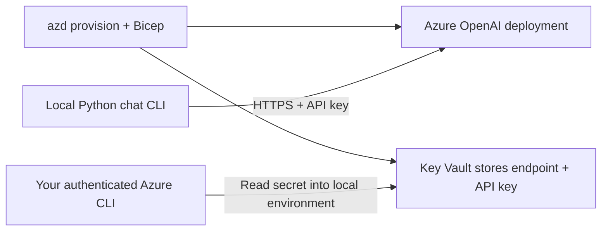

# Azure OpenAI Chat — místní CLI a infrastruktura AZD

**Úroveň:** Středně pokročilý · **Doba:** 35–60 minut včetně nastavení

Tento příklad nasazuje **Azure OpenAI zdroj a Key Vault**, poté spustí
interaktivní pythoní chatovací CLI **na vašem počítači**. Nehostuje webovou aplikaci
ani Container App. Výchozí model je `gpt-4.1`, verze `2025-04-14`, s
kapacitou nasazení `GlobalStandard` 20. Před nasazením zkontrolujte aktuální dostupnost a kvótu ve
zvoleném regionu; data životního cyklu modelu se mohou měnit.

## Cíle učení

- Nasadit infrastrukturu modelu pomocí Bicep a azd.
- Získat API klíč z Key Vault bez jeho uvedení ve výstupech nasazení.
- Odesílat požadavky Chat Completions a udržovat historii konverzace.
- Interpretovat počty tokenů a omezení odhadů nákladů.



Tento příklad neobsahuje integraci spravované identity za běhu, multi-region failover,
vlastní omezovač rychlosti, streamovací režim ani hostované výpočty. OpenAI SDK
provádí až dvě opakování při obnovitelných chybách; CLI hlásí zbývající chyby.

## Požadavky

- Aktuální stabilní [azd](https://learn.microsoft.com/azure/developer/azure-developer-cli/install-azd)
  (v době recenze vydání: 1.37.2).
- [Azure CLI](https://learn.microsoft.com/cli/azure/install-azure-cli).
- Python **3.10+** (doporučeno 3.11) a virtuální prostředí.
- Předplatné Azure s oprávněním vytvářet Cognitive Services a Key Vault
  zdroje, nasazovat modely a číst tajemství vaultu.
- Regionální dostupnost a kvóta `GlobalStandard` pro `gpt-4.1`. Požadavky na přístup
  závisí na předplatném a funkci; není garantována doba schválení.

```bash
azd version
az version
python --version
azd auth login
az login
```

Jedná se o samostatné autentizační relace. Vyberte stejné předplatné v obou
nástrojích před spuštěním níže uvedených příkazů.

## Rychlý start (Bash)

Spusťte z kořenového adresáře repozitáře:

```bash
cd examples/azure-openai-chat
azd env new myopenai
azd provision
```

Vyberte podporovaný region. Nasazení vytvoří skupinu prostředků, OpenAI účet,
nasazení modelu, Key Vault a tajemství `openai-endpoint`/`openai-api-key`.
Neexistují žádné **služby k nasazení** v `azure.yaml`.

Načtěte nesdílené výstupy a načtěte tajemství do vašeho aktuálního shellu:

```bash
export AZURE_OPENAI_ENDPOINT="$(azd env get-value AZURE_OPENAI_ENDPOINT)"
export AZURE_OPENAI_MODEL="$(azd env get-value AZURE_OPENAI_MODEL)"
KV_NAME="$(azd env get-value AZURE_KEY_VAULT_NAME)"
export AZURE_OPENAI_API_KEY="$(az keyvault secret show \
  --vault-name "$KV_NAME" --name openai-api-key --query value --output tsv)"

python -m venv .venv
source .venv/bin/activate
python -m pip install -r src/requirements.txt
python src/chat.py
```

Ve PowerShellu aktivujte pomocí `.\.venv\Scripts\Activate.ps1` a přiřaďte proměnné prostředí
pomocí `$env:AZURE_OPENAI_ENDPOINT = azd env get-value AZURE_OPENAI_ENDPOINT`
(a podobně pro model). Získejte API klíč pomocí
`$env:AZURE_OPENAI_API_KEY = az keyvault secret show --vault-name $KV_NAME --name openai-api-key --query value -o tsv`.
Nejprve nastavte `$KV_NAME = azd env get-value AZURE_KEY_VAULT_NAME`.

Nezobrazujte, neukládejte ani nevkládejte API klíč do reportů o problémech. CLI čte
proměnné prostředí procesu; **ne** získává tajemství z Key Vault ani nenačítá soubory `.env`.
`config.py` ověřuje koncový bod, limit tokenů a teplotu při spuštění.

Očekávaný výstup (obsah a použití se mohou lišit):

```text
Azure OpenAI Chat Application
Model: gpt-4.1
...
You: Say hello in one sentence.
Assistant: Hello! How can I help you today?
[Tokens: ... | Cost: $...]
```

Příkazy: `stats` zobrazuje součty, `clear` vymaže historii konverzace a
`quit`/`exit` ukončí relaci. Neexistují žádné příkazy `--stream`, `--show-tokens`, `tokens`,
nebo `cost`.

## Ověření nasazení

Po načtení výše uvedených shellových proměnných:

```bash
curl --fail-with-body \
  "${AZURE_OPENAI_ENDPOINT%/}/openai/deployments/${AZURE_OPENAI_MODEL}/chat/completions?api-version=2024-10-21" \
  -H "Content-Type: application/json" \
  -H "api-key: $AZURE_OPENAI_API_KEY" \
  -d '{"messages":[{"role":"user","content":"Say hello!"}],"max_tokens":50}'

az keyvault secret list --vault-name "$KV_NAME" --query "[].name" -o table
```

Úspěch: API vrací HTTP 200 s `choices[0].message.content` a `usage`;
trezor vypisuje `openai-api-key` a `openai-endpoint`. Samotné úspěšné nasazení ARM
neověřuje inferenci.

## Soubory a konfigurace

```text
azure.yaml                         # Infrastructure-only AZD project
infra/main.bicep                   # Subscription deployment
infra/main.parameters.json         # Environment, location, principal ID
infra/resources/openai.bicep       # Account + model
infra/resources/keyvault.bicep     # Vault + deploying user's secret access policy
infra/resources/secrets.bicep      # Writes secrets, no key output
src/chat.py                        # Interactive CLI
src/config.py                      # Environment validation
src/requirements.txt               # Python packages
```

Pro změnu poskytnutého modelu/verze/kapacity upravte výchozí hodnoty v
`infra/main.bicep` a spusťte `azd provision`. Nastavení `AZURE_OPENAI_MODEL` ve vaší
shellu pouze vybere **existující název nasazení**; nenasazuje jiný model.

| Proměnná runtime | Výchozí / zdroj |
|---|---|
| `AZURE_OPENAI_ENDPOINT` | Povinné; výstup azd bez tajemství |
| `AZURE_OPENAI_API_KEY` | Povinné; načíst z Key Vault |
| `AZURE_OPENAI_MODEL` | `gpt-4.1`; název nasazení Azure |
| `AZURE_OPENAI_MAX_TOKENS` | 800 (rozsah ověření 1–4096) |
| `AZURE_OPENAI_TEMPERATURE` | 0,7 (rozsah 0–2) |
| `AZURE_OPENAI_INPUT_PRICE_PER_1K` | 0,002 USD; ilustrativní sazba za neukládaný vstup |
| `AZURE_OPENAI_OUTPUT_PRICE_PER_1K` | 0,008 USD; ilustrativní sazba za výstup |

## Náklady a bezpečnostní omezení

Zobrazení nákladů je **odhad**, nikoli fakturace Azure. Vynásobí použití API tokenů
konfigurovanými sazbami a nezohledňuje slevy za uložený vstup,
regionální/SKU rozdíly, daně, změny cen nebo neúspěšné/opakované volání.
Přepište **obě sazby**, pokud používáte jiný model nebo SKU, a ověřte aktuální
[ceny Azure OpenAI](https://azure.microsoft.com/pricing/details/cognitive-services/openai-service/).

Pro ilustraci stojí 100 požadavků používajících 500 neukládaných vstupních a 200 výstupních tokenů
při výchozích sazbách `100 × (500/1000 × .002 + 200/1000 × .008) = $0.26`.
Operace/spracování v Key Vault mají samostatné poplatky. Pro tento místní CLI není žádný pevný poplatek 50 $/měsíc
a v šabloně není žádný hostovaný výpočet.

Vault používá přístupovou politiku pro nasazující subjekt; není to RBAC nebo
příklad aplikace spravované identity. Veřejné koncové body a ověřování pomocí API klíče
se používají k výuce. Před přizpůsobením pro produkci omezte oprávnění a přidejte vhodnou kontrolu identity/sítě.


## Praktická cvičení

### 1. Ověření kontextu a jeho resetování

**Začátek:** spuštění CLI. **Cíl:** pozorovat historii.
Řekněte „Pamatujte si slovo cedar,“ a poté se zeptejte „Jaké slovo jsem vás požádal, abyste si zapamatovali?“
Spusťte `stats`; dva úspěšné kroky by měly být počítány jako dvě vyměněné zprávy.
Spusťte `clear` a `stats`; vyměněné zprávy by měly být nulové (celkové tokeny zůstávají).
Přesné znění modelu není deterministické.

### 2. Změna limitu odpovědi

**Začátek:** ukončete CLI, přičemž ponechte stejný shell.
Spusťte `export AZURE_OPENAI_MAX_TOKENS=100`, restartujte `python src/chat.py` a požádejte o
krátké vysvětlení azd. Zkontrolujte, zda banner zobrazuje 100.
Obnovte pomocí `unset AZURE_OPENAI_MAX_TOKENS`. Menší limit odpovědi nesnižuje
již odeslané tokeny historie.

### Běžné problémy

- **Chybějící proměnné prostředí:** provisioning neexportuje hodnoty shellu;
  opakujte kroky exportu. Nový terminál je potřebuje znovu.
- **403 čtení Key Vault:** ověřte předplatné/přihlášení Azure CLI a principála
  v přístupové politice ke schránce. Změny zásad mohou chvíli trvat, než se projeví.
- **404 inference:** zkontrolujte jméno nasazení, koncový bod a stav nasazení.
- **429 inference:** počkejte na reset limitů; ověřte kvótu modelu v regionu.
  CLI odstraňuje neúspěšné kroky z historie, takže opakování je nezdvojí.
- **Délka kontextu:** vzorek neomezuje dlouhé konverzace; použijte `clear`.
- **Model nedostupný/ukončený:** konzultujte aktuální dostupnost modelu a aktualizujte
  model/verzi/SKU společně; verze API a verze modelu jsou odlišná nastavení.

## Úklid a další kroky

```bash
azd down
unset AZURE_OPENAI_API_KEY
```

Uchovávání odstraněných v Key Vault je sedm dní; vymazání vyžaduje samostatná oprávnění.
Neexistuje žádná potvrzená testovací sada; nespouštějte neexistující příkaz `pytest tests/`.
Přidejte testy s napodobeninami API před rozšířením kódu.

[Příklady kontejnerů](../../../../examples/container-app) · [Návrh architektury maloobchodu](../retail-scenario.md) ·
[Domovská stránka kurzu](../../README.md) · [Nahlásit problém](https://github.com/microsoft/AZD-for-beginners/issues)

---

<!-- CO-OP TRANSLATOR DISCLAIMER START -->
**Prohlášení o omezení odpovědnosti**:
Tento dokument byl přeložen pomocí AI překladatelské služby [Co-op Translator](https://github.com/Azure/co-op-translator). Přestože usilujeme o co největší přesnost, mějte prosím na paměti, že automatizované překlady mohou obsahovat chyby nebo nepřesnosti. Originální dokument v jeho mateřském jazyce by měl být považován za autoritativní zdroj. Pro kritické informace se doporučuje profesionální lidský překlad. Nejsme odpovědní za jakékoli nedorozumění nebo nesprávné interpretace vzniklé použitím tohoto překladu.
<!-- CO-OP TRANSLATOR DISCLAIMER END -->