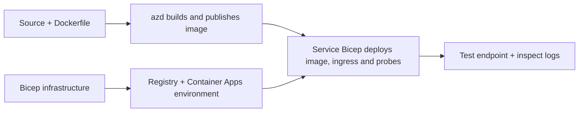

# Příklady nasazení kontejnerových aplikací s AZD

Tento adresář obsahuje dva výukové příklady se zdrojovým kódem, Dockerfiles,
infrastrukturou Bicep a `azure.yaml`. Žádný z nich není vhodný pro produkci.

## Vyberte příklad

| Vzorek | Co je implementováno | Požadavky |
|---|---|---|
| [Jednoduché Flask API](../../../../examples/container-app/simple-flask-api) | Jednoduché Python CRUD API, položky v paměti, zdravotní kontroly, HTTP škálování | Základní znalosti CLI a HTTP |
| [Dvouservisní mikroslužby](../../../../examples/container-app/microservices) | Node.js brána, interní read-only Python produktová služba, telemetrie a škálování | Nejprve dokončete příklad s jednou službou |

Počítejte s 30–60 minutami včetně nastavení a ověření. Doba poskytování Azure se liší.

## Požadavky

- [Azure Developer CLI](https://learn.microsoft.com/azure/developer/azure-developer-cli/install-azd)
- [Azure CLI](https://learn.microsoft.com/cli/azure/install-azure-cli) pro ověřovací příkazy
- Docker s běžícím démonem pro sestavení těchto kontejnerových obrazů
- Předplatné Azure s oprávněními pro vytváření zdrojů a dostatečnou regionální kvótou
- Bash pro příklady shellu, nebo ekvivalentní příkazy PowerShellu

```bash
azd version
az version
docker info
azd auth login
az login
```

Tyto dva nástroje mají samostatné přihlašovací relace. Použijte aktuální stabilní azd; aktuální
zveřejněná verze k datu revize je 1.37.2. Starší minimální verze nejsou
zárukou kompatibility.

## Rychlý start

Ze kořenového adresáře repozitáře:

```bash
cd examples/container-app/simple-flask-api
azd env new flask-demo
azd up
API_URL=$(azd env get-value API_ENDPOINT)
curl --fail-with-body "${API_URL}/health"
```

Očekává se: HTTP 200 s `"status": "healthy"`. Postupujte podle README příkladu pro vytvoření,
čtení, aktualizaci a smazání položky a pro prohlížení záznamů.



Počáteční nasazení používá veřejný hello-world obraz na portu 80. Konkrétní
konfigurační soubory Bicep umožňují `azd deploy` nahradit ho sestaveným obrazem aplikace
a správným portem/probování aplikace (8000 pro Flask/produkty, 8080 pro bránu).
Tyto soubory uchovávejte se svými `azure.yaml` `module` nastaveními.

## Konfigurace: co co mění

`azure.yaml` vybírá zdrojové adresáře, jazyky, hostitele a moduly nasazení.
CPU/paměť kontejneru, příchozí připojení, sondy, počet replik a škálovací pravidla jsou definovány
v **Bicepu**, nikoli v libovolných `resources`, `scale` nebo `regions` vlastnostech služby.

`azd env set SOME_VALUE ...` ukládá hodnotu lokálně. Změní nasazený
zdroj pouze tehdy, pokud ji parametr, mapování prostředí nebo hák výslovně spotřebuje.
Tyto příklady nekonzumují `MAX_REPLICAS`, `SCALE_TO_ZERO_TIMEOUT`,
`CONTAINER_APP_REPLICA_TYPE` ani vlastní nastavení canary z hodnot prostředí azd.
Upravte příslušný Bicep a spusťte `azd up` pro opětovné poskytování a nasazení.

Nevkládejte zdroj aplikace pod `infra/`. `project` musí ukazovat na zdrojový
adresář obsahující Dockerfile a manifest závislostí.

## Monitorování a náklady

- `azd monitor --logs` otevírá portálový pohled; nejde o stream terminálových záznamů.
  Použijte `az containerapp logs show --follow` s aktuálním názvem zdroje.
- Jednoduché API zapisuje záznamy do stdout, které sbírají Container Apps/Log Analytics.
  Jeho poskytovaný zdroj Application Insights není automaticky instrumentován.
- Brána mikroslužeb používá Node.js SDK Application Insights; Pythonová
  služba exportuje stopy aplikačních logů. Kompletní sledování požadavků/závislostí v Pythonu
  není nakonfigurováno.
- Škálování na nulu může snížit náklady na výpočetní prostředky, ale registry a ingest/uložení logů
  mohou stále něco stát. Výchozí nastavení mikroslužeb nechávají repliky běžet.
  Odhadněte si region a využití v
  [kalkulačce cen Azure](https://azure.microsoft.com/pricing/calculator/).

## Pokročilé vzory — neimplementované funkce

Toto jsou návrhové směry, nikoli dodatečné lokální projekty nebo příklady ke kopírování a spuštění:

- **Trvalá data a autentizace:** nahraďte úložiště v paměti a přidejte
  autentizaci/autorizaci Microsoft Entra ID před produkcí.
- **Blue-green/canary:** používejte režim více revizí Container Apps, štítky revizí,
  váhy provozu, zdravotní ověřování a postupy návratu zpět.
  Tyto příklady nemají `deploymentStrategy: canary` konfiguraci azd.
  Viz [správa revizí](https://learn.microsoft.com/azure/container-apps/revisions).
- **Multi-region:** vytvořte samostatná prostředí a aplikace v Bicepu a navrhněte
  globální směrování a konzistenci dat. Seznam `regions` služby není azd
  mechanismus nasazení.
- **Pracovníci front:** přidejte zdroj pracovníka, závislosti, prostředky fronty, spravovaný
  identita s rolemi datové roviny a ověřené škálovací pravidlo. Nekopírujte
  prázdnou `src/worker` cestu a neočekávejte spustitelný projekt.
- **Dapr:** zajištění komponent, konfigurace sidecaru, instalace odpovídajícího SDK,
  a implementace zpracování chyb stavu/pub-sub.
- **Tajné klíče:** pokud možno používejte spravovanou identitu a přiřazení rolí. Pouhé
  vytvoření Key Vaultu nezajišťuje aplikacím přístup ani nenačítá tajné klíče.

## Úklid

Z adresáře příkladů:

```bash
azd down
```

Zkontrolujte výzvy k odstranění a potvrďte, že dedikovaná skupina prostředků je odstraněna.
Nepoužívejte tyto příklady jako produkční základ bez dalšího návrhu a testů.

[Index příkladů](../README.md) · [Domovská stránka kurzu](../../README.md) ·
[Dokumentace Container Apps](https://learn.microsoft.com/azure/container-apps/) ·
[Nahlásit problém](https://github.com/microsoft/AZD-for-beginners/issues)

---

<!-- CO-OP TRANSLATOR DISCLAIMER START -->
**Prohlášení o omezení odpovědnosti**:
Tento dokument byl přeložen pomocí AI překladatelské služby [Co-op Translator](https://github.com/Azure/co-op-translator). Přestože usilujeme o co největší přesnost, mějte prosím na paměti, že automatizované překlady mohou obsahovat chyby nebo nepřesnosti. Originální dokument v jeho mateřském jazyce by měl být považován za autoritativní zdroj. Pro kritické informace se doporučuje profesionální lidský překlad. Nejsme odpovědní za jakékoli nedorozumění nebo nesprávné interpretace vzniklé použitím tohoto překladu.
<!-- CO-OP TRANSLATOR DISCLAIMER END -->