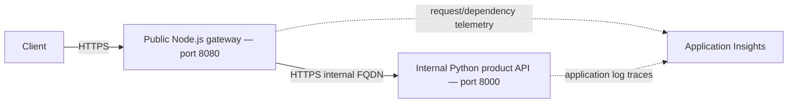

# Mikroslužby se dvěma službami — Azure Container Apps

**Úroveň:** Středně pokročilý · **Čas:** 45–60 minut včetně nastavení

Tento výukový vzorek implementuje **Node.js API Gateway** a **read-only Python Product Service**. Zahrnuty jsou zdrojové kódy, Dockerfiles, Bicep a konfigurace azd.

Nejedná se o systém připravený pro produkční nasazení.

## Co se naučíte

- Nezávislé nasazení dvou služeb.
- Použití interního backendového FQDN přes HTTPS.
- Ověření odpovědí úspěchu, nenalezení a nedostupnosti služby.
- Porozumění telemetrii a nezávislému škálování.



Katalog produktů obsahuje pět pevných produktů v paměti. Nejsou zde žádné **POST,
PUT ani DELETE handlery**, databáze, Service Bus, služby objednávek/uživatelů/oznámení,
kód v C# nebo Go. To jsou nápady pro budoucí vývoj, ne zahrnuté funkce.
Brána neautentizuje uživatele; interní přístup není náhradou
za autorizaci aplikace.

## Požadavky

Nejprve dokončete [jednoduché Flask API](../../../../../examples/container-app/simple-flask-api).
Nainstalujte aktuální stabilní azd (v době revize vydaná verze: 1.37.2), Azure CLI,
a Docker s běžícím démonem. Potřebujete předplatné Azure, oprávnění pro tvorbu zdrojů
a regionální kvótu Container Apps.

```bash
azd version
az version
docker info
azd auth login
az login
```

Použijte stejné předplatné v obou CLI nástrojích. Níže uvedené příkazy používají Bash.

## Nasazení a ověření

Z kořenového adresáře repozitáře:

```bash
cd examples/container-app/microservices
azd env new microservices-demo
azd up
GATEWAY_URL=$(azd env get-value API_GATEWAY_URL)
RG_NAME=$(azd env get-value AZURE_RESOURCE_GROUP)
GATEWAY_NAME=$(azd env get-value API_GATEWAY_NAME)
PRODUCT_NAME=$(azd env get-value PRODUCT_SERVICE_NAME)

curl --fail-with-body "${GATEWAY_URL}/health"
curl --fail-with-body "${GATEWAY_URL}/api/products"
curl --fail-with-body "${GATEWAY_URL}/api/products/1"
curl -i "${GATEWAY_URL}/api/products/999"
```

**Úspěch:** health 200; list 200 s **pěti** produkty; produkt 1 je notebook
za cenu 999,99 s dostupností 50; neznámý produkt vrací 404.
Popisy jsou zahrnuty v odpovědích; časová razítka se liší.

Počáteční nasazení používá veřejné obrázky hello-world na portu 80, takže se nesnaží
stahovat neexistující obrázky z prázdného registru. Service-specifické Bicep moduly
a parametrické soubory je nahrazují sestavenými obrazy a porty/probami aplikací během
`azd deploy`. Hlavní parametry zachovávají zveřejněné názvy obrazů pro pozdější provisioning.

## Služby a síťování

| Služba | Exponované koncové body | Výchozí zdroje |
|---|---|---|
| Brána | GET `/`, `/health`, `/api/products`, `/api/products/:id` | 1 vCPU, 2 GiB, 2–20 replik |
| Produkt | GET `/`, `/health`, `/products`, `/products/<id>` | 0.5 vCPU, 1 GiB, 1–10 replik |

Produktový ingress má `external: false` a `allowInsecure: false`. Bicep injektuje
`PRODUCT_SERVICE_URL=https://<actual-internal-fqdn>` do brány. HTTP by
přesměrovalo; HTTPS odpovídá nakonfigurovanému ingressu. Krátké DNS jméno musí odpovídat
**skutečnému názvu Container App**, ne logickému klíči služby `product-service`.
Nepokoušejte se volat interní URL přímo z vašeho notebooku.

Brána má pětisekundový timeout pro volání produktu. Chybějící ID produktů
propagují jako 404; selhání přenosu/jiné backendové chyby vracejí 503. Brána
`/health` kontroluje pouze bránu, ne dostupnost backendu.

## Soubory a konfigurace

```text
azure.yaml
infra/main.bicep
infra/main.parameters.json
infra/abbreviations.json
infra/core/container-apps-environment.bicep
infra/core/monitor.bicep
infra/app/api-gateway.bicep
infra/app/api-gateway.parameters.json
infra/app/product-service.bicep
infra/app/product-service.parameters.json
src/api-gateway/{app.js,package.json,Dockerfile}
src/product-service/{main.py,requirements.txt,Dockerfile}
```

Škálování, CPU/paměť, porty a proby jsou nastaveny v `infra/app/*.bicep`. Změňte tyto
soubory a spusťte `azd up` pro aplikaci infrastruktury a redeploy. V tomto vzorku
není parametr `GATEWAY_MAX_REPLICAS` proměnné prostředí.

Pro změny pouze kódu:

```bash
azd deploy product-service
azd deploy api-gateway
```

Node obraz používá Node 22; Python obraz používá Python 3.11. Oba naslouchají
`0.0.0.0`. Ingress/proby používají port 8080 (brána) a 8000 (produkt).

## Lokální vývoj s Dockerem

Spusťte z tohoto ukázkového adresáře. Použijte uživatelsky definovanou síť, **ne `localhost`
pro přístup jednoho kontejneru k druhému**:

```bash
docker network create azd-microservices-demo
docker build -t local-product ./src/product-service
docker build -t local-gateway ./src/api-gateway
docker run -d --name azd-product --network azd-microservices-demo local-product
docker run -d --name azd-gateway --network azd-microservices-demo \
  -p 8080:8080 -e PRODUCT_SERVICE_URL=http://azd-product:8000 local-gateway
curl --fail-with-body http://localhost:8080/api/products
```

Očekává se: pět produktů. HTTP se používá pouze pro tuto lokální Docker síť.

```bash
docker stop azd-product azd-gateway
docker rm azd-product azd-gateway
docker network rm azd-microservices-demo
```

## Monitorování

```bash
az containerapp logs show --name "$GATEWAY_NAME" --resource-group "$RG_NAME" --follow
# In a separate terminal:
az containerapp logs show --name "$PRODUCT_NAME" --resource-group "$RG_NAME" --tail 100
```

`azd monitor --logs` otevírá portálový pohled; nesleduje přenos logů terminálu.
Node SDK sbírá požadavky/závislosti brány. Pythonův `AzureLogHandler`
exportuje **logové stopy**, nikoli automatické Flask požadavky, SQL závislosti nebo úplné
distribuované stopy. OpenCensus je legacy SDK; při rozšiřování tohoto vzorku upřednostněte Azure Monitor OpenTelemetry.


```kusto
requests
| where timestamp > ago(1h)
| where name contains "products"
| summarize RequestCount=count(), AvgDuration=avg(duration) by bin(timestamp, 5m)
```

Pro zprávy v Python aplikaci:

```kusto
traces
| where timestamp > ago(1h)
| where message contains "products"
| project timestamp, message, severityLevel
```

Povolit zpoždění přijímání a vzorkování; neočekávejte přesný počet požadavků ani
garantovanou latenci. Není nakonfigurováno žádné vlastní upozornění nebo přehledy.

## Praktické cvičení

### Cvičení 1: Upravte katalog

**Výchozí bod:** `src/product-service/main.py`.
**Cíl:** ověřit nezávislé nasazení služby.
Změňte zásobu Laptopu z 50 na 49 ve pevně daném seznamu `products`, spusťte
`azd deploy product-service`, poté vyžádejte `${GATEWAY_URL}/api/products/1`.

**Kritéria úspěchu / řešení:** HTTP 200 s `"stock":49`. Obnovte 50 a znovu nasaďte.
**Častý problém:** úprava gateway místo služby, která vlastní katalog.
Tím se mění zdrojová data, nikoli trvalá databáze inventáře.

### Cvičení 2: Ověřte konfiguraci repliky

**Výchozí bod:** `infra/app/product-service.bicep`.
**Cíl:** pozorovat změnu infrastruktury bez hádání o autoskalování.
Změňte `minReplicas: 1` na `minReplicas: 2`, spusťte `azd up`, poté:

```bash
az containerapp show --name "$PRODUCT_NAME" --resource-group "$RG_NAME" \
  --query properties.template.scale -o json
```

**Kritéria úspěchu:** nastavené minimum je 2 a maximum zůstává 10.
Obnovte minimum na 1 a spusťte `azd up`.
**Častý problém:** samotný `azd deploy` neaplikuje změny na nesouvisející sdílenou
infrastrukturu. Nenastavujte `maxReplicas` na nulu jako simulaci selhání.
Toto ověřuje konfiguraci, nikoli zátěžový test nebo garantovaný okamžitý počet replik.

### Cvičení 3: Otestujte zpracování nedostupné služby lokálně

**Výchozí bod:** oba lokální Docker kontejnery výše běží.
**Cíl:** rozlišit selhání backendu od chybějícího produktu.
Zastavte pouze kontejner produktu:

```bash
docker stop azd-product
curl -i http://localhost:8080/api/products
docker start azd-product
curl --fail-with-body http://localhost:8080/api/products
```

**Kritéria úspěchu:** během zastavení vrací gateway 503 s
`"error":"Product service unavailable"`; po restartu seznam vrací 200.
V případě potřeby opakujte po krátkém startovním zpoždění.
**Častý problém:** zastavení gateway testuje jiné selhání (žádná HTTP odpověď).

## Náklady a mezery v produkci

Výchozí minimální repliky udržují běh výpočetní kapacity. Registry a monitorování také
představují náklady. Neexistuje ověřený pevný celkový poplatek 50 $/měsíc: odhadněte regionální CPU/paměť,
hodiny replik, požadavky, registry a uchovávání záznamů v
[Azure kalkulačce cen](https://azure.microsoft.com/pricing/calculator/).
Zdroje pro výuku smažte ihned po použití.

Produkční práce zahrnuje autentizaci/autorizaci, řízené identity s omezenými právy,
trvalá data, validaci vstupu/odpovědi, podporované monitorovací nástroje,
testování zátěže/selhání, CI/CD, upozornění a postupy obnovy. Přidání objednávkové
služby, fronty nebo databáze je samostatný implementační úkol, nikoli hotové
cvičení nebo funkce již zde dostupné.

## Řešení problémů a úklid

- **Obrázek nenalezen při prvním nasazení:** bootstrap by měl použít veřejný obrázek;
  ověřte výchozí parametry hlavního obrázku a mapování modulu nasazení.
- **503 produkty:** zkontrolujte záznamy produktu, revizi obrázku a vloženou interní HTTPS URL.
- **404 nečekaná cesta:** produktové API je pouze pro čtení; ověřte trasu, nikoli neexistující CRUD handler.
- **Žádná telemetrie:** zkontrolujte běhové připojovací řetězce bez jejich vystavení a
  povolte zpoždění příjmu. Tabulky požadavků Pythonu nejsou naplněny jeho logovacím handlerem.

Z tohoto ukázkového adresáře:

```bash
azd down
```

Zkontrolujte výzvy ke smazání a ověřte odebrání vyhrazené skupiny zdrojů.

[Předchozí: Flask API](../../../../../examples/container-app/simple-flask-api) · [Další: Databázová aplikace](../../../../../examples/database-app) ·
[Vývoj AI](../../../docs/chapter-02-ai-development/README.md) ·
[Domovská stránka kurzu](../../../README.md) · [Nahlásit problém](https://github.com/microsoft/AZD-for-beginners/issues)

---

<!-- CO-OP TRANSLATOR DISCLAIMER START -->
**Prohlášení o omezení odpovědnosti**:
Tento dokument byl přeložen pomocí AI překladatelské služby [Co-op Translator](https://github.com/Azure/co-op-translator). Přestože usilujeme o co největší přesnost, mějte prosím na paměti, že automatizované překlady mohou obsahovat chyby nebo nepřesnosti. Originální dokument v jeho mateřském jazyce by měl být považován za autoritativní zdroj. Pro kritické informace se doporučuje profesionální lidský překlad. Nejsme odpovědní za jakékoli nedorozumění nebo nesprávné interpretace vzniklé použitím tohoto překladu.
<!-- CO-OP TRANSLATOR DISCLAIMER END -->