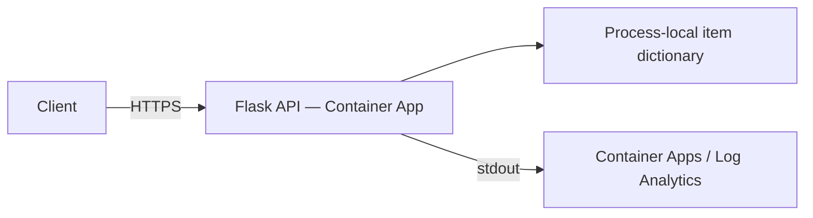

# Jednoduché Flask API — Azure Container Apps

**Úroveň:** Začátečník · **Čas:** 30–45 minut včetně nastavení

Nasazení Python Flask CRUD API pomocí Azure Developer CLI (azd). Zdrojový kód, Dockerfile,
Bicep a parametry nasazení jsou zahrnuty. Toto je **vzdělávací příklad**, nikoli
produkční API.

## Co se naučíte

- Vytvořit a publikovat kontejner přes azd.
- Nakonfigurovat ingress a liveness/readiness sondy.
- Ověřit odpovědi CRUD a zkontrolovat logy aplikace.
- Pochopit, proč je data v paměti nevhodná pro trvalé aplikace.



**Důležité:** položky jsou uchovávány v jednom procesu. Výchozí je **jeden Gunicorn worker,
0–1 repliky**, záměrně se vyhýbáme nekonzistentním datům mezi workery/replikami.
Položky se ztrácejí při restartu, změně revize nebo nastavení scale-to-zero. Zvětšení počtu replik
vyžaduje sdílené perzistentní úložiště. API nemá autentizaci ani autorizaci.

## Požadavky

- [Aktuální stabilní azd](https://learn.microsoft.com/azure/developer/azure-developer-cli/install-azd)
  (v době revize vydaná verze: 1.37.2).
- [Azure CLI](https://learn.microsoft.com/cli/azure/install-azure-cli) pro ověření.
- Docker s běžícím démonem; je vyžadován pro výchozí lokální build image.
- Azure předplatné, oprávnění k vytváření zdrojů a regionální kvótu pro Container Apps.
- Bash pro níže uvedené příkazy (nebo ekvivalentní PowerShell).
- Python 3.11 pro volitelný lokální vývoj.

```bash
azd version
az version
docker info
azd auth login
az login
```

CLI nástroje mají oddělené přihlašovací relace. Použijte stejné předplatné v obou.

## Rychlý start

Ze základní složky repozitáře:

```bash
cd examples/container-app/simple-flask-api
azd env new flask-demo
azd up
API_URL=$(azd env get-value API_ENDPOINT)
RG_NAME=$(azd env get-value AZURE_RESOURCE_GROUP)
API_NAME=$(azd env get-value API_NAME)
curl --fail-with-body "${API_URL}/health"
```

Očekávané: HTTP 200 a JSON s `"status":"healthy"`,
`"service":"simple-flask-api"` a aktuálním UTC časovým razítkem.
Provisioning a build image obvykle trvají několik minut; doby se liší.

Původní provisioning používá veřejný hello-world image naslouchající na portu 80.
`azure.yaml` vybere `infra/app/api.bicep` a jeho odpovídající parametrický soubor pro
nasazení služby, které přepne image, ingress a sondy na port 8000.
Tyto nasazovací parametry nemažte.

## Ověření CRUD

Spusťte postupně následující, dokud je stejná replika aktivní:

```bash
# Create: HTTP 201; note the returned id (1 for a fresh process).
curl -i -X POST "${API_URL}/api/items" \
  -H "Content-Type: application/json" \
  -d '{"name":"Test Item","description":"My first item"}'

# Read list: HTTP 200, total 1 in a fresh process.
curl --fail-with-body "${API_URL}/api/items"

# Replace 1 if your create response returned another id.
curl --fail-with-body "${API_URL}/api/items/1"
curl -i -X PUT "${API_URL}/api/items/1" \
  -H "Content-Type: application/json" -d '{"name":"Updated Item"}'
curl -i -X DELETE "${API_URL}/api/items/1"
curl -i "${API_URL}/api/items/1"
```

Úspěch: POST 201, čtení/PUT 200, DELETE 204 bez těla, pak chybějící položka 404.
Nesprávně formátovaný/nejde o JSON objekt nebo prázdné jméno vrací 400.
Pokud položka zmizí mezi požadavky, zkontrolujte restart nebo scale-to-zero;
je to záměrné omezení uchování v paměti, ne trvalé uložení.

| Endpoint | Metody |
|---|---|
| `/` | GET — informace o službě |
| `/health` | GET — liveness/readiness |
| `/api/items` | GET, POST |
| `/api/items/{id}` | GET, PUT, DELETE |

## Logy a konfigurace

```bash
az containerapp logs show --name "$API_NAME" --resource-group "$RG_NAME" --follow
```

Očekávané: spuštění Gunicornu, logy přístupu požadavků a zprávy aplikace.
`azd monitor --logs` otevírá portálový pohled; neprovozuje stream do terminálu.
Application Insights je zprovozněný, ale **není instrumentován tímto Flask kódem**;
použijte Container Apps/Log Analytics pro stdout logy.

Upravit `infra/app/api.bicep` pro CPU/paměť, limity replik nebo škálovací pravidla, pak
spusťte `azd up`. Výchozí hodnoty jsou 0,5 vCPU, 1 GiB, minimum 0 / maximum 1 replika a
HTTP práh 50 souběžných požadavků. Scale-to-zero může přidat latenci studeného startu.

Libovolné hodnoty `azd env set MAX_REPLICAS`, `API_KEY`, `LOG_LEVEL` nebo
`SCALE_TO_ZERO_TIMEOUT` nejsou **propojeny s touto šablonou ani aplikací**.
Nastavení hodnoty automaticky nevytváří runtime environmentální proměnnou.
Image explicitně používá port 8000; při změně portu aktualizujte Dockerfile, Bicep ingress a sondy
dohromady.

## Soubory

```text
azure.yaml
infra/main.bicep
infra/main.parameters.json
infra/app/container-apps.bicep       # Environment, registry, monitoring
infra/app/api.bicep                  # App, ingress, probes, scale settings
infra/app/api.parameters.json        # Image and resource values for azd deploy
src/app.py
src/Dockerfile
src/requirements.txt
```

## Lokální vývoj

Z tohoto adresáře příkladu:

```bash
python -m venv .venv
source .venv/bin/activate  # PowerShell: .\.venv\Scripts\Activate.ps1
python -m pip install -r src/requirements.txt
python src/app.py
```

V jiném terminálu otestujte `http://localhost:8000/health` a CRUD endpointy.
Nebo sestavte a spusťte skutečný image:

```bash
docker build -t flask-api:local ./src
docker run --rm -p 8000:8000 flask-api:local
```

Pro změny pouze v kódu po prvním nasazení spusťte `azd deploy api`.
Pro změny v Bicep spusťte `azd up` pro nové provisionování a nasazení.

## Praktické cvičení

### 1. Ověření zamítnutí vstupu

**Výchozí bod:** nasazené API, `API_URL` výše.
**Cíl:** ověřit, že API odmítá neplatné JSON formáty a chybějící jména.

```bash
curl -i -X POST "${API_URL}/api/items" \
  -H "Content-Type: application/json" -d '[]'
curl -i -X POST "${API_URL}/api/items" \
  -H "Content-Type: application/json" -d '{"name":""}'
```

**Kritéria úspěchu / řešení:** obojí vrací 400 s JSON chybou, nikoli 500.
**Běžný problém:** opomenutí hlavičky content-type JSON.

### 2. Přidat read-only verzi endpointu

**Výchozí bod:** `src/app.py`. **Cíl:** rozšířit a znovu nasadit API.
Přidejte toto před blok `if __name__ == '__main__':`:

```python
@app.route('/version', methods=['GET'])
def version():
    return jsonify({'version': '1.0.0'})
```

Spusťte `azd deploy api`, pak `curl --fail-with-body "${API_URL}/version"`.
**Kritéria úspěchu:** HTTP 200 a `{"version":"1.0.0"}`.
**Běžný problém:** vložení route za blokující volání `app.run()` při
testování pomocí `python src/app.py`.

### Kontrola znalostí

Proč jeden worker nestačí pro trvalá data? Protože i jeden proces ztrácí
svůj slovník při restartu. Produkční verze potřebuje perzistentní sdílené úložiště,
autentizaci, autorizaci, migrace, testy a provozní monitoring.

## Náklady a řešení problémů

Toto není zaručené nasazení za 0 $: základní registr a ukládání/logování může
způsobit poplatky i při nulové výpočetní zátěži aplikace. Použijte
[kalkulačku cen](https://azure.microsoft.com/pricing/calculator/) pro váš region.

- **Selhání Docker buildu:** ověřte `docker info`, síťový přístup a závislosti.
- **Nezdravá aplikace:** prohlédněte konzolové/systémové logy a ověřte port image, ingress
  a sondy, že souhlasí. Placeholder nesmí být sondován na Flask portu.
- **403/oprávnění:** ověřte předplatné a oprávnění na vytváření zdrojů.
- **Položky mizí:** stav v paměti se resetuje při restartu/scale-to-zero; přidejte databázi
  pro trvalé chování.

## Vyčištění a další kroky

```bash
azd down
```

Zkontrolujte výzvu k smazání a ověřte odstranění dedikované skupiny zdrojů.
Nepoužívejte destruktivní čištění na skupinu zdrojů obsahující nesouvisející data.

[Další: Databázová aplikace](../../../../../examples/database-app) · [Mikroslužby](../../../../../examples/container-app/microservices) ·
[Přehled kontejnerů](../README.md) · [Domů kurzu](../../../README.md) ·
[Nahlásit problém](https://github.com/microsoft/AZD-for-beginners/issues)

---

<!-- CO-OP TRANSLATOR DISCLAIMER START -->
**Prohlášení o omezení odpovědnosti**:
Tento dokument byl přeložen pomocí AI překladatelské služby [Co-op Translator](https://github.com/Azure/co-op-translator). Přestože usilujeme o co největší přesnost, mějte prosím na paměti, že automatizované překlady mohou obsahovat chyby nebo nepřesnosti. Originální dokument v jeho mateřském jazyce by měl být považován za autoritativní zdroj. Pro kritické informace se doporučuje profesionální lidský překlad. Nejsme odpovědní za jakékoli nedorozumění nebo nesprávné interpretace vzniklé použitím tohoto překladu.
<!-- CO-OP TRANSLATOR DISCLAIMER END -->