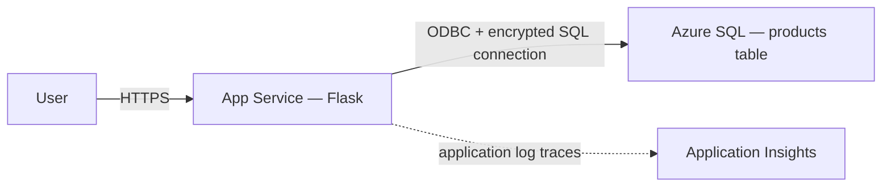

# Flask a Azure SQL na App Service

**Úroveň:** Středně pokročilý · **Doba:** 30–60 minut včetně předpokladů

Tento příklad nasazuje Python Flask read API na **Linux App Service** a základní
Azure SQL databázi. Zdrojové kódy, Bicep a konfigurace azd jsou zahrnuty. Jedná se o
výukovou aplikaci, nikoli o produkčně připravenou databázovou architekturu.

## Co se naučíte

- Poskytovat App Service, SQL a monitorovací zdroje pomocí Bicep.
- Konfigurovat šifrované SQL připojení bez ukládání přihlašovacích údajů.
- Inicializovat schéma před spuštěním workerů Gunicorn.
- Ověřit načtená data, odpovědi v případě nenalezení a zdraví databáze.



Zdroje: dedikovaná skupina zdrojů, plán B1 Linux App Service, Python 3.11 Web
App, SQL server a základní databáze 2 GB, Application Insights a Log Analytics.
Web App používá **nasazení ze zdroje/ZIP a instalaci závislostí Oryx**;
`azd deploy` nesestavuje ani nenasazuje volitelný Dockerfile.

## Předpoklady

- Aktuální stabilní verzi [azd](https://learn.microsoft.com/azure/developer/azure-developer-cli/install-azd)
  (publikované vydání v době recenze: 1.37.2).
- [Azure CLI](https://learn.microsoft.com/cli/azure/install-azure-cli) pro ověření.
- Azure předplatné, oprávnění k vytvoření uvedených zdrojů a regionální kvóta.
- Python **3.11** pro lokální vývoj; uložený `pyodbc==5.0.1` může vyžadovat
  nativní build nástroje na novějších verzích Pythonu.
- Microsoft ODBC Driver 18 (nebo 17) pro SQL Server na lokálních strojích. `pip install
  pyodbc` neinstaluje systémový ovladač. Viz
  [Instalace ODBC](https://learn.microsoft.com/sql/connect/odbc/download-odbc-driver-for-sql-server).
- Docker jen pokud testujete volitelný kontejner lokálně.

```bash
azd version
az version
azd auth login
az login
```

Použijte stejné předplatné v obou nástrojích. Níže uvedené příkazy jsou pro Bash.

## Nasazení

Z kořenového adresáře repozitáře:

```bash
cd examples/database-app
azd env new sql-demo
azd provision
azd deploy
WEB_URL=$(azd env get-value WEB_APP_URI)
WEB_NAME=$(azd env get-value WEB_APP_NAME)
RG_NAME=$(azd env get-value AZURE_RESOURCE_GROUP)
```

Vyberte podporovaný region. `sqlAdminLogin` má výchozí hodnotu `sqladmin`; požadovaný
`sqlAdminPassword` je zabezpečený parametr. Zadejte silné heslo, když budete vyzváni.
Uchovávejte nasazovací přihlašovací údaje mimo Git a hlášení chyb. Aktuální interpolace
připojovacího řetězce očekává heslo bez oddělovačů připojovacího řetězce, jako jsou
`;`; upravte escapování před použitím takových hodnot.

Bicep nastavuje spouštěcí příkaz, který spouští `init_database()` **před** Gunicornem
začínají pracovníci. To je nutné, protože import `app:app` neprovádí
Pythonův blok `if __name__ == '__main__'`. Na nové databázi inicializace
vytvoří `products` a vloží pět řádků. Je to jednoduchý ukázkový základ, nikoli
souběžný migrační rámec; použijte správné migrace před rozšířením instancí.

Aplikace vybere instalovaný Microsoft ODBC Driver 18, pak 17, pokud připojovací
řetězec explicitně nejmenuje ovladač. Pokud žádný neexistuje, spuštění skončí
chybnou instalací. Ověřte dostupnost ovladače ve vybraném
běhovém prostředí App Service namísto toho, abyste to jen předpokládali.

## Ověření

```bash
curl --fail-with-body "${WEB_URL}/"
curl --fail-with-body "${WEB_URL}/health"
curl --fail-with-body "${WEB_URL}/products"
curl --fail-with-body "${WEB_URL}/products/1"
curl -i "${WEB_URL}/products/999"
```

Očekáváno:

- `/` vrací informace o koncovém bodu.
- `/health` vrací 200 s `{"status":"healthy","database":"connected"}`.
- `/products` vrací pět semenných produktů na nové databázi.
- `/products/1` vrací Laptop s cenou 1299.99.
- Neexistující produkt vrací 404 s `{"error":"Product not found"}`.

API je pouze pro čtení. Není zde žádná trasa POST/PUT/DELETE ani uživatelské rozhraní prohlížeče.
Selhání připojení k databázi vrací 503 z `/health`; není to úspěch.

## Soubory a konfigurace

```text
azure.yaml                         # Python App Service source deployment
infra/main.bicep
infra/main.parameters.json
infra/abbreviations.json
infra/resources/sql-server.bicep
infra/resources/sql-database.bicep
infra/resources/app-service-plan.bicep
infra/resources/web-app.bicep       # Settings + initialization/startup command
infra/resources/app-insights.bicep
src/web/app.py
src/web/requirements.txt
src/web/Dockerfile                 # Optional local container, not the azd target
.env.sample
```

`SQL_CONNECTION_STRING` je předáván jako zabezpečený parametr Bicep modulu Web App
a ukládán v nastavení App Service, nikoli v výstupech nasazení.
`APPLICATIONINSIGHTS_CONNECTION_STRING` konfiguruje export protokolů.
`SCM_DO_BUILD_DURING_DEPLOYMENT=true` umožňuje instalaci závislostí na straně serveru.
Nastavení libovolných hodnot `azd env` automaticky nemění nastavení aplikace.

Pravidlo `0.0.0.0` firewallu SQL umožňuje připojení z **Azure služeb,
včetně předplatných jiných zákazníků**, podléhajících SQL autentizaci. Není
omezeno na tuto aplikaci nebo předplatné. Veřejný přístup SQL je povolen.
Použijte scoped networking a aplikační totožnost bez oprávnění admina před nasazením do produkce.

## Lokální vývoj

Použijte Python 3.11 a nainstalovaný Microsoft SQL ODBC ovladač:

```bash
python -m venv .venv
source .venv/bin/activate  # PowerShell: .\.venv\Scripts\Activate.ps1
python -m pip install -r src/web/requirements.txt
export SQL_CONNECTION_STRING='Server=tcp:YOUR_SERVER.database.windows.net,1433;Database=YOUR_DATABASE;UID=YOUR_USER;PWD=YOUR_PASSWORD;Encrypt=yes;TrustServerCertificate=no;Connection Timeout=30;'
python src/web/app.py
```

Nahraďte zástupné symboly bezpečně. Kopírovaný `.env` soubor **není automaticky načten**
touto aplikací. Místo toho exportujte proměnné ve vašem aktuálním shellu.
Pro Azure SQL z notebooku umožněte dočasně pouze vaši veřejnou IP:

```bash
SQL_SERVER=$(azd env get-value SQL_SERVER_NAME)
MY_IP=YOUR_PUBLIC_IP
az sql server firewall-rule create -g "$RG_NAME" -s "$SQL_SERVER" \
  -n AllowMyLearningIP --start-ip-address "$MY_IP" --end-ip-address "$MY_IP"
```

Po testování pravidlo odstraňte:

```bash
az sql server firewall-rule delete -g "$RG_NAME" -s "$SQL_SERVER" -n AllowMyLearningIP
```

Volitelný test kontejneru z tohoto ukázkového adresáře:

```bash
docker build -t sql-flask:local src/web
docker run --rm -p 8000:8000 -e SQL_CONNECTION_STRING sql-flask:local
```

Tento image instaluje Driver 18 pomocí balíčkového repozitáře Debian 12 odpovídajícího jeho
základu Bookworm, jednorázově inicializuje databázi a pak spustí Gunicorn.

## Monitorování a řešení problémů

Povolte a sledujte aplikační protokoly filesystému App Service při diagnostice spuštění:

```bash
az webapp log config --name "$WEB_NAME" --resource-group "$RG_NAME" \
  --application-logging filesystem --level information
az webapp log tail --name "$WEB_NAME" --resource-group "$RG_NAME"
```

Tento kód exportuje **protokolové stopy** aplikace prostřednictvím starého OpenCensus handleru.
Nezprostředkovává automatické trasování Flask požadavků/závislostí, Live Metrics,
SQL auditing, diagnostická nastavení či upozornění. Ty vyžadují samostatné nastavení.
Pro novou instrumentaci preferujte Azure Monitor OpenTelemetry.

V Application Insights Logs po provedení API požadavků:

```kusto
traces
| where timestamp > ago(1h)
| where message contains "products" or message contains "Health check"
| project timestamp, message, severityLevel
```

Povolení prodlevy při ingestování. Aktivita tabulky požadavků nebo Live Metrics není kritériem dokončení
této pouze pro protokoly instrumentace.

- **Chybějící ovladač:** zkontrolujte `pyodbc.drivers()` v runtime a nainstalujte
  podporovaný Microsoft ODBC ovladač. Pouhý Python balíček nestačí.
- **Selhání připojení:** zkontrolujte SQL nastavení, přihlašovací údaje, firewall a vybrané
  předplatné. Nezakazujte šifrování, aby jste chybu obešli.
- **Chybějící tabulka produktů:** potvrďte, že Bicep startovací příkaz byl nasazen;
  spuštění `gunicorn app:app` samotného vynechává inicializaci.
- **Selhání sestavení balíčku:** použijte Python 3.11 nebo zajistěte natívní build požadavky.
- **Data s nulovou cenou:** nula je platná desetinná cena; musí se serializovat jako 0.0,
  nikoli `null`.

## Praktická cvičení

### Cvičení 1: Ověření chování při chybějícím produktu

**Výchozí bod:** nasazené API a `WEB_URL` výše.
**Cíl:** rozlišit chybějící řádek od poškozené databáze.
Požádejte `/health` a `/products/999` pomocí výše uvedených příkazů.
**Kritéria úspěchu / odpověď:** health 200, neexistující produkt 404 (nikoli 500 nebo 503).
**Běžný problém:** předpoklad, že odpověď „nenalezeno“ znamená poškození SQL připojení.

### Cvičení 2: Změna nasazené hodnoty

**Výchozí bod:** Azure SQL Query Editor, připojený k vzorové databázi.
**Cíl:** ukázat, že data API jsou uložena v SQL, nikoliv v paměti procesu.

```sql
UPDATE products SET price = 0 WHERE id = 1;
SELECT id, name, price FROM products WHERE id = 1;
```

Požádejte `${WEB_URL}/products/1`. **Kritéria úspěchu:** cena je `0.0`, nikoli `null`.
Hodnotu obnovte:

```sql
UPDATE products SET price = 1299.99 WHERE id = 1;
```

**Běžný problém:** úprava Python seed listu neaktualizuje řádky již v SQL.
Nepoužívejte cvičení se schématem/databází na produkční databázi.

### Cvičení 3: Přidání čtecího koncového bodu počtu

**Výchozí bod:** `src/web/app.py`.
**Cíl:** rozšířit API o agregační dotaz bez parametrů.
Přidejte to před blokem `if __name__ == '__main__':`:

```python
@app.route('/product-count')
def product_count():
    from contextlib import closing
    with closing(get_db_connection()) as conn, closing(conn.cursor()) as cursor:
        cursor.execute("SELECT COUNT(*) FROM products")
        return jsonify({'count': cursor.fetchone()[0]})
```

Spusťte `azd deploy web`, poté požádejte `${WEB_URL}/product-count`.
**Kritéria úspěchu:** 200 s `{"count":5}` na nedotčené semenné databázi.
**Běžný problém:** změna trasy, ale zapomenuté nové nasazení.
Pro produkci přidejte ošetření chyb/testy; toto krátké cvičení se zaměřuje na dotaz.

## Náklady, produkční mezery a úklid

B1 App Service a Basic databáze jsou účtovány během doby, kdy jsou přiděleny. Zastavení
Web App **nezastaví** účtování plánu App Service. Protokoly a úložiště mohou přidat náklady.
Použijte [Azure pricing calculator](https://azure.microsoft.com/pricing/calculator/)
pro aktuální regionální ceny. Přechod na F1 také vyžaduje deaktivaci `alwaysOn`;
není to náhrada na jeden řádek. SQL serverless není automaticky zdarma.

Produkční práce zahrnuje aplikaci identity s nejmenšími oprávněními (ne admin SQL),
autentizaci/autorizaci, privátní síť, bezpečné migrace, přehled spojení a životního cyklu,
telemetry, auditing, upozornění, testy a postupy obnovy.
Redis caching a další tabulky jsou nápady pro vývoj, nikoli implementovaná cvičení.

Ze tohoto ukázkového adresáře:

```bash
azd down
```

Zkontrolujte výzvu k odstranění a ověřte, že je dedikovaná resource skupina odstraněna.
Neodstraňujte skupiny obsahující nesouvisející data.

[Container examples](../../../../examples/container-app) ·
[AI development](../../docs/chapter-02-ai-development/README.md) ·
[Course home](../../README.md) · [Report an issue](https://github.com/microsoft/AZD-for-beginners/issues)

---

<!-- CO-OP TRANSLATOR DISCLAIMER START -->
**Prohlášení o omezení odpovědnosti**:
Tento dokument byl přeložen pomocí AI překladatelské služby [Co-op Translator](https://github.com/Azure/co-op-translator). Přestože usilujeme o co největší přesnost, mějte prosím na paměti, že automatizované překlady mohou obsahovat chyby nebo nepřesnosti. Originální dokument v jeho mateřském jazyce by měl být považován za autoritativní zdroj. Pro kritické informace se doporučuje profesionální lidský překlad. Nejsme odpovědní za jakékoli nedorozumění nebo nesprávné interpretace vzniklé použitím tohoto překladu.
<!-- CO-OP TRANSLATOR DISCLAIMER END -->