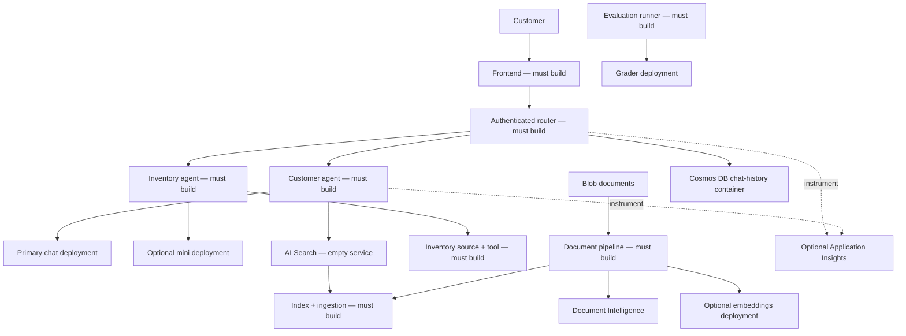

# Víceagentní zákaznická podpora — Architektonický plán pro maloobchod

**Kapitola 5: Víceagentní AI řešení**

- [Domov kurzu](../README.md)
- [Kapitola 5](../docs/chapter-05-multi-agent/README.md)
- [Předpoklad: Integrace AI](../docs/chapter-02-ai-development/microsoft-foundry-integration.md)
- [Dále: Plánování kapacity](../docs/chapter-06-pre-deployment/capacity-planning.md)
- [ARM infrastruktura scaffold](retail-multiagent-arm-template/README.md)

> **Průvodce architekturou, ne funkční aplikace.** Jediné implementační soubory maloobchodu
> jsou `azuredeploy.json`, `azuredeploy.parameters.json` a `deploy.sh` v
> `retail-multiagent-arm-template/`. Router/frontend kontejnery jsou zástupci hello-world.
> Lokálně neexistuje žádný maloobchodní agent, uživatelské rozhraní, ingestní pipeline, hodnotitel, skener ani
> testovací sada aplikace.

## Přehled

**Cíl:** navrhnout systém zákaznické podpory se zákaznickým agentem a agentem zásob,
určit, co infrastruktura poskytuje, a naplánovat chybějící aplikační
kontrakty a ověřování.

**Cílová skupina:** vývojáři, kteří dokončili lokální
[chatový příklad](../../../examples/azure-openai-chat) a [příklad dvou služeb v kontejnerech](../../../examples/container-app/microservices).
Vyhraďte si 2–3 hodiny na studium architektury. Vytvoření aplikace je samostatný
projekt: 80–120 hodin vývoje je ilustrativní plánovací odhad pro
zkušené vývojáře, **nikoli závazek dodání**; produkční zpřísnění, testy,
bezpečnostní přezkum a provoz vyžadují další práci.

### Výsledky učení

- Vysvětlit směrování, ukotvení, oprávnění nástrojů a vlastnictví konverzace.
- Rozlišovat identifikátory modelů, názvy nasazení, verze API a verze ARM.
- Navrhnout ingestování a vyhledávání dokumentů s odpovídajícími vektorovými rozměry.
- Definovat ověřitelné funkční, hodnotící a požadavky na zotavení z chyb.
- Oddělit volitelné architektonické cíle od skutečně poskytovaných zdrojů.

## Architektura řešení



Toto je **cílová architektura aplikace**, nikoli diagram běžících služeb agenta.
Rámec ARM vytváří základní služby a pouze dva zástupné kontejnery.
Front Door, registr, spravované identity, přiřazení rolí,
soukromé koncové body, failover, instrumentace aplikace a upozornění nejsou zahrnuty.

### Odpovědnosti a smlouvy

| Komponenta | Požadované chování | Důkazy před označením za dokončené |
|---|---|---|
| Frontend | Ověřit uživatele, vykreslit chat, bezpečně nahrávat dokumenty | Testy UI a nahrávání, přístupné chyby |
| Router | Autorizovat požadavky, vybrat agenta, omezit volání/nastavení časového limitu | Testy směrování, kontroly autorizace, testy selhání |
| Zákaznický agent | Zakládat odpovědi na politiku/produkt na schválených zdrojích | Správné citace, zdržení se při absenci dat |
| Inventární nástroj | Číst autoritativní stav zásob s omezenými oprávněními | Deterministické testy stavu zásob; žádná vymyšlená dostupnost |
| Dokumentový pipeline | Extrahovat, dělit na části, vkládat, indexovat, aktualizovat/mazat | Indexované přípravky a chování opakování/nevyřízené zprávy |
| Úložiště konverzace | Izolovat uživatele, vynucovat uchovávání | Testy autorizace přes uživatele a TTL |
| Spouštěč vyhodnocení | Porovnávat výstupy s pravdou a rubrikou | Pokrytí, počty selhání, reprodukovatelné zprávy |

Považujte router za recepci a nástroje za omezené interní systémy:
výběr specialisty není autorizací pro přístup ke všem záznamům zákazníka.
Vynucujte identitu a oprávnění v aplikačním kódu a datových službách, ne v promptů.

## Infrastruktura vs. aplikace

Přečtěte si [scaffold README](retail-multiagent-arm-template/README.md) před
poskytnutím zdrojů. Obsahuje přesné zdroje, režimy, náklady a omezení.

| Logické využití | Název nasazení ARM | Model / verze | Výchozí region |
|---|---|---|---|
| Zákaznický chat | `gpt-4.1-chat` | `gpt-4.1` / `2025-04-14` | `eastus2` |
| Inventory | `gpt-4.1-mini-inventory` | `gpt-4.1-mini` / `2025-04-14` | `westus2`, volitelné |
| Embeddings | `text-embedding-ada-002` | `text-embedding-ada-002` / `2` | `francecentral`, volitelné |
| Evaluation | `gpt-4.1-grader` | `gpt-4.1` / `2025-04-14` | Primární region ve výchozím nastavení |

Zkontrolujte dostupnost modelu/verze/SKU a kvótu v **každém regionu**. Chat/mini/grader
používají `GlobalStandard`; embeddings používají `Standard`. Mapování kapacitních jednotek na TPM je
specifické pro model. Nepřidávejte různé kapacitní jednotky jako univerzální záruku kvóty.

Argument `model` v požadavku Azure OpenAI je **název nasazení**, nikoli
nutně identifikátor modelu v katalogu. Verze datového API `2024-10-21`
se liší od verze modelu `2025-04-14` a ARM zdroje `apiVersion`.
Nelze opravit nedostupný model pouze změnou verze datového API.

`--no-multi-region` přeskočí sekundární a embeddings účty. Primární chatový a
nezávislý grader účet zůstávají. Samostatné účty modelu neposkytují automatické
přepnutí; to vyžaduje směrování aplikace, kompatibilní nasazení, kontrolu stavu,
limity opakování a přezkum datové rezidence.

## Implementační plán

### 1. Začněte jednou otestovanou interakcí

Před sestavením velkého rámce použijte místní chatový vzorek k navázání
inferenční konektivity. Definujte jednu reprezentativní zákaznickou otázku, schválený
zdroj odpovědi, očekávanou citaci a chování při selhání, když tento zdroj chybí.

### 2. Definujte směrování a hranice nástrojů

Vytvořte si vlastní zdroj routeru, manifest závislostí, Dockerfile a testy. 
Ilustrační smlouva může být `POST /chat` s `{"message":"...","conversation_id":"..."}`.
**Tento endpoint je návrhem designu; není implementován šablonou ARM.**

Ověřte typy/limity těla, odvoďte uživatelskou identitu z autentikace, vynucujte vlastnictví konverzace,
aplikujte timeouty požadavků a vracejte smysluplné chybové kódy.
Nepovažujte chyby HTTP nebo prázdné odpovědi za úspěšné výsledky agenta.

### 3. Implementujte grounding a ingestování

Šablona ARM nevytváří vyhledávací index. Toto je **referenční JSON fragment 
k přizpůsobení ve vaší vlastní definici indexu**, nikoliv soubor již v repozitáři:

```json
{
  "name": "retail-product-index",
  "fields": [
    {"name": "id", "type": "Edm.String", "key": true},
    {"name": "title", "type": "Edm.String", "searchable": true},
    {"name": "content", "type": "Edm.String", "searchable": true},
    {"name": "category", "type": "Edm.String", "filterable": true},
    {
      "name": "content_vector",
      "type": "Collection(Edm.Single)",
      "searchable": true,
      "dimensions": 1536,
      "vectorSearchProfile": "retail-profile"
    }
  ],
  "vectorSearch": {
    "algorithms": [{"name": "retail-hnsw", "kind": "hnsw"}],
    "profiles": [{"name": "retail-profile", "algorithm": "retail-hnsw"}]
  }
}
```

Profil propojuje vektorové pole s jeho algoritmem. Rozměry musí odpovídat 
skutečnému výstupu embeddingu (1536 pro toto nasazení `ada-002`). 
Pro Python retrieval použijte `azure.search.documents.models.VectorizedQuery` místo neúplného 
slovníku bez druhu dotazu na vektor:

```python
# Reference function only: supply an authenticated async SearchClient and an embedding.
from azure.search.documents.models import VectorizedQuery

async def retrieve(search_client, embedding):
    results = await search_client.search(
        search_text=None,
        vector_queries=[VectorizedQuery(
            vector=embedding,
            k_nearest_neighbors=5,
            fields="content_vector"
        )],
        select=["id", "title", "content"]
    )
    return [document async for document in results]
```

Vytvořte samostatnou implementaci ingestování, která:

1. Autorizuje přístup pro nahrávání a validuje typ obsahu a velikost.
2. Čte soukromé blob objekty pomocí autentizovaných volání SDK. Soukromá URL blobu sama o sobě 
   **není** čitelný vstup pro Document Intelligence; pošlete stažené bajty s
   `AnalyzeDocumentRequest(bytes_source=...)` nebo použijte vhodně omezený, 
   krátkodobý SAS po přezkoumání přístupových požadavků.
3. Extrahuje text, rozdělí ho na kusy dle limitů embeddingu a generuje embeddingy.
4. Vytváří stabilní platné klíče dokumentů a nahrává kusy s odpovídajícími vektory.
5. Kontroluje výsledky indexace jednotlivých dokumentů, zpracovává opakování a aktualizuje/smaže zastaralá data.

Nevkládejte libovolné uživatelské klíče/hodnoty do OData filtrů. Povolujte pouze konkrétní pole,
ověřte typy hodnot a escapujte uvozovky ve stringu. Booleovské a číselné filtry potřebují
typované literály, ne uvozovkami obklopené řetězce.

### 4. Propojení s webem

**Bing Search v7 byl ukončen 11. srpna 2025.** Starý `Microsoft.Bing/accounts`
zdroj a `api.bing.microsoft.com/v7.0/search` příklady nejsou podporovanou implementační cestou.
Zvažte aktuálně podporovanou integraci propojení v Microsoft Foundry a jeho SDK, oprávnění,
účtování a požadavky na citace; žádná zde není implementována. Není to přímá náhrada za
ukončený endpoint.

### 5. Přidejte telemetrii a vyhodnocení

Vytvoření Application Insights samo o sobě kód neinstrumentuje. Použijte podporované Azure Monitor
OpenTelemetry instrumentace při tvorbě nové aplikace, přenášejte kontext trasování mezi službami
a vyhněte se logování zákaznických promptů, dokumentů či tajemství.
Oříznutí dotazu jej **nezanonymizuje**.

Měřte dobu trvání požadavku, selhání směrování/nástrojů, relevantnost vyhledávání, správnost citací,
využití tokenů a zdržení se odpovědi. Ukládejte inventář/pravidla s realitou spolu
s evaluačními případy: hodnotitel nemůže spolehlivě určit faktickou přesnost
pouze z otázky a odpovědi.

Nasazení hodnotitele není spouštěč hodnocení. Implementujte verzované kritérium,
validaci strukturovaného výstupu/schémy, kontroly rozsahu skóre, počty selhání přenosu
a případy přezkoumané lidmi. Hlaste neúplné/chybové případy samostatně; nepřeveďte je
na úspěšná hodnocení nebo je tiše nezahrnujte jako odpovědi modelu nulové kvality.

Stejně tak několik kontrol klíčových slov není bezpečnostní certifikace. Neúspěšný HTTP
požadavek, chybějící testovací strategie nebo prázdná odpověď musí způsobit, že test bude
**neujasněný nebo neúspěšný**, nikoliv výsledné skóre „100% bezpečné“. Proveďte autorizované testování s odpovídající
nástroje a lidské kontroly před jakýmkoli tvrzením o připravenosti k výrobě.

### 6. Nasazení vaší aplikace

Vytvořte své vlastní zdrojové adresáře, manifesty, testy, registry a oprávnění pro stahování obrazů.
Nahraďte zástupné znaky sestavenými obrazy a aktualizujte ingress/probes podle
portu naslouchání každé aplikace. Nakonfigurujte runtime proměnné prostředí v Bicep
nebo v explicitním podporovaném mapování prostředí azd.

Neexistuje žádný generický `config` slovník pod službou azd, který by automaticky
vytvářel runtime proměnné prostředí. `azd env set` mění pouze zdroje, které tyto hodnoty
explicitně využívají. V tomto skeletu není implementován žádný canary, seznam regionů ani háček pro doladění.


## Praktické návrhové cvičení

Toto jsou **architektonická cvičení**, nikoli tvrzení o spustitelném kódu pro maloobchodní startér.

### Cvičení 1: Ověření hranice

**Výchozí bod:** tři soubory v `retail-multiagent-arm-template/`.
**Cíl:** rozlišit zajištění od funkčnosti aplikace.
Otevřete `azuredeploy.json`, najděte oba kontejnery obrazů a hodnoty `targetPort`,
poté vyjmenujte komponenty aplikace, které v repozitáři chybí.

**Kritéria úspěchu / odpověď:** oba obrazy jsou zástupné hello-world naslouchající
na portu 80; agenti, chat UI, router handlery, index/ingestion, evaluátor a skener
chybí. Úspěšný placeholder root požadavek nevaliduje `/chat`.
**Běžný problém:** interpretace názvů zdrojů jako `retail-router` jako funkčního kódu.

### Cvičení 2: Sledujte konfiguraci vectoru

**Výchozí bod:** výše uvedený index JSON.
**Cíl:** porozumět vztahu mezi polem → profilem → algoritmem.
Určete, které hodnoty se musí změnit při přechodu na embedding model s
jiný rozměr výstupu, pak si prohlédněte funkci `retrieve`.

**Kritéria úspěchu / odpověď:** změňte pole `dimensions` na skutečnou délku vektoru;
nechte `vectorSearchProfile` zarovnané s deklarovaným profilem a jeho algoritmem;
dotaz `fields` musí pojmenovat vektorové pole. Pře generujte stávající dokumentové vektory
při změně embedding modelu.
**Běžný problém:** změna pouze jména modelu při zachování nekompatibilních vektorů.

### Cvičení 3: Definujte test selhání

**Výchozí bod:** tabulka odpovědností.
**Cíl:** zabránit falešnému úspěchu.
Sepište očekávané chování pro nedostupné API inventáře, vyhledávací index bez
odpovídajících dokumentů a požadavek na vyhodnocení vracející HTTP 503.

**Kritéria úspěchu / odpověď:** žádné vymyšlené hodnoty inventáře; explicitní abstinence nebo
eskalace, pokud chybí kontext; vyhodnocení hlásí selhání přenosu spíše než
kvalitu nebo bezpečnostní průchod. Přidejte spustitelné testy při sestavování aplikace.
**Běžný problém:** zachycení každé výjimky a pokračování s prázdnou odpovědí.

## Náklady, řešení problémů a úklid

- Infrastruktura má průběžné náklady i při prázdných vyhledávacích indexech a zástupných
  aplikacích. Použijte aktuální regionální ceny; ani „minimální“ ani více regionů neznamená zdarma.
- Náklady na tokeny závisí na modelu, cacheovaném/nekacheovaném vstupu, výstupu a SKU nasazení.
  Směrování může ušetřit peníze pouze, pokud měřená pracovní zátěž a výsledky kvality to ospravedlňují;
  pevná úspora 60–80 % není garantována.
- Před nasazením zkontrolujte dostupnost modelu a kvótu; rozlišujte oprávnění,
  chyby v deployment-name, region, model-version a API-version.
- Nespouštějte chybějící `setup-data.sh`, evaluator CLI nebo `pytest tests/` příkazy.
  Jejich implementace jsou součástí vašeho vývojového plánu.
- Konstrukce je pouze pro ARM: postupujte podle jejích
  [instrukcí pro ověření a vyčištění](retail-multiagent-arm-template/README.md).
  `azd down` nespravuje tyto zdroje.

## Související zdroje

- [Fungující ukázka místního chatu](../../../examples/azure-openai-chat)
- [Fungující ukázka kontejneru se dvěma službami](../../../examples/container-app/microservices)
- [Vektorové indexy AI Search](https://learn.microsoft.com/azure/search/vector-search-how-to-create-index)
- [Dokumentace Container Apps](https://learn.microsoft.com/azure/container-apps/)
- [Řešení problémů](../docs/chapter-07-troubleshooting/common-issues.md)
- [Nahlásit problém](https://github.com/microsoft/AZD-for-beginners/issues)

---

<!-- CO-OP TRANSLATOR DISCLAIMER START -->
**Prohlášení o omezení odpovědnosti**:
Tento dokument byl přeložen pomocí AI překladatelské služby [Co-op Translator](https://github.com/Azure/co-op-translator). Přestože usilujeme o co největší přesnost, mějte prosím na paměti, že automatizované překlady mohou obsahovat chyby nebo nepřesnosti. Originální dokument v jeho mateřském jazyce by měl být považován za autoritativní zdroj. Pro kritické informace se doporučuje profesionální lidský překlad. Nejsme odpovědní za jakékoli nedorozumění nebo nesprávné interpretace vzniklé použitím tohoto překladu.
<!-- CO-OP TRANSLATOR DISCLAIMER END -->