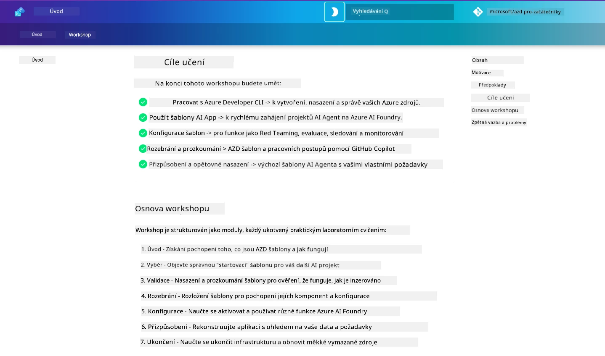

<div align="center">
  <div style="background: linear-gradient(135deg, #0078d4, #106ebe); border-radius: 10px; padding: 20px; margin: 20px 0; box-shadow: 0 4px 15px rgba(0, 120, 212, 0.3); border: 2px solid #005a9e;">
    <h2 style="color: white; margin: 0; font-size: 24px; text-shadow: 1px 1px 2px rgba(0,0,0,0.3);">
      🎯 Workshop AZD pro vývojáře umělé inteligence
    </h2>
    <p style="color: white; margin: 10px 0 0 0; font-size: 16px; text-shadow: 1px 1px 2px rgba(0,0,0,0.3);">
      <strong>Praktický workshop na tvorbu AI aplikací pomocí Azure Developer CLI.</strong><br>
      Dokončete 7 modulů k osvojení šablon AZD a pracovních postupů nasazení AI.
    </p>
    <div style="margin-top: 15px;">
      <span style="background: rgba(255,255,255,0.2); padding: 5px 10px; border-radius: 15px; color: white; font-size: 14px;">
        📅 Zdrojové pokyny zkontrolovány: listopad 2026
      </span>
    </div>
  </div>
</div>

# Workshop AZD pro vývojáře umělé inteligence

Vítejte na praktickém workshopu pro naučení Azure Developer CLI (AZD) se zaměřením na nasazení AI aplikací. Tento workshop vám pomůže získat praktické znalosti o šablonách AZD ve 3 krocích:

1. **Objevování** - najděte šablonu, která je pro vás správná.
1. **Nasazení** - nasazení a ověření funkčnosti
1. **Přizpůsobení** - upravte a přetvořte ji podle svých potřeb!

Během tohoto workshopu budete také seznámeni se základními nástroji a pracovními postupy vývojáře, které vám pomohou zjednodušit vaši celkovou vývojovou cestu.

<br/>

## Průvodce založený na prohlížeči

Lekce workshopu jsou v Markdownu. Můžete je procházet přímo na GitHubu nebo spustit náhled v prohlížeči, jak je ukázáno na snímku obrazovky níže.



Pro použití této možnosti - proveďte fork repozitáře do svého profilu a spusťte GitHub Codespaces. Jakmile je terminál VS Code aktivní, zadejte tento příkaz:

Tento náhled v prohlížeči funguje v GitHub Codespaces, vývojových kontejnerech nebo v místní klonované kopii s nainstalovaným Pythonem a MkDocs.

```bash title="" linenums="0"
python -m pip install -r requirements-dev.txt
python -m mkdocs serve --config-file workshop/mkdocs.yml
```

Tyto příkazy spusťte z **kořenového adresáře kurzu**, ne z samostatně inicializovaného ukázkového AI projektu. Nechte náhled na popředí tak, aby byly chyby viditelné; zastavíte ho stiskem Ctrl+C. Pro kontrolu stránky bez spouštění serveru spusťte `python -m mkdocs build --strict --config-file workshop/mkdocs.yml`.

Během několika sekund se zobrazí vyskakovací dialog. Zvolte možnost `Open in browser`. Webový průvodce se nyní otevře v nové záložce prohlížeče. Některé výhody tohoto náhledu:

1. **Vestavěné vyhledávání** - rychle najděte klíčová slova nebo lekce.
1. **Ikona kopírování** - najeďte myší nad blok kódu pro zobrazení této možnosti
1. **Přepínač motivů** - přepínejte mezi tmavým a světlým motivem
1. **Získejte pomoc** - klikněte na ikonu Discordu v patičce a připojte se!

<br/>

## Přehled workshopu

**Délka:** 3-4 hodiny  
**Úroveň:** Začátečník až středně pokročilý  
**Požadavky:** Základní znalost Azure, konceptů AI, VS Code a příkazové řádky.

Jedná se o praktický workshop, kde se učíte přímo činností. Po dokončení cvičení doporučujeme projít si osnovu AZD pro začátečníky, abyste mohli pokračovat ve svém vzdělávání v oblasti bezpečnosti a produktivity.

| Čas| Modul  | Cíl |
|:---|:---|:---|
| 15 min | [Úvod](docs/instructions/0-Introduction.md) | Nastavit scénu, pochopit cíle |
| 30 min | [Výběr AI šablony](docs/instructions/1-Select-AI-Template.md) | Prozkoumat možnosti a zvolit startovní šablonu | 
| 30 min | [Ověření AI šablony](docs/instructions/2-Validate-AI-Template.md) | Nasadit výchozí řešení do Azure |
| 30 min | [Rozebrání AI šablony](docs/instructions/3-Deconstruct-AI-Template.md) | Prozkoumat strukturu a konfiguraci |
| 30 min | [Nastavení AI šablony](docs/instructions/4-Configure-AI-Template.md) | Aktivovat a vyzkoušet dostupné funkce |
| 30 min | [Přizpůsobení AI šablony](docs/instructions/5-Customize-AI-Template.md) | Přizpůsobit šablonu vašim potřebám |
| 30 min | [Ukončení infrastruktury](docs/instructions/6-Teardown-Infrastructure.md) | Vyčistit a uvolnit prostředky |
| 15 min | [Závěr a další kroky](docs/instructions/7-Wrap-up.md) | Vzdělávací zdroje, výzva workshopu |

<br/>

## Co se naučíte

Považujte šablonu AZD za učební pískoviště pro objevování různých schopností a nástrojů pro kompletní vývoj na Microsoft Foundry. Na konci tohoto workshopu byste měli mít intuitivní představu o různých nástrojích a konceptech v tomto kontextu.

| Koncept  | Cíl |
|:---|:---|
| **Azure Developer CLI** | Pochopit příkazy nástroje a pracovní postupy|
| **Šablony AZD**| Pochopit strukturu projektu a konfiguraci|
| **Azure AI Agent**| Zřizování a nasazení Microsoft Foundry projektu  |
| **Azure AI Search**| Umožnit inženýrství kontextu s agenty |
| **Pozorovatelnost**| Prozkoumat sledování, monitorování a vyhodnocení |
| **Red Teaming**| Prozkoumat adversariální testování a zmírnění rizik |

<br/>

## Struktura workshopu

Workshop je strukturován tak, aby vás provedl cestou od objevení šablony přes nasazení, rozebrání a přizpůsobení - s použitím oficiální startovací šablony [Getting Started with AI Agents](https://github.com/Azure-Samples/get-started-with-ai-agents).

### [Modul 1: Výběr AI šablony](docs/instructions/1-Select-AI-Template.md) (30 min)

- Co jsou šablony AI?
- Kde najdu šablony AI?
- Jak začít vytvářet AI agenty?
- **Cvičení**: Rychlý start v Codespaces nebo dev kontejneru

### [Modul 2: Ověření AI šablony](docs/instructions/2-Validate-AI-Template.md) (30 min)

- Jaká je architektura AI šablony?
- Jaký je vývojový pracovní postup AZD?
- Kde získat pomoc s vývojem AZD?
- **Cvičení**: Nasadit a ověřit šablonu AI agentů

### [Modul 3: Rozebrání AI šablony](docs/instructions/3-Deconstruct-AI-Template.md) (30 min)

- Prozkoumejte své prostředí v `.azure/` 
- Prozkoumejte nastavení zdrojů v `infra/` 
- Prozkoumejte svou konfiguraci AZD v `azure.yaml`
- **Cvičení**: Upravte proměnné prostředí a znovu nasadte

### [Modul 4: Nastavení AI šablony](docs/instructions/4-Configure-AI-Template.md) (30 min)
- Prozkoumejte: Rekuperační generování obsahu (Retrieval Augmented Generation)
- Prozkoumejte: Hodnocení agentů a Red Teaming
- Prozkoumejte: Sledování a monitoring
- **Cvičení**: Prozkoumejte AI agenta + pozorovatelnost 

### [Modul 5: Přizpůsobení AI šablony](docs/instructions/5-Customize-AI-Template.md) (30 min)
- Definujte: PRD se scénářovými požadavky
- Nastavte: Proměnné prostředí pro AZD
- Implementujte: Lifecycle Hooks pro přidané úlohy
- **Cvičení**: Přizpůsobte šablonu svému scénáři

### [Modul 6: Ukončení infrastruktury](docs/instructions/6-Teardown-Infrastructure.md) (30 min)
- Shrnutí: Co jsou šablony AZD?
- Shrnutí: Proč používat Azure Developer CLI?
- Další kroky: Vyzkoušejte jinou šablonu!
- **Cvičení**: Zrušte zřizování infrastruktury a vyčistěte

<br/>

## Výzva workshopu

Chcete se vyzvat k většímu? Zde jsou některé návrhy projektů - nebo nám sdílejte své nápady!

| Projekt | Popis |
|:---|:---|
|1. **Rozebrat složitou AI šablonu** | Použijte pracovní postup a nástroje, které jsme nastínili, a zkuste nasadit, ověřit a přizpůsobit jinou šablonu AI řešení. _Co jste se naučili?_|
|2. **Přizpůsobení podle svého scénáře**  | Zkuste napsat PRD (Produktovou specifikaci) pro jiný scénář. Pak použijte GitHub Copilot v repozitáři šablony v Agent Modelu - a požádejte ho o generování pracovního postupu přizpůsobení. _Co jste se naučili? Jak byste mohli tyto návrhy vylepšit?_|
| | |

## Máte zpětnou vazbu?

1. Vložte issue do tohoto repozitáře - označte ho `Workshop` pro přehlednost.
1. Připojte se na Microsoft Foundry Discord - propojte se s kolegy!


| | | 
|:---|:---|
| **📚 Domov kurzu**| [AZD pro začátečníky](../README.md)|
| **📖 Dokumentace** | [Začínáme se AI šablonami](https://learn.microsoft.com/en-us/azure/ai-foundry/how-to/develop/ai-template-get-started)|
| **🛠️ AI šablony** | [Microsoft Foundry šablony](https://ai.azure.com/templates) |
|**🚀 Další kroky** | [Začít workshop](#workshop-overview) |
| | |

<br/>

---

**Navigace:** [Hlavní kurz](../README.md) | [Úvod](docs/instructions/0-Introduction.md) | [Modul 1: Výběr šablony](docs/instructions/1-Select-AI-Template.md)

**Připraveni začít stavět AI aplikace s AZD?**

[Začít workshop: Úvod →](docs/instructions/0-Introduction.md)

---

<!-- CO-OP TRANSLATOR DISCLAIMER START -->
**Prohlášení o omezení odpovědnosti**:
Tento dokument byl přeložen pomocí AI překladatelské služby [Co-op Translator](https://github.com/Azure/co-op-translator). Přestože usilujeme o co největší přesnost, mějte prosím na paměti, že automatizované překlady mohou obsahovat chyby nebo nepřesnosti. Originální dokument v jeho mateřském jazyce by měl být považován za autoritativní zdroj. Pro kritické informace se doporučuje profesionální lidský překlad. Nejsme odpovědní za jakékoli nedorozumění nebo nesprávné interpretace vzniklé použitím tohoto překladu.
<!-- CO-OP TRANSLATOR DISCLAIMER END -->