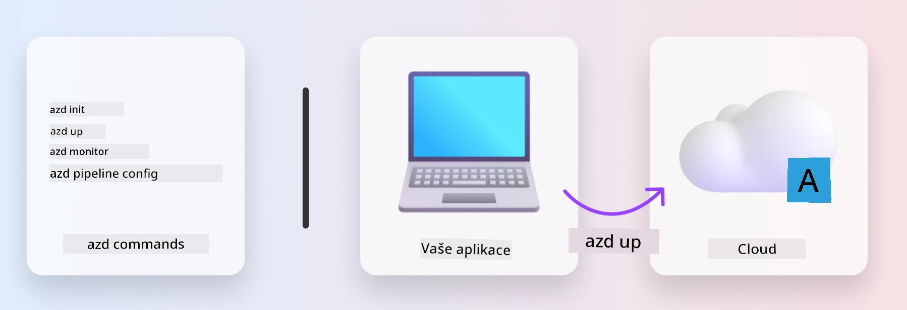
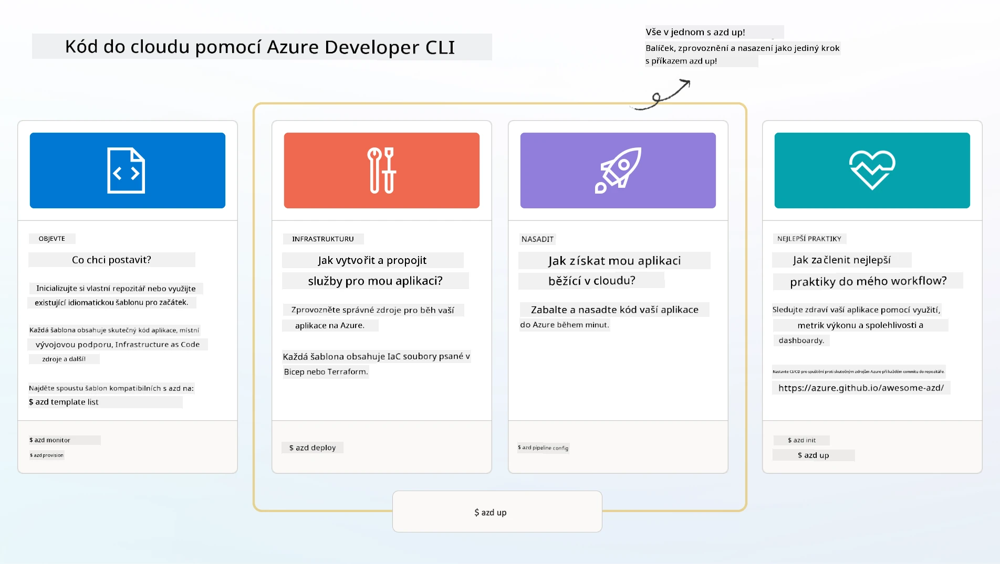

# 1. Vyberte šablonu

!!! tip "NA KONCI TOHOTO MODULU BUDETE UMĚT"

    - [ ] Describe what AZD templates are
    - [ ] Discover and use AZD templates for AI
    - [ ] Get started with the AI Agents template
    - [ ] **Lab 1:** AZD Quickstart in Codespaces or a dev container

---

## 1. Analogie stavitele

Postavit moderní podnikové AI řešení _od základů_ může být náročné. Je to trochu jako stavět si vlastní nový dům, cihla po cihle. Ano, dá se to udělat! Ale není to nejefektivnější způsob, jak dosáhnout požadovaného výsledku! 

Místo toho často začínáme se stávajícím _návrhem_, a spolupracujeme s architektem na jeho přizpůsobení našim specifickým požadavkům. A právě takový přístup je vhodný při budování inteligentních aplikací. Nejprve najděte vhodnou návrhovou architekturu, která odpovídá vašemu problému. Poté spolupracujte s řešeními architektem na přizpůsobení a rozvoji řešení pro váš konkrétní scénář.

Ale kde najít tyto návrhové plány? A jak najít architekta, který nás naučí, jak si tyto plány sami přizpůsobit a nasadit? V tomto workshopu odpovíme na tyto otázky a představíme vám tři technologie:

1. [Azure Developer CLI](https://aka.ms/azd) – open-source nástroj, který urychluje cestu vývojáře od lokálního vývoje (build) k nasazení v cloudu (ship).
1. [Microsoft Foundry Templates](https://ai.azure.com/templates) – standardizované open-source repozitáře obsahující ukázkový kód, infrastrukturu a konfigurační soubory pro nasazení AI architektury řešení.
1. [GitHub Copilot Agent Mode](https://code.visualstudio.com/docs/copilot/chat/chat-agent-mode) – kódovací agent založený na znalostech Azure, který nás může vést při orientaci v kódu a provádění změn – pomocí přirozeného jazyka.

S těmito nástroji v ruce nyní můžeme _najít_ správnou šablonu, _nasadit_ ji, abychom ověřili, že funguje, a _přizpůsobit_ ji našim specifickým scénářům. Pojďme se podívat, jak to funguje.


---

## 2. Azure Developer CLI

Nástroj příkazového řádku [Azure Developer CLI](https://learn.microsoft.com/en-us/azure/developer/azure-developer-cli/) (nebo `azd`) je open-source nástroj, který může urychlit vaši cestu od kódu ke cloudu pomocí sady pro vývojáře přátelských příkazů, které fungují konzistentně napříč vaším IDE (vývojovým) a CI/CD (devops) prostředím.

S `azd` může být vaše cesta nasazením tak jednoduchá jako:

- `azd init` - Inicializuje nový AI projekt z existující šablony AZD.
- `azd up` - Provisuje infrastrukturu a nasadí vaši aplikaci v jednom kroku.
- `azd monitor` - Získá monitoring v reálném čase a diagnostiku pro vaši nasazenou aplikaci.
- `azd pipeline config` - Nastaví CI/CD pipeline k automatizaci nasazení do Azure.

**🎯 | CVIČENÍ**: <br/> Prozkoumejte nyní nástroj příkazové řádky `azd` ve vašem aktuálním workshop prostředí. Může jít o GitHub Codespaces, vývojový kontejner nebo lokální klon s nainstalovanými předpoklady. Začněte zadáním tohoto příkazu, abyste viděli, co nástroj dokáže:

```bash title="" linenums="0"
azd help
```



---

## 3. Šablona AZD

Aby mohl `azd` dosáhnout tohoto, potřebuje znát infrastrukturu k provisování, konfigurační nastavení k vynucení a aplikaci k nasazení. Zde přicházejí na řadu [AZD šablony](https://learn.microsoft.com/en-us/azure/developer/azure-developer-cli/azd-templates?tabs=csharp).

AZD šablony jsou open-source repozitáře, které kombinují ukázkový kód s infrastrukturou a konfiguračními soubory potřebnými pro nasazení architektury řešení.
Použitím přístupu _Infrastructure-as-Code_ (IaC) umožňují šablony definice zdrojů a konfigurační nastavení verzovat (stejně jako zdrojový kód aplikace) - čímž vytvářejí znovupoužitelné a konzistentní pracovní postupy napříč uživateli daného projektu.

Při vytváření nebo opětovném použití šablony AZD pro _váš_ scénář zvažte tyto otázky:

1. Co stavíte? → Existuje šablona, která má výchozí kód pro tento scénář?
1. Jak je vaše řešení navrženo? → Existuje šablona, která obsahuje potřebné zdroje?
1. Jak je vaše řešení nasazeno? → Myslete na `azd deploy` s před- a následnými zpracovatelskými háčky!
1. Jak to můžete dále optimalizovat? → Myslete na zabudovaný monitoring a automatizační pipeline!

**🎯 | CVIČENÍ**: <br/> 
Navštivte galerii [Awesome AZD](https://azure.github.io/awesome-azd/) a pomocí filtrů prozkoumejte více než 250 dostupných šablon. Podívejte se, zda najdete nějakou, která odpovídá požadavkům _vášeho_ scénáře.



---

## 4. Šablony AI aplikací

Pro aplikace poháněné umělou inteligencí Microsoft poskytuje specializované šablony obsahující **Microsoft Foundry** a **Foundry Agents**. Tyto šablony urychlují váš postup k výstavbě inteligentních, do produkce připravených aplikací.

### Šablony Microsoft Foundry & Foundry Agents

Vyberte si níže šablonu k nasazení. Každá šablona je dostupná na [Awesome AZD](https://azure.github.io/awesome-azd/) a může být inicializována jediným příkazem.

| Šablona | Popis | Příkaz pro nasazení |
|----------|-------------|----------------|
| **[AI Chat s RAG](https://github.com/Azure-Samples/azure-search-openai-demo)** | Chatová aplikace založená na vyhledávání | `azd init -t Azure-Samples/azure-search-openai-demo .` |
| **[Začněte s AI agenty](https://github.com/Azure-Samples/get-started-with-ai-agents)** | Chatovací aplikace podporovaná agentem; používaná během tohoto workshopu | `azd init -t Azure-Samples/get-started-with-ai-agents .` |
| **[Začněte s AI chatem](https://github.com/Azure-Samples/get-started-with-ai-chat)** | Startovací AI chatovací aplikace | `azd init -t Azure-Samples/get-started-with-ai-chat .` |

Toto jsou alternativy: inicializujte **jeden** šablonu ve vlastním prázdném adresáři. Zadání `.` na konci vybere tento adresář; jeho vynechání v současných verzích AZD vytvoří podsložku pojmenovanou podle šablony. Inicializace stáhne projekt; `azd up` provede fakturovatelné nasazení poté, co zkontrolujete předpoklady, prostředky, podporu regionu a kvóty.

### Rychlý start

1. **Prohlédněte si šablony**: Navštivte [https://azure.github.io/awesome-azd/](https://azure.github.io/awesome-azd/) a filtrujte podle `AI`, `Agents`, nebo `Microsoft Foundry`
2. **Vyberte svou šablonu**: Zvolte tu, která odpovídá vašemu použití
3. **Inicializujte**: Spusťte příkaz `azd init` pro vybranou šablonu
4. **Nasazení**: Spusťte `azd up` pro přípravu a nasazení

**🎯 | CVIČENÍ**: <br/>
Vyberte jednu z výše uvedených šablon podle vašeho scénáře:

- **Pokračujete v tomto workshopu?** → Zvolte **Začněte s AI agenty**
- **Stavíte chat založený na vyhledávání?** → Samostatně prozkoumejte **AI Chat s RAG**
- **Potřebujete jinou architekturu?** → Prohledejte galerii a ověřte skutečné úložiště, stav implementace a předpoklady

```bash title="Initialize the workshop template in an empty directory" linenums="0"
azd init -t Azure-Samples/get-started-with-ai-agents .
azd auth login
azd up
```

!!! info "Objevte více šablon"
    Galerie [Awesome AZD](https://azure.github.io/awesome-azd/) obsahuje více než 250 šablon. Použijte filtry k nalezení šablon odpovídajících vašim specifickým požadavkům na jazyk, rámec a Azure služby.

---

<!-- CO-OP TRANSLATOR DISCLAIMER START -->
**Prohlášení o omezení odpovědnosti**:
Tento dokument byl přeložen pomocí AI překladatelské služby [Co-op Translator](https://github.com/Azure/co-op-translator). Přestože usilujeme o co největší přesnost, mějte prosím na paměti, že automatizované překlady mohou obsahovat chyby nebo nepřesnosti. Originální dokument v jeho mateřském jazyce by měl být považován za autoritativní zdroj. Pro kritické informace se doporučuje profesionální lidský překlad. Nejsme odpovědní za jakékoli nedorozumění nebo nesprávné interpretace vzniklé použitím tohoto překladu.
<!-- CO-OP TRANSLATOR DISCLAIMER END -->