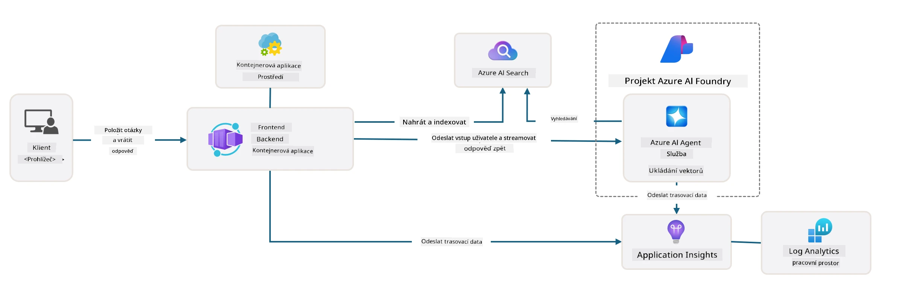
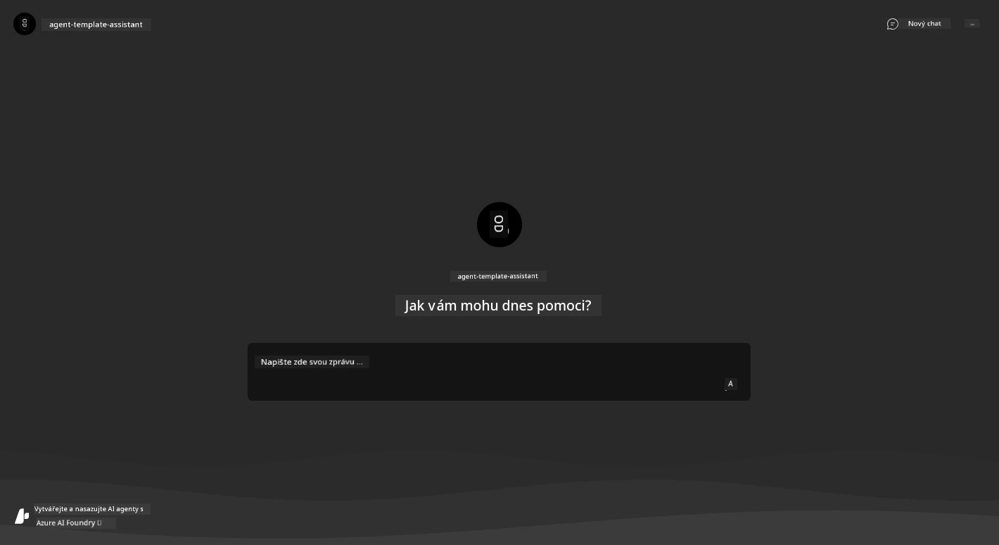

# 2. Ověřit šablonu

> Průvodce zdrojem přezkoumán proti AZD 1.37.2 a aktuálnímu vzoru k 4. listopadu 2026. Screenshoty jsou ilustrativní; navigace v portálu, výchozí nastavení šablon a dostupnost služeb se může měnit. Tento přezkum neprovedl nasazení do Azure v reálném čase.

!!! tip "NA KONCI TOHOTO MODULU BUDETE SCHOPNI"

    - [ ] Identify the sample's prerequisites and intended resources
    - [ ] Deploy the selected template into an intentional environment
    - [ ] Verify the application and agent behavior separately from deployment success
    - [ ] **Lab 2:** Record evidence of a working baseline, or an actionable deployment blocker

---

## 1. Zkontrolujte požadavky

Rozhraní příkazového řádku [Azure Developer CLI](https://learn.microsoft.com/azure/developer/azure-developer-cli/) spravuje nasazení aplikace pomocí konfigurace, infrastruktury a kódu šablony. Zkontrolujte svoji nainstalovanou verzi:

```bash
azd version
```

V případě potřeby použijte [aktuální pokyny k instalaci/aktualizaci](https://learn.microsoft.com/azure/developer/azure-developer-cli/install-azd). Prohlédnutý příklad deklaruje AZD `>=1.14.0`, ale doporučuje se aktuální podporované vydání. Nepovinné rozšíření AI mají samostatné požadavky na verze; běžný pracovní postup `azd up` v tomto příkladu rozšíření agentů nevyžaduje.

Před nasazením si přečtěte [nastavení účtu Azure](https://github.com/Azure-Samples/get-started-with-ai-agents/blob/main/docs/azure_account_setup.md) a [průvodce nasazením](https://github.com/Azure-Samples/get-started-with-ai-agents/blob/main/docs/deployment.md) vzorového příkladu. Potvrďte svůj předplatný plán, oprávnění, dostupnost modelu, regionální kvótu a očekávané poplatky. Bezplatný účet Azure nezaručuje přístup ani bezplatné používání ke všem požadovaným službám.

## 2. Otevřete vybraný vzorový příklad

Použijte repozitář [Začínáme s AI agenty](https://github.com/Azure-Samples/get-started-with-ai-agents) inicializovaný v Modulu 1. Pokud jste jej neinicializovali, vyberte jednu z těchto možností:

- Otevřete [Codespace pro ukázku](https://github.com/codespaces/new/Azure-Samples/get-started-with-ai-agents).
- Naklonujte ukázku a řiďte se jejím místním/dev-container nastavením.
- V **prázdném adresáři** spusťte:

```bash
azd init --template Azure-Samples/get-started-with-ai-agents .
```

Nainicializujte pouze jednu šablonu přes existující projekt. Další příkazy spouštějte z kořenového adresáře ukázky obsahujícího `azure.yaml`, nikoliv z kořenového repozitáře kurzu.

Ukázka hostí aplikaci chatu založenou na agentovi v Container Apps a zajišťuje podpůrné Foundry zdroje. Místo brání se starému screenshotu jako přesnému inventáři zdrojů raději projděte aktuální architekturu a volitelné služby.



## 3. Nasazujte cíleně

```bash
azd auth login
azd up
```

Zkontrolujte výzvy:

1. Zvolte jedinečný název prostředí AZD.
2. Vyberte požadovaný odběr, nikoli jen ten první nabídnutý.
3. Vyberte oblast podporovanou požadovaným modelem/verzí/SKU a vaší kvótou.
4. Přečtěte si výstup provisioningu, nasazení a hooku po nasazení.

Zkontrolované výchozí hodnoty zahrnují `gpt-5-mini`, verzi `2025-08-07` a `GlobalStandard`. Zkontrolujte svou inicializovanou šablonu a [podporované kombinace model/oblast](https://learn.microsoft.com/azure/ai-services/agents/concepts/model-region-support). Žádná oblast není univerzálně zaručena, že bude fungovat.

Doba nasazení se liší. Pokud provisioning selže, zachovejte chybu a opravte její příčinu před opětovným pokusem. Neodstraňujte nasazení ani trvale neodstraňujte prostředky jako obecný krok při řešení problémů.

## 4. Ověřte aplikaci

```bash
azd show
```

Otevřete koncový bod pro `api_and_frontend` nebo najděte Container App ve skupině prostředků nasazení v [portálu Azure](https://portal.azure.com/). Postupujte podle pokynů k přístupu/autentizaci ve vzorovém příkladu, pokud je vyžadováno přihlášení; nezasahujte do autentizace, aby zkouška prošla.



Vyzkoušejte několik [ukázkových otázek](https://github.com/Azure-Samples/get-started-with-ai-agents/blob/main/docs/sample_questions.md):

- Obecná faktická otázka.
- Otázka, na kterou by měla být odpověď v nahraných dokumentech vzorku.
- Otázka, na kterou nelze odpovědět z těchto dokumentů.

Ověřte, že se UI načte, API odpovídá, načítání používá očekávaná data, citace odpovídají zdrojovému obsahu a nepodporované otázky jsou zpracovávány vhodným způsobem. Pouze úspěšná zpráva `azd up` tyto výsledky nezaručuje.

## 5. Kontrola nasazeného agenta

Otevřete svůj projekt v [Foundry portálu](https://ai.azure.com/). V přezkoumávaném portálovém toku vyberte **Build**, potom **Agents** a najděte agenta vytvořeného podle ukázky. Navigační štítky se mohou změnit.

Zaznamenejte si:

- Jméno a verzi agenta.
- Nastavené nasazení modelu.
- Skutečné instrukce a povolené nástroje.
- Které soubory nebo hledací indexy jsou propojeny a zda byla konfigurace úspěšně dokončena.

Přezkoumávaná ukázka používá identifikátor agenta ve formátu `agent_name:agent_version` pro své hodnotící testy. Nekopírujte klasický identifikátor agenta/thread z staré obrazovky do novějšího API workflow.

Porovnejte nahrané dokumenty s `src/files/` ve své inicializované revizi. Starší obrazovky ukazovaly 32 souborů; toto číslo není zaručeným aktuálním výchozím nastavením. Ověřte každou odpověď ohledně ukázkových zákazníků/produktů proti skutečným syntetickým zdrojovým datům a nahrávejte pouze tento typ dat.

## 6. Porovnání s playgroundem

Otevřete vybraný playground agenta ve Foundry a položte stejnou otázku týkající se načítání dat. Porovnejte nakonfigurovanou verzi agenta, nástroje, citace a kvalitu odpovědí s provozovanou aplikací.

Odpovědi jsou pravděpodobnostní; slovně identické výstupy nejsou kritériem. Pokud se výsledky výrazně liší, zkontrolujte, že aplikace a playground cílí na stejný projekt, agenta/verzi a zdroj znalostí.

## 7. Kontrola předpokladů pozorovatelnosti

Ukázkový [návod k pozorovatelnosti](https://github.com/Azure-Samples/get-started-with-ai-agents/blob/main/docs/observability.md) je zdrojem pravdy pro nastavení trasování, hodnocení a red-teamingu.

Ve zkontrolovaných výchozích nastaveních infrastruktury je Application Insights povoleno, ale **klientské trasování je zakázáno** (`ENABLE_AZURE_MONITOR_TRACING=false`). Vytvoření monitorovacího zdroje zatím nedokazuje, že aplikace exportuje trace. Modul 5 pokrývá povolení trasování a generování testovacího požadavku.

Použijte aplikační logy Container App pro vyšetření chyb při spuštění/API. Ve Foundry prohlédněte dostupné pohledy trasování a monitoringu agenta. Záznamy hodnocení vyžadují příslušnou konfiguraci, podporované evaluátory/region a skutečné požadavky; nezobrazují se automaticky u každého běhu.

Nechte zachytávání obsahu promptu/odpovědi vypnuté, dokud nebudete mít přezkoumané požadavky na soukromí, uchovávání, přístup a redakci.

## 8. Pochopení hodnot prostředí

AZD ukládá vybrané prostředí pod `.azure/<environment-name>/`. Perzistentní vstupy a výstupy nasazení lze číst pomocí:

```bash
azd env list
azd env get-value AZURE_ENV_NAME
azd env get-value AZURE_LOCATION
```

`azd env get-values` zobrazí všechny hodnoty, což může zahrnovat citlivou konfiguraci. Nevkládejte tento výstup do veřejných problémů ani logů.

AZD používá vybrané prostředí při spouštění svých příkazů/háčků, zatímco proměnné prostředí procesu mohou také ovlivnit příkazy a šablony. To **neexportuje** hodnoty do vašeho nadřazeného shellu nebo každého samostatně spuštěného Python procesu. Postupujte podle ukázkových [pokynů pro lokální vývoj](https://github.com/Azure-Samples/get-started-with-ai-agents/blob/main/docs/local_development.md).

Výchozí hodnoty šablon lze aplikovat v `infra/main.parameters.json` bez explicitního zobrazení jako místní hodnoty. Nastavení libovolné proměnné nemění infrastrukturu, pokud ji šablona nekonzumuje.

Například pro explicitní výběr přezkoumávaných výchozích modelů:

```bash
azd env set AZURE_AI_AGENT_MODEL_NAME gpt-5-mini
azd env set AZURE_AI_AGENT_MODEL_VERSION 2025-08-07
azd env set AZURE_AI_AGENT_DEPLOYMENT_SKU GlobalStandard
azd provision --preview
azd up
```

Nejprve zkontrolujte kompatibilitu, kapacitu, dostupnost a plánované změny. Aktualizace infrastruktury vyžadují provisioning; samotný `azd deploy` nestačí. Podporované změny modelu obvykle nevyžadují rozebrání celé aplikace.

`azd env refresh` získává výstupy nasazení pro přístupné prostředí; nerekonstruuje všechny vlastní vstupy, nesynchronizuje tajemství ani nenahrazuje správu konfigurace.

## 9. Zaznamenejte si svůj výchozí stav

- [ ] Ověřeno správné prostředí, předplatné, oblast a model.
- [ ] Provisioning, nasazení a nezbytné nastavovací hooky dokončeny bez nevyřešených chyb.
- [ ] Ověřen přístup k aplikaci, chat, vyhledávání a citace.
- [ ] Identifikován agent/verze a zdroj znalostí.
- [ ] Zdokumentovány předpoklady pro pozorovatelnost a všechny zbývající blokace.

Pokračujte na [Deconstruct a Template](3-Deconstruct-AI-Template.md).

---

<!-- CO-OP TRANSLATOR DISCLAIMER START -->
**Prohlášení o omezení odpovědnosti**:
Tento dokument byl přeložen pomocí AI překladatelské služby [Co-op Translator](https://github.com/Azure/co-op-translator). Přestože usilujeme o co největší přesnost, mějte prosím na paměti, že automatizované překlady mohou obsahovat chyby nebo nepřesnosti. Originální dokument v jeho mateřském jazyce by měl být považován za autoritativní zdroj. Pro kritické informace se doporučuje profesionální lidský překlad. Nejsme odpovědní za jakékoli nedorozumění nebo nesprávné interpretace vzniklé použitím tohoto překladu.
<!-- CO-OP TRANSLATOR DISCLAIMER END -->