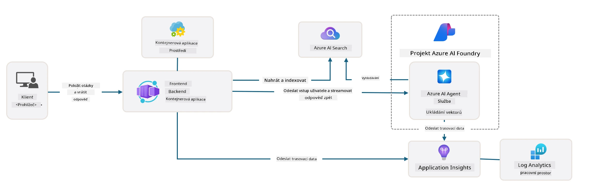

# 3. Dekonstruujte šablonu

!!! tip "NA KONCI TOHOTO MODULU BUDETE UMĚT"

    - [ ] Use GitHub Copilot and optional MCP tools for Azure documentation and read-only exploration
    - [ ] Identify the template's application, infrastructure, configuration, and test entry points
    - [ ] Verify generated explanations against actual repository files
    - [ ] **Lab 3:** Trace one request and one configuration input through the project

---

## 1. Aktivujte GitHub Copilot

Otevřete inicializovaný vzorek AI ve VS Code a povolte [GitHub Copilot](https://code.visualstudio.com/docs/copilot/chat/chat-agent-mode). Přihlaste se pomocí účtu, který má způsobilý plán; limity použití se liší. Požádejte Copilota, aby vysvětlil repozitář před autorizací změn.

### Volitelné MCP servery

Tyto služby mohou poskytnout další nástroje:

- [Azure MCP Server](https://learn.microsoft.com/azure/developer/azure-mcp-server/overview)
- [Microsoft Learn MCP Server](https://learn.microsoft.com/training/support/mcp)

Ve VS Code si projděte [pokyny konfigurace MCP](https://code.visualstudio.com/docs/copilot/chat/mcp-servers) a v případě potřeby vytvořte `.vscode/mcp.json`:

```json
{
  "servers": {
    "Azure MCP Server": {
      "type": "stdio",
      "command": "npx",
      "args": ["-y", "@azure/mcp@latest", "server", "start"]
    },
    "microsoft.docs.mcp": {
      "type": "http",
      "url": "https://learn.microsoft.com/api/mcp"
    }
  }
}
```

Příkaz `npx` vyžaduje podporovanou instalaci Node.js/npm a stahuje spustitelný kód. Projděte balíček a připevněte schválenou verzi pro reprodukovatelné týmové nastavení. Spusťte servery pomocí ovládání MCP ve VS Code a prozkoumejte jejich dostupné nástroje; názvy se mohou mezi verzemi lišit.

**Autentizace je samostatná.** Použijte `azd auth login` pro AZD. Postupujte podle dokumentovaného autentizačního toku Azure MCP pro jeho nástroje; samotné přihlášení AZD nezaloží MCP relaci. Použijte `az login` samostatně, když cvičení nebo hook vyvolá Azure CLI.

Zkuste příkazy jen pro čtení:

1. „Použijte Microsoft Learn MCP k nalezení dokumentace konfigurace Azure Developer CLI.“
2. „Vysvětlete `azure.yaml` tohoto repozitáře; uveďte soubory, které implementují každý hook.“
3. „Pomocí dostupných nástrojů Azure MCP vyjmenujte mé nasazené zdroje, aniž byste cokoli měnili.“

Zkontrolujte vybraného nájemce/předplatné a každý navržený volaný nástroj. Neschvalujte vytváření, mazání zdrojů nebo změny přístupu jen kvůli prozkoumání architektury.

## 2. Pochopte architekturu

Vzorek hostuje backend Python FastAPI a frontend React/TypeScript v Azure Container Apps. Backend komunikuje s agentem v projektu Microsoft Foundry. Získávání a sledovatelnost závisí na povolených funkcích šablony a úspěšném nastavení; nejsou zaručeny jen proto, že byla aplikace nasazena.



Porovnejte tento diagram s [aktuálním upstream průvodcem nasazením](https://github.com/Azure-Samples/get-started-with-ai-agents/blob/main/docs/deployment.md) a vašimi skutečnými zdroji. Zkontrolujte nakonfigurované nasazení modelu, nástroje agenta, spravovanou identitu, přiřazení rolí a volitelné zdroje AI Search/Application Insights.

**Cvičení:** Požádejte Copilota, aby sledoval požadavek chatu z frontendu přes API do Foundry, včetně odkazů na soubory a funkce. Otevřete tyto odkazy a ověřte vysvětlení. Neusuzujte autentizaci, směrování nebo autorizaci jen z diagramu.

## 3. Struktura repozitáře

Následující vybrané cesty byly zkontrolovány vůči vzorku 4. listopadu 2026. Vaše inicializovaná revize zůstává zdrojem pravdy:

```text
get-started-with-ai-agents/
  azure.yaml
  docker-compose.yaml
  requirements-dev.txt
  .devcontainer/
  infra/
    main.bicep
    main.parameters.json
    api.bicep
    core/
  src/
    Dockerfile
    pyproject.toml
    requirements.txt
    api/
      main.py
      routes.py
      search_index_manager.py
    frontend/
      package.json
      src/
    files/
  scripts/
    validate_env_vars.sh
    validate_env_vars.ps1
    postdeploy.sh
    postdeploy.ps1
  tests/
    test_evaluation.py
    test_red_teaming.py
  docs/
    deployment.md
    deploy_customization.md
    ai_search.md
    observability.md
    local_development.md
    troubleshooting.md
```

### Infrastruktura a konfigurace

`infra/main.bicep` orchestruje zdroje; `main.parameters.json` propojuje vstupy šablony s hodnotami prostředí AZD. `azure.yaml` vybírá aplikační službu a lifecycle hooky. Sledujte vstup, například `USE_AZURE_AI_SEARCH_SERVICE`, napříč těmito soubory, abyste našli, co se skutečně mění.

### Aplikace a identita

Čtěte `src/api/` a `src/frontend/` společně. Identifikujte, kde je agent vytvořen nebo získán, kde se konfigurují instrukce/nástroje a která identita používá každý Azure volání. Vzorkové soubory pod `src/files/` jsou ukázková data, nikoli produkční katalog nebo autorizační model.

### Testy a sledovatelnost

Aktuální vstupní body pro evaluaci a red-teaming jsou pod `tests/`; starší odkazy na adresáře `evals/` a `airedteaming/` jsou pro tento vzorek zastaralé. Přečtěte si `docs/observability.md` pro předpoklady a náklady před spuštěním cloudových testů. Tyto Python testy jsou oddělené od volitelného `azure.ai.evaluations` rozšíření AZD.

## 4. Ověřte svá zjištění

- Identifikujte API trasu, interakci agenta a kód pro získávání pro jednu ukázkovou otázku.
- Vysvětlete, která identita přistupuje k Foundry a která konfigurace vybírá její endpoint.
- Najděte skutečné pre-up a post-deploy skripty a jejich chování při zpracování chyb.
- Uveďte jakékoliv závislosti nebo volitelné funkce, které ve vašem nasazení chybí.

Pokračujte na [Konfigurace šablony](4-Configure-AI-Template.md).

---

<!-- CO-OP TRANSLATOR DISCLAIMER START -->
**Prohlášení o omezení odpovědnosti**:
Tento dokument byl přeložen pomocí AI překladatelské služby [Co-op Translator](https://github.com/Azure/co-op-translator). Přestože usilujeme o co největší přesnost, mějte prosím na paměti, že automatizované překlady mohou obsahovat chyby nebo nepřesnosti. Originální dokument v jeho mateřském jazyce by měl být považován za autoritativní zdroj. Pro kritické informace se doporučuje profesionální lidský překlad. Nejsme odpovědní za jakékoli nedorozumění nebo nesprávné interpretace vzniklé použitím tohoto překladu.
<!-- CO-OP TRANSLATOR DISCLAIMER END -->