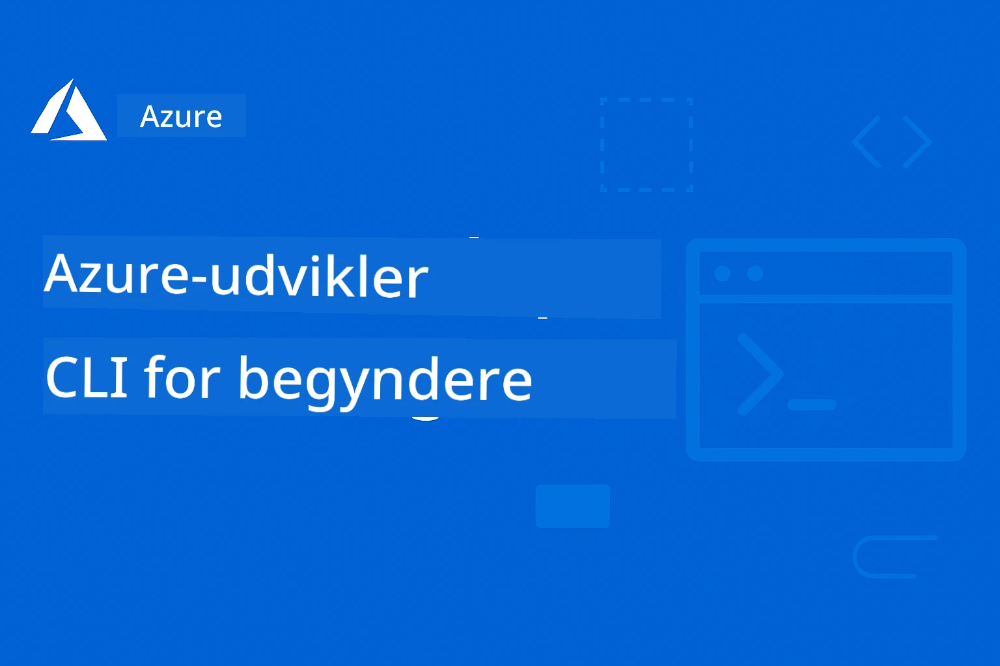

# AZD For Begyndere: En Struktureret Læringsrejse

 

[](https://github.com/microsoft/AZD-for-beginners)
[](https://GitHub.com/microsoft/azd-for-beginners/network/)
[](https://github.com/microsoft/AZD-for-beginners)

[](https://discord.com/invite/nkVh3dp)
[](https://discord.gg/nTYy5BXMWG)

---

### Automatiske Oversættelser (Altid Opdaterede)

<!-- CO-OP TRANSLATOR LANGUAGES TABLE START -->
[Arabic](../ar/README.md) | [Bengali](../bn/README.md) | [Bulgarian](../bg/README.md) | [Burmese (Myanmar)](../my/README.md) | [Chinese (Simplified)](../zh-CN/README.md) | [Chinese (Traditional, Hong Kong)](../zh-HK/README.md) | [Chinese (Traditional, Macau)](../zh-MO/README.md) | [Chinese (Traditional, Taiwan)](../zh-TW/README.md) | [Croatian](../hr/README.md) | [Czech](../cs/README.md) | [Danish](./README.md) | [Dutch](../nl/README.md) | [Estonian](../et/README.md) | [Finnish](../fi/README.md) | [French](../fr/README.md) | [German](../de/README.md) | [Greek](../el/README.md) | [Hebrew](../he/README.md) | [Hindi](../hi/README.md) | [Hungarian](../hu/README.md) | [Indonesian](../id/README.md) | [Italian](../it/README.md) | [Japanese](../ja/README.md) | [Kannada](../kn/README.md) | [Khmer](../km/README.md) | [Korean](../ko/README.md) | [Lithuanian](../lt/README.md) | [Malay](../ms/README.md) | [Malayalam](../ml/README.md) | [Marathi](../mr/README.md) | [Nepali](../ne/README.md) | [Nigerian Pidgin](../pcm/README.md) | [Norwegian](../no/README.md) | [Persian (Farsi)](../fa/README.md) | [Polish](../pl/README.md) | [Portuguese (Brazil)](../pt-BR/README.md) | [Portuguese (Portugal)](../pt-PT/README.md) | [Punjabi (Gurmukhi)](../pa/README.md) | [Romanian](../ro/README.md) | [Russian](../ru/README.md) | [Serbian (Cyrillic)](../sr/README.md) | [Slovak](../sk/README.md) | [Slovenian](../sl/README.md) | [Spanish](../es/README.md) | [Swahili](../sw/README.md) | [Swedish](../sv/README.md) | [Tagalog (Filipino)](../tl/README.md) | [Tamil](../ta/README.md) | [Telugu](../te/README.md) | [Thai](../th/README.md) | [Turkish](../tr/README.md) | [Ukrainian](../uk/README.md) | [Urdu](../ur/README.md) | [Vietnamese](../vi/README.md)

> **Foretrækker du at klone lokalt?**
>
> Dette repository indeholder oversættelser til over 50 sprog, hvilket øger downloadstørrelsen betydeligt. For at klone uden oversættelser, brug sparse checkout:
>
> **Bash / macOS / Linux:**
> ```bash
> git clone --filter=blob:none --sparse https://github.com/microsoft/AZD-for-beginners.git
> cd AZD-for-beginners
> git sparse-checkout set --no-cone '/*' '!translations' '!translated_images'
> ```
>
> **CMD (Windows):**
> ```cmd
> git clone --filter=blob:none --sparse https://github.com/microsoft/AZD-for-beginners.git
> cd AZD-for-beginners
> git sparse-checkout set --no-cone "/*" "!translations" "!translated_images"
> ```
>
> Det giver dig alt, hvad du behøver for at gennemføre kurset med en meget hurtigere download.
<!-- CO-OP TRANSLATOR LANGUAGES TABLE END -->

## 🆕 Hvad er Nyt i azd i Dag

> 📌 **Foundry GA-opdatering (2026-11-09):** Den **`microsoft.foundry` 1.0 pakke er generelt tilgængelig**, annonceret d. [5. november 2026](https://devblogs.microsoft.com/azure-sdk/microsoft-foundry-azure-developer-cli-ga/). Brug **`azd >= 1.37.0`** og installer den med `azd ext install microsoft.foundry`. Følg [hosted-agent walkthrough](docs/chapter-02-ai-development/microsoft-foundry-integration.md#hosted-agent-walkthrough-ga) for opsætning, lokal test og deployment. Denne opdatering bygger på offentliggjort vejledning, ikke en live Azure-udrulning; bundle GA gør ikke alle valgfrie funktioner, udvidelser eller SDK'er generelt tilgængelige.

Azure Developer CLI understøtter mange applikationstyper, herunder webapps, API'er og AI-agenter, gennem understøttede værter, skabeloner og udvidelser.

Her er, hvad det betyder for dig:

- **En GA pakke til Foundry-udvikling.** `microsoft.foundry` installerer syv kerneudvidelser, inkl. agenter, projekter og Agent Inspector. Agentkode og deploymentsindstillinger holdes samlet i `azure.yaml`.
- **Test lokalt, og udrul så din kode.** Brug `azd ai agent init --deploy-mode code`, `azd provision` og `azd ai agent run` til at inspicere lokale forespørgsler og svar. Brug derefter `azd deploy` til fjernbyg i Foundry, uden lokal containerbuild.
- **Mål kvalitet separat.** Installer **`azure.ai.evaluations`** for `azd ai eval generate`, `init` og `run start`; den er ikke inkluderet i pakken. Hold reviderede datasæt og rubrikker sammen med din kode. Ældre projekter bør følge [evaluerings- og optimerings-migrationsvejledningen](docs/chapter-08-production/production-ai-practices.md#evaluation-migration-and-quality-checks).
- **Genbrug konfiguration i CI/CD.** Efter en succesfuld `azd up`, konfigurer en pipeline med `azd pipeline config`. Installer pakken på runneren og behold de genererede autentifikations- og miljøindstillinger.
- **Glattere dag-til-dag grundlæggende funktioner.** Seneste udgivelser gjorde `azd init` idempotent (sikkert at køre igen), ryddede automatisk gamle tokens i `azd auth login`, og tilføjede en venlig `azd tool` first-run setupsprompt.
- **Kernearbejdsgangen er uændret.** Uanset om du udruller en todo-app, en mikrotjeneste eller en multi-agent AI-løsning, er kommandoerne de samme.

> **Bemærk til Aspire-brugere:** Microsoft refererer nu til produktet blot som **Aspire** (tidligere ".NET Aspire"). AZD's Aspire-understøttelse er uændret – kun navnet er opdateret.

Hvis du har brugt azd tidligere, er AI-understøttelse en naturlig forlængelse – ikke et separat værktøj eller et avanceret spor. Hvis du starter fra bunden, lærer du én arbejdsgang, der fungerer til alt.

---

## 🚀 Hvad er Azure Developer CLI (azd)?

**Azure Developer CLI (azd)** er et udviklervenligt kommandolinjeværktøj, som gør det enkelt at udrulle applikationer til Azure. I stedet for manuelt at oprette og forbinde dusinvis af Azure-ressourcer, kan du udrulle hele applikationer med én kommando.

### Magien ved `azd up`

```bash
# This single command does everything:
# ✅ Creates all Azure resources  
# ✅ Configures networking and security
# ✅ Builds your application code
# ✅ Deploys to Azure
# ✅ Gives you a working URL
azd up
```

Skabelonen leverer applikations- og infrastrukturkonfigurationen. Succesfuld udrulning kræver stadig understøttede tjenester/modeller, tilstrækkelig kvote og tilladelser, korrekte input samt verifikation af den udrullede applikation. `azd up` gør ikke automatisk en skabelon sikker, overholdende eller produktionsklar.

---

## ❓ Azure Developer CLI vs Azure CLI: Hvad er Forskellen?

Dette er det mest almindelige spørgsmål blandt begyndere. Her er det simple svar:

| Funktion | **Azure CLI (`az`)** | **Azure Developer CLI (`azd`)** |
|---------|---------------------|--------------------------------|
| **Formål** | Håndtere individuelle Azure-ressourcer | Udrulle komplette applikationer |
| **Tankegang** | Infrastruktur-fokuseret | Applikations-fokuseret |
| **Eksempel** | `az webapp create --name myapp...` | `azd up` |
| **Læringskurve** | Skal kende Azure-tjenester | Kender blot din app |
| **Bedst til** | DevOps, Infrastruktur | Udviklere, Prototyper |

### Enkel Analog

- **Azure CLI** er som at have alle værktøjerne til at bygge et hus - hamre, save, søm. Du kan bygge alt, men du skal kende byggeri.
- **Azure Developer CLI** er som at hyre en entreprenør - du beskriver, hvad du vil have, og de tager sig af byggeriet.

### Hvornår man skal bruge hvad

| Situation | Brug Dette |
|----------|----------|
| "Jeg vil hurtigt udrulle min webapp" | `azd up` |
| "Jeg skal kun oprette en lagerkonto" | `az storage account create` |
| "Jeg bygger en fuld AI-applikation" | `azd init --template azure-search-openai-demo` |
| "Jeg skal fejlfinde en specifik Azure-ressource" | `az resource show` |
| "Jeg vil udrulle til mit konfigurerede produktionsmiljø" | Gennemgå konfiguration, adgang, omkostninger og operationelle gates før `azd up --environment production` |

### De arbejder sammen!

AZD og Azure CLI har separat autentifikation og konfiguration. Brug `azd auth login` for AZD, og `az login` når en hook- eller diagnostic-kommando eksplicit kræver Azure CLI. Du kan bruge begge:
```bash
# Deploy your app with AZD
azd up

# Then fine-tune specific resources with Azure CLI
az webapp config set --name myapp --always-on true
```

---

## 🌟 Find Skabeloner i Awesome AZD

Start ikke fra bunden! **Awesome AZD** er fællesskabets samling af klar-til-udrulning skabeloner:

| Ressource | Beskrivelse |
|----------|-------------|
| 🔗 [**Awesome AZD Gallery**](https://azure.github.io/awesome-azd/) | Gennemse 200+ skabeloner med et klik for udrulning |
| 🔗 [**Indsend en Skabelon**](https://github.com/Azure/awesome-azd/issues) | Bidrag med din egen skabelon til fællesskabet |
| 🔗 [**GitHub Repository**](https://github.com/Azure/awesome-azd) | Star og udforsk kilden |

### Populære AI Skabeloner fra Awesome AZD

Vælg én skabelon i dens egen tomme mappe; kommandoerne nedenfor er alternativer. Den efterfølgende `.` initialiserer den mappe.

```bash
# RAG Chat with Microsoft Foundry Models + AI Search
azd init --template azure-search-openai-demo .

# Quick AI Chat Application
azd init --template openai-chat-app-quickstart .

# AI Agents with Foundry Agents
azd init --template get-started-with-ai-agents .
```

---

## 🎯 Kom i Gang i 3 Trin

Før du starter, sørg for at din maskine er klar til den skabelon, du vil udrulle:

**Windows:**
```powershell
.\validate-setup.ps1
```

**macOS / Linux:**
```bash
bash ./validate-setup.sh
```

Hvis en påkrævet kontrol fejler, ret det først og fortsæt så med hurtigstarten.

### Trin 1: Installér AZD (2 minutter)

**Windows:**
```powershell
winget install microsoft.azd
```

**macOS:**
```bash
brew tap azure/azd && brew install azd
```

**Linux:**
```bash
curl -fsSL https://aka.ms/install-azd.sh | bash
```

### Trin 2: Autentificer til AZD

```bash
# Optional if you plan to use Azure CLI commands directly in this course
az login

# Required for AZD workflows
azd auth login
```

Hvis du er usikker på, hvilken du har brug for, så følg den fulde opsætningsproces i [Installation & Opsætning](docs/chapter-01-foundation/installation.md#authentication-setup).

### Trin 3: Udrul din Første App

```bash
# Initialize from a template
azd init --template todo-nodejs-mongo .

# Deploy to Azure (creates everything!)
azd up
```

**🎉 Det er det!** Din app er nu live på Azure.

### Ryd Op (Glem Ikke!)

```bash
# Remove all resources when done experimenting
azd down --force --purge
```

---

## 📚 Sådan Bruger Du Dette Kursus

Dette kursus er designet til **progressiv læring** – start hvor du er tryg, og arbejd dig opad:

| Din Erfaring | Start Her |
|-----------------|------------|
| **Helt ny til Azure** | [Kapitel 1: Fundament](#-chapter-1-foundation--quick-start) |
| **Kender Azure, ny til AZD** | [Kapitel 1: Fundament](#-chapter-1-foundation--quick-start) |
| **Vil udrulle AI-apps** | [Kapitel 2: AI-Først Udvikling](#-chapter-2-ai-first-development-recommended-for-ai-developers) |
| **Vil have praktisk øvelse** | [🎓 Interaktiv Workshop](workshop/README.md) - 3-4 timers guidet lab |
| **Behøver produktionsmønstre** | [Kapitel 8: Produktion & Enterprise](#-chapter-8-production--enterprise-patterns) |

### Hurtig Opsætning

1. **Fork dette Repository**: [](https://GitHub.com/microsoft/azd-for-beginners/fork)
2. **Klon det**: `git clone https://github.com/YOUR-USERNAME/azd-for-beginners.git`
3. **Få Hjælp**: [Azure Discord Community](https://discord.com/invite/ByRwuEEgH4)

> **Foretrækker du at klone lokalt?**

> Dette repository inkluderer 50+ sprogoversættelser, hvilket betydeligt øger downloadstørrelsen. For at klone uden oversættelser, brug sparse checkout:
> ```bash
> git clone --filter=blob:none --sparse https://github.com/microsoft/AZD-for-beginners.git
> cd AZD-for-beginners
> git sparse-checkout set --no-cone '/*' '!translations' '!translated_images'
> ```
> Dette giver dig alt, hvad du behøver for at gennemføre kurset med en langt hurtigere download.


## Kursusoversigt

Mestér Azure Developer CLI (azd) gennem strukturerede kapitler designet til progressiv læring. **Særligt fokus på AI-applikationsudrulning med Microsoft Foundry-integration.**

### Hvorfor dette kursus er essentielt for moderne udviklere

Udviklere, der udruller AI-arbejdsmængder, har ofte brug for vejledning om:
- Komplekse multi-service AI-arkitekturer
- Bedste praksisser for produktion AI-udrulning  
- Azure AI-serviceintegration og konfiguration
- Omkostningsoptimering for AI-arbejdsmængder
- Fejlsøgning af AI-specifikke udrulningsproblemer

### Læringsmål

Ved at gennemføre dette strukturerede kursus vil du:
- **Mestér AZD fundamenter**: Kernekoncepter, installation og konfiguration
- **Udrul AI-applikationer**: Brug AZD med Microsoft Foundry-tjenester
- **Implementér infrastruktur som kode**: Håndter Azure-ressourcer med Bicep-skabeloner
- **Fejlsøg udrulninger**: Løs almindelige problemer og fejlret
- **Optimer til produktion**: Sikkerhed, skalering, overvågning og omkostningsstyring
- **Byg multi-agent-løsninger**: Udrul komplekse AI-arkitekturer

## Før du starter: Konti, adgang og forudsætninger

Før du begynder kapitel 1, sikr dig, at du har følgende på plads. Installations-trinnene senere i denne vejledning antager, at disse grundlæggende ting allerede er håndteret.

- **En Azure-abonnement**: Du kan bruge et eksisterende abonnement fra arbejde eller din egen konto, eller oprette en [gratis prøveversion](https://aka.ms/azurefreetrial) for at komme i gang.
- **Tilladelse til at oprette Azure-ressourcer**: For de fleste øvelser bør du have mindst **Bidragyder**-adgang på den målrettede abonnement eller ressourcegruppe. Nogle kapitler kan også antage, at du kan oprette ressourcegrupper, managed identities og RBAC-tildelinger.
- [**En GitHub-konto**](https://github.com): Dette er nyttigt til at forke repository'en, spore dine egne ændringer og bruge GitHub Codespaces til workshoppen.
- **Forudsætninger for skabelon-kørselstid**: Nogle skabeloner kræver lokale værktøjer som Node.js, Python, Java eller Docker. Kør opsætningsvalidatoren før start for at opdage manglende værktøjer tidligt.
- **Grundlæggende terminal-fortrolighed**: Du behøver ikke være ekspert, men bør være komfortabel med at køre kommandoer som `git clone`, `azd auth login` og `azd up`.

> **Arbejder du i et virksomhedsabonnement?**
> Hvis dit Azure-miljø administreres af en administrator, bekræft på forhånd, at du kan udrulle ressourcer i abonnementet eller ressourcegruppen, som du planlægger at bruge. Hvis ikke, bed om et sandbox-abonnement eller Bidragyder-adgang før du starter.

> **Ny til Azure?**
> Start med din egen Azure-prøveversion eller pay-as-you-go abonnement på https://aka.ms/azurefreetrial, så du kan gennemføre øvelserne fra ende til anden uden at vente på godkendelser på udlejer-niveau.

## 🗺️ Kursuskort: Hurtig navigation efter kapitel

Hvert kapitel har en dedikeret README med læringsmål, hurtige starter og øvelser:

| Kapitel | Emne | Lektioner | Varighed | Kompleksitet |
|---------|-------|---------|----------|------------|
| **[Kap 1: Fundament](docs/chapter-01-foundation/README.md)** | Kom godt i gang | [AZD Grundlæggende](docs/chapter-01-foundation/azd-basics.md) &#124; [Installation](docs/chapter-01-foundation/installation.md) &#124; [Første Projekt](docs/chapter-01-foundation/first-project.md) | 30-45 min | ⭐ |
| **[Kap 2: AI-udvikling](docs/chapter-02-ai-development/README.md)** | AI-First Apps | [Foundry Integration](docs/chapter-02-ai-development/microsoft-foundry-integration.md) &#124; [AI-agenter](docs/chapter-02-ai-development/agents.md) &#124; [Modeludrulning](docs/chapter-02-ai-development/ai-model-deployment.md) &#124; [Workshop](docs/chapter-02-ai-development/ai-workshop-lab.md) | 1-2 t | ⭐⭐ |
| **[Kap 3: Konfiguration](docs/chapter-03-configuration/README.md)** | Auth & Sikkerhed | [Konfiguration](docs/chapter-03-configuration/configuration.md) &#124; [Auth & Sikkerhed](docs/chapter-03-configuration/authsecurity.md) | 45-60 min | ⭐⭐ |
| **[Kap 4: Infrastruktur](docs/chapter-04-infrastructure/README.md)** | IaC & Udrulning | [Udrulningsvejledning](docs/chapter-04-infrastructure/deployment-guide.md) &#124; [Provisionering](docs/chapter-04-infrastructure/provisioning.md) | 1-1,5 t | ⭐⭐⭐ |
| **[Kap 5: Multi-Agent](docs/chapter-05-multi-agent/README.md)** | AI Agent Løsninger | [Detailscenario](examples/retail-scenario.md) &#124; [Koordinationsmønstre](docs/chapter-06-pre-deployment/coordination-patterns.md) | 2-3 t | ⭐⭐⭐⭐ |
| **[Kap 6: Forud for Udrulning](docs/chapter-06-pre-deployment/README.md)** | Planlægning & Validering | [Preflight Checks](docs/chapter-06-pre-deployment/preflight-checks.md) &#124; [Kapacitetsplanlægning](docs/chapter-06-pre-deployment/capacity-planning.md) &#124; [SKU-udvælgelse](docs/chapter-06-pre-deployment/sku-selection.md) &#124; [App Insights](docs/chapter-06-pre-deployment/application-insights.md) | 1 t | ⭐⭐ |
| **[Kap 7: Fejlfinding](docs/chapter-07-troubleshooting/README.md)** | Debug & Fix | [Almindelige Problemer](docs/chapter-07-troubleshooting/common-issues.md) &#124; [Debugging](docs/chapter-07-troubleshooting/debugging.md) &#124; [AI Problemer](docs/chapter-07-troubleshooting/ai-troubleshooting.md) | 1-1,5 t | ⭐⭐ |
| **[Kap 8: Produktion](docs/chapter-08-production/README.md)** | Virksomhedsmønstre | [Produktionspraksis](docs/chapter-08-production/production-ai-practices.md) | 2-3 t | ⭐⭐⭐⭐ |
| **[🎓 Workshop](workshop/README.md)** | Hands-On Lab | [Introduktion](workshop/docs/instructions/0-Introduction.md) &#124; [Udvælgelse](workshop/docs/instructions/1-Select-AI-Template.md) &#124; [Validering](workshop/docs/instructions/2-Validate-AI-Template.md) &#124; [Nedbrydning](workshop/docs/instructions/3-Deconstruct-AI-Template.md) &#124; [Konfiguration](workshop/docs/instructions/4-Configure-AI-Template.md) &#124; [Tilpasning](workshop/docs/instructions/5-Customize-AI-Template.md) &#124; [Nedlukning](workshop/docs/instructions/6-Teardown-Infrastructure.md) &#124; [Afrunding](workshop/docs/instructions/7-Wrap-up.md) | 3-4 t | ⭐⭐ |

**Samlet kursusvarighed:** ~10-14 timer | **Færdighedsprogression:** Begynder → Produktionsklar

---

## 📚 Læringskapitler

*Vælg din læringssti baseret på erfaring og mål*

### 🚀 Kapitel 1: Fundament & Hurtig start
**Forudsætninger**: Azure-abonnement, grundlæggende kendskab til kommandolinje  
**Varighed**: 30-45 minutter  
**Kompleksitet**: ⭐

#### Hvad du vil lære
- Forståelse af Azure Developer CLI grundlæggende
- Installation af AZD på din platform
- Din første succesfulde udrulning

#### Læringsressourcer
- **🎯 Start her**: [Hvad er Azure Developer CLI?](#-what-is-azure-developer-cli-azd)
- **📖 Teori**: [AZD Grundlæggende](docs/chapter-01-foundation/azd-basics.md) - Kernekoncepter og terminologi
- **⚙️ Opsætning**: [Installation & Opsætning](docs/chapter-01-foundation/installation.md) - Platformspecifikke vejledninger
- **🛠️ Praktisk**: [Dit Første Projekt](docs/chapter-01-foundation/first-project.md) - Trin-for-trin tutorial
- **📋 Hurtig reference**: [Command Cheat Sheet](resources/cheat-sheet.md)

#### Praktiske øvelser
```bash
# Quick installation check
azd version

# Deploy your first application
azd init --template todo-nodejs-mongo .
azd up
```

**💡 Kapitelresultat**: Udrul en simpel webapplikation til Azure ved hjælp af AZD

**✅ Succeskriterier:**
```bash
# After completing Chapter 1, you should be able to:
azd version              # Shows installed version
azd init --template todo-nodejs-mongo  # Initializes project
azd up                  # Deploys to Azure
azd show                # Displays running app URL
# Application opens in browser and works
azd down --force --purge  # Cleans up resources
```

**📊 Tidsforbrug:** 30-45 minutter  
**📈 Færdighedsniveau efter:** Kan selvstændigt udrulle grundlæggende applikationer

---

### 🤖 Kapitel 2: AI-Først Udvikling (Anbefalet for AI-udviklere)
**Forudsætninger**: Kapitel 1 gennemført  
**Varighed**: 1-2 timer  
**Kompleksitet**: ⭐⭐

#### Hvad du vil lære
- Microsoft Foundry integration med AZD
- Udrulning af AI-drevne applikationer
- Forståelse af AI-servicekonfigurationer

#### Læringsressourcer
- **🎯 Start her**: [Microsoft Foundry Integration](docs/chapter-02-ai-development/microsoft-foundry-integration.md)
- **🤖 AI-agenter**: [AI Agents Guide](docs/chapter-02-ai-development/agents.md) - Udrul intelligente agenter med AZD
- **📖 Mønstre**: [AI Model Deployment](docs/chapter-02-ai-development/ai-model-deployment.md) - Udrul og håndter AI-modeller
- **🛠️ Workshop**: [AI Workshop Lab](docs/chapter-02-ai-development/ai-workshop-lab.md) - Gør dine AI-løsninger AZD-klar
- **🎥 Interaktiv vejledning**: [Workshop-materialer](workshop/README.md) - Browserbaseret læring med MkDocs * DevContainer-miljø
- **📋 Skabeloner**: [Microsoft Foundry Skabeloner](#featured-microsoft-foundry-templates)
- **📝 Eksempler**: [AZD Udrulningseksempler](examples/README.md)

#### Praktiske øvelser
```bash
# Deploy your first AI application
azd init --template azure-search-openai-demo .
azd up

# Try additional AI templates
azd init --template openai-chat-app-quickstart .
azd init --template agent-openai-python-prompty .
```

**💡 Kapitelresultat**: Udrul og konfigurer en AI-drevet chat-applikation med RAG-funktionalitet

**✅ Succeskriterier:**
```bash
# After Chapter 2, you should be able to:
azd init --template azure-search-openai-demo .
azd up
# Test the AI chat interface
# Ask questions and get AI-powered responses with sources
# Verify search integration works
azd monitor  # Check Application Insights shows telemetry
azd down --force --purge
```

**📊 Tidsforbrug:** 1-2 timer  
**📈 Færdighedsniveau efter:** Kan udrulle AI-læringsapplikationer og identificere yderligere produktionsklare krav
**💰 Omkostningsbevidsthed:** Forstå $80-150/måned udviklingsomkostninger, $300-3500/måned produktionsomkostninger

#### 💰 Omkostningsovervejelser for AI-udrulninger

**Udviklingsmiljø (estimere $80-150/måned):**
- Microsoft Foundry-modeller (pay-as-you-go): $0-50/måned (baseret på token-forbrug)
- AI Search (Basic tier): $75/måned
- Container Apps (Forbrug): $0-20/måned
- Lager (Standard): $1-5/måned

**Produktionsmiljø (estimere $300-3.500+/måned):**
- Microsoft Foundry-modeller (PTU for konsistent ydeevne): $3.000+/måned ELLER Pay-as-you-go med højt volumen
- AI Search (Standard tier): $250/måned
- Container Apps (Dedikeret): $50-100/måned
- Application Insights: $5-50/måned
- Lager (Premium): $10-50/måned

**💡 Tips til omkostningsoptimering:**
- Tjek modelinference-priser og konto-specifikke kreditter; Azure OpenAI inkluderer ikke en universel 50.000-token gratis månedlig kvote
- Kør `azd down` for at slette ressourcer, når de ikke længere er nødvendige, efter at have gennemgået det valgte miljø
- Start med forbrugsbaseret fakturering, opgrader til PTU kun til produktion
- Brug `azd provision --preview` for at inspicere planlagt infrastruktur, og pris derefter de resulterende ressourcer med Azure Pricing Calculator
- Aktivér autoskalering: betal kun for faktisk brug

**Omkostningsovervågning:**
```bash
# Inspect planned resources (this does not calculate prices)
azd provision --preview

# Monitor actual costs in Azure Portal
az consumption budget list --resource-group <your-rg>
```

---

### ⚙️ Kapitel 3: Konfiguration & Autentifikation
**Forudsætninger**: Kapitel 1 gennemført  
**Varighed**: 45-60 minutter  
**Kompleksitet**: ⭐⭐

#### Hvad du vil lære
- Miljøkonfiguration og -styring
- Autentifikation og sikkerhedsbedste praksis
- Navngivning og organisering af ressourcer

#### Læringsressourcer
- **📖 Konfiguration**: [Konfigurationsvejledning](docs/chapter-03-configuration/configuration.md) - Miljøopsætning
- **🔐 Sikkerhed**: [Autentifikationsmønstre og managed identity](docs/chapter-03-configuration/authsecurity.md) - Autentifikationsmønstre
- **📝 Eksempler**: [Database-app-eksempel](examples/database-app/README.md) - AZD database-eksempler

#### Praktiske øvelser
- Konfigurer flere miljøer (dev, staging, prod)
- Opsæt managed identity-autentifikation
- Implementér miljøspecifikke konfigurationer

**💡 Kapitelresultat**: Styr flere miljøer med korrekt autentifikation og sikkerhed

---

### 🏗️ Kapitel 4: Infrastruktur som kode & Udrulning
**Forudsætninger**: Kapitel 1-3 gennemført  
**Varighed**: 1-1,5 timer  
**Kompleksitet**: ⭐⭐⭐

#### Hvad du vil lære
- Avancerede udrulningsmønstre
- Infrastruktur som kode med Bicep
- Strategier for ressourceprovisionering

#### Læringsressourcer
- **📖 Udrulning**: [Udrulningsvejledning](docs/chapter-04-infrastructure/deployment-guide.md) - Komplet workflow
- **🏗️ Provisionering**: [Provisionering af ressourcer](docs/chapter-04-infrastructure/provisioning.md) - Azure ressourcesstyring
- **📝 Eksempler**: [Containerapp-eksempel](../../examples/container-app) - Containeriserede udrulninger

#### Praktiske øvelser
- Opret tilpassede Bicep-skabeloner
- Udrul multi-service applikationer
- Implementér blue-green udrulningsstrategier

**💡 Kapitelresultat**: Udrul komplekse multi-service applikationer med brugerdefinerede infrastruktu­ rskabeloner

---

### 🎯 Kapitel 5: Multi-Agent AI-løsninger (Avanceret)
**Forudsætninger**: Kapitel 1-2 gennemført  
**Varighed**: 2-3 timer  
**Kompleksitet**: ⭐⭐⭐⭐

#### Hvad du vil lære
- Multi-agent arkitektur mønstre
- Agent orkestrering og koordinering
- Produktionsklare AI-udrulninger

#### Læringsressourcer
- **🤖 Fremhævet Design**: [Retail Multi-Agent Solution](examples/retail-scenario.md) - Arkitekturplan, ikke en fuld applikation
- **🛠️ ARM Skabeloner**: [ARM Template Package](../../examples/retail-multiagent-arm-template) - Infrastruktur stillads; gennemgå forudsætninger og manglende applikationskomponenter
- **📖 Arkitektur**: [Multi-agent koordineringsmønstre](docs/chapter-06-pre-deployment/coordination-patterns.md) - Mønstre

#### Praktiske Øvelser
```bash
# Inspect the retail infrastructure scaffold before choosing to deploy it
cd examples/retail-multiagent-arm-template
cat README.md

# After an intentional deployment, inspect infrastructure state
az deployment group show --resource-group <rg-name> --name <deployment-name>
```

**💡 Kapitelresultat**: Forstå multi-agent design og identificer implementerings-, validerings- og driftsarbejde der kræves ud over et infrastrukturskabelon

---

### 🔍 Kapitel 6: Validering og Planlægning Før Udplacering
**Forudsætninger**: Kapitel 4 gennemført  
**Varighed**: 1 time  
**Kompleksitet**: ⭐⭐

#### Det Du Vil Lære
- Kapacitetsplanlægning og ressourcevalidering
- Strategier for SKU-udvælgelse
- Pre-flight checks og automatisering

#### Læringsressourcer
- **📊 Planlægning**: [Kapacitetsplanlægning](docs/chapter-06-pre-deployment/capacity-planning.md) - Ressourcevalidering
- **💰 Udvælgelse**: [SKU Udvælgelse](docs/chapter-06-pre-deployment/sku-selection.md) - Omkostningseffektive valg
- **✅ Validering**: [Pre-flight Checks](docs/chapter-06-pre-deployment/preflight-checks.md) - Automatiserede scripts

#### Praktiske Øvelser
- Kør kapacitetsvalideringsscripts
- Optimer SKU-udvælgelsen for omkostninger
- Implementer automatiserede pre-deploy checks

**💡 Kapitelresultat**: Valider og optimer udplaceringer før eksekvering

---

### 🚨 Kapitel 7: Fejlfinding og Debugging
**Forudsætninger**: Ethvert udplaceringskapitel gennemført  
**Varighed**: 1-1,5 timer  
**Kompleksitet**: ⭐⭐

#### Det Du Vil Lære
- Systematiske debugging-tilgange
- Almindelige problemer og løsninger
- AI-specifik fejlfinding

#### Læringsressourcer
- **🔧 Almindelige Problemer**: [Almindelige Problemer](docs/chapter-07-troubleshooting/common-issues.md) - FAQ og løsninger
- **🕵️ Debugging**: [Debugging Guide](docs/chapter-07-troubleshooting/debugging.md) - Trin-for-trin strategier
- **🤖 AI Problemer**: [AI-Specifik Fejlfinding](docs/chapter-07-troubleshooting/ai-troubleshooting.md) - AI serviceproblemer

#### Praktiske Øvelser
- Diagnosticer udplaceringsfejl
- Løs autentificeringsproblemer
- Debug AI serviceforbindelse

**💡 Kapitelresultat**: Selvstændigt diagnosticere og løse almindelige udplaceringsproblemer

---

### 🏢 Kapitel 8: Produktions- og Enterprise-Mønstre
**Forudsætninger**: Kapitel 1-4 gennemført  
**Varighed**: 2-3 timer  
**Kompleksitet**: ⭐⭐⭐⭐

#### Det Du Vil Lære
- Produktionsudplaceringsstrategier
- Enterprise sikkerhedsmønstre
- Overvågning og omkostningsoptimering

#### Læringsressourcer
- **🏭 Produktion**: [Best Practices for Production AI](docs/chapter-08-production/production-ai-practices.md) - Enterprise mønstre
- **📝 Eksempler**: [Microservices Eksempel](../../examples/microservices) - Komplekse arkitekturer
- **📊 Overvågning**: [Application Insights integration](docs/chapter-06-pre-deployment/application-insights.md) - Overvågning

#### Praktiske Øvelser
- Implementer enterprise sikkerhedsmønstre
- Opsæt omfattende overvågning
- Udrul til produktion med korrekt governance

**💡 Kapitelresultat**: Udrul applikationer klar til enterprise og produktion med fuld kapabilitet

---

## 🎓 Workshop Oversigt: Praktisk Læringserfaring

> **⚠️ WORKSHOP STATUS: Aktiv Udvikling**  
> Workshopmaterialerne er i øjeblikket under udvikling og forfining. Kernemoduler fungerer, men nogle avancerede sektioner er ufuldstændige. Vi arbejder aktivt på at færdiggøre alt indhold. [Spor fremgang →](workshop/README.md)

### Interaktive Workshopmaterialer
**Omfattende praktisk læring med browserbaserede værktøjer og guidede øvelser**

Vores workshopmaterialer tilbyder en struktureret, interaktiv læringsoplevelse, der supplerer det kapitelbaserede pensum ovenfor. Workshoppen er designet til både selvstyret læring og instruktørledede sessioner.

#### 🛠️ Workshopfunktioner
- **Browserbaseret Interface**: Fuldt MkDocs-drevet workshop med søge-, kopierings- og tema funktioner
- **GitHub Codespaces Integration**: Én-klik udviklingsmiljøopsætning
- **Struktureret Læringsvej**: 8-moduls guidede øvelser (3-4 timer samlet)
- **Progressiv Metodologi**: Introduktion → Udvælgelse → Validering → Nedbrydning → Konfiguration → Tilpasning → Nedtagning → Afslutning
- **Interaktiv DevContainer Miljø**: Forudkonfigurerede værktøjer og afhængigheder

#### 📚 Workshop Modulsstruktur
Workshoppen følger en **8-moduls progressiv metodologi** der tager dig fra opdagelse til mestring af udrulning:

| Modul | Emne | Hvad Du Vil Gøre | Varighed |
|--------|-------|----------------|----------|
| **0. Introduktion** | Workshop Oversigt | Forstå læringsmål, forudsætninger og workshopstruktur | 15 min |
| **1. Udvælgelse** | Skabelonopdagelse | Udforsk AZD skabeloner og vælg den rette AI skabelon til dit scenarie | 20 min |
| **2. Validering** | Udrul & Verificer | Udrul skabelonen med `azd up` og valider at infrastrukturen virker | 30 min |
| **3. Nedbrydning** | Forstå Struktur | Brug GitHub Copilot til at udforske skabelonarkitektur, Bicep-filer og kodeorganisation | 30 min |
| **4. Konfiguration** | azure.yaml Dybdegående | Mestér `azure.yaml` konfiguration, livscyklus hooks og miljøvariabler | 30 min |
| **5. Tilpasning** | Gør Det Dit Eget | Aktiver AI Search, tracing, evaluering, og tilpas til dit scenarie | 45 min |
| **6. Nedtagning** | Ryd Op | Sikker deprovisionering af ressourcer med `azd down --purge` | 15 min |
| **7. Afslutning** | Næste Skridt | Gennemgå resultater, nøglekoncepter, og fortsæt din læringsrejse | 15 min |

**Workshop Flow:**
```
Introduction → Selection → Validation → Deconstruction → Configuration → Customization → Teardown → Wrap-up
     ↓            ↓           ↓              ↓               ↓              ↓            ↓           ↓
  Overview    Find the     Deploy &      Explore        Master         Customize     Clean up    Review &
             right        verify        code &        azure.yaml      for your      resources   next steps
             template                   structure                     scenario
```

#### 🚀 Kom Godt I Gang Med Workshoppen
```bash
# Option 1: GitHub Codespaces (Recommended)
# Click "Code" → "Create codespace on main" in the repository

# Option 2: Local Development
git clone https://github.com/microsoft/azd-for-beginners.git
cd azd-for-beginners/workshop
# Follow the setup instructions in workshop/README.md
```

#### 🎯 Workshop Læringsresultater
Ved at gennemføre workshoppen vil deltagerne:
- **Udrulle Produktionsklare AI Applikationer**: Brug AZD med Microsoft Foundry tjenester
- **Mestre Multi-Agent Arkitekturer**: Implementer koordinerede AI agent løsninger
- **Implementer Sikkerhedspraksis**: Konfigurer autentificering og adgangskontrol
- **Optimér For Skala**: Design omkostningseffektive, performante udrulninger
- **Fejlsøg Udrulninger**: Løs almindelige problemer selvstændigt

#### 📖 Workshop Ressourcer
- **🎥 Interaktiv Guide**: [Workshop Materials](workshop/README.md) - Browserbaseret læringsmiljø
- **📋 Modul-for-Modul Instruktioner**:
  - [0. Introduktion](workshop/docs/instructions/0-Introduction.md) - Workshop oversigt og mål
  - [1. Udvælgelse](workshop/docs/instructions/1-Select-AI-Template.md) - Find og vælg AI skabeloner
  - [2. Validering](workshop/docs/instructions/2-Validate-AI-Template.md) - Udrul og verificer skabeloner
  - [3. Nedbrydning](workshop/docs/instructions/3-Deconstruct-AI-Template.md) - Udforsk skabelonarkitektur
  - [4. Konfiguration](workshop/docs/instructions/4-Configure-AI-Template.md) - Mestér azure.yaml
  - [5. Tilpasning](workshop/docs/instructions/5-Customize-AI-Template.md) - Tilpas til dit scenarie
  - [6. Nedtagning](workshop/docs/instructions/6-Teardown-Infrastructure.md) - Ryd op i ressourcer
  - [7. Afslutning](workshop/docs/instructions/7-Wrap-up.md) - Gennemgå og næste skridt
- **🛠️ AI Workshop Lab**: [AI Workshop Lab](docs/chapter-02-ai-development/ai-workshop-lab.md) - AI-fokuserede øvelser
- **💡 Hurtig Start**: [Workshop Setup Guide](workshop/README.md#browser-based-guide) - Miljøkonfiguration

**Perfekt til**: Virksomhedstræning, universitetskurser, selvstyret læring og udvikler bootcamps.

---

## 📖 Dybdegående: AZD Funktioner

Ud over det grundlæggende tilbyder AZD kraftfulde funktioner til produktionsudrulninger:

- **Skabelonbaserede udrulninger** - Brug forudbyggede skabeloner til almindelige applikationsmønstre
- **Infrastructure as Code** - Administrer Azure ressourcer med Bicep eller Terraform  
- **Integrerede workflows** - Problemfri provisionering, udrulning og overvågning af applikationer
- **Udviklervenlig** - Optimeret for udviklerproduktivitet og oplevelse

### **AZD + Microsoft Foundry: Perfekt til AI Udrulninger**

**Hvorfor AZD til AI Løsninger?** AZD adresserer de største udfordringer AI-udviklere møder:

- **AI-Klare Skabeloner** - Forudkonfigurerede skabeloner for Microsoft Foundry Modeller, Azure AI Tjenester og ML arbejdsbelastninger
- **Sikre AI Udrulninger** - Indbyggede sikkerhedsmønstre for AI tjenester, API-nøgler og modelendepunkter  
- **Produktions AI Mønstre** - Bedste praksis for skalerbare, omkostningseffektive AI applikationsudrulninger
- **End-to-End AI Workflows** - Fra modeludvikling til produktionsudrulning med korrekt overvågning
- **Omkostningsoptimering** - Smarte ressourcetildeling og skaleringsstrategier for AI arbejdsbelastninger
- **Microsoft Foundry Integration** - Problemfri forbindelse til Microsoft Foundry modelkatalog og endepunkter

---

## 🎯 Skabeloner & Eksempelsamling

### Fremhævet: Microsoft Foundry Skabeloner
**Start her hvis du udruller AI applikationer!**

> **Bemærk:** Disse skabeloner demonstrerer forskellige AI mønstre. Nogle er eksterne Azure Samples, andre er lokale implementeringer.

| Skabelon | Kapitel | Kompleksitet | Tjenester | Type |
|----------|---------|------------|----------|------|
| [**Kom i gang med AI chat**](https://github.com/Azure-Samples/get-started-with-ai-chat) | Kapitel 2 | ⭐⭐ | AzureOpenAI + Azure AI Model Inference API + Azure AI Search + Azure Container Apps + Application Insights | Ekstern |
| [**Kom i gang med AI agenter**](https://github.com/Azure-Samples/get-started-with-ai-agents) | Kapitel 2 | ⭐⭐ | Foundry Agents + AzureOpenAI + Azure AI Search + Azure Container Apps + Application Insights| Ekstern |
| [**Azure Search + OpenAI Demo**](https://github.com/Azure-Samples/azure-search-openai-demo) | Kapitel 2 | ⭐⭐ | Azure OpenAI + Azure AI Search + Container Apps (default) + Storage | Ekstern |
| [**OpenAI Chat App Quickstart**](https://github.com/Azure-Samples/openai-chat-app-quickstart) | Kapitel 2 | ⭐ | AzureOpenAI + Container Apps + Application Insights | Ekstern |
| [**Agent OpenAI Python Prompty**](https://github.com/Azure-Samples/agent-openai-python-prompty) | Kapitel 5 | ⭐⭐⭐ | AzureOpenAI + Azure Functions + Prompty | Ekstern |
| [**Contoso Chat RAG**](https://github.com/Azure-Samples/contoso-chat) | Kapitel 8 | ⭐⭐⭐⭐ | AzureOpenAI + AI Search + Cosmos DB + Container Apps | Ekstern |
| [**Retail Multi-Agent Solution**](examples/retail-scenario.md) | Kapitel 5 | ⭐⭐⭐⭐ | Foreslået arkitektur- og infrastrukturskabelon; applikationsimplementering påkrævet | **Lokal blueprint** |

### Fremhævet: Komplette Læringsscenarier
**Produktionsklare applikationsskabeloner koblet til læringskapitler**

| Skabelon | Læringskapitel | Kompleksitet | Nøglelæring |
|----------|------------------|------------|--------------|
| [**openai-chat-app-quickstart**](https://github.com/Azure-Samples/openai-chat-app-quickstart) | Kapitel 2 | ⭐ | Grundlæggende AI udrulningsmønstre |
| [**azure-search-openai-demo**](https://github.com/Azure-Samples/azure-search-openai-demo) | Kapitel 2 | ⭐⭐ | RAG implementering med Azure AI Search |
| [**get-started-with-ai-agents**](https://github.com/Azure-Samples/get-started-with-ai-agents) | Kapitel 2 | ⭐⭐ | Agent-baseret chat og prøvespecifikke evalueringstests |
| [**agent-openai-python-prompty**](https://github.com/Azure-Samples/agent-openai-python-prompty) | Kapitel 5 | ⭐⭐⭐ | Agent framework og funktion kald |
| [**contoso-chat**](https://github.com/Azure-Samples/contoso-chat) | Kapitel 8 | ⭐⭐⭐ | Enterprise AI orkestrering |
| [**retail-multi-agent-solution**](examples/retail-scenario.md) | Kapitel 5 | ⭐⭐⭐⭐ | Multi-agent arkitektur med kunde- og lageragenter |

### Læring efter Eksempeltype

> **📌 Lokale vs. Eksterne Eksempler:**  
> **Lokale Eksempler** (i dette repo) = Se eksemplets README for implementeringsstatus og forudsætninger
> **Eksterne Eksempler** (Azure Samples) = Klon fra linkede repositories

#### Lokale Eksempler (Klar til Brug)
- [**Retail Multi-Agent Solution**](examples/retail-scenario.md) - Arkitekturplan med ARM infrastrukturskabelon
  - Foreslåede kunde- og lageragentroller
  - Overvågning, evaluering og applikationskode skal implementeres og verificeres
  - Kun provisioning af ressourcer producerer ikke en fungerende retail-applikation

#### Lokale Eksempler - Container Applikationer (Kapitler 2-5)
**Omfattende containerudrulningseksempler i dette repository:**
- [**Container App Eksempler**](examples/container-app/README.md) - Komplett guide til containeriserede udrulninger
  - [Simple Flask API](../../examples/container-app/simple-flask-api) - Grundlæggende REST API med scale-to-zero
  - [Microservices Arkitektur](../../examples/container-app/microservices) - To-tjeneste læringseksempel; produktionsafslutning er ekstra arbejde
  - Hurtig start, produktion og avancerede udrulningsmønstre
  - Overvågning, sikkerhed og omkostningsoptimeringsvejledning

#### Eksterne Eksempler - Simpel Applikationer (Kapitler 1-2)
**Klon disse Azure Samples repositorier for at komme i gang:**
- [Simple Web App - Node.js + MongoDB](https://github.com/Azure-Samples/todo-nodejs-mongo) - Grundlæggende udrulningsmønstre
- [Statisk Website - React SPA](https://github.com/Azure-Samples/todo-csharp-sql-swa-func) - Statisk indholdsudrulning
- [Container App - Python Flask](https://github.com/Azure-Samples/container-apps-store-api-microservice) - REST API-udrulning

#### Eksterne eksempler - Databaseintegration (Kapitel 3-4)  
- [Database App - C# + SQL](https://github.com/Azure-Samples/todo-csharp-sql) - Mønstre for databaseforbindelse
- [Functions + Cosmos DB](https://github.com/Azure-Samples/todo-python-mongo-swa-func) - Serverløs dataarbejdsgang

#### Eksterne eksempler - Avancerede mønstre (Kapitel 4-8)
- [Java Microservices](https://github.com/Azure-Samples/java-microservices-aca-lab) - Multi-service arkitekturer
- [Container Apps Jobs](https://github.com/Azure-Samples/container-apps-jobs) - Baggrundsbehandling  
- [Enterprise ML Pipeline](https://github.com/Azure/mlops-v2) - MLOps reference-mønstre; ikke en drop-in AZD skabelon

### Eksterne skabelonsamlinger
- [**Officiel AZD Skabelongalleri**](https://azure.github.io/awesome-azd/) - Kurateret samling af officielle og community-skabeloner
- [**Azure Developer CLI Skabeloner**](https://learn.microsoft.com/en-us/azure/developer/azure-developer-cli/azd-templates) - Microsoft Learn skabelondokumentation
- [**Eksempelkatalog**](examples/README.md) - Lokale lære-eksempler med detaljerede forklaringer

---

## 📚 Læringsressourcer & Referencer

### Hurtige referencer
- [**Kommandooversigt**](resources/cheat-sheet.md) - Væsentlige azd-kommandoer organiseret efter kapitel
- [**Ordliste**](resources/glossary.md) - Azure og azd terminologi  
- [**FAQ**](resources/faq.md) - Almindelige spørgsmål organiseret efter læringskapitel
- [**Studievejledning**](resources/study-guide.md) - Omfattende praksisøvelser

### Praktiske workshops
- [**AI Workshop Lab**](docs/chapter-02-ai-development/ai-workshop-lab.md) - Gør dine AI-løsninger klar til AZD-udrulning (2-3 timer)
- [**Interaktiv Workshop**](workshop/README.md) - 8-modulers guidede øvelser med MkDocs og GitHub Codespaces
  - Følger: Introduktion → Udvælgelse → Validering → Nedbrydning → Konfiguration → Tilpasning → Nedtagning → Afrunding

### Eksterne læringsressourcer
- [Azure Developer CLI Dokumentation](https://learn.microsoft.com/en-us/azure/developer/azure-developer-cli/)
- [Azure Architecture Center](https://learn.microsoft.com/en-us/azure/architecture/)
- [Azure Prisberegner](https://azure.microsoft.com/pricing/calculator/)
- [Azure Status](https://status.azure.com/)

### AI-agentfærdigheder til din editor
- [**Microsoft Azure Skills på skills.sh**](https://skills.sh/microsoft/github-copilot-for-azure) - 37 åbne agentfærdigheder for Azure AI, Foundry, udrulning, diagnostik, omkostningsoptimering og mere. Installér dem i GitHub Copilot, Cursor, Claude Code eller enhver understøttet agent:
  ```bash
  npx skills add microsoft/github-copilot-for-azure
  ```

---

## 🔧 Hurtig fejlfinding

**Almindelige problemer nybegyndere møder og øjeblikkelige løsninger:**

<details>
<summary><strong>❌ "azd: command not found"</strong></summary>

```bash
# Install AZD first
# Windows (PowerShell):
winget install microsoft.azd

# macOS:
brew tap azure/azd && brew install azd

# Linux:
curl -fsSL https://aka.ms/install-azd.sh | bash

# Verify installation
azd version
```
</details>

<details>
<summary><strong>❌ "No subscription found" eller "Subscription not set"</strong></summary>

```bash
# List available subscriptions
az account list --output table

# Set default subscription
az account set --subscription "<subscription-id-or-name>"

# Set for AZD environment
azd env set AZURE_SUBSCRIPTION_ID "<subscription-id>"

# Verify
az account show
```
</details>

<details>
<summary><strong>❌ "InsufficientQuota" eller "Quota exceeded"</strong></summary>

```bash
# Try different Azure region
azd env set AZURE_LOCATION "westus2"
azd up

# Or use smaller SKUs in development
# Edit infra/main.parameters.json:
{
  "sku": "B1"  // Instead of "P1V2"
}
```
</details>

<details>
<summary><strong>❌ "azd up" fejler halvvejs</strong></summary>

```bash
# Option 1: Inspect the error and retry after correcting its cause
azd show
azd up --debug

# Option 2: Just fix infrastructure
azd provision

# Option 3: Check detailed status
azd show

# Option 4: Check logs in Azure Monitor
azd monitor --logs
```
</details>

<details>
<summary><strong>❌ "Authentication failed" eller "Token expired"</strong></summary>

```bash
# Re-authenticate for AZD
azd auth logout
azd auth login

# Optional: refresh Azure CLI too if you are running az commands
az logout
az login

# Verify authentication
az account show
```
</details>

<details>
<summary><strong>❌ "Resource already exists" eller navnekonflikter</strong></summary>

```bash
# Inspect the conflicting resource before changing or deleting anything.
# For an isolated new deployment, create a separate environment:
azd env new dev-v2
azd up
```
</details>

<details>
<summary><strong>❌ Skabelonudrulning tager for lang tid</strong></summary>

**Normale ventetider:**
- Simpel webapp: 5-10 minutter
- App med database: 10-15 minutter
- AI-applikationer: 15-25 minutter (OpenAI-provisionering er langsom)

```bash
# Check progress
azd show

# If stuck >30 minutes, check Azure Portal:
azd monitor --overview
# Look for failed deployments
```
</details>

<details>
<summary><strong>❌ "Permission denied" eller "Forbidden"</strong></summary>

```bash
# Check your Azure role
az role assignment list --assignee $(az account show --query user.name -o tsv)

# You need at least "Contributor" role
# Ask your Azure admin to grant:
# - Contributor (for resources)
# - User Access Administrator (for role assignments)
```
</details>

<details>
<summary><strong>❌ Kan ikke finde udrullet applikations-URL</strong></summary>

```bash
# Show all service endpoints
azd show

# Or open Azure Portal
azd monitor

# Check specific service
azd env get-values
# Look for *_URL variables
```
</details>

### 📚 Fuld fejlfindingressourcer

- **Guide til almindelige problemer:** [Detaljerede løsninger](docs/chapter-07-troubleshooting/common-issues.md)
- **AI-specifikke problemer:** [AI fejlfinding](docs/chapter-07-troubleshooting/ai-troubleshooting.md)
- **Fejlsøgningsguide:** [Trin-for-trin fejlsøgning](docs/chapter-07-troubleshooting/debugging.md)
- **Få hjælp:** [Azure Discord](https://discord.gg/microsoft-azure) #azure-developer-cli

---

## 🎓 Kursusfærdiggørelse & Certificering

### Fremdriftsovervågning
Spor dine læringsfremskridt gennem hvert kapitel:

- [ ] **Kapitel 1**: Fundament og hurtig start ✅
- [ ] **Kapitel 2**: AI-først udvikling ✅  
- [ ] **Kapitel 3**: Konfiguration og autentificering ✅
- [ ] **Kapitel 4**: Infrastruktur som kode & udrulning ✅
- [ ] **Kapitel 5**: Multi-agent AI-løsninger ✅
- [ ] **Kapitel 6**: Forudgående validering & planlægning ✅
- [ ] **Kapitel 7**: Fejlfinding & debug ✅
- [ ] **Kapitel 8**: Produktion & enterprise mønstre ✅

### Læringsverifikation
Efter at have gennemført hvert kapitel, verificer din viden ved:
1. **Praktisk øvelse**: Udfør kapitlets hands-on udrulning
2. **Videnscheck**: Gennemgå FAQ-sektionen for dit kapitel
3. **Fællesskabsdiskussion**: Del din oplevelse i Azure Discord
4. **Næste kapitel**: Gå videre til næste kompleksitetsniveau

### Fordele ved kursusfærdiggørelse
Når du har gennemført alle kapitler, vil du have:
- **Produktionsoplevelse**: Udrullet reelle AI-applikationer til Azure
- **Professionelle færdigheder**: Enterprise-klare udrulningsevner  
- **Fællesskabsanerkendelse**: Aktivt medlem af Azure-udviklerfællesskabet
- **Karrierefremgang**: Eftertragtet AZD og AI udrulningsekspertise

---

## 🤝 Fællesskab & Support

### Få hjælp & support
- **Tekniske problemer**: [Rapportér fejl og anmod om funktioner](https://github.com/microsoft/azd-for-beginners/issues)
- **Læringsspørgsmål**: [Microsoft Azure Discord Community](https://discord.gg/microsoft-azure) og [](https://discord.gg/nTYy5BXMWG)
- **AI-specifik hjælp**: Deltag i [](https://discord.gg/nTYy5BXMWG)
- **Dokumentation**: [Officiel Azure Developer CLI dokumentation](https://learn.microsoft.com/en-us/azure/developer/azure-developer-cli/)

### Fællesskabsindsigt fra Microsoft Foundry Discord

**Emner drøftet af fællesskabet:**
- Multi-service udrulninger, legitimationsstyring og produktionsparathed
- AI-specifikke skabeloner, fejlfinding guides og bedste praksis

**Deltag i vores fællesskab for at:**
- Dele dine AZD + AI erfaringer og få hjælp
- Få adgang til tidlige forhåndsvisninger af nye AI-skabeloner
- Bidrage til bedste praksis for AI-udrulning
- Påvirke fremtidig AI + AZD funktionsudvikling

### Bidrag til kurset
Vi byder bidrag velkommen! Læs venligst vores [Bidragsvejledning](CONTRIBUTING.md) for detaljer om:
- **Indholdsforbedringer**: Forbedr eksisterende kapitler og eksempler
- **Nye eksempler**: Tilføj virkelige scenarier og skabeloner  
- **Oversættelse**: Hjælp med at opretholde flersproget support
- **Fejlrapporter**: Forbedr nøjagtighed og klarhed
- **Fællesskabsstandarder**: Følg vores inkluderende fællesskabsretningslinjer

---

## 📄 Kursusinformation

### Licens
Dette projekt er licenseret under MIT-licensen - se [LICENSE](../../LICENSE) filen for detaljer.

### Relaterede Microsoft læringsressourcer

Vores team producerer andre omfattende læringskurser:

<!-- CO-OP TRANSLATOR OTHER COURSES START -->
### LangChain
[](https://aka.ms/langchain4j-for-beginners)
[](https://aka.ms/langchainjs-for-beginners?WT.mc_id=m365-94501-dwahlin)
[](https://github.com/microsoft/langchain-for-beginners?WT.mc_id=m365-94501-dwahlin)
---

### Azure / Edge / MCP / Agenter
[](https://github.com/microsoft/AZD-for-beginners?WT.mc_id=academic-105485-koreyst)
[](https://github.com/microsoft/edgeai-for-beginners?WT.mc_id=academic-105485-koreyst)
[](https://github.com/microsoft/mcp-for-beginners?WT.mc_id=academic-105485-koreyst)
[](https://github.com/microsoft/ai-agents-for-beginners?WT.mc_id=academic-105485-koreyst)

---
 
### Generativ AI-serie
[](https://github.com/microsoft/generative-ai-for-beginners?WT.mc_id=academic-105485-koreyst)
[-9333EA?style=for-the-badge&labelColor=E5E7EB&color=9333EA)](https://github.com/microsoft/Generative-AI-for-beginners-dotnet?WT.mc_id=academic-105485-koreyst)
[-C084FC?style=for-the-badge&labelColor=E5E7EB&color=C084FC)](https://github.com/microsoft/generative-ai-for-beginners-java?WT.mc_id=academic-105485-koreyst)
[-E879F9?style=for-the-badge&labelColor=E5E7EB&color=E879F9)](https://github.com/microsoft/generative-ai-with-javascript?WT.mc_id=academic-105485-koreyst)

---
 
### Kerne-læring
[](https://aka.ms/ml-beginners?WT.mc_id=academic-105485-koreyst)
[](https://aka.ms/datascience-beginners?WT.mc_id=academic-105485-koreyst)
[](https://aka.ms/ai-beginners?WT.mc_id=academic-105485-koreyst)
[](https://github.com/microsoft/Security-101?WT.mc_id=academic-96948-sayoung)
[](https://aka.ms/webdev-beginners?WT.mc_id=academic-105485-koreyst)
[](https://aka.ms/iot-beginners?WT.mc_id=academic-105485-koreyst)
[](https://github.com/microsoft/xr-development-for-beginners?WT.mc_id=academic-105485-koreyst)

---
 
### Copilot-serie
[](https://aka.ms/GitHubCopilotAI?WT.mc_id=academic-105485-koreyst)
[](https://github.com/microsoft/mastering-github-copilot-for-dotnet-csharp-developers?WT.mc_id=academic-105485-koreyst)
[](https://github.com/microsoft/CopilotAdventures?WT.mc_id=academic-105485-koreyst)
<!-- CO-OP TRANSLATOR OTHER COURSES END -->

---

## 🗺️ Kursusnavigation

**🚀 Klar til at begynde at lære?**

**Nybegyndere**: Start med [Kapitel 1: Fundament & Hurtig start](#-chapter-1-foundation--quick-start)  
**AI-udviklere**: Spring til [Kapitel 2: AI-først udvikling](#-chapter-2-ai-first-development-recommended-for-ai-developers)  
**Erfarne udviklere**: Begynd med [Kapitel 3: Konfiguration & autentificering](#️-chapter-3-configuration--authentication)

**Næste skridt**: [Begynd Kapitel 1 - AZD Grundlæggende](docs/chapter-01-foundation/azd-basics.md) →

---

<!-- CO-OP TRANSLATOR DISCLAIMER START -->
**Ansvarsfraskrivelse**:
Dette dokument er blevet oversat ved hjælp af AI-oversættelsestjenesten [Co-op Translator](https://github.com/Azure/co-op-translator). Selvom vi bestræber os på nøjagtighed, skal du være opmærksom på, at automatiserede oversættelser kan indeholde fejl eller unøjagtigheder. Det originale dokument på dets oprindelige sprog bør betragtes som den autoritative kilde. For kritisk information anbefales professionel menneskelig oversættelse. Vi påtager os intet ansvar for misforståelser eller fejltolkninger, der opstår som følge af brugen af denne oversættelse.
<!-- CO-OP TRANSLATOR DISCLAIMER END -->