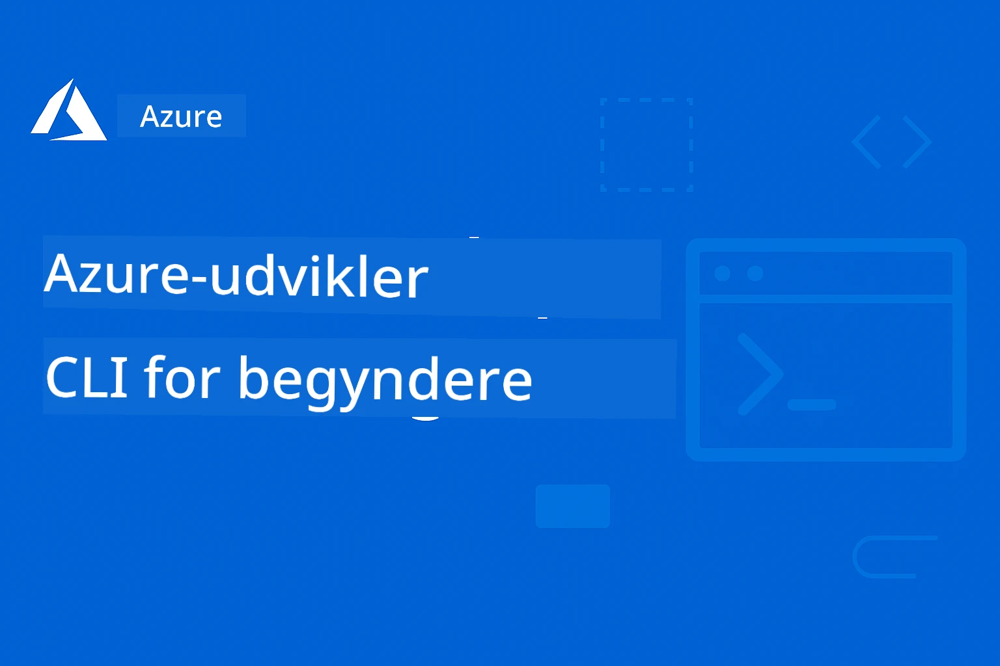

# AZD for Begyndere: En Struktureret Læringsrejse

 

[](https://github.com/microsoft/AZD-for-beginners)
[](https://GitHub.com/microsoft/azd-for-beginners/network/)
[](https://github.com/microsoft/AZD-for-beginners)

[](https://discord.com/invite/nkVh3dp)
[](https://discord.gg/nTYy5BXMWG)

---

### Automatisk Oversættelse (Altid Opdateret)

<!-- CO-OP TRANSLATOR LANGUAGES TABLE START -->
[Arabisk](../ar/README.md) | [Bengali](../bn/README.md) | [Bulgarsk](../bg/README.md) | [Burmesisk (Myanmar)](../my/README.md) | [Kinesisk (Forenklet)](../zh-CN/README.md) | [Kinesisk (Traditionelt, Hong Kong)](../zh-HK/README.md) | [Kinesisk (Traditionelt, Macau)](../zh-MO/README.md) | [Kinesisk (Traditionelt, Taiwan)](../zh-TW/README.md) | [Kroatisk](../hr/README.md) | [Tjekkisk](../cs/README.md) | [Dansk](./README.md) | [Hollandsk](../nl/README.md) | [Estisk](../et/README.md) | [Finsk](../fi/README.md) | [Fransk](../fr/README.md) | [Tysk](../de/README.md) | [Græsk](../el/README.md) | [Hebraisk](../he/README.md) | [Hindi](../hi/README.md) | [Ungarsk](../hu/README.md) | [Indonesisk](../id/README.md) | [Italiensk](../it/README.md) | [Japansk](../ja/README.md) | [Kannada](../kn/README.md) | [Khmer](../km/README.md) | [Koreansk](../ko/README.md) | [Litauisk](../lt/README.md) | [Malay](../ms/README.md) | [Malayalam](../ml/README.md) | [Manipuri (Meitei Mayek)](../mni/README.md) | [Marathi](../mr/README.md) | [Nepalesisk](../ne/README.md) | [Nigeriansk Pidgin](../pcm/README.md) | [Norsk](../no/README.md) | [Persisk (Farsi)](../fa/README.md) | [Polsk](../pl/README.md) | [Portugisisk (Brasilien)](../pt-BR/README.md) | [Portugisisk (Portugal)](../pt-PT/README.md) | [Punjabi (Gurmukhi)](../pa/README.md) | [Rumænsk](../ro/README.md) | [Russisk](../ru/README.md) | [Serbisk (Cyrillic)](../sr/README.md) | [Slovakisk](../sk/README.md) | [Slovensk](../sl/README.md) | [Spansk](../es/README.md) | [Swahili](../sw/README.md) | [Svensk](../sv/README.md) | [Tagalog (Filippinsk)](../tl/README.md) | [Tamil](../ta/README.md) | [Telugu](../te/README.md) | [Thai](../th/README.md) | [Tyrkisk](../tr/README.md) | [Ukrainsk](../uk/README.md) | [Urdu](../ur/README.md) | [Vietnamesisk](../vi/README.md)

> **Foretrækker du at klone lokalt?**
>
> Dette repository inkluderer 50+ sprogoversættelser, hvilket betydeligt øger downloadstørrelsen. For at klone uden oversættelser, brug sparse checkout:
>
> **Bash / macOS / Linux:**
> ```bash
> git clone --filter=blob:none --sparse https://github.com/microsoft/AZD-for-beginners.git
> cd AZD-for-beginners
> git sparse-checkout set --no-cone '/*' '!translations' '!translated_images'
> ```
>
> **CMD (Windows):**
> ```cmd
> git clone --filter=blob:none --sparse https://github.com/microsoft/AZD-for-beginners.git
> cd AZD-for-beginners
> git sparse-checkout set --no-cone "/*" "!translations" "!translated_images"
> ```
>
> Dette giver dig alt, hvad du behøver for at gennemføre kurset med en meget hurtigere download.
<!-- CO-OP TRANSLATOR LANGUAGES TABLE END -->

## 🆕 Hvad er Nyt i azd i Dag

> 📌 **AI CLI release review (2026-11-04):** Vejledning blev kontrolleret mod udgivet **`azd 1.37.2`**, **agenter `1.0.0-beta.23`**, og **evalueringer `1.0.0-beta.2`** dokumentation/kilde. Brug `azd >= 1.37.0` til den kombinerede arbejdsgang. Kør `azd version` og [opdater core CLI](https://learn.microsoft.com/azure/developer/azure-developer-cli/install-azd) før udvidelser. Se [ændringer og rettelser i udgivelsen](docs/chapter-08-production/production-ai-practices.md#recent-release-changes-and-fixes). Dette er ikke en live implementeringsvalidering af hele kurset.

Azure Developer CLI understøtter mange applikationstyper, herunder webapps, API’er og AI-agenter, via understøttede værter, skabeloner og udvidelser.

Her er hvad det betyder for dig:

- **AI-agenter er nu første-klasses azd arbejdsbelastninger.** Du kan initialisere, implementere og administrere AI-agentprojekter ved hjælp af den samme `azd init` → `azd up` arbejdsgang, du allerede kender.
- **Et agentlivscyklus over to udvidelser.** Brug `azure.ai.agents` til at initialisere, påkalde, optimere og pensionere agenter. Installer **`azure.ai.evaluations`** separat for `azd ai eval init`, `generate` og `run start`. Agenter beta.22 erstattede den legacy evalueringsarbejdsgang og ændrede optimeringskonfiguration; følg [migreringsvejledningen](docs/chapter-08-production/production-ai-practices.md#evaluation-migration-and-quality-checks).
- **Flere AI-byggesten.** Nye preview-udvidelser – `azure.ai.skills` og `azure.ai.connections` – lader dig administrere genanvendelige agentfærdigheder og Foundry-forbindelser direkte med azd.
- **Microsoft Foundry-integration** bringer modelimplementering, agenthosting og AI-servicekonfiguration direkte ind i azd-skabelonesystemet.
- **Glattere dag-til-dag grundlæggende.** Seneste udgivelser gjorde `azd init` idempotent (sikkert at køre igen), fik `azd auth login` til automatisk at rydde udløbne tokens og tilføjede en venlig `azd tool` opsætningsprompt ved første kørsel.
- **Kernearbejdsgangen er uændret.** Uanset om du implementerer en todo-app, en mikrotjeneste eller en multi-agent AI-løsning, er kommandoerne de samme.

> **Bemærk for Aspire-brugere:** Microsoft refererer nu til produktet blot som **Aspire** (tidligere ".NET Aspire"). azd’s Aspire-understøttelse er uændret – kun navnet er opdateret.

Hvis du har brugt azd før, er AI-understøttelse en naturlig forlængelse – ikke et separat værktøj eller et avanceret spor. Hvis du starter fra bunden, lærer du én arbejdsgang, der virker for alt.

---

## 🚀 Hvad er Azure Developer CLI (azd)?

**Azure Developer CLI (azd)** er et udviklervenligt kommandolinjeværktøj, der gør det enkelt at implementere applikationer til Azure. I stedet for manuelt at oprette og forbinde dusinvis af Azure-ressourcer kan du implementere komplette applikationer med en enkelt kommando.

### Magien ved `azd up`

```bash
# This single command does everything:
# ✅ Creates all Azure resources  
# ✅ Configures networking and security
# ✅ Builds your application code
# ✅ Deploys to Azure
# ✅ Gives you a working URL
azd up
```

Skabelonen leverer applikations- og infrastruktur konfigurationen. En succesfuld implementering kræver stadig understøttede tjenester/modeller, tilstrækkelig kvote og tilladelser, korrekte input og verifikation af den implementerede applikation. `azd up` gør ikke automatisk en skabelon sikker, overholdende eller produktionsklar.

---

## ❓ Azure Developer CLI vs Azure CLI: Hvad er Forskellen?

Dette er det mest almindelige spørgsmål nybegyndere stiller. Her er det simple svar:

| Funktion | **Azure CLI (`az`)** | **Azure Developer CLI (`azd`)** |
|---------|---------------------|--------------------------------|
| **Formål** | Administrer individuelle Azure-ressourcer | Implementer komplette applikationer |
| **Tankegang** | Infrastruktur-fokuseret | Applikations-fokuseret |
| **Eksempel** | `az webapp create --name myapp...` | `azd up` |
| **Læringskurve** | Skal kende Azure-tjenester | Bare kendskab til din app |
| **Bedst til** | DevOps, Infrastruktur | Udviklere, Prototyping |

### Enkel Analog

- **Azure CLI** er som at have alle værktøjerne til at bygge et hus – hamre, save, søm. Du kan bygge alt, men du skal kende byggeri.
- **Azure Developer CLI** er som at ansætte en entreprenør – du beskriver, hvad du vil have, og de klarer byggeriet.

### Hvornår skal man bruge hvad

| Scenarie | Brug Denne |
|----------|----------|
| "Jeg vil hurtigt implementere min webapp" | `azd up` |
| "Jeg skal bare oprette en lagerkonto" | `az storage account create` |
| "Jeg bygger en komplet AI-applikation" | `azd init --template azure-search-openai-demo` |
| "Jeg skal debugge en specifik Azure-ressource" | `az resource show` |
| "Jeg vil implementere til mit konfigurerede produktionsmiljø" | Gennemgå konfiguration, adgang, omkostninger og operationelle porte før `azd up --environment production` |

### De arbejder sammen!

AZD og Azure CLI har separat autentifikation og konfiguration. Brug `azd auth login` for AZD, og `az login` når en hook eller diagnostisk kommando eksplicit kræver Azure CLI. Du kan bruge begge:
```bash
# Deploy your app with AZD
azd up

# Then fine-tune specific resources with Azure CLI
az webapp config set --name myapp --always-on true
```

---

## 🌟 Find Skabeloner i Awesome AZD

Start ikke fra bunden! **Awesome AZD** er det community-drevne samling af klar-til-implementering skabeloner:

| Ressource | Beskrivelse |
|----------|-------------|
| 🔗 [**Awesome AZD Gallery**](https://azure.github.io/awesome-azd/) | Gennemse 200+ skabeloner med ét-klik implementering |
| 🔗 [**Indsend en Skabelon**](https://github.com/Azure/awesome-azd/issues) | Bidrag med din egen skabelon til fællesskabet |
| 🔗 [**GitHub Repository**](https://github.com/Azure/awesome-azd) | Sæt stjerne og udforsk koden |

### Populære AI Skabeloner fra Awesome AZD

Vælg én skabelon i sin egen tomme mappe; kommandoerne nedenfor er alternativer. Det afsluttende `.` initialiserer den mappe.

```bash
# RAG Chat with Microsoft Foundry Models + AI Search
azd init --template azure-search-openai-demo .

# Quick AI Chat Application
azd init --template openai-chat-app-quickstart .

# AI Agents with Foundry Agents
azd init --template get-started-with-ai-agents .
```

---

## 🎯 Kom Godt i Gang på 3 Trin

Før du starter, sørg for, at din maskine er klar til den skabelon, du vil implementere:

**Windows:**
```powershell
.\validate-setup.ps1
```

**macOS / Linux:**
```bash
bash ./validate-setup.sh
```

Hvis nogen nødvendige tjek fejler, ret det først og fortsæt derefter med hurtigstarten.

### Trin 1: Installer AZD (2 minutter)

**Windows:**
```powershell
winget install microsoft.azd
```

**macOS:**
```bash
brew tap azure/azd && brew install azd
```

**Linux:**
```bash
curl -fsSL https://aka.ms/install-azd.sh | bash
```

### Trin 2: Autentificer for AZD

```bash
# Optional if you plan to use Azure CLI commands directly in this course
az login

# Required for AZD workflows
azd auth login
```

Hvis du ikke er sikker på, hvilken du har brug for, følg den fulde opsætningsproces i [Installation & Setup](docs/chapter-01-foundation/installation.md#authentication-setup).

### Trin 3: Implementer Din Første App

```bash
# Initialize from a template
azd init --template todo-nodejs-mongo .

# Deploy to Azure (creates everything!)
azd up
```

**🎉 Så er det det!** Din app er nu live på Azure.

### Ryd Op (Glem Ikke!)

```bash
# Remove all resources when done experimenting
azd down --force --purge
```

---

## 📚 Sådan Bruger du Dette Kursus

Dette kursus er designet til **progressiv læring** – start hvor du er tryg, og arbejd dig op:

| Din Erfaring | Start Her |
|-----------------|------------|
| **Helt ny til Azure** | [Kapitel 1: Grundlag](#-chapter-1-foundation--quick-start) |
| **Kender Azure, ny til AZD** | [Kapitel 1: Grundlag](#-chapter-1-foundation--quick-start) |
| **Vil implementere AI-apps** | [Kapitel 2: AI-Første Udvikling](#-chapter-2-ai-first-development-recommended-for-ai-developers) |
| **Vil have praktisk træning** | [🎓 Interaktiv Workshop](workshop/README.md) - 3-4 timers guidet laboratorie |
| **Behøver produktionsmønstre** | [Kapitel 8: Produktion & Enterprise](#-chapter-8-production--enterprise-patterns) |

### Hurtig Opsætning

1. **Fork Dette Repository**: [](https://GitHub.com/microsoft/azd-for-beginners/fork)
2. **Klon Det**: `git clone https://github.com/YOUR-USERNAME/azd-for-beginners.git`
3. **Få Hjælp**: [Azure Discord Community](https://discord.com/invite/ByRwuEEgH4)

> **Foretrækker du at klone lokalt?**

> Dette repository inkluderer 50+ sprogoversættelser, hvilket betydeligt øger downloadstørrelsen. For at klone uden oversættelser, brug sparse checkout:
> ```bash
> git clone --filter=blob:none --sparse https://github.com/microsoft/AZD-for-beginners.git
> cd AZD-for-beginners
> git sparse-checkout set --no-cone '/*' '!translations' '!translated_images'
> ```
> Dette giver dig alt, hvad du behøver for at gennemføre kurset med en meget hurtigere download.


## Kursusoversigt

Mest Azure Developer CLI (azd) gennem strukturerede kapitler designet til progressiv læring. **Særligt fokus på AI-applikationsudrulning med Microsoft Foundry-integration.**

### Hvorfor dette kursus er essentielt for moderne udviklere

Udviklere, der udruller AI-arbejdsmængder, har ofte brug for vejledning om:
- Komplekse AI-arkitekturer med mange tjenester
- Bedste praksis for produktion AI-udrulning  
- Azure AI tjenesteintegration og konfiguration
- Omkostningsoptimering for AI-arbejdsmængder
- Fejlfinding af AI-specifikke udrulningsproblemer

### Læringsmål

Ved at gennemføre dette strukturerede kursus vil du:
- **Beherske AZD grundlæggende**: Kernekoncepter, installation og konfiguration
- **Udrulle AI-applikationer**: Brug AZD med Microsoft Foundry-tjenester
- **Implementere Infrastruktur som kode**: Administrer Azure-ressourcer med Bicep-skabeloner
- **Fejlsøge udrulninger**: Løs almindelige problemer og fejlfind
- **Optimere til produktion**: Sikkerhed, skalering, overvågning og omkostningsstyring
- **Bygge multi-agent løsninger**: Udrul komplekse AI-arkitekturer

## Før du starter: Konti, adgang og forudsætninger

Før du begynder kapitel 1, skal du sikre, at du har følgende på plads. Installationsprocesserne senere i denne guide forudsætter, at disse grundlæggende ting allerede er håndteret.

- **Et Azure-abonnement**: Du kan bruge et eksisterende abonnement fra arbejde eller din egen konto, eller oprette en [gratis prøveperiode](https://aka.ms/azurefreetrial) for at komme i gang.
- **Tilladelse til at oprette Azure-ressourcer**: For de fleste øvelser bør du have mindst **Contributor** adgang til det ønskede abonnement eller ressourcergruppen. Nogle kapitler forudsætter også, at du kan oprette ressourcer, administrerede identiteter og RBAC-tilladelser.
- [**En GitHub-konto**](https://github.com): Dette er nyttigt til at forgrene repository, spore dine egne ændringer og bruge GitHub Codespaces til workshoppen.
- **Forudsætninger for skabelonens kørsel**: Nogle skabeloner kræver lokale værktøjer som Node.js, Python, Java eller Docker. Kør installationsvalidering før start, så du fanger manglende værktøjer tidligt.
- **Grundlæggende terminalfaring**: Du behøver ikke være ekspert, men du skal være tryg ved at køre kommandoer som `git clone`, `azd auth login` og `azd up`.

> **Arbejder du i et virksomhedsabonnement?**
> Hvis dit Azure-miljø administreres af en administrator, bekræft på forhånd, at du kan udrulle ressourcer i det abonnement eller den ressourcergruppe, du planlægger at bruge. Hvis ikke, bed om et sandkasse-abonnement eller Contributor-adgang, før du starter.

> **Ny til Azure?**
> Start med din egen Azure-prøveperiode eller betal efter forbrug-abonnement på https://aka.ms/azurefreetrial, så du kan gennemføre øvelserne fra ende til anden uden at vente på godkendelser på lejerniveau.

## 🗺️ Kursuskort: Hurtig navigation efter kapitel

Hvert kapitel har en dedikeret README med læringsmål, hurtig start og øvelser:

| Kapitel | Emne | Lektioner | Varighed | Kompleksitet |
|---------|-------|---------|----------|------------|
| **[Kap 1: Grundlag](docs/chapter-01-foundation/README.md)** | Kom godt i gang | [AZD Basics](docs/chapter-01-foundation/azd-basics.md) &#124; [Installation](docs/chapter-01-foundation/installation.md) &#124; [Første projekt](docs/chapter-01-foundation/first-project.md) | 30-45 min | ⭐ |
| **[Kap 2: AI-udvikling](docs/chapter-02-ai-development/README.md)** | AI-Første apps | [Foundry-integration](docs/chapter-02-ai-development/microsoft-foundry-integration.md) &#124; [AI-agenter](docs/chapter-02-ai-development/agents.md) &#124; [Modeludrulning](docs/chapter-02-ai-development/ai-model-deployment.md) &#124; [Workshop](docs/chapter-02-ai-development/ai-workshop-lab.md) | 1-2 t | ⭐⭐ |
| **[Kap 3: Konfiguration](docs/chapter-03-configuration/README.md)** | Auth & sikkerhed | [Konfiguration](docs/chapter-03-configuration/configuration.md) &#124; [Auth & sikkerhed](docs/chapter-03-configuration/authsecurity.md) | 45-60 min | ⭐⭐ |
| **[Kap 4: Infrastruktur](docs/chapter-04-infrastructure/README.md)** | IaC & udrulning | [Udrulningsguide](docs/chapter-04-infrastructure/deployment-guide.md) &#124; [Provisionering](docs/chapter-04-infrastructure/provisioning.md) | 1-1,5 t | ⭐⭐⭐ |
| **[Kap 5: Multi-Agent](docs/chapter-05-multi-agent/README.md)** | AI-agentløsninger | [Detailhandelsscenarie](examples/retail-scenario.md) &#124; [Koordinationsmønstre](docs/chapter-06-pre-deployment/coordination-patterns.md) | 2-3 t | ⭐⭐⭐⭐ |
| **[Kap 6: Forud for udrulning](docs/chapter-06-pre-deployment/README.md)** | Planlægning & validering | [Preflight-tjek](docs/chapter-06-pre-deployment/preflight-checks.md) &#124; [Kapacitetsplanlægning](docs/chapter-06-pre-deployment/capacity-planning.md) &#124; [SKU-valg](docs/chapter-06-pre-deployment/sku-selection.md) &#124; [App Insights](docs/chapter-06-pre-deployment/application-insights.md) | 1 t | ⭐⭐ |
| **[Kap 7: Fejlfinding](docs/chapter-07-troubleshooting/README.md)** | Debug & rettelse | [Almindelige problemer](docs/chapter-07-troubleshooting/common-issues.md) &#124; [Debugging](docs/chapter-07-troubleshooting/debugging.md) &#124; [AI-problemer](docs/chapter-07-troubleshooting/ai-troubleshooting.md) | 1-1,5 t | ⭐⭐ |
| **[Kap 8: Produktion](docs/chapter-08-production/README.md)** | Enterprise-mønstre | [Produktionspraksis](docs/chapter-08-production/production-ai-practices.md) | 2-3 t | ⭐⭐⭐⭐ |
| **[🎓 Workshop](workshop/README.md)** | Praktisk laboratorie | [Introduktion](workshop/docs/instructions/0-Introduction.md) &#124; [Udvælgelse](workshop/docs/instructions/1-Select-AI-Template.md) &#124; [Validering](workshop/docs/instructions/2-Validate-AI-Template.md) &#124; [Nedbrydning](workshop/docs/instructions/3-Deconstruct-AI-Template.md) &#124; [Konfiguration](workshop/docs/instructions/4-Configure-AI-Template.md) &#124; [Tilpasning](workshop/docs/instructions/5-Customize-AI-Template.md) &#124; [Nedtagning](workshop/docs/instructions/6-Teardown-Infrastructure.md) &#124; [Afrunding](workshop/docs/instructions/7-Wrap-up.md) | 3-4 t | ⭐⭐ |

**Samlet kurstid:** ~10-14 timer | **Færdighedsprogression:** Begynder → Produktionsklar

---

## 📚 Læringskapitler

*Vælg din læringssti baseret på erfaringsniveau og mål*

### 🚀 Kapitel 1: Grundlag & Hurtig start
**Forudsætninger**: Azure-abonnement, grundlæggende kommando-linjekendskab  
**Varighed**: 30-45 minutter  
**Kompleksitet**: ⭐

#### Hvad du lærer
- Forstå Azure Developer CLI grundlæggende
- Installere AZD på din platform
- Din første succesfulde udrulning

#### Læringsressourcer
- **🎯 Start her**: [Hvad er Azure Developer CLI?](#-what-is-azure-developer-cli-azd)
- **📖 Teori**: [AZD Basics](docs/chapter-01-foundation/azd-basics.md) - Kernekoncepter og terminologi
- **⚙️ Opsætning**: [Installation & opsætning](docs/chapter-01-foundation/installation.md) - Platform-specifikke guider
- **🛠️ Praktisk**: [Dit første projekt](docs/chapter-01-foundation/first-project.md) - Trin-for-trin vejledning
- **📋 Hurtig reference**: [Kommando-cheatsheet](resources/cheat-sheet.md)

#### Praktiske øvelser
```bash
# Quick installation check
azd version

# Deploy your first application
azd init --template todo-nodejs-mongo .
azd up
```

**💡 Kapitelresultat**: Udrul en simpel webapplikation til Azure ved hjælp af AZD

**✅ Godkendelse af succes:**
```bash
# After completing Chapter 1, you should be able to:
azd version              # Shows installed version
azd init --template todo-nodejs-mongo  # Initializes project
azd up                  # Deploys to Azure
azd show                # Displays running app URL
# Application opens in browser and works
azd down --force --purge  # Cleans up resources
```

**📊 Tidsinvestering:** 30-45 minutter  
**📈 Færdighedsniveau efter:** Kan udrulle grundlæggende applikationer selvstændigt

---

### 🤖 Kapitel 2: AI-først udvikling (Anbefalet for AI-udviklere)
**Forudsætninger**: Kapitel 1 gennemført  
**Varighed**: 1-2 timer  
**Kompleksitet**: ⭐⭐

#### Hvad du lærer
- Microsoft Foundry-integration med AZD
- Udrulning af AI-drevne applikationer
- Forståelse af AI-tjenestekonfigurationer

#### Læringsressourcer
- **🎯 Start her**: [Microsoft Foundry integration](docs/chapter-02-ai-development/microsoft-foundry-integration.md)
- **🤖 AI-agenter**: [AI Agents Guide](docs/chapter-02-ai-development/agents.md) - Udrul intelligente agenter med AZD
- **📖 Mønstre**: [AI Model Deployment](docs/chapter-02-ai-development/ai-model-deployment.md) - Udrul og administrer AI-modeller
- **🛠️ Workshop**: [AI Workshop Lab](docs/chapter-02-ai-development/ai-workshop-lab.md) - Gør dine AI-løsninger AZD-klare
- **🎥 Interaktiv guide**: [Workshop-materialer](workshop/README.md) - Browserbaseret læring med MkDocs * DevContainer-miljø
- **📋 Skabeloner**: [Microsoft Foundry skabeloner](#featured-microsoft-foundry-templates)
- **📝 Eksempler**: [AZD udrulningseksempler](examples/README.md)

#### Praktiske øvelser
```bash
# Deploy your first AI application
azd init --template azure-search-openai-demo .
azd up

# Try additional AI templates
azd init --template openai-chat-app-quickstart .
azd init --template agent-openai-python-prompty .
```

**💡 Kapitelresultat**: Udrul og konfigurer en AI-drevet chatapplikation med RAG-funktioner

**✅ Godkendelse af succes:**
```bash
# After Chapter 2, you should be able to:
azd init --template azure-search-openai-demo .
azd up
# Test the AI chat interface
# Ask questions and get AI-powered responses with sources
# Verify search integration works
azd monitor  # Check Application Insights shows telemetry
azd down --force --purge
```

**📊 Tidsinvestering:** 1-2 timer  
**📈 Færdighedsniveau efter:** Kan udrulle AI-læringsapplikationer og identificere yderligere krav til produktionsparathed
**💰 Omkostningsbevidsthed:** Forstå $80-150/måned udviklingsomkostninger, $300-3500/måned produktionsomkostninger

#### 💰 Omkostningshensyn ved AI-udrulninger

**Udviklingsmiljø (estimeret $80-150/måned):**
- Microsoft Foundry modeller (Pay-as-you-go): $0-50/måned (baseret på token-forbrug)
- AI Search (Basic niveau): $75/måned
- Container apps (Consumption): $0-20/måned
- Storage (Standard): $1-5/måned

**Produktionsmiljø (estimeret $300-3.500+/måned):**
- Microsoft Foundry modeller (PTU for konsekvent ydeevne): $3.000+/måned ELLER Pay-as-you-go med højt volumen
- AI Search (Standard niveau): $250/måned
- Container apps (Dedikeret): $50-100/måned
- Application Insights: $5-50/måned
- Storage (Premium): $10-50/måned

**💡 Tips til omkostningsoptimering:**
- Tjek prissætning for model inferens og konto-specifikke credits; Azure OpenAI inkluderer ikke en universel 50.000-token månedlig gratis tilladelse
- Kør `azd down` for at slette ressourcer, når de ikke længere er nødvendige, efter at have gennemgået det valgte miljø
- Start med forbrugsbaseret fakturering, opgrader til PTU kun for produktion
- Brug `azd provision --preview` til at inspicere planlagt infrastruktur, og pris derefter de resulterende ressourcer med Azure Pricing Calculator
- Aktivér autoskalering: betal kun for faktisk brug

**Omkostningsovervågning:**
```bash
# Inspect planned resources (this does not calculate prices)
azd provision --preview

# Monitor actual costs in Azure Portal
az consumption budget list --resource-group <your-rg>
```

---

### ⚙️ Kapitel 3: Konfiguration & autentificering
**Forudsætninger**: Kapitel 1 gennemført  
**Varighed**: 45-60 minutter  
**Kompleksitet**: ⭐⭐

#### Hvad du lærer
- Miljøkonfiguration og styring
- Autentificering og sikkerhedspraksis
- Navngivning og organisering af ressourcer

#### Læringsressourcer
- **📖 Konfiguration**: [Konfigurationsguide](docs/chapter-03-configuration/configuration.md) - Miljøopsætning
- **🔐 Sikkerhed**: [Autentificeringsmønstre og administreret identitet](docs/chapter-03-configuration/authsecurity.md) - Autentificeringsmønstre
- **📝 Eksempler**: [Database-app eksempel](examples/database-app/README.md) - AZD databaseeksempler

#### Praktiske øvelser
- Konfigurer flere miljøer (dev, staging, prod)
- Opsæt autentificering med administreret identitet
- Implementer miljøspecifikke konfigurationer

**💡 Kapitelresultat**: Administrer flere miljøer med korrekt autentificering og sikkerhed

---

### 🏗️ Kapitel 4: Infrastruktur som kode & udrulning
**Forudsætninger**: Kapitel 1-3 gennemført  
**Varighed**: 1-1,5 timer  
**Kompleksitet**: ⭐⭐⭐

#### Hvad du lærer
- Avancerede udrulningsmønstre
- Infrastruktur som kode med Bicep
- Strategier for ressourcetildeling

#### Læringsressourcer
- **📖 Udrulning**: [Udrulningsguide](docs/chapter-04-infrastructure/deployment-guide.md) - Komplette workflows
- **🏗️ Provisionering**: [Provisionering af ressourcer](docs/chapter-04-infrastructure/provisioning.md) - Azure ressourcestyring
- **📝 Eksempler**: [Container App eksempel](../../examples/container-app) - Containeriserede udrulninger

#### Praktiske øvelser
- Opret tilpassede Bicep-skabeloner
- Udrul multi-service applikationer
- Implementer blue-green udrulningsstrategier

**💡 Kapitelresultat**: Udrul komplekse multi-service applikationer ved hjælp af tilpassede infrastruktuиришabeloner

---

### 🎯 Kapitel 5: Multi-Agent AI løsninger (Avanceret)
**Forudsætninger**: Kapitel 1-2 gennemført  
**Varighed**: 2-3 timer  
**Kompleksitet**: ⭐⭐⭐⭐

#### Hvad du lærer
- Multi-agent arkitektur-mønstre
- Agentorchestrering og koordinering
- Produktionsklare AI-udrulninger

#### Læringsressourcer
- **🤖 Fremhævet design**: [Retail Multi-Agent Solution](examples/retail-scenario.md) - Arkitektur blueprint, ikke en komplet applikation
- **🛠️ ARM Skabeloner**: [ARM Template Package](../../examples/retail-multiagent-arm-template) - Infrastrukturskelet; gennemgå forudsætninger og manglende applikationskomponenter
- **📖 Arkitektur**: [Multi-agent koordineringsmønstre](docs/chapter-06-pre-deployment/coordination-patterns.md) - Mønstre

#### Praktiske Øvelser
```bash
# Inspect the retail infrastructure scaffold before choosing to deploy it
cd examples/retail-multiagent-arm-template
cat README.md

# After an intentional deployment, inspect infrastructure state
az deployment group show --resource-group <rg-name> --name <deployment-name>
```

**💡 Kapitelresultat**: Forstå multi-agent design og identificer det implementerings-, validerings- og driftsarbejde, der kræves ud over et infrastrukturskelet

---

### 🔍 Kapitel 6: Forud-udrulningsvalidering & Planlægning
**Forudsætninger**: Kapitel 4 gennemført  
**Varighed**: 1 time  
**Kompleksitet**: ⭐⭐

#### Det, du vil lære
- Kapacitetsplanlægning og ressourcevalidering
- Strategier for valg af SKU
- Forud-udrulningskontroller og automatisering

#### Læringsressourcer
- **📊 Planlægning**: [Kapacitetsplanlægning](docs/chapter-06-pre-deployment/capacity-planning.md) - Ressourcevalidering
- **💰 Valg**: [SKU-valg](docs/chapter-06-pre-deployment/sku-selection.md) - Omkostningseffektive valg
- **✅ Validering**: [Forud-udrulningskontroller](docs/chapter-06-pre-deployment/preflight-checks.md) - Automatiserede scripts

#### Praktiske Øvelser
- Kør kapacitetsvalideringsscripts
- Optimer SKU-valg for omkostning
- Implementer automatiserede forud-udrulningskontroller

**💡 Kapitelresultat**: Valider og optimer udrulninger før eksekvering

---

### 🚨 Kapitel 7: Fejlfinding & Debugging
**Forudsætninger**: Ethvert udrulningskapitel gennemført  
**Varighed**: 1-1,5 timer  
**Kompleksitet**: ⭐⭐

#### Det, du vil lære
- Systematiske debug-metoder
- Almindelige problemer og løsninger
- AI-specifik fejlfinding

#### Læringsressourcer
- **🔧 Almindelige problemer**: [Almindelige problemer](docs/chapter-07-troubleshooting/common-issues.md) - FAQ og løsninger
- **🕵️ Debugging**: [Debugging Guide](docs/chapter-07-troubleshooting/debugging.md) - Trin-for-trin strategier
- **🤖 AI Problemer**: [AI-specifik fejlfinding](docs/chapter-07-troubleshooting/ai-troubleshooting.md) - AI-serviceproblemer

#### Praktiske Øvelser
- Diagnostiser udrulningsfejl
- Løs autentificeringsproblemer
- Debug AI-serviceforbindelser

**💡 Kapitelresultat**: Selvstændigt diagnosticere og løse almindelige udrulningsproblemer

---

### 🏢 Kapitel 8: Produktion & Enterprise-mønstre
**Forudsætninger**: Kapitel 1-4 gennemført  
**Varighed**: 2-3 timer  
**Kompleksitet**: ⭐⭐⭐⭐

#### Det, du vil lære
- Produktionsudrulningsstrategier
- Enterprise-sikkerhedsmønstre
- Overvågning og omkostningsoptimering

#### Læringsressourcer
- **🏭 Produktion**: [Produktions-AI bedste praksisser](docs/chapter-08-production/production-ai-practices.md) - Enterprise-mønstre
- **📝 Eksempler**: [Mikrotjeneste-eksempel](../../examples/microservices) - Komplekse arkitekturer
- **📊 Overvågning**: [Application Insights integration](docs/chapter-06-pre-deployment/application-insights.md) - Overvågning

#### Praktiske Øvelser
- Implementer enterprise-sikkerhedsmønstre
- Opsæt omfattende overvågning
- Udrul til produktion med korrekt styring

**💡 Kapitelresultat**: Udrul enterprise-klar applikationer med fuld produktionskapacitet

---

## 🎓 Workshop Oversigt: Praktisk Læringsoplevelse

> **⚠️ WORKSHOP STATUS: Aktiv Udvikling**  
> Workshop-materialerne er i øjeblikket under udvikling og finpudsning. Kerne-moduler er funktionelle, men nogle avancerede sektioner er ufuldstændige. Vi arbejder aktivt på at færdiggøre alt indhold. [Følg fremgang →](workshop/README.md)

### Interaktive Workshop-materialer
**Omfattende praktisk læring med browser-baserede værktøjer og guidede øvelser**

Vores workshop-materialer tilbyder en struktureret, interaktiv læringsoplevelse, der supplerer det kapiteldelte pensum ovenfor. Workshoppen er designet til både selvstyret læring og instruktør-ledede sessioner.

#### 🛠️ Workshop-funktioner
- **Browser-baseret interface**: Færdig MkDocs-drevet workshop med søgning, kopi og tema-funktioner
- **GitHub Codespaces-integration**: One-click opsætning af udviklingsmiljø
- **Struktureret læringssti**: 8-moduls guidede øvelser (3-4 timer i alt)
- **Progressiv metode**: Introduktion → Valg → Validering → Nedbrydning → Konfiguration → Tilpasning → Nedtagning → Afslutning
- **Interaktivt DevContainer-miljø**: Forud-konfigurerede værktøjer og afhængigheder

#### 📚 Workshop modulstruktur
Workshoppen følger en **8-moduls progressiv metode**, der tager dig fra opdagelse til udrulningsmestring:

| Modul | Emne | Hvad du vil gøre | Varighed |
|--------|-------|----------------|----------|
| **0. Introduktion** | Workshop Oversigt | Forstå læringsmål, forudsætninger, og workshopstruktur | 15 min |
| **1. Valg** | Skabelonopdagelse | Udforsk AZD-skabeloner og vælg den rette AI-skabelon til dit scenarie | 20 min |
| **2. Validering** | Udrul & verificer | Udrul skabelonen med `azd up` og valider at infrastrukturen fungerer | 30 min |
| **3. Nedbrydning** | Forstå struktur | Brug GitHub Copilot til at udforske skabelonarkitektur, Bicep-filer og kodeorganisering | 30 min |
| **4. Konfiguration** | azure.yaml dybdegående | Mestre `azure.yaml` konfiguration, livscyklus-hooks og miljøvariabler | 30 min |
| **5. Tilpasning** | Gør det til dit | Aktivér AI Search, tracing, evaluering og tilpas til dit scenarie | 45 min |
| **6. Nedtagning** | Ryd op | Sikker nedlukning af ressourcer med `azd down --purge` | 15 min |
| **7. Afslutning** | Næste skridt | Gennemgå resultater, nøglebegreber, og fortsæt din læringsrejse | 15 min |

**Workshop flow:**
```
Introduction → Selection → Validation → Deconstruction → Configuration → Customization → Teardown → Wrap-up
     ↓            ↓           ↓              ↓               ↓              ↓            ↓           ↓
  Overview    Find the     Deploy &      Explore        Master         Customize     Clean up    Review &
             right        verify        code &        azure.yaml      for your      resources   next steps
             template                   structure                     scenario
```

#### 🚀 Kom godt i gang med workshoppen
```bash
# Option 1: GitHub Codespaces (Recommended)
# Click "Code" → "Create codespace on main" in the repository

# Option 2: Local Development
git clone https://github.com/microsoft/azd-for-beginners.git
cd azd-for-beginners/workshop
# Follow the setup instructions in workshop/README.md
```

#### 🎯 Workshop læringsresultater
Ved at gennemføre workshoppen vil deltagerne:
- **Udrulle produktionsklare AI-applikationer**: Brug AZD med Microsoft Foundry-tjenester
- **Beherske multi-agent arkitekturer**: Implementere koordinerede AI-agentløsninger
- **Implementere sikkerhed bedste praksis**: Konfigurere autentificering og adgangskontrol
- **Optimere til skala**: Designe omkostningseffektive, ydelsesorienterede udrulninger
- **Fejlfinding af udrulninger**: Løse almindelige problemer selvstændigt

#### 📖 Workshop ressourcer
- **🎥 Interaktiv guide**: [Workshop materialer](workshop/README.md) - Browser-baseret læringsmiljø
- **Modul-for-modul instruktioner**:
  - [0. Introduktion](workshop/docs/instructions/0-Introduction.md) - Workshop oversigt og mål
  - [1. Valg](workshop/docs/instructions/1-Select-AI-Template.md) - Find og vælg AI-skabeloner
  - [2. Validering](workshop/docs/instructions/2-Validate-AI-Template.md) - Udrul og verificer skabeloner
  - [3. Nedbrydning](workshop/docs/instructions/3-Deconstruct-AI-Template.md) - Udforsk skabelonarkitektur
  - [4. Konfiguration](workshop/docs/instructions/4-Configure-AI-Template.md) - Mestre azure.yaml
  - [5. Tilpasning](workshop/docs/instructions/5-Customize-AI-Template.md) - Tilpas til dit scenarie
  - [6. Nedtagning](workshop/docs/instructions/6-Teardown-Infrastructure.md) - Ryd op i ressourcer
  - [7. Afslutning](workshop/docs/instructions/7-Wrap-up.md) - Gennemgang og næste skridt
- **🛠️ AI Workshop Laboratorium**: [AI Workshop Lab](docs/chapter-02-ai-development/ai-workshop-lab.md) - AI-fokuserede øvelser
- **💡 Hurtig start**: [Workshop opsætningsguide](workshop/README.md#browser-based-guide) - Miljøkonfiguration

**Perfekt til**: Virksomhedstræning, universitetskurser, selvstyret læring og udvikler bootcamps.

---

## 📖 Dybdegående: AZD Funktioner

Ud over det basale tilbyder AZD kraftfulde funktioner til produktionsudrulninger:

- **Skabelon-baserede udrulninger** - Brug færdigbyggede skabeloner til almindelige applikationsmønstre
- **Infrastruktur som kode** - Administrer Azure-ressourcer med Bicep eller Terraform  
- **Integrerede arbejdsgange** - Problemfri provisionering, udrulning og overvågning af applikationer
- **Udviklervenlig** - Optimeret til udviklerproduktivitet og oplevelse

### **AZD + Microsoft Foundry: Perfekt til AI-udrulninger**

**Hvorfor AZD for AI-løsninger?** AZD løser de største udfordringer, AI-udviklere møder:

- **AI-klar Skabeloner** - Forudkonfigurerede skabeloner til Microsoft Foundry-modeller, Azure AI-tjenester og ML workloads
- **Sikre AI-udrulninger** - Indbyggede sikkerhedsmønstre til AI-tjenester, API-nøgler og modelendpoints  
- **Produktions AI-mønstre** - Bedste praksis for skalerbare, omkostningseffektive AI-applikationsudrulninger
- **End-to-End AI-arbejdsgange** - Fra modeludvikling til produktionsudrulning med korrekt overvågning
- **Omkostningsoptimering** - Smarte ressourceallokerings- og skaleringstrategier for AI workloads
- **Microsoft Foundry-integration** - Problemfri forbindelse til Microsoft Foundry-modelkatalog og endpoints

---

## 🎯 Skabeloner & Eksempelsamling

### Fremhævet: Microsoft Foundry Skabeloner
**Start her, hvis du udruller AI-applikationer!**

> **Bemærk:** Disse skabeloner demonstrerer forskellige AI-mønstre. Nogle er eksterne Azure samples, andre er lokale implementeringer.

| Skabelon | Kapitel | Kompleksitet | Tjenester | Type |
|----------|---------|------------|----------|------|
| [**Kom godt i gang med AI chat**](https://github.com/Azure-Samples/get-started-with-ai-chat) | Kapitel 2 | ⭐⭐ | AzureOpenAI + Azure AI Model Inference API + Azure AI Search + Azure Container Apps + Application Insights | Ekstern |
| [**Kom godt i gang med AI agenter**](https://github.com/Azure-Samples/get-started-with-ai-agents) | Kapitel 2 | ⭐⭐ | Foundry Agents + AzureOpenAI + Azure AI Search + Azure Container Apps + Application Insights| Ekstern |
| [**Azure Search + OpenAI Demo**](https://github.com/Azure-Samples/azure-search-openai-demo) | Kapitel 2 | ⭐⭐ | Azure OpenAI + Azure AI Search + Container Apps (standard) + Storage | Ekstern |
| [**OpenAI Chat App Hurtigstart**](https://github.com/Azure-Samples/openai-chat-app-quickstart) | Kapitel 2 | ⭐ | AzureOpenAI + Container Apps + Application Insights | Ekstern |
| [**Agent OpenAI Python Prompty**](https://github.com/Azure-Samples/agent-openai-python-prompty) | Kapitel 5 | ⭐⭐⭐ | AzureOpenAI + Azure Functions + Prompty | Ekstern |
| [**Contoso Chat RAG**](https://github.com/Azure-Samples/contoso-chat) | Kapitel 8 | ⭐⭐⭐⭐ | AzureOpenAI + AI Search + Cosmos DB + Container Apps | Ekstern |
| [**Retail Multi-Agent Løsning**](examples/retail-scenario.md) | Kapitel 5 | ⭐⭐⭐⭐ | Foreslået arkitektur og infrastrukturskelet; applikationsimplementering kræves | **Lokal blueprint** |

### Fremhævet: Færdige Læringsscenarier
**Produktionsklare applikationsskabeloner kortlagt til læringskapitler**

| Skabelon | Læringskapitel | Kompleksitet | Nøglelæring |
|----------|------------------|------------|--------------|
| [**openai-chat-app-quickstart**](https://github.com/Azure-Samples/openai-chat-app-quickstart) | Kapitel 2 | ⭐ | Grundlæggende AI-udrulningsmønstre |
| [**azure-search-openai-demo**](https://github.com/Azure-Samples/azure-search-openai-demo) | Kapitel 2 | ⭐⭐ | RAG-implementering med Azure AI Search |
| [**kom-godt-i-gang-med-ai-agenter**](https://github.com/Azure-Samples/get-started-with-ai-agents) | Kapitel 2 | ⭐⭐ | Agent-understøttet chat og scenariespecifikke evalueringstests |
| [**agent-openai-python-prompty**](https://github.com/Azure-Samples/agent-openai-python-prompty) | Kapitel 5 | ⭐⭐⭐ | Agent-rammeværk og funktionskald |
| [**contoso-chat**](https://github.com/Azure-Samples/contoso-chat) | Kapitel 8 | ⭐⭐⭐ | Enterprise AI orkestrering |
| [**retail-multi-agent-løsning**](examples/retail-scenario.md) | Kapitel 5 | ⭐⭐⭐⭐ | Multi-agent arkitektur med Customer og Inventory agenter |

### Læring efter eksempeltype

> **📌 Lokale vs. Eksterne Eksempler:**  
> **Lokale Eksempler** (i dette repo) = Undersøg eksemplets README for implementeringsstatus og forudsætninger
> **Eksterne Eksempler** (Azure Samples) = Klon fra linkede repositories

#### Lokale Eksempler (Klar til brug)
- [**Retail Multi-Agent Løsning**](examples/retail-scenario.md) - Arkitekturblueprint med et ARM infrastrukturskelet
  - Foreslåede Customer og Inventory agentroller
  - Overvågning, evaluering og applikationskode skal implementeres og verificeres
  - Provisionering af ressourcer alene giver ikke en fungerende retail applikation

#### Lokale Eksempler - Container Applikationer (Kapitel 2-5)
**Omfattende containerudrulningseksempler i dette repository:**
- [**Container App Eksempler**](examples/container-app/README.md) - Fuld guide til containeriserede udrulninger
  - [Simple Flask API](../../examples/container-app/simple-flask-api) - Grundlæggende REST API med scale-to-zero
  - [Mikrotjenestearkitektur](../../examples/container-app/microservices) - To-service læringseksempel; produktionshårdhed kræver yderligere arbejde
  - Hurtigstart, Produktion, og Avancerede udrulningsmønstre
  - Overvågning, sikkerhed og omkostningsoptimeringsvejledning

#### Eksterne Eksempler - Simple Applikationer (Kapitel 1-2)
**Klon disse Azure Samples repositories for at komme i gang:**
- [Simple Web App - Node.js + MongoDB](https://github.com/Azure-Samples/todo-nodejs-mongo) - Grundlæggende udrulningsmønstre
- [Statisk Website - React SPA](https://github.com/Azure-Samples/todo-csharp-sql-swa-func) - Statisk indholdsudrulning
- [Container App - Python Flask](https://github.com/Azure-Samples/container-apps-store-api-microservice) - REST API udrulning

#### Eksterne Eksempler - Databaseintegration (Kapitel 3-4)  
- [Database App - C# + SQL](https://github.com/Azure-Samples/todo-csharp-sql) - Databaseforbindelsesmønstre  
- [Functions + Cosmos DB](https://github.com/Azure-Samples/todo-python-mongo-swa-func) - Serverløs data workflow  

#### Eksterne Eksempler - Avancerede Mønstre (Kapitel 4-8)  
- [Java Microservices](https://github.com/Azure-Samples/java-microservices-aca-lab) - Multi-service arkitekturer  
- [Container Apps Jobs](https://github.com/Azure-Samples/container-apps-jobs) - Baggrundsbehandling  
- [Enterprise ML Pipeline](https://github.com/Azure/mlops-v2) - MLOps reference mønstre; ikke en drop-in AZD skabelon  

### Eksterne Skabelonsamlinger  
- [**Officiel AZD Skabelongalleri**](https://azure.github.io/awesome-azd/) - Kurateret samling af officielle og community-skabeloner  
- [**Azure Developer CLI Skabeloner**](https://learn.microsoft.com/en-us/azure/developer/azure-developer-cli/azd-templates) - Microsoft Learn skabelondokumentation  
- [**Eksempelkatalog**](examples/README.md) - Lokale læringseksempler med detaljerede forklaringer  

---

## 📚 Læringsressourcer & Referencer  

### Hurtige Referencer  
- [**Kommandooversigt**](resources/cheat-sheet.md) - Væsentlige azd kommandoer organiseret efter kapitel  
- [**Ordlist**](resources/glossary.md) - Azure- og azd-terminologi  
- [**FAQ**](resources/faq.md) - Almindelige spørgsmål organiseret efter læringskapitel  
- [**Studieguide**](resources/study-guide.md) - Omfattende øvelser  

### Praktiske Workshops  
- [**AI Workshop Lab**](docs/chapter-02-ai-development/ai-workshop-lab.md) - Gør dine AI-løsninger AZD-distribuerbare (2-3 timer)  
- [**Interaktiv Workshop**](workshop/README.md) - 8-moduls guidede øvelser med MkDocs og GitHub Codespaces  
  - Følger: Introduktion → Udvælgelse → Validering → Nedbrydning → Konfiguration → Tilpasning → Nedlukning → Afslutning  

### Eksterne Læringsressourcer  
- [Azure Developer CLI Dokumentation](https://learn.microsoft.com/en-us/azure/developer/azure-developer-cli/)  
- [Azure Arkitekturcenter](https://learn.microsoft.com/en-us/azure/architecture/)  
- [Azure Priskalkulator](https://azure.microsoft.com/pricing/calculator/)  
- [Azure Status](https://status.azure.com/)  

### AI Agent Kompetencer til Din Editor  
- [**Microsoft Azure Kompetencer på skills.sh**](https://skills.sh/microsoft/github-copilot-for-azure) - 37 åbne agent-kompetencer for Azure AI, Foundry, deployment, diagnostik, omkostningsoptimering og mere. Installer dem i GitHub Copilot, Cursor, Claude Code eller enhver understøttet agent:  
  ```bash
  npx skills add microsoft/github-copilot-for-azure
  ```

---

## 🔧 Hurtig Fejlfinding Guide  

**Almindelige problemer som begyndere møder og øjeblikkelige løsninger:**  

<details>
<summary><strong>❌ "azd: kommando ikke fundet"</strong></summary>

```bash
# Install AZD first
# Windows (PowerShell):
winget install microsoft.azd

# macOS:
brew tap azure/azd && brew install azd

# Linux:
curl -fsSL https://aka.ms/install-azd.sh | bash

# Verify installation
azd version
```
</details>

<details>
<summary><strong>❌ "Ingen abonnement fundet" eller "Abonnement ikke sat"</strong></summary>

```bash
# List available subscriptions
az account list --output table

# Set default subscription
az account set --subscription "<subscription-id-or-name>"

# Set for AZD environment
azd env set AZURE_SUBSCRIPTION_ID "<subscription-id>"

# Verify
az account show
```
</details>

<details>
<summary><strong>❌ "InsufficientQuota" eller "Kvota overskredet"</strong></summary>

```bash
# Try different Azure region
azd env set AZURE_LOCATION "westus2"
azd up

# Or use smaller SKUs in development
# Edit infra/main.parameters.json:
{
  "sku": "B1"  // Instead of "P1V2"
}
```
</details>

<details>
<summary><strong>❌ "azd up" fejler midt i processen</strong></summary>

```bash
# Option 1: Inspect the error and retry after correcting its cause
azd show
azd up --debug

# Option 2: Just fix infrastructure
azd provision

# Option 3: Check detailed status
azd show

# Option 4: Check logs in Azure Monitor
azd monitor --logs
```
</details>

<details>
<summary><strong>❌ "Godkendelse mislykkedes" eller "Token udløbet"</strong></summary>

```bash
# Re-authenticate for AZD
azd auth logout
azd auth login

# Optional: refresh Azure CLI too if you are running az commands
az logout
az login

# Verify authentication
az account show
```
</details>

<details>
<summary><strong>❌ "Ressource findes allerede" eller navnekonflikter</strong></summary>

```bash
# Inspect the conflicting resource before changing or deleting anything.
# For an isolated new deployment, create a separate environment:
azd env new dev-v2
azd up
```
</details>

<details>
<summary><strong>❌ Skabelonudrulning tager for lang tid</strong></summary>

**Normale ventetider:**  
- Enkel webapp: 5-10 minutter  
- App med database: 10-15 minutter  
- AI-applikationer: 15-25 minutter (OpenAI provisionering er langsom)  

```bash
# Check progress
azd show

# If stuck >30 minutes, check Azure Portal:
azd monitor --overview
# Look for failed deployments
```
</details>

<details>
<summary><strong>❌ "Tilladelse nægtet" eller "Forbudt"</strong></summary>

```bash
# Check your Azure role
az role assignment list --assignee $(az account show --query user.name -o tsv)

# You need at least "Contributor" role
# Ask your Azure admin to grant:
# - Contributor (for resources)
# - User Access Administrator (for role assignments)
```
</details>

<details>
<summary><strong>❌ Kan ikke finde URL til den udrullede applikation</strong></summary>

```bash
# Show all service endpoints
azd show

# Or open Azure Portal
azd monitor

# Check specific service
azd env get-values
# Look for *_URL variables
```
</details>

### 📚 Fuld Fejlfinding Ressourcer  

- **Vejledning i Almindelige Problemer:** [Detaljerede løsninger](docs/chapter-07-troubleshooting/common-issues.md)  
- **AI-Specifikke Problemer:** [AI Fejlfinding](docs/chapter-07-troubleshooting/ai-troubleshooting.md)  
- **Debugging Guide:** [Fejlsøgning trin for trin](docs/chapter-07-troubleshooting/debugging.md)  
- **Få Hjælp:** [Azure Discord](https://discord.gg/microsoft-azure) #azure-developer-cli  

---

## 🎓 Kursusafslutning & Certificering  

### Fremskridtsopfølgning  
Følg din læring gennem hvert kapitel:  

- [ ] **Kapitel 1**: Grundlag & Hurtigstart ✅  
- [ ] **Kapitel 2**: AI-Først Udvikling ✅  
- [ ] **Kapitel 3**: Konfiguration & Godkendelse ✅  
- [ ] **Kapitel 4**: Infrastruktur som Kode & Udrulning ✅  
- [ ] **Kapitel 5**: Multi-Agent AI Løsninger ✅  
- [ ] **Kapitel 6**: Forudgående Validering & Planlægning ✅  
- [ ] **Kapitel 7**: Fejlfinding & Debugging ✅  
- [ ] **Kapitel 8**: Produktion & Enterprise Mønstre ✅  

### Læringsverificering  
Efter afslutning af hvert kapitel, bekræft din viden ved:  
1. **Praktisk Øvelse**: Gennemfør kapitlets praktiske udrulning  
2. **Videnscheck**: Gennemgå FAQ sektionen for dit kapitel  
3. **Fællesskabsdiskussion**: Del din erfaring i Azure Discord  
4. **Næste Kapitel**: Gå videre til næste kompleksitetsniveau  

### Fordele ved Kursusafslutning  
Når alle kapitler er gennemført, vil du have:  
- **Produktionserfaring**: Udrullet rigtige AI-applikationer til Azure  
- **Professionelle Kompetencer**: Enterprise-klar udrulningsevne  
- **Fællesskabsanerkendelse**: Aktiv medlem af Azure udviklerfællesskabet  
- **Karrierefremskridt**: Eftertragtet AZD og AI udrulningsekspertise  

---

## 🤝 Fællesskab & Support  

### Få Hjælp & Support  
- **Tekniske Problemer**: [Rapporter fejl og ønsk funktioner](https://github.com/microsoft/azd-for-beginners/issues)  
- **Læringsspørgsmål**: [Microsoft Azure Discord Fællesskab](https://discord.gg/microsoft-azure) og [](https://discord.gg/nTYy5BXMWG)  
- **AI-Specifik Hjælp**: Deltag i [](https://discord.gg/nTYy5BXMWG)  
- **Dokumentation**: [Officiel Azure Developer CLI dokumentation](https://learn.microsoft.com/en-us/azure/developer/azure-developer-cli/)  

### Fællesskabsindsigt fra Microsoft Foundry Discord  

**Emner diskuteret af fællesskabet:**  
- Multi-service udrulninger, legitimationsstyring, og produktionsparathed  
- AI-specifikke skabeloner, fejlfinding guides, og bedste praksis  

**Deltag i vores fællesskab for at:**  
- Dele dine AZD + AI erfaringer og få hjælp  
- Få adgang til tidlige forhåndsvisninger af nye AI skabeloner  
- Bidrage til AI udrulnings bedste praksis  
- Påvirke fremtidig AI + AZD funktionsudvikling  

### Bidrag til Kurset  
Vi byder bidrag velkommen! Læs venligst vores [Bidragsvejledning](CONTRIBUTING.md) for detaljer om:  
- **Indholdsforbedringer**: Forbedre eksisterende kapitler og eksempler  
- **Nye Eksempler**: Tilføj virkelige scenarier og skabeloner  
- **Oversættelse**: Hjælp med at vedligeholde flersproget support  
- **Fejlrapporter**: Forbedre nøjagtighed og klarhed  
- **Fællesskabsstandarder**: Følg vores inkluderende fællesskabsretningslinjer  

---

## 📄 Kursusinformation  

### Licens  
Dette projekt er licenseret under MIT-licensen - se venligst [LICENSE](../../LICENSE) filen for detaljer.  

### Relaterede Microsoft Læringsressourcer  

Vores team producerer andre omfattende læringskurser:  

<!-- CO-OP TRANSLATOR OTHER COURSES START -->
### LangChain  
[](https://aka.ms/langchain4j-for-beginners)  
[](https://aka.ms/langchainjs-for-beginners?WT.mc_id=m365-94501-dwahlin)  
[](https://github.com/microsoft/langchain-for-beginners?WT.mc_id=m365-94501-dwahlin)  
---

### Azure / Edge / MCP / Agenter  
[](https://github.com/microsoft/AZD-for-beginners?WT.mc_id=academic-105485-koreyst)  
[](https://github.com/microsoft/edgeai-for-beginners?WT.mc_id=academic-105485-koreyst)  
[](https://github.com/microsoft/mcp-for-beginners?WT.mc_id=academic-105485-koreyst)  
[](https://github.com/microsoft/ai-agents-for-beginners?WT.mc_id=academic-105485-koreyst)  

---
 
### Generativ AI Serie  
[](https://github.com/microsoft/generative-ai-for-beginners?WT.mc_id=academic-105485-koreyst)  
[-9333EA?style=for-the-badge&labelColor=E5E7EB&color=9333EA)](https://github.com/microsoft/Generative-AI-for-beginners-dotnet?WT.mc_id=academic-105485-koreyst)  
[-C084FC?style=for-the-badge&labelColor=E5E7EB&color=C084FC)](https://github.com/microsoft/generative-ai-for-beginners-java?WT.mc_id=academic-105485-koreyst)  
[-E879F9?style=for-the-badge&labelColor=E5E7EB&color=E879F9)](https://github.com/microsoft/generative-ai-with-javascript?WT.mc_id=academic-105485-koreyst)  

---
 
### Kerne Læring  
[](https://aka.ms/ml-beginners?WT.mc_id=academic-105485-koreyst)  
[](https://aka.ms/datascience-beginners?WT.mc_id=academic-105485-koreyst)  
[](https://aka.ms/ai-beginners?WT.mc_id=academic-105485-koreyst)  
[](https://github.com/microsoft/Security-101?WT.mc_id=academic-96948-sayoung)  
[](https://aka.ms/webdev-beginners?WT.mc_id=academic-105485-koreyst)  
[](https://aka.ms/iot-beginners?WT.mc_id=academic-105485-koreyst)  
[](https://github.com/microsoft/xr-development-for-beginners?WT.mc_id=academic-105485-koreyst)  

---
 
### Copilot Serie  
[](https://aka.ms/GitHubCopilotAI?WT.mc_id=academic-105485-koreyst)  
[](https://github.com/microsoft/mastering-github-copilot-for-dotnet-csharp-developers?WT.mc_id=academic-105485-koreyst)  
[](https://github.com/microsoft/CopilotAdventures?WT.mc_id=academic-105485-koreyst)  
<!-- CO-OP TRANSLATOR OTHER COURSES END -->

---

## 🗺️ Kursusnavigation  

**🚀 Klar til at begynde at lære?**  

**Begyndere**: Start med [Kapitel 1: Grundlag & Hurtigstart](#-chapter-1-foundation--quick-start)  
**AI-udviklere**: Hop til [Kapitel 2: AI-Først Udvikling](#-chapter-2-ai-first-development-recommended-for-ai-developers)  
**Erfarne Udviklere**: Begynd med [Kapitel 3: Konfiguration & Godkendelse](#️-chapter-3-configuration--authentication)  

**Næste Skridt**: [Begynd Kapitel 1 - AZD Grundlæggende](docs/chapter-01-foundation/azd-basics.md) →  

---

<!-- CO-OP TRANSLATOR DISCLAIMER START -->
**Ansvarsfraskrivelse**:
Dette dokument er blevet oversat ved hjælp af AI-oversættelsestjenesten [Co-op Translator](https://github.com/Azure/co-op-translator). Selvom vi bestræber os på nøjagtighed, skal du være opmærksom på, at automatiserede oversættelser kan indeholde fejl eller unøjagtigheder. Det originale dokument på dets oprindelige sprog bør betragtes som den autoritative kilde. For kritisk information anbefales professionel menneskelig oversættelse. Vi påtager os intet ansvar for misforståelser eller fejltolkninger, der opstår som følge af brugen af denne oversættelse.
<!-- CO-OP TRANSLATOR DISCLAIMER END -->