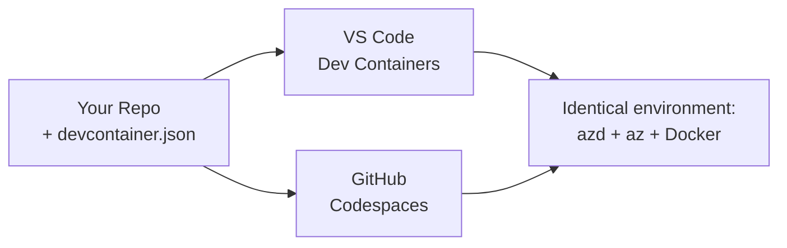

# Dev-containere & GitHub Codespaces for azd

**Kapitelnavigation:**
- **📚 Kursusforside**: [AZD for Begyndere](../../README.md)
- **📖 Nuværende kapitel**: Kapitel 1 - Fundament & Hurtig start
- **⬅️ Forrige**: [Medbring din egen app](bring-your-own-app.md)
- **🚀 Næste kapitel**: [Kapitel 2: AI-First Udvikling](../chapter-02-ai-development/README.md)

> Kommando- og konfigurationsgennemgangsmål: `azd 1.37.2` (november 2026). Container builds og Azure-udrulninger blev ikke udført som del af denne gennemgang.

## Introduktion

At installere azd, det rigtige sprogmiljø, Docker og Azure CLI på alle maskiner er en belastning — og det er den vigtigste årsag til, at en tutorial, der "virker på min maskine", fejler for andre. En **dev-container** løser dette ved at beskrive hele din toolchain i en fil. Enhver, der åbner projektet i VS Code eller GitHub Codespaces, får præcis det samme miljø med azd allerede installeret. Denne lektion viser dig, hvordan du tilføjer en.

## Læringsmål

Når du er færdig med denne lektion, vil du:
- Forstå hvad en dev-container er, og hvorfor den hjælper med azd
- Tilføje en minimal `.devcontainer/devcontainer.json` til et projekt
- Inkludere azd, Azure CLI og Docker via Dev Container *features*
- Åbne projektet i GitHub Codespaces eller VS Code

## Læringsudbytte

Efter at have gennemført denne lektion vil du kunne:
- Udforme en `devcontainer.json` til et azd-projekt
- Tilføje azd og Azure-værktøjer uden manuelle installationer
- Køre `azd up` inde fra en container eller Codespace

---

## Hvad er en dev-container?

En dev-container er et Docker-baseret udviklingsmiljø defineret af en `.devcontainer/devcontainer.json` fil i dit repositorium. Når du åbner projektet:

- **VS Code** (med udvidelsen Dev Containers) bygger containeren og tilslutter sig den.
- **GitHub Codespaces** bygger den samme container i skyen og giver dig en browserbaseret editor.

Under alle omstændigheder får hver bidragyder identiske værktøjer — ingen "har du installeret azd?" fejlsøgning.



---

## Trin 1: Opret devcontainer-filen

Opret `.devcontainer/devcontainer.json` i roden af dit projekt:

```json
{
  "name": "azd-project",
  "image": "mcr.microsoft.com/devcontainers/base:bookworm",
  "features": {
    "ghcr.io/devcontainers/features/azure-cli:1": {},
    "ghcr.io/azure/azure-dev/azd:0": { "version": "1.37.2" },
    "ghcr.io/devcontainers/features/docker-in-docker:2": {},
    "ghcr.io/devcontainers/features/node:1": {}
  },
  "customizations": {
    "vscode": {
      "extensions": [
        "ms-azuretools.azure-dev",
        "ms-azuretools.vscode-bicep"
      ]
    }
  },
  "forwardPorts": [3000],
  "postCreateCommand": "azd version"
}
```

Hvad hver del gør:

| Nøgle | Formål |
|-------|---------|
| `image` | Det basale OS for containeren |
| `features` | Forbyggede installerere — her: Azure CLI, **azd**, Docker og Node.js |
| `customizations.vscode.extensions` | Auto-installerer azd- og Bicep-udvidelser til VS Code |
| `forwardPorts` | Eksponerer din apps port til din browser |
| `postCreateCommand` | Kører én gang efter containeren er bygget (her en sanity-check) |

> Feature-versionen (`azd:0`) og den installerede CLI-version er forskellige. Sæt feature's `version` option til `"1.37.2"` for at fastlåse CLI; brug ikke en CLI-version som feature-tag.

---

## Trin 2: Tilpas feature til dit apps sprog

Skift `node` feature til det, din app bruger:

```jsonc
// Python project
"ghcr.io/devcontainers/features/python:1": {},

// .NET project
"ghcr.io/devcontainers/features/dotnet:2": {},

// Java project
"ghcr.io/devcontainers/features/java:1": {},

// Go project
"ghcr.io/devcontainers/features/go:1": {}
```

Behold `docker-in-docker` når du bygger images lokalt. En konfigureret remote ACR build (`docker.remoteBuild: true`) er et alternativ; værtstypen alene kræver ikke altid lokal Docker.

---

## Trin 3: Åbn det

**I VS Code:**
1. Installer **Dev Containers** udvidelsen.
2. Åbn projektmappen.
3. Klik på **Åbn igen i container** når du bliver bedt om det (eller kør *Dev Containers: Reopen in Container*).

**I GitHub Codespaces:**
1. Push repo til GitHub.
2. Klik **Code → Codespaces → Create codespace on main**.
3. Vent på at containeren bygges — azd er klar i terminalen.

---

## Trin 4: Udrul inde fra containeren

Containeren har azd forudinstalleret, så den normale arbejdsgang virker bare:

```bash
azd auth login --use-device-code   # device code is handy inside Codespaces
azd up
```

> **Hvorfor `--use-device-code`?** I en fjerncontainer eller Codespace findes der ingen lokal browser til omdirigering, så device-code login er den pålidelige metode. Du kopierer en kode ind i en browsertab for at fuldføre login.

---

## Almindelige faldgruber

| Faldgrube | Løsning |
|----------|---------|
| `azd up` kan ikke bygge et image | Tilføj `docker-in-docker` feature |
| Browser-login hænger i Codespaces | Brug `azd auth login --use-device-code` |
| Værktøjer varierer mellem holdmedlemmer | Fastlåse CLI via azd feature's `version` option og fastlås sprogmiljøer |
| Appen er ikke tilgængelig i browseren | Tilføj porten til `forwardPorts` |

---

## Resumé

- En dev-container gør din azd-toolchain reproducerbar for alle.
- Tilføj azd, Azure CLI og Docker gennem Dev Container *features*.
- Tilpas sprogfeature til din app og behold `docker-in-docker` for container-værter.
- Brug device-code login, når du kører i Codespaces.

---

## 🔗 Navigation

| Retning | Ressource |
|---------|----------|
| **Forrige** | [Medbring din egen app](bring-your-own-app.md) |
| **Kapitelforside** | [Kapitel 1: Fundament & Hurtig start](README.md) |
| **Næste kapitel** | [Kapitel 2: AI-First Udvikling](../chapter-02-ai-development/README.md) |

## 📖 Relaterede ressourcer

- [Installation & Setup](installation.md)
- [Kommando-oversigt](../../resources/cheat-sheet.md)
- [Officiel Dev Containers specifikation](https://containers.dev/)
- [azd Dev Container feature](https://github.com/Azure/azure-dev/tree/main/ext/devcontainer)

---

<!-- CO-OP TRANSLATOR DISCLAIMER START -->
**Ansvarsfraskrivelse**:
Dette dokument er blevet oversat ved hjælp af AI-oversættelsestjenesten [Co-op Translator](https://github.com/Azure/co-op-translator). Selvom vi bestræber os på nøjagtighed, skal du være opmærksom på, at automatiserede oversættelser kan indeholde fejl eller unøjagtigheder. Det originale dokument på dets oprindelige sprog bør betragtes som den autoritative kilde. For kritisk information anbefales professionel menneskelig oversættelse. Vi påtager os intet ansvar for misforståelser eller fejltolkninger, der opstår som følge af brugen af denne oversættelse.
<!-- CO-OP TRANSLATOR DISCLAIMER END -->