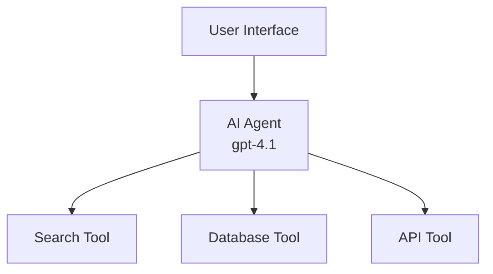
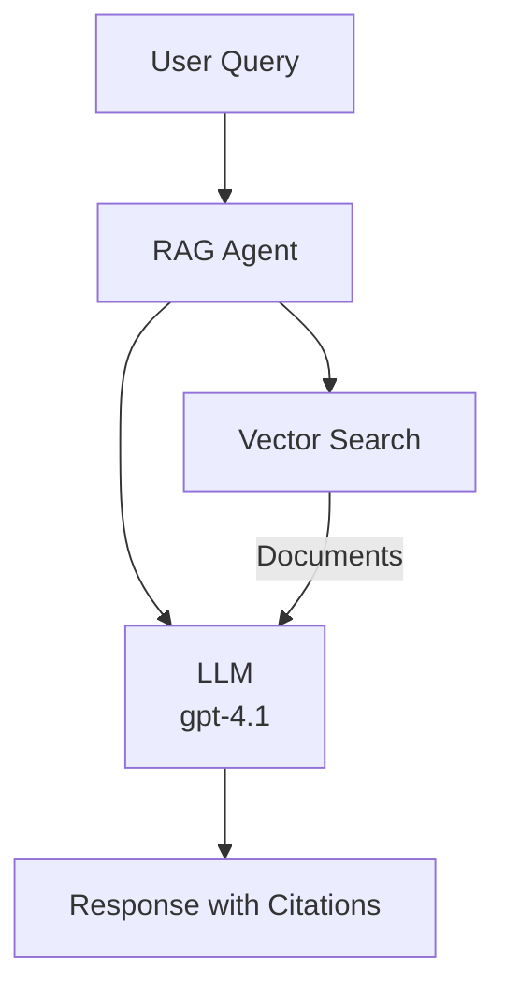
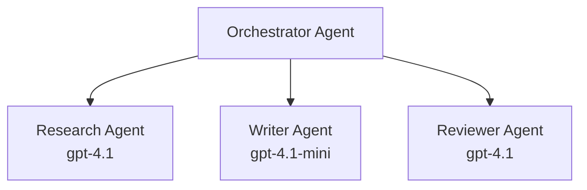

# AI-agenter med Azure Developer CLI

**Kapitelnavigation:**
- **📚 Kursus Hjem**: [AZD For Beginners](../../README.md)
- **📖 Nuværende Kapitel**: Kapitel 2 - AI-Først Udvikling
- **⬅️ Forrige**: [Microsoft Foundry Integration](microsoft-foundry-integration.md)
- **➡️ Næste**: [AI Model Deployment](ai-model-deployment.md)
- **🚀 Avanceret**: [Multi-Agent Løsninger](../../examples/retail-scenario.md)

---

## Introduktion

AI-agenter er autonome programmer, der kan opfatte deres miljø, træffe beslutninger og tage handlinger for at opnå specifikke mål. I modsætning til simple chatbots, der svarer på forespørgsler, kan agenter:

- **Brug værktøjer** - Kalde API’er, søge i databaser, udføre kode
- **Planlægge og ræsonnere** - Bryde komplekse opgaver ned i trin
- **Lære fra kontekst** - Opretholde hukommelse og tilpasse adfærd
- **Samarbejde** - Arbejde sammen med andre agenter (multi-agent systemer)

Denne vejledning viser dig, hvordan du implementerer AI-agenter til Azure ved hjælp af Azure Developer CLI (azd).

At bruge samtalekontekst er ikke modeltræning: vedvarende hukommelse, adgangskontrol og opbevaring skal implementeres/konfigureres af applikationen.

> **Udgivelsesgennemgang (2026-11-04):** CLI-eksempler blev tjekket i forhold til `azd` `1.37.2`, `azure.ai.agents` `1.0.0-beta.23`, og `azure.ai.evaluations` `1.0.0-beta.2` dokumentation/kilde, ikke en live Azure-udrulning. Brug `azd >= 1.37.0` til den samlede arbejdsgang. Se [seneste ændringer og rettelser](../chapter-08-production/production-ai-practices.md#recent-release-changes-and-fixes) før opgradering af ældre projekter.

## Læringsmål

Ved at gennemføre denne vejledning vil du:
- Forstå hvad AI-agenter er, og hvordan de adskiller sig fra chatbots
- Implementere færdigbyggede skabeloner til AI-agenter med AZD
- Konfigurere Foundry-agenter til tilpassede agenter
- Implementere grundlæggende agentmønstre (værktøjsbrug, RAG, multi-agent)
- Overvåge og fejlfinde implementerede agenter

## Læringsresultater

Når du er færdig, vil du være i stand til at:
- Implementere AI-agent-applikationer til Azure med en enkelt kommando
- Konfigurere agentværktøjer og kapaciteter
- Implementere retrieval-augmented generation (RAG) med agenter
- Designe multi-agent arkitekturer til komplekse arbejdsgange
- Fejlsøge almindelige problemer med agentudrulning

---

## 🤖 Hvad gør en Agent anderledes end en Chatbot?

| Funktion | Chatbot | AI Agent |
|---------|---------|----------|
| **Adfærd** | Svarer på prompts | Tager autonome handlinger |
| **Værktøjer** | Kan bruge hentning eller værktøjer | Bruger typisk værktøjer i en målorienteret løkke |
| **Hukommelse** | Afhængig af applikationen | Vedvarende hukommelse kun hvis eksplicit implementeret |
| **Planlægning** | Enkelt svar | Flertrins ræsonnering |
| **Samarbejde** | Enkelt enhed | Kan arbejde med andre agenter |

### Simpel Analog

- **Chatbot** = En hjælpsom person, der besvarer spørgsmål ved et informationsskrivebord
- **AI Agent** = En personlig assistent, der kan foretage opkald, booke aftaler og gennemføre opgaver for dig

---

## 🚀 Hurtig Start: Implementer Din Første Agent

Vælg en mulighed i et **nyt tomt arbejdsmiljø**. Den afsluttende `.` initialiserer der; uden et eksplicit destination kan den nuværende AZD oprette en undermappe med skabelonnavn og ændrer ikke dit shell-katalog. Hold separate skabeloner/miljøer i separate mapper.

Tid/omkostningsområderne nedenfor er vejledende, ikke bekræftede tilbud. Tjek hver eksempels aktuelle forudsætninger, priser, modelkvota og valgfrie tjenester før implementering.

### Mulighed 1: Foundry Agents Skabelon (Anbefalet)

```bash
# Initialize the AI agents template
azd init --template get-started-with-ai-agents .

# Deploy to Azure
azd up
```

**Hvad der implementeres:** Eksemplets nuværende infrastruktur og valgte muligheder bestemmer model, værktøjer, hosting og overvågningsressourcer. Gennemgå dets README og `infra/` før provisioning; antag ikke at alle agent-skabeloner inkluderer Search eller webinterface.

**Tid:** ~15-20 minutter
**Omkostning:** ~$100-150/måned (udvikling)

### Mulighed 2: Creative Writing Agents med Prompty

```bash
# Initialize the Prompty-based agent template
azd init --template https://github.com/Azure-Samples/contoso-creative-writer .

# Deploy to Azure
azd up
```

**Hvad der implementeres:** En FastAPI/Prompty multi-agent skrive-eksempel med Azure OpenAI, Bing Grounding og Azure AI Search. Det tidligere `agent-openai-python-prompty` repository omdirigerer herhen; det er ikke en minimal Azure Functions vejr-agent skabelon. Følg dets aktuelle README for hosting, modelkvota og Bing Grounding forudsætninger.

**Tid:** ~10-15 minutter
**Omkostning:** ~$50-100/måned (udvikling)

### Mulighed 3: RAG Chat Agent

```bash
# Initialize RAG chat template
azd init --template azure-search-openai-demo .

# Deploy to Azure
azd up
```

**Hvad der implementeres:**
- ✅ Microsoft Foundry Models
- ✅ Azure AI Search med eksempeldata
- ✅ Dokumentbehandlingspipeline
- ✅ Chat-interface med citater

**Tid:** ~15-25 minutter
**Omkostning:** ~$80-150/måned (udvikling)

### Mulighed 4: AZD AI Agent Init (Projekt Skabelon Preview)

Brug `azd ai agent init` interaktivt, eller tag et aktuelt `azure.yaml` agentprojekt med `--template`/`-t` i brug. Den gamle `--manifest`/`-m` mulighed er en forældet alias, ikke en konverter for ældre manifests.

```bash
# Install the AI agents extension
azd extension install azure.ai.agents

# Optional: verify the installed preview version
azd extension show azure.ai.agents

# Initialize from a current agent project template (supply your template path)
azd ai agent init --template ./templates/support-agent/azure.yaml

# Deploy to Azure
azd up

# Test the deployed agent (shows latency + time-to-first-byte)
azd ai agent invoke
```

**Hvornår man bruger `azd ai agent init` vs `azd init --template`:**

| Tilgang | Bedst til | Hvordan det virker |
|----------|----------|------|
| `azd init --template` | Starter fra en fungerende eksempelapp | Kloner et fuldt skabelonrepo med kode + infrastruktur |
| `azd ai agent init --template` | Bruger et aktuelt Foundry agentprojekt | Bruger et `azure.yaml` projekt dokument og dets definitioner |

> **Tip:** Brug `azd init --template` når du lærer (Muligheder 1-3 ovenfor). Brug `azd ai agent init` til Foundry agent arbejdsgang. For at tilføje en direkte agentdefinition til et eksisterende projekt, se [initierings- og migrationsvejledning](../chapter-08-production/production-ai-practices.md#initializing-agent-projects-with-azd-ai-agent-init).

Efter `azd up`, brug `azd ai agent invoke` til test, den separate `azure.ai.evaluations` extension (`azd ai eval init`, `generate`, og `run start`) til at måle kvaliteten og `azd ai agent optimize` til at forbedre den ved brug af den nye evalueringskonfiguration. Agenter beta.22 erstattede den gamle evalueringsarbejdsgang og ændrede optimeringens `--config` format. Se [evaluering migration](../chapter-08-production/production-ai-practices.md#evaluation-migration-and-quality-checks) og [optimering migration](../chapter-08-production/production-ai-practices.md#optimization-configuration-migration) før genbrug af ældre eksempler.

---

## 🏗️ Agent Arkitektur Mønstre

### Mønster 1: Enkel Agent med Værktøjer

Det simpleste agentmønster - en agent, der kan bruge flere værktøjer.



**Bedst til:**
- Kundesupport bots
- Forskningsassistenter
- Dataanalyse agenter

**Relateret applikationseksempel:** `azure-search-openai-demo` demonstrerer RAG, ikke en generisk agentløkke med vilkårlige værktøjer.

### Mønster 2: RAG Agent (Retrieval-Augmented Generation)

En agent, der henter relevante dokumenter før den genererer svar.



**Bedst til:**
- Virksomheders vidensbaser
- Dokument Q&A systemer
- Overholdelses- og juridisk forskning

**AZD Skabelon:** `azure-search-openai-demo`

### Mønster 3: Multi-Agent System

Flere specialiserede agenter, der arbejder sammen om komplekse opgaver.



**Bedst til:**
- Kompleks indholdsgenerering
- Flertrins arbejdsgange
- Opgaver, der kræver forskellig ekspertise

**Læs mere:** [Multi-Agent Koordinations Mønstre](../chapter-06-pre-deployment/coordination-patterns.md)

---

## ⚙️ Konfiguration af Agent Værktøjer

Agenter bliver magtfulde, når de kan bruge værktøjer. Sådan konfigurerer du almindelige værktøjer:

### Værktøjskonfiguration i Foundry Agenter

Denne **klassiske Agent Service SDK-fragment** retter sig mod `azure-ai-projects==1.0.0` og `azure-ai-agents==1.1.0` med `azure-identity`. Det er ikke den nyere versionerede agent/Responses API, som nogle nuværende Foundry skabeloner bruger, heller ikke `azure.ai.agents` AZD-udvidelsen (et andet pakke). Bland ikke disse API-generationer. Sæt `PROJECT_ENDPOINT` til en klassisk Foundry projektendepunkt og `MODEL_DEPLOYMENT_NAME` til en eksisterende understøttet modelimplementering; godkend med `az login` lokalt og tildel de krævede projektrettigheder.

```python
# agent_config.py
import os
from azure.ai.projects import AIProjectClient
from azure.ai.agents.models import FunctionTool
from azure.identity import DefaultAzureCredential

def search_knowledge_base(query: str) -> str:
    """Search the demonstration knowledge base.

    :param query: Search text.
    :return: Matching demonstration information.
    """
    # Local fixture only, not a production search implementation.
    return "Demo policy: returns are accepted within 30 days."

project_client = AIProjectClient(
    endpoint=os.environ["PROJECT_ENDPOINT"],
    credential=DefaultAzureCredential(),
)
search_tool = FunctionTool(functions={search_knowledge_base})
project_client.agents.enable_auto_function_calls(search_tool)
agent = project_client.agents.create_agent(
    model=os.environ["MODEL_DEPLOYMENT_NAME"],
    name="Support Agent",
    instructions="Use search_knowledge_base for policy questions. Label results as demo data.",
    tools=search_tool.definitions,
)
```

At registrere et funktionsskema udfører ikke Python på servicen. I denne SDK kører `enable_auto_function_calls` plus `agents.runs.create_and_process(...)` registrerede callbacks i din klientproces. Se det [udgivne SDK-eksempel](https://github.com/Azure/azure-sdk-for-python/blob/azure-ai-agents_1.1.0/sdk/ai/azure-ai-agents/samples/agents_tools/sample_agents_auto_function_call.py). Luk klienten og slet demonstrationsagenter/tråde, når du er færdig.

### Miljøkonfiguration

Følgende navne er **vejledende custom-template inputs**, ikke indbyggede AZD-skift. Først led hver værdi gennem `infra/main.parameters.json`, infrastruktur og applikationskode. `azd env set` alene ændrer ikke agentens værktøjer eller instruktioner.

```bash
# Set up agent-specific environment variables
azd env set AZURE_OPENAI_MODEL "gpt-4.1"
azd env set AGENT_INSTRUCTIONS "You are a helpful assistant..."
azd env set ENABLE_CODE_INTERPRETER "true"
azd env set ENABLE_FILE_SEARCH "true"

# Apply wired infrastructure and application changes
azd up
```

---

## 📊 Overvågning af Agenter

### Application Insights Integration

Hvis din valgte skabelon provisionerer Application Insights og konfigurerer instrumentering:

```bash
# Open monitoring dashboard
azd monitor --overview

# Open the Application Insights logs view (not a streaming log tail)
azd monitor --logs

# View live metrics
azd monitor --live
```

### Nøgleindikatorer at Spore

| Metrik | Beskrivelse | Mål |
|--------|-------------|--------|
| Responstid | Tid til at generere svar | < 5 sekunder |
| Tokenforbrug | Tokens pr. forespørgsel | Overvåg for omkostninger |
| Værktøjskald Successrate | % af vellykkede værktøjskald | > 95% |
| Fejlrate | Fejlede agentforespørgsler | < 1% |
| Bruger tilfredshed | Feedback scores | > 4.0/5.0 |

### Brugerdefineret Logning for Agenter

```python
import os
from azure.monitor.opentelemetry import configure_azure_monitor
from opentelemetry import trace

# Configure Azure Monitor with OpenTelemetry
configure_azure_monitor(
    connection_string=os.environ["APPLICATIONINSIGHTS_CONNECTION_STRING"]
)

tracer = trace.get_tracer(__name__)

def log_agent_interaction(user_query, agent_response, tools_used, latency_ms):
    with tracer.start_as_current_span("agent_interaction") as span:
        span.set_attributes({
            "query_length": len(user_query),  # Do not log raw prompts or personal data
            "response_length": len(agent_response),
            "tools_used": tools_used,
            "latency_ms": latency_ms
        })
```

> **Bemærk:** Installer den krævede pakke: `pip install azure-monitor-opentelemetry`. Den bringer OpenTelemetry-afhængighederne; import-navnerum er ikke et krav for at installere en pakke med navnet `opentelemetry`.

---

## 💰 Omkostningsbetragtninger

### Estimerede månedlige omkostninger efter mønster

Disse er vejledende planlægningsintervaller, ikke tilbud eller udgiftslofter. Region, model tokens, Search/compute SKUs, værktøjssessioner, lager og trafik kan overstige dem. Tjek eksempels omkostningsvejledning og Azure-priser før `azd up`.

| Mønster | Udviklingsmiljø | Produktion |
|---------|-----------------|------------|
| Enkelt Agent | $50-100 | $200-500 |
| RAG Agent | $80-150 | $300-800 |
| Multi-Agent (2-3 agenter) | $150-300 | $500-1,500 |
| Enterprise Multi-Agent | $300-500 | $1,500-5,000+ |

### Omkostningsoptimeringstips

1. **Brug gpt-4.1-mini til simple opgaver** (kun hvis din skabelon anvender dette input)
   ```bash
   azd env set AZURE_OPENAI_MODEL "gpt-4.1-mini"
   ```

2. **Implementér scoped caching for sikre, gentagne forespørgsler.** Inkluder lejer-/brugerautorisation, modeludrulning, instruktioner og hentningsversion i cache-nøglen; sæt udløb. Del ikke private samtalesvar via en proces-bred forespørgselsbaseret cache. SDK-agent-objektet har ingen generisk `agent.run()` metode.

3. **Sæt token-grænser pr. kørsel**
   ```python
   # Set max_completion_tokens when running the agent, not during creation
   run = project_client.agents.runs.create_and_process(
       thread_id=thread.id,
       agent_id=agent.id,
       max_completion_tokens=1000  # Budget across the run; may finish as incomplete
   )
   ```

4. **Skaler berettigede Container Apps ned til nul, når de ikke er i brug**
   ```bash
   # Custom-template input: must map to template.scale.minReplicas
   azd env set MIN_REPLICAS "0"
   ```
   Anvend infrastrukturbeslutningen med `azd provision` eller `azd up`. Skalering til nul kræver en passende trigger og stopper ikke Search, lager eller model-/værktøjsomkostninger.

---

## 🔧 Fejlfinding af Agenter

### Almindelige Problemer og Løsninger

<details>
<summary><strong>❌ Agent svarer ikke på værktøjskald</strong></summary>

```bash
# Inspect the application deployment (not the agent's registered tools)
azd show

# Verify OpenAI deployment
az cognitiveservices account deployment list \
  --name $AZURE_OPENAI_NAME \
  --resource-group $RG_NAME

# Check agent logs
azd monitor --logs
```

**Almindelige årsager:**
- Værktøjsfunktionssignatur passer ikke
- Manglende nødvendige tilladelser
- API-endepunkt ikke tilgængeligt
</details>

<details>
<summary><strong>❌ Høj forsinkelse i agentsvar</strong></summary>

```bash
# Check Application Insights for bottlenecks
azd monitor --live

# Consider using a faster model
azd env set AZURE_OPENAI_MODEL "gpt-4.1-mini"
azd up
```

**Optimeringstips:**
- Brug streaming svar
- Implementér svartcaching
- Reducér størrelsen på kontekstvinduet
</details>

<details>
<summary><strong>❌ Agent returnerer forkert eller hallucineret information</strong></summary>

```python
# Improve with better system prompts
instructions = """
You are a helpful assistant. IMPORTANT:
- Only answer based on provided context
- If you don't know, say "I don't know"
- Always cite your sources
- Never make up information
"""

# Use these instructions in the agent definition.
# For classic file search, first upload/index documents in a vector store,
# then use FileSearchTool(vector_store_ids=[...]) and pass both its
# .definitions and .resources when creating the agent.
```
 Instruktioner og hentning mindsker risiko; ingen garanterer faktuelle svar. Evaluer grundede og uden-for-rammen spørgsmål mod kendte svar.
</details>

<details>
<summary><strong>❌ Fejl om overskredne token-grænser</strong></summary>

```python
# Implement context window management
def truncate_context(messages, max_tokens=8000, model="gpt-4.1"):
    """Approximate content-only budget for objects with .content strings."""
    import tiktoken
    encoding = tiktoken.encoding_for_model(model)
    total_tokens = 0
    truncated = []
    
    for msg in reversed(messages):
        msg_tokens = len(encoding.encode(msg.content))
        if total_tokens + msg_tokens > max_tokens:
            break
        truncated.insert(0, msg)
        total_tokens += msg_tokens
    
    return truncated
```
 Denne hjælper udelukker rolle-/værktøjsskemaer, systeminstruktioner, billedtokens og protokol overhead. Reserver plads til disse og fuldførelsen; del ikke værktøjskald/resultatpar eller kasser nødvendige systeminstruktioner. Installer `tiktoken` separat. Det er ikke en generel validator for kontekstvindue.
</details>

---

## 🎓 Praktiske Øvelser

### Øvelse 1: Implementer en Grundlæggende Agent (20 minutter)

**Mål:** Implementer din første AI-agent med AZD

```bash
# Step 1: Initialize template
azd init --template get-started-with-ai-agents .

# Step 2: Login to Azure
azd auth login
# If you work across tenants, add --tenant-id <tenant-id>

# Step 3: Deploy
azd up

# Step 4: Test the agent
# Expected output after deployment:
#   Deployment Complete!
#   Endpoint: https://<app-name>.<region>.azurecontainerapps.io
# Open the URL shown in the output and try asking a question

# Step 5: View monitoring
azd monitor --overview

# Step 6: Clean up
azd down --force --purge
```

**Succes kriterier:**
- [ ] Agent svarer på spørgsmål
- [ ] Kan tilgå overvågningsdashboard via `azd monitor`
- [ ] Ressourcer ryddet op med succes

### Øvelse 2: Tilføj et Tilpasset Værktøj (30 minutter)

**Mål:** Udvid en agent med et tilpasset værktøj

**Startpunkt:** Brug den klassiske SDK-klient fra [Værktøjskonfiguration](#tool-configuration-in-foundry-agents), ikke en vilkårlig skabelon med en anden SDK-generation.

1. Tilføj denne deterministiske fixture til `agent_config.py`:
   ```python
   def get_weather(location: str) -> str:
       """Return demonstration weather, not live conditions.

       :param location: City name.
       :return: A clearly labelled fixture.
       """
       print(f"TOOL_CALLED: {location}")
       return f"Demo weather in {location}: Sunny, 72°F (fixture, not live)"
   ```
2. Erstat registrerings- og oprettelsesblokken for søgeværktøjet med:
   ```python
   weather_tool = FunctionTool(functions={get_weather})
   project_client.agents.enable_auto_function_calls(weather_tool)
   agent = project_client.agents.create_agent(
       model=os.environ["MODEL_DEPLOYMENT_NAME"],
       name="Weather Agent",
       instructions="Call get_weather for weather questions; explain that it returns demo data.",
       tools=weather_tool.definitions,
   )
   thread = project_client.agents.threads.create()
   try:
       project_client.agents.messages.create(
           thread_id=thread.id, role="user", content="Use get_weather for Seattle."
       )
       run = project_client.agents.runs.create_and_process(
           thread_id=thread.id, agent_id=agent.id
       )
       if run.status != "completed":
           raise RuntimeError(f"Run status: {run.status}; error: {run.last_error}")
       for message in project_client.agents.messages.list(thread_id=thread.id):
           for text in message.text_messages:
               print(text.text.value)
   finally:
       project_client.agents.threads.delete(thread.id)
       project_client.agents.delete_agent(agent.id)
       project_client.close()
   ```
3. Kør lokalt (dette kalder det eksisterende Azure-projekt og medfører modelomkostninger):
   ```bash
   python agent_config.py
   # Expected: TOOL_CALLED: Seattle, then a completed answer labelled demo data.
   ```

**Succeskriterier:**
- [ ] Agenten genkender vejrbetingede forespørgsler
- [ ] Værktøjet kaldes korrekt
- [ ] Svaret inkluderer vejrinformation

### Øvelse 3: Byg en RAG Agent (45 minutter)

**Mål:** Opret en agent, der svarer på spørgsmål ud fra dine dokumenter

```bash
# Step 1: Deploy RAG template
azd init --template azure-search-openai-demo .
azd up

# Step 2: Upload your documents
# For the sample's local ingestion path, place supported files in data/.
# Run from the sample root after following its Python environment setup:
./scripts/prepdocs.sh
# Windows PowerShell equivalent: .\\scripts\\prepdocs.ps1

# Step 3: Test with domain-specific questions
# Open the web app URL from the azd up output
# Ask questions about your uploaded documents
# Responses should include citation references like [doc.pdf]
```

**Succeskriterier:**
- [ ] Agenten svarer ud fra uploadede dokumenter
- [ ] Svarene inkluderer kildehenvisninger
- [ ] Testspørgsmål uden for omfang håndteres uden uunderbyggede påstande (ikke en garanti for hvert fremtidigt spørgsmål)

Hvis `USE_CLOUD_INGESTION=true`, brug i stedet eksemplets cloud ingestion/upload workflow; den lokale wrapper springer bevidst ingestion over. Efter test, kør `azd down` i RAG-miljøet og gennemgå de ressourcer, der skal slettes.

---

## 📚 Næste trin

Nu hvor du forstår AI-agenter, kan du udforske disse avancerede emner:

| Emne | Beskrivelse | Link |
|-------|-------------|------|
| **Multi-Agent Systemer** | Byg systemer med flere samarbejdende agenter | [Retail Multi-Agent Example](../../examples/retail-scenario.md) |
| **Koordineringsmønstre** | Lær orkestrerings- og kommunikationsmønstre | [Coordination Patterns](../chapter-06-pre-deployment/coordination-patterns.md) |
| **Produktionsudrulning** | Agentudrulning klar til virksomhed | [Production AI Practices](../chapter-08-production/production-ai-practices.md) |
| **Agent Evaluering** | Test og evaluer agentpræstation | [AI Troubleshooting](../chapter-07-troubleshooting/ai-troubleshooting.md) |
| **AI Workshop Lab** | Hands-on: Gør din AI-løsning AZD-klar | [AI Workshop Lab](ai-workshop-lab.md) |

---

## 📖 Yderligere ressourcer

### Officiel dokumentation
- [Microsoft Foundry Agent Service](https://learn.microsoft.com/azure/ai-services/agents/)
- [Microsoft Foundry Agent Service Quickstart](https://learn.microsoft.com/azure/ai-services/agents/quickstart)
- [Semantic Kernel Agent Framework](https://learn.microsoft.com/semantic-kernel/)

### AZD Skabeloner til Agenter
- [Kom i gang med AI-agenter](https://github.com/Azure-Samples/get-started-with-ai-agents)
- [Kreative skriveagenter med Prompty](https://github.com/Azure-Samples/contoso-creative-writer)
- [Azure Search OpenAI Demo](https://github.com/Azure-Samples/azure-search-openai-demo)

### Community ressourcer
- [Awesome AZD - Agent Skabeloner](https://azure.github.io/awesome-azd/?tags=ai-agents)
- [Azure AI Discord](https://discord.gg/microsoft-azure)
- [Microsoft Foundry Discord](https://discord.gg/nTYy5BXMWG)

### Agentfærdigheder til din editor
- [**Microsoft Azure Agent Skills**](https://skills.sh/microsoft/github-copilot-for-azure) - Installér genanvendelige AI-agentfærdigheder til Azure-udvikling i GitHub Copilot, Cursor eller enhver understøttet agent. Indeholder færdigheder til [Azure AI](https://skills.sh/microsoft/github-copilot-for-azure/azure-ai), [Microsoft Foundry](https://skills.sh/microsoft/github-copilot-for-azure/microsoft-foundry), [udrulning](https://skills.sh/microsoft/github-copilot-for-azure/azure-deploy) og [diagnostik](https://skills.sh/microsoft/github-copilot-for-azure/azure-diagnostics):
  ```bash
  npx skills add microsoft/github-copilot-for-azure
  ```

---

**Navigation**
- **Forrige lektion**: [Microsoft Foundry Integration](microsoft-foundry-integration.md)
- **Næste lektion**: [AI Model Deployment](ai-model-deployment.md)

---

<!-- CO-OP TRANSLATOR DISCLAIMER START -->
**Ansvarsfraskrivelse**:
Dette dokument er blevet oversat ved hjælp af AI-oversættelsestjenesten [Co-op Translator](https://github.com/Azure/co-op-translator). Selvom vi bestræber os på nøjagtighed, skal du være opmærksom på, at automatiserede oversættelser kan indeholde fejl eller unøjagtigheder. Det originale dokument på dets oprindelige sprog bør betragtes som den autoritative kilde. For kritisk information anbefales professionel menneskelig oversættelse. Vi påtager os intet ansvar for misforståelser eller fejltolkninger, der opstår som følge af brugen af denne oversættelse.
<!-- CO-OP TRANSLATOR DISCLAIMER END -->