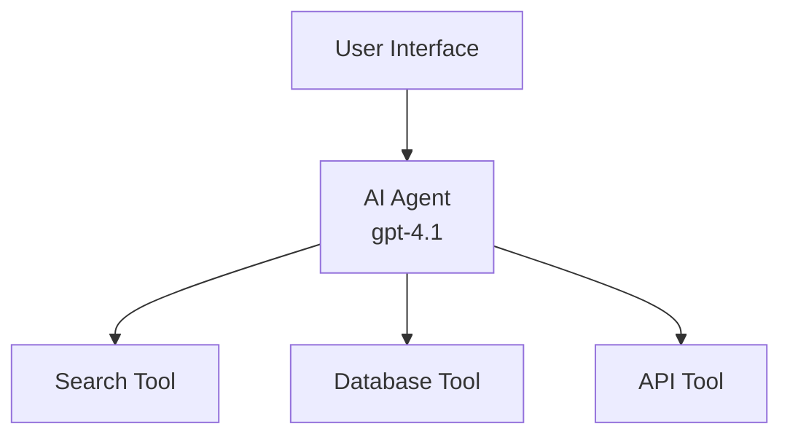
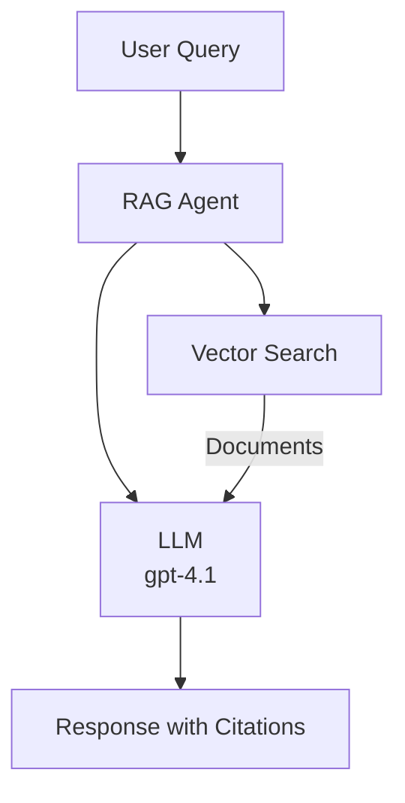
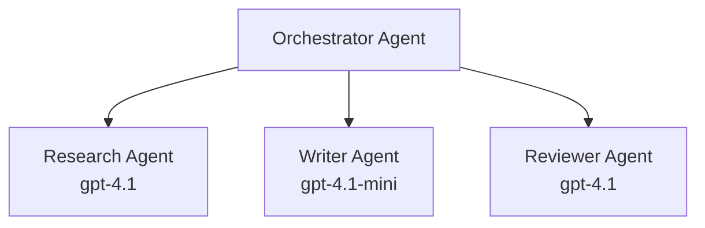

# AI-agenter med Azure Developer CLI

**Kapitelnavigation:**
- **📚 Kursusstart**: [AZD For Beginners](../../README.md)
- **📖 Nuværende kapitel**: Kapitel 2 - AI-First Development
- **⬅️ Forrige**: [Microsoft Foundry Integration](microsoft-foundry-integration.md)
- **➡️ Næste**: [AI Model Deployment](ai-model-deployment.md)
- **🚀 Avanceret**: [Multi-Agent Solutions](../../examples/retail-scenario.md)

---

## Introduktion

AI-agenter er autonome programmer, der kan opfatte deres miljø, træffe beslutninger og tage handlinger for at nå specifikke mål. I modsætning til simple chatbots, der svarer på anmodninger, kan agenter:

- **Brug værktøjer** - Kalde API'er, søge i databaser, udføre kode
- **Planlægge og ræsonnere** - Opdele komplekse opgaver i trin
- **Lære fra kontekst** - Opbevare hukommelse og tilpasse adfærd
- **Samarbejde** - Arbejde sammen med andre agenter (multi-agent systemer)

Denne vejledning viser dig, hvordan du implementerer AI-agenter til Azure ved hjælp af Azure Developer CLI (azd).

Brug af samtalekontekst er ikke modeltræning: vedvarende hukommelse, adgangskontrol og opbevaring skal implementeres/konfigureres af applikationen.

> **Foundry GA-opdatering (2026-11-09):** Installer den generelt tilgængelige `microsoft.foundry` 1.0-pakke med `azd >= 1.37.0`. Evalueringer installeres separat; valgfrie preview-funktioner og det klassiske SDK-fragment nedenfor promoveres ikke til GA ved pakkens annoncering. Denne vejledning er baseret på [GA-announcement](https://devblogs.microsoft.com/azure-sdk/microsoft-foundry-azure-developer-cli-ga/) og dokumentation, ikke en live Azure-implementering.

## Læringsmål

Ved at gennemføre denne vejledning vil du:
- Forstå, hvad AI-agenter er, og hvordan de adskiller sig fra chatbots
- Implementere forudbyggede AI-agent skabeloner ved hjælp af AZD
- Konfigurere Foundry-agenter til brugerdefinerede agenter
- Implementere grundlæggende agentmønstre (værktøjsbrug, RAG, multi-agent)
- Overvåge og fejlfinde implementerede agenter

## Læringsresultater

Når du er færdig, vil du kunne:
- Implementere AI-agent applikationer til Azure med en enkelt kommando
- Konfigurere agentværktøjer og -funktioner
- Implementere retrieval-augmented generation (RAG) med agenter
- Designe multi-agent arkitekturer til komplekse workflows
- Løse almindelige problemer ved agentimplementering

---

## 🤖 Hvad gør en agent anderledes end en chatbot?

| Funktion | Chatbot | AI-Agent |
|---------|---------|----------|
| **Adfærd** | Svarer på anmodninger | Tager autonome handlinger |
| **Værktøjer** | Kan bruge søgning eller værktøjer | Typisk værktøjsbrug i en målrettet løkke |
| **Hukommelse** | Applikationsafhængig | Vedvarende hukommelse kun hvis eksplicit implementeret |
| **Planlægning** | Enkeltsvar | Flerskridts ræsonnering |
| **Samarbejde** | Enkelt enhed | Kan samarbejde med andre agenter |

### Enkel analogi

- **Chatbot** = En hjælpsom person, der besvarer spørgsmål ved en informationsskranke
- **AI-Agent** = En personlig assistent, der kan ringe op, booke aftaler og udføre opgaver for dig

---

## 🚀 Kom godt i gang: Implementer din første agent

Vælg en mulighed i et **nyt tomt arbejdsbibliotek**. Den afsluttende `.` initialiserer der; uden en eksplicit destination kan nuværende AZD oprette en undermappe med skabelonens navn og ændrer ikke dit terminals bibliotek. Hold separate skabeloner/miljøer i separate biblioteker.

Tids-/omkostningsangivelserne nedenfor er vejledende, ikke bekræftede tilbud. Tjek hver prøves aktuelle forudsætninger, priser, modelkvoter og valgfrie tjenester før implementering.

### Mulighed 1: Foundry Agents Skabelon (Anbefalet)

```bash
# Initialize the AI agents template
azd init --template get-started-with-ai-agents .

# Deploy to Azure
azd up
```

**Hvad implementeres:** Prøvens aktuelle infrastruktur og valgte muligheder bestemmer model, værktøjer, hosting og overvågningsressourcer. Gennemgå README og `infra/` før provisionering; antag ikke at enhver agent-skabelon inkluderer Search eller et webinterface.

**Tid:** ~15-20 minutter
**Pris:** ~$100-150/måned (udvikling)

### Mulighed 2: Kreative Agent-skrivninger med Prompty

```bash
# Initialize the Prompty-based agent template
azd init --template https://github.com/Azure-Samples/contoso-creative-writer .

# Deploy to Azure
azd up
```

**Hvad implementeres:** En FastAPI/Prompty multi-agent skriveprøve, der bruger Azure OpenAI, Bing Grounding og Azure AI Search. Det tidligere `agent-openai-python-prompty` repository omdirigerer her; det er ikke en minimal Azure Functions vejr-agent skabelon. Følg den aktuelle README for hosting, modelkvoter og Bing Grounding krav.

**Tid:** ~10-15 minutter
**Pris:** ~$50-100/måned (udvikling)

### Mulighed 3: RAG Chat-agent

```bash
# Initialize RAG chat template
azd init --template azure-search-openai-demo .

# Deploy to Azure
azd up
```

**Hvad implementeres:**
- ✅ Microsoft Foundry modeller
- ✅ Azure AI Search med prøve-data
- ✅ Dokumentbehandlingspipeline
- ✅ Chat-interface med kildehenvisninger

**Tid:** ~15-25 minutter
**Pris:** ~$80-150/måned (udvikling)

### Mulighed 4: Hosted Agent med GA Foundry-pakken

Brug [den komplette hosted-agent vejledning](microsoft-foundry-integration.md#hosted-agent-walkthrough-ga) for det grundlæggende Python Agent Framework Responses API eksempel. Denne kode-implementeringsvej kræver Python 3.13+, de aktuelle uv, Foundry tilladelser og regional modelkvote. Autentificer lokale SDK-kald separat ved brug af Azure CLI-legitimationsoplysninger.

```bash
azd auth login
azd ext install microsoft.foundry
```

Initialiser prøven i det tomme bibliotek:

```text
azd ai agent init --template https://github.com/microsoft-foundry/foundry-samples/blob/main/samples/python/hosted-agents/agent-framework/responses/01-basic/azure.yaml --deploy-mode code --src .
```

Vælg et nyt eller eksisterende projekt, gennemgå `azure.yaml`, og kør `azd provision`. Brug `azd ai agent run` til at åbne Agent Inspector og fra en anden terminal i biblioteket `azd ai agent invoke --local "Explain how this agent is hosted."`. Efter lokal verifikation, brug `azd deploy` og `azd ai agent invoke "Explain how this agent is hosted."` til at sammenligne den implementerede respons. Foundry bygger den uploadede kilde eksternt; en lokal containerbuild er ikke nødvendig.

**Hvornår bruger man `azd ai agent init` vs `azd init --template`:**

| Tilgang | Bedst til | Hvordan det virker |
|----------|----------|------|
| `azd init --template` | Starter fra en fungerende prøve-app | Kloner et fuldt skabelon-repo med kode + infrastruktur |
| `azd ai agent init --template` | Tilpasser et aktuelt Foundry agent-projekt | Bruger et `azure.yaml` projekt dokument og dets definitioner |

> **Tip:** Mulighederne 1-3 starter fra fulde applikationsskabeloner; mulighed 4 lærer den GA hosted-agent arbejdsgang. Ingen initialiseringskommando migrerer automatisk ældre agent-manifester. For at tilføje en direkte agentdefinition til et eksisterende projekt, se [initialiserings- og migrationsvejledning](../chapter-08-production/production-ai-practices.md#initializing-agent-projects-with-azd-ai-agent-init).

Installer `azure.ai.evaluations` separat for at generere og gennemgå testdata/bedømmelser, konfigurere en evaluering og køre den med `azd ai eval`. Optimering kan genbruge en kompatibel evaluering; gennemgå kandidater før eksplicit implementering. Følg [evalueringsarbejdsgang](../chapter-08-production/production-ai-practices.md#evaluation-migration-and-quality-checks) og [optimeringsmigrering](../chapter-08-production/production-ai-practices.md#optimization-configuration-migration) før genbrug af ældre eksempler. Til oprydning forbliver ressourcer for et genbrugt Foundry-projekt efter `azd down`; en nyoprettet projektressourcegruppe slettes. Se [oprydningsvejledning](microsoft-foundry-integration.md#7-clean-up-deliberately).

---

## 🏗️ Agentarkitektur-mønstre

### Mønster 1: Enkel Agent med Værktøjer

Det enkleste agentmønster - en agent, der kan bruge flere værktøjer.



**Bedst til:**
- Kundesupport bots
- Forskningsassistenter
- Dataanalyse-agenter

**Relateret anvendelses-prøve:** `azure-search-openai-demo` demonstrerer RAG, ikke en generisk vilkårlig-værktøjs agent-løkke.

### Mønster 2: RAG Agent (Retrieval-Augmented Generation)

En agent, der henter relevante dokumenter før responsgenerering.



**Bedst til:**
- Virksomhedsvidenbaser
- Dokument Q&A systemer
- Compliance og juridisk forskning

**AZD Skabelon:** `azure-search-openai-demo`

### Mønster 3: Multi-Agent System

Flere specialiserede agenter, der arbejder sammen om komplekse opgaver.



**Bedst til:**
- Komplekse indholdsgenereringer
- Flerskridts workflows
- Opgaver, der kræver forskellig ekspertise

**Lær mere:** [Multi-Agent Coordination Patterns](../chapter-06-pre-deployment/coordination-patterns.md)

---

## ⚙️ Konfiguration af Agent-værktøjer

Agenter bliver kraftfulde, når de kan bruge værktøjer. Sådan konfigurerer du almindelige værktøjer:

### Værktøjskonfiguration i Foundry Agents

Dette **klassiske Agent Service SDK-fragment** retter sig mod `azure-ai-projects==1.0.0` og `azure-ai-agents==1.1.0` med `azure-identity`. Det er ikke den nyere versionerede agent/Responses API, som nogle nuværende Foundry-skabeloner bruger, heller ikke `azure.ai.agents` AZD-udvidelsen (en anden pakke). Bland ikke disse API-generationer. Sæt `PROJECT_ENDPOINT` til et klassisk Foundry-projekt-endpoint og `MODEL_DEPLOYMENT_NAME` til en eksisterende understøttet modelimplementering; autentificer lokalt med `az login` og giv de nødvendige projekt-tilladelser.

```python
# agent_config.py
import os
from azure.ai.projects import AIProjectClient
from azure.ai.agents.models import FunctionTool
from azure.identity import DefaultAzureCredential

def search_knowledge_base(query: str) -> str:
    """Search the demonstration knowledge base.

    :param query: Search text.
    :return: Matching demonstration information.
    """
    # Local fixture only, not a production search implementation.
    return "Demo policy: returns are accepted within 30 days."

project_client = AIProjectClient(
    endpoint=os.environ["PROJECT_ENDPOINT"],
    credential=DefaultAzureCredential(),
)
search_tool = FunctionTool(functions={search_knowledge_base})
project_client.agents.enable_auto_function_calls(search_tool)
agent = project_client.agents.create_agent(
    model=os.environ["MODEL_DEPLOYMENT_NAME"],
    name="Support Agent",
    instructions="Use search_knowledge_base for policy questions. Label results as demo data.",
    tools=search_tool.definitions,
)
```

Registrering af et funktionsskema udfører ikke Python på servicen. I dette SDK kører `enable_auto_function_calls` plus `agents.runs.create_and_process(...)` registrerede callbacks i din klientproces. Se [udgivet SDK-eksempel](https://github.com/Azure/azure-sdk-for-python/blob/azure-ai-agents_1.1.0/sdk/ai/azure-ai-agents/samples/agents_tools/sample_agents_auto_function_call.py). Luk klienten og slet demonstrationsagenter/tråde, når du er færdig.

### Miljøkonfiguration

Følgende navne er **illustrative brugerdefinerede skabeloninput**, ikke indbyggede AZD-switches. Først led hver værdi igennem `infra/main.parameters.json`, infrastruktur og applikationskode. `azd env set` alene ændrer ikke en agents værktøjer eller instruktioner.

```bash
# Set up agent-specific environment variables
azd env set AZURE_OPENAI_MODEL "gpt-4.1"
azd env set AGENT_INSTRUCTIONS "You are a helpful assistant..."
azd env set ENABLE_CODE_INTERPRETER "true"
azd env set ENABLE_FILE_SEARCH "true"

# Apply wired infrastructure and application changes
azd up
```

---

## 📊 Overvågning af agenter

### Application Insights Integration

Hvis din valgte skabelon provisionerer Application Insights og konfigurerer instrumentation:

```bash
# Open monitoring dashboard
azd monitor --overview

# Open the Application Insights logs view (not a streaming log tail)
azd monitor --logs

# View live metrics
azd monitor --live
```

### Vigtige metrics at følge

| Metric | Beskrivelse | Mål |
|--------|-------------|--------|
| Responsforsinkelse | Tid til at generere respons | < 5 sekunder |
| Tokenforbrug | Tokens per anmodning | Overvåg for omkostninger |
| Værktøjskalds succesrate | % af succesfulde værktøjskørsler | > 95% |
| Fejlrate | Mislykkedes agentanmodninger | < 1% |
| Brugertilfredshed | Feedback score | > 4.0/5.0 |

### Brugerdefineret logging for agenter

```python
import os
from azure.monitor.opentelemetry import configure_azure_monitor
from opentelemetry import trace

# Configure Azure Monitor with OpenTelemetry
configure_azure_monitor(
    connection_string=os.environ["APPLICATIONINSIGHTS_CONNECTION_STRING"]
)

tracer = trace.get_tracer(__name__)

def log_agent_interaction(user_query, agent_response, tools_used, latency_ms):
    with tracer.start_as_current_span("agent_interaction") as span:
        span.set_attributes({
            "query_length": len(user_query),  # Do not log raw prompts or personal data
            "response_length": len(agent_response),
            "tools_used": tools_used,
            "latency_ms": latency_ms
        })
```

> **Bemærk:** Installer den nødvendige pakke: `pip install azure-monitor-opentelemetry`. Den bringer OpenTelemetry-afhængigheder; import-navnerummet er ikke et krav for at installere en pakke kaldet `opentelemetry`.

---

## 💰 Omkostningsbetragtninger

### Anslåede månedlige omkostninger efter mønster

Disse er illustrerende planlægningsintervaller, ikke tilbud eller forbrugslofter. Region, modeltokens, Search/compute SKUs, værktøjssessioner, lagring og trafik kan overstige disse. Tjek prøvens omkostningsvejledning og Azure-priser før `azd up`.

| Mønster | Udviklingsmiljø | Produktion |
|---------|-----------------|------------|
| Enkel agent | $50-100 | $200-500 |
| RAG Agent | $80-150 | $300-800 |
| Multi-Agent (2-3 agenter) | $150-300 | $500-1.500 |
| Enterprise Multi-Agent | $300-500 | $1.500-5.000+ |

### Tips til omkostningsoptimering

1. **Brug gpt-4.1-mini til simple opgaver** (kun hvis din skabelon anvender dette input)
   ```bash
   azd env set AZURE_OPENAI_MODEL "gpt-4.1-mini"
   ```

2. **Implementer scoped caching for sikre, gentagne forespørgsler.** Inkluder tenant-/brugerautorisation, modelimplementering, instruktioner og hentningsversion i cache-nøglen; sæt en udløbstid. Del ikke private samtalerespons gennem en procesbred kun-forespørgsels-cache. SDK agent-objektet har ikke en generisk `agent.run()` metode.

3. **Sæt tokenbegrænsninger per kørsel**
   ```python
   # Set max_completion_tokens when running the agent, not during creation
   run = project_client.agents.runs.create_and_process(
       thread_id=thread.id,
       agent_id=agent.id,
       max_completion_tokens=1000  # Budget across the run; may finish as incomplete
   )
   ```

4. **Skalér berettigede Container Apps til nul, når de ikke er i brug**
   ```bash
   # Custom-template input: must map to template.scale.minReplicas
   azd env set MIN_REPLICAS "0"
   ```
   Anvend infrastrukturer ændringen med `azd provision` eller `azd up`. Skalering til nul kræver en egnet trigger og stopper ikke Search, lagring eller model/værktøjsomkostninger.

---

## 🔧 Fejlfinding af agenter

### Almindelige problemer og løsninger

<details>
<summary><strong>❌ Agent svarer ikke på værktøjskald</strong></summary>

```bash
# Inspect the application deployment (not the agent's registered tools)
azd show

# Verify OpenAI deployment
az cognitiveservices account deployment list \
  --name $AZURE_OPENAI_NAME \
  --resource-group $RG_NAME

# Check agent logs
azd monitor --logs
```

**Almindelige årsager:**
- Værktøjsfunktions signatur passer ikke
- Manglende nødvendige tilladelser
- API-endpoint ikke tilgængeligt
</details>

<details>
<summary><strong>❌ Høj latenstid i agentrespons</strong></summary>

```bash
# Check Application Insights for bottlenecks
azd monitor --live

# Consider using a faster model
azd env set AZURE_OPENAI_MODEL "gpt-4.1-mini"
azd up
```

**Optimeringstips:**
- Brug streaming-responser
- Implementer responscaching
- Reducer kontekstvinduesstørrelse
</details>

<details>
<summary><strong>❌ Agent returnerer ukorrekte eller hallucinatoriske oplysninger</strong></summary>

```python
# Improve with better system prompts
instructions = """
You are a helpful assistant. IMPORTANT:
- Only answer based on provided context
- If you don't know, say "I don't know"
- Always cite your sources
- Never make up information
"""

# Use these instructions in the agent definition.
# For classic file search, first upload/index documents in a vector store,
# then use FileSearchTool(vector_store_ids=[...]) and pass both its
# .definitions and .resources when creating the agent.
```
Instruktioner og hentning reducerer risiko; ingen garanterer faktuelle svar. Evaluer jordede og udenfor-område spørgsmål mod kendte svar.
</details>

<details>
<summary><strong>❌ Tokenbegrænsning overskredet fejl</strong></summary>

```python
# Implement context window management
def truncate_context(messages, max_tokens=8000, model="gpt-4.1"):
    """Approximate content-only budget for objects with .content strings."""
    import tiktoken
    encoding = tiktoken.encoding_for_model(model)
    total_tokens = 0
    truncated = []
    
    for msg in reversed(messages):
        msg_tokens = len(encoding.encode(msg.content))
        if total_tokens + msg_tokens > max_tokens:
            break
        truncated.insert(0, msg)
        total_tokens += msg_tokens
    
    return truncated
```
Denne hjælper ekskluderer rolle-/værktøjsskemaer, systeminstruktioner, billedtokens og protokolomkostninger. Reserver plads til disse og fuldførelsen; del ikke værktøjskald/resultat-par eller kasser nødvendige systeminstruktioner. Installer `tiktoken` separat. Det er ikke en generel kontekstvindues-validator.
</details>

---

## 🎓 Praktiske øvelser

### Øvelse 1: Implementer en basal agent (20 minutter)

**Mål:** Implementer din første AI-agent ved hjælp af AZD

```bash
# Step 1: Initialize template
azd init --template get-started-with-ai-agents .

# Step 2: Login to Azure
azd auth login
# If you work across tenants, add --tenant-id <tenant-id>

# Step 3: Deploy
azd up

# Step 4: Test the agent
# Expected output after deployment:
#   Deployment Complete!
#   Endpoint: https://<app-name>.<region>.azurecontainerapps.io
# Open the URL shown in the output and try asking a question

# Step 5: View monitoring
azd monitor --overview

# Step 6: Review the listed resources and confirm cleanup
azd down
```

**Succes kriterier:**
- [ ] Agenten besvarer spørgsmål
- [ ] Kan få adgang til overvågningsdashboard via `azd monitor`
- [ ] Ressourcer ryddet op med succes

### Øvelse 2: Tilføj et Tilpasset Værktøj (30 minutter)

**Mål:** Udvid en agent med et tilpasset værktøj

**Udgangspunkt:** Brug den klassiske SDK-klient fra [Tool Configuration](#tool-configuration-in-foundry-agents), ikke en tilfældig skabelon med en anden SDK-generation.

1. Tilføj denne deterministiske fixture til `agent_config.py`:
   ```python
   def get_weather(location: str) -> str:
       """Return demonstration weather, not live conditions.

       :param location: City name.
       :return: A clearly labelled fixture.
       """
       print(f"TOOL_CALLED: {location}")
       return f"Demo weather in {location}: Sunny, 72°F (fixture, not live)"
   ```
2. Erstat registrerings- og oprettelsesblokken for search-tool med:
   ```python
   weather_tool = FunctionTool(functions={get_weather})
   project_client.agents.enable_auto_function_calls(weather_tool)
   agent = project_client.agents.create_agent(
       model=os.environ["MODEL_DEPLOYMENT_NAME"],
       name="Weather Agent",
       instructions="Call get_weather for weather questions; explain that it returns demo data.",
       tools=weather_tool.definitions,
   )
   thread = project_client.agents.threads.create()
   try:
       project_client.agents.messages.create(
           thread_id=thread.id, role="user", content="Use get_weather for Seattle."
       )
       run = project_client.agents.runs.create_and_process(
           thread_id=thread.id, agent_id=agent.id
       )
       if run.status != "completed":
           raise RuntimeError(f"Run status: {run.status}; error: {run.last_error}")
       for message in project_client.agents.messages.list(thread_id=thread.id):
           for text in message.text_messages:
               print(text.text.value)
   finally:
       project_client.agents.threads.delete(thread.id)
       project_client.agents.delete_agent(agent.id)
       project_client.close()
   ```
3. Kør lokalt (dette kalder det eksisterende Azure-projekt og pådrager modelomkostninger):
   ```bash
   python agent_config.py
   # Expected: TOOL_CALLED: Seattle, then a completed answer labelled demo data.
   ```

**Succes kriterier:**
- [ ] Agenten genkender vejrrelaterede forespørgsler
- [ ] Værktøjet kaldes korrekt
- [ ] Svaret indeholder vejrinformation

### Øvelse 3: Byg en RAG Agent (45 minutter)

**Mål:** Skab en agent, der besvarer spørgsmål ud fra dine dokumenter

```bash
# Step 1: Deploy RAG template
azd init --template azure-search-openai-demo .
azd up

# Step 2: Upload your documents
# For the sample's local ingestion path, place supported files in data/.
# Run from the sample root after following its Python environment setup:
./scripts/prepdocs.sh
# Windows PowerShell equivalent: .\\scripts\\prepdocs.ps1

# Step 3: Test with domain-specific questions
# Open the web app URL from the azd up output
# Ask questions about your uploaded documents
# Responses should include citation references like [doc.pdf]
```

**Succes kriterier:**
- [ ] Agenten svarer ud fra uploadede dokumenter
- [ ] Svar indeholder kildehenvisninger
- [ ] Testspørgsmål uden for omfang håndteres uden uunderbyggede påstande (ikke en garanti for hvert fremtidigt spørgsmål)

Hvis `USE_CLOUD_INGESTION=true`, brug i stedet prøvens cloud ingestion/upload arbejdsgang; den lokale wrapper springer med vilje ingestion over. Efter test kør `azd down` i RAG-miljøet og gennemgå de ressourcer, der skal slettes.

---

## 📚 Næste Skridt

Nu hvor du forstår AI-agenter, kan du udforske disse avancerede emner:

| Emne | Beskrivelse | Link |
|-------|-------------|------|
| **Multi-Agent Systemer** | Byg systemer med flere samarbejdende agenter | [Retail Multi-Agent Example](../../examples/retail-scenario.md) |
| **Koordinationsmønstre** | Lær orkestrerings- og kommunikationsmønstre | [Coordination Patterns](../chapter-06-pre-deployment/coordination-patterns.md) |
| **Produktionsudrulning** | Enterprise-klar agentudrulning | [Production AI Practices](../chapter-08-production/production-ai-practices.md) |
| **Agent Evaluering** | Test og evaluer agentydelse | [AI Troubleshooting](../chapter-07-troubleshooting/ai-troubleshooting.md) |
| **AI Workshop Lab** | Praktisk: Gør din AI-løsning AZD-klar | [AI Workshop Lab](ai-workshop-lab.md) |

---

## 📖 Yderligere Ressourcer

### Officiel Dokumentation
- [Microsoft Foundry Agent Service](https://learn.microsoft.com/azure/ai-services/agents/)
- [Microsoft Foundry Agent Service Quickstart](https://learn.microsoft.com/azure/ai-services/agents/quickstart)
- [Semantic Kernel Agent Framework](https://learn.microsoft.com/semantic-kernel/)

### AZD Skabeloner for Agenter
- [Kom i gang med AI-agenter](https://github.com/Azure-Samples/get-started-with-ai-agents)
- [Kreative Skriveagenter med Prompty](https://github.com/Azure-Samples/contoso-creative-writer)
- [Azure Search OpenAI Demo](https://github.com/Azure-Samples/azure-search-openai-demo)

### Community Ressourcer
- [Awesome AZD - Agent Skabeloner](https://azure.github.io/awesome-azd/?tags=ai-agents)
- [Azure AI Discord](https://discord.gg/microsoft-azure)
- [Microsoft Foundry Discord](https://discord.gg/nTYy5BXMWG)

### Agentfærdigheder til Din Editor
- [**Microsoft Azure Agent Skills**](https://skills.sh/microsoft/github-copilot-for-azure) - Installer genanvendelige AI-agentfærdigheder til Azure-udvikling i GitHub Copilot, Cursor eller enhver understøttet agent. Inkluderer færdigheder for [Azure AI](https://skills.sh/microsoft/github-copilot-for-azure/azure-ai), [Microsoft Foundry](https://skills.sh/microsoft/github-copilot-for-azure/microsoft-foundry), [udrulning](https://skills.sh/microsoft/github-copilot-for-azure/azure-deploy) og [diagnostik](https://skills.sh/microsoft/github-copilot-for-azure/azure-diagnostics):
  ```bash
  npx skills add microsoft/github-copilot-for-azure
  ```

---

**Navigation**
- **Forrige Lektion**: [Microsoft Foundry Integration](microsoft-foundry-integration.md)
- **Næste Lektion**: [AI Model Deployment](ai-model-deployment.md)

---

<!-- CO-OP TRANSLATOR DISCLAIMER START -->
**Ansvarsfraskrivelse**:
Dette dokument er blevet oversat ved hjælp af AI-oversættelsestjenesten [Co-op Translator](https://github.com/Azure/co-op-translator). Selvom vi bestræber os på nøjagtighed, skal du være opmærksom på, at automatiserede oversættelser kan indeholde fejl eller unøjagtigheder. Det originale dokument på dets oprindelige sprog bør betragtes som den autoritative kilde. For kritisk information anbefales professionel menneskelig oversættelse. Vi påtager os intet ansvar for misforståelser eller fejltolkninger, der opstår som følge af brugen af denne oversættelse.
<!-- CO-OP TRANSLATOR DISCLAIMER END -->