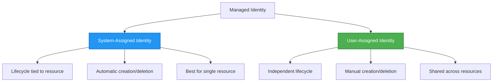

# Autentificeringsmønstre og Administreret Identitet

⏱️ **Anslået Tid**: 45-60 minutter læsning; afsæt ekstra tid til integration i øvelser | 💰 **Omkostningspåvirkning**: Identity/RBAC er gratis; deployeret compute, storage og Key Vault er betalbare | ⭐ **Kompleksitet**: Mellemtrin

> Gennemgået i forhold til `azd 1.37.2` (November 2026). Denne lektion indeholder **illustrative integrationsfragmenter, ikke en komplet downloadbar `secure-app` skabelon**. Opret de refererede filer, lever tilhørende infrastruktur, og udskift pladsholdere før deployment. Ingen Azure-ressourcer blev oprettet under gennemgangen.

**📚 Læringssti:**
- ← Forrige: [Konfigurationsstyring](configuration.md) - Håndtering af miljøvariable og hemmeligheder
- 🎯 **Du er her**: Autentificering & Sikkerhed (Administreret Identitet, Key Vault, sikre mønstre)
- → Næste: [Infrastructure as Code](../chapter-04-infrastructure/README.md) - Provisionering og deployment af ressourcer
- 🏠 [Kursus Forside](../../README.md)

---

## Hvad Du Vil Lære

Ved at gennemføre denne lektion vil du:
- Forstå Azure-autentificeringsmønstre (nøgler, forbindelsesstrenge, administreret identitet)
- Implementere **Administreret Identitet** for kodeordsløs autentificering
- Sikre hemmeligheder med **Azure Key Vault** integration
- Konfigurere **rollebaseret adgangskontrol (RBAC)** for AZD deployments
- Anvende sikkerhedsbest practices i Container Apps og Azure-tjenester
- Migrere fra nøglebaseret til identitetsbaseret autentificering

## Hvorfor Administreret Identitet Er Vigtigt

### Problemet: Traditionel Autentificering

**Før Administreret Identitet:**
```javascript
// ❌ SECURITY RISK: Hardcoded secrets in code
const connectionString = "Server=mydb.database.windows.net;User=admin;Password=P@ssw0rd123";
const storageKey = "xK7mN9pQ2wR5tY8uI0oP3aS6dF1gH4jK...";
const cosmosKey = "C2x7B9n4M1p8Q5w3E6r0T2y5U8i1O4p7...";
```

**Problemer:**
- 🔴 **Eksponerede hemmeligheder** i kode, konfigurationsfiler, miljøvariable
- 🔴 **Credential rotation** kræver kodeændringer og redeployment
- 🔴 **Revisionsmareridt** - hvem har adgang til hvad, hvornår?
- 🔴 **Spredning** - hemmeligheder spredt over flere systemer
- 🔴 **Compliance-risici** - fejler sikkerhedsrevisioner

### Løsningen: Administreret Identitet

**Efter Administreret Identitet:**
```javascript
// ✅ SECURE: No secrets in code
const credential = new DefaultAzureCredential();
const client = new BlobServiceClient(
  "https://mystorageaccount.blob.core.windows.net",
  credential  // Azure automatically handles authentication
);
```

**Fordele:**
- ✅ **Ingen hemmeligheder** i kode eller konfiguration
- ✅ **Automatisk rotation** - Azure håndterer den
- ✅ **Fuld revisionshistorik** i Microsoft Entra ID-logfiler
- ✅ **Centraliseret sikkerhed** - håndteres i Azure Portal
- ✅ **Klar til compliance** - opfylder sikkerhedsstandarder

**Analogi**: Traditionel autentificering er som at bære flere fysiske nøgler til forskellige døre. Administreret Identitet er som at have et sikkerhedsbadge, der automatisk giver adgang baseret på hvem du er—ingen nøgler at miste, kopiere eller rotere.

---

## Arkitekturoversigt

### Autentificeringsflow med Administreret Identitet

```mermaid
sequenceDiagram
    participant App as Your Application<br/>(Container App)
    participant MI as Managed Identity<br/>(Microsoft Entra ID)
    participant KV as Key Vault
    participant Storage as Azure Storage
    participant DB as Azure SQL
    
    App->>MI: Request access token<br/>(automatic)
    MI->>MI: Verify identity<br/>(no password needed)
    MI-->>App: Return token for requested audience<br/>(lifetime varies)
    
    App->>KV: Get secret<br/>(using token)
    KV->>KV: Check RBAC permissions
    KV-->>App: Return secret value
    
    App->>Storage: Upload blob<br/>(using token)
    Storage->>Storage: Check RBAC permissions
    Storage-->>App: Success
    
    App->>DB: Query data<br/>(using token)
    DB->>DB: Check SQL permissions
    DB-->>App: Return results
    
    Note over App,DB: Request a separate token for each service audience;<br/>SDK credentials handle caching and renewal
```

### Typer af Administrerede Identiteter



| Funktion | System-Tildelt | Bruger-Tildelt |
|---------|----------------|---------------|
| **Livscyklus** | Knyttet til ressource | Uafhængig |
| **Oprettelse** | Automatisk med ressource | Manuel oprettelse |
| **Sletning** | Slettet med ressource | Består efter ressource-sletning |
| **Deling** | Én ressource kun | Flere ressourcer |
| **Brugsscenarie** | Enkle scenarier | Kompleks multi-ressource scenarier |
| **Skabelonvalg** | Defineret i infrastruktur | Defineret i infrastruktur |

---

## Forudsætninger

### Nødvendige Værktøjer

Du bør allerede have disse installeret fra tidligere lektioner:

```bash
# Verify Azure Developer CLI
azd version
# ✅ Expected: azd version 1.0.0 or higher

# Verify Azure CLI
az --version
# ✅ Expected: azure-cli 2.50.0 or higher
```

### Azure-krav

- Aktiv Azure-abonnement
- Rettigheder til:
  - Oprette administrerede identiteter
  - Tildele RBAC-roller
  - Oprette Key Vault-ressourcer
  - Deployere Container Apps

### Forudgående viden

Du bør have gennemført:
- [Installationsguide](../chapter-01-foundation/installation.md) - AZD opsætning
- [AZD Grundlæggende](../chapter-01-foundation/azd-basics.md) - Kernebegreber
- [Konfigurationsstyring](configuration.md) - Miljøvariable

---

## Lektion 1: Forståelse af Autentificeringsmønstre

### Mønster 1: Forbindelsesstrenge (Legacy - Undgå)

**Sådan fungerer det:**
```bash
# Connection string contains credentials
STORAGE_CONNECTION_STRING="DefaultEndpointsProtocol=https;AccountName=myaccount;AccountKey=xK7mN9pQ2wR5..."
COSMOS_CONNECTION_STRING="AccountEndpoint=https://myaccount.documents.azure.com:443/;AccountKey=C2x7..."
SQL_CONNECTION_STRING="Server=myserver.database.windows.net;User=admin;Password=P@ssw0rd..."
```

**Problemer:**
- ❌ Hemmeligheder synlige i miljøvariable
- ❌ Logget i deploymentsystemer
- ❌ Vanskeligt at rotere
- ❌ Ingen revisionsspor for adgang

**Hvornår bruges:** Når måltjenesten kræver nøglebaseret autentificering. Foretræk identitet hvor understøttet; ellers opbevar nøgler sikkert og roter dem, også i produktion.

---

### Mønster 2: Key Vault Referencer (Bedre)

**Sådan fungerer det:**
**Delvise Bicep-fragmenter:** krævede vault-felter, Container App-identitet og dens `configuration.secrets`-post udelades. `secretRef` navngiver en Container App-hemmelighed; det er **ikke i sig selv** en Key Vault URI. For at bruge Key Vault, definer den navngivne hemmelighed med `keyVaultUrl` og en autoriseret `identity`.

```bicep
// Store secret in Key Vault
resource keyVault 'Microsoft.KeyVault/vaults@2023-02-01' = {
  name: 'mykv'
  properties: {
    enableRbacAuthorization: true
  }
}

// Reference in Container App
env: [
  {
    name: 'STORAGE_KEY'
    secretRef: 'storage-key'  // References Key Vault
  }
]
```

**Fordele:**
- ✅ Hemmeligheder opbevaret sikkert i Key Vault
- ✅ Centraliseret hemmelighedsstyring
- ✅ Rotation uden kodeændringer

**Begrænsninger:**
- ⚠️ Bruger stadig nøgler/adgangskoder
- ⚠️ Skal håndtere Key Vault adgang

**Hvornår bruges:** Trin i overgang fra forbindelsesstrenge til administreret identitet.

---

### Mønster 3: Administreret Identitet (Best Practice)

**Sådan fungerer det:**
**Delvis Bicep:** flet identitetsblokken ind i en komplet Container App og lever `storageAccount` og rolledefinitionen. En rolle-tildeling kræver også en deterministisk `name`.

```bicep
// Enable managed identity
resource containerApp 'Microsoft.App/containerApps@2023-05-01' = {
  name: 'myapp'
  identity: {
    type: 'SystemAssigned'  // Automatically creates identity
  }
}

// Grant permissions
resource roleAssignment 'Microsoft.Authorization/roleAssignments@2022-04-01' = {
  name: guid(storageAccount.id, containerApp.id, storageBlobDataContributorRole)
  scope: storageAccount
  properties: {
    roleDefinitionId: storageBlobDataContributorRole
    principalId: containerApp.identity.principalId
    principalType: 'ServicePrincipal'
  }
}
```

**Applikationskode:**
```javascript
// No secrets needed!
const { DefaultAzureCredential } = require('@azure/identity');
const { BlobServiceClient } = require('@azure/storage-blob');

const credential = new DefaultAzureCredential();
const blobServiceClient = new BlobServiceClient(
  'https://mystorageaccount.blob.core.windows.net',
  credential
);
```

**Fordele:**
- ✅ Ingen hemmeligheder i kode/konfiguration
- ✅ Automatisk credential rotation
- ✅ Fuld revisionshistorik
- ✅ RBAC-baserede tilladelser
- ✅ Klar til compliance

**Hvornår bruges:** Foretrækkes til Azure-hostede applikationer, der får adgang til tjenester, som understøtter Microsoft Entra autentificering.

---

### Mønster 4: Service Principals (CI/CD & Automation)

Administreret identitet er guldstandarden *for ressourcer, der kører inde i Azure*. Men hvad med ting, der kører **udenfor** Azure — som et CI/CD pipeline på en build-agent eller et script på din bærbare, der ikke kan bruge din interaktive login? Der kommer en **service principal** ind i billedet: en ikke-menneskelig identitet med egne credentials som en automatiseret proces kan logge ind som.

**Sådan fungerer det:**

Opret en service principal scoped til en resource group (mindste rettigheder):

```bash
az ad sp create-for-rbac \
  --name "myapp-cicd" \
  --role contributor \
  --scopes "/subscriptions/<sub-id>/resourceGroups/<rg-name>"
```

Dette udskriver en klient-ID, klienthemmelighed og tenant-ID. azd kan logge ind med dem ikke-interaktivt:

```bash
azd auth login \
  --client-id "<appId>" \
  --client-secret "<password>" \
  --tenant-id "<tenant>"
```

**Foretræk federerede credentials (OIDC) frem for hemmeligheder.** I stedet for en langlivet klienthemmelighed, konfigurer en federeret credential så pipelinen udveksler en kortvarig token—ingen hemmelighed at lække eller rotere:

```bash
azd auth login \
  --client-id "<appId>" \
  --federated-credential-provider "github" \
  --tenant-id "<tenant>"
```

> `azd pipeline config` opsætter dette automatisk for dig. Se CI/CD gennemgangene i [Kapitel 8](../chapter-08-production/production-ai-practices.md).

**Fordele:**
- ✅ Fungerer udenfor Azure (build-agenter, on-prem, andre clouds)
- ✅ Kan scoping til én resource group med én rolle
- ✅ Federerede (OIDC) variant bruger ingen gemt hemmelighed

**Afvejninger:**
- ⚠️ Hemmelighedsbaseret variant kræver omhyggelig opbevaring og rotation
- ⚠️ En lækket hemmelighed giver alt, hvad SP kan gøre—hold scopes stramme

**Hvornår bruges:** CI/CD pipelines og automatisering, der ikke kan bruge administreret identitet. Foretræk altid **federeret/OIDC** varianten fremfor klienthemmelighed, og foretræk administreret identitet når workload kører inde i Azure.

**Sikker opbevaring af credentials:**
- Commit aldrig hemmeligheder—brug din pipelines hemmelighedslager (GitHub Actions secrets, Azure DevOps variable grupper / Key Vault).
- Scope SP til den mindste rolle og resource group den behøver.
- Sæt en udløbsdato og roter, eller eliminer hemmeligheden helt med OIDC.

---

## Lektion 2: Implementering af Administreret Identitet med AZD

### Trin-for-trin Implementering

Følgende fragmenter viser, hvordan man integrerer administreret identitet i et Container App-projekt. De er **ikke en copy-and-run starter**: Storage-modulet, fuld managed environment/registry infrastruktur, Dockerfile og parameterfil leveres ikke her. Start fra en fungerende Container Apps skabelon og flet disse mønstre ind, mens du beholder dens registry-konfiguration og servicetags.

### Projektstruktur

```
secure-app/
├── azure.yaml                 # AZD configuration
├── infra/
│   ├── main.bicep            # Main infrastructure
│   ├── core/
│   │   ├── identity.bicep    # Managed identity setup
│   │   ├── keyvault.bicep    # Key Vault configuration
│   │   └── storage.bicep     # Storage with RBAC
│   └── app/
│       └── container-app.bicep
└── src/
    ├── app.js                # Application code
    ├── package.json
    └── Dockerfile
```

### 1. Konfigurer AZD (azure.yaml)

```yaml
name: secure-app
metadata:
  template: secure-app@1.0.0

services:
  api:
    project: ./src
    language: js
    host: containerapp

# Managed identity must be enabled in the infrastructure, not by this YAML.
```

### 2. Infrastruktur: Aktiver Administreret Identitet

**Fil: `infra/main.bicep`**

```bicep
targetScope = 'subscription'

param environmentName string
param location string = 'eastus'
param containerAppsEnvironmentId string
param containerImage string

var tags = { 'azd-env-name': environmentName }

// Resource group
resource rg 'Microsoft.Resources/resourceGroups@2021-04-01' = {
  name: 'rg-${environmentName}'
  location: location
  tags: tags
}

// Storage Account
module storage './core/storage.bicep' = {
  name: 'storage'
  scope: rg
  params: {
    name: 'st${uniqueString(rg.id)}'
    location: location
    tags: tags
  }
}

// Key Vault
module keyVault './core/keyvault.bicep' = {
  name: 'keyvault'
  scope: rg
  params: {
    name: 'kv-${uniqueString(rg.id)}'
    location: location
    tags: tags
  }
}

// Container App with Managed Identity
module containerApp './app/container-app.bicep' = {
  name: 'container-app'
  scope: rg
  params: {
    name: 'ca-${environmentName}'
    location: location
    tags: tags
    storageAccountName: storage.outputs.name
    keyVaultName: keyVault.outputs.name
    containerAppsEnvironmentId: containerAppsEnvironmentId
    containerImage: containerImage
  }
}

// Grant Container App access to Storage
module storageRoleAssignment './core/role-assignment.bicep' = {
  name: 'storage-role'
  scope: rg
  params: {
    principalId: containerApp.outputs.identityPrincipalId
    roleDefinitionId: 'ba92f5b4-2d11-453d-a403-e96b0029c9fe'  // Storage Blob Data Contributor
    targetResourceType: 'storage'
    targetResourceName: storage.outputs.name
  }
}

// Grant Container App access to Key Vault
module kvRoleAssignment './core/role-assignment.bicep' = {
  name: 'kv-role'
  scope: rg
  params: {
    principalId: containerApp.outputs.identityPrincipalId
    roleDefinitionId: '4633458b-17de-408a-b874-0445c86b69e6'  // Key Vault Secrets User
    targetResourceType: 'keyvault'
    targetResourceName: keyVault.outputs.name
  }
}

// Outputs
output AZURE_STORAGE_ACCOUNT_NAME string = storage.outputs.name
output AZURE_KEY_VAULT_NAME string = keyVault.outputs.name
output APP_URL string = containerApp.outputs.url
```

### 3. Container App med System-Tildelt Identitet

**Fil: `infra/app/container-app.bicep`**

```bicep
param name string
param location string
param tags object = {}
param storageAccountName string
param keyVaultName string
param containerAppsEnvironmentId string
param containerImage string

resource containerApp 'Microsoft.App/containerApps@2023-05-01' = {
  name: name
  location: location
  tags: union(tags, { 'azd-service-name': 'api' })
  identity: {
    type: 'SystemAssigned'  // 🔑 Enable managed identity
  }
  properties: {
    managedEnvironmentId: containerAppsEnvironmentId
    configuration: {
      ingress: {
        external: true
        targetPort: 3000
      }
    }
    template: {
      containers: [
        {
          name: 'api'
          image: containerImage // Must exist; configure registry credentials for private images
          resources: {
            cpu: json('0.5')
            memory: '1Gi'
          }
          env: [
            {
              name: 'AZURE_STORAGE_ACCOUNT_NAME'
              value: storageAccountName
            }
            {
              name: 'AZURE_KEY_VAULT_NAME'
              value: keyVaultName
            }
            // 🔑 No secrets - managed identity handles authentication!
          ]
        }
      ]
    }
  }
}

// Output the identity for RBAC assignments
output identityPrincipalId string = containerApp.identity.principalId
output id string = containerApp.id
output url string = 'https://${containerApp.properties.configuration.ingress.fqdn}'
```

### 4. RBAC Rolle-Tildelingsmodul

**Fil: `infra/core/role-assignment.bicep`**

```bicep
param principalId string
param roleDefinitionId string  // Azure built-in role ID
@allowed(['storage', 'keyvault'])
param targetResourceType string
param targetResourceName string

// Typed existing resources give Bicep a valid resource scope, not a string ID.
resource storageTarget 'Microsoft.Storage/storageAccounts@2023-01-01' existing = {
  name: targetResourceName
}
resource vaultTarget 'Microsoft.KeyVault/vaults@2023-02-01' existing = {
  name: targetResourceName
}

resource storageAssignment 'Microsoft.Authorization/roleAssignments@2022-04-01' = if (targetResourceType == 'storage') {
  name: guid(storageTarget.id, principalId, roleDefinitionId)
  scope: storageTarget
  properties: {
    roleDefinitionId: subscriptionResourceId('Microsoft.Authorization/roleDefinitions', roleDefinitionId)
    principalId: principalId
    principalType: 'ServicePrincipal'
  }
}

resource vaultAssignment 'Microsoft.Authorization/roleAssignments@2022-04-01' = if (targetResourceType == 'keyvault') {
  name: guid(vaultTarget.id, principalId, roleDefinitionId)
  scope: vaultTarget
  properties: {
    roleDefinitionId: subscriptionResourceId('Microsoft.Authorization/roleDefinitions', roleDefinitionId)
    principalId: principalId
    principalType: 'ServicePrincipal'
  }
}

// This module assigns at the target resource scope, not the whole resource group.
```

### 5. Applikationskode med Administreret Identitet

**Fil: `src/app.js`**

```javascript
const express = require('express');
const { DefaultAzureCredential } = require('@azure/identity');
const { BlobServiceClient } = require('@azure/storage-blob');
const { SecretClient } = require('@azure/keyvault-secrets');

const app = express();
const PORT = process.env.PORT || 3000;

// 🔑 Initialize credential (works automatically with managed identity)
const credential = new DefaultAzureCredential();

// Azure Storage setup
const storageAccountName = process.env.AZURE_STORAGE_ACCOUNT_NAME;
const blobServiceClient = new BlobServiceClient(
  `https://${storageAccountName}.blob.core.windows.net`,
  credential  // No keys needed!
);

// Key Vault setup
const keyVaultName = process.env.AZURE_KEY_VAULT_NAME;
const secretClient = new SecretClient(
  `https://${keyVaultName}.vault.azure.net`,
  credential  // No keys needed!
);

// Health check
app.get('/health', (req, res) => {
  res.json({ status: 'healthy', authentication: 'managed-identity' });
});

// Upload file to blob storage
app.post('/upload', async (req, res) => {
  try {
    const containerClient = blobServiceClient.getContainerClient('uploads');
    await containerClient.createIfNotExists();
    
    const blobName = `file-${Date.now()}.txt`;
    const blockBlobClient = containerClient.getBlockBlobClient(blobName);
    
    const content = 'Hello from managed identity!';
    await blockBlobClient.upload(content, Buffer.byteLength(content));
    
    res.json({
      success: true,
      blobName: blobName,
      message: 'File uploaded using managed identity!'
    });
  } catch (error) {
    console.error('Upload error:', error);
    res.status(500).json({ error: error.message });
  }
});

// Get secret from Key Vault
app.get('/secret/:name', async (req, res) => {
  try {
    const secretName = req.params.name;
    const secret = await secretClient.getSecret(secretName);
    
    res.json({
      name: secretName,
      retrieved: secret.value !== undefined, // Never return the secret value to callers
      message: 'Secret retrieved using managed identity!'
    });
  } catch (error) {
    console.error('Secret error:', error);
    res.status(500).json({ error: error.message });
  }
});

// List blob containers (demonstrates read access)
app.get('/containers', async (req, res) => {
  try {
    const containers = [];
    for await (const container of blobServiceClient.listContainers()) {
      containers.push(container.name);
    }
    
    res.json({
      containers: containers,
      count: containers.length,
      message: 'Containers listed using managed identity!'
    });
  } catch (error) {
    console.error('List error:', error);
    res.status(500).json({ error: error.message });
  }
});

app.listen(PORT, () => {
  console.log(`Secure API listening on port ${PORT}`);
  console.log('Authentication: Managed Identity (passwordless)');
});
```

**Fil: `src/package.json`**

```json
{
  "name": "secure-app",
  "version": "1.0.0",
  "dependencies": {
    "express": "^4.18.2",
    "@azure/identity": "^4.0.0",
    "@azure/storage-blob": "^12.17.0",
    "@azure/keyvault-secrets": "^4.7.0"
  },
  "scripts": {
    "start": "node app.js"
  }
}
```

### 6. Deploy og Test

Kør kun disse kommandoer **efter** at have fuldført den manglende infrastruktur, Dockerfile og matchende `main.parameters.json` i dit eget projekt. Autentificer azd med `azd auth login`; log separat ind med `az login` for Azure CLI-checks senere. De viste endpoints er demonstrationer og kræver passende adgangskontrol før offentlig brug.

```bash
# Initialize AZD environment
azd init

# Deploy infrastructure and application
azd up

# Get the app URL
APP_URL=$(azd env get-value APP_URL)

# Test health check
curl $APP_URL/health
```

**✅ Forventet output:**
```json
{
  "status": "healthy",
  "authentication": "managed-identity"
}
```

**Test af blob-upload:**
```bash
curl -X POST $APP_URL/upload
```

**✅ Forventet output:**
```json
{
  "success": true,
  "blobName": "file-1700404800000.txt",
  "message": "File uploaded using managed identity!"
}
```

**Test af container-listing:**
```bash
curl $APP_URL/containers
```

**✅ Forventet output:**
```json
{
  "containers": ["uploads"],
  "count": 1,
  "message": "Containers listed using managed identity!"
}
```

---

## Almindelige Azure RBAC Roller

### Indbyggede Rolle-ID'er for Administreret Identitet

| Service | Rollenavn | Rolle-ID | Rettigheder |
|---------|-----------|---------|-------------|
| **Storage** | Storage Blob Data Reader | `2a2b9908-6ea1-4ae2-8e65-a410df84e7d1` | Læse blobs og containere |
| **Storage** | Storage Blob Data Contributor | `ba92f5b4-2d11-453d-a403-e96b0029c9fe` | Læse, skrive, slette blobs |
| **Storage** | Storage Queue Data Contributor | `974c5e8b-45b9-4653-ba55-5f855dd0fb88` | Læse, skrive, slette køer/beskeder |
| **Key Vault** | Key Vault Secrets User | `4633458b-17de-408a-b874-0445c86b69e6` | Læse hemmeligheder |
| **Key Vault** | Key Vault Secrets Officer | `b86a8fe4-44ce-4948-aee5-eccb2c155cd7` | Læse, skrive, slette hemmeligheder |
| **Cosmos DB** | Cosmos DB Indbygget Data Reader | `00000000-0000-0000-0000-000000000001` | Læse Cosmos DB data |
| **Cosmos DB** | Cosmos DB Indbygget Data Contributor | `00000000-0000-0000-0000-000000000002` | Læse, skrive Cosmos DB data |
| **SQL Database** | SQL DB Contributor | `9b7fa17d-e63e-47b0-bb0a-15c516ac86ec` | Administrere database-ressourcer; giver ikke SQL dataadgang |
| **Service Bus** | Azure Service Bus Data Owner | `090c5cfd-751d-490a-894a-3ce6f1109419` | Sende, modtage, administrere beskeder |

### Hvordan man finder Rolle-ID'er

Cosmos DB for NoSQL's to ID'er ovenfor er **native Cosmos data-plane rolledefinitioner**, ikke Azure RBAC abonnement-rolle-ID'er. Tildel dem med `az cosmosdb sql role assignment create` (eller `Microsoft.DocumentDB/databaseAccounts/sqlRoleAssignments`), ikke `az role assignment create`. SQL dataadgang kræver en Entra-databasebruger og SQL-tilladelser.

```bash
# List all built-in roles
az role definition list --query "[].{Name:roleName, ID:name}" --output table

# Search for specific role
az role definition list --query "[?contains(roleName, 'Storage Blob')].{Name:roleName, ID:name}" --output table

# Get role details
az role definition list --name "Storage Blob Data Contributor"
```

---

## Praktiske Øvelser

**Integrationsforudsætninger for alle tre øvelser:** en fungerende Container App-skabelon i dit eget projekt, matchende Bicep-ressourcer, Azure CLI/azd login og myndighed til at tildele de nødvendige roller. Dette er vejledte tilpasninger, ikke selvstændige lokale starters; erstat eksemplariske ressource-navne med dine deployerede navne.

### Øvelse 1: Aktivering af Administreret Identitet for Eksisterende App ⭐⭐ (Mellem)

**Mål**: Tilføj administreret identitet til en eksisterende Container App deployment

**Scenario**: Du har en Container App, der bruger forbindelsesstrenge. Konverter den til administreret identitet.

**Startpunkt**: Container App med denne konfiguration:

```bicep
// ❌ Current: Using connection string
env: [
  {
    name: 'STORAGE_CONNECTION_STRING'
    secretRef: 'storage-connection'
  }
]
```

**Trin**:

1. **Aktiver administreret identitet i Bicep:**

```bicep
resource containerApp 'Microsoft.App/containerApps@2023-05-01' = {
  name: 'myapp'
  identity: {
    type: 'SystemAssigned'  // Add this
  }
  // ... rest of configuration
}
```

2. **Giv Storage adgang:**

```bicep
// Get storage account reference
resource storageAccount 'Microsoft.Storage/storageAccounts@2023-01-01' existing = {
  name: storageAccountName
}

// Assign role
resource roleAssignment 'Microsoft.Authorization/roleAssignments@2022-04-01' = {
  name: guid(containerApp.id, 'ba92f5b4-2d11-453d-a403-e96b0029c9fe', storageAccount.id)
  scope: storageAccount
  properties: {
    roleDefinitionId: subscriptionResourceId('Microsoft.Authorization/roleDefinitions', 'ba92f5b4-2d11-453d-a403-e96b0029c9fe')
    principalId: containerApp.identity.principalId
    principalType: 'ServicePrincipal'
  }
}
```

3. **Opdater applikationskode:**

**Før (forbindelsesstreng):**
```javascript
const { BlobServiceClient } = require('@azure/storage-blob');

const blobServiceClient = BlobServiceClient.fromConnectionString(
  process.env.STORAGE_CONNECTION_STRING
);
```

**Efter (administreret identitet):**
```javascript
const { DefaultAzureCredential } = require('@azure/identity');
const { BlobServiceClient } = require('@azure/storage-blob');

const credential = new DefaultAzureCredential();
const blobServiceClient = new BlobServiceClient(
  `https://${process.env.STORAGE_ACCOUNT_NAME}.blob.core.windows.net`,
  credential
);
```

4. **Opdater miljøvariable:**

```bicep
env: [
  {
    name: 'STORAGE_ACCOUNT_NAME'
    value: storageAccountName  // Just the name, no secrets!
  }
  // Remove STORAGE_CONNECTION_STRING
]
```

5. **Deploy og test:**

```bash
# Redeploy
azd up

# Test that it still works
APP_URL=$(azd show --output json | jq -er '.services.api.ingressUrl')
curl --fail -X POST "$APP_URL/upload"
```

**✅ Succeskriterier:**
- ✅ Applikationen deployes uden fejl
- ✅ Storage-operationer virker (upload, liste, download)
- ✅ Ingen forbindelsesstrenge i miljøvariable
- ✅ Identitet synlig i Azure Portal under "Identity" bladet

**Verifikation:**

```bash
# Check managed identity is enabled
az containerapp show \
  --name myapp \
  --resource-group rg-myapp \
  --query "identity.type"
# ✅ Expected: "SystemAssigned"

# Check role assignment
az role assignment list \
  --assignee $(az containerapp show --name myapp --resource-group rg-myapp --query "identity.principalId" -o tsv) \
  --scope /subscriptions/{sub-id}/resourceGroups/rg-myapp/providers/Microsoft.Storage/storageAccounts/mystorageaccount
# ✅ Expected: Shows "Storage Blob Data Contributor" role
```

**Tid**: 20-30 minutter

---

### Øvelse 2: Multi-Service Adgang med Bruger-Tildelt Identitet ⭐⭐⭐ (Avanceret)

**Mål**: Opret en bruger-tildelt identitet, der deles på tværs af flere Container Apps

**Scenario**: Du har 3 mikroservices, som alle behøver adgang til samme Storage-konto og Key Vault.

**Trin**:

1. **Opret bruger-tildelt identitet:**

**Fil: `infra/core/identity.bicep`**

```bicep
param name string
param location string
param tags object = {}

resource userAssignedIdentity 'Microsoft.ManagedIdentity/userAssignedIdentities@2023-01-31' = {
  name: name
  location: location
  tags: tags
}

output id string = userAssignedIdentity.id
output principalId string = userAssignedIdentity.properties.principalId
output clientId string = userAssignedIdentity.properties.clientId
```

2. **Tildel roller til bruger-tildelt identitet:**

```bicep
// In main.bicep
module userIdentity './core/identity.bicep' = {
  name: 'user-identity'
  scope: rg
  params: {
    name: 'id-${environmentName}'
    location: location
    tags: tags
  }
}

// Grant Storage access
resource storageRoleAssignment 'Microsoft.Authorization/roleAssignments@2022-04-01' = {
  name: guid(storageAccount.id, environmentName, 'storage-contributor')
  scope: storageAccount
  properties: {
    roleDefinitionId: subscriptionResourceId('Microsoft.Authorization/roleDefinitions', 'ba92f5b4-2d11-453d-a403-e96b0029c9fe')
    principalId: userIdentity.outputs.principalId
    principalType: 'ServicePrincipal'
  }
}

// Grant Key Vault access
resource kvRoleAssignment 'Microsoft.Authorization/roleAssignments@2022-04-01' = {
  name: guid(keyVault.id, environmentName, 'kv-secrets-user')
  scope: keyVault
  properties: {
    roleDefinitionId: subscriptionResourceId('Microsoft.Authorization/roleDefinitions', '4633458b-17de-408a-b874-0445c86b69e6')
    principalId: userIdentity.outputs.principalId
    principalType: 'ServicePrincipal'
  }
}
```

3. **Tildel identitet til flere Container Apps:**

```bicep
resource apiGateway 'Microsoft.App/containerApps@2023-05-01' = {
  name: 'api-gateway'
  identity: {
    type: 'UserAssigned'
    userAssignedIdentities: {
      '${userIdentity.outputs.id}': {}
    }
  }
  // ... rest of config
}

resource productService 'Microsoft.App/containerApps@2023-05-01' = {
  name: 'product-service'
  identity: {
    type: 'UserAssigned'
    userAssignedIdentities: {
      '${userIdentity.outputs.id}': {}
    }
  }
  // ... rest of config
}

resource orderService 'Microsoft.App/containerApps@2023-05-01' = {
  name: 'order-service'
  identity: {
    type: 'UserAssigned'
    userAssignedIdentities: {
      '${userIdentity.outputs.id}': {}
    }
  }
  // ... rest of config
}
```

4. **Applikationskode (alle tjenester bruger samme mønster):**

```javascript
const { ManagedIdentityCredential } = require('@azure/identity');
const { BlobServiceClient } = require('@azure/storage-blob');

// For user-assigned identity, specify the client ID
const credential = new ManagedIdentityCredential(
  process.env.AZURE_CLIENT_ID  // User-assigned identity client ID
);

// Alternative (choose ONE credential declaration):
// const { DefaultAzureCredential } = require('@azure/identity');
// const credential = new DefaultAzureCredential({
//   managedIdentityClientId: process.env.AZURE_CLIENT_ID
// });

const blobServiceClient = new BlobServiceClient(
  `https://${process.env.STORAGE_ACCOUNT_NAME}.blob.core.windows.net`,
  credential
);
```

Sæt hver Container Apps runtime `AZURE_CLIENT_ID` til `userIdentity.outputs.clientId` og `STORAGE_ACCOUNT_NAME` til dit lager navn i Bicep. Det er ikke nok blot at tildele identiteten eller køre `azd env set` til at konfigurere disse runtime værdier.

5. **Deploy og verificer:**

```bash
azd up

# Test all services can access storage
# Replace with the actual ingress URLs reported for your three services
curl --fail -X POST "$API_GATEWAY_URL/upload"
curl --fail -X POST "$PRODUCT_SERVICE_URL/upload"
curl --fail -X POST "$ORDER_SERVICE_URL/upload"
```

**✅ Succeskriterier:**
- ✅ En identitet delt på tværs af 3 tjenester
- ✅ Alle tjenester kan få adgang til Storage og Key Vault
- ✅ Identitet bevares hvis du sletter en tjeneste
- ✅ Centraliseret tilladelsesstyring

**Fordele ved bruger-tildelt identitet:**
- Én enkelt identitet at administrere
- Konsistente tilladelser på tværs af tjenester
- Overlever tjenestesletning
- Bedre til komplekse arkitekturer

**Tid**: 30-40 minutter

---

### Øvelse 3: Implementer Key Vault Secret Rotation ⭐⭐⭐ (Avanceret)

**Mål**: Gem tredjeparts API-nøgler i Key Vault og få adgang til dem ved hjælp af managed identity

**Scenario**: Din app skal kalde en ekstern API (OpenAI, Stripe, SendGrid), som kræver API-nøgler.

**Trin**:

1. **Opret Key Vault med RBAC:**

**Fil: `infra/core/keyvault.bicep`**

```bicep
param name string
param location string
param tags object = {}

resource keyVault 'Microsoft.KeyVault/vaults@2023-02-01' = {
  name: name
  location: location
  tags: tags
  properties: {
    enableRbacAuthorization: true  // Use RBAC instead of access policies
    sku: {
      family: 'A'
      name: 'standard'
    }
    tenantId: subscription().tenantId
    enableSoftDelete: true
    softDeleteRetentionInDays: 90
  }
}

// Allow Container App to read secrets
output id string = keyVault.id
output name string = keyVault.name
output uri string = keyVault.properties.vaultUri
```

2. **Gem hemmeligheder i Key Vault:**

```bash
# Get Key Vault name
KV_NAME=$(azd env get-value AZURE_KEY_VAULT_NAME)

# Store third-party API keys
az keyvault secret set \
  --vault-name $KV_NAME \
  --name "OpenAI-ApiKey" \
  --value "sk-proj-xxxxxxxxxxxxx"

az keyvault secret set \
  --vault-name $KV_NAME \
  --name "Stripe-ApiKey" \
  --value "sk_live_xxxxxxxxxxxxx"

az keyvault secret set \
  --vault-name $KV_NAME \
  --name "SendGrid-ApiKey" \
  --value "SG.xxxxxxxxxxxxx"
```

3. **Applikationskode til at hente hemmeligheder:**

**Fil: `src/config.js`**

```javascript
const { DefaultAzureCredential } = require('@azure/identity');
const { SecretClient } = require('@azure/keyvault-secrets');

class Config {
  constructor() {
    this.credential = new DefaultAzureCredential();
    this.secretClient = new SecretClient(
      `https://${process.env.AZURE_KEY_VAULT_NAME}.vault.azure.net`,
      this.credential
    );
    this.cache = {};
  }

  async getSecret(secretName) {
    // Check cache first
    if (this.cache[secretName]) {
      return this.cache[secretName];
    }

    try {
      const secret = await this.secretClient.getSecret(secretName);
      this.cache[secretName] = secret.value;
      console.log(`✅ Retrieved secret: ${secretName}`);
      return secret.value;
    } catch (error) {
      console.error(`❌ Failed to get secret ${secretName}:`, error.message);
      throw error;
    }
  }

  async getOpenAIKey() {
    return this.getSecret('OpenAI-ApiKey');
  }

  async getStripeKey() {
    return this.getSecret('Stripe-ApiKey');
  }

  async getSendGridKey() {
    return this.getSecret('SendGrid-ApiKey');
  }
}

module.exports = new Config();
```

4. **Brug hemmeligheder i applikationen:**

**Fil: `src/app.js`**

Denne **erstatningsapplikationsfragmen** kræver `npm install openai`, en rigtig tredjepartsnøgle, en tilgængelig model og infrastrukturen fra dit arbejdsprojekt. Den kalder OpenAI direkte, ikke en Azure OpenAI deployment. Pladsholdernøgler nedenfor giver ikke tilladelse til en forespørgsel.

```javascript
const express = require('express');
const config = require('./config');
const { OpenAI } = require('openai');

const app = express();

// Initialize OpenAI with key from Key Vault
let openaiClient;

async function initializeServices() {
  const openaiKey = await config.getOpenAIKey();
  openaiClient = new OpenAI({ apiKey: openaiKey });
  console.log('✅ Services initialized with secrets from Key Vault');
}

app.post('/chat', async (req, res) => {
  try {
    const completion = await openaiClient.chat.completions.create({
      model: 'gpt-4.1',
      messages: [{ role: 'user', content: 'Hello!' }]
    });
    
    res.json({
      response: completion.choices[0].message.content,
      authentication: 'Key from Key Vault via Managed Identity'
    });
  } catch (error) {
    res.status(500).json({ error: error.message });
  }
});

// Start listening only after initialization succeeds.
initializeServices().then(() => {
  app.listen(3000, () => console.log('Key Vault demo running'));
}).catch(error => {
  console.error('Initialization failed:', error.message);
  process.exitCode = 1;
});
```

5. **Deploy og test:**

```bash
azd up

# Test that API keys work
curl -X POST https://myapp.azurecontainerapps.io/chat \
  -H "Content-Type: application/json" \
  -d '{"message":"Hello AI"}'
```

**✅ Succeskriterier:**
- ✅ Ingen API-nøgler i kode eller miljøvariable
- ✅ Applikationen henter nøgler fra Key Vault
- ✅ Tredjeparts-API'er fungerer korrekt
- ✅ Kan rotere nøgler uden kodeændringer

**Rotér en hemmelighed:**

```bash
# Update secret in Key Vault
az keyvault secret set \
  --vault-name $KV_NAME \
  --name "OpenAI-ApiKey" \
  --value "sk-proj-NEW_KEY_HERE"

# Find the active revision name, then restart it to clear the in-process cache
az containerapp revision list --name myapp --resource-group rg-myapp --output table
az containerapp revision restart \
  --name myapp \
  --resource-group rg-myapp \
  --revision "<active-revision-name>"
```

**Tid**: 25-35 minutter

---

## Videnscheckpoint

### 1. Autentificeringsmønstre ✓

Test din forståelse:

- [ ] **Q1**: Hvad er de tre vigtigste autentificeringsmønstre? 
  - **A**: Connection strings (ældgammelt), Key Vault-referencer (overgang), Managed Identity (bedst)

- [ ] **Q2**: Hvorfor er managed identity bedre end connection strings?
  - **A**: Ingen hemmeligheder i koden, automatisk rotation, fuld revisionsspor, RBAC-tilladelser

- [ ] **Q3**: Hvornår vil du bruge bruger-tildelt identitet i stedet for system-tildelt?
  - **A**: Når identitet deles på tværs af flere ressourcer, eller når identitets livscyklus er uafhængig af ressourcelivscyklussen

**Praktisk verifikation:**
```bash
# Check what type of identity your app uses
az containerapp show \
  --name myapp \
  --resource-group rg-myapp \
  --query "identity.type"

# List all role assignments for the identity
az role assignment list \
  --assignee $(az containerapp show --name myapp --resource-group rg-myapp --query "identity.principalId" -o tsv)
```

---

### 2. RBAC og tilladelser ✓

Test din forståelse:

- [ ] **Q1**: Hvad er rolle-ID for "Storage Blob Data Contributor"?
  - **A**: `ba92f5b4-2d11-453d-a403-e96b0029c9fe`

- [ ] **Q2**: Hvilke tilladelser giver "Key Vault Secrets User"?
  - **A**: Læse-adgang til hemmeligheder (kan ikke oprette, opdatere eller slette)

- [ ] **Q3**: Hvordan giver du en Container App adgang til Azure SQL?
  - **A**: Konfigurer Microsoft Entra autentificering, opret identiteten som databasebruger og giv de nødvendige SQL-tilladelser. "SQL DB Contributor" håndterer kun Azure-ressourcer; den autoriserer ikke forespørgsler.

**Praktisk verifikation:**
```bash
# Find specific role
az role definition list --name "Storage Blob Data Contributor"

# Check what roles are assigned to your identity
PRINCIPAL_ID=$(az containerapp show --name myapp --resource-group rg-myapp --query "identity.principalId" -o tsv)
az role assignment list --assignee $PRINCIPAL_ID --output table
```

---

### 3. Key Vault-integration ✓

Test din forståelse:

- [ ] **Q1**: Hvordan aktiverer du RBAC for Key Vault i stedet for adgangspolitikker?
  - **A**: Sæt `enableRbacAuthorization: true` i Bicep

- [ ] **Q2**: Hvilket Azure SDK bibliotek håndterer managed identity autentificering?
  - **A**: `@azure/identity` med `DefaultAzureCredential` klasse

- [ ] **Q3**: Hvor længe ligger Key Vault-hemmeligheder i cache?
  - **A**: Afhænger af applikationen; implementer din egen caching strategi

**Praktisk verifikation:**
```bash
# Test Key Vault access
az keyvault secret show \
  --vault-name $KV_NAME \
  --name "OpenAI-ApiKey" \
  --query "{name:name,enabled:attributes.enabled}"

# Check RBAC is enabled
az keyvault show \
  --name $KV_NAME \
  --query "properties.enableRbacAuthorization"
# ✅ Expected: true
```

---

## Sikkerhedspraksis

### ✅ GØR:

1. **Brug altid managed identity i produktion**
   ```bicep
   identity: {
     type: 'SystemAssigned'
   }
   ```

2. **Brug mindst privilegerede RBAC-roller**
   - Brug "Reader"-roller når muligt
   - Undgå "Owner" eller "Contributor" medmindre nødvendigt

3. **Gem tredjepartsnøgler i Key Vault**
   ```javascript
   const apiKey = await secretClient.getSecret('ThirdPartyApiKey');
   ```

4. **Aktiver revisionslogning** (delvis ressourcefragment; slå sammen med dine vault og workspace deklarationer)
   ```bicep
   resource vaultDiagnostics 'Microsoft.Insights/diagnosticSettings@2021-05-01-preview' = {
     name: 'vault-audit'
     scope: keyVault
     properties: {
       workspaceId: logAnalytics.id
       logs: [{ category: 'AuditEvent', enabled: true }]
     }
   }
   ```

5. **Brug forskellige identiteter for dev/staging/prod**
   ```bash
   azd env new dev
   azd env new staging
   azd env new prod
   ```

6. **Rotér hemmeligheder regelmæssigt**
   - Sæt udløbsdatoer på Key Vault-hemmeligheder
   - Automatiser rotation med Azure Functions

### ❌ BRUG IKKE:

1. **Hardcode aldrig hemmeligheder**
   ```javascript
   // ❌ BAD
   const apiKey = "sk-proj-xxxxxxxxxxxxx";
   ```

2. **Brug ikke connection strings i produktion**
   ```javascript
   // ❌ BAD
   BlobServiceClient.fromConnectionString(process.env.STORAGE_CONNECTION_STRING)
   ```

3. **Giv ikke overdrevne tilladelser**
   ```bicep
   // ❌ BAD - too much access
   roleDefinitionId: subscriptionResourceId('Microsoft.Authorization/roleDefinitions', '8e3af657-a8ff-443c-a75c-2fe8c4bcb635')
   
   // ✅ GOOD - least privilege
   roleDefinitionId: subscriptionResourceId('Microsoft.Authorization/roleDefinitions', '2a2b9908-6ea1-4ae2-8e65-a410df84e7d1')
   ```

4. **Log ikke hemmeligheder**
   ```javascript
   // ❌ BAD
   console.log('API Key:', apiKey);
   
   // ✅ GOOD
   console.log('API Key retrieved successfully');
   ```

5. **Del ikke produktionsidentiteter på tværs af miljøer**
   ```bicep
   // ❌ BAD - same identity for dev and prod
   // ✅ GOOD - separate identities per environment
   ```

---

## Fejlfinding Guide

### Problem: "Unauthorized" ved adgang til Azure Storage

**Symptomer:**
```
Error: Unauthorized (403)
AuthorizationPermissionMismatch: This request is not authorized to perform this operation
```

**Diagnose:**

```bash
# Check if managed identity is enabled
az containerapp show \
  --name myapp \
  --resource-group rg-myapp \
  --query "identity.type"
# ✅ Expected: "SystemAssigned" or "UserAssigned"

# Check role assignments
PRINCIPAL_ID=$(az containerapp show --name myapp --resource-group rg-myapp --query "identity.principalId" -o tsv)
az role assignment list --assignee $PRINCIPAL_ID

# Expected: Should see "Storage Blob Data Contributor" or similar role
```

**Løsninger:**

1. **Giv korrekt RBAC-rolle:**
```bash
STORAGE_ID=$(az storage account show --name mystorageaccount --resource-group rg-myapp --query "id" -o tsv)
az role assignment create \
  --assignee $PRINCIPAL_ID \
  --role "Storage Blob Data Contributor" \
  --scope $STORAGE_ID
```

2. **Vent på udbredelse (kan tage 5-10 minutter):**
```bash
# Check role assignment status
az role assignment list --assignee $PRINCIPAL_ID --scope $STORAGE_ID
```

3. **Bekræft applikationskode bruger korrekt credential:**
```javascript
// Make sure you're using DefaultAzureCredential
const credential = new DefaultAzureCredential();
```

---

### Problem: Key Vault adgang nægtet

**Symptomer:**
```
Error: Forbidden (403)
The user, group or application does not have secrets get permission
```

**Diagnose:**

```bash
# Check Key Vault RBAC is enabled
az keyvault show \
  --name $KV_NAME \
  --query "properties.enableRbacAuthorization"
# ✅ Expected: true

# Check role assignments
az role assignment list \
  --assignee $PRINCIPAL_ID \
  --scope /subscriptions/{sub-id}/resourceGroups/rg-myapp/providers/Microsoft.KeyVault/vaults/$KV_NAME
```

**Løsninger:**

1. **Aktiver RBAC på Key Vault:**
```bash
az keyvault update \
  --name $KV_NAME \
  --enable-rbac-authorization true
```

2. **Giv Key Vault Secrets User rolle:**
```bash
KV_ID=$(az keyvault show --name $KV_NAME --query "id" -o tsv)
az role assignment create \
  --assignee $PRINCIPAL_ID \
  --role "Key Vault Secrets User" \
  --scope $KV_ID
```

---

### Problem: DefaultAzureCredential fejler lokalt

**Symptomer:**
```
Error: DefaultAzureCredential failed to retrieve a token
CredentialUnavailableError: No credential available
```

**Diagnose:**

```bash
# Check if you're logged in
az account show

# Check Azure CLI authentication
az ad signed-in-user show
```

**Løsninger:**

1. **Login til Azure CLI:**
```bash
az login
```

2. **Sæt Azure abonnement:**
```bash
az account set --subscription "Your Subscription Name"
```

3. **For lokal udvikling, brug miljøvariable:**
```bash
export AZURE_TENANT_ID="your-tenant-id"
export AZURE_CLIENT_ID="your-client-id"
export AZURE_CLIENT_SECRET="your-client-secret"
```

4. **Eller brug en anden credential lokalt:**
```javascript
const { DefaultAzureCredential, AzureCliCredential } = require('@azure/identity');

// Use AzureCliCredential for local dev
const credential = process.env.NODE_ENV === 'production' 
  ? new DefaultAzureCredential()
  : new AzureCliCredential();
```

---

### Problem: Rolle-tildeling tager for lang tid at udbrede

**Symptomer:**
- Rolle tildelt succesfuldt
- Får stadig 403 fejl
- Intermitterende adgang (fungerer nogle gange, andre gange ikke)

**Forklaring:**
Azure RBAC ændringer kan tage 5-10 minutter at udbrede globalt.

**Løsning:**

```bash
# Wait and retry
echo "Waiting for RBAC propagation..."
sleep 300  # Wait 5 minutes

# Test access
curl --fail -X POST "$APP_URL/upload"

# If still failing, restart the app
az containerapp revision restart \
  --name myapp \
  --resource-group rg-myapp \
  --revision "<active-revision-name>"
```

---

## Omkostningsovervejelser

### Omkostninger ved Managed Identity

| Ressource | Omkostning |
|----------|------------|
| **Managed Identity** | 🆓 **GRATIS** - Ingen beregning |
| **RBAC Rolletildelinger** | 🆓 **GRATIS** - Ingen beregning |
| **Microsoft Entra ID Token-forespørgsler** | 🆓 **GRATIS** - Inkluderet |
| **Key Vault operationer** | $0.03 pr. 10.000 operationer |
| **Key Vault hemmelighedslagring** | Tjek aktuel pris; antag ikke månedligt gebyr pr. hemmelighed |

**Managed identity sparer penge ved:**
- ✅ Eliminering af Key Vault operationer for service-til-service autentificering
- ✅ Reducering af sikkerhedshændelser (ingen lækkede credentials)
- ✅ Mindre operationel belastning (ingen manuel rotation)

Antal applikationsforespørgsler svarer ikke til Key Vault operationer: caching og rotationsmønstre bestemmer hemmelighedslæsningsomkostninger. Identity fjerner ikke compute/storage-gebyrer. Tjek [Key Vault prisfastsættelse](https://azure.microsoft.com/pricing/details/key-vault/) og Azure Priskalkulator for dit område snarere end at gætte månedlige besparelser ud fra forespørgselsantal alene.

---

## Lær mere

### Officiel dokumentation
- [Azure Managed Identity](https://learn.microsoft.com/entra/identity/managed-identities-azure-resources/overview)
- [Azure RBAC](https://learn.microsoft.com/azure/role-based-access-control/overview)
- [Azure Key Vault](https://learn.microsoft.com/azure/key-vault/general/overview)
- [DefaultAzureCredential](https://learn.microsoft.com/dotnet/api/azure.identity.defaultazurecredential)

### SDK dokumentation
- [@azure/identity (Node.js)](https://www.npmjs.com/package/@azure/identity)
- [Azure.Identity (C#)](https://www.nuget.org/packages/Azure.Identity/)
- [azure-identity (Python)](https://pypi.org/project/azure-identity/)

### Næste skridt i dette kursus
- ← Forrige: [Konfigurationsstyring](configuration.md)
- → Næste: [Infrastructure as Code](../chapter-04-infrastructure/README.md)
- 🏠 [Kursus Hjem](../../README.md)

### Relaterede eksempler
- [Microsoft Foundry Models Chat Eksempel](../../../../examples/azure-openai-chat) - Bruger managed identity for Microsoft Foundry Models
- [Microservices Eksempel](../../../../examples/microservices) - Multi-service autentificeringsmønstre

---

## Resume

**Du har lært:**
- ✅ Tre autentificeringsmønstre (connection strings, Key Vault, managed identity)
- ✅ Hvordan man aktiverer og konfigurerer managed identity i AZD
- ✅ RBAC rolletildelinger for Azure tjenester
- ✅ Key Vault integration for tredjepartshemmeligheder
- ✅ Bruger-tildelt vs system-tildelt identiteter
- ✅ Sikkerhedspraksis og fejlfinding

**Vigtige punkter:**
1. **Brug altid managed identity i produktion** - Ingen hemmeligheder, automatisk rotation
2. **Brug mindst privilegerede RBAC-roller** - Giv kun nødvendige tilladelser
3. **Gem tredjepartsnøgler i Key Vault** - Centraliseret hemmelighedsstyring
4. **Adskil identiteter pr. miljø** - Udvikling, staging, produktion isolation
5. **Aktiver revisionslogning** - Hold styr på hvem der har fået adgang til hvad

**Næste skridt:**
1. Fuldfør de praktiske øvelser ovenfor
2. Migrer en eksisterende app fra connection strings til managed identity
3. Gennemgå begyndermiljøets deploy-flow: [Første Projekt](../chapter-01-foundation/first-project.md)

---

<!-- CO-OP TRANSLATOR DISCLAIMER START -->
**Ansvarsfraskrivelse**:
Dette dokument er blevet oversat ved hjælp af AI-oversættelsestjenesten [Co-op Translator](https://github.com/Azure/co-op-translator). Selvom vi bestræber os på nøjagtighed, skal du være opmærksom på, at automatiserede oversættelser kan indeholde fejl eller unøjagtigheder. Det originale dokument på dets oprindelige sprog bør betragtes som den autoritative kilde. For kritisk information anbefales professionel menneskelig oversættelse. Vi påtager os intet ansvar for misforståelser eller fejltolkninger, der opstår som følge af brugen af denne oversættelse.
<!-- CO-OP TRANSLATOR DISCLAIMER END -->